# 서문

항체 기반 치료제 분야는 수십 년에 걸친 과학적 돌파구와 기술 발전을 토대로 빠르게 진화하고 있다. 한때 제약 산업을 지배했던 것은 저분자 약물이었지만, 이제 항체와 항체 유래 분자는 주요 치료제군을 이룬다. 그 임상적 영향력은 종양학, 자가면역 질환과 감염병, 그리고 점점 더 신경계 질환으로까지 뻗어 있다. 2026년 초 현재 전 세계적으로 200개가 넘는 치료용 항체가 규제 승인을 받았고, 수백 개가 임상 개발 단계를 통과하고 있다. 이러한 변화는 항체 공학이 끊임없이 정교해진 덕분이며, 그 결과 더 안전하고 더 강력하며 표적을 겨냥한 바이오의약품의 개발이 가능해졌다.

1970년대 이래 항체 공학은 하이브리도마 기술의 초창기에서 출발해 생의학의 최전선에 있는 정교한 학문으로 놀랍게 변모했다. 1975년 단일클론항체 생산이라는 획기적 발견은 표적 면역치료의 토대를 놓았다. 이후 수십 년 동안 인간화 기법, 파지 디스플레이 기술, 완전 인간 항체의 개발 같은 돌파구가 치료 응용을 혁신했다. 21세기에는 이중특이성 항체, 항체–약물 접합체, 나노바디가 등장하며 혁신이 급증했고, 공학적으로 설계된 항체의 임상적 활용 범위가 극적으로 넓어졌다. 2026년에 이르러 계산 기반 설계, 합성생물학, AI 기반 플랫폼의 통합은 축적된 임상 데이터의 뒷받침 속에 발견의 속도를 한층 더 끌어올렸고, 항체 공학은 정밀의학과 차세대 바이오의약품의 초석이 되었다.

치료와 진단에 대한 수요가 계속 커지면서, 새롭고 성능이 뛰어난 항체 형식에 대한 요구도 그 어느 때보다 커졌다. 항체 공학은 생물학, 화학, 의학이 교차하는 지점에서 중심 학문이 되었고, 연구자들이 더 높은 효능, 개선된 안정성, 맞춤형 이펙터 기능, 향상된 제조 가능성을 갖춘 분자를 설계할 수 있게 해 준다.

*Antibody Engineering: Methods and Protocols* 제4판은 기초 기법과 고급 기법을 모두 아우르는 포괄적 안내서로서 이전 판의 전통을 이어 간다. 나이브(naïve), 합성형, 면역형을 포함한 다양한 항체 라이브러리의 구축과, 파지·효모·포유류 디스플레이 시스템을 이용한 후보 선별을 다룬다. 이 판은 또한 항체 발견과 특성 규명을 개선하기 위한 계산 기반 설계, 에피토프 예측, 딥러닝 같은 인 실리코 접근법을 조명한다. 발현과 정제에서 특성 규명과 최적화에 이르기까지, 이 책은 연구자들에게 연구·진단·치료 응용을 위한 차세대 항체 기반 분자를 만들어 낼 방대한 도구 상자를 제공한다.

# 파트 I 인 실리코 방법

## 제1장 IMGT 명명법과 IMGT 고유 번호 체계: 면역글로불린(IG) 또는 항체와 T 세포 수용체(TR)를 위한 35년 면역정보학의 두 기둥

Marie-Paule Lefranc, Gérard Lefranc

### 초록

IMGT®, 즉 국제 면역유전학 정보 시스템(international ImMunoGeneTics information system®)은 1989년 Marie-Paule Lefranc(몽펠리에 대학교 및 CNRS)가 프랑스 몽펠리에에서 창설했으며, 어류에서 인간에 이르는 유악 척추동물의 적응 면역 반응에 관여하는 항원 수용체, 곧 면역글로불린(IG) 또는 항체와 T 세포 수용체(TR)의 방대한 다양성을 관리하기 위한 것이었다. IMGT의 창설은 면역유전학과 생물정보학의 경계에서 등장한 새로운 과학, 면역정보학의 출현을 알렸다. 면역정보학은 일곱 가지 공리 위에 세워졌는데, 이 공리들은 모든 객체, 모든 과정, 모든 관계가 식별되고 기술되고 분류되고 번호가 매겨지고 위치가 지정되고 방향이 정해져야 하며, 그것이 얻어지는 방식 또한 규정될 수 있다고 가정한다. IMGT-ONTOLOGY 공리(대문자로 표기)는 개념으로 이어졌고, 그 개념에서 IMGT Scientific chart 규칙이 생성되었다(예: CLASSIFICATION > 분류 개념 > 명명법, NUMEROTATION > 번호 매김 개념 > IMGT 고유 번호 …). 첫 번째 IMGT 면역정보학적 돌파구는 IG 또는 TR 사슬의 합성에 참여하는 가변(V), 다양성(D), 결합(J) DNA를 통상적인 유전자와 마찬가지로 공식적인 "유전자"로 인정받게 하고, 이를 게놈 데이터베이스에 등록한 것이었다. 이는 좌위, 군, 아군, 유전자, 대립유전자에 기반한 IG 및 TR의 표준화된 IMGT 명명법으로 이어졌으며, 기능성 유전자와 개방 해독틀(ORF), 위유전자를 모두 포함한 인간(*Homo sapiens*) IG 및 TR 유전자(orphon 포함)가 1999년 HGNC의 승인을 받았다. 두 번째 IMGT 면역정보학적 돌파구는 IG와 TR의 가변 도메인과 불변 도메인을, 서열상의 근본적 차이(V–(D)–J 영역 대 C 영역 엑손, CDR-IMGT 대 루프)와 가닥의 수 및 종류("9개의 역평행 가닥" 대 "7개의 역평행 가닥과 하나의 가로지르는 CD 가닥")에도 불구하고 진화적으로 관련된 구조 단위로 간주한 것이다. 이는 V 도메인과 C 도메인에 대한 표준화된 IMGT 고유 번호 체계(이황화 결합의 C23과 C104, W41, 소수성 89번이라는 네 개의 공통 아미노산 포함)와 그 그래픽 표현인 IMGT Collier de Perles로 이어졌다. 이러한 돌파구 덕분에 IMGT 정보 시스템(7개 데이터베이스, 17개 도구, 25,000개가 넘는 웹 페이지)은 35년 동안 면역유전학과 면역정보학의 세계적 기준이 되었다. IMGT 명명법은 공학적으로 설계되고 인간화된 치료용 항체 및 T 세포 수용체의 서열과 구조를 연결하며, 세계보건기구(WHO) 국제 일반명(INN)으로 공표된 치료용 단일클론항체의 대립유전자, 동종이형(allotype), 공학적 변이체에 대한 표준화된 특성 규정을 제공한다. 주요 조직적합성(MH) 복합체의 가변(V), 불변(C), 홈(G) 도메인에 IMGT 고유 번호 체계와 IMGT Colliers de Perles를 적용하면, 적응 면역계의 항원 수용체를 특징짓는 특이적 아미노산 상호작용(IG/항원 및 TR/펩타이드-MH(pMH1 또는 pMH2)의 파라토프/에피토프)을 기술할 수 있다. 이러한 표준화는 면역글로불린 슈퍼패밀리(IgSF)와 MH 슈퍼패밀리(MhSF)에 속하는 단백질의 V 유사, C 유사, G 유사 도메인으로까지 확장되었다.

핵심어  IMGT 명명법, IMGT 고유 번호 체계, IMGT Collier de Perles, 면역유전학, 면역정보학, 면역글로불린(IG), T 세포 수용체(TR), IMGT-ONTOLOGY, 동종이형(allotype), 파라토프

### 1  서론

1989년 6월 Marie-Paule Lefranc(몽펠리에 대학교 및 CNRS, 프랑스 몽펠리에)가 IMGT, 즉 국제 면역유전학 정보 시스템(international ImMunoGeneTics information system) [1]을 창설한 것은 면역유전학과 생물정보학의 경계에 자리한 새로운 과학, 면역정보학의 탄생을 알리는 사건이었다 [2] (see Note 1). 면역글로불린(IG) 또는 항체 [3]와 T 세포 수용체(TR) [4] 도메인에 대한 IMGT 명명법과 IMGT 고유 번호 체계는 적응 면역 반응의 지식과 공학을 위한 35년 면역정보학의 두 기둥이다. IMGT 명명법과, 그래픽 표현인 IMGT Collier de Perles를 동반한 IMGT 고유 번호 체계는 각각 IMGT-ONTOLOGY [2–4]에서 분류 개념(CLASSIFICATION 공리)과 번호 매김 개념(NUMEROTATION 공리)으로 정식화되었다. 이러한 IMGT-ONTOLOGY 개념과 공리에서 생성된 IMGT Scientific chart 규칙에 기반하여, IMGT®는 면역유전학과 면역정보학의 세계적 기준이 되었고, IG 및 TR 유전자와 대립유전자에 대한 IMGT 명명법과, 서열 및 구조에서의 가변(V) 및 불변(C) 도메인에 대한 IMGT 고유 번호 체계를 제공한다 [2]. 표준화된 데이터는 7개의 IMGT 데이터베이스(예: IMGT/LIGM-DB, IMGT/GENE-DB, IMGT/2Dstructure-DB, IMGT/3Dstructure-DB)와 17개의 대화형 도구(예: IMGT/V-QUEST, IMGT/HighV-QUEST, IMGT/DomainGapAlign), 25,000페이지가 넘는 웹 자원에서 관리된다 [2]. 더 넓게 보면, IMGT 명명법과 IMGT 고유 번호 체계는 턱이 있는 모든 척추동물(Gnathostomata, 유악류)에서 유전자와 좌위부터 서열, 단백질 구조와 기능에 이르기까지 IG와 TR의 다형성 있고 복잡하며 방대한 다양성을 해독하는 열쇠이며 [2], 적응 면역의 항원 수용체를 공학적으로 설계하고 인간화하는 데에도 열쇠가 된다.

유악 척추동물(또는 유악류)이 4억 5천만 년 전에 획득한 적응 면역은 어류에서 인간에 이르는 모든 현존 유악 척추동물 종에서 발견되며, 놀라운 면역 특이성과 기억을 특징으로 한다. 이는 항원 수용체의 극단적 다양성 덕분에 B 세포와 T 세포가 지니는 성질이다 [2]. B 세포와 형질세포의 IG는 항원을 원래의(가공되지 않은) 형태로 인식하는 반면, T 세포의 TR은 가공된 항원을 인식하는데, 이들은 고도로 다형성인 주요 조직적합성(MH, 인간에서는 HLA, 즉 인간 백혈구 항원) 단백질에 의해 펩타이드로 제시된다. 개인마다 지닐 수 있는 항원 수용체 레퍼토리는 약 2 × 1012개의 서로 다른 IG와 TR로 추정되며, 제한 요인은 유기체가 유전적으로 생산하도록 프로그램된 B 세포와 T 세포의 수일 뿐이다 [2]. 이 방대한 다양성은 IG와 TR 사슬 [3, 4], 그중에서도 사슬의 N말단에서 항원을 인식하고 결합하는 가변 도메인(V-DOMAIN)의 복잡한 분자 합성에서 비롯된다 [2] (그림 1).

IG와 TR 도메인의 합성에는 DNA 수준에서 일어나는 몇 가지 독특한 기전이 포함된다: (i) V-DOMAIN을 암호화하는 V, D, J 유전자의 조합적 재배열[전사체에서 V–(D)–J는 C-REGION을 암호화하는 C 유전자에 스플라이싱된다], (ii) V, D, J 유전자 코딩 영역 말단의 엑소뉴클레아제 트리밍과 말단 데옥시뉴클레오티딜전이효소 TdT에 의한 뉴클레오티드의 무작위 부가.

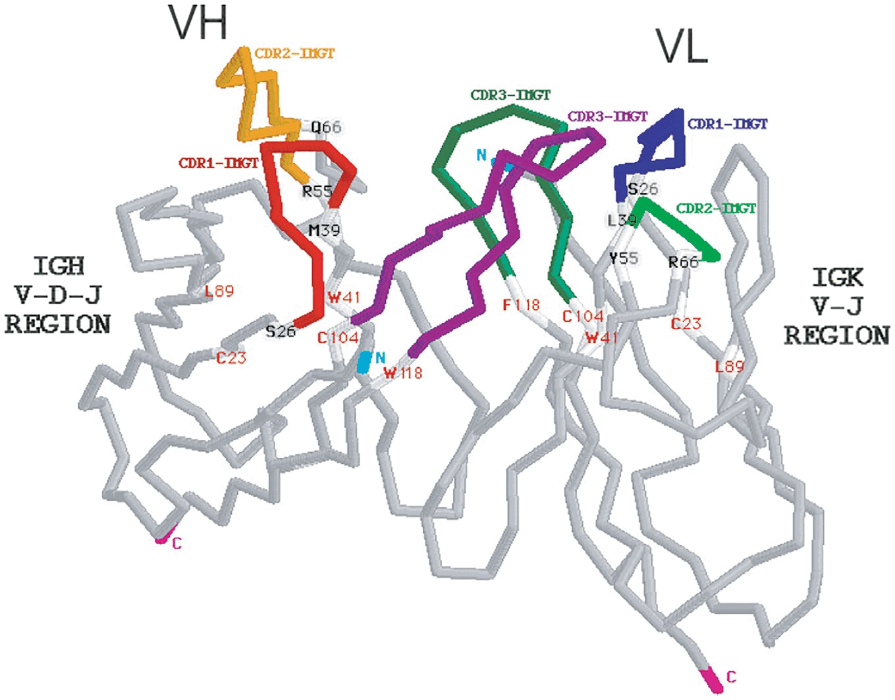

그림 1 면역글로불린(IG) 또는 항체의 짝지어진 가변 VH 및 VL 도메인 [48]. VH와 VL 도메인은 각각 IGH V–D–J-REGION과 IGK(여기서는) 또는 IGL V–J-REGION에 의해 암호화되며, 이는 재배열된 V, D, J 유전자의 유형을 나타낸다 [2, 3]. 골격 영역은 회색으로 표시했다. 초가변 루프 또는 상보성 결정 영역 CDR1-IMGT, CDR2-IMGT, CDR3-IMGT는 VH의 경우 각각 빨강, 주황, 보라로, VL의 경우 각각 파랑, 초록, 청록으로 표시했다 [48]. VH와 VL의 여섯 루프가 항원 인식 및 결합 부위를 구성한다. 고도로 보존된 아미노산은 V-DOMAIN의 IMGT 고유 번호 체계 [52]에 따른 위치와 함께 빨간색으로 표시했다: VH의 C23(1st-CYS), W41(CONSERVED-TRP), L89(보존된 소수성 아미노산), C104(2nd-CYS 104), W118(J-TRP), 그리고 VL의 F118(J-PHE). 이때 104와 118은 CDR3-IMGT의 앵커 위치다. CDR1-IMGT의 앵커 위치는 26과 39이고, CDR2-IMGT는 55와 66이다(검은색으로 표기)(M.-P. Lefranc와 G. Lefranc, LIGM, IMGT® 창설자 겸 저자, https://www.imgt.org의 허가를 받아 사용).

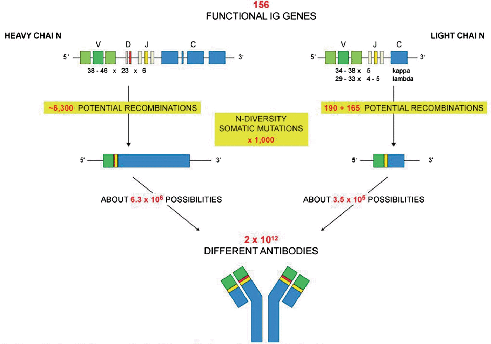

그림 2 면역글로불린(IG) 또는 항체의 분자 합성과 그 다양성의 기원 [48]. 유전자 번호는 인간(*Homo sapiens*) IGH, IGK, IGL 좌위에서 가져왔다. 적응 면역 반응의 항원 수용체 다양성을 만들어 내는 분자 기전으로는 조합적 다양성(V–D–J 재배열), 접합부 다양성(N-다양성 포함), 체세포 과돌연변이(SHM), 중쇄와 경쇄의 짝지음이 있다. B 세포에서 DNA 수준으로 일어나는 이 모든 다양성 기전을 종합하면 중쇄는 약 6.3 × 106가지, 경쇄는 약 3.5 × 105가지의 조합이 가능하며, 하나의 중쇄가 하나의 경쇄와 짝을 이루면(항체는 동일한 중쇄와 경쇄 두 쌍으로 이루어진다) 2 × 1012개의 서로 다른 항체라는 잠재적 레퍼토리가 만들어진다 [48]. IG 또는 항체의 클래스나 서브클래스에 따라 달라지는 두 개의 H–L 간 이황화 결합과 H–H 간 이황화 결합은 표시하지 않았다. H쇄 VH 도메인(V–D–J 영역)과 L쇄 VL 도메인(V–J 영역)의 재배열에 관여하는 유전자 영역을 강조했다: V 영역(초록), D 영역, 더 정확히는 (N–D) 영역(빨강), J 영역(노랑)이며, C 유전자가 암호화하는 C 영역은 파랑이다 [48](M.-P. Lefranc와 G. Lefranc, LIGM, IMGT® 창설자 겸 저자, https://www.imgt.org의 허가를 받아 사용).

여기서 TdT(DNTT, DNA 뉴클레오티딜렉소트랜스퍼레이스)는 접합부 N-다양성 영역을 만들어 내며, (iii) IG의 경우 B 세포 분화 과정 후반에 체세포 과돌연변이(SHM)와 클래스 또는 서브클래스 전환이 일어난다 [2, 3] (그림 2).

### 2  IMGT® 유전자 및 대립유전자 명명법

1989년 6월 HGM10에서 *Homo sapiens* TRG 유전자가 승인된 것이 IMGT®와, 면역유전학과 생물정보학의 경계에 자리한 새로운 과학인 면역정보학의 탄생을 알린 첫 번째 돌파구다 [2]. 실제로 이때 처음으로 면역글로불린(IG) 또는 항체와 T 세포 수용체(TR)의 가변(V), 다양성(D), 결합(J), 불변(C) 유전자가 통상적인 유전자와 마찬가지로 공식적인 "유전자"로 인정되었다 [2]. 이 중대한 돌파구 덕분에 복잡하고 고도로 다양한 적응 면역 반응의 IG 및 TR 유전자와 대립유전자에 표준화된 유전자 이름을 부여하고 [3–30], 이를 게놈 데이터베이스와 도구에서 관리할 수 있게 되었다. 공식 IMGT 유전자 명명법 [3–8]은 1999년 인간게놈기구(HUGO) 명명위원회(HGNC)의 국제적 승인을 받았고 [31, 32], IUIS 명명위원회의 지지를 받았다 [33, 34] (그림 3) (see Note 2).

IMGT IG 및 TR 유전자 이름은 게놈 프로젝트의 공식 기준이며, 따라서 IMGT/GENE-DB [35], Genome Database(GDB) [36], 미국 국립생물공학정보센터(NCBI)의 LocusLink [37], 이 데이터베이스(현재는 "Gene"으로 명명)가 LocusLink를 대체했을 때의 NCBI Entrez Gene [38], NCBI Map Viewer, 유럽생물정보학연구소(EBI)의 Ensembl [39], 영국 웰컴트러스트 생어연구소의 Vertebrate Genome Annotation(Vega) Browser [40]에 등록되었다. 인간 IG 및 TR 불변 유전자(예: *Homo sapiens* IGHM, IGHG1, IGHG2)의 아미노산 서열은 2008년 UniProt에 제공되었고, 인간 IG 가변 유전자의 서열은 IMGT/HGNC 유전자 정의(예: *Homo sapiens* IGHV1-2 immunoglobulin heavy variable 1–2)와 함께 2016년에 제공되었다 [41]. HGNC, NCBI Gene, Ensembl, UniProt은 IMGT/GENE-DB로 직접 연결된다 [35]. IMGT 인간 IG 및 TR 유전자는 NCBO BioPortal의 IMGT-ONTOLOGY와, 같은 사이트의 HUGO 온톨로지 및 미국 국립암연구소(NCI) 메타시소러스에도 통합되었다. 2008년 이래 IMGT 유전자 및 대립유전자 이름은 WHO INN 프로그램의 단일클론항체(mAb) 정의에 사용되었고 [42–44], 해당 아미노산 서열은 IMGT 구조 데이터베이스인 IMGT/2Dstructure-DB와 IMGT/3Dstructure-DB에 등록되었다 [45–47].

IG 명명법의 한 예로, 표 1은 기능성 *Homo sapiens* 면역글로불린 IGHV, IGKV, IGLV 유전자 이름과 CDR-IMGT 길이, 유전자당 대립유전자 수, 유전자 복제수 변이(copy number variation, CNV), 좌위 유전자 순서를 보여 준다 [3, 48, 49].


### 3  IMGT 고유 번호 체계와 IMGT 콜리에 드 페를

면역정보학의 두 번째 돌파구는 IMGT 고유 번호 체계(IMGT unique numbering) [50–57]이다. 이는 번호 매기기(numerotation) [55–57]의 핵심 개념이다. IMGT 고유 번호 체계 [50–57]는 1997년 V 도메인용으로 [50–52], 2005년 C 도메인 [53]과 G 도메인 [54]용으로 처음 확립되었으며, 뉴클레오타이드(코돈) 서열과 아미노산 서열 [3, 4], 2D 구조와 3D 구조에 모두 적용된다. 이 체계 덕분에 면역정보학과 IMGT 정보 시스템 [58–63] 안에서, 항체 공학과 인간화 [64–75]에서, IMGT 데이터베이스 [35, 45–47, 76–78]와 IMGT 도구 [2, 46, 79–81], 그리고 IMGT 웹 자원(대립유전자 정렬 [3, 4], 단백질 표시 [3, 4, 15, 22, 48], IMGT 콜리에 드 페를 [82–88]) 사이에서 서열과 3D 구조 간의 간극을 메울 수 있다. IMGT 고유 번호 체계는 이제 가변(V) 도메인 [52, 55–57], 불변(C) 도메인 [53, 55–57], 홈(G) 도메인 [54–57]을 기술하는 표준이 되었다(참고(Note) 3 참조).

#### 3.1  IMGT 고유

번호 체계

3.1.1  번호 매기기의 개념

IMGT 고유 번호 체계는 V 도메인을 기술하는 표준이다 [52, 55–57] (표 2).

3.1.2  V 도메인 기술을 위한 IMGT 고유 번호 체계

V 도메인용 IMGT 고유 번호 체계는 CDR-IMGT 길이에 대한 표준이다 [52]. 표준화된 CDR-IMGT 번호와 길이 [52]가 기존의 다른 번호 체계 [89–92]와 어떻게 대응하는지는 IMGT Scientific chart > Correspondence between V numberings https://www.imgt.org/IMGTScientificChart/Numbering/IMGTcorrespondence.html (2025년 3월 6일 접속) > IGHV 및 VH, > IGKV 및 V-KAPPA, > IGLV 및 에 자세히 나와 있다.

3.1.3  CDR-IMGT 길이를 위한 IMGT 고유 번호 체계

표 2
V 도메인의 가닥과 루프

IMGT 위치와 길이는 V 도메인(V-DOMAIN 및 V-LIKE-DOMAIN)용 IMGT 고유 번호 체계에 근거한다 [52].

| V 도메인의 가닥과 루프^a^ | IMGT 위치 [52] | 길이^b^ | V-DOMAIN FR-IMGT 및 CDR-IMGT^d^ | 특징적 잔기@위치^c^ |
|---|---|---|---|---|
| A-가닥 | 1–15 | 15 (위치 10에 갭이 있으면 14) | FR1-IMGT |  |
| B-가닥 | 16–26 | 11 |  | 1st-CYS 23 |
| BC-루프 | 27–38 | 12 (또는 그 이하) | CDR1-IMGT |  |
| C-가닥 | 39–46 | 8 | FR2-IMGT | CONSERVED-TRP 41 |
| C′-가닥 | 47–55 | 9 | FR2-IMGT |  |
| C′C″-루프 | 56–65 | 10 (또는 그 이하) | CDR2-IMGT |  |
| C″-가닥 | 66–74 | 9 (위치 73에 갭이 있으면 8) | FR3-IMGT |  |
| D-가닥 | 75–84 | 10 (위치 81, 82에 갭이 있으면 8) | FR3-IMGT |  |
| E-가닥 | 85–96 | 12 | FR3-IMGT | hydrophobic 89 |
| F-가닥 | 97–104 | 8 | FR3-IMGT | 2nd-CYS 104 |
| FG-루프 | 105–117 | 13 (또는 그 이하, 또는 그 이상) | CDR3-IMGT |  |
| G-가닥 | 118–128 | 11 (또는 10) | FR4-IMGT | V-DOMAIN J-PHE 118 또는 J-TRP 118^d^ |

^a^ IMGT® 레이블(기술의 개념)은 대문자로 쓴다.
^b^ 아미노산(또는 코돈)의 수.
^c^ 잔기@위치(Residue@Position)는 IMGT® 번호 매기기 개념으로, IMGT 고유 번호 체계에 근거하여 특정 잔기(또는 보존적 성질의 아미노산 부류)의 위치에 번호를 부여한다.
^d^ IG 및 TR V-DOMAIN의 레이블에서 FR4-IMGT(G-가닥)는 J-REGION의 C-말단 부분에 해당하며, 위치 118–121의 정규 모티프 F/W–G–X–G(J-MOTIF) 시작점인 J-PHE 또는 J-TRP 118에 의해 5′ 쪽이 경계지어진다.

V-LAMBDA. 사람과 마우스 IG의 CDR1-IMGT 및 CDR2-IMGT 길이 [3, 45–47]와 정규 구조(canonical structure) [90–92] 간 대응 관계 링크는 IMGT Index > Canonical structures CDR1-IMGT https://www.imgt.org/IMGTrepertoire/2D-3Dstruct/FClength/canonCDR1IG.html (2025년 3월 6일 접속), CDR2-IMGT https://www.imgt.org/IMGTrepertoire/2D-3Dstruct/FClength/canonCDR2IG.html (2025년 3월 6일 접속)에서 볼 수 있다. CDR-IMGT를 규정할 때는 정규 구조 대신 CDR-IMGT 길이를 사용한다. 실제로 CDR-IMGT 길이를 이용하면 3D 구조가 없더라도 서열과 구조를 비교 분석할 수 있다(참고(Note) 4 참조). 표준화된 CDR-IMGT와 FR-IMGT는 WHO INN 프로그램 [42–44]의 승인을 받았으며, 이 프로그램은 INN mAb 신청 시 CDR-IMGT 길이를 요구한다. 세 CDR-IMGT의 길이는 대괄호 안에 아미노산 수를 점으로 구분하여 표시한다. 예를 들어 [8.8.13]과 같다.

IMGT 고유 번호 체계는 C 도메인을 기술하는 표준이다 [53, 55–57] (표 3).

3.1.4  C 도메인 기술을 위한 IMGT 고유 번호 체계

IMGT 고유 번호 체계는 G 도메인을 기술하는 표준이다 [54–57].

3.1.5  G 도메인 기술을 위한 IMGT 고유 번호 체계

IMGT 콜리에 드 페를 [82–88]은 IMGT가 정의한 도메인(예: V, C, G)을 그래픽 2D로 표현한 것으로 [87], IMGT 고유 번호 체계 [50–57]에 근거하며 서열과 3D 구조 사이의 간극을 메운다. 따라서 V 및 C 도메인용 IMGT 고유 번호 체계에서는 V 도메인(FR-IMGT)(표 2)과 C 도메인(표 3)의 골격 영역(참고(Note) 5 참조)에서 보존된 아미노산이 항상 같은 번호를 갖는다. 수용체 종류(IG, TR 또는 기타 IgSF)와 무관하고, 사슬 종류(IG 중쇄, 경쇄 카파, 람다; TR 알파, 베타, 감마, 델타)와 무관하며, 도메인(V 또는 C)과 무관하고, 유래 종과도 무관하다. 예를 들어 시스테인 23(B-가닥), 트립토판 41(C-가닥), 소수성 아미노산 89(E-가닥), 시스테인 104(F-가닥)가 그렇다(그림 1).

#### 3.2  IMGT 콜리에 드

페를

모타비주맙(motavizumab) 항체 VH 및 CH1 도메인의 IMGT 콜리에 드 페를(IMGT/3Dstructure-DB 및 PDB [93] 코드: 3ixt, 참고(Note) 6 참조)을 예로 들었다(그림 4).

IMGT 콜리에 드 페를에서는 아미노산을 한 글자 약어로 표시한다(참고(Note) 7 참조). FR-IMGT에서 소수성 아미노산(양의 값을 갖는 수화 지수)과 트립토판(W)이 특정 위치에서 분석 서열의 50% 이상에 나타나면 파란색 배경으로 표시한다. 앵커 위치는 사각형으로 나타낸다(참고(Note) 8 참조). V-DOMAIN의 CDR-IMGT는 IMGT 색상 메뉴에 따라 채색한다(참고(Note) 9 참조). IMGT 콜리에

표 3
C 도메인의 가닥, 턴, 루프

IMGT 위치와 길이는 C 도메인(C-DOMAIN 및 C-LIKE-DOMAIN)용 IMGT 고유 번호 체계에 근거한다 [53].

| C 도메인의 가닥, 턴, 루프^a^ | IMGT 위치 | 길이^b^ | 특징적 잔기@위치^c^ |
|---|---|---|---|
| A-가닥 | 1–15 | 15 (위치 10에 갭이 있으면 14) |  |
| AB-턴 | 15.1–15.3 | 0–3 |  |
| B-가닥 | 16–26 | 11 | 1st-CYS 23 |
| BC-루프 | 27–38 (27–31, 34–38) | 10 (또는 그 이하) |  |
| C-가닥 | 39–45 | 7 | CONSERVED-TRP 41 |
| CD-가닥 | 45.1–45.9 | 0–9 |  |
| D-가닥 | 77–84 | 8 (위치 82에 갭이 있으면 7) |  |
| DE-턴 | 84.1–84.7, 85.1–85.7 | 0–14 |  |
| E-가닥 | 85–96 | 12 | hydrophobic 89 |
| EF-턴 | 96.1–96.2 | 0–2 |  |
| F-가닥 | 97–104 | 8 | 2nd-CYS 104 |
| FG-루프 | 105–117 | 13 (또는 그 이하, 또는 그 이상) |  |
| G-가닥 | 118–128 | 11 (또는 그 이하) |  |

^a^ IMGT® 레이블(기술의 개념)은 대문자로 쓴다.
^b^ 아미노산(또는 코돈) 수 기준.
^c^ 잔기@위치(Residue@Position)는 IMGT® 번호 매기기 개념으로, IMGT 고유 번호 체계에 근거하여 특정 잔기(또는 보존적 성질의 아미노산 부류)의 위치에 번호를 부여한다.

드 페를은 3D 구조에 더 가까운 그래픽 표현을 얻고, mAb가 결정화된 경우 수소 결합까지 보여주기 위해 두 개의 층으로 표시할 수 있다 [45–47] (그림 4).

IMGT 콜리에 드 페를은 생산적으로 재배열된 서열 2474개의 V-REGION(1360개 IGHV, 585개 IGKV, 529개 IGLV)에서 골격 아미노산 위치의 아미노산 통계 프로파일을 시각화하는 데 사용되었다. 이들 서열은 IMGT 고유 번호 체계에 따라 번호가 매겨졌다 [83]. 두 가지 통계 기법(대응 분석과 계층적 분류)을 사용하여 FR1-, FR2-, FR3-IMGT의 골격 위치 237개(IGHV 80개, IGKV 79개, IGLV 78개)를 20가지 일반 아미노산의 세 가지 성질(수화도, 부피, 화학적 특성)에 대해 분석했다 [83]. IMGT 콜리에 드 페를 통계 프로파일을 보면, 수화도·부피·화학적 특성 세 성질 모두에서 IGHV와 IGKV + IGLV에 공통으로 보존된 위치가 열네 개다. 21, 89, 100(지방족), 23 및 104(황), 102 및 103(Y), 41(W), 44(아마이드), 46(P), 47(G), 75(염기성), 83(하이드록실), 98(산성)이 그것이다. 다섯 위치는 두 성질(수화도와 화학적 특성)에서 보존되지만 부피에서는 차이(위치 77) 또는 더 큰 가변성(19, 22, 77, 79, 94)을 보인다 [83]. 서른 위치는 세 성질 모두에서 IGKV와 IGLV에 공통으로 보존되며, 다른 열한 위치는 두 성질(수화도와 화학적 특성)에서 보존된다. 일곱 위치는 IGHV/IGKV + IGLV 영역 간의 특정 차이를 규정한다. 8(G/P), 12(지방족/하이드록실), 42(–/P), 43(염기성/아마이드), 50(–/P), 52(W/지방족), 78(–/G)이다. 네 위치는 IGKV/IGLV 영역 간의 특정 차이를 규정한다. 7(하이드록실/P), 24(염기성/하이드록실), 86(산성/–), 87(F/지방족)이다 [83].

IMGT 콜리에 드 페를의 특정 위치에 있는 아미노산의 물리화학적 성질과 통계 프로파일 분석은 종 간 IG 및 TR 유전체 레퍼토리를 비교 연구하는 데 이용할 수 있다.

IMGT 콜리에 드 페를은 항체 공학과 항체 인간화, 그리고 치료용 단일클론항체(mAb)의 잠재적 면역원성 평가에 사용된다 [94]. 이 정보는 특히 다음과 같은 경우에 유용하다.

1.	CDR 이식(grafting)에 기반한 항체 인간화 설계에서 이식할 CDR1-IMGT, CDR2-IMGT, CDR3-IMGT를 정확히 규정할 때 [58–75].

2.	항원과의 접촉에 관여할 수 있는 CDR-IMGT 루프의 아미노산을 찾아낼 때 [46, 47, 75, 80, 81].

3.	IMGT/2Dstructure-DB에서 보여주듯이, 3D 구조가 없어도 아미노산 서열을 구조적으로 분석할 수 있는 가능성을 제공할 때. 항체 인간화에서 중요한 것은 CDR2-IMGT 및 CDR3-IMGT 위치와 각각 수소 결합을 형성하는 두 FR-IMGT 위치 39와 40이다. 즉 앵커 39는 CDR2-IMGT 56(VH) 또는 57(VL)과, 위치 40은 CDR3-IMGT 105(VH와 VL 모두)와 수소 결합을 한다. 이 위치들은 결국 원래 항체의 잔기를 유지해야 할 수도 있다 [48].

4.	결정화된 V 도메인과 C 도메인에서 수소 결합을 표시한 사례(IMGT/3Dstructure-DB의 두 층 IMGT 콜리에 드 페를 [45–47])처럼, 선형 아미노산 서열과 3D 구조 사이의 간극을 메울 때.

5.	다형성 아미노산(동종이형, allotype) [94–100]과, 치료용 항체의 이펙터 성질·반감기·구조를 위한 Fc 공학 변이체 [101, 102]를 찾아낼 때.

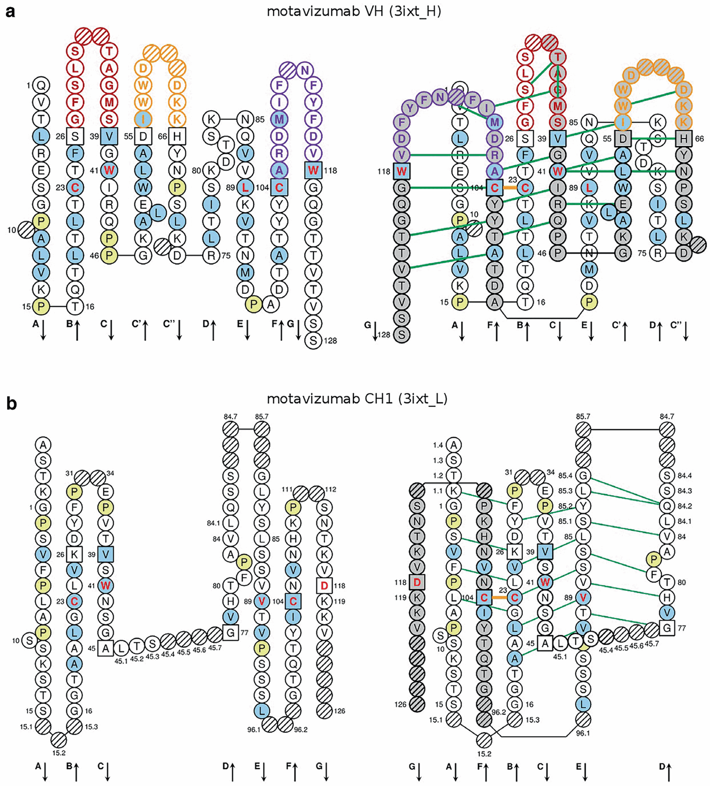

그림 4 V-DOMAIN 및 C-DOMAIN의 IMGT 콜리에 드 페를 [55, 56, 87, 88]. (a) V-DOMAIN의 IMGT 콜리에 드 페를. (b) C-DOMAIN의 IMGT 콜리에 드 페를. IMGT 콜리에 드 페를은 한 층(왼쪽)과 두 층 및 수소 결합(오른쪽)으로 표시했다. 모타비주맙 항체(3ixt_H)의 VH 및 CH1 도메인을 예로 들었다(참고(Note) 6 참조). 아미노산은 한 글자 약어로 표시했다(참고(Note) 7 참조). 앵커 위치는 사각형으로 표시했다(참고(Note) 8 참조). 소수성 아미노산(양의 수화 지수: I, V, L, F, C, M, A)과 트립토판(W)이 분석 서열의 50% 이상에서 발견되는 위치는 파란색으로 표시했다. V-DOMAIN의 CDR1-IMGT, CDR2-IMGT, CDR3-IMGT(각각 BC, C'C″, FG 루프에 해당)는 각각 빨간색, 주황색, 보라색으로 채색했다(IMGT 색상 메뉴)(참고(Note) 9 참조). CDR-IMGT 길이는 [10.7.12]이다. VH와 CH1의 빗금 친 원은 각각 V 도메인 [52]과 C 도메인 [53]용 IMGT 고유 번호 체계에 따라 비어 있는 위치를 나타낸다. 화살표는 3D 구조에서 베타 가닥의 방향과 명칭을 가리킨다. 수소 결합이 있는 두 층 IMGT 콜리에 드 페를은 IMGT/3Dstructure-DB(https://www.imgt.org/3Dstructure-DB/)에 통합된 IMGT/Collier-de-Perles 도구 [86]로 생성했다 [45–47]. 수소 결합(초록색 선)과 이황화 다리(C23과 C104 사이의 주황색 선)는 실험 구조 데이터로부터 자동으로 추가했다. 이 표현 덕분에 3ixt 구조 [93]의 IGHG1 CH1에 K120이 존재하는 것은 오류임을 확인할 수 있었다. 모타비주맙은 IGHG1*03(INN 8693, R57)이므로 아르기닌(Arg) R120이어야 한다. (M.-P. Lefranc와 G. Lefranc, LIGM, IMGT®의 창립자이자 저자, 국제 ImMunoGeneTics 정보 시스템®, https://www.imgt.org의 허가를 받아 사용)

### 4  IMGT-ONTOLOGY와 IMGT Scientific Chart 규칙

면역정보학의 두 가지 획기적 성과, 즉 IG와 TR의 IMGT 유전자 및 대립유전자
명명법[2–8]과 IMGT Collier de Perles와 결합한 V, C, G 도메인의 IMGT 고유
번호 체계[50–54]는 각각 분류 개념(concept of classification)과 번호 부여
개념(concept of numerotation)이며, 둘 다 IMGT-ONTOLOGY[67, 103–116]의
일부이다. IMGT-ONTOLOGY는 일곱 가지 공리, 곧 IDENTIFICATION, DESCRIPTION,
CLASSIFICATION, NUMEROTATION, LOCALIZATION, ORIENTATION, OBTENTION으로
이루어진다(Fig. 5). 이 공리들은 모든 객체, 모든 과정, 모든 관계가 식별되고
기술되고 분류되고 번호가 부여되고 위치가 정해지고 방향이 정해져야 하며,
그것이 얻어지는 방식 또한 규정될 수 있다고 전제한다[109, 110].

IMGT-ONTOLOGY의 공리와 개념은 IMGT® 데이터베이스, 도구, 웹 자원에서 쓰이는
IMGT Scientific chart 규칙 https://www.imgt.org/IMGTScientificChart/ 을
만들어냈다. IMGT 전문가 검증 데이터 개념의 예는 Table 4에 정리되어 있다.

식별(identification) 개념[111]은 325개가 넘는 IMGT® 표준화 키워드(서열용
189개, 3D 구조용 137개)를 정의하는 토대가 되었다. 표준화 키워드는 주석
과정에서 부여되는 통제 어휘(controlled vocabulary)를 뜻하며, IMGT
데이터베이스를 검색하고 서열과 3D 구조를 추출할 때 표준화된 검색 기준을
제공한다. 이 키워드들은 2010년 미국 국립 생의학 온톨로지 센터(NCBO)의
BioPortal에 등록되었다(https://bioportal.bioontology.org/ontologies/1491).
키워드는 예컨대 분자 유형, 유전자 유형, 배열(configuration) 유형, 기능
유형을 규정한다.

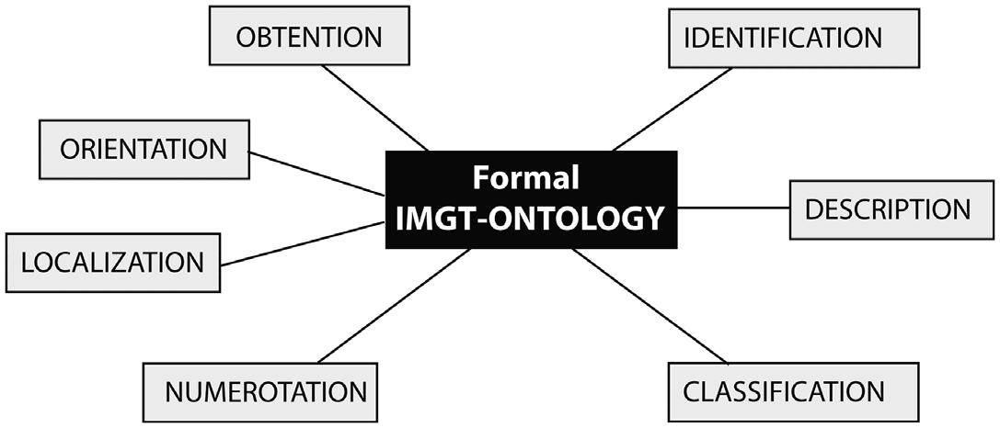

Fig. 5 정식 IMGT-ONTOLOGY 공리[67, 110]. 일곱 가지 공리인 IDENTIFICATION,
DESCRIPTION, CLASSIFICATION, NUMEROTATION, LOCALIZATION, ORIENTATION,
OBTENTION은 식별, 기술, 분류, 번호 부여, 위치 설정, 방향 설정, 획득의
개념을 낳았고, 이 개념들은 IMGT Scientific chart 규칙(예: IMGT 표준화
키워드, IMGT 표준화 레이블, IMGT 유전자 및 대립유전자 명명법, V, C, G
도메인의 IMGT 고유 번호 체계)을 세우는 데 필수적이었다(M.-P. Lefranc과
G. Lefranc, LIGM, IMGT®의 창립자 및 저자, 국제 ImMunoGeneTics 정보
시스템®, https://www.imgt.org의 허가를 받아 사용).

Table 4
IMGT-ONTOLOGY 개념, IMGT Scientific chart 규칙, 그리고 IMGT 전문가 검증 데이터
개념의 예

IMGT 전문가 검증
데이터 개념의
예

IMGT-ONTOLOGY
공리

IMGT-ONTOLOGY
개념

IMGT Scientific chart 규칙

분자 유형, 수용체

IDENTIFICATION

개념

IMGT 표준화

유형, 사슬 유형, 유전자
유형, 배열
유형, 분자 실체
유형, 기능

공리 [111]

식별
[111]

키워드 [3, 4] (예:
클론타입, 파라토프,
에피토프, 변이체, Fc
수용체, FcR)

코어 (V-, D-, J-, C-)
프로토타입
서열용 레이블
2D 및 3D 구조용 레이블

DESCRIPTION

기술
개념 [113]

IMGT 표준화 레이블

공리 [113]

기술 [113]

및 주석 [3, 4]
(예: CDR-IMGT,
FR-IMGT, 항체
기술) 프로토타입
[3, 4]

구조

유전자 표 [3, 4]
대립유전자 정렬

IMGT 표준화 IG 및

CLASSIFICATION

개념

TR 유전자 명명법
(그룹, 서브그룹, 유전자,
대립유전자) [3, 4]

공리 [112]

분류
(그룹, 서브그룹,
유전자, 대립유전자) [112]

[3, 4]
대립유전자 표
IMGT 참조

서열 디렉터리
(모든 유악 척추동물 종의
IG 및 TR)

IMGT 고유 번호 체계

NUMEROTATION

개념

단백질 디스플레이 [3, 4,

V- 및 V-LIKE-
DOMAIN [52], C- 및
C-LIKE-DOMAIN
[53], G- 및 G-LIKE-
DOMAIN [54], IMGT
Colliers de Perles
[82–88]

공리 [50–54,
82–88]

번호 부여
(IMGT 고유 번호
체계 [50–
54], IMGT Collier
de Perles) [82–88]

15, 22]
IMGT Colliers de

Perles(V, C 및 G
도메인용) [82–88]
FR-IMGT 및 CDR-

IMGT 경계 설정

5′ 경계 및 3′ 경계 카피
수 변이(CNV)
[3, 4]

LOCALIZATION
개념

염색체상

위치

위치 설정 [3, 4]
유전자좌 표현

[3, 4]
표준화 키워드

ORIENTATION
개념

게놈 인스턴스의

염색체

방향

상호 방향(즉, 동원체성,
텔로미어성, 5′, 3′) [3, 4]

방향 설정 [2–4]
유전자좌 방향 [2–4]
유전자 방향 [2–4]
DNA 가닥 방향

[2–4]
도메인 베타 가닥

방향

OBTENTION
개념

표준화된 기원
표준화된 방법론

참고문헌 [3, 4]

IMGT-ONTOLOGY에서 "Molecule_EntityType" 개념(IDENTIFICATION 공리)은
식별의 "MoleculeType", "GeneType", "ConfigurationType" 개념으로 정의되며,
그 속성은 "Functionality"와 "StructureType" 개념(IDENTIFICATION
공리)에서 규정된다[110, 111](Fig. 6). 분자 유형은 gDNA, mRNA, cDNA 또는
단백질이다(뉴클레오타이드 서열 데이터베이스에서는 "cDNA" 대신 "mRNA"를
쓴다는 점에 유의해야 한다). 유전자 유형은 통상(일반) 유전자와, IG 및 TR의
경우 가변(V), 다양성(D), 결합(J), 불변(C) 유형으로 나뉜다. 배열 유형은
통상 유전자와 IG 및 TR의 C 유전자에서는 정의되지 않으며, IG 및 TR의 재배열
유전자(V, D, J 유전자)에서는 생식계열(germline)이나 재배열(또는 부분
재배열, 도시하지 않음) 가운데 하나이다. "Molecule_EntityType"에는 열아홉
개의 실체(온톨로지의 리프 개념)가 포함된다. 그중 "gene", "nt-sequence",

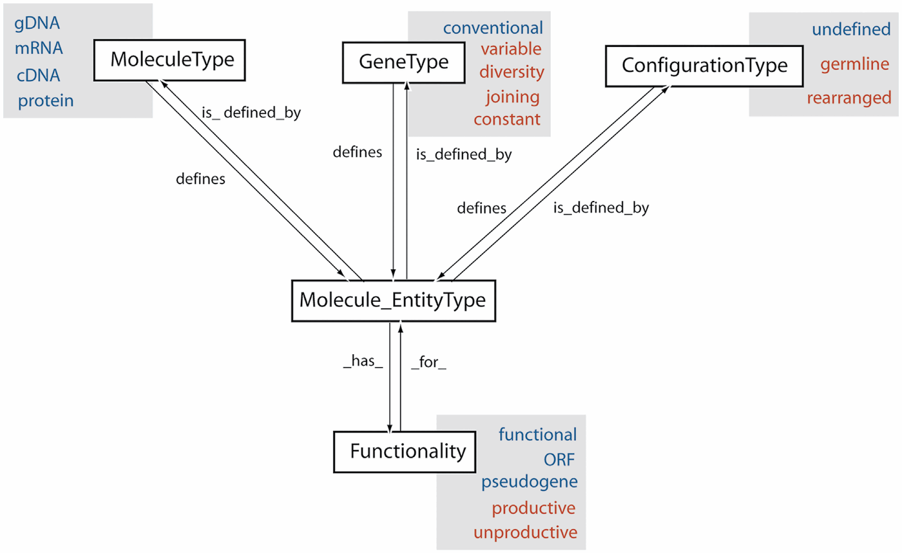

Fig. 6 식별의 "Molecule_EntityType" 개념(IDENTIFICATION)[111].
"Molecule_EntityType"은 열아홉 개의 실체(온톨로지의 리프 개념)를
포함하며, 이들은 세 가지 일반 실체(gene, nt-sequence, AA-sequence)와
IG 및 TR에 특이적인 열여섯 개의 실체(예: V-gene, D-gene, J-gene, C-gene,
L–V–D–J–C-sequence, L–V–J–C-sequence)를 식별한다[111].
"Molecule_EntityType" 개념은 식별 개념인 "MoleculeType"(gDNA, mRNA, in
vitro cDNA, 단백질), "GeneType"(통상, 가변, 다양성, 결합, 불변),
"ConfigurationType"(정의되지 않음, 생식계열, 재배열, (도시하지 않음) 부분
재배열)으로 정의되며, "Functionality"(기능성, ORF, 슈도유전자, 생산성,
비생산성)와 (도시하지 않은) "StructureType"(예: 정규형, 키메라형,
인간화형) 개념에서 식별되는 속성을 지닌다. 화살표는 상호 관계
"is_defined_by"와 "defines", "_has_"와 "_for_"를 나타낸다. IMGT 전문가
검증 데이터 개념은 일반 개념이면 파란색, IG 및 TR에 특이적이면 빨간색으로
표기했다(M.-P. Lefranc과 G. Lefranc, LIGM, IMGT®의 창립자 및 저자, 국제
ImMunoGeneTics 정보 시스템®, https://www.imgt.org의 허가를 받아 사용).

"AA-sequence"는 각각 정의되지 않은 배열의 통상 유전자에서 gDNA, mRNA,
단백질을 식별한다. 이 가운데 열여섯 개는 IG와 TR을 식별할 수 있게 한다.
gDNA용이 여섯 개("V-gene", "D-gene", "J-gene", "C-gene", "V–D–J-gene",
"V–J gene"), mRNA용이면서 in vitro cDNA에도 유효한 것이 두 개("L–V–D–
J–C-sequence", "L–V–J–C-sequence"), 단백질용이 두 개("V–D–J–C-
sequence", "V–J–C sequence"), 그리고 부분 재배열("D–J-gene")이나 불임
전사체("L–V-sequence", "D-sequence", "J-sequence", "J–C-sequence",
"C-sequence")용이 여섯 개이다. 각 "Molecule_EntityType"에는 레이블(대문자
표기)과 함께 실체 기술을 위한 "Molecule_EntityPrototype"(DESCRIPTION
공리)이 대응한다(Fig. 7). Molecule_EntityType과 Molecule_EntityPrototype
리프 개념의 전체 목록은 IMGT Scientific chart > IMGT prototypes tables
(https://www.imgt.org/IMGTScientificChart/SequenceDescription/prototypes.html)
에서 볼 수 있으며(2025년 3월 6일 접속), 그래픽 표현이나 "IMGT prototypes"로
가는 링크가 함께 제공된다.

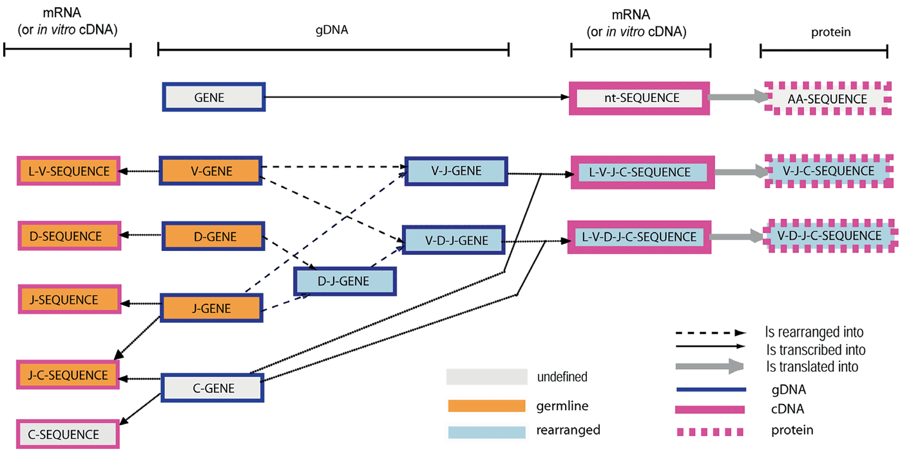

Fig. 7 기술의 "Molecule_EntityPrototype" 개념(DESCRIPTION)[110].
"Molecule_EntityPrototype"은 각 Molecule_EntityType의 기술을 위해
생성된다. 열아홉 개의 실체(온톨로지의 리프 개념)가 정의되어 있다(레이블은
대문자). 이 가운데 "GENE", "nt-SEQUENCE", "AA-SEQUENCE" 세 개는 통상
유전자에 해당한다. 열여섯 개의 실체는 IG와 TR을 기술할 수 있게 한다.
gDNA용 여섯 개는 생식계열("V-GENE", "D-GENE", "J-GENE"), 정의되지 않은
배열("C-GENE"), 재배열("V–D–J-GENE", "V–J-GENE")이고, mRNA 및 in vitro
cDNA용 두 개는 "L–V–D–J–C-SEQUENCE", "L–V–J–C-SEQUENCE", 단백질용 두
개는 "V–D–J–C-SEQUENCE", "V–J–C-SEQUENCE", 부분 재배열용 하나는
"D–J-GENE", 불임 생식계열 전사체용 다섯 개는 예컨대 L–V-SEQUENCE이다(왼쪽
열). IG와 TR의 V, D, J 유전자를 포함하는 열 개의 실체는 생식계열
유전자에서 재배열 유전자로의 이행, 그다음 mRNA로의 전사, 이어서 단백질
서열로의 번역을 보여준다. 여기에는 V-GENE, D-GENE, J-GENE(주황색
배경)이 포함되며, 이들은 V–J-GENE, D–J-GENE, V–D–J-GENE(파란색
배경)으로 재배열되고, C-GENE(정의되지 않은 배열, 배경색 없음)과 함께
L–V–J–C-SEQUENCE와 L–V–D–J–C-SEQUENCE로 전사되며, 번역과 성숙 과정을
거쳐 V–J–C-SEQUENCE와 V–D–J–C-SEQUENCE가 된다(M.-P. Lefranc과
G. Lefranc, LIGM, IMGT®의 창립자 및 저자, 국제 ImMunoGeneTics 정보
시스템®, https://www.imgt.org의 허가를 받아 사용).

기능성은 분자 실체 유형(Fig. 6)과 그에 대응하는 분자 실체
프로토타입(Fig. 7)에 부여된다. 생식계열 V, D, J 유전자(V-gene, D-gene,
J-gene)(Fig. 7의 주황색 배경)와 C 유전자(C-gene), 그리고 통상
유전자(gene)(Fig. 7에서 배경색 없음)의 기능성은 기능성(F), 개방
해독틀(ORF), 슈도유전자(P) 가운데 하나이다. 여기에 대응하는
전사체(mRNA)나 in vitro cDNA(IG 및 TR의 경우 Fig. 7 왼쪽 열)도 같은 F,
ORF, P 기능성을 지닌다. 재배열(또는 부분 재배열)된 V, D, J 유전자를 가진
분자 실체의 기능성은 생산성 또는 비생산성이다(Fig. 7에서 파란색 배경인
실체). 분자 실체에 기능성을 부여하는 규칙은 IMGT Scientific chart > IMGT
functionality(https://www.imgt.org/IMGTScientificChart/SequenceDescription/IMGTfunctionality.html)
에 정의되어 있다(2025년 3월 6일 접속).

수용체의 식별에서는 여러 도식 표현 방식을 함께 고려하여, 서로 다른
데이터베이스(서열, 유전자, 구조)에서 사슬과 도메인의 공통 특징과 고유한
특성을 식별하고, 치료용 항체와 면역 응용용 융합 단백질(FPIA)의 경우 다양한
엔지니어링 형식을 관리한다. 예를 들어 IG 또는 항체는
"Molecule_ReceptorType"의 개념으로 식별된다(Fig. 8).

네 가지 표현은 서로 다르지만, 모두 IG를 네 개의 사슬, 즉 두 개의
IG-Heavy_chains와 두 개의 IG-Light_chains로 이루어진 수용체로 식별하고,
각 사슬이 도메인으로 조직되어 있음을 보여주며, 이를 뉴클레오타이드
영역과 연결해 준다. 따라서 VH와 VL은 각각 V–D–J 영역과 V–J 영역이
암호화하는 V형 도메인이다. CL, CH1, CH2, CH3는 C형 도메인이다. C 유전자
유형은 C-영역(경쇄의 CL, 중쇄의 CH1, 힌지, CH2, CH3, 그리고 도시하지
않았지만 가용성 IG의 CHS, 막형 IG의 연결 영역(CO), 막관통 영역(TM),
세포질 영역(CY))을 암호화한다.

IMGT/2Dstructure-DB와 IMGT/3Dstructure-DB에서 쓰는 레이블은 수용체 수준,
사슬 수준, 도메인 수준에 있다. 고등 척추동물 V 도메인의 레이블은 VH(가변
중쇄), VL(가변 경쇄), V-KAPPA, V-LAMBDA이다. C 도메인의 레이블은
경쇄에서는 C-REGION(C-KAPPA, C-LAMBDA)에, 중쇄에서는 C-REGION의
일부(예: IG-Heavy-Gamma 사슬의 CH1, CH2, CH3 도메인. CH1과 CH2 사이에
힌지 영역이 있고, 가용성 형태의 CH3 C-말단에 CHS가 있다)에 해당한다.

단백질 기술을 표준화하기 위해 20가지 일반 아미노산(AA)을 열한 개의 IMGT
물리화학적 분류로 나누었다[83](https://www.imgt.org/IMGTeducation/Aide-memoire/ > Amino acids)(Fig. 9).

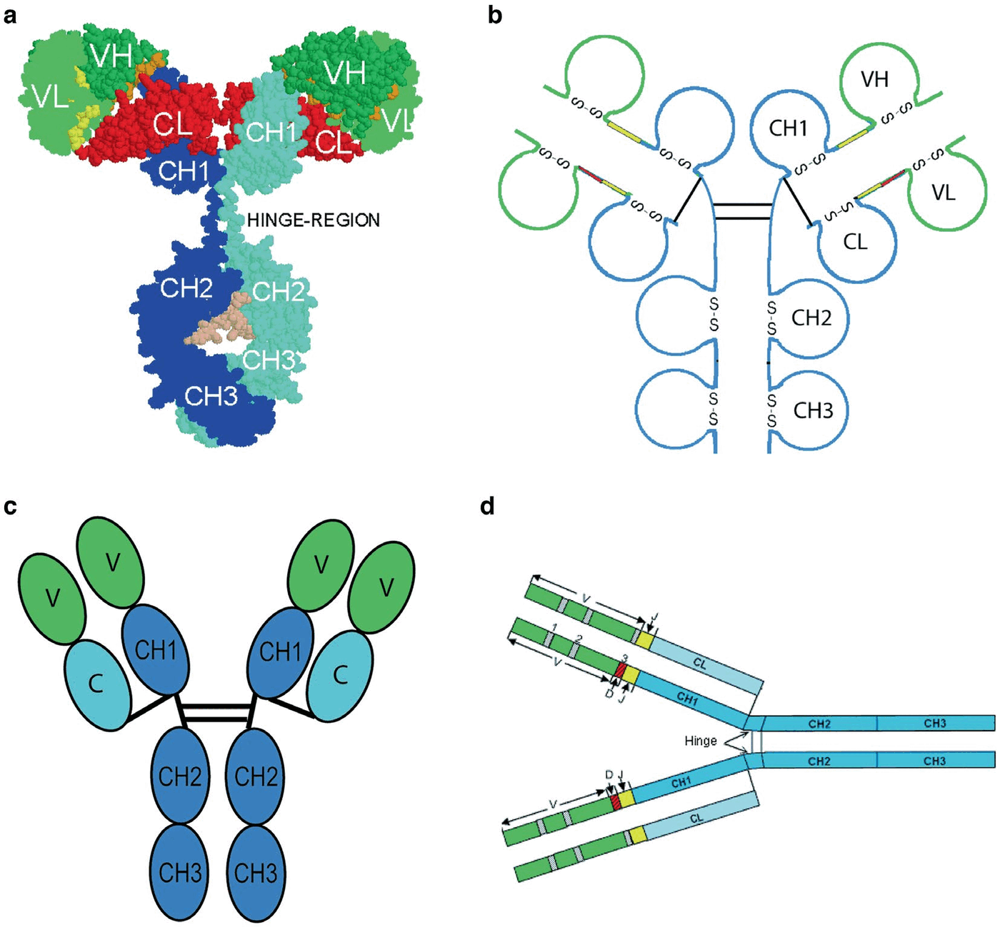

Fig. 8 IG 또는 항체를 "Molecule_ReceptorType"의 실체(온톨로지의 리프
개념)로 식별한 모습. 이 실체는 네 개의 사슬, 즉 두 개의 IG-Heavy-Chain과
두 개의 IG-Light-Chain("ChainType" 개념)으로 이루어진다(IDENTIFICATION)[110]. 네 가지 표현은 서로 다르지만, 모두
IG를 네 개의 사슬로 이루어진 수용체로 식별하고, 각 사슬이
도메인("DomainType" 개념)으로 조직되어 있음을 보여준다. VH와 VL은 각각
V–D–J 영역과 V–J 영역이 암호화하는 V형 도메인이다. CL, CH1, CH2, CH3는
C형 도메인이다. C형 도메인은 불변 영역(IG-Light-Chain의 CL, IG-Heavy-Chain의
CH1, 힌지, CH2, CH3)을 암호화한다. (a) 중쇄(H)의 VH, CH1, HINGE-REGION,
CH2, CH3와 경쇄(L)의 VL, CL에 레이블을 붙인 IG 또는 항체 3D 분자 모델.
(b) 12개의 레이블된 IG 도메인으로 나타낸 IG 또는 항체의 조직(네 개의 V
도메인은 초록색 테두리, 여덟 개의 C 도메인은 파란색 테두리)으로, 각
도메인에는 보존된 도메인 내 이황화 다리(S–S)가 있다. 각 H 사슬은 H–L
다리로 L 사슬과 연결된다. 두 H 사슬은 힌지 수준에서 H–H 이황화
다리(여기서는 두 개)로 연결된다. (c) 12개 도메인을 각각 난형 모듈로
표시한 IMGT IG 또는 항체 표현(VH는 초록색, VL은 연한 초록색, CH1–CH3은
파란색, CL은 연한 파란색). 치료용 항체의 여러 형식을 예시하는 데
사용된다(예: IMGT/mAb-DB). (d) V, D, J, C 유전자 유형이 암호화하는 영역을
선형으로 나타낸 IG 또는 항체. 가변 도메인을 암호화하는 V, D, J 영역을
강조했다. VH는 재배열된 V–D–J 영역이, VL은 재배열된 V–J 영역이
암호화하며, V는 초록색, D는 빨간색, J는 노란색이다. Y자 모양으로 도식화한
이 표현은 IG 또는 항체를 나타낼 때 흔히 쓰인다(M.-P. Lefranc과 G. Lefranc,
LIGM, IMGT®의 창립자 및 저자, 국제 ImMunoGeneTics 정보 시스템®,
https://www.imgt.org의 허가를 받아 사용).

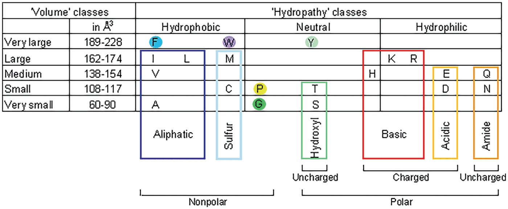

Fig. 9 "hydropathy", "volume", "chemical characteristics" 속성에 따른 20가지
일반 아미노산의 IMGT 분류(IDENTIFICATION). 세 가지 "hydropathy" 분류(소수성,
중성, 친수성), 세제곱옹스트롬(Å3)으로 측정한 다섯 가지 "volume" 분류(매우
작음 [60–90], 작음 [108–117], 중간 [138–154], 큼 [162–174], 매우 큼
[189–228]), 열한 가지 "chemical characteristics" 분류(지방족, 황, 하이드록실,
산성, 아마이드, 염기성, F, W, Y, G, P)가 정의되었다[83]. 소수성
아미노산에는 매우 큰 두 개(F, W), 지방족(I, L, V, A), 황 함유(M, C)가
포함된다. 중성 아미노산에는 Y(매우 큼), P(작음), G(매우 작음), S와
T(전하 없는 하이드록실), H(염기성)가 포함된다. 티로신은 OH가 약산성이고
극성이지만 중성 분류에 속한다. 히스티딘은 약염기성이지만 중성 분류에
속한다[83]. 친수성 아미노산에는 K와 R(전하를 띤 염기성), D와 E(전하를 띤
산성), Q와 N(전하 없는 아마이드)이 포함된다. 열 가지 아미노산은 수소
공여체 및/또는 수용체 원자를 가진 곁사슬을 지녀 극성으로 정의된다.
이들의 곁사슬은 전하를 띠거나(D, E, H, K, R), -NH2기(N, Q) 또는
-OH기(S, T, Y)를 가진 전하 없는 상태이다(https://www.imgt.org/IMGTeducation/Aide-memoire/_UK/aminoacids/charge/ (2025년 3월 4일 접속)(M.-P. Lefranc과 G. Lefranc, LIGM, IMGT®의 창립자 및 저자, 국제 ImMunoGeneTics 정보 시스템®, https://www.imgt.org의 허가를 받아 사용).

### 5  IMGT® 정보 시스템 개요

국제 ImMunoGeneTics 정보 시스템®인 IMGT®[67, 117], https://www.imgt.org는
서열, 게놈, 구조 면역유전학 데이터를 한곳에서 제공한다. 이 데이터에는 IMGT
명명법과 IMGT 고유 번호 체계로 주석이 달려 있으며, 그 바탕에는
IMGT-ONTOLOGY의 개념과 IMGT Scientific chart 규칙이 있다. IMGT®는 서열,
유전자, 구조(2D 및 3D)를 위한 일곱 개의 IMGT 데이터베이스, 서열·유전자·구조
분석을 위한 17개의 대화형 온라인 IMGT 도구(Fig. 10), 그리고 25,000쪽이
넘는 IMGT 웹 자원(이전의 IMGT Marie-Paule 페이지)으로 이루어진다. IMGT는
인간과 다른 척추동물 종의 면역글로불린(IG) 또는 항체, T 세포 수용체(TR),
주조직적합성(MH) 항원과, 척추동물 및 무척추동물의 면역글로불린
상과(IgSF), MH 상과(MhSF), 면역계 관련 단백질(RPI)을 전문으로 하는
고품질 통합 지식 자원이다. 실제로 V, C, G 도메인의 IMGT 고유 번호 체계는
각각 IgSF의 V유사 및 C유사 도메인과 MhSF의 G유사(및 C유사)
도메인[50–54]에 사용된다.

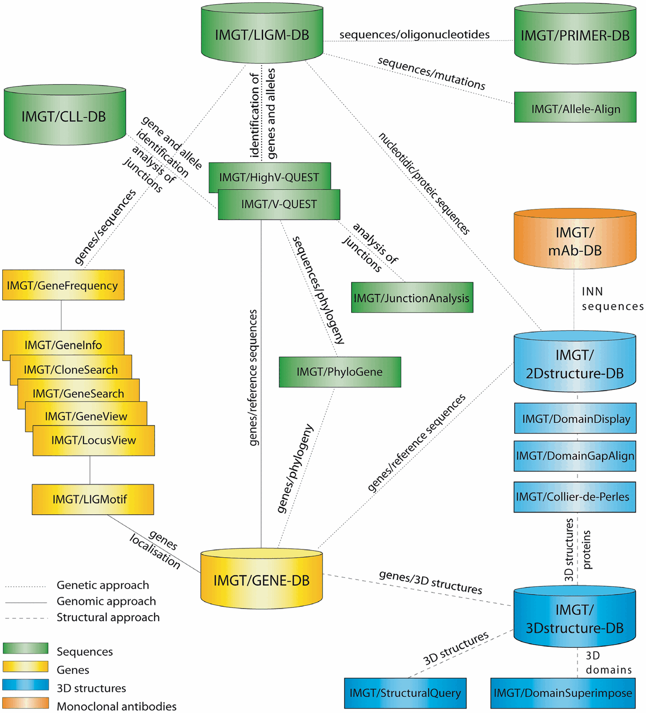

Fig. 10 국제 ImMunoGeneTics 정보 시스템® IMGT®(https://www.imgt.org)[67, 117]. IMGT는 일곱 개의
데이터베이스(원기둥으로 표시), 열일곱 개의 도구(사각형으로 표시), 그리고 여기에
나타내지 않은 IMGT 웹 자원(예: IMGT Repertoire, IMGT Scientific chart)(25,000쪽 이상)과
IMGT의 다른 접속 경로(https://www.imgt.org/home.php)로 이루어진다. 데이터베이스에는
뉴클레오타이드 서열 데이터베이스인 IMGT/LIGM-DB(IMGT/CLL-DB, IMGT/PRIMER-DB 같은
다른 기반과 연결됨), 유전자 데이터베이스 IMGT/GENE-DB, 아미노산 서열 데이터베이스
IMGT/2Dstructure-DB, 구조 데이터베이스 IMGT/3Dstructure-DB가 있다. 각 데이터베이스는
특정 도구와 연결된다. 예컨대 유전자 및 대립유전자 식별을 포함한 뉴클레오타이드 서열
분석용 IMGT/V-QUEST는 접합부 분석용 IMGT/JunctionAnalysis와 scFv 분석을 통합하고,
차세대 염기서열 분석(NGS) 레퍼토리 분석용으로 IMGT/HighV-QUEST가 있다.
IMGT/DomainGapAlign은 도메인 단위 아미노산 서열 분석 도구이다. IMGT/Collier de Perles
도구는 V, C, G의 도메인별 그래픽 표현을 제공한다. 유전학적, 게놈학적, 구조적이라는 세
가지 과학적 접근은 색으로 구분했다. 서열은 초록색, 유전자는 노란색, 2D 및 3D 구조는
파란색이다. IMGT/mAb-DB(주황색으로 표시)는 단일클론항체를 위한 인터페이스로 2010년에
만들어졌다. M.-P. Lefranc과 G. Lefranc, LIGM, IMGT®의 창립자 및 저자, 국제
ImMunoGeneTics 정보 시스템®, https://www.imgt.org의 허가를 받아 사용.

IMGT 웹 자원에는 IMGT Repertoire(IG 및 TR, MH, RPI)
https://www.imgt.org/IMGTrepertoire/[118, 119]가 있다. 이는 특정 웹 페이지의
갱신과 생성, IMGT 데이터베이스와 IMGT 도구 개발에 핵심적인 부분으로,
서열("Proteins and alleles"), 유전자("Locus and genes"), 구조("2D and 3D
structures")에 대한 LIGM 전문가 검증 데이터를 데이터베이스와 도구에
최종 등록하기 전에 제공한다(Table 5).

IMGT 웹 자원(이전의 IMGT Marie-Paule 페이지)에는 IMGT Repertoire(IG 및 TR,
MH 및 RPI) https://www.imgt.org/IMGTrepertoire/ 외에도 IMGT Scientific
chart https://www.imgt.org/IMGTScientificChart/(서열 및 3D 구조 식별과

Table 5
IMGT 데이터베이스, IMGT 도구, IMGT Repertoire(IMGT 웹 자원의 일부)

IMGT Repertoire(IG 및
TR)

IMGT 데이터베이스a
IMGT 도구

"단백질과 대립유전자"
유전자 표,
잠재적 생식계열

서열
IMGT/LIGM-DB [76]
IMGT/MH-DB(EBI에서

IMGT/V-QUEST

[122–127]
IMGT/JunctionAnalysis

호스팅)
IMGT/PRIMER-DB

레퍼토리 [48],
유전자 목록 [48],
대립유전자 정렬 IG

[128, 129]
IMGT/Decryption(내부용)

[120]
IMGT/CLL-DBa [121]

[130]
IMGT/Automat(내부용)

및 TR [3, 4].
대립유전자 표,
CDR-IMGT 길이,
단백질 디스플레이 [3, 4]
동종이형 [99, 100],
동형 [2, 3],
엔지니어링 변이체 [101,

[131, 132]
IMGT/HighV-QUEST

[133–137]
IMGT/StatClonotype [138,

139]
IMGT/Allele-Align
IMGT/PhyloGene [140]
IMGT/DomainDisplay

102],
등.

"유전자좌와 유전자":

유전자
IMGT/

IMGT/LIGMotif [79]
IMGT/LocusView
IMGT/GeneView
IMGT/GeneSearch
IMGT/CloneSearch
IMGT/GeneInfo [141, 142]
IMGT/GeneFrequency

염색체
위치,
유전자좌 표현,

GENE-DB [35]

유전자좌 경계, 유전자좌
기술 [3, 4].
게놈 어셈블리 내

유전자좌, 유전자
순서, CNV [49],
유전자 엑손/인트론
구성과
스플라이싱 부위 [3, 4]
잠재적 생식계열
레퍼토리
명명법 간

대응 관계 [3, 4].

(계속)

Table 5
(계속)

IMGT Repertoire(IG 및
TR)

IMGT 데이터베이스a
IMGT 도구

'2D 및 3D 구조':
Colliers de Perles [3, 4,

IMGT/DomainGapAlign

구조
IMGT/3Dstructure-

[46, 80, 81]
IMGT/DomainDisplay
IMGT/DomainSuperimpose
IMGT/StructuralQuery [45]
IMGT/Collier-de-Perles [86]

DB 및
IMGT/2Dstructure-

82–88]
아미노산 특성에 대한 IMGT

DB [45–47]

분류
[83]
IMGT Colliers de Perles

참조 프로파일 [83]
IMGT 서열 프로파일

[143]
3D 표현
FR-IMGT 및 CDR-

IMGT 길이
[45–47]
가닥, 루프, 나선

길이 [45–47]

형식 구조

치료용

IMGT/mAb-DB [42,

77, 78]
다음으로의 링크

표현

단일클론
항체

IMGT/2Dstructure-DB
다음으로의 링크

IMGT/3Dstructure-DB

aIMGT/CLL-DB[121]는 IMGT/V-QUEST로 분석한 만성 림프구성
백혈병(CLL) 환자의 IG 서열을 담고 있다.

기술, 번호 부여, 명명법, 표현 규칙), IMGT Index(https://www.imgt.org/IMGTindex/)
(FactsBook, IMGT-NC 보고서, IUIS-NC, IMGT-ONTOLOGY 서열 제출,
분류학 …), IMGT Bloc-notes https://www.imgt.org/IMGTbloc-notes/(흥미로운
링크, NCBI Genome, PubMed, 학회 공지, 박사후 연구원 및 채용 정보, 메시지,
검색 엔진 …), IMGT Education https://www.imgt.org/IMGTeducation/(IMGT
Lexique, Aide-mémoire, 튜토리얼, 질의응답, 교육 자료 …), IMGT Posters and
diaporama https://www.imgt.org/IMGTposters/, IMGT 의학 페이지
https://www.imgt.org/IMGTmedical/, IMGT 수의학 페이지
https://www.imgt.org/IMGTveterinary/, IMGT 생명공학 페이지
https://www.imgt.org/IMGTbiotechnology/, IMGT 면역정보학 페이지
https://www.imgt.org/about/immunoinformatics.php가 있다.

### 6  IMGT 데이터베이스

IMGT/GENE-DB[35]는 IG 및 TR 유전자와 대립유전자를 위한 IMGT
데이터베이스이다(40개 종에서 11,825개 유전자, 16,367개 대립유전자,
https://www.imgt.org/genedb/ 2025년 2월 27일 접속). IMGT/GENE-DB

#### 6.1  IMGT 데이터베이스

유전자용: IMGT/
GENE-DB

통계는 종별로 IG 또는 TR 유전자와 대립유전자의 총수를 제공하고, 각 종에
대해 IMGT 그룹별, 기능별(F, ORF, P) 유전자와 대립유전자 수를 제공한다.

IMGT/LIGM-DB[76]는 IG 및 TR의 뉴클레오타이드 서열을 위한 IMGT
데이터베이스이다(368개 종에서 251,566개 항목, https://www.imgt.org/ligmdb/
2025년 2월 27일 접속). 뉴클레오타이드 서열에 부여된 IMGT 표준화
키워드(IDENTIFICATION)[111]는 IMGT/LIGM-DB 플랫 파일의 "DE"(정의)와
"KW"(키워드) 줄에서 찾을 수 있다. 파일의 "FT"(특징) 줄에 있는 IMGT 표준화
레이블(DESCRIPTION)[113]은 내부 도구인 IMGT/Automat[131, 132]와/또는
수동 생물학적 큐레이션으로 얻은 상세한 서열 주석을 제공한다. IMGT 표준화
레이블은 대문자로 표기되어 있어 알아볼 수 있다. 예로 V-GENE과 V–D–J-GENE
분자 실체의 레이블을 Fig. 11에 나타내었다.

#### 6.2  IMGT 데이터베이스

뉴클레오타이드
서열용: IMGT/
LIGM-DB

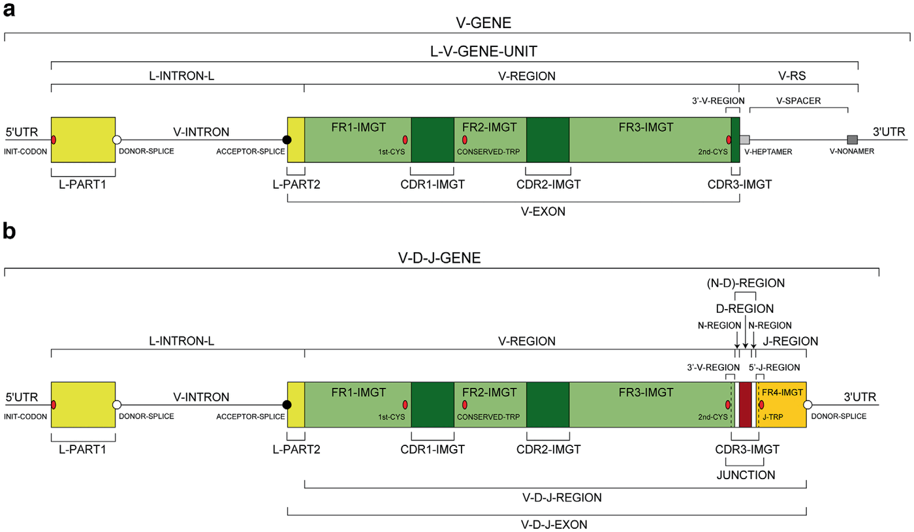

Fig. 11 "V-GENE"과 "V–D–J-GENE" "Molecule_ EntityPrototype"의 IMGT® 표준화
레이블(DESCRIPTION). (a) "V-GENE" 프로토타입. V-GENE(생식계열 배열)의
게놈(gDNA) 분자 조직은 5′ UTR, L-PART1, V-INTRON, V-EXON(L-PART2와
V-REGION으로 구성), 3′ UTR(V-RS로 시작)을 보여준다. V-REGION에는
FR1-IMGT(1st-CYS 포함), CDR1-IMGT, FR2-IMGT(CONSERVED-TRP 포함),
CDR2-IMGT, FR3-IMGT(2nd-CYS 포함), 생식계열 CDR3-IMGT가 있다.
(b) "V–D–J-GENE" 프로토타입. V–D–J-GENE(재배열 배열)의 게놈(gDNA) 분자
조직은 VH 도메인을 암호화하는 V–D–J-REGION을 특징으로 한다. V–D–J
재배열 덕분에 V-REGION은 추가적인 (N–D)-REGION과 J-REGION에 이어진다.
CDR3-IMGT는 2nd-CYS와 J-TRP 사이에 걸쳐 있는데, 이 둘은 CDR3-IMGT의
앵커이며 각각 FR3-IMGT와 FR4-IMGT에 속한다. JUNCTION은 두 앵커인
2nd-CYS와 J-TRP를 포함하므로 CDR3-IMGT보다 아미노산 두 개가 더 길다.
J-TRP(포함)에서 J-REGION의 DONOR-SPLICE까지의 암호화 영역이
FR4-IMGT이며, 이는 V-DOMAIN의 G-STRAND에 해당한다. 서른아홉 개의
레이블("V-GENE"용 27개, "V–D–J-GENE"용 32개 중 20개는 공통)과 열두 개의
관계[113]가 이들 프로토타입을 완전히 기술하는 데 필요하고 충분하다
(M.-P. Lefranc과 G. Lefranc, LIGM, IMGT®의 창립자 및 저자, 국제
ImMunoGeneTics 정보 시스템®, https://www.imgt.org의 허가를 받아 사용).

IG와 TR에는 네 가지 핵심 레이블이 있는데, V-REGION, D-REGION, J-REGION,
C-REGION이며 각각 V, D, J, C 유전자의 암호화 영역에 해당한다. 이 레이블
덕분에 IMGT/LIGM-DB는 일반 데이터베이스(GenBank/European Nucleotide
Archive(ENA)/DNA Data Bank of Japan(DDBJ))보다 훨씬 강력한 검색이
가능하다. 예를 들어 "Homo sapiens" "cDNA" "productive"
"IG-Heavy-Gamma" 서열을 "CDR3-IMGT" 레이블로 검색할 수 있다(예컨대
1,826개 서열이 검색되며, 그중 "CDR3-IMGT" 뉴클레오타이드 또는 아미노산
서열을 추출하거나 내려받을 수 있다).

IMGT/2Dstructure-DB[45]는 서열과 3D 구조 사이의 간극을 메우고, 3D 구조가
없는 항체의 아미노산 서열을 기술·분석하기 위해 IMGT/3Dstructure-DB
(https://www.imgt.org/3Dstructure-DB/)의 확장으로 만들어졌다.
IMGT/2Dstructure-DB는 IMGT/3Dstructure-DB의 정보학 프레임과 인터페이스를
사용하므로, 여러 사슬로 이루어진 고분자 수용체로서 항체를 분석·관리·검색할
수 있다. 이는 IG 서열을 개별적으로 분석·관리하는 IMGT/LIGM-DB 서열
데이터베이스와 대조적이다. 이들 아미노산 서열은 표준화 명명법, 기술, 번호
부여라는 동일한 IMGT 기준으로 분석·관리된다.

#### 6.3  IMGT

아미노산 서열과 구조를
위한 데이터베이스:
IMGT/2Dstructure-
DB와
IMGT/3Dstructure-DB

6.3.1  IMGT/
2Dstructure-DB

IMGT/2Dstructure-DB에는 아미노산 서열 수준에서 정의된 수용체에 대한, 주석이 붙은 아미노산 서열과 2차원 구조(IMGT Colliers de Perles)가 담겨 있다. 이 가운데 336개 항목은 Kabat 데이터베이스(KAB)에서 온 것이고(이용 가능한 염기서열이 없는 항목들이다)[89], 1311개 항목은 세계보건기구(WHO) 국제일반명(INN) 프로그램 목록에 발표된 IG나 항체(-mab, -tug, -bart, mig, -ment [44]) 또는 단백질(-cept, -fusp 등)이다[42–44](2025년 2월 27일 접속). 개별 항목은 항목 ID(예: INN 항목이라면 8693과 같은 네 자리 코드)나 분자 이름(예: INN 항목이라면 motavizumab과 같은 INN)으로 조회할 수 있다. 항목 유형(예: “INN”)으로 검색할 수도 있고(그림 12), 데이터베이스 Query 페이지에서 선택한 IMGT-ONTOLOGY 개념을 활용할 수도 있다.

IMGT/2Dstructure-DB 카드는 사슬과 도메인에 관한 표준화된 IMGT 정보를, 그리고 한 층 또는 두 층으로 그린 IMGT Colliers de Perles를 제공한다. 다만 실험적 구조 데이터에 관한 정보(두 층 IMGT Collier de Perles의 수소 결합, 접촉 분석)는 해당 항체가 결정화된 경우에만 대응하는 IMGT/3Dstructure-DB 카드에서 얻을 수 있다는 점을 염두에 두어야 한다.

IMGT/3Dstructure-DB는 3차원(3D) 구조를 PDB [93]에서 가져온 수용체에 대해 상세한 주석을 제공한다(7243개 항목, 2025년 2월 27일 접속)[45–47].

6.3.2  IMGT/
3Dstructure-DB

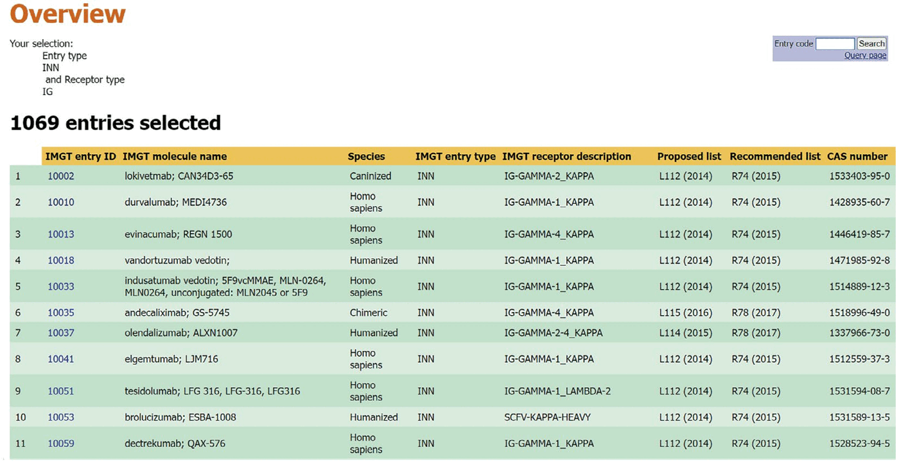

그림 12 IMGT/2Dstructure-DB 개요 결과. 이 개요 결과 페이지는 IMGT/2Dstructure-DB [45–47] https://www.imgt.org/3Dstructure-DB/ (2023년 11월 17일 접속)에서 IMGT 항목 유형 “INN”과 IMGT 수용체 유형 “IG”로 조회한 결과이다(IMGT-ONTOLOGY IDENTIFICATION axiom). 표에는 “IMGT entry ID”(INN 코드에 해당), 분자 이름(각 항목 줄에서 가장 먼저 표시되는 이름이 INN이다. 나머지 이름은 INN 이전에 쓰이던 통용 명칭, 실험실 코드 및/또는 상품명), 종, IMGT 항목 유형, IMGT 수용체 설명, Proposed 및 Recommended 목록(해당 항목이 발표된 첫 번째 INN 목록), CAS 번호 열이 포함된다. 처음 몇 개 항목은 다음과 같다: 10002, lokivetmab, Caninized, IG-GAMMA-2_KAPPA; 10010, durvalumab, Homo sapiens, IG-GAMMA-1_KAPPA; 10013, evinacumab, Homo sapiens, IG-GAMMA-4_KAPPA. 표에는 모두 1069개 항목이 선택되었음이 표시되어 있다. IMGT 항목 ID를 클릭하면 IMGT/2Dstructure-DB 카드로 이동한다. IMGT/2Dstructure-DB 카드 [45–47]는 IMGT/mAb-DB 데이터베이스 [77, 78, 117]에서도 열람할 수 있다(M.-P. Lefranc과 G. Lefranc, LIGM, IMGT®의 창시자 및 저자, 국제 ImMunoGeneTics 정보 시스템®, https://www.imgt.org의 허가를 받아 사용).

“IMGT/3Dstructure-DB 카드”는 IMGT/3Dstructure-DB [45–47]의 핵심 단위이다. 실제로 PDB 항목마다 하나씩, IMGT/3Dstructure-DB 항목마다 하나의 카드가 있으며, 이 카드를 통해 해당 항목과 관련된 모든 데이터에 접근한다. 이 카드는 IMGT/2Dstructure-DB 카드의 모델로 쓰였다. IMGT/3Dstructure-DB 카드의 “Chain details” 절은 먼저 사슬 자체에 관한 정보를, 그다음에는 도메인별 정보를 담고 있다(그림 13).

IMGT/3Dstructure-DB 카드

사슬과 도메인은 IMGT 표준 표기를 사용해 기술한다.

1.	 각 사슬에 대한 정보에는 다음이 포함된다.

“Chain ID”(예: 3ixt_A),
“Chain length”(아미노산 수, 예: 225),
“IMGT chain description”(여러 도메인의 경계 표시 포함, 예: VH–CH1 = VH (1–120) [D1] + CH1
(121–218) [D2],

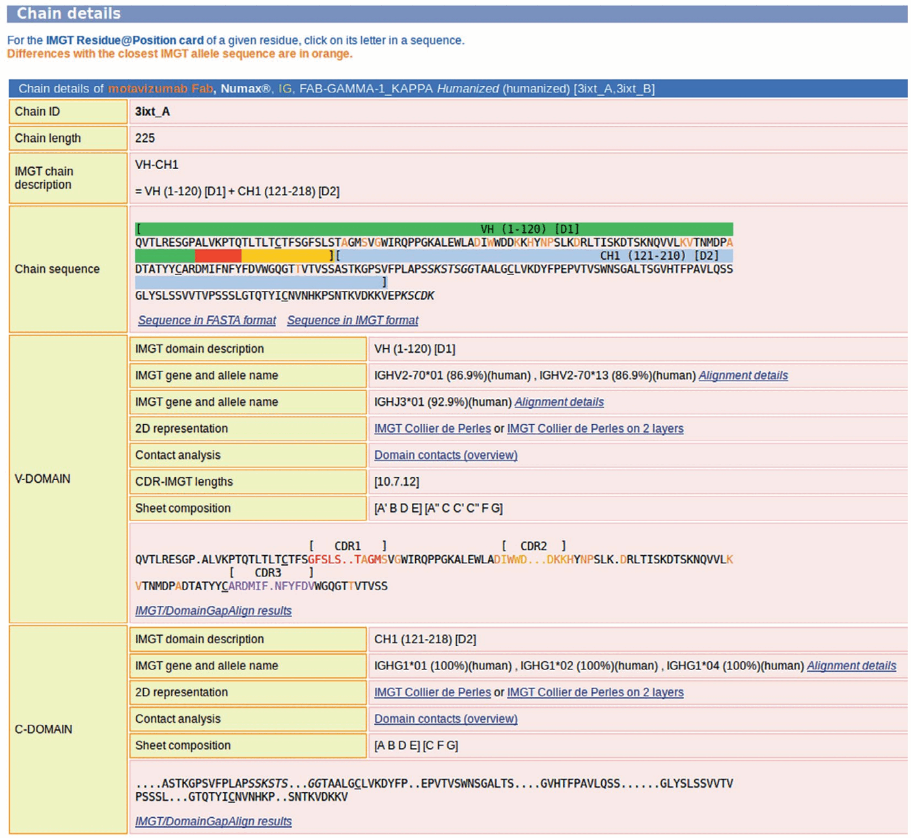

그림 13 IMGT/3Dstructure-DB 카드 [45–47]. “IMGT/3Dstructure-DB 카드”는 데이터베이스의 각 항목마다 열람할 수 있다. 인간화 항체 motavizumab Fab의 Fab에서 VH–CH1 사슬(Chain ID: 3ixt_A)에 대한 “Chain details” 절이 표시되어 있다. 사슬 길이는 225이다. 사슬과 도메인은 표준화된 IMGT 표기를 사용해 기술한다. IMGT 사슬 설명은 VH–CH1 = VH (1–120) [D1] + CH1 (121–218) [D2]이다. 사슬 서열은 색으로 구분된 영역과 함께 표시된다. VH 도메인 [D1]에서는 V-REGION(녹색), (N–D)-REGION(적색), J-REGION(황색)이고, CH1 도메인 [D2]는 청색이다. V-DOMAIN 절은 IMGT 도메인 설명 VH (1–120) [D1], IGHV와 IGHJ에 대한 정렬 상세가 딸린 IMGT 유전자 및 대립유전자 이름, 2D 표현(한 층의 IMGT Collier de Perles 또는 2층 IMGT Collier de Perles), Contact analysis와 Domain contacts(개요)로 이어지는 링크, CDR-IMGT 길이 [10.7.12], 시트 구성 [A′ B D E] [A″C C′C″ F G], V-DOMAIN의 IMGT 고유 번호와 IMGT 색상 메뉴에 따라 CDR1-IMGT(적색), CDR2-IMGT(주황색), CDR3-IMGT(보라색)를 표시한 아미노산 서열, 생식계열과 다른 아미노산을 주황색으로 강조한 서열, 그리고 IMGT/DomainGapAlign 결과로 가는 링크를 제공한다. C-DOMAIN 절은 CH1 도메인에 대해 IMGT 도메인 설명, IMGT 유전자 및 대립유전자 이름, 2D 표현과 Contact analysis로 가는 링크, 시트 구성 [A B D E] [C F G], C-DOMAIN의 IMGT 고유 번호에 따른 아미노산 서열 표시, IMGT/DomainGapAlign 결과 링크 등 유사한 세부 정보를 제공한다. IMGT/2Dstructure-DB 카드에서도 비슷한 결과 화면이 제공된다. 다만 그 경우에는 실험적 구조 데이터에 관한 정보(두 층 IMGT Collier de Perles의 수소 결합, Domain contacts)가, 해당 항체가

“Chain sequence”(영역과 도메인의 경계 표시, 가장 가까운 유전자 및 대립유전자와 다른 아미노산(AA)을 주황색으로 강조, FASTA 형식 서열 및 IMGT 형식 서열로 가는 링크 포함).

2.	 V-DOMAIN에 대한 정보에는 예를 들어 다음이 포함된다.

“IMGT domain description”(예: VH (1–120) [D1]),
V에 대한 동일성 백분율이 붙은 “IMGT gene and allele name”
(예: IGHV2-70*01 (86.90%) (Human))과 Alignment details로 가는
링크
J에 대한 동일성 백분율이 붙은 “IMGT gene and allele name”
(예: IGHJ3*01 (92.90%) (Human), 그리고 같은 동일성 백분율을 주는
다른 대립유전자들)과 Alignment details로 가는
링크,
“2D representation”: 한 층의 IMGT Collier de Perles 또는 두 층의 IMGT Collier de
Perles로 가는 링크,
“Contact analysis”: Domain contacts(개요)로 가는 링크,
“CDR-IMGT lengths”(예: [10.7.12]),
“Sheet composition”(예: [A′BDE][A″CC′C″FG]),
CDR-IMGT 경계 표시와 함께, 가장 가까운 V 및 J 유전자·대립유전자와 다른 아미노산(AA)을 주황색으로 강조한 도메인 아미노산 서열,
IMGT/DomainGapAlign 결과로 가는 링크.

IMGT/3Dstructure-DB의 접촉 분석 [46, 47]은 IMGT/3Dstructure-DB 항목에서 도메인 및/또는 사슬 사이의 원자쌍 접촉(참고(Note) 10 참조)과 내부 접촉에 관한 방대한 정보를 제공한다. 이 정보는 다음과 같이 여러 수준에서 얻을 수 있다.

IMGT/3Dstructure-
DB 접촉 분석

1.	 도메인 접촉(개요),

2.	 도메인 쌍 접촉(“DomPair”)(그림 14). 이는 한 쌍의 파트너 사이 접촉에 관한
정보를 제공한다(예: motavizumab의 VH 도메인(3ixt_H 사슬)과
리간드(3ixt_P 사슬) 사이(그림 14a), 또는 motavizumab의 V-KAPPA
도메인(3ixt_L 사슬)과 리간드(3ixt_P
사슬) 사이(그림 14b)).

3.	 특정 위치의 특정 잔기에 대한 구조 정보와 접촉을 제공하는 IMGT Residue@Position 카드(“R@P”), 또는 IMGT Residue@Position. IMGT Residue
@Position은 IMGT 위치 번호, 잔기

그림 13 (계속) 결정화된 경우에만 대응하는 IMGT/3Dstructure-DB 카드에서 제공된다. 구조와 서열 사이의 불일치는 IMGT 주석으로 강조된다. 예를 들어 이 경우에는 다음과 같다: “3ixt_A와 3ixt_H의 CH1 120에 K(Lys)가 존재하는 것은 오류이다. motavizumab(INN 8693, IMGT/2Dstructure-DB)에서처럼 아르기닌(Arg) R120이어야 한다. 3ixt_A와 3ixt_H의 서열은 IGHG1*03이어야 한다”(M.-P. Lefranc과 G. Lefranc, LIGM, IMGT®의 창시자 및 저자, 국제 ImMunoGeneTics 정보 시스템®, https://www.imgt.org의 허가를 받아 사용).

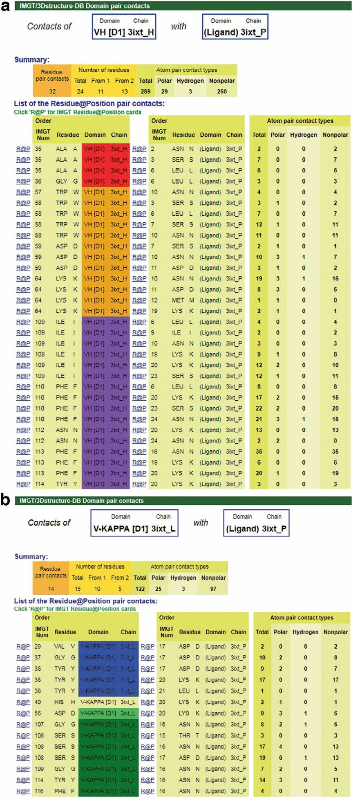

그림 14 IMGT/3Dstructure-DB 접촉 분석 결과 [46, 47]. (a) 펩타이드 에피토프에 결합한 motavizumab Fab 결정에서 motavizumab VH 도메인 [D1] 3ixt_H와 융합 당단백질 F1(리간드) 3ixt_P 사이의 IMGT/3Dstructure-DB 도메인 쌍 접촉. 요약 절에는 32개의 잔기 쌍 접촉이 있고, 원자쌍 접촉 유형은 모두 289개로 극성 29개, 수소 3개, 비극성 260개가 포함된다. 표의 처음 네 열에는 VH[D1] 3ixt_H의 IMGT 번호, 잔기, 도메인, 사슬이, 다음 네 열에는 (리간드) 3ixt_P의 같은 정보가, 그리고 더 오른쪽의 원자쌍 접촉 유형 네 열에는 접촉 수(전체, 극성, 수소, 비극성)가 나열된다. 이 구조에서 리간드와 접촉하는 VH 위치는 모두 CDR-IMGT에 속하며, CDR1-IMGT에 속하는 위치(A35, G36)는 적색, CDR2-IMGT에 속하는 위치(W57, W58, D59, K64)는 주황색, CDR3-IMGT에 속하는 위치(I109, F110, N112, F113, Y114)는 보라색으로 표시된다. 이는 VH의

잔기 이름, IMGT 도메인 설명, IMGT 사슬 ID(예: 35–ALA (A)–VH–3ixt_H)로 정의된다(참고(Note) 11 참조). IMGT Residue@Position 카드는 IMGT/3Dstructure-DB 카드의 아미노산 서열에서, 또는 IMGT Colliers de Perles에서 아미노산 하나를 클릭해 바로 열람할 수 있다.

원자쌍 접촉은 각 수준(“R@P”, “DomPair”, 개요)에서 원자 접촉 유형(비공유, 극성, 수소 결합 등) 및/또는 원자 접촉 범주((BB) 골격/골격, (SS) 곁사슬/곁사슬 등)로 조회할 수 있다[46, 47](참고(Note) 12 참조).

IG/Ag 복합체에서 IG와 Ag의 경계면에서 접촉하는 아미노산들이 IG 표면의 파라토프를, Ag 표면의 에피토프를 이룬다(그림 15).

IMGT 파라토프와 에피토프

IMGT/3Dstructure-DB에서 IG/Ag 복합체에 대한 “IMGT paratope and epitope” 절은 접촉 분석과 상호작용 점수 함수를 결합해 결정된다. 이들은 표준화된 방식으로 기술된다. 따라서 3ixt의 Ag 에피토프(그림 15)는 융합 당단백질 F1(3ixt_P)의 아미노산으로 구성된다. 11개의 아미노산이 Ag 에피토프를 형성한다. 에피토프에 속하는 각 아미노산은 3D 구조에서 사슬 내 위치로 정의된다(아미노산이 V, C, G 도메인의 일부라면 그 위치는 IMGT 고유 번호 [52–54]에 따라 제시된다).

3ixt(motavizumab Fab)의 IG 파라토프(그림 15)는 VH(3ixt_H 사슬)와 V-KAPPA(3ixt_L 사슬)의 아미노산으로 구성된다. IG의 아미노산 15개, 즉 VH에서 8개, V-KAPPA에서 7개가 파라토프를 형성한다. IMGT Collier de Perles(그림 4)를 보면 파라토프의 8개 위치가 모두 VH CDR-IMGT에 속하고(A35는 CDR1-IMGT, W58, D59, K64는 CDR2-IMGT, I109, F110, N112, F113은 CDR3-IMGT), 파라토프의 7개 위치가 모두 V-KAPPA CDR-IMGT에 속한다(G37과 Y38은

그림 14 (계속) IMGT 색상 메뉴(적색, 주황색, 보라색)를 따른 것이다(참고(Note) 9 참조). 온라인에서 R@P를 클릭하면 해당 잔기@위치의 쌍 접촉을 볼 수 있다. (b) motavizumab의 V-KAPPA [D1] 도메인(3ixt_L)과 융합 당단백질 F1(리간드)(3ixt_P) 사이의 IMGT/3Dstructure-DB 도메인 쌍 접촉. “Atom contact types”에서 표시 전에 “Polar,” “Hydrogen bonds,” “Nonpolar”를 선택했다. 요약 절에는 14개의 잔기 쌍 접촉이 있고, 원자쌍 접촉 유형은 모두 122개로 극성 25개, 수소 3개, 비극성 97개가 포함된다. 표의 처음 네 열에는 V-KAPPA [D1] 사슬 3ixt_L의 IMGT 번호, 잔기, 도메인, 사슬이, 다음 네 열에는 (리간드) 3ixt_P의 같은 정보가, 그리고 더 오른쪽의 원자쌍 접촉 유형 네 열에는 접촉 수(전체, 극성, 수소, 비극성)가 나열된다. 이 구조에서 리간드와 접촉하는 V-KAPPA 위치는 FR2-IMGT의 H40을 제외하면 모두 CDR-IMGT에 속한다. CDR1-IMGT에 속하는 아미노산(V29, G37, Y38)은 청색, CDR2-IMGT에 속하는 아미노산(D56)은 녹색, CDR3-IMGT에 속하는 아미노산(G107, S108, G109, Y114, F116)은 청록색으로 표시된다. 이는 VL(V-kappa 또는 V-lambda)의 CDR-IMGT에 대한 IMGT 색상 메뉴(청색, 녹색, 청록색)를 따른 것이다(참고(Note) 9 참조). 온라인에서 R@P를 클릭하면 IMGT Residue@Position 카드 [46, 47]의 쌍 접촉을 볼 수 있다(M.-P. Lefranc과 G. Lefranc, LIGM, IMGT®의 창시자 및 저자, 국제 ImMunoGeneTics 정보 시스템®, https://www.imgt.org의 허가를 받아 사용).

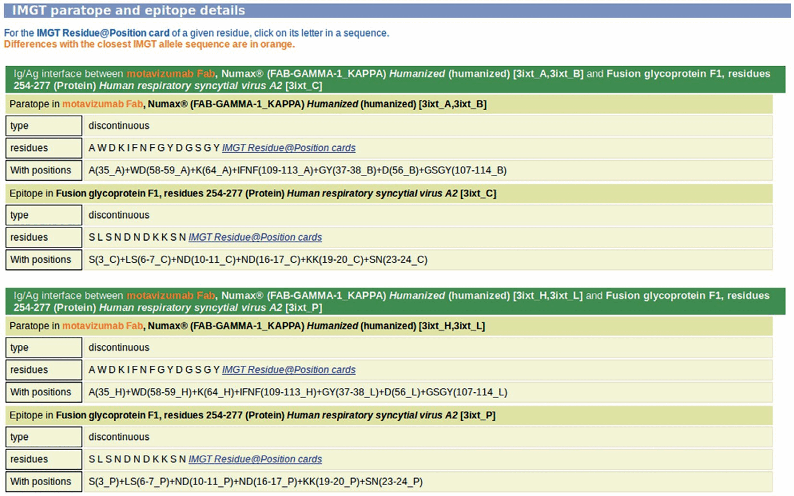

그림 15 IG/Ag 복합체의 “IMGT paratope and epitope”. IMGT/3Dstructure-DB에서 가져온 이 표는 펩타이드 에피토프에 결합한 motavizumab Fab 결정(3ixt)의 IMGT 파라토프와 에피토프를 보여 준다. 여기에는 motavizumab Fab(FAB-GAMMA-1 KAPPA) Numax® 인간화 항체(3ixt_H, 3ixt_L)와 인간 호흡기 세포융합 바이러스 A2(3ixt_P)의 융합 당단백질 F1 254–277번 잔기 사이의 IG/Ag 경계면에 관한 정보가 포함된다. 3ixt의 H_L/P 사슬과 A_B/C 사슬에 대해 제공되는 파라토프/에피토프 결과는 동일하다. 파라토프는 불연속이며 15개의 아미노산이 유지되었다(IMGT 접촉 분석에서 검출된 20개 가운데)(그림 14a, b): A(35_H) + WD(58-59_H) + K(64_H) + IFNF(109-113_H) + GY(37-38_L) + D(56_L) + GSGY(107-114_L). VH(3ixt_H)의 아미노산 8개와 V-KAPPA(3ixt_L)의 아미노산 7개가 IG 파라토프에 참여한다. IG 파라토프에 속하는 각 아미노산은 IMGT 고유 번호 [52]에 따른 V 도메인 내 위치로 특징지어지므로, 그것이 CDR1-IMGT(27–38), CDR2-IMGT(56–65) 및/또는 CDR3-IMGT(105–117)에 속하는지(또는 속하지 않는지)를 판별할 수 있다. 3ixt에서 파라토프의 아미노산 15개(VH에서 8개, V-KAPPA에서 7개)는 모두 CDR-IMGT에 속하며, 6개의 CDR-IMGT가 모두 참여한다. 3ixt_H의 VH에서는 A35가 CDR1-IMGT에, W58, D59, K64가 CDR2-IMGT에, I109, F110, N112, F113이 CDR3-IMGT에 속하고(그림 14a), 3ixt_L의 V-KAPPA에서는 G37과 Y38이 CDR1-IMGT에, D56이 CDR2-IMGT에, G107, S108, G109, Y114가 CDR3-IMGT에 속한다(그림 14b). 에피토프 역시 불연속이며 11개의 아미노산이 유지되었다(접촉 분석에서 검출된 16개 가운데). S(3_P) + LS(6-7_P) + ND(10-11_P) + ND(16-17_P) + KK(19-20_P) + SN(23-24_P). 항원 결정기(에피토프)에 속하는 각 아미노산은 그 위치(여기서는 3D 구조에서 사슬 내 위치)로 특징지어진다. 예를 들어 “S (3_P)”는 세린(S)이 융합 당단백질 F1 리간드(3ixt_P)의 3번 위치에 있음을, “SN (23-24_P)”는 세린(S)과 아스파라긴(N)이 23, 24번 위치에 있음을 뜻한다. IG/Ag 3D 구조(3ixt)의 “IMGT paratope and epitope” 분석은 IMGT/3Dstructure-DB, https://www.imgt.org/3Dstructure-DB/ [46, 47]에서 가져온 것이다(M.-P. Lefranc과 G. Lefranc, LIGM, IMGT®의 창시자 및 저자, 국제 ImMunoGeneTics 정보 시스템®, https://www.imgt.org의 허가를 받아 사용).

에서 CDR1-IMGT, D56은 CDR2-IMGT, G107, S108, G109, Y114는 CDR3-IMGT에 속한다). “Epitope IMGT Residue@Position cards”와 “Paratope IMGT Residue@Position cards”(그림 15)를 클릭하면 각각 에피토프와 파라토프에 속하는 아미노산마다 상세한 접촉 정보를 얻을 수 있다. IMGT 파라토프와 에피토프는

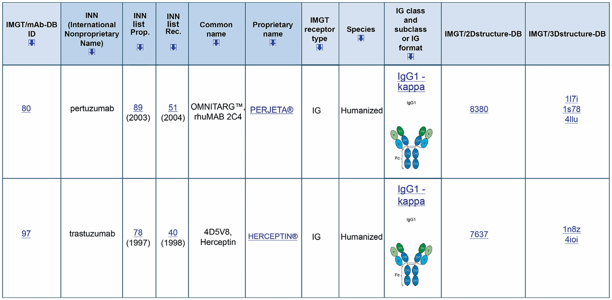

그림 16 IMGT/mAb-DB 데이터베이스 조회 결과 [77, 78]. 결과에는 두 단일클론항체 pertuzumab과 trastuzumab에 관한 정보가 표시된다. 각 행에는 IMGT/mAb-DB ID, 국제일반명(INN), INN proposed 및 recommended 목록 번호(괄호 안에 연도), 통용명과 상품명, IMGT 수용체 유형, 종, IG 클래스와 서브클래스 또는 IG 형식, 그리고 IMGT/2Dstructure-DB(INN 번호 코드) 및 IMGT/3Dstructure-DB(PDB 코드) 데이터베이스 [46, 47]로 가는 링크 같은 세부 정보가 포함된다. 두 항체는 모두 인간화 IgG1-kappa이다. Pertuzumab(ID 80)은 INN L89(2003)와 R51(2004)에서, trastuzumab(ID 97)은 INN L78(1997)과 R40(1998)에서 유래했다. 상품명은 각각 PERJETA®와 HERCEPTIN®이다. 그 밖의 정보로는 특이성 표적 이름과 종, 작용 기전, 개발 기술, 기원 클론의 종과 이름, 회사, 발현 시스템, 용도, 임상 영역, 임상 적응증, 개발 상태, 규제 기관 상태와 연도, 임상시험, 당국 결정, 외부 링크, 인용/주석/참고문헌, 바이오시밀러가 있다(M.-P. Lefranc과 G. Lefranc, LIGM, IMGT®의 창시자 및 저자, 국제 ImMunoGeneTics 정보 시스템®, https://www.imgt.org의 허가를 받아 사용).

IMGT/3Dstructure-DB(https://www.imgt.org/3Dstructure-DB/)에서는 IG/Ag 3D 구조에 대해 자동으로 결정된다.

IMGT/mAb-DB(https://www.imgt.org/mAb-DB/, 2025년 3월 6일 접속) [42, 77, 78]는 치료적 단일클론항체(IG, mAb), TR, FPIA, 임상 응용용 복합 단백질(CPCA) 및 치료적 관심 대상 관련 단백질(RPI)을 위한 조회 인터페이스를 제공한다. IMGT/mAb-DB의 1586개 항목 가운데 1407개가 INN에서 유래했으며, 여기에는 IG 1224개, TR 10개, FPIA 47개, CPCA 62개, RPI 64개가 포함된다. 이들은 WHO INN 프로그램 목록 [42–44], 아미노산 서열을 위한 IMGT/2Dstructure-DB, 그리고 3D 구조가 있으면 IMGT/3Dstructure-DB [45–47]로 연결된다(그림 16).

#### 6.4  IMGT 데이터베이스

(치료용
단일클론
항체): IMGT/
mAb-DB

### 7  IMGT Tools for Gene, Sequence, and Structure Analysis

IMGT/LIGMotif [79]는 어류 종에서 호모 사피엔스에 이르기까지 방대한 게놈 서열에서 새로운 IG 및 TR 유전자를 식별하고 기술하기 위한 연구와 IMGT 생물정보 큐레이션(biocuration)에 쓰인다.

#### 7.1  IMGT Tool for

Gene Analysis

IMGT/V-QUEST(https://www.imgt.org/IMGT_vquest/input)는 IG와 TR 가변 도메인의 염기서열을 분석하는 IMGT 도구이다[122–127]. IMGT/V-QUEST는 접합부 분석을 위한 IMGT/JunctionAnalysis [128, 129](https://www.imgt.org/IMGT_jcta/analysis)와, 사용자 서열의 자동 주석을 위한 내부 모듈인 IMGT/Decryption [130] 및 IMGT/Automat [131, 132]를 통합한다. 재배열된 V–D–J-REGION과 V–J-REGION, 그리고 JUNCTION의 분석은 염기서열 수준에서 이루어진다. IMGT/V-QUEST와 IMGT/JunctionAnalysis가 제공하는 맞춤 매개변수와 결과는 다른 곳에 기술되어 있다[122–130]. JUNCTION은 앵커 위치인 2nd-CYS 104와 J-TRP 또는 J-PHE 118을 포함한 CDR3-IMGT에 해당한다[128, 129]. 백혈병이나 림프종에서 IG 및 TR 악성 클론의 클론형(clonotype) 비교를 위해, 최근 IMGT/JunctionAnalysis [128, 129] 결과에 JUNCTION 해독(decryption) [130]이 추가되어 상세한 기술뿐 아니라 개별 코딩 영역의 길이(염기 수)까지 제공한다: (3′V): 3′V-REGION, {N}: N-REGION, (D): D-REGION, (5′J): 5′J-REGION, 그리고 잘려나간(0, 마이너스 부호) 또는 회문형 P(플러스 부호) 염기 수. IMGT JUNCTION 해독 값은 D-GENE이 없는 접합부 (3′V)3′{N}5′(5′J), D-GENE이 하나인 (3′V)3′{N1}5′(D)3′{N2}5′(5′J), D-GENE이 둘 및 셋인 경우에 대해 https://www.imgt.org/IMGT_jcta/decryption 에 제시되어 있다.

#### 7.2  IMGT Tools for

Nucleotide Sequence
Analysis

7.2.1  IMGT/V-QUEST and
IMGT/JunctionAnalysis

2010년 10월 이후로는 차세대 염기서열 분석(NGS)(또는 고처리량 염기서열 분석(HTS), 심층 염기서열 분석)으로 얻은 IG 또는 항체와 TR V-영역 염기서열의 분석을 IMGT/HighV-QUEST [127, 133–136]로 수행할 수 있다. 이 도구는 실행당 최대 1,000,000개 서열(scFv 포함 [137])을 분석하고, IMGT 클론형(AA) [135]을 식별·비교하며(현재 배치 간 최대 100만 서열), 다양성 및 발현 통계 분석을 더 진행할 수 있도록 다운로드 가능한 IMGT/StatClonotype 도구 [138, 139]용 결과를 제공한다.

7.2.2  IMGT/HighV-
QUEST, the IMGT Portal for
NGS Nucleotide Sequence
Analysis

IMGT/V-QUEST와 IMGT/HighV-QUEST는 사용자 염기서열을 IMGT® 참조 디렉터리 [117]와 비교한다. 이 디렉터리는 IMGT/LIGM-DB [76]와 IMGT/GENE-DB [35] 데이터로 구축한, 좌위 및 종별 세트를 포함한다. 정의상 IMGT 참조 디렉터리 세트는 대립유전자마다 서열 하나를 담고 있다. 기본적으로 사용자 서열은 인프레임 V-REGION을 가진 슈도유전자(P) 대립유전자(F+ ORF+ in-frame P)를 포함해 모든 F 및 ORF 유전자와 대립유전자와 비교된다. 그러나 IMGT/V-QUEST와 IMGT/HighV-QUEST 옵션에서는 “F+ORF” 세트를 선택하거나, 게놈 분석의 경우 “orphon을 포함하는” 두 세트를 선택할 수 있다. “With allele *01 only” 매개변수는 사용자 서열을 서로 다른 유전자와 비교해야 하거나, 동일한 유전자를 사용하는 사용자 서열을

7.2.3  IMGT® Reference
Directories for IMGT/V-
QUEST and IMGT/HighV-
QUEST

대립유전자 다형성과 무관하게 함께 정렬해야 할 때 유용할 수 있다. IMGT/V-QUEST 참조 디렉터리는 인간과 마우스처럼 폭넓게 연구된 종을 위해 구축되어 있다. 이는 IMGT 참조 디렉터리 세트가 완전하지 않은 다른 종이나 분류군에도 해당한다. 그런 경우에는 IMGT 참조 디렉터리의 상태(IMGT® 웹사이트의 갱신 정보)를 고려해 결과를 해석해야 한다. IMGT/V-QUEST 참조 디렉터리 세트로 가는 링크는 IMGT/V-QUEST Welcome 페이지에서 제공된다.

IMGT/DomainGapAlign [46, 80, 81]은 V, C, G 도메인의 아미노산 서열을 분석하는 IMGT® 도구이다. IMGT/DomainGapAlign은 아미노산 도메인 서열을 IMGT 참조 디렉터리 세트(IMGT/GENE-DB [35]의 생식계열 V 및 J 유전자와 C 유전자 도메인을 번역한 것)와 비교해 분석한다. 이 참조 아미노산 서열은 IMGT/DomainDisplay를 조회해 표시할 수 있다. 여러 아미노산 서열을 동시에 분석할 수 있으나, 같은 도메인 유형에 속해야 한다. IMGT/DomainGapAlign은 가장 가까운 생식계열 V-REGION 및 J-REGION 대립유전자(V 도메인의 경우)와 가장 가까운 C-DOMAIN 대립유전자(C 도메인의 경우)를 식별한다. IMGT/DomainGapAlign은 사용자의 V 영역 아미노산 서열을 가장 가까운 V 및 J 영역과 정렬해 보여 주며(그림 17), IG와 TR V-DOMAIN의 경우 IMGT 갭과 FR-IMGT(가닥) 및 CDR-IMGT(루프)의 경계를 V에 대한 IMGT 고유 번호 [52]에 따라 표시한다. 예를 들어 motavizumab VH 도메인의 V-REGION과 J-REGION은 각각 Homo sapiens IGHV2-70*01 및 IGHJ3*01과 86.9%, 92.9%의 동일성을 갖는 것으로 식별된다. 가장 가까운 대립유전자가 여러 개 식별되면 사용자는 해당 정렬을 각각 선택해 볼 수 있다(그림 17a). 아미노산 서열은 IMGT 색상 메뉴에 따라 V-REGION, J-REGION, 그리고 VH 도메인의 경우 (N–D)-REGION의 경계와 함께 표시된다.

#### 7.3 IMGT/DomainGapAlign: 아미노산 서열 분석을 위한 IMGT 도구

FR-IMGT와 CDR-IMGT에서 아미노산 차이의 개수(Fig. 17b)는 잠재적 면역원성을 평가하는 기준 가운데 하나이다 [94]. 완전한 VH 도메인의 골격 영역(FR)은 91개 위치로 이루어지며(FR1-, FR2-, FR3-, FR4-IMGT에 각각 25, 17, 38, 11개 위치), 완전한 VL 도메인의 골격은 89개 위치로 이루어진다(각각 26, 17, 36, 10개 위치) [46, 80]. 따라서 motavizumab VH의 골격은 가장 가까운 인간 생식계열(germline)인 IGHV2-70*01과 IGHJ3*01로 구성된 골격과 비교할 때 아미노산 차이가 10개이고(91개 중 81개 동일 AA)(Fig. 17b), 반면 trastuzumab VH의 골격 [94]은 가장 가까운 인간 생식계열 IGHV3-66*01과 IGHJ4*01로 구성된 골격과 8개의 아미노산 차이를 보인다(91개 중 83개 동일 AA) [46, 80]. AA 변화의 특성(참고(Note) 12 참조)은 V-DOMAIN의 경우 가닥과 루프, 그리고 FR-IMGT와 CDR-IMGT 단위로 표시되고(Fig. 17b), C-DOMAIN의 경우에는 가닥, 턴, 루프 단위로 표시된다(Fig. 18b).

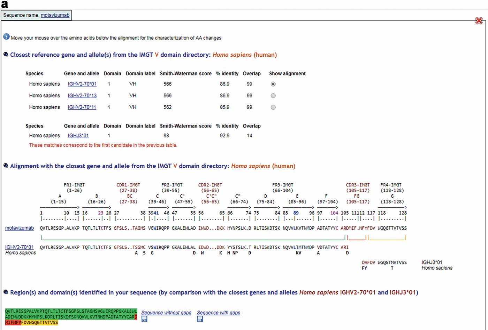

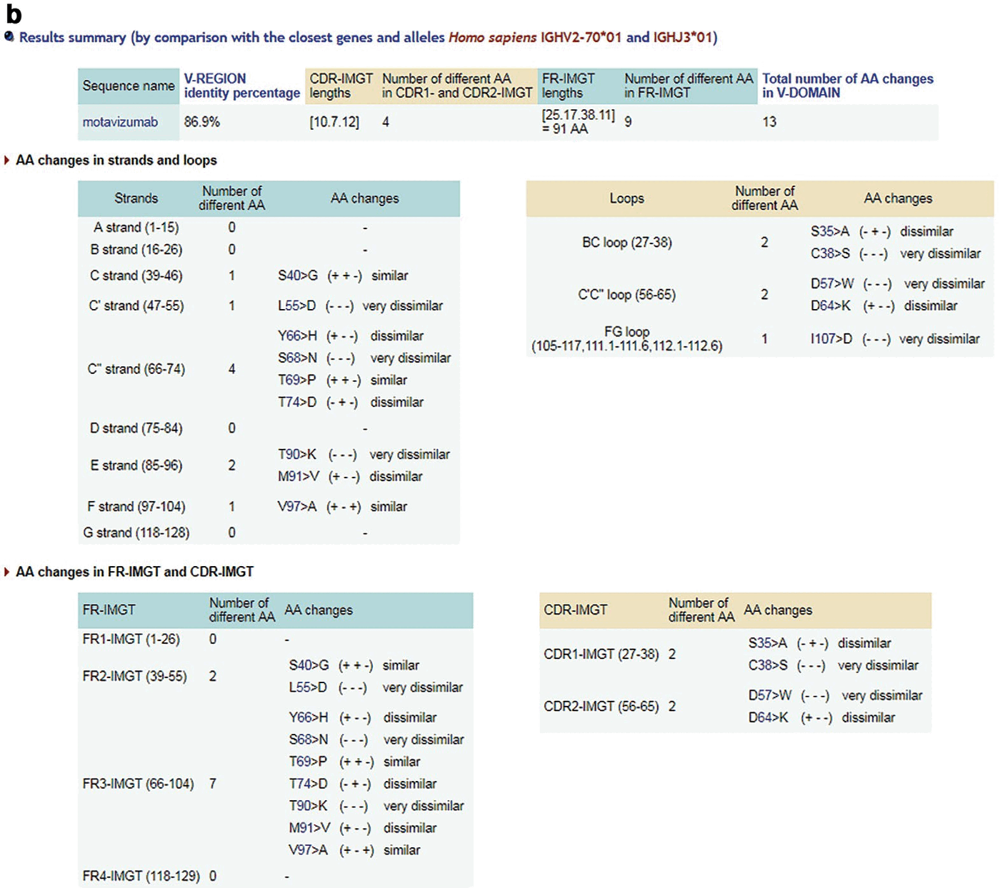

Fig. 17 계속

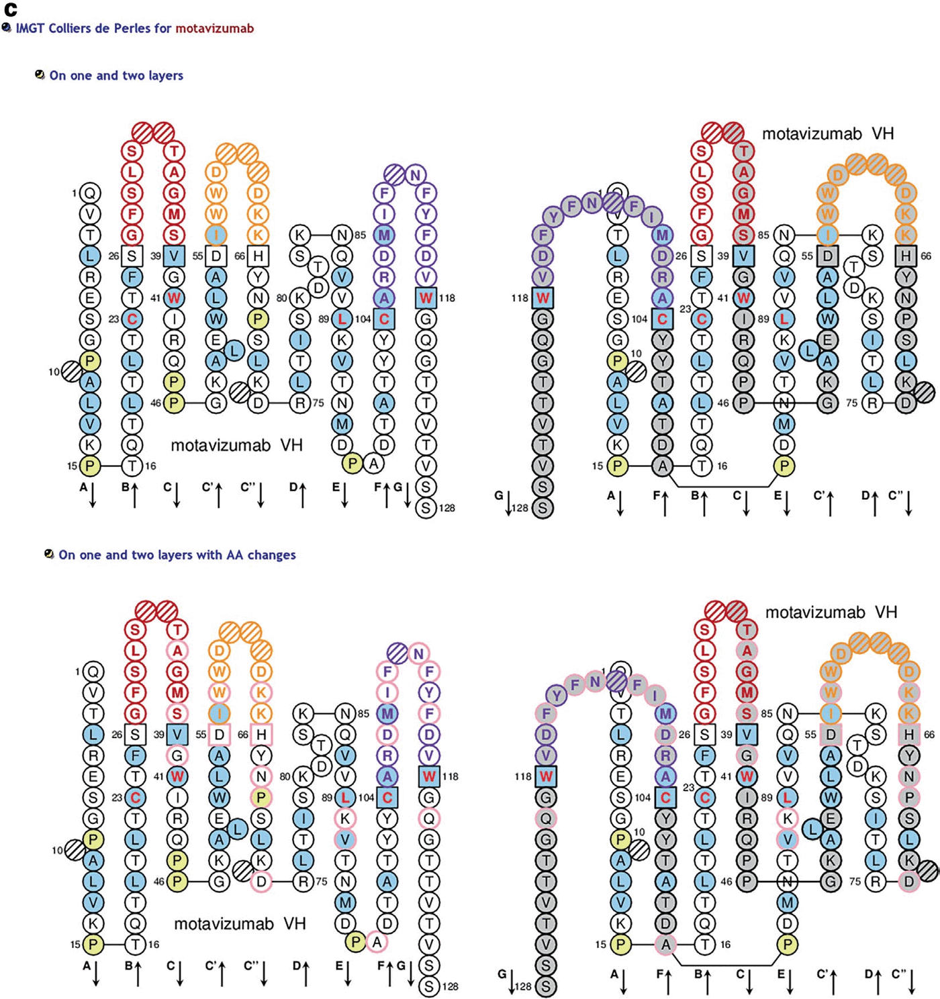

Fig. 17 VH 도메인에 대한 IMGT/DomainGapAlign 결과. (a) 결과는 세 부분으로 구성된다. 1. IMGT "V" 도메인 디렉터리에서 Homo sapiens(인간)의 가장 가까운 참조 유전자와 대립유전자. motavizumab VH 도메인의 V-REGION과 J-REGION은 아미노산 수준에서 Homo sapiens IGHV2-70*01 및 IGHJ3*01과 각각 86.9% 및 92.9%의 동일성을 갖는 것으로 확인되었다. 아미노산 차이는 V 및 J 정렬 아래에 표시된다. 2. IMGT "V" 도메인 디렉터리에서 가장 가까운 유전자 및 대립유전자와의 정렬: Homo sapiens(인간). IMGT/DomainGapAlign은 사용자의 V 영역 아미노산 서열을, V 도메인에 대한 IMGT 고유 번호 체계 [52]에 따른 IMGT 갭 및 FR-IMGT와 CDR-IMGT의 경계와 함께, 그리고 차이가 나는 아미노산을 강조하여 보여준다. 3. VH 도메인 서열은 IMGT 색상 메뉴에 따라 V-REGION, (N–D)-REGION, J-REGION을 각각 녹색, 적색, 황색으로 강조하여 표시한다. FASTA 서열(갭 없음 및 갭 있음)로의 링크가 제공된다. (b) 결과 요약 및 아미노산 변화 결과. 결과 요약은 V-REGION 동일성 비율(86.9%), CDR-IMGT 길이 [10.7.12], CDR1- 및 CDR2-IMGT의 상이한 AA 개수("4"), FR-IMGT 길이 [25.17.38.11] = 91 AA, FR-IMGT의 상이한 AA 개수("9"), V-DOMAIN(CDR3-IMGT 또는 FG 루프는 제외)의 총 AA 변화 개수("13")를 제공한다. AA 변화는 두 부분으로 상세히 제시되는데, 첫 번째는 가닥과 루프(가닥 A부터 G, 루프 BC, C″C 및 FG), 두 번째는 FR-IMGT와 CDR-IMGT(FR1-부터 FR4-IMGT, CDR1-IMGT, CDR2-IMGT) 단위로 표시된다. 결과는 네 개의 개별 표로 제시된다. 각 아미노산 변화마다, 아미노산이 바뀌었음에도 보존된 IMGT 아미노산 분류 [83]가 괄호 안에 "+"와 함께 다음 순서로 표시된다: 친수성, 부피, 화학적 특성. 예를 들어 Y66 > H (+ − − )는 두 아미노산 Y와 H가 동일한 친수성 분류에 속하지만 부피와 화학적 특성 분류는 다르다는 뜻이다 [83]. AA 변화는 다음과 같이 등급이 매겨진다. 매우 유사(Very similar): (+ + +), 유사(Similar): (+ + −) 또는 (+ −+), 비유사(Dissimilar): (+ −−) 또는 (−+ −) 또는 (−−+ ), 매우 비유사(Very dissimilar): (−−−). (c) IMGT Collier de Perles는 가장 가까운 생식계열 V-REGION 및 J-REGION과 다른 위치를 분홍색 원으로 강조한다(온라인 버전 기준) (M.-P. Lefranc 및 G. Lefranc, LIGM, IMGT®(국제 ImMunoGeneTics 정보 시스템®, https://www.imgt.org)의 창립자 겸 저자, 허가를 받아 사용)

분석 대상 VH 또는 VL 도메인(V–D–J-REGION 또는 V–J-REGION)의 IMGT Collier de Perles 역시 가장 가까운 생식계열 서열과의 아미노산 차이를 강조한 형태로 제공된다(온라인에서는 분홍색 원)(Fig. 17c).

IMGT/DomainGapAlign은 사용자의 C 영역 아미노산 서열을, C 도메인에 대한 IMGT 고유 번호 체계 [53]에 따른 IMGT 갭과 가닥 및 루프의 경계와 함께 가장 가까운 C 도메인에 정렬하여 보여준다(Fig. 18).

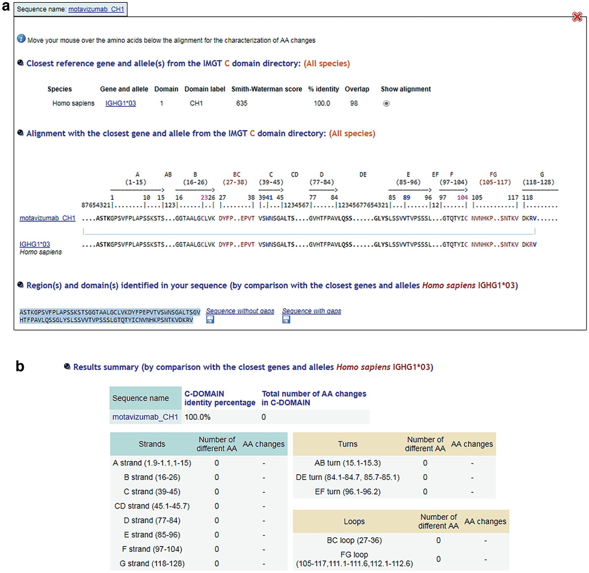

Fig. 18 C 도메인에 대한 IMGT/DomainGapAlign 결과. (a) 결과는 세 부분으로 구성된다. 1. IMGT 'C' 도메인 디렉터리(전 종)에서 가장 가까운 참조 유전자와 대립유전자. motavizumab(INN 8693, R57, IMGT/mAb-DB) CH1 도메인은 아미노산 수준에서 Homo sapiens IGHG1*03 CH1과 100% 동일성을 갖는 것으로 확인되었다. 2. IMGT "C" 도메인 디렉터리(전 종)에서 가장 가까운 유전자 및 대립유전자와의 정렬. IMGT/DomainGapAlign은 사용자의 C 도메인 아미노산 서열을, C 도메인에 대한 IMGT 고유 번호 체계 [53]에 따른 IMGT 갭과 가닥, 턴 및 루프의 경계와 함께 보여준다. 3. CH1 도메인 서열은 IMGT 색상 메뉴에 따라 C-DOMAIN을 연한 청색으로 강조하여 표시한다. (b) C-DOMAIN 동일성 비율과 C-DOMAIN의 총 AA 변화 개수를 포함한 결과 요약이 제공된다. 가닥(A, B, C, CD, D, E, F, G), 턴(AB, DE, EF), 루프(BC, FG)의 AA 변화가 세 개의 개별 표로 표시된다. 이 예에서 "0"은 AA 변화가 없음을 뜻한다 (M.-P. Lefranc 및 G. Lefranc, LIGM, IMGT®(국제 ImMunoGeneTics 정보 시스템®, https://www.imgt.org)의 창립자 겸 저자, 허가를 받아 사용)

IMGT® 웹사이트(https://www.imgt.org)의 IMGT/Collier-de-Perles 도구 [86]를 이용하면 사용자가 자체 도메인 아미노산 서열에서 출발하여 한 층 또는 두 층의 IMGT Colliers de Perles를 그릴 수 있다. 서열은 IMGT 고유 번호 체계에 따라 갭을 넣어야 한다(예를 들어 IMGT/DomainGapAlign 사용). IMGT/Collier-de-Perles 도구는 IMGT 색상 메뉴에 따른 CDR-IMGT, 또는 친수성이나 부피 분류, 혹은 11가지 IMGT 물리화학적 분류 [83]에 따른 FR-IMGT 아미노산을 표시하도록 사용자 정의할 수 있다.

#### 7.4 아미노산 서열의 그래픽 표현을 위한 IMGT 도구: IMGT/Collier-de-Perles 도구

IMGT/DomainSuperimpose는 IMGT/3Dstructure-DB [45–47]에 있는 두 도메인의 3D 구조를 겹쳐 볼 수 있게 해준다. IMGT/StructuralQuery [45]는 분자 내 상호작용의 특정 구조적 특징, 즉 phi/psi 각도, 접근 가능 표면적, 원자 접촉 유형, 아미노산 간의 옹스트롬 단위 거리, Residue@Position 접촉, 그리고 V 도메인의 경우 CDR-IMGT 길이나 패턴을 기준으로 V, C 또는 G 도메인을 포함하는 IMGT/3Dstructure-DB 항목을 검색할 수 있게 해준다.

#### 7.5 3D 도메인 중첩 및 구조 질의를 위한 IMGT 도구

## 8 TR 모방 항체와 TR 표적 펩타이드-HLA의 접촉 분석

IMGT 고유 번호 체계 [50–57]에 기반한 접촉 분석 비교는 IgSF나 MhSF에 속하는 단백질의 V, C, G 도메인 사이에서 손쉽게 수행할 수 있으며, 그 예가 IMGT/3Dstructure-DB [45–47]에 수천 건의 복합체로 제시되어 있다. 결정화된 복합체에서 항원 수용체와 그 표적 사이의 접촉 분석 [45–47, 93]은 한편으로는 IG/항원, 다른 한편으로는 TR/펩타이드-MH(pMH1 또는 pMH2)를 포함한다.

흥미롭게도, 비교하는 두 복합체가 IG와 TR이라는 서로 다른 두 유형의 항원 수용체 V 도메인을 포함하는 특이한 상황에서도 표준화된 접촉 분석 비교가 가능하다. 동일한 pMH1을 표적으로 하는 TR 모방 항체와 진짜 TR의 복합체를 비교하는 경우가 바로 그렇다. peptide-HLA를 함께 표적으로 하는 TR 모방 항체와 TR의 접촉 분석 [144]이 실제로 Fig. 19에 제시되어 있으며, 여기에는 IG와 TR 모두에 유효한 IMGT 유전자 및 대립유전자 명명법 [3, 4]과 V-DOMAIN 고유 번호 체계 [52], 그리고 MH에 유효한 G-DOMAIN IMGT 고유 번호 체계 [54]가 사용되었다 [145–147]. IG Fab "Fab 3M4E5"(VH-CH1_L-람다 단편 항체)는 TR 알파-베타 "1G4_a58b61"과 마찬가지로 HLA-A*02:01이 제시하는 NY-ESO-1 펩타이드에 결합하기 때문에 TR 모방체라고 불린다 [148]. 접촉면에는 IG Fab의 VH와 V-LAMBDA, 그리고 TR의 V-BETA와 V-ALPHA가 리간드(1행), G-ALPHA1 도메인(2행), G-ALPHA2 도메인(3행)에 대해 형성하는 접촉이 포함된다. IG Fab의 VH [8.8.12]와 V-LAMBDA [9.3.9], 그리고 TR의 V-BETA [5.6.12]와 V-ALPHA [6.7.13]의 IMGT Collier de Perles가 한 층(4행)과, 실험적으로 확인된 수소 결합과 함께 두 층(5행)으로 제시된다. 6행에서 NY-ESO-1 펩타이드 SLLMWITQC와 MH1 HLA-A*02:01 홈 사이의 접촉은 예상대로 두 peptide-HLA 복합체에서 유사하다 [145–147].

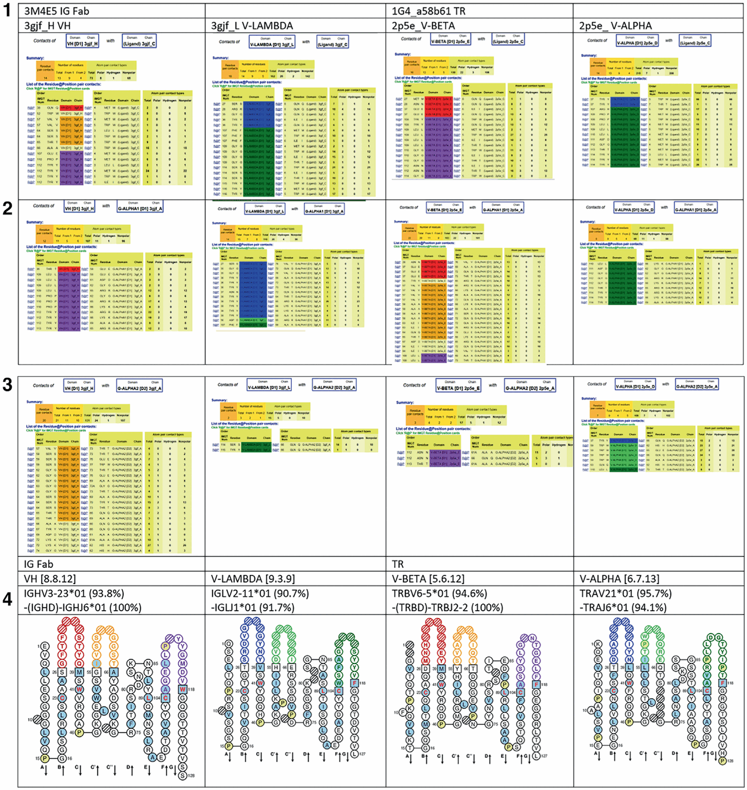

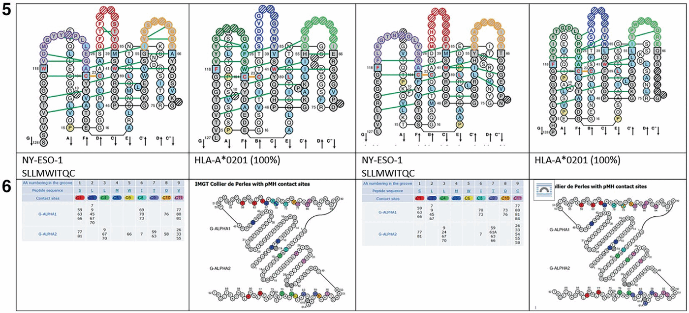

Fig. 19 계속

Fig. 19 peptide-HLA를 함께 표적으로 하는 TR 모방 항체와 고전적 TR의 접촉 분석 및 IMGT Collier de Perles [144]. "3M4E5" IG Fab(TR 모방 항체)(IMGT/3Dstructure-DB: 3gif)의 VH와 V-LAMBDA, 그리고 "1G4_a58b61" TR(고전적 TR)(IMGT/3Dstructure-DB: 2p5e)의 V-BETA와 V-ALPHA(왼쪽부터 오른쪽으로 열 1–4)는 MH1 HLA-A*02:01이 제시하는 NY-ESO-1 노나머 펩타이드 SLLMWITQC("리간드")를 표적으로 한다(마지막 행) [148]. 위에서 아래로 다음이 제시된다. 1. V 도메인(VH, V-LAMBDA, V-BETA, V-ALPHA)과 펩타이드 리간드 사이의 접촉. 2. V 도메인과 MH1 G-ALPHA1 도메인 사이의 접촉. 3. V 도메인과 MH1 G-ALPHA2 도메인 사이의 접촉. 4. CDR-IMGT 길이(대괄호 안)와 함께 한 층으로 표현한 V 도메인의 IMGT Collier de Perles: VH [8.8.12], V-LAMBDA [9.3.9], V-BETA [5.6.12], V-ALPHA [6.7.13], 그리고 생식계열 유전자와 비교한 동일성 비율과 함께 재배열된 V 및 J 유전자와 대립유전자. 5. V 도메인(VH, V-LAMBDA, V-BETA, V-ALPHA)의 수소 결합과 함께 두 층으로 표현한 IMGT Collier de Perles(IMGT/3Dstructure-DB: 3gif, 2p5e). 6. NY-ESO-1 펩타이드 SLLMWITQC와 MH1 HLA-A*02:01 홈(pMH 접촉 부위)의 접촉(마지막 행, IMGT/3Dstructure-DB: 3gif(1열) 및 2p5e(3열)), 그리고 MH1 HLA-A*02:01 G-ALPHA1 및 G-ALPHA2 도메인의 IMGT Collier de Perles(마지막 행, IMGT/3Dstructure-DB: 3gif(2열) 및 2p5e(4열)). CDR1-IMGT, CDR2-IMGT, CDR3-IMGT는 IMGT 색상 메뉴를 따른다(VH와 V-BETA는 각각 적색, 주황색, 자주색; VL, 여기서는 V-LAMBDA와 V-ALPHA는 각각 청색, 녹색, 청록색) (M.-P. Lefranc 및 G. Lefranc, LIGM, IMGT®(국제 ImMunoGeneTics 정보 시스템®, https://www.imgt.org)의 창립자 겸 저자, 허가를 받아 사용)

### 9 인간 IG 사슬의 동종이형

인간 IG 동종이형(allotype)은 인간 IG 중쇄와 경쇄에서 혈청학적으로, 전통적으로는 혈구응집 억제법으로 판정되는 항원 결정기(또는 '표지')이다. 동종이형은 gamma1, gamma2, gamma3, alpha2 중쇄(각각 G1m, G2m, G3m, A2m 동종이형으로 지정)와 카파 경쇄(Km 동종이형)에서 확인되었다 [99, 100]. Gm 및 Am 동종이형은 집단유전학에서 가장 강력한 도구 가운데 하나였고 [99, 100, 149–153], 인간 IGHC 유전자의 분자적 특성 규명(유전자 전환, 복제수 변이 또는 CNV, 유전자 순서)에 결정적으로 기여했다 [154–162](참고(Note) 13 참조). 동종이형은 키메라 항체나 인간화 항체의 특정 위치에서 잠재적으로 면역원성이 있는 아미노산을 규명하는 데 사용되어 왔다 [94–96]. 동종이형 및 대립유전자 다형성 아미노산은 질량분석법으로 단백질 서열에서 동정되었다 [97, 98]. 동종이형은 아미노산 및 형태 변화와 관련하여 다형성 IG 사슬의 면역원성을 이해하는 주요 체계를 이룬다 [99, 100]. C-DOMAIN에 대한 IMGT 고유 번호 체계는 Gm, Am, Km 동종이형에 대한 표준화된 기술을 제공하고, G1m, G2m, G3m, A2m, Km 동종이형과 IGHG1, IGHG2, IGHG3, IGHA2, IGKC 대립유전자 사이의 상관관계를 최초로 확립함으로써 항체 공학과 인간화에 기여했다 [99, 100](Table 6). 이 정보는 염기서열 분석으로 얻은 다형성 데이터 [155]와 항체 단백체 분석에서의 동종이형 특성 규명 [97, 98]을 해석하는 데 특히 유용하다.

IgG1은 치료용 항체에서 가장 흔한 아형으로, H-gamma1 사슬의 불변 영역은 Homo sapiens IGHG1*01(100%), G1m17,1(CH1 K120 (214), CH3 D12 (356), L14 (358)), Homo sapiens IGHG1*03(100%), G1m3, nG1m1(CH1 R120 (214), CH3 E12 (356), M14 (358)), 또는 조작 변이체 IGHG1*03v, G1m3>G1m17, nG1m1(CH1 R120>K (214), CH3 E12 (356), M14 (358))에 의해 암호화된다(괄호 안의 숫자는 Eu-IMGT 위치이다 [102])(IMGT Scientific chart https://www.imgt.org/IMGTScientificChart/ > 2. Numbering > Correspondence between C numberings).

H-gamma2 사슬의 불변 영역은 Homo sapiens IGHG2*01(100%), G2m..(CH2 V45.1 (282)) 또는 조작 변이체 IGHG2*02v, G2m23 > G2m..(CH2 M45.1 > V (282))에 의해 암호화된다(IMGT Repertoire https://www.imgt.org/IMGTrepertoire/ > 4. Allotypes > IGHC: human (Homo sapiens) > G2m allotypes > G2m23 allotype and G2m..). H-gamma3 사슬은 길고 다형성이 큰 힌지(4개 엑손 힌지의 경우 62개 아미노산) 때문에 치료용 항체에서는 거의 사용되지 않지만, Homo sapiens IGHG3*01, G3m5*(G3m5,10,11,13,14,26,27) CH3 S44 (384), M84 (397), Q98 (419), I101 (422), R115 (435), F116 (436)에 의해 암호화되는 불변 영역이 보고되어 있다(다른 아이소타입과 비교할 때 괄호 안의 숫자는 CH3의 Eu-IMGT 위치이다 [102]. IMGT G3m 대립유전자 나비 표현 [99, 100]은 IMGT Repertoire https://www.imgt.org/IMGTrepertoire/ > 4. Allotypes > IGHC: Human (Homo sapiens) > G3m allotypes에서 확인할 수 있다.

Table 6 IGHG1 대립유전자와 G1m 대립유전자의 대응 관계

G1m 동종이형 또는 G1m 대립유전자에 관여하는 아미노산을 지닌 IGHG1 대립유전자, 즉 항체 시약으로 면역원성이 실험적으로 입증된 대립유전자만을 제시하였다 [99, 100].

| IGHG1 대립유전자 | G1m 대립유전자a 동종이형 | 동종이형c | 103 | 120 | 12 | 14 | 101 | 110 | 115 | 116 | 집단 |
|---|---|---|---|---|---|---|---|---|---|---|---|
| *번호 체계* | | | IMGT | IMGT | IMGT | IMGT | IMGT | IMGT | IMGT | IMGT | |
| *엑손 번호* | | | (82) | (97) | (16) | (18) | (82) | (91) | (95) | (96) | |
| *Eu 번호* | | | 199 | 214 | 356 | 358 | 422 | 431 | 435 | 436 | |
| *G1m 대립유전자* | G1m17/nG1m17, G1m3d | | | | G1m1/nG1m1 | | G1m27/– | | G1m2/– | G1m28/– | |
| IGHG1*01 e, IGHG1*02 e | G1m17,1 | | I | K | D | L | V | A | H | Y | Caucasoid, Negroid, Mongoloid |
| IGHG1*03 | G1m3 | nG1m1, nG1m17 | I | R | E | M | V | A | H | Y | Caucasoid |
| IGHG1*04 | G1m17,1,27 | | I | K | D | L | I | A | H | Y | Negroid |
| IGHG1*05p f | G1m17,1,28 | | I | K | D | L | V | A | R | Y | Negroid |
| IGHG1*06p f | G1m,17,1,27,28 | | I | K | D | L | I | A | R | Y | Negroid |
| IGHG1*07p f | G1m17,1,2 | | I | K | D | L | V | G | H | Y | Caucasoid, Mongoloid |
| IGHG1*08p f | G1m3,1 | nG1m17 | I | R | D | L | V | A | H | Y | Mongoloid |
| IGHG1*09p f | G1m17 | nG1m1 | I | K | E | M | V | A | H | Y | |
| IGHG1*03v g | G1m3 > G1m17 | nG1m1 | I | K | E | M | V | A | H | Y | Engineered |
| IGHG1*01v g | G1m17,1 > G1m3,1 | nG1m17 | I | R | D | L | V | A | H | Y | Engineered |

a Negroid 집단에서는 G1m17,1 대립유전자가 G1m27 및/또는 G1m28을 흔히 포함하며, 이로써 세 가지 추가 G1m 대립유전자, 즉 G1m17,1,27, G1m17,1,28, G1m17,1,27,28이 생겨난다. 이들은 혈청학적으로 입증되었고 [99, 100], 그중 하나인 IGHG1*04는 서열 수준에서 확인되었으며, IGHG1*05p와 IGHG1*06p의 존재가 예상된다.

b IMGT 위치는 C 도메인에 대한 IMGT 고유 번호 체계 [53]를 따르며, 괄호 안은 엑손 번호, 기울임체는 Eu 번호이다. 표에서 G1m 동종이형에 해당하는 아미노산은 굵게 표시하였다.

c Gm1 음성 및 Gm-17 음성 gamma-1 사슬(및 다른 gamma 사슬)에 존재하는 nG1m1 및 nG1m17 동종이형(isoallotype)은 기울임체로 표시하였다.

d R120의 존재는 항-nG1m17 항체로 검출되는 반면, gamma1 사슬에서 I103과 R120이 동시에 존재하는 것은 항-Gm3 항체로 검출된다 [99, 100].

e IGHG1*01과 IGHG1*02는 염기 수준에서만 다르다(CH2의 코돈 85.1).

f 문자 'p'는 이들 대립유전자가 아직 염기 수준에서 서열이 결정되지 않았음을 뜻하며 [99, 100], 따라서 IMGT Repertoire(IG and TR) https://www.imgt.org/IMGTrepertoire/ > Alignments of alleles > IGHC > human (Homo sapiens) > IGHG1에는 제시되지 않는다.

g 변형된 동종이형을 지닌 조작 대립유전자 IGHG1*03v와 IGHG1*01v는 각각 자연 대립유전자 IGHG1*09p 및 IGHG1*08p와 동일한 아미노산 서열을 갖지만, 조작된 치료용 항체에는 *03v 및 *01v 명명법을 사용해야 한다.

색상은 동종이형 또는 동종이형(isoallotype)에 관여하는 아미노산을 강조한다: 연한 청색(G1m17), 진한 청색(G1m3), 황색(G1m1), 연한 황색(nG1m1), 녹색(G1m27), 보라색(G1m2).

M.-P. Lefranc 및 G. Lefranc, LIGM, IMGT®(국제 ImMunoGeneTics 정보 시스템®, https://www.imgt.org)의 창립자 겸 저자, 허가를 받아 사용.

경쇄의 경우, Homo sapiens IGKC*01(100%) Km3 A45.1 (154), V101 (192) Km 대립유전자는 집단에서 가장 널리 분포하며 면역원성이 가장 낮다

https://www.imgt.org/IMGTrepertoire/ > 4. Allotypes > IGKC: Human (Homo sapiens) > Km allotypes).

10 이펙터 특성, 반감기 및 치료 항체의 구조를 위한 IGHG 조작 변이체

IG 중쇄의 IGHG 불변 영역에 있는 아미노산은 치료용 단일클론항체(mAb)의 이펙터 특성, 기능 및 구조를 바꾸기 위해 흔히 조작된다 [101, 102]. 아미노산 변화는 항체 의존성 세포성 세포독성(ADCC), 항체 의존성 세포성 식세포작용(ADCP), 보체 의존성 세포독성(CDC), 반감기 증가 또는 감소, half-IG 교환, 그리고 동일 세포에서 항원과 FcγR의 동시 결합을 통한 B 세포 억제에 관여하는 위치에 도입된다 [101, 102](IMGT Biotechnology page https://www.imgt.org/IMGTbiotechnology/ > Antibody glycosylation and effector properties > Amino acid positions involved in ADCC, ADCP, CDC, half-life, and half-IG exchange).

이러한 특성과 기능을 바탕으로 IMGT 조작 변이체는 네 범주에 대응하는 18가지 유형으로 분류되었다 [101, 102]. 첫 번째 범주인 "이펙터(Effector)"(유형 1–8)는 이펙터 특성에 영향을 주는 변이체를 가리킨다. 1. ADCC 감소, 2. ADCC 증강, 3. ADCC 및 ADCP 증강, 4. CDC 증강, 5. CDC 감소, 6. ADCC 및 CDC 감소, 7. FcγRIIB 결합 증가 및 B 세포 억제(동일 세포에서 항원과 FcγR의 동시 결합), 8. CH2 84.4 글리코실화 녹아웃. 두 번째 범주인 "반감기(Half-life)"(유형 9)는 반감기에 영향을 주는 변이체를 가리킨다(대부분 반감기를 늘리거나, 일부는 줄인다). 세 번째 범주인 "물리화학적 특성(Physicochemical properties)"(유형 10)에는 Protein A 결합의 소실, 열 안정성, pI, 산 유도 응집의 감소 같은 특성이 포함된다. 네 번째 범주인 "구조(Structure)"(유형 11–18)는 단일특이성, 이중특이성 또는 다중특이성 항체의 안정성이나 구조에 영향을 주는 변이체를 가리키며 다음을 포함한다. 11. scFv를 비롯한 도메인 안정화를 위한 추가 가교 형성, 12. IgG4 half-IG 교환 방지, 13. 헥사머화, 14. knobs-into-holes 및 이중특이성 항체 H–H 이종이량체화 증강, 15. H–L 간 및/또는 H–H 간 이황화 결합의 억제, 16. 부위특이적 약물 부착(예: 추가 시스테인), 17. 이중특이성 항체의 H–L 이종쌍 형성 증강, 18. 이중특이성 IgG의 half-IG 교환 제어 [101, 102].

표준화된 IMGT 조작 변이체 명명법 [101, 102]은 이펙터 특성(ADCC, ADCP, CDC), 반감기, 치료용 단일클론항체의 구조와 관련된 조작 항체 변이체를 더 쉽게 비교할 수 있도록 마련되었다. IMGT 조작 변이체 이름은 종(예: Homo sapiens의 경우 Homsap), 변이체 유형(1부터 18까지의 숫자), 유전자 이름 약어(예: IGHG1의 경우 G1), 그리고 숫자가 붙은 문자 "v"(예: Homsap 1-G1v1)로 구성된다. 변이체 이름에 덧붙는 IMGT 조작 변이체 정의는 각 조작된 AA 변화마다 도메인, 한 글자 약어로 표기한 AA [83]와 C 도메인에 대한 IMGT 고유 번호 체계 [53]에 따른 위치, 그 뒤에 괄호로 묶인 Eu-IMGT 위치를 포함한다(예: Homsap 1-G1v1, CH2 P1.4 (233)) [101, 102](Table 7). 치료용 항체의 WHO INN 기술 [42–44]에서는 Eu-IMGT 위치 대신 항체 사슬 서열에서의 AA 변화 위치를 사용한다. Fc 조작 변이체의 표준화된 특성 기술(Table 7)에는 또한 (1) IGHG CH 도메인의 IMGT AA 변화(예: CH2 E1.4 > P), (2) Eu-IMGT 위치에서의 AA 변화(예: E233P), (3) IMGT 고유 번호 체계 [53]에 따른 위치와 함께 유전자 및 도메인에서 확인할 수 있는 IMGT 위상학적 모티프 서열로서, 변화에 관여하는 AA를 각각 변화 전에는 적색, 변화 후에는 녹색으로 굵게 강조하여 표시한 것(예: IGHG1 CH2 1.6–3 APELLGGPS > APPLLGGPS. 모티프에서 밑줄 친 아미노산은 C 도메인에 대한 IMGT 고유 번호 체계 [53]의 추가 위치에 해당하며, 예컨대 APELLG와 APPLLG는 1.6, 1.5, 1.4, 1.3, 1.2, 1.1에 해당한다), 그리고 (4) "특성 및 기능"(변이체당 최소 하나, 최대 세 개)과 가능한 경우 3D 구조가 포함된다(Table 7) [101, 102].

IMGT 조작 변이체는 해당 유전자의 *01 대립유전자와 비교하여 분류하며, 그 효과가 대립유전자에 무관한 경우에는 다른 대립유전자의 아미노산(AA) 변화를 기술하기 위한 기준으로 삼는다. 이러한 경우 동일 종의 같은 유전자에 속한 모든 대립유전자에 동일한 변이체(v) 번호를 사용한다.

Table 7에 제시된, 치료용 항체에서 발견되는 Fc 조작 변이체의 예 [101, 102]는 다음과 같다.

1.	 ADCC 및 CDC 감소: Homsap 6-G1v4 CH2 A114(CH2 P114>A (329)); Homsap 6-G2v3 CH2 A1.2, A1, S2, A30, L92, S115, S116(CH2 V1.2>A (235), G1>A (237), P2>S (238), H30>A (268), V92>L (309), A115>S (330), P116>S (331)); Homsap 6-G4v4 CH2 A1.3, A1.2(CH2 F1.3>A (234), L1.2>A (235),

2.	 반감기 증가: Homsap 9-G1v21 CH2 Y15.1, T16, E18(CH2 M15.1>Y (252), S16>T (254), T18>E (256)),

3.	 half-IG 교환 감소: Homsap 12-G4v5 h P10(힌지 1–12 S10>P (228)),

4.	 N-글리코실화 부위 제거: Homsap 8-G4v36 CH2 Q84.4(CH2 N84.4>Q (297)).

Table 7 치료용 항체에서 발견되는 IMGT 조작 Fc 변이체의 예 [101, 102]

| 유형 | 종 | IMGT 조작 Fc 변이체 이름 | IMGT 조작 변이체 정의 | IGHG CH 도메인의 IMGT 아미노산 변화a,b | Eu-IMGT 위치에서의 아미노산 변화 | IMGT 고유 번호 체계c에 따른 위치와 함께 유전자 및 도메인에서 확인할 수 있는 IMGT 위상학적 모티프 [101, 102] | 1. 특성 및 기능 | 2. 특성 및 기능 |
|---|---|---|---|---|---|---|---|---|
| 6 | Homsap | 6-G1v4 | CH2 A114 | CH2 P114>A | P329A | IGHG1 CH2 FG 105–117 KVSNKA..LPAPI>KVSNKA..LAAPI | ADCC 감소. FcγR 결합 감소 [m117]. | CDC 감소. C1q 결합 감소 [m117]. |
| 6 | Homsap | 6-G2v3 | CH2 A1.2, A1, S2, A30, L92, S115, S116 | CH2 V1.2>A, G1>A, P2>S, H30>A, V92>L, A115>S, P116>S (G2sigma) | V235A, G237A, P238S, H268A, V309L, A330S, P331S | IGHG2 CH2 1.6–3 AP.PVAGPS>AP.PAA ASS; 27–38 DVSHEDPEVQ>DVSAEDPEVQ; 89–96 LTVVHQDW>LTVLHQDW; FG 105–117 KVSNKG..LPAPI>KVSNKA..LPSSI | ADCC 감소. FcγR 결합 감소. ADCC 및 ADCP 검출 불가. | CDC 감소. C1q 결합 감소. CDC 검출 불가. |
| 6 | Homsap | 6-G4v4 | CH2 A1.3, A1.2 | CH2 F1.3>A, L1.2>A (FALA) | F234A L235A | IGHG4 CH2 1.6–3 APEFLGGPS>APEAAGGPS | ADCC 감소. FcγR 결합 감소. | CDC 감소. C1q 결합 감소. |
| 9 | Homsap | 9-G1v21 | CH2 Y15.1, T16, E18 | CH2 M15.1>Y, S16>T, T18>E (YTE) | M252Y, S254T, T256E | IGHG1 CH2 13–18 DTLMISRT>DTLYITRE | 반감기 증가. pH 6.0에서 FCGRT 결합 증강 [m133, m134]. | |
| 12 | Homsap | 12-G4v5 h | h P10 | h S10>P | S228P | IGHG4 h 1–12 ESKYGPPCPSCP>ESKYGPPCPPCP (G1-like) | 생체 내 및 시험관 내 IgG4 half-IG 교환 방지 | |
| 8 | Homsap | 8-G4v36 | CH2 Q84.4 | CH2 N84.4>Q | N297Q | IGHG4 CH2 83–86 REEQFNSTYRVV>REEEQFQSTYRVV | ADCC 감소. FcγR 결합 감소 | CH2 84.4의 N-글리코실화 부재에 기인한다. |

a 조작된 아미노산은 변화 전에는 적색, 변화 후에는 녹색이다. 표준화된 IMGT 변이체 명명법을 사용할 수 있는 아미노산 서열이 있는 항체 기술(예: WHO INN 제안 및 권고 목록 [42–44])에서는 Eu-IMGT 위치 대신 항체 사슬에서의 위치를 괄호 안에 덧붙인다.

b 문헌에서 발견되는 별칭 변이체 이름은 청색으로 표시하였다.

c 모티프는 황색으로 표시하며 AA 변화 전과 후를 함께 보여준다. C 도메인에 대한 IMGT 고유 번호 체계 [53]의 추가 위치에 있는 모티프 아미노산(V 도메인 IMGT 고유 번호 체계 [52]와 비교하여)은 밑줄로 표시하였다.

배경색은 해당 "이펙터" 특성 및 기능의 감소(분홍색) 또는 증강(녹색)을 나타낸다. 그 밖의 특성 및 기능의 경우 배경색은 "구조"(황색), "반감기"(연한 청색), 또는 표시하지 않은 "물리화학적 특성"(연한 주황색) 범주를 가리킨다.

M.-P. Lefranc 및 G. Lefranc, LIGM, IMGT®(국제 ImMunoGeneTics 정보 시스템®, https://www.imgt.org)의 창립자 겸 저자, 허가를 받아 사용.

### 11  이용 가능성 및 인용

IMGT® 데이터베이스와 도구를 사용하는 저자들은 이 논문을 인용하고 IMGT® 홈페이지(https://www.imgt.org)를 함께 밝혀 주기를 권장한다. IMGT® 데이터베이스와 도구는 학계에는 무료로, 기업에는 라이선스와 계약에 따라 온라인으로 제공된다.

### 12  참고(Notes)

1.	 IMGT는 처음에는 인류 면역글로불린 동종이형(allotype), 희귀 유전 질환, 근친 가계의 혈청학적 표지자를 연구하던 Gérard Lefranc의 'Laboratoire d'ImMunoGénéTique'의 약자였다. 이 연구실은 레바논 베이루트의 Université Saint-Joseph(USJ) 의학·약학·치의학부(1969–1976)에 있다가, 튀니지 Monastir의 약학·치의학부(1976–1982)를 거쳐 1983년부터 프랑스 Montpellier 대학(UM)에 자리 잡았다. 1983년 Gérard 교수와 Marie-Paule Lefranc 교수가 정년 보직을 받으면서 이 연구실은 분자면역유전학 연구실(Laboratoire d'ImmunoGénétique Moléculaire, LIGM, Université de Montpellier 및 CNRS)이 되었다. 1989년 6월, New Haven에서 열린 HGM10에서 Marie-Paule Lefranc는 LIGM을 대표하여 국제 면역유전학 정보 시스템(international ImMunoGeneTics information system)인 IMGT를 창설했고[1](1995년 샌프란시스코(CA, USA)에서 열린 제9회 국제 면역학 학술대회에서 처음으로 온라인 인터넷 접속을 선보였다), 2003년에는 면역유전학과 면역정보학의 세계적 기준으로 인정받았다[1]. 창설 이래 지난 35년 동안 LIGM이 IMGT 정보 시스템을 운영해 왔다.

2.	 1989년 New Haven에서 열린 제10회 인간 유전체 지도 작성 워크숍(HGM10)에서 IMGT가 창설된 이후, 인간과 다른 척추동물 종의 IG 및 TR에 대한 표준화된 분류와 명명은 Marie-Paule Lefranc가 창설하고 의장을 맡은 IMGT 명명 위원회(IMGT-NC)의 책임 아래 이루어져 왔다. 1995년 샌프란시스코(CA, USA)에서 열린 제9회 국제 면역학 학술대회에서 IMGT 뉴클레오타이드 데이터베이스인 IMGT/LIGM-DB가 처음 온라인으로 시연된 뒤, IMGT-NC는(1992년부터 IUIS 명명 위원회와 협력해 왔다) 공식적으로 IUIS 면역글로불린(IG) 및 T 세포 수용체(TR) 명명 소위원회(IMGT-NC)가 되었다[33, 34]. IMGT의 IG 및 TR 유전자와 대립유전자 이름은 IMGT-ONTOLOGY CLASSIFICATION 공리에서 도출된 'Group', 'Subgroup', 'Gene', 'Allele' 분류 개념에 바탕을 둔다[3, 4].

3.	 가변(V) 도메인은 IG와 TR의 V-DOMAIN 및 IG와 TR 이외의 면역글로불린 상과(IgSF) 단백질의 V-LIKE-DOMAIN을 포함한다[52]. 불변(C) 도메인은 IG와 TR의 C-DOMAIN 및 IG와 TR 이외의 IgSF 단백질의 C-LIKE-DOMAIN을 포함한다[53]. 홈(G) 도메인은 주조직적합성(MH)의 G-DOMAIN과 MH 이외의 MH 상과(MhSF) 단백질의 G-LIKE-DOMAIN(또는 면역계 관련 단백질(RPI)-MH1Like)을 포함한다[54]. (RPI-)MH2Like 단백질은 아직 확인된 바 없다.

4.	 IMGT-ONTOLOGY에서는 CDR-IMGT를 규정할 때 정준 구조(canonical structure, CS) 대신 CDR-IMGT 길이를 사용한다. 그 이유는 다음과 같다. (1) 확인된 CS 19개 가운데 15개가 특정 CDR-IMGT 길이에 대응한다. (2) 서로 다른 (단 두 개의) CS를 갖는 CDR-IMGT 길이는 IGLV의 9개 아미노산[9..]으로 된 CDR1-IMGT와 IGHV의 8개 아미노산[.8.]으로 된 CDR2-IMGT뿐이다. (3) 모든 CDR-IMGT 길이에 대해 CS가 확인된 것은 아니다. (4) 문헌에는 실험적 구조 증거 없이 서열만으로 기술된 'CS 변이형'이 다수 보고되어 있다. (5) CDR3는 길이와 서열의 다양성, 그리고 유연성 때문에 표준화된 CS를 규정할 수 없다. (6) CS 동정은 3D 구조를 알고 있을 때만 신뢰할 수 있다. 따라서 서열을 다루는 상황에서 세 개의 CDR을 정의하는 가장 정확한 방법은 CDR-IMGT 길이다. CDR-IMGT 길이는 대괄호 안에 마침표로 구분한 세 숫자로 표시한다(예: [8.8.13]). 필요하다면 Residue@Position 특성으로 정보를 보완할 수 있다.

5.	 골격은 역평행 베타 가닥으로 이루어지며, V 도메인에는 9개(A, B, C, C′, C″, D, E, F, G), C 도메인에는 7개(A, B, C, D, E, F, G)가 있다.

6.	 '3ixt'는 RCSB(Research Collaboratory for Structural Bioinformatics) 단백질 데이터 뱅크(PDB)[93]의 3D 구조 항목 코드, 즉 'PDB 코드'(네 개의 문자 및/또는 숫자로 구성)이다. IMGT®는 IMGT/3Dstructure-DB의 3D 구조에 대해 'PDB 코드'를 'IMGT 항목 ID'로 사용한다(https://www.imgt.org/3Dstructure-DB/) [45–47]. '_'로 구분된 추가 문자는 하나의 3D 구조 안에서 서로 다른 사슬을 나타낸다. 예를 들어 3ixt 항목은 IG/항원(Ag) 복합체(항원인 '리간드' 융합 당단백질 F1과 복합체를 이룬 motavizumab Fab)의 3D 구조로, IG Fab의 경우 3ixt_A와 3ixt_H(VH–CH1), 3ixt_B와 3ixt_L(L-KAPPA) 사슬을, 항원('리간드')의 경우 3ixt_C와 3ixt_P 사슬을 포함한다.

7.	 아미노산(AA) 한 글자 및 세 글자 약어: A (Ala), 알라닌; C (Cys), 시스테인; D (Asp), 아스파르트산; E (Glu), 글루탐산; F (Phe), 페닐알라닌; G (Gly), 글리신; H (His), 히스티딘; I (Ileu), 이소류신; K (Lys), 라이신; L (Leu), 류신; M (Met), 메티오닌; N (Asn), 아스파라긴; P (Pro), 프롤린; Q (Gln), 글루타민; R (Arg), 아르기닌; S (Ser), 세린; T (Thr), 트레오닌; V (Val), 발린; W (Trp), 트립토판; Y (Tyr), 티로신.

아미노산의 물리화학적 특성에 관한 자세한 정보[83]와 분류표(https://www.imgt.org/IMGTeducation/Aide-memoire/_UK/aminoacids/IMGTclasses.html)는 IMGT Aide-Memoire(https://www.imgt.org/IMGTeducation/Aide-memoire/)에서 확인할 수 있다. Residue@Position에서는 아미노산 세 글자 약어를 대문자로 표기한다.

8.	 앵커 위치(anchor position)는 V 도메인에 대해 처음 정의되었으며, 가닥(또는 V-DOMAIN의 FR-IMGT)에 속하면서 세 개의 BC, C′C″, FG 루프(V-DOMAIN에서는 각각 CDR1-IMGT, CDR2-IMGT, CDR3-IMGT)를 지지하는 '앵커' 역할을 한다. V 도메인(IG와 TR의 V-DOMAIN, 그리고 IG와 TR 이외 IgSF의 V-LIKE-DOMAIN)의 앵커 위치는 26번과 39번, 55번과 66번, 104번과 118번이다[52]. 이와 유사하게 C 도메인에서는 여섯 개의 앵커 위치가 정의되었는데[53], 26번과 39번, 45번과 77번(C 도메인의 특징적인 가로 방향 CD 가닥을 한정한다), 104번과 118번이다[53]. 이는 구조적으로 IG와 TR J-REGION의 J-PHE 또는 J-TRP에 해당한다[3, 4]. 앵커 위치는 IMGT Colliers de Perles에서 사각형으로 표시된다.

9.	 V-DOMAIN의 CDR-IMGT에 대한 IMGT 색상 메뉴는 재배열 유형, 즉 V–J 또는 V–D–J를 나타낸다[3, 4]. 따라서 CDR1-IMGT, CDR2-IMGT, CDR3-IMGT의 IMGT 색상 메뉴는 VH(V–D–J 재배열에서 생긴 V–D–J-REGION에 의해 암호화된다)의 경우 빨강, 주황, 보라이고, V-KAPPA 또는 V-LAMBDA(V–J 재배열에서 생긴 V–J-REGION에 의해 암호화된다)의 경우 파랑, 초록, 초록–파랑이다(https://www.imgt.org/IMGTScientificChart/RepresentationRules/colormenu.php). 이 배정은 IMGT/DomainGapAlign이 자동으로 수행한다[46, 80, 81].

10.	 원자쌍 접촉(atom pair contact)은 두 'R@P'의 원자 사이 상호작용을 규정한다. IMGT/3Dstructure-DB에서는 두 원자 사이에 물 분자가 들어갈 수 없을 때 접촉으로 간주하는 로컬 프로그램으로 이를 산출한다[46, 47].

11.	 'Residue@Position' 특성에는 일반 정보(PDB 파일 번호, IMGT 파일 번호, 잔기 전체 이름, 화학식)와 구조 정보인 'IMGT LocalStructure@Position'(2차 구조, 파이·프사이 각도(도 단위), 용매 접근 표면적(ASA, 제곱 옹스트롬))이 포함된다.

12.	 아미노산(AA) 변화는 소수성(세 등급), 부피(다섯 등급), 물리화학적 특성(11등급)에 따라 기술한다[83]. S40>G (+ + −)는 40번 코돈에서 변화에 관여한 두 아미노산(S>G)이 같은 소수성(+) 및 부피(+) 등급에 속하지만 물리화학적 특성은 다른 등급(−)에 속한다는 뜻이다[83]. 이를 바탕으로 우리는 네 가지 유형의 아미노산 변화를 구분했다. 매우 유사(+ + +), 유사(+ + −, + − +), 상이(− − +, − + −, + − −), 매우 상이(− − −)이다[46, 80, 81].

13.	 튀니지의 한 근친 가계에서 G1m 동종이형이 없었던 것이 계기가 되어, 건강한 70세 여성에서 동형접합 상태의 IGHC 유전자 다유전자 결손이 처음 확인되었고, IgG1, IgA1, IgG2, IgG4 아형이 동시에 완전히 결여되어 있음과 함께 인간의 IGHC 유전자 순서 5′-M-D-G3-G1-EP1-A1-GP-G2-G4-E-A2-3′가 밝혀졌다[156–158]. 건강한 개인에서 150 kb에 걸친 다른 다유전자 결손과 다양한 CNV(IGHE 유전자가 없어 IgE 클래스가 결여된 경우 포함)도 튀니지[159–161]와 다른 집단[162–164]에서 보고되었다.

감사의 글

IMGT 참고문헌 목록에서 확인할 수 있는 IMGT Booklet의 PDF를 제공해 주신 Cold Spring Harbor Protocol Press에 감사드린다. IMGT®는 CNRS의 등록 상표이다. IMGT®는 국제 의료정보학 협회(IMIA)와 유전체 및 건강 글로벌 연합(GA4GH)의 회원이다. IMGT®는 유럽연합(EU)의 BIOMED1(BIOCT930038), 생명공학 BIOTECH2(BIO4CT960037), 제5차 PCRDT 삶의 질 및 생활 자원 관리(QLG2-2000-01287), 제6차 PCRDT 정보과학기술(ImmunoGrid, FP6 IST-028069) 프로그램의 일부 지원을 받았다. IMGT는 GIS IBiSA, BioCampus Montpellier, Région Occitanie(연구를 위한 대형 기술 플랫폼(GPTR)), 프랑스 국립연구청(ANR), Labex MabImprove(ANR-10-LABX-53-01)의 재정 지원을 받았다. IMGT는 GENCI(Grand Equipement National de Calcul Intensif)가 배정한 [036029](2010-2025) 할당으로 CINES의 HPC 자원에 접근할 수 있다. IMGT®는 현재 프랑스 국립과학연구센터(CNRS), 고등교육연구부(MESR), Université de Montpellier의 지원을 받고 있다.

이해 상충  저자들은 이 장의 내용과 관련하여 밝혀야 할 이해 상충이 없다.

### 참고문헌

1.	Lefranc M-P (2003) IMGT, the international 
ImMunoGeneTics information system. In: 
Bock G, Goode J (eds) Immunoinformatics: 
Bioinformatic strategies for better understanding of immune function, vol 254. 
Novartis Foundation Symposium, John Wiley 
and Sons, Chichester, pp 126–126, discussion 
136–142, 216–222, 250–252
	
2.	Lefranc M-P (2014) Immunoglobulin and 
T cell receptor genes: IMGT® and the 
birth and rise of immunoinformatics. Front 
Immunol 5:22. https://doi.org/10.3389/
fimmu.2014.00022
	
3.	Lefranc 
M-P, 
Lefranc 
G 
(2001) 
The 
Immunoglobulin FactsBook. Academic Press, 
London, Harcourt Science and Technology 
Company, San Diegop p. 458
	
4.	Lefranc M-P, Lefranc G (2001) The T cell 
receptor FactsBook. Academic Press, London, 
Harcourt Science and Technology Company, 
San Diegop p. 398
	
5.	Lefranc M-P (2000) Nomenclature of the 
human immunoglobulin genes. In: Coligan 
JE, Bierer BE, Margulies DE, Shevach EM, 
Strober W (eds) Current Pprotocols in 
Iimmunology. John Wiley and Sons, Hoboken 
N.J., pp A.1 P.1–A.1 P.37
	
6.	Lefranc M-P (2000) Nomenclature of the 
human T cell Receptor genes. In: Coligan 
JE, Bierer BE, Margulies DE, Shevach EM, 
Strober W (eds) Current Pprotocols in 
Iimmunology. John Wiley and Sons, Hoboken 
N.J., pp A.1 O.1–A.1 O.23
	
7.	Lefranc M-P (2000) Locus maps and genomic 
repertoire of the human T cell receptor genes. 
Immunologist 8/3:72–79
	
8.	Lefranc M-P (2000) Locus maps and genomic 
repertoire of the human immunoglobulin 
genes. Immunologist 8/3:80–88
	
9.	Lefranc M-P (1998) IMGT locus in focus: 
a new section of experimental and clinical 
immunogenetics. Exp Clin Immunogenet 
15:1–7. PMID: 9619395
	 10.	Pallarès N, Frippiat J-P, Giudicelli V, Lefranc

(IGLJ) segments. Exp Clin Immunogenet 
15:8–18. PMID: 9619396
	 11.	Barbié V, Lefranc M-P (1998) The human

immunoglobulin 
kappa 
variable 
(IGKV) 
genes and joining (IGKJ) segments. Exp Clin 
Immunogenet 15:171–183. PMID: 9813414
	 12.	Martinez C, Lefranc M-P (1998) The mouse

(Mus musculus) immunoglobulin kappa variable (IGKV) genes and joining (IGKJ) segments. Exp Clin Immunogenet 15:184–193. 
PMID: 9813415
	 13.	Pallarès N, Lefebvre S, Contet V, Mastuda F,

Lefranc M-P (1999) The human immunoglobulin heavy variable (IGHV) genes. 
Exp Clin Immunogenet 16:36–60. PMID: 
10087405
	 14.	Ruiz M, Pallarès N, Contet V, Barbié V,

Lefranc M-P (1999) The human immunoglobulin heavy diversity (IGHD) and joining 
(IGHJ) segments. Exp Clin Immunogenet 
16:173–184. PMID: 10394055
	 15.	Scaviner D, Barbié V, Ruiz M, Lefranc M-P

(1999) Protein displays of the human immunoglobulin heavy, kappa and lambda variable 
and joining regions. Exp Clin Immunogenet 
16:234–240. PMID: 10575277
	 16.	Folch G, Lefranc M-P (2000) The human

T cell receptor beta variable (TRBV) genes. 
Exp Clin Immunogenet 17:42–54. PMID: 
10686482
	 17.	Scaviner D, Lefranc M-P (2000) The human

T cell receptor alpha variable (TRAV) genes. 
Exp Clin Immunogenet 17:83–96. PMID: 
10810225
	 18.	Scaviner D, Lefranc M-P (2000) The human

T cell receptor alpha joining (TRAJ) genes. 
Exp Clin Immunogenet 17:97–106. PMID: 
10810226
	 19.	Folch G, Lefranc M-P (2000) The human T

cell receptor beta diversity (TRBD) and beta 
joining (TRBJ) genes. Exp Clin Immunogenet 
17:107–114. PMID: 10810227
	 20.	Artero S, Lefranc M-P (2000) The Teleostei

immunoglobulin heavy IGH genes. Exp 
Clin Immunogenet 17:148–161. PMID: 
10899740

M-P (1998) The human immunoglobulin 
lambda variable (IGLV) genes and joining

59:899–902. 
https://doi.org/10.1007/
s00251-007-0260-4
	 34.	Lefranc M-P (2008) WHO-IUIS Nomen-

21.	Artero S, Lefranc M-P (2000) The Teleostei

immunoglobulin light IGL1 and IGL2 V, 
J and C genes. Exp Clin Immunogenet 
17:162–172. PMID: 10899741
	 22.	Folch G, Scaviner D, Contet V, Lefranc M-P

clature Subcommittee for immunoglobulins 
and T cell receptors report August 2007, 
13th International Congress of Immunology, 
Rio de Janeiro, Brazil. Dev Comp Immunol 
32:461–463. 
https://doi.org/10.1016/j.
dci.2007.09.008
	 35.	Giudicelli V, Chaume D, Lefranc M-P (2005)

(2000) Protein displays of the human T cell 
receptor alpha, beta, gamma and delta variable 
and joining regions. Exp Clin Immunogenet 
17:205–215. PMID: 11096259
	 23.	Bosc N, Lefranc M-P (2000) The mouse

(Mus musculus) T-cell receptor beta variable (TRBV), diversity (TRBD) and joining (TRBJ) genes. Exp Clin Immunogenet 
17:216–228. PMID: 11096260
	 24.	Bosc N, Contet V, Lefranc M-P (2001) The

IMGT/GENE-DB: a comprehensive database for human and mouse immunoglobulin 
and T cell receptor genes. Nucl Acids Res 
33:D256–D261. https://doi.org/10.1093/
nar/gki010
	 36.	Letovsky SI, Cottingham RW, Porter CJ, Li

mouse (Mus musculus) T cell receptor delta 
variable (TRDV), diversity (TRDD) and joining (TRDJ) genes. Exp Clin Immunogenet 
18:51–58. PMID: 11150853
	 25.	Lefranc M-P (2001) Nomenclature of the

PW (1998) GDB: the human genome database. Nucl Acids Res 26(1):94–99. https://
doi.org/10.1093/nar/26.1.94
	 37.	Maglott DR, Katz KS, Sicotte H, Pruitt KD

human immunoglobulin heavy (IGH) genes. 
Exp Clin Immunogenet 18:100–116. PMID: 
11340299
	 26.	Lefranc M-P (2001) Nomenclature of the

(2000) NCBI’s LocusLink and RefSeq. Nucl 
Acids 
Res 
28(1):126–128. 
https://doi.
org/10.1093/nar/28.1.126
	 38.	Maglott D, Ostell J, Pruitt KD, Tatusova T

human immunoglobulin kappa (IGK) genes. 
Exp Clin Immunogenet 18:161–174. PMID: 
11549845
	 27.	Lefranc M-P (2001) Nomenclature of the

(2007) Entrez Gene: gene-centered information at NCBI. Nucl Acids Res 35:D26–D31. 
https://doi.org/10.1093/nar/gkl993
	 39.	Stabenau A, McVicker G, Melsopp C, Proctor

human immunoglobulin lambda (IGL) genes. 
Exp Clin Immunogenet 18:242–254. PMID: 
11872955
	 28.	Martinez-Jean C, Folch G, Lefranc M-P

G, Clamp M, Birney E (2004) The Ensembl 
core software libraries. Genome Res 14:929–
933. https://doi.org/10.1101/gr.1857204
	 40.	Wilming LG, Gilbert JG, Howe K, Trevanion

(2001) Nomenclature and overview of 
the mouse (Mus musculus and Mus sp .) 
immunoglobulin kappa (IGK) genes. Exp 
Clin Immunogenet 18:255–279. PMID: 
11872956
	 29.	Bosc N, Lefranc M-P (2003) IMGT locus

S, Hubbard T, Harrow JL (2008) The vertebrate genome annotation (Vega) database. 
Nucl Acids Res 36:D753–D760. https://doi.
org/10.1093/nar/gkm987
	 41.	Argoud-Puy G, IMGT®, the international

ImMunoGeneTics 
information 
system®, 
and 
The 
UniProt 
Consortium 
(2017) 
Representative 
functional 
immunoglobulin (IG) genes in UniProtKB/Swiss-Prot. 
Poster 13th [BC]2—the Basel Computational 
Biology 
Conference, 
Basel, 
Switzerland, 
September 12–15
	 42.	Lefranc M-P (2011) Antibody nomenclature:

in focus: the mouse (Mus musculus) T cell 
receptor alpha (TRA) and delta (TRD) variable genes. Dev Comp Immunol 27:465–497. 
PMID: 12697305
	 30.	Lefranc 
M-P, 
Lefranc 
G 
(2004) 
Immunoglobulin lambda (IGL) genes of 
human and mouse. In: Honjo T, Alt FW, 
Neuberger MS (eds) Molecular biology of 
B cells. Academic Press, Elsevier Science, pp 
37–59
	 31.	Wain HM, Bruford EA, Lovering RC et al

from IMGT-ONTOLOGY to INN definition. 
MAbs 3(1):1–2. https://doi.org/10.4161/
mabs.3.1.14151
	 43.	World Health Organization. General policies

(2002) Guidelines for human gene nomenclature. Genomics 79:464–470. https://doi.
org/10.1006/geno.2002.6748
	 32.	Bruford EA, Lush MJ, Wright MW, Sneddon

for monoclonal antibodies. INN Working 
Document 09.251. Update 18 Dec 2009. 
https://www.who.int/publications/m/
item/inn-09-251. Accessed 19 Nov 2023
	 44.	Guimaraes Koch SS, Thorpe R, Kawasaki N

TP, Povey S, Birney E (2008) The HGNC 
Database in 2008: a resource for the human 
genome. Nucleic Acids Res 36:D445–D448. 
https://doi.org/10.1093/nar/gkm881
	 33.	Lefranc M-P (2007) WHO-IUIS Nomen-

et al (2022) International nonproprietary 
names for monoclonal antibodies: an evolving 
nomenclature system. MAbs 14(1):2075078. 
https://doi.org/10.1080/19420862.2022.
2075078. PMID: 35584276

clature Subcommittee for immunoglobulins 
and T cell receptors report. Immunogenetics

and MhSF. Cold Spring Harb Protoc 6:633–
642. https://doi.org/10.1101/pdb.ip85
	 56.	Lefranc M-P (2013) IMGT unique number45.	Kaas Q, Ruiz M, Lefranc M-P (2004)

IMGT/3Dstructure-DB 
and 
IMGT/
StructuralQuery, a database and a tool for 
immunoglobulin, T cell receptor and MHC 
structural data. Nucl Acids Res 32:D208–
D210. https://doi.org/10.1093/nar/gkh042
	 46.	Ehrenmann F, Kaas Q, Lefranc M-P (2010)

ing. In: Dubitzky W, Wolkenhauer O, Cho 
K-H, Yokota H (eds) Encyclopedia of systems 
biology. Springer Science+Business Media, 
LLC, New York, 952–959
	 57.	Lefranc M-P (2014) Immunoinformatics of

IMGT/3Dstructure-DB 
and 
IMGT/
DomainGapAlign: a database and a tool for 
immunoglobulins or antibodies, T cell receptors, MHC, IgSF and MhcSF. Nucl Acids Res 
38:D301–D307. https://doi.org/10.1093/
nar/gkp946
	 47.	Ehrenmann 
F, 
Lefranc 
M-P 
(2011) 
IMGT/3Dstructure-DB: 
querying 
the 
IMGT database for 3D structures in immunology and immunoinformatics (IG or antibodies, TR, MH, RPI, and FPIA). Cold 
Spring Harb Protoc 6:750–761. https://doi.
org/10.1101/pdb.prot5637
	 48.	Lefranc 
M-P, 
Lefranc 
G 
(2020) 
Immunoglobulins or antibodies: IMGT® 
bridging genes, structures and functions. 
Biomedicines 8(9):E319. https://doi.org/
10.3390/biomedicines8090319
	 49.	Lefranc M-P, Lefranc G (2022) IMGT® Homo

the V, C, and G domains: IMGT® definitive 
system for IG, TR and IgSF, MH, and MhSF. 
Methods Mol Biol 1184:59–107. https://
doi.org/10.1007/978-1-4939-1115-8_4
	 58.	Lefranc M-P, Giudicelli V, Ginestoux C,

Chaume D (2003) IMGT, the international 
ImMunoGeneTics information system: the 
reference in immunoinformatics. Stud Health 
Technol Inform 95:74–79
	 59.	Lefranc M-P (2003) IMGT databases, web

resources and tools for immunoglobulin and 
T cell receptor sequence analysis. Leukemia 
17(1):260–266. https://doi.org/10.1038/
sj.leu.2402637
	 60.	Lefranc M-P (2004) IMGT, the international

ImMunoGenetics information system®. In: 
Lo BKC (ed) Antibody engineering methods 
and protocols. Methods in Molecular Biology, 
2nd ed, vol 248. Humana Press, Totowa, pp 
27–49
	 61.	Lefranc M-P (2005) IMGT, the intersapiens IG and TR loci, gene order, CNV 
and haplotypes: new concepts as a paradigm 
for jawed vertebrates genome assemblies. 
12(3):381. 
https://doi.org/10.3390/
biom12030381. PMID: 35327572
	 50.	Lefranc M-P (1997) Unique database numnational 
ImMunoGeneTics 
information 
system: a standardized approach for immunogenetics and immunoinformatics. Immunome 
Res 
20(1):3. 
https://doi.org/10.1186/
1745-7580-1-3
	 62.	Lefranc M-P (2007) IMGT®, the interbering system for immunogenetic analysis. 
Immunol Today 18:509. https://doi.org/
10.1016/S0167-5699(97)01163-8
	 51.	Lefranc M-P (1999) The IMGT unique numnational 
ImMunoGeneTics 
information 
system® for immunoinformatics. Methods 
for querying IMGT® databases, tools and 
Web resources in the context of immunoinformatics. In: Flower DR (ed) Immunoinformatics: predicting immunogenicity in 
silico. Methods in Molecular Biology, Chap. 
2, vol 409. Humana Press, Springer, Totowa, 
pp 19–42. doi: https://doi.org/10.1007/ 
978-1-60327-118-9_2
	 63.	Lefranc M-P (2008) IMGT, the international

bering for immunoglobulins, T cell receptors and Ig-like domains. Immunologist 
7:132–136
	 52.	Lefranc M-P, Pommié C, Ruiz M et al (2003)

IMGT unique numbering for immunoglobulin and T cell receptor variable domains 
and Ig superfamily V-like domains. Dev 
Comp Immunol 27:55–77. https://doi.
org/10.1016/S0145-305X(02)00039-3
	 53.	Lefranc M-P, Pommié C, Kaas Q et al (2005)

IMGT unique numbering for immunoglobulin and T cell receptor constant domains 
and Ig superfamily C-like domains. Dev 
Comp Immunol 29:185–203. https://doi.
org/10.1016/j.dci.2004.07.003
	 54.	Lefranc M-P, Duprat E, Kaas Q, Tranne M,

ImMunoGeneTics information system for 
immunoinformatics: methods for querying 
IMGT® databases, tools and Web resources 
in the context of immunoinformatics. Mol 
Biotechnol 40:101–111. https://doi.org/
10.1007/s12033-008-9062-7. Epub (2008) 
May 8
	 64.	Lefranc M-P (2009) Antibody databases and

Thiriot A, Lefranc G (2005) IMGT unique 
numbering for MHC groove G-DOMAIN 
and MHC superfamily (MhcSF) G-LIKE-
DOMAIN. Dev Comp Immunol 29:917–938. 
https://doi.org/10.1016/j.dci.2005.03.003
	 55.	Lefranc M-P (2011) IMGT unique numbertools: the IMGT® experience. In: Zhiqiang 
An (ed) Therapeutic monoclonal antibodies: 
from Bench to Clinic. John Wiley & Sons, 
Inc, Hoboken, New Jersey, 91–114
	 65.	Lefranc M-P (2009) Antibody databases:

ing for the Variable (V), Constant (C), and 
Groove (G) domains of IG, TR, MH, IgSF,

IMGT®, a French platform of world-wide

diseases. ASM Press, Washington, DC, AID-
0001-2012, 
pp 
363–379. 
https://doi.
org/10.1128/microbiolspec
	 75.	Marillet S, Lefranc M-P, Boudinot P, Cazals F

interest [in French]. Bases de données anticorps: IMGT®, une plate-forme française 
d’intérêt 
mondial. 
Médecine/Sciences 
25:1020–1023. https://doi.org/10.1051/
medsci/200925121020
	 66.	Ehrenmann F, Duroux P, Giudicelli V, Lefranc

(2017) Novel structural parameters of Ig-Ag 
complexes yield a quantitative description of 
interaction specificity and binding affinity. 
Front 
Immunol 
8:34. 
https://doi.org/
10.3389/fimmu.2017.00034
	 76.	Giudicelli V, Duroux P, Ginestoux C et al

M-P (2010) Standardized sequence and structure analysis of antibody using IMGT®. In: 
Kontermann R, Dübel S (eds), Antibody 
engineering, vol 2, chap. 2. Springer-Verlag, 
Berlin, Heidelberg, pp 11–31
	 67.	Lefranc M-P (2011) IMGT, the International

(2006) IMGT/LIGM-DB, the IMGT® 
comprehensive database of immunoglobulin and T cell receptor nucleotide sequences. 
Nucl Acids Res 34:D781–D784. https://doi.
org/10.1093/nar/gkj088
	 77.	Poiron C, Wu Y, Ginestoux C, Ehrenmann F,

ImMunoGeneTics Information System. Cold 
Spring Harb Protoc 6:595–603. https://doi.
org/10.1101/pdb.top115
	 68.	Lefranc M-P, Ehrenmann F, Ginestoux

C, Duroux P, Giudicelli V (2012) Use of 
IMGT® databases and tools for antibody 
engineering and humanization. In: Chames 
P (ed) Antibody engineering, Methods in 
Molecular Biology, Chap 1, vol 907. Humana 
Press, Springer, New York, pp 3–37
	 69.	Lefranc M-P (2013) IMGT® Information

Duroux P, Lefranc M-P (2010) IMGT/
mAb-DB: the IMGT® database for therapeutic 
monoclonal 
antibodies. 
11èmes 
Journées Ouvertes de Biologie, Informatique 
et Mathématiques (JOBIM), Montpellier, 
7–9 September 2010. Poster 13. http://
www.jobim2010.fr/indexe662.html?q=en/
node/56. Accessed 19 Nov 2023
	 78.	Lefranc M-P (2010) IMGT/HighV-QUEST,

System. In: Dubitzky W, Wolkenhauer O, 
Cho K-H and Yokota H (eds). Encyclopedia 
of 
Systems 
Biology. 
doi: 
https://doi.
org/10.1007/978-1-4419-9863-7. Springer 
Science+Business Media, LLC012, New York, 
pp 959–964 
	 70.	Shirai H, Prades C, Vita R et al (2014) Antibody

IMGT/DomainGapAlign 
and 
IMGT/
mAb-DB: novel IMGT contribution for antibody 
engineering 
and 
humanization. 
Antibody Engineering, IBC 21st Annual 
International Conference, December 5–9, 
2010, San Diego, USA
	 79.	Lane J, Duroux P, Lefranc M-P (2010) From

informatics for drug discovery. Biochim 
Biophys Acta 1844(11):2002–2015. https://
doi.org/10.1016/j.bbapap.2014.07.006
	 71.	Alamyar E, Giudicelli V, Duroux P, Lefranc

IMGT-ONTOLOGY to IMGT/LIGMotif: 
the IMGT® standardized approach for immunoglobulin and T cell receptor gene identification 
and description in large genomic sequences. BMC Bioinformatics 11:223. https://
doi.org/10.1186/1471-2105-11-223
	 80.	Ehrenmann F, Lefranc M-P (2011) IMGT/

M-P (2014) Antibody V and C domain 
sequence, structure and interaction analysis with special reference to IMGT®. Meth 
Mol Biol 1131:337–381. In: Ossipow V, 
Fisher N (eds) Monoclonal antibodies: 
Methods and Protocols, 2nd ed. Humana 
Press, Springer Science+Business Media, 
LLC, New York. https://doi.org/10.1007/ 
978-1-62703-992-5_21
	 72.	Lefranc M-P (2014) How to use IMGT® for

DomainGapAlign: IMGT standardized analysis of amino acid sequences of variable, constant, and groove domains (IG, TR, MH, 
IgSF, MhSF). Cold Spring Harb Protoc 
6:737–749. https://doi.org/10.1101/pdb.
prot5636
	 81.	Ehrenmann F, Lefranc M-P (2012) IMGT/

therapeutic antibody engineering. In: Dübel 
S, Reichert J (eds). Handbook of therapeutic antibodies, vol 4, 2nd ed. Wiley, Volume 
1: Defining the right antibody composition, 
Chap. 10, pp 229–264
	 73.	Lefranc M-P (2014) IMGT® immunoglobuDomainGapAlign: the IMGT® tool for the 
analysis of IG, TR, MHC, IgSF and MhcSF 
domain 
amino 
acid 
polymorphism. 
In 
Christiansen F, Tait B (eds) Immunogenetics, 
Methods in Molecular Biology, Chap. 33, 
vol 882. Humana Press, Springer, New York, 
pp 605–633. doi: https://doi.org/10.1007/ 
978-1-61779-842-9_33
	 82.	Ruiz M, Lefranc M-P (2002) IMGT gene

lin repertoire analysis and antibody humanization. In: Alt FW, Honjo T, Radbruch A, Reth 
M (eds) Molecular biology of B cells, 2nd 
ed. Academic Press, Elsevier Ltd, London, 
UK, Chapter 26, pp 481–514. ISBN: 
978-0-12-397933-9
	 74.	Lefranc M-P (2015) Antibody Informatics:

identification and Colliers de Perles of human 
immunoglobulins with known 3D structures. 
Immunogenetics 53:857–883. https://doi.
org/10.1007/s00251-001-0408-6

IMGT, the International ImMunoGeneTics 
Information System. In: Crowe J, Boraschi 
D, Rappuoli R (eds) Antibodies for infectious

83.	Pommié C, Levadoux S, Sabatier R, Lefranc G,

95.	Jefferis R, Lefranc M-P (2009) Human immuLefranc M-P (2004) IMGT standardized criteria for statistical analysis of immunoglobulin V-REGION amino acid properties. J 
Mol Recognit 17:17–32. https://doi.org/
10.1002/jmr.647
	 84.	Kaas Q, Lefranc M-P (2007) IMGT Colliers

noglobulin allotypes: possible implications 
for immunogenicity. MAbs 1(4):332–338. 
https://doi.org/10.4161/mabs.1.4.9122
	 96.	Magdelaine-Beuzelin C, Vermeire S, Goodall

M et al (2009) IgG1 heavy chain-coding 
gene polymorphism (G1m allotypes) and 
development 
of 
antibodies-to-infliximab. 
Pharmacogenet Genomics 19:383–387
	 97.	Dechavanne C, Guillonneau F, Chiappetta G

de Perles: standardized sequence-structure 
representations of the IgSF and MhcSF superfamily domains. CBIO 2:21–30
	 85.	Kaas Q, Ehrenmann F, Lefranc M-P (2007)

et al (2012) Mass spectrometry detection of G3m and IGHG3 alleles and 
follow-up of differential mother and neonate 
IgG3. 
PLoS 
One 
7(9):e46097. 
https://doi.org/10.1371/jour nal.
pone.0046097
	 98.	Dambrun M, Dechavanne C, Emmanuel A

IG, TR and IgSf, MHC and MhcSF: what do 
we learn from the IMGT Colliers de Perles. 
Brief Funct Genomic Proteomic 6:253–264. 
https://doi.org/10.1093/bfgp/elm032
	 86.	Ehrenmann F, Giudicelli V, Duroux P, Lefranc

M-P (2011) IMGT/Collier de Perles: IMGT 
standardized representation of domains (IG, 
TR, and IgSF variable and constant domains, 
MH and MhSF groove domains). Cold Spring 
Harb Protoc (6). https://doi.org/10.1101/
pdb.prot5635
	 87.	Lefranc M-P (2011) IMGT Collier de Perles

et al (2017) Human immunoglobulin heavy 
gamma chain polymorphisms: molecular confirmation of proteomic assessment. Mol Cell 
Proteomics 
16(5):824–839. 
https://doi.
org/10.1074/mcp.M116.064733. 
Epub 
2017 Mar 6
	 99.	Lefranc M-P, Lefranc G (2012) Human Gm,

for the Variable (V), Constant (C), and 
Groove (G) domains of IG, TR, MH, IgSF, 
and MhSF. Cold Spring Harb Protoc 6:643–
651. https://doi.org/10.1101/pdb.ip86
	 88.	Lefranc M-P (2013) IMGT Collier de Perles.

Km and Am allotypes and their molecular characterization: a remarkable demonstration of 
polymorphism. Meth Mol Biol 882:635–680. 
https://doi.org/10.1007/978-1-61779-
842-9_34. In: Christiansen F, Tait B (eds) 
Immunogenetics, chap. 34. Humana Press, 
Springer New York
	100.	Lefranc M-P, Lefranc G (2023) Human

In: Dubitzky W, Wolkenhauer O, Cho K-H, 
Yokota H (eds) Encyclopedia of Ssystems 
Bbiology. Springer Science+Business Media, 
LLC, New York, 944–952
	 89.	Kabat EA, Wu TT, Perry H, Gottesman K,

Gm, Km, and Am Allotypes: WHO/IMGT 
nomenclature and IMGT unique numbering for immunoinformatics and therapeutical 
antibodies. 
BioMedInformatics 
3(3):649690. 
https://doi.org/10.3390/
biomedinformatics3030044
	101.	Lefranc M-P, Lefranc G (2022) IMGT®

Foeller C (1991) Sequences of Proteins of 
Immunological interest, U.S. Department 
of Health and Human Services USDHHS, 
Public Health Service, National Institutes 
of Health. NIH Publication N° 91-3242, 
Bethesda, MD
	 90.	Chothia C, Lesk AM (1987) Canonical strucnomenclature of engineered IGHG variants involved in antibody effector properties 
and formats. Antibodies (Basel) 11(4):65. 
https://doi.org/10.3390/antib11040065. 
PMID: 36278618
	102.	Lefranc M-P, Lefranc G (2024) Using

tures for the hypervariable regions of immunoglobulins. J Mol Biol 196:901–917. https://
doi.org/10.1016/0022-2836(87)90412-8
	 91.	Chothia C, Lesk AM, Tramontano A et al

(1989) Conformations of immunoglobulin 
hypervariable regions. Nature 342:877–883
	 92.	Al-Lazikani B, Lesk AM, Chothia C (1997)

IMGT unique numbering for IG allotypes 
and Fc-engineered variants of effector properties and half-life of therapeutic antibodies. 
Immunol Rev 328:473–506. https://doi.
org/10.1111/imr.13399. PMID: 39367563
	103.	Giudicelli V, Lefranc M-P (1999) Ontology

Standard conformations for the canonical 
structures of immunoglobulins. J Mol Biol 
273:927–948
	 93.	Rose PW, Beran B, Bi C et al (2011) The

RCSB Protein Data Bank: redesigned web site 
and web services. Nucleic Acids Res 39:D392–
D401. https://doi.org/10.1002/jcc.23328
	 94.	Magdelaine-Beuzelin C, Kaas Q, Wehbi V et al

for immunogenetics: IMGT-ONTOLOGY. 
Bioinformatics 15:1047–1054. https://doi.
org/10.1093/bioinformatics/15.12.1047
	104.	Giudicelli V, Lefranc M-P (2003) IMGT-

(2007) Structure-function relationships of 
the variable domains of monoclonal antibodies approved for cancer treatment. Crit Rev 
Oncol Hematol 64:210–225. https://doi.
org/10.1016/j.critrevonc.2007.04.011

ONTOLOGY: gestion et découverte de connaissances au sein d’IMGT. In: Hacid M-S, 
Kodratoff Y, Boulanger D (eds) Extraction 
et gestion des connaissances (EGC'2003), 
Actes des troisièmes journées Extraction et

Genet 
3:79. 
https://doi.org/10.3389/
fgene.2012.00079. eCollection 2012
	115.	Giudicelli V, Lefranc M-P (2013) IMGT-

Gestion des Connaissances, Lyon, France, 
22–24 janvier 2003. Revue des Sciences et 
Technologies de l’Information, RSTI, série 
Revue d’Intelligence Artificielle- Extraction 
des Connaissances et Apprentissage (RIA-
ECA), Hermès Science Publications, ISBN 
2-7462-0631-5, 
17(1–2–3), 
pp 
13–23. 
Lavoisier, Cachan, Paris
	105.	Lefranc M-P (2004) IMGT-ONTOLOGY

ONTOLOGY. In: Dubitzky W, Wolkenhauer 
O, Cho K-H and Yokota H (eds), Encyclopedia 
of 
Systems 
Biology, 
doi: 
https://doi.
org/10.1007/978-1-4419-9863-7. Springer 
Science+Business Media, LLC012, New York, 
pp 964–972
	116.	Lefranc M-P (2014) Immunoglobulins: 25

and IMGT databases, tools and Web resources 
for immunogenetics and immunoinformatics. 
Mol Immunol 40(10):647–660. https://doi.
org/10.1016/j.molimm.2003.09.006
	106.	Lefranc M-P, Giudicelli V, Ginestoux C et al

years of Immunoinformatics and IMGT-
ONTOLOGY. Biomolecules 4(4):1102–1139. 
https://doi.org/10.3390/biom4041102
	117.	Lefranc M-P, Giudicelli V, Duroux P

(2004) IMGT-ONTOLOGY for immunogenetics and immunoinformatics. In Silico Biol 
4:17–29
	107.	Lefranc M-P, Clément O, Kaas Q et al (2005)

et al (2015) IMGT®, the international 
ImMunoGeneTics information system® 25 
years on. Nucl Acids Res 43:D413–D422. 
https://doi.org/10.1093/nar/gku1056 
Epub 2014 Nov 5
	118.	Lefranc M-P (2001) IMGT, the international

IMGT-choreography for immunogenetics and 
immunoinformatics. In Silico Biol 5:45–60
	108.	Lefranc M-P (2008) IMGT-ONTOLOGY,

ImMunoGeneTics database. Nucleic Acids Res 
29:D207–D209. https://doi.org/10.1093/
nar/29.1.207. PMID:11125093
	119.	Lefranc M-P (2003) IMGT, the internaIMGT® databases, tools and Web resources 
for Immunoinformatics. In: Schoenbach 
C, 
Ranganathan 
S, 
Brusic 
V 
(eds) 
Immunoinformatics. Immunomics Reviews. 
Series of Springer Science and Business Media 
LLC, vol 1, Chap. 1. Springer, New York, pp 
1–18
	109.	Lefranc M-P, Giudicelli V, Regnier L, Duroux

tional ImMunoGeneTics database®. Nucleic 
Acids Res 31:D307–D310. https://doi.org/
10.1093/nar/gkg085. PMID:12520009
	120.	Folch G, Bertrand J, Lemaitre M, Lefranc M-P

(2004) IMGT/PRIMER-DB. In: Galperin 
MY (ed) The Molecular Biology Databases. 
Collection: 2004 update. Database listing. 
Nucleic Acids Res 32:D3–D22. https://doi.
org/10.1093/nar/gkh143
	121.	Brochet X (2008) Conception et intégration

P (2008) IMGT®, a system and an ontology that bridge biological and computational 
spheres in bioinformatics. Brief Bioinform 
9:263–275. https://doi.org/10.1093/bib/
bbn014
	110.	Duroux P, Kaas Q, Brochet X et al (2008)

d’un système d’information dédié à l’analyse 
et à la gestion des séquences réarrangées des 
récepteurs d’antigènes au sein d’IMGT®: 
application à la leucémie lymphoïde chronique, 
PhD thesis (in French). Université de Montpellier, 18 décembre 2008
	122.	Giudicelli V, Chaume D, Lefranc M-P (2004)

IMGT-Kaleidoscope, the Formal IMGT-
ONTOLOGY 
paradigm. 
Biochimie 
90:
570–583. https://doi.org/10.1016/j.biochi.
2007.09.003
	111.	Lefranc 
M-P 
(2011) 
From 
IMGT-
ONTOLOGY IDENTIFICATION axiom 
to IMGT standardized keywords: for immunoglobulins (IG), T cell receptors (TR), and 
conventional genes. Cold Spring Harb Protoc 
6:604–613. https://doi.org/10.1101/pdb.
ip82
	112.	Lefranc M-P (2011) From IMGT-ONTOLOGY

IMGT/V-QUEST, an integrated software for 
immunoglobulin and T cell receptor V-J and 
V-D-J rearrangement analysis. Nucl Acids Res 
32:W435–W440. https://doi.org/10.1093/
nar/gkh412
	123.	Giudicelli V, Lefranc M-P (2005) Interactive

CLASSIFICATION axiom to IMGT standardized gene and allele nomenclature: for immunoglobulins (IG) and T cell receptors (TR). Cold 
Spring Harb Protoc 6:627–632. https://doi.
org/10.1101/pdb.ip84
	113.	Lefranc 
M-P 
(2011) 
From 
IMGT-
ONTOLOGY DESCRIPTION axiom to 
IMGT standardized labels: for immunoglobulin (IG) and T cell receptor (TR) sequences and 
structures. Cold Spring Harb Protoc 6:614–
626. https://doi.org/10.1101/pdb.ip83
	114.	Giudicelli V, Lefranc M-P (2012) IMGT-

IMGT on-line tools for the analysis of immunoglobulin and T cell receptor repertoires. In: 
Veskler BA (ed) New research on immunology. Nova Science Publishers Inc, New York, 
77–105
	124.	Brochet X, Lefranc M-P, Giudicelli V (2008)

IMGT/V-QUEST: the highly customized 
and integrated system for IG and TR standardized V-J and V-D-J sequence analysis. Nucl 
Acids Res 36:W503–W508. https://doi.
org/10.1093/nar/gkn316
	125.	Giudicelli V, Lefranc M-P (2008) IMGT®

ONTOLOGY 2012. Frontiers in Bioinformatics and Computational Biology. Front

standardized analysis of immunoglobulin rearranged sequences. In: Ghia P, Rosenquist R,

Davi F (eds) Immunoglobulin gene analysis 
in Chronic Lymphocytic Leukemia. Wolters 
Kluwer Health Italy, Italy, chapter 2, 33–52
	126.	Giudicelli V, Brochet X, Lefranc M-P (2011)

et Mathématiques (JOBIM), Montpellier, 7–9 
September 2010
	134.	Alamyar E, Giudicelli V, Li S, Duroux P,

Lefranc M-P (2012) IMGT/HighV-QUEST: 
the IMGT® web portal for immunoglobulin 
(IG) or antibody and T cell receptor (TR) 
analysis from NGS high throughput and deep 
sequencing. Immunome Res 8(1):2. https://
doi.org/10.1007/978-1-61779-842-9_32
	135.	Li S, Lefranc M-P, Miles JJ et al (2013)

IMGT/V-QUEST: IMGT standardized analysis of the immunoglobulin (IG) and T cell 
receptor (TR) nucleotide sequences. Cold 
Spring Harb Protoc 6:695–715. https://doi.
org/10.1101/pdb.prot5633
	127.	Alamyar E, Duroux P, Lefranc M-P, Giudicelli

IMGT/HighV-QUEST paradigm for T cell 
receptor IMGT clonotype diversity and next 
generation 
repertoire 
immunoprofiling. 
Nat 
Commun 
4:2333. 
https://doi.
org/10.1038/ncomms3333
	136.	Giudicelli V, Duroux P, Lavoie A, Aouinti S,

V (2012) IMGT® tools for the nucleotide analysis of immunoglobulin (IG) and T cell receptor (TR) V-(D)-J repertoires, polymorphisms, 
and IG mutations: IMGT/V-QUEST and 
IMGT/HighV-QUEST for NGS, Meth Mol 
Biol, 882, 569-604. In: Christiansen F, Tait 
B (eds) Immunogenetics, chap. 32. Humana 
Press, Springer, New York. doi: https://doi.
org/10.1007/978-1-61779-842-9_32
	128.	Yousfi Monod M, Giudicelli V, Chaume D,

Lefranc M-P, Kossida S (2015) From IMGT-
ONTOLOGY to IMGT/HighV-QUEST for 
NGS immunoglobulin (IG) and T cell receptor (TR) repertoires in autoimmune and infectious diseases. Autoimmun Infec Dis 1(1). 
https://doi.org/10.16966/aidoa.103
	137.	Giudicelli V, Duroux P, Kossida S, Lefranc

Lefranc M-P (2004) IMGT/JunctionAnalysis: 
the first tool for the analysis of the immunoglobulin and T cell receptor complex V-J 
and V-D-J JUNCTIONs. Bioinformatics 
20:i379–i385. 
https://doi.org/10.1093/
bioinformatics/bth945
	129.	Giudicelli V, Lefranc M-P (2011) IMGT/

M-P (2017) IG and TR single chain Fragment 
variable (scFv) sequence analysis: a new 
advanced functionality of IMGT/V-QUEST 
and IMGT/HighV-QUEST. BMC Immunol 
18(1):35. https://doi.org/10.1186/s12865-
017-0218-8
	138.	Aouinti S, Malouche D, Giudicelli V, Kossida

JunctionAnalysis: IMGT standardized analysis 
of the V-J and V-D-J junctions of the rearranged 
immunoglobulins (IG) and T cell receptors 
(TR). Cold Spring Harb Protoc 6:716–725. 
https://doi.org/10.1101/pdb.prot5634
	130.	Rollin 
M, 
Giudicelli 
V, 
Lefranc 
M-P 
(2019) 
IMGT/JunctionAnalysis: 
IMGT 
JUNCTION decryption values for (3’V)3’{N}
[5’(D)3’{N}]5’(5’J). https://www.imgt.org/
IMGT_jcta/decryption. Accessed 26 Nov 2023
	131.	Giudicelli V, Protat C, Lefranc M-P (2003)

S, Lefranc M-P (2015). IMGT/HighV-
QUEST statistical significance of IMGT clonotype (AA) diversity per gene for standardized 
comparisons of next generation sequencing 
immunoprofiles of immunoglobulins and T 
cell receptors. PLoS One 10(11):e0142353. 
doi: https://doi.org/10.1371/journal.pone. 
0142353. eCollection 2015. Correction: PLoS 
One 2016 1(1):e0146702. https://doi.org/
10.1371/journal.pone.0146702
	139.	Aouinti S, Giudicelli V, Duroux P, Malouche

The IMGT strategy for the automatic annotation of IG and TR cDNA sequences: 
IMGT/Automat. In: Proceedings of the 
European Conference on Computational 
Biology (ECCB 2003),” Data and Knowledge 
Bases, Poster DKB_31, ECCB. Paris: Institut 
National de Recherche en Informatique et en 
Automatique, pp 103–104
	132.	Giudicelli V, Chaume D, Jabado-Michaloud

D, Kossida S, Lefranc M-P (2016) IMGT/
StatClonotype for pairwise evaluation and 
visualization of NGS IG and TR IMGT clonotype (AA) diversity or expression from 
IMGT/HighV-QUEST. 
Front 
Immunol 
7:339. 
https://doi.org/10.3389/fimmu.
2016.00339. eCollection 2016
	140.	Elemento O, Lefranc M-P (2003) IMGT/

J, Lefranc M-P (2005) Immunogenetics 
sequence annotation: the strategy of IMGT 
based on IMGT-ONTOLOGY. Stud Health 
Technol Inform 116:3–8
	133.	Alamyar E, Giudicelli V, Duroux P, Lefranc

PhyloGene: an on-line tool for comparative 
analysis of immunoglobulin and T cell receptor genes. Dev Comp Immunol 27:763–779
	141.	Baum TP, Pasqual N, Thuderoz F et al (2004)

M-P (2010) IMGT/HighV-QUEST: a highthroughput system and web portal for the 
analysis of rearranged nucleotide sequences 
of antigen receptors - High-throughput version of IMGT/V-QUEST. Poster, 11èmes 
Journées Ouvertes de Biologie, Informatique

IMGT/GeneInfo: enhancing V(D)J recombination database accessibility. Nucleic Acids 
Res 32:D51–D54. PMID: 14681357
	142.	Baum TP, Hierle V, Pascal N et al (2006)

IMGT/GeneInfo: T cell receptor gamma 
TRG and delta TRD genes in database give

access to all TR potential V(D)J recombinations. BMC Bioinform 7:224. PMID: 
16640788
	143.	Ruiz M, Lefranc M-P (2000) IMGT sequence

length polymorphism. Nucleic Acids Res 
12:1303–1311
	153.	Lefranc M-P, Lefranc G (1990) Molecular

genetics of immunoglobulin allotype expression. In: Shakib F (ed) The human IgG 
subclasses: molecular analysis of structure, 
function and regulation. Pergamon Press, pp 
43–78
	154.	Osipova LP, Posukh OL, Wiebe VP et al

profile: a standardized visualization for the 
immunoglobulin 
and 
T 
cell 
receptor 
V-REGIONs applicable to other protein alignments. Currents in Computational Molecular 
Biology, Frontiers Science Series n°30. Universal 
Academy Press, Tokyo, 126–127
	144.	Lefranc M-P, Lefranc G (2023) Antibody

(1999) BamHI-SacI RFLP and Gm analysis 
of the immunoglobulin IGHG genes in 
Northern Selkups (West Siberia): new haplotypes with deletion, duplication and triplication. Hum Genet 105:530–541
	155.	Dard P, Lefranc M-P, Osipova L, Sanchez-

sequence and structure analyses using IMGT®: 
30 years of immunoinformatics. In: Tsumoto 
K, Kuroda D (eds) Computer-aided antibody 
design: methods and protocols. Springer 
Science+Business Media, LLC. Methods 
in Molecular Biology, vol. 2552, pp 3–59. 
https://doi.org/10.1007/978-1-0716-
2609-2_1. PMID: 36346584
	145.	Kaas Q, Lefranc M-P (2005) T cell recepMazas A (2001) DNA sequence variability of IGHG3 genes associated to the main 
G3m haplotypes in human populations. Eur J 
Human Genet 9:765–772
	156.	Lefranc M-P, Lefranc G, Rabbitts TH (1982)

tor/peptide/MHC molecular characterization and standardized pMHC contact sites 
in IMGT/3Dstructure-DB. In Silico Biol 
5:505–528
	146.	Kaas Q, Duprat E, Tourneur G, Lefranc

Inherited deletion of immunoglobulin heavy 
chain constant region genes in normal human 
individuals. Nature 300:760–762. PMID: 
6817143
	157.	Lefranc G, Chaabani H, Van Loghem E,

M-P (2008)  IMGT standardization for 
molecular characterization of the T cell 
receptor/peptide/MHC 
complexes. 
In: 
Schoenbach C, Ranganathan S, Brusic V (eds) 
Immunoinformatics. Springer, New York, 
19–49
	147.	Lefranc M-P, Lefranc G (2022) IMGT/

Lefranc M-P, De Lange G, Helal AN (1983) 
Simultaneous absence of the human IgG1, 
IgG2, IgG4 and IgA1 subclasses: immunological and immunogenetical considerations. Eur J Immunol 13:240–244. PMID: 
6832214
	158.	Lefranc M-P, Lefranc G, De Lange G et al

3Dstructure-DB: T-cell receptor TR paratope and peptide/major histocompatibility 
pMH contact sites and epitope. Methods 
Mol Biol 2453:533–570. https://doi.org/
10.1007/978-1-0716-2115-8_25. 
PMID: 
35622341
	148.	Holland CJ, Crean RM, Pentier JM et al

(1983) Instability of the human immunoglobulin heavy chain constant region locus 
indicated by different inherited chromosomal 
deletions. Mol Biol Med 1:207–217. PMID: 
6438434
	159.	Lefranc M-P, Lefranc G (1987) Human immunoglobulin heavy-chain multigene deletions in 
healthy individuals. FEBS Lett 213:231–237. 
PMID: 3104087
	160.	Keyeux G, Lefranc G, Lefranc M-P (1989) A

(2020) Specificity of bispecific T cell receptors and antibodies targeting peptide-HLA. 
J Clin Invest 130(5):2673–2688. https://doi.
org/10.1172/JCI130562. PMID: 32310221
	149.	Lefranc G, Loiselet J, Rivat L, Ropartz C

multigene deletion in the human IGH constant region locus involves highly homologous 
hot spots of recombination. Genomics 5:431–
441. PMID: 2613231
	161.	Wiebe V, Helal A, Lefranc M-P, Lefranc G

(1976) Gm, Km and Isf allotypes in the 
Lebanese population. Acta Anthropogenet 
1:34–45
	150.	Lefranc G, De Lange G, Rivat L et al (1979)

(1994) Molecular analysis of the T17 immunoglobulin CH multigene deletion (del 
A1-GP-G2-G4-E). Hum Genet 93:520–528. 
PMID: 8168828
	162.	Hammarström L, Carbonara AO, De Marchi

Gm, Am and Km immunoglobulin allotypes 
of two populations in Tunisia. Hum Genet 
50:199–211
	151.	Van Loghem E, De Lange G, Van Leeuwen

AM et al (1982) Human IgG allotypes cooccurring in more than one IgG subclass. Vox 
Sang 43:301–309
	152.	Lefranc M-P, Rabbitts TH (1984) Human

M, Lefranc G, Lefranc M-P, Smith CIE (1987) 
Generation of the antibody repertoire in individuals with multiple immunoglobulin heavy 
chain constant region gene deletions. Scand J 
Immunol 25:189–194. PMID: 3823791

immunoglobulin heavy chain A2 gene allotype determination by restriction fragment

163.	Lefranc M-P, Hammarström L, Smith CIE,

164.	Bottaro A, Gallina R, Brusco A et al (1993)

Lefranc G (1991) Gene deletions in the 
human immunoglobulin heavy chain constant 
region locus: molecular and immunological 
analysis. Immunodefic Rev 2:265–281. 
PMID: 1905558

Familial clustering of IGHC deletions and 
duplications: 
functional 
and 
molecular 
analysis. Immunogenetics 37(5):356–363. 
https://doi.org/10.1007/BF00216800. 
PMID: 8428768

이 장은 Creative Commons Attribution 4.0 International License(http://creativecommons.org/licenses/by/4.0/)의 조건에 따라 오픈 액세스로 제공됩니다. 이 라이선스는 원저자와 출처를 적절히 밝히고, Creative Commons 라이선스 링크를 함께 제시하며, 변경 여부를 명시하는 한, 매체나 형식에 관계없이 공유·적용·배포·재현하는 것을 허용합니다.

이 장에 포함된 이미지와 기타 제3자 자료 역시 해당 자료에 별도의 출처 표시가 없는 한 이 장의 Creative Commons 라이선스에 포함됩니다. 해당 자료가 이 장의 Creative Commons 라이선스에 포함되지 않거나, 의도한 사용이 법정 허용 범위를 넘거나 라이선스가 허용하는 범위를 초과하는 경우에는 저작권자로부터 직접 허가를 받아야 합니다.

## Chapter 2 새로운 항체 설계에서 딥러닝과 물리 기반 접근법의 상보성

Floriane Eshak and Anne Goupil-Lamy

### 초록

항체와 항체 유도체는 표적에 대한 높은 특이성과 친화도 덕분에 최근 신약 개발의 중심으로 떠올랐다. 이 생물학적 제제는 다양한 특성과 성질을 지녀 약물 개발과 공학적 설계에 매력적인 대상이 된다. 지난 10년 동안 약 175종의 항체 기반 치료제가 규제 심사를 받았거나 승인되었다. 이들 항체는 방향성 진화(directed evolution)에서부터 인 실리코(in silico) 약물 설계에 이르기까지 다양한 접근법으로 설계되었다. 이 장에서는 항체와 나노바디 같은 항체 단편의 폴딩을 이해하고, 항체–항원 상호작용을 해독하며, 항체의 성질을 예측하기 위해 물리 기반 접근법과 인공지능 도구 같은 인 실리코 도구를 활용하는 데 주로 초점을 맞춘다. 이러한 측면은 항체와 그 유도체를 설계하는 데 필수적이다.

핵심어  Antibody, Nanobody, Epitope identification, Molecular dynamics, Artificial intelligence, AlphaFold, Homology modeling, Docking

### 1  서론

약 40년 전, 최초의 단일클론항체가 FDA 승인을 받으면서 더 많은 항체 기반 의약품이 시장에 나올 수 있는 길이 열렸다 [1]. 그 결과 기존 항체와 항체 단편은 치료와 진단 양쪽의 다양한 응용 분야에서 흥미롭고 새로운 도구로 부상했다. 이 생물학적 제제는 항원 선택성과 높은 친화도 같은 폭넓은 특성을 제공하므로, 다른 치료제와 비교할 때 안전성이 높은 약리학적 프로파일을 보장한다. 이들의 높은 특이성은 주로 파라토프(paratope)를 구성하는 6개의 초가변 루프에서 비롯된다.

기존 항체는 두 개의 중쇄와 두 개의 경쇄로 이루어진 Y자형 단백질 구조를 형성하며, 총 분자량은 150 kDa이다(그림 1a). 각 중쇄에는 세 개의 불변 도메인(CH1, CH2, CH3)과 하나의 가변 도메인(VH)이 있고, 각 경쇄는 단일

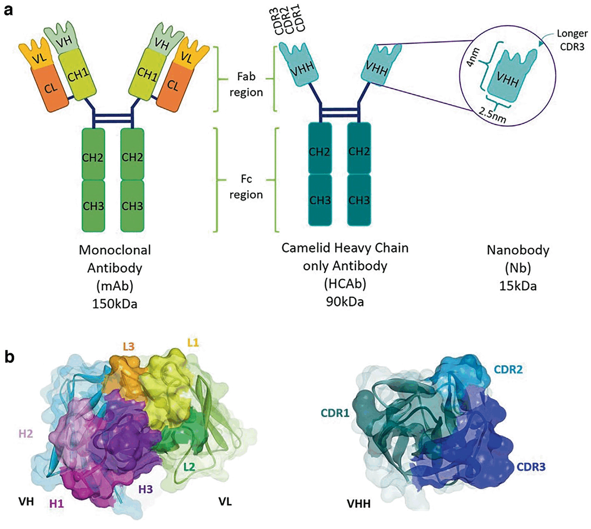

그림 1 기존 항체와 그 유도체의 모식도. a 왼쪽 패널은 기존 항체의 도메인 구성을, 오른쪽 패널은 나노바디(VHH 도메인)의 구조를 강조하여 중쇄 항체의 도메인 구성을 나타낸다. b 왼쪽 패널은 짝을 이룬 중쇄와 경쇄로 구성되어 6개의 초가변 루프를 나타내는 기존 항체의 파라토프를, 오른쪽 패널은 세 개의 CDR로 구성된 VHH의 파라토프를 나타낸다.

불변 도메인(CL)과 하나의 가변 도메인(VL)으로 구성된다 [2–6]. CH1/CL/VH/VL이 짝을 이룬 도메인은 항원 결합 단편(Fab)을 이루며 항원 인식과 결합을 담당하고, 나머지 보존된 도메인은 결정화 가능 단편(Fc)을 구성한다. 후자는 이펙터 기능과 면역세포 동원에 결정적이다 [7, 8]. 단일클론항체(mAb)는 6개의 상보성 결정 영역(CDR)으로 이루어진 큰 파라토프를 필요로 하는데, 그중 세 개는 VH 도메인(H1, H2, H3)에, 세 개는 VL 도메인(L1, L2, L3)에 속한다(그림 1b). 이렇게 넓은 파라토프는 약 600–900 Ų의 표면적을 제공하여 항원 결합 능력을 온전히 발휘하게 한다. 기존 항체는 파라토프의 다양성이 매우 커서 평평한 표면을 지닌 에피토프를 포함한 폭넓은 에피토프를 인식할 수 있다 [8]. 또한 VH와 VL 도메인은 고도로 보존된 골격 영역(FR)으로 구성된다.

기존 항체를 넘어서, 약 20년 전에는 중쇄 항체(HcAb) 같은 항체 유도체가 발견되었다 [9]. HcAb는 연골어류와 낙타과 종에서만 확인되는데, 후자에서의 발견이 나노바디로 이어졌다. 나노바디는 HcAb의 항원 결합 도메인으로 정의되며, 단일 도메인 항체(중쇄의 가변 중쇄 도메인: VHH)라고도 한다(그림 1a) [10]. 기존 항체의 VH 도메인과 마찬가지로, 나노바디는 네 개의 비교적 보존된 골격 영역(FR1–FR4)과 세 개의 초가변 CDR 영역(CDR1–CDR3)으로 이루어지며, 이들이 주로 파라토프를 구성한다(그림 2.1b). 나노바디는 기존 항체보다 약 10배 작아서 높은 안정성과 용해도 같은 유리한 성질을 지닌다 [11–21]. 더욱이 나노바디는 매우 가변적이고 비정규적인 CDR3 루프 덕분에 기존 항체에 필적하는 친화도를 달성할 수 있다. 평균 길이가 18개 잔기이고 특정한 경우에는 24개 잔기 이상까지 늘어날 수 있어, 나노바디의 CDR3 루프는 기존 항체의 평균 14개 아미노산보다 훨씬 길다 [22–26)]. 나노바디 CDR3의 이러한 길이와 아미노산 조성의 다양성 덕분에, 이들은 기존 항체에서는 관찰되지 않는 폭넓은 비제약적·비정규적 형태를 취할 수 있다. 이 성질은 숨겨진 틈새와 감춰진 에피토프(cryptic epitope)에 접근할 수 있게 하여 표적 결합에서의 활용 범위를 넓혀 준다 [27–30].

앞서 언급했듯이, 항체와 표적 사이의 결합 방식과 상호작용을 이해하면 에피토프 표적 설계와 공학적 개량에 귀중한 통찰을 얻을 수 있다. 이런 구조 정보는 X선 결정학, 극저온 전자현미경, 핵자기공명(NMR) 같은 다양한 실험 기법으로 얻을 수 있지만, 이러한 방법은 대개 시간이 오래 걸리고 비용이 많이 든다. 따라서 계산 기반 방법은 더 빠르고 비용 효율적이라는 점에서 에피토프 식별의 유용한 대안이 된다. 이 절에서는 Eshak 등이 보고한 바와 같이 [31], 지금까지 시험된 인 실리코 접근법을 바탕으로 물리 기반 방법과 딥러닝 알고리즘을 모두 사용해 항체와 나노바디의 구조 및 폴딩을 예측하는 다양한 프로토콜을 소개한다. 이어서 항체의 에피토프 식별로 넘어가는데, 여기서 목표는 그림 2에 나타낸 것처럼 항체가 에피토프에 대해 취하는 결합 방식을 이해하는 것이다. 항체–항원 모델을 바탕으로 에피토프 표적 설계와 친화도 성숙을 비롯한 여러 응용을 수행할 수 있으며, 이에 대해서도 다룬다. 이어서 항체 제형(formulation) 성질 예측과 인간화를 논의하는데, 이는 설계된 항체나 항체 단편의 약물화 가능성(druggability)을 보장하는 데 결정적이기 때문이다.

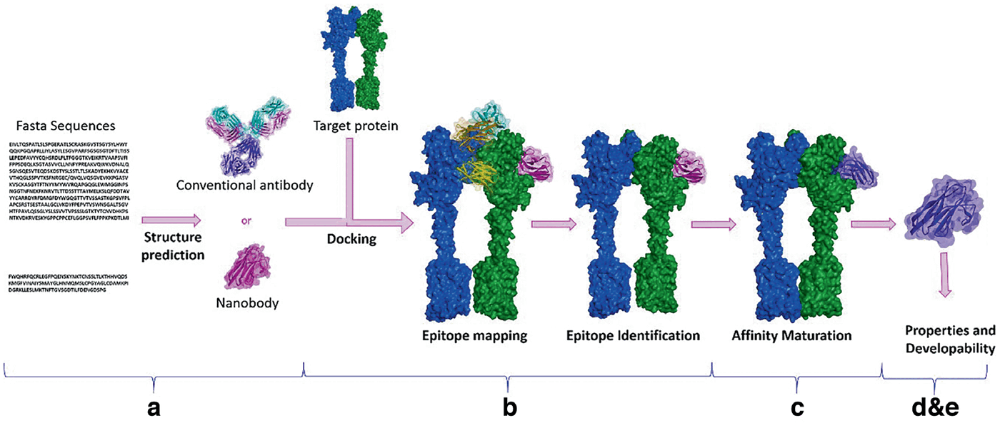

그림 2 이 장에서 제시하는 워크플로. a 항체 또는 나노바디의 FASTA 서열에서 출발하여 구조 예측을 수행한다. b 항체 또는 그 유도체(나노바디)와 표적 단백질의 구조를 바탕으로 에피토프 매핑을 위한 도킹 실험을 수행하여 여러 잠재적 에피토프를 생성한다. 마지막 단계는 에피토프 식별을 위한 분석을 수행하는 것이다. c 에피토프 매핑을 바탕으로 친화도 성숙을 수행하고 이어서 d, e로 진행할 수 있다. 제형 성질 예측과 항체 또는 항체 단편의 인간화/개발 가능성(developability)

### 2  재료

항체와 나노바디의 구조 예측에는 Discovery Studio에 구현된 Modeler [32], IgFold [33], ImmuneBuilder [34], NanoNet [35]을 사용하였다. Discovery Studio 프로토콜로 시스템을 준비한 뒤 NAMD [36]를 이용한 분자 동역학 기반 구조 최적화를 적용하였다. 에피토프 동정에는 ZDOCK [37], HADDOCK2.4 [38]와 같은 도킹 도구를 사용하였고, 여기에 AlphaFold2 Multimer [39]와 AlphaFold3 [40]를 적용한 뒤 복합체의 안정성을 평가하기 위해 분자 동역학을 수행하였다. RMSD 계산, 비결합 상호작용, 응집 성향(aggregation propensity) 점수 계산처럼 모두 Discovery Studio에 구현되어 있는 도구들은 항체/항원 복합체의 결합 방식을 통찰하고 결합에 결정적인 핵심 잔기를 선별하는 데 유용하다. 친화도 성숙에는 Discovery Studio의 Mutation Energy of Binding과 Diffab [41]을 사용하였다. 마지막으로 점도, 용해도, 개발 가능성 지수(developability index) 같은 단백질 제형 특성 계산은 모두 Discovery Studio의 여러 프로토콜로 평가하였다. 끝으로 후보 항체의 인간화는 Discovery Studio의 “Predict Humanizing Mutations” 프로토콜로 수행한다.

### 3  방법

상동성 모델링(homology modeling)과 같은 물리 기반 모델링 기법은 항체 구조 예측에 널리 쓰여 왔다. 다만 CDR 루프, 특히 H3 루프의 가변성과 VH·VL 사슬의 배향 때문에 이 작업은 상당한 난관이 된다.

#### 3.1  항체 및 항체 유도체 구조 예측

그럼에도 에피토프 동정, 에피토프 기반 설계와 공학 같은 다양한 응용을 위해서는 거의 정확한 항체 구조를 확보하는 일이 핵심 단계다.

상동성 모델링은 템플릿 기반 접근법으로, 단백질 데이터 뱅크(PDB)에서 얻고 X선 결정학, 극저온 전자현미경, 핵자기 공명으로 규명한 템플릿 구조를 필요로 한다. 상동성 모델링의 원리는 두 단백질이 높은 서열 동일성을 공유하면 유사한 구조도 공유할 확률이 높다는 생각에 기반한다. 하나의 구조를 템플릿으로 삼아 여러 방법으로 다른 단백질의 구조를 예측할 수 있는데, 여기에는 분절 매칭(SEGMOD/ENCAD) [42], 강체 조립(SWISS-MODEL) [43], 공간 구속 조건(MODELLER) [44], 인공 진화 기법(NEST) [45] 등이 있다. 항체 3차원 구조 생성에는 일관되게 좋은 성능을 보여 MODELLER를 선택하였다. MODELLER는 질의 서열과 템플릿 서열의 정렬에서 도출한 공간 구속 조건을 만족시키는 방식으로 3차원 모델을 만들며, 이 구속 조건들은 구속 유형별 확률 밀도 함수(PDF)로 표현된다(참고(Note) 1 참조). 예측된 3차원 구조는 이 구속 조건을 최대한 따라야 한다.

이 분야의 최근 발전은 인공지능(AI) 기반 접근법이 이끌었고, AlphaFold2 [46]의 개발과 함께 서열에 담긴 공진화 정보를 이용해 단백질 구조를 정확히 예측하는 능력을 입증하였다. 이처럼 큰 진전에도 항체 구조 예측은 서열에 공진화 정보가 없다는 점 때문에 여전히 어렵다. 그렇다고 해서 과학계가 항체 구조 예측을 위한 딥러닝 접근법과 신경망 알고리즘 개발을 포기한 것은 아니다. 이런 방법에는 IgFold [33]와 ImmuneBuilder가 있으며, 둘 다 주어진 항체나 나노바디 서열에 대해 3차원 구조를 예측하는 종단 간(end-to-end) 방법이다 [34]. IgFold는 나노바디 서열을 수백만 개의 항체 서열로 사전 학습한 트랜스포머 언어 모델인 AntiBERTy [31]로 문맥 임베딩으로 변환하는 딥러닝 모델이다. IgFold는 AntiBERTy가 생성한 서열 임베딩을 예측의 입력으로 사용한다. 이 임베딩을 활용해 IgFold는 항체 구조를 규정하는 원자 좌표를 곧바로 예측할 수 있다. 골격 원자 좌표를 예측한 뒤 IgFold는 Rosetta [47]로 곁사슬을 만들고 최적화한다. ImmuneBuilder는 주로 항원 특이적 버전의 AlphaFold-Multimer 접근법을 채택한다. 독립적으로 학습된 네 개의 딥러닝 모델로 구성되어 네 개 구조의 앙상블을 생성하고, 그중 가장 좋은 구조를 선택한다. 주어진 나노바디나 항체 서열에 대해 ImmuneBuilder와 IgFold는 3차원 구조를 생성하는 데 몇 초밖에 걸리지 않는다. AbodyBuilder3 역시 항체 구조 예측에서 좋은 성능을 보이는 것으로 확인되었다 [48].

IgFold, ImmuneBuilder, AbodyBuilder3의 코드는 GitHub에서 내려받을 수 있다.

항체 구조 예측에는 여섯 개 가변 루프의 구조를 예측하고 VL과 VH의 상대적 배향을 결정해야 하는 등 여러 난제가 있다. VH와 VL의 배향을 CDR 폴딩과 함께 정확히 모델링하는 것은 이들이 함께 파라토프를 이루고 항원 결합에서 중추적 역할을 하기 때문에 매우 중요하다. 첫 단계는 상동성 모델 도구로 항체의 관심 영역에 대한 3차원 구조를 만드는 것이다. 예를 들어 Modeler는 Discovery Studio에 구현된 형태로, Fab 영역 구조 예측을 위해 설계된 사용하기 쉬운 올인원 프로토콜인 Antibody Modeling Cascade를 통해 항체 모델링에 사용할 수 있다. 이 프로토콜은 항체 도메인 확인, 경쇄와 중쇄 짝짓기, 상동성 모델 구축, CDR 루프 영역 정제 같은 단계를 수행하는 자동화된 과정이다.

3.1.1  항체 구조 예측

이 프로토콜은 입력으로 항체 서열을 받아 항체 구조 예측의 종단 간 과정을 수행한다. Antibody Modeling Cascade 프로토콜은 경쇄와 중쇄 서열을 바탕으로 하나 이상의 항체 Fab 또는 Fv 영역에 대한 3차원 모델 구조 생성을 자동화한다. 이 과정에는 항체 도메인 확인, 경쇄와 중쇄 짝짓기, 서열 유사성이 높은 골격 템플릿 선택, 골격 영역의 상동성 모델 구축, CDR 템플릿으로 CDR 루프 영역 정제, 그리고 선택적으로 예측된 Fab 구조를 템플릿 전장 구조에 이식하기가 포함된다. 이 이식 과정은 모델 Fab의 베타 시트를 전장 템플릿의 해당 잔기에 겹쳐 놓고, 템플릿의 Fab 영역을 대체하며, 다시 만든 펩타이드 결합과 링커 영역 이황화 결합의 기하 구조를 정리하는 작업이다.

항체 구조 예측을 위해서는 먼저 Discovery Studio 세션에 항체 서열을 불러온 뒤, Macromolecules>Model Antibody>“Annotate Antibody Sequence” 프로토콜로 IMGT 넘버링 체계나 적절한 다른 넘버링을 서열에 부여한다. 이 프로토콜은 여섯 개 초가변 루프를 식별한다. 주석이 달린 항체 질의 서열을 입력하고, Model Antibody 도구 패널의 “Antibody Modeling Cascade” 프로토콜로 3차원 모델링에 필요한 여러 매개변수를 지정한다. Framework Template Types는 top 5로 설정해 VH 및 VL 도메인을 모델링할 상위 5개 항체 골격 구조 템플릿을 선택하는데, 대부분의 경우 VH·VL 배향에 최적이다. Sequence Similarity Cutoff는 10으로 설정하는데, 이는 상위 5개 골격 중 가장 좋은 적중과 이 비율 범위를 벗어나는 구조 템플릿을 배제한다. 여섯 개 초가변 루프 모델링에서는 CDR Loop Definition에 IMGT [49] 넘버링 체계를 선택한다. 파라토프 모델링 정확도를 높이기 위해 여섯 개 초가변 루프를 모두 지정한다(참고(Note) 2 참조). 고급 매개변수에서는 골격 구조 템플릿 검색에서 CDR 영역을 제외한다. 생성된 모델은 PDF 에너지 점수에 따라 순위가 매겨지며, 이를 통해 모델링 위반이 가장 적은 모델을 사용자가 선택할 수 있다.

IgFold로 항체 구조를 예측하려면 먼저 IgFold 설치 안내를 따라 설치한다(참고(Note) 3 참조). IgFold_Antibody.py라는 파일을 만들고 다음 코드를 적는다.

```
from igfold import IgFoldRunner
from igfold.refine.pyrosetta_ref import init_pyrosetta
init_pyrosetta()
sequences = {
   “H”: “”,
   “L”: “”
}
pred_pdb = “my_antibody.pdb”
igfold = IgFoldRunner()
igfold.fold(
   pred_pdb, # Output PDB file
   sequences=sequences, # Antibody sequences
   do_refine=True, # Refine the antibody structure with 
PyRosetta
   do_renum=True, # Renumber predicted antibody structure (Chothia)
)
```

그다음 모델링할 항체의 중쇄와 경쇄 서열을 채운다. do_refine을 True로 설정해 Rosetta로 모델을 정제하도록 한다 [47]. “python IgFold_Antibody.py”로 코드를 실행한다. IgFold는 추가로 잔기별 정확도 추정치, 즉 신뢰도 점수를 제공해 예측 구조의 품질을 평가할 수 있게 한다.

ImmuneBuilder [34]로 항체 구조를 예측하려면(참고(Note) 4 참조) ABodyBuilder2 모듈을 선택한다. ImmuneBuilder_Antibody.py라는 파일을 만들고 다음 코드를 적는다.

```
from ImmuneBuilder import ABodyBuilder2
predictor = ABodyBuilder2()
output_file = “antibody.pdb”
sequences = {
   ‘H’: ‘’,
   ‘L’: ‘’}
antibody = predictor.predict(sequences)
antibody.save(output_file)
```

그다음 모델링할 항체의 중쇄와 경쇄 서열을 채운다 [47]. “python ImmuneBuilder_Antibody.py”로 코드를 실행한다. 구조 정제와 에너지 최소화는 OpenMM [50]으로 수행한다. IgFold와 마찬가지로 ImmuneBuilder도 최종 예측의 잔기별 오차 추정치를 계산해 예측 구조의 품질을 평가할 수 있다.

나노바디 구조를 생성하는 일은 특히 CDR3 루프, 그중에서도 정규 폴딩을 따르지 않는 루프를 예측할 때 큰 어려움을 안긴다. 앞서 언급한 접근법과 도구를 나노바디 구조 예측에 쓸 수 있다. 이에 더해, 합성곱 신경망을 사용하며 나노바디 구조 예측 전용으로 설계된 딥러닝 모델인 NanoNet [51)]도 다룬다.

나노바디 구조 예측

상동성 모델링에는 항체 구조 예측과 마찬가지로 Discovery Studio에 구현된 Modeler [32]를 사용한다. 앞서 설명한 올인원 Antibody Modeling Cascade 프로토콜 외에도, 템플릿 선택에 사용자가 개입할 수 있는 단계별 프로토콜 묶음을 쓸 수 있다.

먼저 VHH 서열을 불러온 뒤 “Annotate Antibody Sequence” 프로토콜로 VHH 서열에 IMGT 넘버링 체계를 부여한다. “Identify Framework Templates” 프로토콜로 적중하는 골격 구조 템플릿을 검색한다. 주석이 달린 나노바디 서열을 Heavy Chain Sequence에 입력한다. Maximum Templates는 25, 구조 템플릿의 Resolution Threshold는 3.5 Å, Exclude CDR Regions는 True로 설정한다. 골격 서열 동일성·유사성 백분율, 템플릿 해상도, 그리고 주어진 서열 데이터베이스에서 적중을 찾을 가능성의 추정치 역할을 하는 E-value를 기준으로 적합한 구조 템플릿을 선택한다. 선택한 템플릿의 생물 종이 Camelidae에 속하는지 반드시 확인한다. “Align Sequences” 프로토콜로 질의 서열과 선택한 구조 템플릿의 서열 정렬을 수행한다. 그다음 Macromolecules>Create Homology Models>“Build Homology Models” 프로토콜로 나노바디의 3차원 모델을 생성한다. 선택한 구조 템플릿과 앞 단계에서 얻은 서열 정렬을 입력한다. Number of Models는 30으로 설정하고 필요하면 늘리며, 더 나은 성능을 위해 Optimization Level은 high로 설정한다. 30개 모델은 PDF 총 에너지에 따라 순위가 매겨진다. Discovery Studio의 Macromolecules>Model Antibody>“Model Antibody Loops” 프로토콜로 루프 정제에 쓸 최적 모델을 선택한다 [32]. 이 프로토콜은 세 CDR 각각에 대해 상동성 모델링을 수행해 루프 모델링 정확도를 높인다(참고(Note) 5 참조).

IgFold로 나노바디 구조를 예측하려면 IgFold_nanobody.py라는 파일을 만들고 다음 코드를 적는다.

```
from igfold import IgFoldRunner
from igfold.refine.pyrosetta_ref import init_pyrosetta
init_pyrosetta()
sequences = {
   “H”: “”
}
pred_pdb = “nanobody.pdb”
igfold = IgFoldRunner()

igfold.fold(
   pred_pdb, # Output PDB file
   sequences=sequences, # Nanobody sequences
   do_refine=True, # Refine the nanobody structure with 
PyRosetta
   do_renum=True, # Renumber predicted nanobody structure (Chothia)
)
```

그다음 모델링할 나노바디의 중쇄 서열을 채운다. do_refine을 True로 설정해 Rosetta로 모델을 정제하도록 한다 [47]. “python IgFold_nanobody.py”로 코드를 실행한다.

ImmuneBuilder [34]로 나노바디 구조를 예측하려면 NanoBuilder2 모듈을 선택한다. ImmuneBuilder_nanobody.py라는 파일을 만들고 다음 코드를 적는다.

```
from ImmuneBuilder import NanoBodyBuilder2
predictor = NanoBodyBuilder2()
output_file = “nanobody.pdb”
sequence = {
‘H’: ‘’
}
nanobody = predictor.predict(sequence)
nanobody.save(output_file)
```

그다음 모델링할 나노바디의 중쇄 서열을 채운다 [47]. “python ImmuneBuilder_nanobody.py”로 코드를 실행한다. 구조 정제와 에너지 최소화는 OpenMM [50]으로 수행한다.

끝으로 나노바디 구조 예측은 설명된 설치 안내(https://github.com/dinalab3D/NanoNet)를 따라 시작한다 [51]. 그다음 나노바디 서열에 대한 fasta 파일을 만들고 다음 명령줄로 NanoNet을 실행한다.

```
python NanoNet.py fasta_file -m.
```

-m 옵션은 Modeller를 이용한 곁사슬 재구성을 위해 추가한다. 항체와 나노바디 모델을 생성한 뒤에는 시간을 들여 모델 품질을 평가하고 3차원 구조를 비교하며, 모델을 여러 개 생성한 경우 평균 제곱근 편차(RMSD)를 계산한다 [31]. 이어서 동역학 연구를 통한 구조 최적화를 고려한다.

상동성 모델링, IgFold, ImmuneBuilder, NanoNet 모델 중 최적 모델을 선택한 뒤에는 그 모델을 Discovery Studio의 Graphics view에 불러오고, Macromolecules의 Prepare Protein 도구 패널에 있는 “Clean Protein” 도구와 “Prepare Proteins” 프로토콜로 구조를 준비한다. Clean Protein 하위 페이지의 Preferences 대화상자에서 대체 형태(alternate conformation)를 제거하고, 말단을 추가하며, 누락된 곁사슬 원자를 보완하도록 설정한다. 이 단계는 선택 사항이지만, 프로토콜이 역장(forcefield) 유형을 지정할 때 생길 수 있는 문제를 피하려면 권장한다.

3.1.2  분자 동역학을 이용한 구조 최적화

그다음 “Prepare Proteins” 프로토콜로 생리학적 pH에서 구조를 양성자화한다. 구조에서 물 분자, 모든 비특이적 리간드와 이온을 제거하는 것이 권장된다.

이어서 Discovery Studio에 구현된 Simulation>Change Forcefield>“Apply Forcefield” 명령으로 CHARMM36 역장을 사용해 항체나 나노바디 구조를 매개변수화한다 [32].

모델 정제에는 분자 동역학 시뮬레이션 연구를 활용해 항체나 나노바디 구조의 형태를 표집한다. Discovery Studio의 여러 프로토콜로 분자 동역학을 적용한다. 먼저 Discovery Studio에 구현된 “Minimization” 프로토콜로 에너지 최소화를 통해 항체나 나노바디 구조를 정제한다. 최소화 알고리즘으로는 Smart Minimizer를 선택하는데, 이는 최급강하법에 이어 켤레 구배법을 함께 고려한다(참고(Note) 6 참조).

그다음 “Solvation” 프로토콜로 최소화된 항체나 나노바디 구조를 TIP3 물 모델에서 용매화한다(참고(Note) 7 참조).

시스템을 만든 뒤에는 Run Simulations 도구 패널의 “Standard Dynamics Cascade” 프로토콜을 사용하는데, 이는 시스템을 최소화하고 평형화한 다음 CHARMM이나 NAMD로 생산 단계를 수행한다. 분자 동역학 시뮬레이션을 위한 종단 간 프로토콜이다(참고(Note) 8 참조).

생산 단계에는 Run Simulations 도구 패널의 “Dynamics (NAMD)” 프로토콜을 선택한다(참고(Note) 9 참조).

분자 동역학 시뮬레이션 후에는 Analyze Trajectory 도구 패널의 “Process Trajectory” 프로토콜로 궤적에서 물을 제거한다. Discovery Studio의 Analyze Trajectory 프로토콜로 항체의 RMSD를 모니터링하는데, 이 값은 구조의 안정성을 보여 주고 형태 변화를 설명해 준다. 또한 프레임 군집화를 수행해 분자 동역학 시뮬레이션 전반에서 가장 대표적인 형태를 선택할 수 있다.

항체나 나노바디 구조를 예측하고 CDR 루프를 더 정확하게 정제하고 나면, 그 결합 방식을 예측하고 에피토프를 동정하는 일이 흥미로워진다.

항체–항원 상호작용을 해독하고 이해하려면 에피토프 동정이 필수적인 과정이 된다. 이는 항체와 항원의 결합 방식을 지배하는 상호작용을 이해하는 일이다. 이를 위해 딥러닝 알고리즘을 쓰거나, 항체와 항원 구조를 모두 모델링해야 하는 단백질–단백질 도킹을 쓰는 두 가지 방법이 있다. 도킹 과정은 표집(sampling)과 점수화(scoring)라는 두 핵심 단계를 포함한다. 표집 단계에서는 형태 공간을 탐색하기 위해 여러 형태를 생성한다. 이어서 점수화 단계에서는 각 형태에 대해 점수 함수를 계산하고, 그 결과 모델의 순위를 매겨 복합체의 원래 구조를 정확히 나타낼 확률이 높은 모델을 찾아낸다. 이상적으로는 표집 과정에서 알고리즘이

#### 3.2  에피토프 동정

원래에 가까운 결합 방식을 효과적으로 재현해야 하고, 점수 함수는 그 결합 방식을 상위 포즈 안에 순위 매길 수 있어야 한다. 점수 함수는 두 개체 사이의 결합 친화도를 예측하는 데 쓰는 수학적 방정식이다. 에피토프 매핑에는 두 가지 도킹 접근법을 쓸 수 있다. 두 개체를 모두 형태적으로 강체라고 보는 강성 도킹(rigid docking), 또는 잔기 곁사슬의 유연성을 고려하는 유연 도킹(flexible docking)이다. 반면 AlphaFold2 Multimer와 AlphaFold3 같은 딥러닝 알고리즘은 항체와 항원의 서열을 모두 필요로 한다 [39, 40]. 두 알고리즘은 최근 나노바디 에피토프 예측에서 완만한 성공률(AlphaFold2-Multimer 약 32%, AlphaFold3 약 47%)을 보였고, 나노바디 CDR3의 길이와 형태에 크게 의존하였다 [52]. 또한 두 알고리즘 모두 항체 에피토프 예측에서 60%를 넘는 실패율을 보인다는 사실이 앞서 보고되었다 [53, 54](참고(Note) 10 참조).

강성 도킹에는 Discovery Studio에 구현된 ZDOCK [37]이 흔히 쓰인다. ZDOCK은 결합 부위에 대한 정보를 거의 요구하지 않아 블라인드 도킹에 최적이다.

3.2.1  강성 도킹

도킹 과정을 시작하기 전에, Protein Data Bank(PDB), AlphaFold 또는 상동성 모델링에서 얻은 표적 단백질을 “Clean Protein” 도구와 “Prepare Proteins” 프로토콜로 정제하고 준비하며 양성자화하는 것이 중요하다. Discovery Studio에 구현된 Dock and Analyze Protein Complexes의 “Dock proteins (ZDOCK)” 프로토콜을 연다. Input Receptor Protein(표적) 구조와 Input Ligand Protein(앞 단계에서 준비한 항체나 나노바디, 또는 단백질 데이터 뱅크에서 얻은 구조)을 선택한다(참고(Note) 11 참조).

도킹 과정 후에는 Process Poses (ZDOCK) 프로토콜로 도킹 후 분석을 수행하는데, 원래 구조에 가까울 가능성이 낮은 포즈를 걸러 내도록 적극 권장된다. Input Receptor Protein, Input Ligand Protein, Input Poses에 생성된 2000개 포즈를 지정한다. Filter Poses에는 CDR3나 H3의 끝 또는 정점을 Ligand Binding Site Residues로 설정하고 Distance Cutoff는 10 Å로 한다. 이 단계는 항체의 H3나 나노바디의 CDR3가 파라토프를 이루지 않고 표적 단백질과 상호작용하지 않는 포즈, 다시 말해 항체 배향이 뒤집힌 포즈를 효과적으로 제거하는 데 중요하다.

이 도킹 단계에 이어 Discovery Studio의 “Refine Docked Proteins (RDOCK)” 프로토콜로 도킹 결과를 정제한다. 이 프로토콜은 포즈 정제와 최적화를 수행한 뒤 CHARMM 최소화로 재점수화한다(참고(Note) 12 참조). 프로토콜은 최적화된 포즈의 순위를 출력한다.

RDock으로 얻은 Refine 결과를 ZRank 점수 함수를 사용한 Process 도킹 출력과 비교한다. 두 접근법과 두 점수 함수에서 유사한 포즈가 상위에 오르면 원래에 가까운 에피토프일 가능성을 시사한다. 또한 포즈 밀도와 군집 크기를 평가하는데, 이는 좋은 형태 상보성을 나타내는 지표다.

나아가 상위 포즈를 검토하는데, 이들은 경험적 점수 함수 값이 낮아 표적 단백질과 리간드 단백질 사이에 많은 상호작용과 형태 상보성이 있음을 보여 준다.

유연 도킹에는 HADDOCK2.4나 더 새로운 버전인 HADDOCK3.0을 웹서버 또는 로컬에서 사용할 수 있으며(참고(Note) 13 참조), 항원–항체 모델링 프로토콜을 따른다 [38]. HADDOCK 2.4를 로컬에 설치하는 경우 표적 단백질과 리간드 단백질(항체 또는 나노바디) 모두에 대한 입력 파일을 준비한다. FreeSASA [55]로 각 잔기의 용매 접근성을 계산한다. HADDOCK2.4는 모호한 구속 조건(AIR)을 정의해 데이터 기반 도킹을 지원한다(참고(Note) 14 참조). 프로그램을 실행하면 몇 시간이 걸려 3단계 도킹 과정이 생성된다. 첫 단계는 강체 에너지 최소화(it0)이고, 이어서 세 가지 과정을 포함하는 반유연 정제(it1)가 진행된다. 이 상태에서 상위 200개 모델이 마지막 단계의 정제를 거치는데, 이 단계는 계면 잔기 사이의 정전기 상호작용을 정제하기 위해 명시적 용매에서 짧은 분자 동역학 시뮬레이션으로 구성되며 모든 분자가 유연하다 [38, 56]. 세 번째 단계에서 생성된 포즈는 RMSD에 따라 군집화된다. 가장 큰 네 개 포즈 군집을 분석하고, 각 군집에서 HADDOCK 점수가 가장 낮은 최고 5개 모델을 비교한다. 포즈 밀도가 높고 HADDOCK 점수가 좋은 도킹 포즈일수록 원래에 가까운 포즈일 가능성이 높다.

3.2.2  유연 도킹

도킹 실험에서 잠재적 에피토프를 선택한 뒤에는 원래에 가까운 에피토프 동정을 이끌기 위해 여러 분석을 수행할 수 있다. 이런 분석에는 동역학 연구와 응집 성향 점수가 포함될 수 있다.

3.2.3  에피토프 동정

잠재적인 항체–항원 또는 나노바디–항원 복합체를 선택한 뒤에는 분자 동역학 시뮬레이션을 수행해 시뮬레이션 전반에서 파라토프의 안정성을 평가한다. 자연에서는 원래에 가까운 에피토프가 보통 더 높은 안정성을 보이며, 이는 일관되고 지속적인 상호작용으로 유지된다. 따라서 여러 복합체의 안정성을 비교하면 에피토프 동정에 값진 통찰을 얻을 수 있다.

분자 동역학 시뮬레이션

항체–항원 또는 나노바디–항원 복합체 각각에 대해 다음 단계를 수행한다. 먼저 “Prepare Protein” 프로토콜로 생리학적 pH에서 복합체를 양성자화한다. 가능하면 모든 물 분자와 이온을 제거한다. Discovery Studio의 “Apply Forcefield” 대화상자로 CHARMM36 역장을 사용해 복합체를 매개변수화한다. 표적 단백질이 막관통 단백질이 아니면 앞서 설명한 항체와 나노바디 구조 예측 정제 프로토콜을 따른다. 단백질이 막관통 단백질이면 이 프로토콜을 따른다(참고(Note) 15 참조). 평형화 후에는 앞서 설명한 대로 Dynamics (NAMD) 프로토콜로 분자 동역학 생산 단계를 수행한다(참고(Note) 9 참조).

분자 동역학 시뮬레이션 후에는 Process Trajectory 프로토콜로 궤적에서 물을 제거한다. 그다음 non-bond Interactions 대화상자로 항체–항원 복합체 양쪽 사이의 분자 내 상호작용을 선택한다. Analyze Trajectory 프로토콜로 분자 동역학 시뮬레이션 전반에서 나노바디와 항체 파라토프의 RMSD를 모니터링한다. 선별한 비결합 상호작용은 분자 동역학 전반에 걸쳐 모니터링한다. RMSD는 파라토프의 안정성에 값진 통찰을 주며, 이 복합체가 자연에서 형성되어 안정하게 유지될 수 있는지에 대한 확실한 지표가 된다. 비결합 상호작용을 모니터링하면 결합 상호작용에 관여하는 잔기의 일관성과 빈도를 알 수 있다. 끝으로 결합 부위 안에서 항체/나노바디의 형태 변화를 관찰하는데, 이는 에피토프 동정에 중요한 단서를 제공한다.

응집 성향 점수는 잔기의 소수성과 용매 접근성을 모두 고려하며, 처음에는 표면 잔기가 응집하는 경향을 측정하는 데 쓰였다. 그러나 이 점수는 항체–항원 복합체 사이의 잠재적 소수성 상보성, 즉 두 개체 사이의 인식을 이끌 수 있는 성질을 나타내는 지표가 되기도 한다. 따라서 표적 단백질과 리간드 단백질 양쪽에서 잔기의 응집 성향 점수를 평가하는 것이 중요하다.

응집 성향 점수 계산

Discovery Studio의 Macromolecules>Predict Protein Formulation Properties>“Calculate Aggregation Score” 프로토콜을 사용하는데, 선택한 포즈에서 얻은 표적 단백질을 선택해 수행한 뒤 리간드 단백질에 대해서도 수행한다. 두 단백질은 응집 성향 점수에 따라 색으로 구분된다. 선택한 잠재적 포즈의 파라토프와 에피토프 사이에 소수성 상보성이 있는지 평가한다. 소수성 상보성은 항원–항체 결합에 반드시 필요한 것은 아니지만, 예측을 이끌고 특정 결합 방식을 설명하는 데 도움이 될 수 있다.

결정 구조나 계산적으로 동정한 항체–항원 복합체 모델에서 검증된 에피토프를 바탕으로 여러 응용을 수행할 수 있으며, 여기에는 에피토프 기반 설계가 포함된다. 여기에는 항체의 항원에 대한 결합 친화도를 높이는 것을 목표로 하는 친화도 성숙과, 에피토프를 변이시켜 다른 에피토프를 인식할 수 있게 하는 것을 목표로 하는 재에피토핑(re-epitoping)이 포함될 수 있다.

#### 3.3 친화도 성숙(affinity maturation)

기존의 복합체 구조나 모델을 기반으로, 알려진 에피토프에 대한 항체의 선택성과 결합 친화도를 높이기 위한 친화도 성숙을 다룬다. 복합체 결합에 관여하는 잔기를 식별하기 위해 결합 상호작용을 철저히 분석해야 한다. 선택성에 주로 책임이 있는 항체의 H3 또는 나노바디의 CDR3 등 세 개의 과변이성 루프에 집중하는 것이 바람직하다. 모든 상호작용을 확인한 후, 항체가 항원에 대해 결합 친화도를 높이기 위해 돌연변이를 삽입하는 것이 목표이다. 돌연변이 삽입은 여러 방법으로 수행할 수 있으며, 이어서 돌연변이 결합 에너지 계산이 이루어진다.

See Note 16.

3.3.1 Discovery Studio를 활용한 사용자가 정의한 점 및 순차적 돌연변이

복합체 설정

Discovery Studio 세션에서는 PDB에서 항체–항원 단백질 구조를 불러오거나, 복합체 모델을 Graphics View로 열어야 한다. 그런 다음 Macromolecules의 Prepare protein 도구 패널에서 “Prepare Proteins” 프로토콜을 선택하여 원하는 pH(가급적 생리학적 pH)에서 복합체를 프로토네이션하고, 누락된 잔기와 루프를 구축해야 한다. 가급적 모든 물 분자와 이온을 제거한다. 그 후 Simulations>Change Forcefield>Apply Forcefield 또는 Assign Forcefield 프로토콜을 선택하여 CHARMm Polar H forcefield로 복합체 구조를 매개변수화한다.

파라토프(paratope)를 찾아 철저히 분석한 후, non-bond interaction 패널을 통해 상호작용에 관여하는 잔기를 선택한다. 항체 또는 나노바디의 CDR에 속하는 상호작용의 핵심 잔기를 선택한다. 그런 다음 Graphics 화면에서 이 잔기들을 선택한다. Macromolecules의 Design Protein 도구 패널에서 “Calculate Mutation Energy (Binding)” 프로토콜을 열어야 한다. Input Typed Molecule에서 복합체 이름을 참조하고, 항체 또는 나노바디의 체인을 Ligand chain으로 설정한다. 그런 다음 Mutation Sites로 첫 번째 실행에서 Single Mutations을 선택하며, 이는 Fig. 3에 나타낸 것과 같다. Mutations에서 돌연변이를 정의하면 선택된 잔기가 표시되고, 모든 아미노산, 산성, 염기성 또는 특정 아미노산 중에서 시뮬레이션할 돌연변이를 선택할 수 있다. 실험 중이라면 모든 아미노산을 선택한다. 다만 계산 시간이 늘어난다. pH Dependent Electrostatics을 True로 설정한다. 프로토콜을 실행한다. 돌연변이 계산 후 각 돌연변이에 대한 결합 에너지 값이 계산된다. 이 ΔΔG 값은 돌연변이 시 항체가 항원에 대해 예측되는 결합 친화도를 나타낸다. 양의 ΔΔG 값은 불안정화 효과를 나타내어 결합 친화도 감소를 예측하며, 음의 ΔΔG 값은 안정화 효과를 나타내어 결합 친화도 향상을 예측한다 [57]. 음의 ΔΔG 값을 주는 돌연변이를 선택한다. Fig. 3에 나타난 것처럼 안정화 돌연변이를 고려하여 두 번째로 조합 돌연변이를 실행할 수 있다. 두 번째 실행에서는 “Calculate Mutation Energy (Binding)” 프로토콜을 선택한다. 항체 또는 나노바디의 체인을 Ligand chain으로 설정한다. 그런 다음 Mutation Sites에서 All Selected Residues을 선택한다. Mutations에서 첫 번째 실행 결과를 기반으로 돌연변이를 정의한다. pH Dependent Electrostatics을 True로 설정한 후 프로토콜을 실행한다.

결합 친화도 향상(Enhancing Binding Affinity)

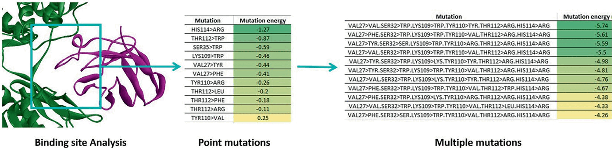

Fig. 3 Workflow for affinity maturation from point to multiple mutations

추가 검증: 돌연변이 후 항체/나노바디의 안정성을 예측하려면, “Calculate Mutation Energy (Binding)”에 대해 설명한 것과 유사한 “Calculate Mutation Energy (Stability)” 프로토콜을 실행해야 한다. 항체/나노바디의 접힘이 불안정화되지 않으면서 결합 친화도를 향상시킬 것으로 기대되는 돌연변이를 교차 검증한다.

Diffab [41]는 항원 특이적 항체와 나노바디 설계를 위한 확산 기반 생성 모델이다(see Note 17).

3.3.2 확산 모델: Diffab [41]

앞서 언급한 것처럼 항원–항체 복합체를 준비해야 한다. 또한 항체 또는 나노바디는 Chothia 방식 [58]으로 주석 처리되어야 한다. 주석 처리는 Discovery Studio에서 복합체를 Graphics View로 불러오고, Macromolecules의 Model Antibody 도구 패널에서 “Annotate Antibody Sequence” 프로토콜을 선택하여 수행할 수 있다. Annotation Scheme을 Chothia로 설정한다. ANARCI [59]와 AbRSA [60]와 같은 다른 번호 매기기 도구들도 사용할 수 있다.

복합체 설정

복합체를 설정한 후, 항체의 파라토프와 설계 목표에 따라 다음 옵션 중 적절한 설계 모드(design mode)를 선택한다:

결합 친화도 향상(Enhancing Binding Affinity)

• FixBB: FixBB는 Diffab [41]에 구현된 Rosetta 기반 서열 설계 소프트웨어로, 백본을 고정한 상태에서 CDR 서열을 샘플링한다. fixbb.yml 설정 모드를 사용하여 선택한다.

• Codesign: 이 설정 모드는 각 CDR의 서열과 구조를 동시에 샘플링한다. 하나의 CDR에 대해 서열과 구조를 모두 샘플링하려면 codesign_single.yml 모드를, 모든 CDR에 대해 동시에 샘플링하려면 codesign_multicdrs.yml 모드를 선택할 수 있다.

• Abopt: 이 설정 모드는 하나의 CDR에 대한 제한된 서열 및 구조 샘플링으로 기존 항체를 최적화한다. abopt_singlecdr.yml을 사용하여 이 설정 모드를 선택한다.

설계 모드를 선택한 후 다음 지침을 따른다:

Models generation:
python design_pdb.py insert_pathway/complex.pdb --config configs/test/mode.yml

To Relax generated mutants using Rosetta:
export PYTHONPATH=$PYTHONPATH:/insert_pathway/diffab
python diffab/tools/relax/run.py –root./results/mode/
complex.pdb_*/ --pipeline pyrosetta

To compute the mutation binding energy and evaluate using 
Rosetta:
export PYTHONPATH=$PYTHONPATH:/insert_pathway/diffab/
diffab
python tools/eval/run.py --root ./../results/mode/
complex.pdb_*/

./../results/mode/complex.pdb_* 폴더는 결과가 생성되는 곳이며, summary.csv도 함께 확인해야 한다. 후자는 생성된 모델에 대한 중요한 정보를 담은 컬럼을 포함하며, 예를 들어 RMSD는 야생형과 설계 모델 간의 RMSD를 계산하고, dG_gen과 dG_ref는 항체와 항원의 결합 에너지를 나타낸다. 마지막으로 ddG 컬럼은 돌연변이 결합 에너지, 즉 돌연변이와 야생형 간의 결합 에너지 차이를 나타낸다. 음의 ΔΔG 값은 돌연변이 시 결합 친화도 향상을 의미한다. 모델에 대한 구조 분석을 수행하고 추가적인 상호작용을 확인해야 한다.

항체와 나노바디 설계를 위한 구조 기반 생성 프레임워크의 최근 등장에 주목할 필요가 있다. 이는 확산 기반 단백질 백본 생성과 서열 최적화, 또는 구조–서열 통합 모델을 결합한다. 이러한 접근법은 de novo 스캐폴드 생성과 표적 조건 설계를 모두 가능하게 하며, 면역글로불린(IG) 형식에 점점 전문화되고 있다. 특정 구현이 계속 빠르게 발전하고 있지만, 이러한 파이프라인은 이미 현대 항체 공학(antibody engineering) 워크플로의 핵심 도구가 되었다 [61–63].

#### 3.4 Discovery Studio로 단백질 제형 특성 계산

“Calculate Protein Formulation Properties” 프로토콜은 동일한 계열의 단백질에 대해 개발 가능성 지수(DI), 용해도, 점도를 계산하여, 생물학적 제제를 발현, 인큐베이션, 정제 및 저장하기 전에 적합성을 빠르게 평가할 수 있도록 한다.

단백질, 특히 항체는 치료에 필요한 높은 농도로 저장할 때 응집이 발생하기 쉬우며, 이는 활성을 감소시키고 면역 반응을 유발할 수 있다.

3.4.1 개발 가능성 지수(DI)

DI는 관련 단백질의 응집 경향을 순위 매기는 데 사용되는 지표로, 소수성 및 총 전하 특성에 기반한다. DI는 다음 공식에 따라 응집 친화도(APS)에서 가중 제곱 총 전기를 뺀 값으로 계산된다:

DI
APS
total charge
[
]
[
]
2
β
=
−
×

여기서 APS는 양성 응집 점수이며, 모든 양성 원자 응집 점수의 합으로 계산된다. 단백질에 하나 이상의 가변 영역이 있는 항체인 경우, DI(Fv) 점수를 생성하기 위해 이들 영역에 대해 APS가 계산된다.

분자들은 DI 값의 낮은 값에서 높은 값 순으로 순위가 매겨지며, 높은 값일수록 응집 가능성이 높고 개발에 덜 유리하다.

또한 변성 도메인과 전체 분자에 대해 모든 원자 응집 점수의 합으로 구성된 순수한 분자 응집 점수가 계산된다.

치료용 단백질, 특히 항체는 여러 의학적 상태의 치료 접근법으로 간주된다. 앞서 언급한 것처럼 설계된 항체는 높은 용해도를 가져야 하므로 높은 농도로 저장 및 투여할 수 있다. 예측된 항체 용해도는 개발 주기 전반을 통해 항체 후보를 순위 매기고 필터링하여 개발 위험을 줄이는 강력한 도구이다.

3.4.2 용해도 점수

정전기적 상호작용과 소수성 상호작용은 단백질 용해도와 응집에 영향을 미치는 핵심 요인이다. 단백질 용해도가 등전점에서 최소라는 것은 잘 알려져 있다 [64]. 이는 단백질 분자 간 정전기적 상호작용이 용해도에 얼마나 중요한지 보여준다. 단백질 분자 간 정전기적 상호작용은 반발력과 인력의 조합이다. 일반적으로 분자 순전하 Z가 증가하면 반발력이 커지며, 전하 불대칭은 예를 들어 양과 음의 표면 전위와 같은 반대 전하를 가진 단백질 부분 사이의 인력을 유발할 수 있다. 첫 번째 근사로 전하 불대칭은 분자 쌍극 모멘트 D로 평가할 수 있다. 용해도에 영향을 미치는 또 다른 pH 의존 요인은 분자가 용액에서 응집(결정 또는 응집) 상으로 전이하는 전이 에너지의 일부인 용매화 에너지 ΔGsolv이다 [65]. 리보뉴클레아제 SA 돌연변이와 인슐린을 이용한 단백질 용해도의 pH 의존성 검증을 기반으로, 용해도에 대한 정전기적 기여를 평가하는 다음 경험적 점수 함수 SpH(pH)가 사용된다:

(
)
(
)
SpH pH
Z(pH )
D(pH )
Gsolv pH
C
2
2
α
β
∆
=
−
+

순전하 Z, 쌍극 모멘트 D, ΔGsolv는 Calculate Protein Ionization and Residue pK 프로토콜과 동일한 방식으로 pH의 함수로 계산되며, α, β, C는 조정 가능한 매개변수이다.

단백질 분자 간 소수성 상호작용은 낮은 용해도를 유발하는 또 다른 인력이다. 이는 개발 가능성 지수(DI)에서처럼 양성 응집 점수(APS)로 근사할 수 있다:

γ
=
−
Solubility Score
SpH(pH )
[APS]

여기서 γ는 스케일링 매개변수이다.

용해도 점수가 더 양수이면 더 좋은 용해도를 의미한다.

항체 구조의 상대적 점도 점수는 표면 전하 지도 방법 [66]을 사용하여 추정된다. 이 방법은 정전기적 표면 패치를 정량화하며, 항체 구조의 경우 Fv 영역의 음의 정전기적 패치가 실험적으로 결정된 점도와 잘 상관관계가 있음이 밝혀진 바 있다(see Notes 18 and 19).

3.4.3 점도 점수

먼저 Discovery Studio Viewer의 Graphics view로 항체/항체 유도체 구조를 불러오는 것부터 시작한다. 그런 다음 이전 섹션에서 권장한 대로 “Prepare Protein” 프로토콜을 사용하여 단백질을 준비한다. 그 후 Macromolecules> Predict Protein Formulation Properties tools> Calculate Formulation Properties를 연다. Input Protein Molecules로 항체(들)를 설정하고, 제형 조건에 맞는 pH와 이온 강도 값을 pH와 Ionic Stength에 입력한다. 마지막으로 적절한 Forcefield를 선택한다.

View Results를 클릭하여 계산된 제형 특성을 단일 Molecule Window로 열어야 한다. 보고서는 계산된 제형 특성의 정렬 가능한 테이블과 상세 결과 및 개별 구조를 보여주는 클릭 가능한 링크를 포함한다. 필요한 특성이 계산된 경우 이 구조에는 표면과 Site 그룹이 추가된다; 응집과 전하 지도 특성이 모두 존재하면, 이를 독립적으로 표시하기 위해 두 개의 별도 구조가 열린다:

• 응집 경향 표면(Aggregation Propensity Surface): 이 표면은 원자별 응집 점수에 따라 색상이 지정된다. 응집에 더 취약할 것으로 예측되는 영역은 Fig. 4에 나타난 것처럼 빨간색이다. Predict Protein Formulation Properties 도구 패널의 View Aggregation Sites 시각화 도구를 사용하여 응집 부위에 대한 상세 분석을 수행할 수 있다.

• 전하 지도 표면(Charge Map Surface): 이 표면은 잔기 표면 전하 지도 점수에 따라 색상이 지정된다. 항체 구조의 경우 Fv 영역의 음의 정전기적 패치가 더 높은 점도와 상관관계가 있으며, 이들은 빨간색이다. 또한 Hierarchy View에는 Active QMap Score Sites와 Negative Active QMap Score Sites 그룹이 포함되어 있다. 표준 Discovery Studio 기능을 사용하여 선택하고 집중할 수 있다. 표면은 투명하며 원자들도 QMap 속성을 사용하여 색상이 지정되어 부위 그룹 분석을 용이하게 한다. 이는 Fig. 5에 나타난 것과 같다.

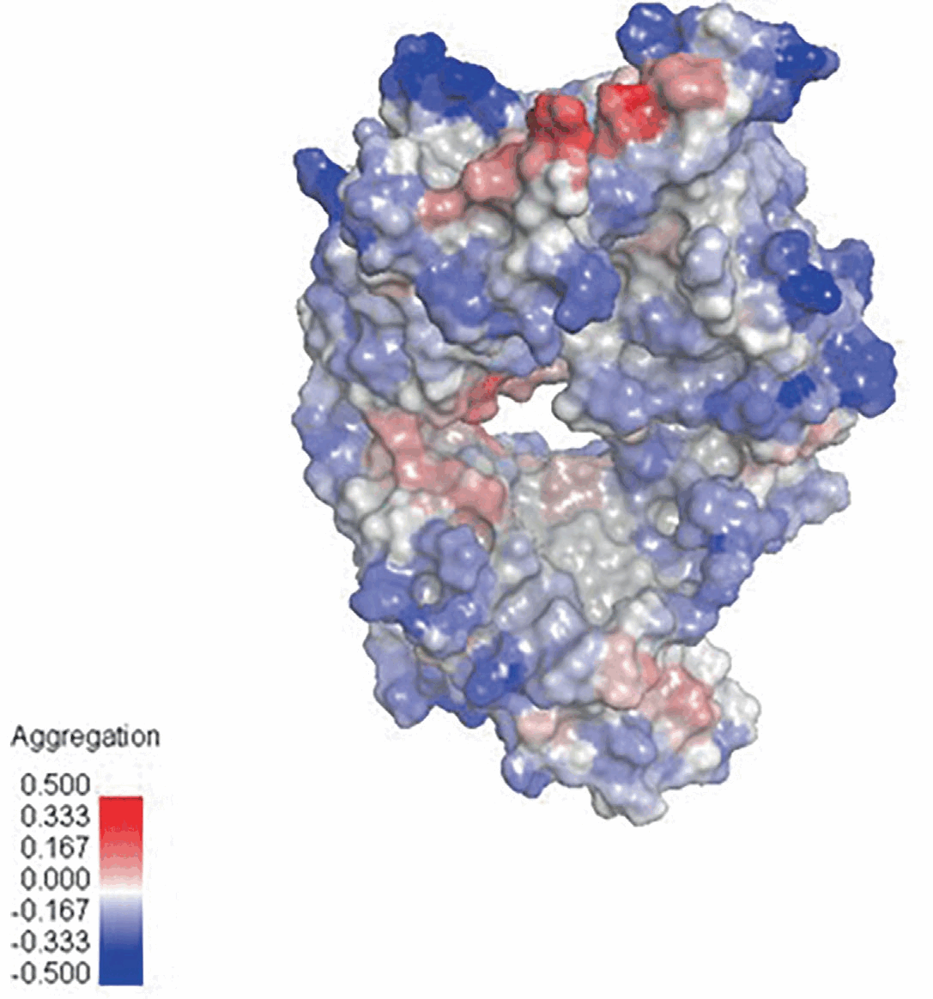

Fig. 4 Aggregation Propensity Surface

Fig. 5 Charge Map Surface


#### 3.5 항체 인간화

with Discovery Studio

“Predict Humanizing Mutations” 프로토콜은 쿼리 항체 시퀀스를 받아, 더 인간적인 형태로 만들기 위한 돌연변이를 제안한다.

목표는 항체 가변 도메인을 변형하여, 결과적으로 생성된 항체가 원래 비인간 항체의 항원 결합 특이성과 친화도를 유지하면서, 낮은 인간 면역 원성과 안정성 손상 없이 만들어지는 항체를 만드는 것이다. 이를 위해 프레임워크 영역의 잔기를 변형하여 인간의 항체에서 흔히 발견되는 잔기 유형과 더 유사하게 만든다. 기본적으로, 원하는 결합 친화도와 특이도를 부여하는 CDR 영역과 CDR conformation을 안정화하는 데 중요한 프레임워크 잔기인 Vernier 잔기가 유지된다 [67]. 이후 돌연변이가 항체 안정성에 미치는 영향을 평가할 수 있다.

인간의 항체에서 각 서열 위치에서 발견되는 잔기 유형에 대한 데이터 소스는 두 가지이다. 하나는 일치하는 인간 생식계열(germline) 유전자 서열을 사용하는 것이다. 다른 하나는 Observed Antibody Space 데이터베이스(OAS) [68]에서 모든 인간 항체 가변 도메인 서열을 추출하여 편찬한 빈도 통계 세트이다. VH, VL_Kappa, VL_Lambda 도메인 서열은 IMGT 방식(IMGT scheme)으로 번호 매기기되며, 각 서열 위치에서 발견되는 각 잔기 유형의 빈도는 개별 도메인 유형별로 계산된다. OAS 데이터베이스의 서열은 IGHV1, IGHV2 등과 같은 V 유전자 유형을 매칭하여 추가로 클러스터링된다. 이후 해당 클러스터에서 각 잔기에 대한 유전자별 통계가 수집되며, 여기에는 D 및 J 인코딩 영역이 포함된다.

“Predict Humanizing Mutations” 프로토콜은 선택된 옵션에 따라 여러 서열을 생성한다. 여기에는 빈도 통계에 의해 제안된 돌연변이를 포함하는 서열과, 생식계열 유전자 서열 비교에 기반한 돌연변이를 포함하는 서열이 있을 수 있다.

추가로, 머신러닝(ML) 방법은 범위의 목표 “인간성” 점수에 대해 인간화 돌연변이를 예측할 수 있다 [69]. 프로토콜은 또한 ML 방법, 생식계열, 그리고 5% 이상의 빈도를 보이는 각 서열 위치에서 발견되는 서로 다른 잔기 유형을 스크리닝하여 생성된 돌연변이를 포함하는 서열을 생성할 수 있으며, 이는 구조적 안정성을 위한 것이다. 돌연변이 에너지 계산을 수행한 경우, 이러한 돌연변이가 포함된 구조가 생성된다. 또한, 쿼리 시퀀스의 각 가변 도메인에 대해 상호작용식 잔기 분석 보고서가 표시되며, 이를 통해 각 서열 위치의 잔기와 가능한 치환을 자세히 검토할 수 있다.

쿼리 항체 시퀀스를 Sequence Window에 불러오는 것으로 시작하며, 이는 경쇄와/또는 중쇄 가변 도메인을 포함해야 하고, 이는 Fig. 6에 나타난 것과 같다. 선택 사항으로, 쿼리와 동일한 가변 도메인 유형 또는 유형을 가진 참조 항체 시퀀스를 비교용으로 불러올 수 있다. 선택 사항으로, 3D 모델 또는 PDB에서 제공된 해당 Fv 또는 Fab 영역 항체 구조를 불러올 수 있으며, 이 구조는 가급적 이전에 설명한 대로 CHARMm Polar H forcefield로 준비되고 타이핑된 것이 바람직하다.

Macromolecules> Model Antibody 도구 > Predict Humanizing Mutations...를 열어 “Predict Humanizing Mutations” 대화 상자를 연다. Query Sequence을 인간화할 항체 시퀀스로 설정하고, Query Structure을 돌연변이 에너지 계산에 사용될 해당 구조로 설정한다. 비교용 생식계열 유전자 서열을 선택하는 방법은 Germline Gene Sequence Options에서 지정하고, 제안된 돌연변이에 대한 돌연변이 에너지를 계산할지는 Calculate Mutation Energy 매개변수에서 지정한다. 마지막으로 남은 매개변수를 원하는 대로 설정한 후 계산을 시작한다.

이 보고서에는 쿼리 시퀀스의 각 잔기와 가능한 치환에 대한 풍부한 데이터가 포함되어 있으며, 이는 Fig. 7에 나타난 것과 같다. 쿼리 셀의 링크를 사용하여 세부 사항을 검토한다. 특히, 인간 빈도 통계에서 생식계열 유전자와 일치하지 않으면서 발생률이 낮은(<5%) 프레임워크 위치인 hotspots에 주의를 기울인다.

3.5.1 Interactive Residue Analysis Reports

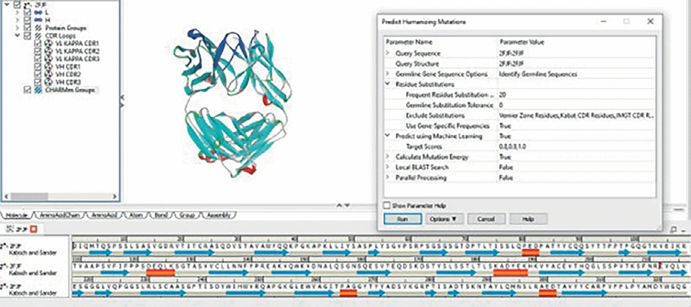

Fig. 6 Predict Humanizing Mutations protocol

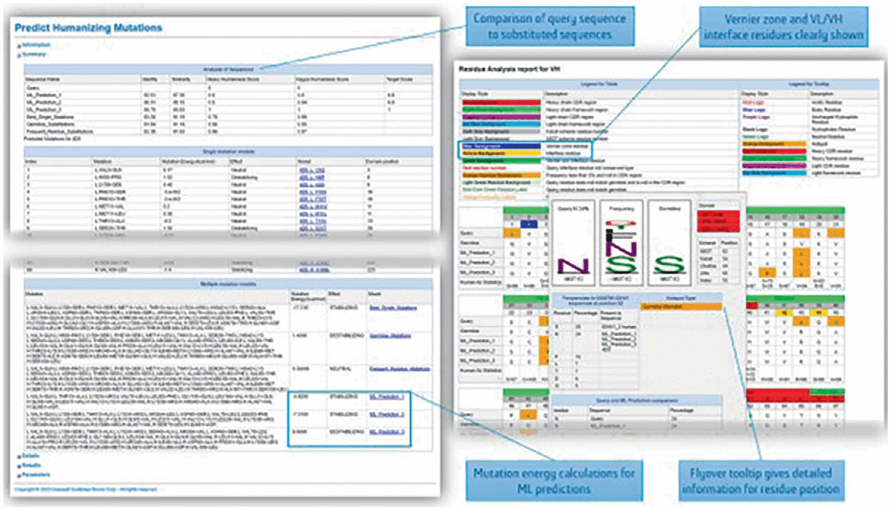

Fig. 7 Results analysis of the ‘Predict Humanizing Mutations’ protocol

쿼리 도메인의 각 잔기 위치에 대해 메인 테이블에는 다음이 표시된다:

• Kabat 및 IMGT 잔기 번호와 CDR 영역

• 쿼리에서 발견된 잔기 유형

• 참조 및 생식계열(사용된 경우)

• ML 예측(사용된 경우)

• 인간 통계 데이터베이스에서 5% 이상의 빈도로 발견된 최대 세 가지 잔기 유형

잔기 위에 마우스를 올려 Chothia 및 Honegger 번호 매기기와 데이터베이스에서 3% 이상 빈도로 발견된 모든 잔기 유형을 포함한 추가 정보를 표시한다. 위치가 주도적 유형(빈도 >75%)을 가지고 있으며 쿼리 시퀀스가 다른 유형을 가지는 경우에도 이를 표시한다. antibody_variable 데이터베이스에 대한 BLAST 검색이 수행된 경우, 상위 10개 히트에 대해 발견된 잔기 유형이 표시된다. VL 및 VH 계면 잔기와 Vernier 잔기의 위치는 메인 테이블과 잔기 세부 사항에 표시된다. 또한, 프레임워크 영역에 있는 계면 잔기의 위치가 제공되며, 이들이 보존된 유형인지 여부를 보여준다 [70].

이 정렬은 쿼리 시퀀스의 두 사본 또는 구조가 제공된 경우 입력 구조의 전체 서열로 구성된다:

3.5.2 Analyzing Residue Substitution Alignment

• IMGT 방식에 대한 일반적인 항체 특징과 색상이 표시된 서열.

• hotspots, Vernier 잔기, 그리고 결합된 Kabat 및 IMGT CDR 영역을 표시하는 서열.

• hotspots는 굵은 글꼴로 표시되며 주황색으로 밑줄이 그어진다.

• Exclude Substitutions 매개변수에서 지정된 기준에 의해 치환에서 제외되지 않은 것은 주황색으로 표시된다.

• 결합된 Kabat 및 IMGT CDR 영역은 굵은 글꼴과 기존 CDR 색상으로 표시된다.

• Vernier 잔기는 파란색 carets로 표시된다.

서열을 두 번 클릭하면 Vernier 잔기, CDR 영역, hotspots의 기능을 포함하는 Sequence Annotation 창이 열린다. 기능 위에 마우스를 올려 상세 정보를 확인한다.

이 서열 이후에는 Frequent_Residue_Substitutions 서열, Germline_Substitutions 서열, ML 방법으로 각 목표 점수에 대해 예측된 서열, 그리고 돌연변이가 수행된 경우 Best_Single_Mutations 서열이 뒤따른다.

돌연변이 에너지 계산을 수행한 경우, 돌연변이를 결합하여 생성된 구조가 표시된다. 이는 Discovery Studio의 다른 도구, 특히 Calculate Protein Formulation Properties를 사용하여 추가로 평가할 수 있다.

3.5.3 Analyzing Mutated Models

### 4 Notes

1. PDFs 제약 조건은 동종 유래 제약 조건과 결합 길이, 결합 각도, 사면 각도, 비결합 거리와 같은 입체 화학적 제약 조건을 포함한다.

2. 프레임워크와 CDR 템플릿 히트 선택 시 Resolution Threshold를 3.5 Å로 설정한다. 정확도를 높이기 위해 Optimization Level을 high로 설정하며, 이는 simulated annealing 단계에서 높은 수준의 샘플링을 고려한다. 필요에 따라 Number of Framework Models와 Number of CDR Models을 30 이상으로 설정한다. Maximum Number of Templates Per Loop는 5로 설정한다. 이 매개변수들은 사용 가능한 구조적 템플릿에 따라 조정할 수 있다.

3. 설치 방법은 다음에서 찾을 수 있다: https://github.com/Graylab/IgFold.

4. 설치 방법은 다음에 나타난다: https://github.com/oxpig/ImmuneBuilder.

5. Maximum Templates per loop를 5로 설정하고, CDR1-CDR3 루프를 최적화한다. Resolution Threshold를 3.5 Å로 설정하고, 모델 수를 30으로 설정한다. Optimization Level을 high로 설정한다. 생성된 모델은 PDF 총 에너지 기준으로 랭킹된다. 모델 수를 더 높은 값으로 설정할 수 있으며, 이는 더 많은 시간을 필요로 하지만 더 정확한 모델을 생성할 수 있다.

6. Maximum Steps를 2000 steps로 설정하고, generalized born switching과 같은 Implicit Solvent Model을 선택한다.

7. Cell Shape을 Orthorhombic 또는 truncated octahedron으로 설정하고, Minimum Distance From Boundary를 12 Å로 설정한다. Add Counterion을 True로 설정하여 시스템을 중성화하고, Salt Concentration을 0.145 Molar로 설정하며, Cation Type을 Sodium, Anion Type을 Chloride로 설정한다.

8. 초기 Minimization 단계에서는 steepest descent를 Algorithm type으로 선택하고, Max steps를 1000 steps로 설정하여 시스템의 초기 불량 접촉을 해결한다. 두 번째 Minimization 단계에서는 conjugate gradient method를 Algorithm type으로 선택하고, Max Steps를 2000 steps로 설정한다. Heating 단계에서는 Simulation Time을 500 ps(0.5 ns)로 설정하고, Target Temperature를 300K로 설정한다. Equilibration 단계에서는 1500 ps(1.5 ns)로 설정한다.

9. Simulation Time을 30 000 ps(30 ns)로 설정하고, Save Results Interval을 10 ps로 설정하며, Thermodynamic ensemble을 NPT로 선택하고, Time step을 2 fs로, Target Temperature를 300 K로 설정한다. 온도 및 압력 제어에는 각각 Langevin dynamics와 Langevin piston Nose-Hoover 방법을 선택한다.

10. AlphaFold2 Multimer은 google collab(https://colab.research.google.com/github/sokrypton/ColabFold/blob/main/AlphaFold2.ipynb)을 통해 접근할 수 있거나 Discovery Studio에 구현될 수 있다. AlphaFold3은 다음 웹서버(https://alphafoldserver.com/)를 통해 접근 가능하다.

11. Angular Step Size를 6으로 설정하여 더 광범위한 리간드 방향 샘플링을 수행하고, 540 000 poses를 생성한다. Poses는 target protein과 antibody 간 상호작용 결과로 다른 docking 결과를 의미한다. 구조 데이터 또는 글리코실화 데이터에 따라, Receptor blocked residues 파라미터를 사용하여 특정 영역을 conformation sampling에서 제거하기 위해 receptor residues를 차단할 수 있다. ZRank 점수를 활성화하여 초기 단계의 ZDock 예측에 대한 reranking 점수를 사용하며, 이는 자세한 electrostatics, van der Waals 및 desolvation energy 항목을 포함한다. poses Clustering에서는 scoring function 기준으로 상위 2000 poses를 선택하고, RMSD Cutoff와 Interface Cutoff를 10 Å로 설정하여 클러스터링한다. Clustering은 target protein 표면에서 pose의 다른 밀도와 그룹을 보여준다.

12. Input Receptor Protein 구조, Input Ligand Protein(항체 또는 나노바디 구조), Input Poses(처리된 포즈의 전체 또는 상위 30% 또는 40%)를 선택한다.

13. HADDOCK2.4의 로컬 설치는 https://www.bonvinlab.org/software/haddock2.4/installation/에서 찾을 수 있다.

14. 이러한 제약 조건은 샘플링 및 스코어링의 두 주요 docking 단계를 안내하는 데 유용한 정보를 제공한다. 제약 조건은 두 가지 방식으로 나뉜다: active, 즉 binding interface에 반드시 존재해야 하며, passive, 즉 interface에 존재해야 한다. blind docking에서는 target protein의 passive restraints를 선택할 때 상대적 solvent accessible value가 40인 solvent accessible residues를 선택한다. antibody 및 nanobody epitope identification에서는 CDR residues를 solvent accessible residues와 교차 참조하여 선택한다. threshold로 40을 설정한다. FreeSASA를 사용한다. target protein의 특정 영역을 restraints에서 제거하여 제거할 수 있다. active 및 passive 리스트를 생성한 후, AIRs input file을 생성하여 사용한다. 구성 파일에서 target protein, ligand protein, and the AIR file을 지정한다.

15. Discovery Studio의 “Minimization” 프로토콜을 사용하여 complex를 최소화하고, Smart Minimizer를 energy minimization Algorithm으로 선택하며, Max Steps를 3000, RMS Gradient를 0.01로 설정한다. Implicit Solvent Model로 Generalized Born Switching을 선택하고 Dielectric Constant을 1로 설정한다. complex energy minimization 후, Macromolecules> Analyze Transmembrane Proteins>“Add membrane” followed by “Edit Membrane” dialogs 또는 Macromolecules>Analyze Transmembrane Proteins>“Add Membrane and Orient Molecule” 프로토콜을 사용하여 membrane를 추가한다. Discovery Studio의 Simulation>Run Simulations>“Solvate with Explicit Membrane” 프로토콜을 사용하여 system solvation 및 equilibration을 수행한다. Lipid Type으로 POPC (1-palmitoyl-2-oleoyl-sn-glycero-3-phosphocholine)를 선택하고, lipids와 water addition을 위해 Minimum XY Distance From Boundaries를 24, Minimum Z Distance From Boundaries를 14로 설정한다. Add Counterion을 enable하여 system을 중성화한다. Salt Concentration을 0.145 Molar로 설정하고, Cation Type을 Sodium, Anion Type을 Chloride로 선택한다. Equilibration을 enable하여 NPT thermodynamic ensemble에서 Temperature 300K, Pressure 1 bar로 설정한다. 세 가지 다른 equilibration 단계가 수행되므로, Time for Stages 1, 2, and 3을 각각 500 ps, 1000 ps, 1500 ps로 설정한다.

16. 이 도구의 장점은 사용자가 결합 부위 분석을 기반으로 변이와 mutant을 정의할 수 있다는 점이다.

17. https://github.com/luost26/diffab에서 제시된 설치 지침을 따른다.

18. DI와 점도 점수는 항체 Fv 도메인을 사용하여 파라미터화되고 테스트된다. 다른 단백질 또는 단백질 도메인에 적용하려면 추가 검증이 필요할 수 있으며, DI의 스케일링 인자는 재교육 및 조정이 필요할 수 있다.

19. 용해도 예측은 리보뉴클레아제 SA, 인슐린, 항체 Fab 도메인 등의 다양한 구형 단백질에 대해 검증된다. 전체 항체 용해도 예측에 항체 Fv 도메인만 사용될 경우, Charge Scaling과 Dipole Scaling 파라미터를 재교육하고 조정해야 할 수 있다.

Conflict of Interest

이 장은 Floriane Eshak이 프랑스 국립 연구 기구(ANR) 지원으로 공동 저술했으며, Anne Goupil-Lamy는 Dassault Systèmes에 고용되어 있다. Dassault Systèmes는 본 장에 언급된 일부 소프트웨어 도구를 개발한다. 저자들은 다른 경쟁 이익이 없음을 선언한다.

### 참고문헌

1.	Liu JKH (2014) The history of monoclonal

4.	Edelman GM, Benacerraf B (1962) On strucantibody development – progress, remaining 
challenges and future innovations. Ann Med 
Surg (Lond) 3(4):113–116
	 2.	Padlan EA (1994) Anatomy of the antitural and functional relations between antibodies and proteins of the gamma-system. Proc 
Natl Acad Sci USA 48(6):1035–1042
	 5.	Poljak RJ, Amzel LM, Chen BL, Phizackerley

body 
molecule. 
Mol 
Immunol 
31(3):
169–217
	 3.	Putnam FW, Liu YS, Low TL (1979) Primary

RP, Saul F (1974) The three-dimensional structure of the Fab′ fragment of a human myeloma 
immunoglobulin at 2.0-Å resolution. Proc Natl 
Acad Sci USA 71(9):3440–3444
	 6.	Chiu ML, Goulet DR, Teplyakov A, Gilliland

structure of a human IgA1 immunoglobulin. 
IV. Streptococcal IgA1 protease, digestion, 
Fab and Fc fragments, and the complete amino 
acid sequence of the alpha 1 heavy chain. J Biol 
Chem 254(8):2865–2874

GL (2019) Antibody structure and function: the basis for engineering therapeutics. 
Antibodies (Basel) 8(4):55

non-catalytic α-exosite binding region. J Mol 
Biol 397(4):1106–1118
	20.	Doña V, Urrutia M, Bayardo M, Alzogaray

7.	Stanfield RL, Wilson IA (2014) Antibody structure. Microbiology spectrum 2(2):https://doi.
org/10.1128/microbiolspec.aid-0012–2013.
	 8.	Sundberg EJ, Mariuzza RA (2002) Molecular

V, Goldbaum FA, Chirdo FG (2010) Single 
domain antibodies are specially suited for 
quantitative determination of gliadins under 
denaturing conditions. J Agric Food Chem 
58(2):918–926
	21.	Ewert S, Cambillau C, Conrath K, Plückthun

recognition in antibody-antigen complexes. 
In: Advances in protein chemistry [Internet]. 
Elsevier [cited 2023 Sep 19]. pp 119–160. 
https://linkinghub.elsevier.com/retrieve/pii/
S0065323302610046
	 9.	Hamers-Casterman 
C, 
Atarhouch 
T, 
Muyldermans S, Robinson G, Hammers C, 
Songa EB et al (1993) Naturally occurring 
antibodies devoid of light chains. Nature 
363(6428):446–448
	10.	Muyldermans S (2013) Nanobodies: natural

A (2002) Biophysical properties of camelid VHH 
domains compared to those of human VH 3 
domains. Biochemistry 41(11):3628–3636
	22.	Harmsen MM, De Haard HJ (2007) Properties,

production, and applications of camelid single-domain antibody fragments. Appl Microbiol 
Biotechnol 77(1):13–22
	23.	Vu KB, Ghahroudi MA, Wyns L, Muyldermans

single-domain antibodies. Annu Rev Biochem 
82:775–797
	11.	De Genst E, Saerens D, Muyldermans S,

S (1997) Comparison of llama VH sequences 
from conventional and heavy chain antibodies. 
Mol Immunol 34(16–17):1121–1131
	24.	Muyldermans S, Baral TN, Retamozzo VC,

Conrath K (2006) Antibody repertoire development in camelids. Dev Comp Immunol 
30(1–2):187–198
	12.	Dumoulin M, Conrath K, Van Meirhaeghe A,

De Baetselier P, De Genst E, Kinne J et al 
(2009) Camelid immunoglobulins and nanobody technology. Vet Immunol Immunopathol 
128(1–3):178–183
	25.	Wu TT, Johnson G, Kabat EA (1993) Length

Meersman F, Heremans K, Frenken LGJ et 
al (2002) Single-domain antibody fragments 
with high conformational stability. Protein Sci 
11(3):500–515
	13.	Hussack G, Hirama T, Ding W, MacKenzie R,

distribution of CDRH3 in antibodies. Proteins 
16(1):1–7
	26.	Silva-Pilipich N, Smerdou C, Vanrell L (2021)

Tanha J (2011) Engineered single-domain antibodies with high protease stability and thermal 
stability. PLoS One 6(11):e28218
	14.	Skaff O, Law RH, Lupton CJ, Adams TE,

In vitro and in vivo application of nanobodies 
against viral and bacterial infections. Arch 
Immunol Ther Exp 69(1):1–14
	27.	Kabat EA, Wu TT (1991) Identical V region 

Huntington JA, Whisstock JC et al (2020) An 
inhibitory antibody against conformational 
change, applied to α1-antitrypsin. Nat 
Commun 11(1):5213
	15.	Muyldermans S (2021) A guide to: nanobody 

amino acid sequences and segments of sequences 
in antibodies of different specificities: relative 
contributions of VH and VL genes, minigenes, 
and complementarity-determining regions to 
binding of antibody-combining sites. J Immunol 
147(5):1709–1719
	28.	Chothia C, Lesk AM (1987) Canonical struc
cloning and expression. FEBS J 288(7):2084–
2102
	16.	Jovčevska I, Muyldermans S (2020) The ther
tures for the hypervariable regions of immunoglobulins. J Mol Biol 196(4):901–917
	29.	Al-Lazikani B, Lesk AM, Chothia C (1997) 

apeutic potential of nanobodies. BioDrugs 
34(1):11–26
	17.	Harlow E, Lane D (1988) Antibodies: a labo
Standard conformations for the canonical structures of immunoglobulins. J Mol Biol 273(4):
927–948
	30.	North B, Lehmann A, Dunbrack RL Jr (2011) 

ratory manual. Cold Spring Harbor Laboratory, 
Cold Spring Harbor, 726 pp
	18.	Koehler G, Milstein C (1975) Continuous cul
A new clustering of antibody CDR loop conformations. J Mol Biol 406(2):228–256
	31.	Lefranc MP, Pommié C, Ruiz M, Giudicelli 

tures of fused cells secreting antibody of predefined specificity. Nature 256(5517):495–497
	19.	Kashyap AK, Steel J, Oner AF, Dietrich MA,

V, Duroux P, Lingner C et al (2003) IMGT 
unique numbering for immunoglobulin and T cell 
receptor variable domains and Ig superfamily 
V-like domains. Dev Comp Immunol 27(1):
55–77
	32.	Lu X, Willuda J, Lee L, Valler M, Valler M, 

Zhu X, Sun P-C et al (2008) Combinatorial 
antibody libraries from survivors of the Turkish 
H5N1 avian influenza outbreak for prophylactic and therapeutic applications. Proc Natl Acad 
Sci 105(16):5986–5991
	33.	Glanville J, Zhai W, Berka J, Telman D, Huerta 

Sauer G et al (2009) Structural and biological 
characterization of a human monoclonal antibody targeting the membrane-proximal domain 
of connective tissue growth factor. J Biol Chem 
284(4):2454–2462
	46.	Sivasubramanian A, Sircar A, Chaudhury S,

G, Mehta D et al (2009) Precise determination 
of the diversity of a combinatorial antibody 
library gives insight into the human germline 
repertoire. Proc Natl Acad Sci 106(48):20216–
20221
	34.	Bradbury ARM, Sidhu S, Dübel S, McCafferty

Gray JJ (2009) Toward high-resolution homology modeling of antibody Fv regions and 
application to antibody-antigen docking. 
Proteins 74(2):497–514
	47.	Marks C, Deane CM (2020) Antibody molec
J (2011) Beyond natural antibodies: the power 
of in vitro display technologies. Nat Biotechnol 
29(3):245–254
	35.	Marks JD, Hoogenboom HR, Bonnert TP,

ular engineering: in silico tools. In: The 
superfamily [Internet]. CRC Press [cited 2023 
Sep 22]. pp 101–118. https://www.taylorfrancis.
com/books/9780429402128/chapters/10.120
1/9780429402128–6
	48.	Dunbar J, Krawczyk K, Leem J, Baker T, Fuchs 

McCafferty J, Griffiths AD, Winter G (1991) 
By-passing immunization: human antibodies 
from V-gene libraries displayed on phage. J Mol 
Biol 222(3):581–597
	36.	Clackson T, Hoogenboom HR, Griffiths AD,

A, Georges G et al (2014) SAbDab: the structural antibody database. Nucleic Acids Res 
42(Database issue):D1140–D1146
	49.	Adolf-Bryfogle J, Kalyuzhniy O, Kubitz M,

Winter G (1991) Making antibody fragments 
using phage display libraries. Nature 352(6336):
624–628
	37.	McCafferty J, Griffiths AD, Winter G, Chiswell

Weitzner BD, Hu X, Jing X et al (2018) 
RosettaAntibodyDesign (RAbD): a knowledgebased protein design framework for antibodies. 
PLoS Comput Biol 14(4):e1006112
	50.	Berman HM, Westbrook J, Feng Z, Gilliland

DJ (1990) Phage antibodies: filamentous 
phage displaying antibody variable domains. 
Nature 348(6301):552–554
	38.	Almagro JC, Fransson J (2008) Humanization 

G, Bhat TN, Weissig H et al (2000) The protein 
data bank. Nucleic Acids Res 28(1):235–242
	51.	Li T, Pantazes RJ, Maranas CD (2014) 

of antibodies. Front Biosci 13(1):1619–1633
	39.	Dukhovny D, Nussinov R, Wolfson HJ (2020) 

OptMAVEn: a new framework for the de novo 
design of antibody variable regions. BMC 
Bioinformatics 15(1):387
	52.	Baran D, Pszolla MG, Lapidoth GD, Norn 

Computational prediction of protein-protein 
interactions. In: Structural bioinformatics. 
Methods in molecular biology, vol 2112. 
Humana, New York, NY. pp 207–225
	40.	Ferdous S, Martin ACR (2018) AbDb: anti

C, Dym O, Unger T et al (2017) Principles 
for computational design of binding antibodies. 
Proc Natl Acad Sci 114(41):10900–10905
	53.	Leaver-Fay A, Tyka M, Lewis SM, Lange OF,

body structure database—a database of annotated 
three-dimensional structures of antibodies. 
Database 2018:bay040
	41.	Luo S, Su Y, Peng X, Wang S, Peng J, Ma J 

Thompson J, Jacak R et al (2011) ROSETTA3: 
an object-oriented software suite for the simulation and molecular design of macromolecules. 
In: Methods in enzymology. Academic Press 
[cited 2023 Sep 20]. pp 545–574. https://
linkinghub.elsevier.com/retrieve/pii/B978012
3812704000196
	54.	Brooks BR, Brooks CL, Mackerell AD, Nilsson 

(2022) Antigen-specific antibody design and 
optimization with diffusion-based generative 
models [Internet]. bioRxiv; 2022 [cited 2023 
Jul 14]. p. 2022.07.10.499518. Available from: 
https://www.biorxiv.org/content/10.1101/
2022.07.10.499518v1
	42.	Al-Lazikani B, Lesk AM, Chothia C (2000) 

L, Petrella RJ, Roux B et al (2009) CHARMM: 
the biomolecular simulation program. J Comput 
Chem 30(10):1545–1614
	55.	Kortkhonjia E, Brandman R, Zhou J, 

Canonical structures for the hypervariable 
regions of T cell αβ receptors. J Mol Biol 
295(4):979–995
	43.	Lefranc M-P, Pommié C, Kaas Q, Duprat E,

Alvarez-Cabrera H, Ferguson N, Raghunathan 
G et al (2013) Probing antibody internal 
dynamics with fluorescence anisotropy and 
molecular dynamics simulations. MAbs 5(2):
306–322
	56.	Yang H, Zhang Q, Kang H, Shen Y, Du X 

Bosc N, Guiraudou D et al (2005) IMGT 
standardized approach for IMGT/Domenene 
delineation and IMGT Colliers de Perles for 
antibody engineering and antibody humanization. 
In: Molecular biology of b cells. Elsevier. pp 
881–897. https://linkinghub.elsevier.com/
retrieve/pii/B9780120536412500585
	44.	Šali A, Blundell TL (1993) Comparative protein 

(2023) Prediction of antibody developability 
using deep learning. Brief Bioinform 24(2):
bbad023
	57.	Kuroda D, Tsumoto K (2011) In silico 

modelling by satisfaction of spatial restraints. 
J Mol Biol 234(3):779–815
	45.	Petrey D, Xiang Z, Tang CL, Xie L, Gimpelev M,

mutagenesis of protein–protein interfaces: in 
silico design of therapeutic antibodies with prolonged half-life. Proteins 81(4):704–714
	58.	Chothia C, Novotný J, Bruccoleri R, Karplus M

Mitros T et al (2003) Using multiple structure 
alignments, fast model building, and energetic

(1985) Domain association in immunoglobulin

molecules: the packing of variable domains. 
J Mol Biol 186(3):651–663
	59.	Dunbar J, Deane CM (2016) ANARCI: anti65.	Tjong H, Zhou HX (2008) Prediction of protein solubility from calculation of transfer free 
energy. Biophys J 95(6):2601–2609
	66.	Agrawal NJ, Helk B, Kumar S, Mody

gen receptor numbering and receptor classification. Bioinformatics 32(2):298–300
	60.	Li L, Chen S, Miao Z, Liu Y, Liu X, Xiao Z et

N, Sathish  HA, Samra HS et al (2016) 
Computational tool for the early screening of 
monoclonal antibodies for their viscosities. Mabs 
8(1):43–48
	67.	Almagro JC, Teplyakov A, Luo J, Sweet RW,

al (2019) AbRSA: A robust tool for antibody 
numbering. Protein Sci 28(8):1524–1531
	61.	Bennett NR, Watson JL, Ragotte RJ, Borst

Kodangattil S, Hernandez-Guzman F et al 
(2014) Second antibody modeling assessment 
(AMA-II). Proteins 82(8):1553–1562
	68.	Kovaltsuk A, Leem J, Kelm S, Snowden J,

AJ, See DL, Weidle C et al (2025) Atomically 
accurate de novo design of antibodies with 
RFdiffusion [Internet]. bioRxiv; 2025 [cited 
2025 Jun 18]. p. 2024.03.14.585103. Available 
from: https://www.biorxiv.org/content/10.1
101/2024.03.14.585103v2
	62.	Watson JL, Juergens D, Bennett NR, Trippe

Deane CM, Krawczyk K (2018) Observed 
antibody space: a resource for data mining 
next-generation sequencing of antibody repertoires. J Immunol 201(8):2502–2509
	69.	Marks C, Hummer AM, Chin M, Deane

BL, Yim J, Eisenach HE et al (2023) De novo 
design of protein structure and function with 
RFdiffusion. Nature 620(7976):1089–1100
	63.	Dauparas J, Anishchenko I, Bennett N, Bai H,

CM 
(2021) 
Humanization 
of 
antibodies using a machine learning approach on 
large-scale repertoire data. Bioinformatics 
37(22):4041–4047
	70.	McCafferty J, Hoogenboom H, Chiswell D

Ragotte RJ, Milles LF et al (2022) Robust deep 
learning based protein sequence design using 
ProteinMPNN. Science 378(6615):49–56
	64.	Tanford C (1961) Physical chemistry of mac

(eds) (1996) Antibody engineering: a practical approach. Oxford University Press, Oxford, 
348 pp (Practical Approach Series)

romolecules, First Edition. John Wiley & Sons 
Inc, New York, p. 710

## Chapter 3 Prediction of Protein Antigen Epitopes from Monoclonal Antibodies by In Silico Molecular Docking

Tânia Maria Manieri and Gabriela Massaro Barreiros

### 초록

항체는 B 림프구가 분비하는 분자이며, 동형단백질(isotype) 중 IgG 형태가 가장 풍부하다. 단일클론항체(mAb)는 해당 수용체에 대해 높은 친화도와 특이성을 지닌 거대분자로, 다양한 작용 기전을 나타낼 수 있어 난치성 질환 치료를 위해 가장 활발히 연구되는 치료제다. 항원–항체 상호작용의 특성 분석은 항체의 작용과 효능을 이해하는 데 매우 중요하다. 생물정보학 도구의 지속적인 발전에 힘입어 이러한 분자를 평가하고 분석하는 데 인 실리코(in silico) 방법의 활용도가 날로 높아지고 있다. 이러한 방법을 통해 항체의 파라토프(paratope)와 항원의 에피토프(epitope), 그리고 항원과 항체 간의 최적 상호작용을 예측할 수 있다. 항원–항체 복합체의 최적 상호작용은 도킹(docking) 방법을 통해 수행할 수 있으며, 항체와 항원의 3차원 구조로부터 두 분자 간의 최적 결합 형태를 결정할 수 있다.

현재 사용 가능한 수많은 도구 중에서도 본 장에서는 학술 연구용 무료 플랫폼에 초점을 맞춘다. ABodyBuilder 플랫폼을 이용해 상동성 모델링으로 항체의 3차원 구조를 확보하는 과정부터 HADDOCK 2.4를 이용한 도킹에 이르기까지 상세히 기술한다. 마지막으로 LigPlot+ 소프트웨어를 사용하여 결합 잔기를 식별하는 방법론을 설명한다.

핵심어: 에피토프, 단일클론항체, 항원, 도킹, Haddock, 인 실리코, 예측

### 1  서론

항체는 B 림프구가 분비하는 분자이며, 세포막에 발현된 수용체와 동일한 항원 인식 부위를 갖는다. 항체는 Fab와 Fc라는 두 개의 단편으로 구성된 분자로 설명할 수도 있다. 항원 결합 단편(fragment antigen-binding)의 약자인 Fab 영역은 중쇄 및 경쇄 가변 도메인인 VH와 VL, 그리고 불변 도메인인 CH1과 CL로 이루어진다. 가변 도메인(Fv)은 7개의 영역으로 구성되는데, 그중 세 개는 상보성 결정 영역(CDR)이고 네 개는 골격 영역(FR)이라 부른다. CDR은 항원 결합 부위의 골격을 형성하여 항체 특이성에 기여한다. 골격 영역은 CDR이 형성하는 루프의 형태와 유연성에 영향을 줌으로써 항체의 특이성에 기여한다. Fc 영역은 항체의 이펙터 기능을 담당하며, 세포 수용체와 결합하는 부위다.

항체의 구조와 작용을 규명할 수 있는 방법론은 이러한 분자의 개발 및 개량에 훌륭한 도구가 된다. 최근 수십 년 동안 컴퓨팅 역량이 기하급수적으로 증가함에 따라 항체와 같은 분자의 계산 최적화 기법 역시 눈부시게 발전했다. 이러한 맥락에서 에피토프, 파라토프와 같은 구조를 예측하고 항원과 항체 등 두 분자 간의 최적 결합 형태를 예측하는 인 실리코 도구들이 널리 활용되고 있다.

파라토프는 항원과 직접 접촉하는 항체의 아미노산 잔기로 정의되며, 통상 골격 영역의 직접적인 관여와 함께 CDR 잔기들이 항원 결합에 참여한다. 반면 에피토프는 항원–항체 복합체가 형성될 때 항체와 접촉하는 항원 부위다.

파라토프와 에피토프를 규명하면 항원–항체 상호작용에 관여하는 잔기를 식별하는 데 유용한 정보를 얻을 수 있으나, 이들 잔기 사이의 구체적인 상호작용 정보까지는 제공하지 못한다. 이러한 한계는 분자 도킹(molecular docking) 방법으로 극복할 수 있다. 분자 도킹을 활용하면 두 분자 간의 결합 인터페이스를 정밀하게 예측할 수 있다.

도킹 알고리즘은 일반적으로 샘플링(sampling)과 채점(scoring)이라는 두 단계로 나뉜다. 샘플링 단계에서는 수천 개의 가능한 구조 형태(conformation)를 생성하며, 채점 단계에서는 이들 형태를 평가·분류하여 천연 구조 형태에 가장 가까운 것을 식별한다 [1].

항체 전산 분석의 첫 번째 단계는 항체 서열을 매핑하는 것이다. 1차 뉴클레오타이드 서열을 데이터베이스 서열과 비교·평가하여 생식계열(germline) 서열과 대조함으로써 V(D)J 영역을 구분하고, 이를 통해 가변 체인의 골격 영역과 CDR을 결정한다. 아미노산 서열 분석을 통해서도 표준화된 참조 체계, 즉 번호 체계(numbering scheme)를 확립하여 가변 영역의 각 아미노산에 고유 식별자를 부여할 수 있다. 번호 체계는 항체 구조 내 각 잔기의 위치 정보를 제공하므로 CDR과 골격 영역을 신속하게 구분할 수 있게 해 준다 [2].

항체 서열을 평가하는 데 사용할 수 있는 온라인 도구는 매우 많으며, 본 장에서 다룰 abYsis 도구 [3]도 그중 하나다. 이 도구에서는 서열에 IMGT [4] 등 널리 쓰이는 번호 체계가 자동으로 적용된 후 CDR과 잠재적인 번역 후 변형(PTM) 같은 중요 정보가 주석(annotation)으로 달린다. abYsis는 항체의 각 위치별 아미노산 잔기 빈도표를 제공하므로, 특정 위치에서 보기 드문 이례적인 잔기를 쉽게 확인할 수 있다 [3].

수많은 모델링 및 예측 방법이 항체와 항원의 3차원 구조를 활용한다. 이러한 결정 구조 중 상당수는 단백질 데이터 은행(PDB)과 같은 데이터베이스에서 구할 수 있다. 실험 구조가 존재하지 않는 경우에는 분자의 아미노산 서열을 바탕으로 3차원 구조를 모델링할 수 있다. 항체의 경우 가변 도메인의 차이가 구조적·기능적 다양성을 결정하므로, 구조 예측의 대부분은 Fv 모델링을 기반으로 수행된다 [5]. 상동성 모델링으로 구조를 얻는 데 AlphaFold [6]나 Rosetta Antibody Protocol [7]을 사용할 수도 있지만, 본 장에서는 Fv 모델링을 통해 항체의 3차원 구조를 확보하는 도구로 ABodyBuilder 플랫폼을 사용한다. 이 알고리즘은 템플릿 모델 선택, 배향 예측, CDR 루프 모델링, 곁사슬 예측이라는 4가지 표준 단계를 따른다. 그런 다음 ABodyBuilder는 항체 구성 요소(예: CDRL3 루프)가 특정 평균 제곱근 편차(RMSD) 임계값 이내로 모델링될 확률을 모델의 '신뢰도(confidence)'로 제시한다. 또한 체외(in vitro) 개발 과정에서 문제를 일으키는 것으로 알려진 구조 모티프를 모델 내에서 탐지하여 표시해 준다 [8]. 분자 도킹을 수행하려면 도킹 알고리즘의 요구 조건에 맞게 구조를 정비해야 한다.

예를 들어 많은 도킹 알고리즘이 항체 구조를 두 개의 분리된 체인(중쇄와 경쇄)으로 인식하지 못하므로, 두 체인을 단일 서열로 재번호 부여해야 한다. 본 장에서는 도킹을 위해 구조를 전처리하는 도구로 PDBtools와 PyMOL을 사용한다. PDBtools는 PDB 파일을 유연하게 조작할 수 있는 온라인 도구다. pdb-tools 패키지의 40여 개 개별 도구를 조합하여 활용할 수 있는 그래픽 인터페이스를 제공한다. 처리된 결과 PDB 파일은 온라인에서 바로 확인하고 다운로드할 수 있다 [9]. PyMOL 분자 그래픽 시스템(버전 2.0 Schrödinger, LLC)은 Python 프로그래밍 언어로 작성된 프로그램으로, 구조 데이터의 시각화, 해석 및 분석에 널리 활용된다.

도킹에는 강체 도킹(rigid docking), 반유연 도킹(semi-flexible docking), 유연 도킹(flexible docking)의 세 가지 유형이 있다. 강체 도킹에서는 두 구조가 모두 고정된 형태, 즉 단단한 분자로 유지되므로 결합 과정에서 구조적 자유도를 반영하기 어렵다. 반유연 도킹에서는 항체는 단단한 구조로 고정되고 항원만 유연하게 움직인다. 유연 도킹에서는 상호작용 시 두 단백질 구조가 모두 유연하게 변화한다. 본 장에서는 유연 도킹 도구인 HADDOCK을 사용한다. HADDOCK [10, 11](High Ambiguity Driven biomolecular DOCKing)은 단백질 도킹 모델링에 널리 쓰이는 소프트웨어다. 핵자기공명(NMR) 분광학 데이터, 부위지정 돌연변이, 구조 정보 등 실험 및 이론 정보를 활용하여 단백질 간 상호작용을 예측한다. HADDOCK은 다양한 구조 형태의 단백질에 대해 여러 무작위 초기 포즈(pose)를 생성한 뒤, 구조적 유사도를 바탕으로 이들 포즈를 정밀화(refinement)하고 군집화(clustering)한다.

목표는 단백질–단백질 상호작용을 가장 잘 나타낼 가능성이 높은 포즈 집합을 식별하는 것이다. 클러스터는 응집형 군집화(agglomerative clustering) 알고리즘을 사용하여 정의된다. 이 알고리즘은 각 포즈 쌍 사이의 형태 차이를 측정하는 거리 행렬을 사용한다. 거리는 포즈 간의 구조적 차이를 나타내는 척도인 RMSD로 측정한다. RMSD는 비교 대상 포즈 간 원자 위치를 비교하여 계산한다. 알고리즘은 각 포즈마다 하나의 클러스터를 생성하는 것으로 시작하여, 모든 포즈가 단일 클러스터에 속할 때까지 가장 가까운 포즈, 즉 RMSD가 가장 낮은 포즈를 가진 클러스터들을 병합해 나간다. 이 과정에서 클러스터 간의 거리는 클러스터 내 모든 포즈 사이의 평균 RMSD로 측정된다. 군집화는 거리 행렬이 단일 값으로 축소될 때까지 계속된다. 이렇게 얻은 클러스터는 공통 접촉 비율(FCC; Fraction of Common Contacts) 기준에 따라 분류된다. 일반적으로 구조적 상보성이 우수하다고 평가되는 0.6 이상의 FCC 값을 가진 해를 선택한다. 이 기준은 단백질–단백질 복합체의 밀도 맵을 각 단백질의 개별 밀도 맵과 비교한다. 이들 맵 사이의 상관관계가 높을수록 결합 인터페이스에서 단백질 간 구조적 상보성이 높음을 의미한다.

인 실리코 방법으로 파라토프와 에피토프를 예측하는 마지막 단계는 도킹을 통해 얻은 복합체의 결합 잔기를 평가하는 것이다. 이를 위해 LigPlot+ 플랫폼을 사용할 수 있다. LigPlot+는 3차원 좌표로부터 항원–항체 상호작용을 나타내는 2차원 다이어그램을 자동으로 생성하는 그래픽 시스템을 제공한다. 이 다이어그램은 수소 결합과 소수성 접촉의 상호작용 패턴을 명확히 보여준다 [12].

### 2  재료

항체 서열 번호를 부여하고 CDR 영역을 구분하기 위해 다음 웹 주소에서 온라인으로 이용 가능한 abYsis 플랫폼을 사용한다: http://www.abysis.org/abysis/. 서열 입력은 아미노산 서열 또는 뉴클레오타이드 서열로 할 수 있으며, 가변 경쇄와 가변 중쇄 분석은 각각 개별적으로 수행해야 한다. 본 장에서 사용하는 번호 체계는 IMGT 번호 체계다.

#### 2.1  항체 서열 분석

항체의 3차원 구조는 상동성을 기반으로 가변 영역(Fv)을 모델링하여 확보한다. 이를 위해 다음 주소에서 온라인으로 제공되는 ABodyBuilder 플랫폼을 사용한다: https://opig.stats.ox.ac.uk/webapps/sabdab-sabpred/sabpred/abodybuilder/ (참고 1 참조). 데이터 입력은 가변 경쇄와 가변 중쇄의 아미노산 서열을 사용해야 한다.

#### 2.2  상동성에 의한 Fv 모델링

도킹은 학술 목적으로 무료로 온라인에서 이용 가능한 HADDOCK 2.4 플랫폼(https://wenmr.science.uu.nl/haddock2.4/)에서 수행한다. 입력 파일로는 PDB 데이터베이스(https://www.rcsb.org/)에서 얻을 수 있는 항원의 3차원 구조와 상동성 모델링으로 확보한 항체의 3차원 구조를 사용한다. 항체의 3차원 구조가 데이터베이스에 이미 등록되어 있다면 해당 구조를 직접 사용할 수 있으므로 상동성 모델링을 거칠 필요가 없다.

#### 2.3  분자 도킹

도킹으로 도출된 항원–항체 복합체에서 항체의 결합 잔기(파라토프)와 항원의 결합 잔기(에피토프)를 결정하기 위해 LigPlot+ 플랫폼을 사용한다. 이 프로그램은 학술 연구 목적으로 무료 다운로드하여 사용할 수 있다(https://www.ebi.ac.uk/thornton-srv/software/LigPlus/). 입력 파일로는 도킹으로 얻은 항원–항체 복합체의 PDB 파일을 사용한다.

#### 2.4  에피토프 및 파라토프 결정

### 3  방법

1.	 abYsis 플랫폼에 접속한다: http://www.abysis.org/abysis/;

#### 3.1  항체 서열 분석

2.	 "Annotate"를 클릭한다. 아미노산 서열을 입력할 때는 "Protein" 필드를, 뉴클레오타이드 서열을 입력할 때는 "DNA" 필드를 사용한다. 경쇄 및 중쇄 가변 영역 분석은 각각 따로 수행한다.

3.	 원하는 서열을 입력하고 "Submit"을 클릭한다.

4.	 "Region Sequence Details" 섹션의 "Regions Definition"에서 IMGT를 선택한다. 선택한 체계에 따라 4개의 골격 영역과 3개의 CDR 영역이 정의된다.

5.	 각 CDR을 구성하는 잔기와 해당 번호를 기록해 둔다. 이 정보는 도킹 과정에서 활용된다.

1.	 ABodyBuilder 플랫폼에 접속한다: https://opig.stats.ox.ac.uk/webapps/sabdab-sabpred/sabpred/abodybuilder/; (참고 1 참조)

#### 3.2  상동성에 의한 Fv 모델링

2.	 "Sequence submission form" 섹션에서 중쇄 가변 영역 아미노산 서열을 "Heavy chain sequence"에, 경쇄 가변 영역 아미노산 서열을 "Light chain sequence"에 입력한다.

3.	 "Job name"에 템플릿 이름을 설정하고 번호 체계에서 "IMGT"를 선택한다.

4.	 ABodyBuilder는 데이터베이스에 공개된 구조를 바탕으로 모델링을 수행한다. 플랫폼이 모델링 시 특정 구조를 참조하지 않도록 하려면 "Specify a PDB blacklist?" 필드에 해당 구조의 PDB 코드를 입력한다. 공백으로 구분하여 최대 50개의 PDB 코드를 입력할 수 있다.

5.	 모델의 PDB 파일은 "Downloads" 섹션에서 "IMGT-numbered Fv model (PDB format)"이라는 이름으로 다운로드할 수 있다(참고 2 참조).

HADDOCK 플랫폼에서 도킹을 수행하려면 플랫폼 튜토리얼에 설명된 대로 구조에 대한 전처리 작업을 거쳐야 한다. 전처리 단계와 이후의 도킹 단계는 다음과 같이 진행된다.
#### 3.3  분자

도킹

1.	 항원 구조는 데이터베이스에서 얻은 구조의 물 분자, 이온, 비단백질 원자를 제거하도록 설정해야 한다. 이를 위해 PDBtools 플랫폼에 접속한다: https://wenmr.science.uu.nl/pdbtools/submit;

3.3.1  항원 구조 설정

2.	 데이터 입력은 구조의 PDB 코드 또는 데이터베이스에서 얻은 PDB 구조로 수행할 수 있다. PDB 코드를 선택하면 구조 코드를 입력하고 “Fetch”를 클릭한다. 구조를 선택하면 “Browse”를 클릭하여 구조 파일을 선택하고 “Upload”를 클릭한다;

3.	 “Tools” 섹션에서 “Main” 아래의 “pdb_delhetatm” 명령을 선택하고 옆의 “+”를 클릭한다. 명령이 파이프라인에 추가된다. 파일을 명령에 제출하려면 “Run”을 클릭한다; (참고 3).

4.	 최종 파일은 “Final output” 섹션에서 다운로드할 수 있다.

1.	 도킹 알고리즘은 두 개의 별도 문자열로 구성된 구조를 인식하지 못하며, 항체에 일반적인 삽입 시퀀이 뒤에 문자로 이어지는 번호 매김도 인식하지 못한다. 따라서 동질성으로 얻은 구조, 또는 데이터베이스에서 얻은 구조는 다시 번호를 매겨야 한다. 이를 위해 PDB tools 플랫폼에 접속한다: https://wenmr.science.uu.nl/pdbtools/submit;

3.3.2  항체 구조 설정

2.	 데이터 입력은 구조의 PDB 코드 또는 데이터베이스에서 얻은 PDB 구조로 수행할 수 있다. PDB 코드를 선택하면 구조 코드를 입력하고 “Fetch”를 클릭한다. 구조를 선택하면 “Browse”를 클릭하여 구조 파일을 선택하고 “Upload”를 클릭한다;

3.	 “Tools” 섹션에서 “Main” 아래의 “pdb_reres” 명령을 선택하고 옆의 “+”를 클릭한다. 명령이 파이프라인에 추가된다. “starting”에 “1”을 입력하여 시퀀스가 잔류 1부터 다시 번호가 매겨지도록 한다. 파일을 명령에 제출하려면 “Run”을 클릭한다; (참고 4).

4.	 최종 파일은 “Final output” 섹션에서 다운로드할 수 있다 (참고 5).

1.	 HADDOCK 플랫폼에 접속한다: https://wenmr.science.uu.nl/haddock2.4/submit/1;

3.3.3  도킹

2.	 템플릿 이름을 “Job name”에 정의한다;

3.	 “number of molecules”를 2로 설정한다;

4.	 “Molecule 1 - input”에서 항체와 관련된 정보를 추가한다. “PDB structure to submit” 아래에서 처리된 항체 구조를 선택한다;

5.	 “Molecule 2 - input”에서 항원과 관련된 정보를 추가한다. “PDB structure to submit” 아래에서 처리된 항원 구조를 선택한다;

6.	 매개변수는 기본값으로 설정된다. “Next”를 클릭한다;

7.	 Molecule 1: 활성 잔기도의 번호를 “Active residues” 필드에 입력한다. 활성 잔기는 이전에 정의된 (“Antibody sequence analysis”, 단계 5) 모든 CDR의 구성 잔료이다. 도킹을 위해 수행된 다시 번호 매김 후 잔류의 번호를 확인하고, 쉼표로 구분하여 모든 잔류의 번호를 입력한다;

8.	 Molecule 1: “Automatically define passive residues around the active residues” 버튼을 비활성화하도록 클릭한다;

9.	 Molecule 2: 에피토프에 대한 정보가 없으므로, “Active residues” 필드를 비워 둔다;

10.	 Molecule 2: “Automatically define surface residues as passive” 스위치를 켜도록 클릭한다. “Automatically define passive residues around the active residues” 버튼이 자동으로 비활성화된다;

11.	 다른 매개변수는 기본값으로 설정된다. “Next”를 클릭한다;

12.	 에피토프를 정의하지 않았고 전체 표면을 선택했으므로, 샘플링을 증가시켜야 한다. 이를 위해 “Sampling parameters” 탭을 확장하고 다음 매개변수를 설정한다:

i.	 강체 도킹 구조 수: 10 000;

ii.	 반 유연 정제 구조 수: 400;

iii.	 최종 정제 구조 수: 400;

iv.	 분석할 구조 수: 400.

13.	 다른 매개변수는 기본값으로 설정된다. 도킹에 구조를 제출하려면 “Submit”을 클릭한다;

14.	 완료되면 얻은 복합체는 “Workspace” 탭(https://wenmr.science.uu.nl/haddock2.4/workspace)에서 확인할 수 있다;

15.	 제출된 작업에 해당하는 줄에서 “Go to result pages”를 클릭한다;

16.	 모든 결과를 대상 폴더로 다운로드한다. 결과는 압축된 폴더로 제공된다. 폴더의 압축을 풀어 얻은 복합체와 다른 결과에 접근한다;

17.	 얻은 모델은 FCC 기준을 사용하여 클러스터로 분류하여 선택되었다. 얻은 복합체는 Pymol에서 시각화할 수 있다(참고 6).

에피토프의 결정은 도킹 단계에서 얻은 복합체의 평가를 통해 이루어진다. 이를 위해 클러스터로 분류된 복합체를 평가하며, 얻은 모델 중 가장 좋은 분류를 받은 것이 어떤 모델인지를 확인한다.

#### 3.4  에피토프와
파라토프의
결정

1.	 LigPlot+가 설치된 폴더에 접속하여 “cLigPlus” 파일을 두 번 클릭한다;

2.	 평가할 복합체를 선택하려면 “File” → “Open” → “PDB File”을 클릭한다;

3.	 “Browse”를 클릭하여 도킹에서 얻은 복합체 파일을 선택한다;

4.	 파일이 선택되면 “DIMPLOT”(참고 7) 탭을 클릭하고 “Run”을 클릭한다;

5.	 기본적으로 스트랜드 A는 항체를 나타내고, 스트랜드 B는 항원을 나타낸다.

6.	 클러스터로 분류된 모든 복합체를 평가한다. 체인 B에 표시된 잔류, 즉 항체와 결합하는 잔류(에피토프)를 적어 둔다. 확인된 잔류의 빈도를 평가하고, 에피토프의 구성 잔류를 결정할 수 있도록 절단 빈도를 정의한다.

### 4  참고

1.	 온라인 도구는 빠르게 업데이트되고 있다. 실험을 시작하기 전에 업데이트 여부를 항상 확인할 것을 권장한다. 이 장을 작성하는 동안 도구가 업데이트되었으며, https://opig.stats.ox.ac.uk/webapps/sabdab-sabpred/sabpred/abodybuilder2/에서 확인할 수 있다.

2.	 동질성으로 얻은 항체 구조는 잔류가 누락된 구조를 결과로 낳을 수 있다. 따라서 동질성 정렬 후 얻은 구조의 아미노산 시퀀스를 항체의 원래 아미노산 시퀀스와 비교하여 모든 잔류가 올바른지 확인하는 것이 중요하다.

3.	 이 도구는 PBD 파일의 모든 HETATM 기록을 제거한다.

4.	 이 도구는 주어진 숫자(기본값은 1)부터 시작하여 PDB 파일의 잔류를 다시 번호를 매긴다.

5.	 PDBtools 도구에 의한 항체 구조의 다시 번호 매김은 동질성으로 얻은 구조가 잘못된 순서의 삽입 잔류를 포함할 경우 잘못된 결과를 초래할 수 있다. 따라서 다시 번호를 매긴 구조를 확인하여 시퀀스가 올바른지, 일반적인 삽insert 번호 매김(숫자 + 문자)이 포함되어 있지 않은지 확인해야 한다. 다시 번호 매김이 잘못되었다면, Pymol에서 동질성으로 얻은 구조의 다시 번호 매김을 수행한다(https://pymolwiki.org/index.php/Renumber에서 자세한 정보 확인):

– 항체 PDB 파일을 연다;

– 명령줄에 “renumber chain H”를 입력하여 중쇄를 다시 번호를 매긴다. 체인은 1부터 마지막 잔류까지 다시 번호가 매겨진다(예: 1부터 122까지). 경쇄를 다시 번호를 매기려면 중쇄의 마지막 잔류부터 시작해야 한다(예시에서 123부터). 그런 다음 경쇄를 다시 번호를 매기려면 “renumber chain L, X” 명령을 입력하고, “X”를 중쇄의 마지막 잔류 후 잔류 번호로 대체한다(예: renumber chain L, 123);

– 수정된 PDB 구조를 저장하려면 “File”을 선택하고 “Export Molecule”을 선택한다. PDB 형식을 선택하고 다시 번호를 매괴진 분자를 대상 폴더에 저장한다.

6.	 여기에서는 표준 프로토콜이 제시된다. 언급된 모든 단계는 Haddock 매뉴얼에 설명되어 있으며 사용자의 필요에 따라 조정할 수 있다.

7.	 항체 구조를 중쇄와 경쇄로 분할하여 다시 번호를 매길 수 있다. 이렇게 하면 복합체를 분석하는 도구는 “ANTIBODY”가 되고 “DIMPLOT”은 그만이다. Pymol에서 생성된 복합체 PDB 파일을 연다.

– 중쇄 잔류를 선택하고 명령줄에 입력한다: “alter (sel), chain=‘H’ Rebuild”

그런 다음 경쇄 잔류를 선택하고 입력한다: “alter (sele), chain=‘L’ Rebuild” 그리고 새 체인을 다시 번호를 매긴다.

Conflict of Interest

이 연구는 Fundação de Amparo à Pesquisa (2020/07040-1, 2022/00205-0, 2020-13139-0, 2026/19391-8), National Council for Scientific and Techonological Development (307045/2020-0), 그리고 Butantan Foundation (FCDID73011)의 지원을 받았다.

### 참고문헌

1.	Wodak SJ, Mendez R (2004) Prediction of protein-protein interactions: the CAPRI experiment, its evaluation and implications. Curr Opin Struct Biol 14(2):242–249. https://doi.org/10.1016/j.sbi.2004.02.003
2.	Norman RA, Ambrosetti F, Bonvin A et al (2020) Computational approaches to therapeutic antibody design: established methods and emerging trends. Brief Bioinform 21(5):1549–1567. https://doi.org/10.1093/bib/bbz095
3.	Swindells MB, Porter CT, Couch M et al ABodyBuilder: automated antibody structure prediction with data-driven accuracy estimation. MAbs 8(7):1259–1268. https://doi.org/10.1080/19420862.2016.1205773
4.	Lefranc MP, Pommie C, Ruiz M et al (2003) IMGT unique numbering for immunoglobulin and T cell receptor variable domains and Ig superfamily V-like domains. Dev Comp Immunol 27(1):55–77. https://doi.org/10.1016/s0145-305x(02)00039-3
5.	Tania MM, Carolina GM, Daniela YT et al (2020) In silico techniques for prospecting and characterizing monoclonal antibodies. In: Nima R (ed) Monoclonal antibodies. IntechOpen, Rijeka, p 5. https://doi.org/10.5772/intechopen.94366
6.	Jumper J, Evans R, Pritzel A et al (2021) Highly accurate protein structure prediction with AlphaFold. Nature 596(7873):583–589. https://doi.org/10.1038/s41586-021-03819-2
7.	Sircar A, Kim ET, Gray JJ (2009) RosettaAntibody: antibody variable region homology modeling server. Nucleic Acids Res 37 (Web Server issue):W474–W479. https://doi.org/10.1093/nar/gkp387
8.	Leem J, Dunbar J, Georges G et al (2016) In silico techniques for prospecting and characterizing monoclonal antibodies. In: Nima R (ed) Monoclonal antibodies. IntechOpen, Rijeka, p 5. https://doi.org/10.5772/intechopen.94366
9.	Jimenez-Garcia B, Teixeira JMC, Trellet M et al (2017) abYsis: integrated antibody sequence and structure-management, analysis, and prediction. J Mol Biol 429(3):356–364. https://doi.org/10.1016/j.jmb.2016.08.019
10.	Honorato RV, Koukos PI, Jimenez-Garcia B et al (2021) Structural biology in the clouds: the WeNMR-EOSC ecosystem. Front Mol Biosci 8:729513. https://doi.org/10.3389/fmolb.2021.729513
11.	van Zundert GCP, Rodrigues JPGLM, Trellet M et al (2016) The HADDOCK2.2 Web server: user-friendly integrative modeling of biomolecular complexes. J Mol Biol 428(4):720–725. https://doi.org/10.1016/j.jmb.2015.09.014
12.	Laskowski RA, Swindells MB (2011) LigPlot+: multiple ligand-protein interaction diagrams for drug discovery. J Chem Inf Model 51(10):2778–2786. https://doi.org/10.1021/ci200227u
13.	Swindells MB, Porter CT, Couch M et al ABodyBuilder: automated antibody structure prediction with data-driven accuracy estimation. MAbs 8(7):1259–1268. https://doi.org/10.1080/19420862.2016.1205773

## Chapter 4 항체 친화도 성숙의 계산적 설계

Esam Tolba Abualrous, Wade Miller and Daniel Andrew Cannon

### 초록

이 장은 특정 표적에 대한 항체의 친화도를 향상시키기 위해 계산 알고리즘을 활용하는 방법에 대한 개요를 제공하는 것을 목적으�한다. 대부분의 경우 구조 정보가 필요하지만, 필요한 정보는 항상 이용 가능하지 않다. 여기서는 항체의 아포 구조나 복합체 구조가 알려지지 않은 시나리오를 독자에게 안내하는 하향식 접근법을 취한다. 이 장의 초점은 계산 도구와 워크플로를 사용하여 항체 친화도 성숙 과정에서 발생할 수 있는 한계를 해결하고, 바람직한 특성을 가진 친화도 성숙 항체 변이를 찾아내는 방법에 있다. 항체 구조 예측 개요부터 시작하여 항체–항원 복합체 예측, 항체 친화도, 안정성, 개발 가능성을 다루고, 마지막으로 항체 계산 설계를 위한 지침과 모범 사례로 마무리한다.

Keywords  항체 공학, 친화도 성숙, 계산적 단백질 설계, 인 실리코 돌연변이, 단백질–단백질 도킹, 단백질 구조 예측, 항체 개발 가능성

### 1  서론

성공적인 치료용 항체의 개발은 효능, 개발 가능성, 안전성과 관련된 여러 측면을 신중하게 고려해야 한다 [1–6]. 항체가 적중 생성(hit generation)부터 리드 확인(lead identification)과 리드 최적화(lead optimization)를 거쳐 전임상 실험과 임상 시험에 이르는 여정 중, 여러 특성이 최적화되어야 한다. 친화도, Fc 이펙터 기능, 약동학적 특성, 열안정성, 응집 경향, 화학적 안정성, 그리고 체외 면역원성 같은 특성들 사이의 적절한 균형을 찾는 것은 상당한 자원과 시간을 요구한다 [2, 7].
#### 2.2  항체–항원 복합체 구조 예측

공개된 항체 구조의 대다수는 항원과 복합체를 이루는 형태이며, 약 10,000개 중 약 8,400개이다. 항원의 종류는 단백질에서 펩타이드, 핵산, 당류 등 다양하지만, 이 구조들에서 항원의 대다수는 단백질(약 7,200개)이다.

2.2.1  항체–항원 복합체 구조

항체가 표적과 결합하는 것은 주로 CDR 상호작용을 통해 이루어지며, 수소 결합, 염교(salt-bridge), π–π 스태킹, π-카티온 상호작용, 비특이적 소수성 상호작용 등의 분자간 상호작용의 조합에 의해 촉진된다. 항체가 표적에 결합하는 힘의 종류는 에피토프(epitope)의 아미노산 구성과 기하학적 배열에 따라 달라지며, 더 나은 형태와 물리화학적 상보성이 더 강하고 안정적인 결합을 유도한다.

항체 구조 자체와 마찬가지로, 항체–항원 복합체 구조를 확보할 수 없다면 예측이 필요하다. 일반적으로 단백질 복합체 구조를 모델링할 때는 단백질–단백질 도킹(protein–protein docking)이라는 기법을 활용한다.

단백질–단백질 도킹의 목표는 두 개 이상 단백질로 이루어진 복합체에서 결합 상호작용을 정확히 예측하는 것이다. 일반적으로 모든 단백질–단백질 도킹 알고리즘에는 두 가지 핵심 측면이 있다: 구조적 샘플링과 생성된 구조의 점수 평가이다. 샘플링과 관련하여 가장 일반적인 방법은 템플릿 기반 샘플링과 탐색 기반 샘플링이다 [61]. 템플릿 기반 방법은 기존 구조를 활용하여 관심 결합 파트너를 기하학적 유사성에 따라 정렬한다. 탐색 기반(“자유”) 도킹 알고리즘은 반면 6차원 회전–구조 공간을 탐색하여 가능한 도킹 구조 집단을 생성한다. 구조적 탐색의 난이도를 단순화하기 위해 대부분의 사용 가능한 방법은 두 결합 파트너 구조를 정적 상태로 처리하는 강체 접근법을 사용한다. 대표적인 알고리즘으로는 PIPER [62], HADDOCK [63, 64], ZDOCK [65] 등이 있으며, 그 외에도 [66–68]이 있다. 실제로 단백질은 강체로 존재하지 않지만 [69], 이는 합리적인 가정으로 확인되었다 [70, 71]. 일부 알고리즘 [72, 73]은 단백질 유연성을 고려하여 구조 예측, 분자 동역학 또는 NMR과 같은 실험적 방법으로부터 유래한 결합 파트너의 구조 앙상블을 받아들이며, 일부는 템플릿 기반 탐색에만 적용될 수 있다 [74, 75]. 이 메서드들은 종종 유연하거나 앙상블 도킹 접근법으로 불린다. 구조적 탐색 이후 예측된 자세는 점수를 받는다. 많은 점수 평가 알고리즘이 존재하며 [61, 76–78], 각 알고리즘의 목표는 원래와 유사한 자세를 무관한 자세(디코이, decoy)보다 높은 순위로 매기는 것이다. 물론 각 점수 함수에는 미묘한 차이가 있지만, 일반적으로 결합 인터페이스에서 더 큰 3차원 형태와 화학적 상보성을 가진 자세에 더 좋은 점수를 부여하는 원칙을 따른다. 대부분의 경우 이 알고리즘들은 항체에 특화된 하위 루틴을 포함하여 항체의 비-CDR 영역을 마스킹하거나, CDR 루프가 인터페이스에 있는 자세를 더 유리하게 평가하거나 둘 다 수행한다. 항체–항원 복합체를 예측할 때는 일반적으로 이 하위 루틴이나 필터를 호출할 것을 권장한다.

2.2.2  단백질–단백질 도킹

최근에는 랜덤 포레스트(random forest) [79, 80]나 그래프 신경망(graph neural network) [81]과 같은 기법을 활용하여 도킹 점수 함수의 정확도를 높이고자 하는 새로운 머신러닝 기반 방법이 보고되었다. 그러나 이러한 접근법은 종종 한계가 있다. 단백질 도킹은 본질적으로 많은 잘못된 구조를 생성하며, 이러한 방법이 학습된 데이터셋은 불가피하게 심하게 왜곡되어 있어 후속 보강이 필요하다 [82]. 따라서 머신러닝 방법의 가장 성공적인 적용은 주로 구조 예측 자체, 특히 딥러닝(deep learning)을 통한 것임은 놀라운 일이 아니다 [51, 83]. AlphaFold2의 확장인 AlphaFold-multimer [83]는 결합 파트너의 공동 폴딩(co-folding)을 통해 항체와 항원 복합체 구조를 예측할 수 있으며, AlphaFold3, Chai-1, DiffDock-PP [84]는 확산 생성 모델(diffusion generative model)을 활용하여 단백질 복합체를 예측한다. 또한 EQUIDOCK [85]과 Sverrisson et al.이 개발한 물리학 기반 딥 신경망 강체 단백질 도킹 알고리즘 [86]은 전통적인 강체 도킹 접근법과 일부 유사하며, 핵심 차이점은 전통적인 빠른 푸리에 변환 방법이 확산 모델이나 새로운 신경망으로 대체된다는 것이다.

그러나 모든 ML/AI 방법과 마찬가지로 충분히 고품질의 학습 데이터의 가용성이 성능에 결정적인 역할을 한다. 따라서 초기 예측은 매우 유망하지만, 분자 동역학 시뮬레이션이나 de novo 루프 정제와 같은 추가 정제 기법이 모델 품질을 향상시키기 위해 필요할 수 있다 [79–82].


2.2.3  단백질 복합체 예측을 위한 머신러닝 방법

이러한 하이브리드 워크플로우는 전통적인 단백질–단백질 도킹 방법의 일부 요소와 ML 방법의 요소를 결합하며, 예를 들어 AlphaFold2를 포함한다. ML 방법은 클러스터링이나 자세의 재점수를 위해 전통적인 단백질–단백질 도킹 방법(예: ClusPro)에 의해 생성된 복합체를 정제하는 데 사용되었다 [87, 88]. 이러한 하이브리드 접근법은 현재 드물지만, 가까운 미래에 더 많이 등장할 가능성이 높다.

2.2.4  하이브리드 방법

계산적 친화도 성숙의 목표는 표적 항원에 대한 결합 친화도를 높인 항체 변이체를 식별하는 것이다. 항체에 대한 대부분의 돌연변이는 표적에 대한 친화도를 조절할 때 중성 또는 유해한 결과를 초래하므로, 실험적 방법을 통한 항체 변이체의 exhaustive 열거와 테스트는 좋은 “히트율”을 반환하지 않는다. 계산적 방법을 사용하면 상대적으로 빠르고 저렴하게 대량의 변이체를 기획할 수 있으며, 돌연변이가 친화도에 미치는 상대적 영향을 평가하고, 이어서 돌연변이 탐색 공간을 좁힐 수 있다.

#### 2.3  단백질 변이체

계산적 친화도 성숙의 첫 단계는 항체와 항원 사이의 결합 인터페이스를 특성화하는 것이다. 명시적인 분자간 상호작용에 대한 구조적 검사는 유용한 출발점이다. 염교(salt-bridge), 수소 결합, π–π, π-카티온, 소수성 상호작용에 참여하는 측사슬을 가진 잔기(residue)는 일반적으로 돌연변이되어서는 안 된다. 이러한 상호작용은 표적 단백질에 대한 유리한 인력력을 수반하기 때문이다 [89]. 이는 종종 인 실리코(in silico) 알라닌 스캐닝(alanine scanning)을 통해 입증할 수 있으며, 각 순차적 부위가 알라닌으로 돌연변이된다 [31, 90, 91]. 이 유형의 실험에서 수소 결합 공여자(donor) 또는 수용체(acceptor), 또는 측사슬의 충전된 부분을 포함하는 잔기는 일반적으로 극성 잔기 측사슬로 대체되어, 결합을 주도하는 부위에서 결합 친화도의 상당한 손실을 초래한다. 반대로 일부 부위는 알라닌 돌연변이에 적합할 수 있으며, 이는 추가 기획의 잠재적 기회를 나타낸다. 다른 연구들은 체세포 과돌연변이(somatic hypermutation)를 돌연변이 부위와 돌연변이할 아미노산을 식별하는 템플릿으로 검토했다 [66, 92–94]. 일반적으로 항체–항원 인터페이스에 있거나 그 근처의 돌연변이가 가장 큰 영향을 미친다고 밝혀졌다. 이는 인터페이스에만 있는 돌연변이만이 친화도에 영향을 미친다는 의미는 아니다. 실제로 인터페이스에서 멀리 떨어진 돌연변이의 영향이 결합 특성에 크게 영향을 줄 수 있는 최근 연구들이 있으며, 많은 경우 VH–VL 상호작용과 유연성의 조절을 통해 작용한다 [95, 96]. 그러나 대부분의 계산적 변이체 생성 방법이 이러한 현상을 관찰하기 위해 필요한 큰 구조적 재배열이나 시간 규모를 샘플링하지 않으므로, 돌연변이는 일반적으로 항원과 인터페이스에 있는 부위를 대상으로 하는 것이 가장 적절하다.

2.3.1  돌연변이 부위의 식별

돌연변이 부위가 선택되면 그 안에서 돌연변이의 설계는 다양한 방식으로 수행될 수 있다. 파시모니우스 포화 돌연변이(parsimonious saturation mutagenesis), 즉 각 부위를 유전적으로 암호화된 모든 다른 아미노산으로 단일 돌연변이하는 방식은 종종 사용되며, 많은 가설을 빠르게 기획하고 평가할 수 있기 때문이다 [31]. MM-GBSA와 MM-PBSA와 같은 방법은 분자 역학(MM)과 암묵적 용매 모델(GBSA/PBSA)을 결합하여 특정 돌연변이가 친화도나 안정성에 미치는 영향을 예측한다 [97, 98]. 이 방법들은 일반적으로 돌연변이 후 단백질 골격의 구조적 변화를 광범위하게 샘플링하지 않으므로, 실험적 ∆∆G 값과의 상관관계가 낮은 경향이 있다 [99, 100]. 그러나 잔기 스캐닝 접근법과 실험적 친화도 간의 직접적인 정량적 비교 패러다임은 본질적으로 제한된 구조적 샘플링을 가진 방법에 너무 많은 부담을 주는 것일 수 있다. 소분자 약물 발견에서 리간드 도킹 점수는 일반적으로 결합 자유 에너지 값과 직접 비교하기보다는 화합물을 순위화하는 데 사용된다.

2.3.2  계산적 변이체 생성

이러한 고처리량 접근법의 목표는 친화도가 낮은 화합물이나 변이체보다 높은 친화도의 화합물이나 변이체를 풍부하게 만드는 것이다. 이는 명백히 불리한 분자가 후속 실험이나 라이브러리에서 빠르게 스크리닝되어 제외될 수 있도록 한다.

많은 인 실리코 변이체 생성 또는 잔기 스캐닝 방법이 있으며, 각각 특정한 강점과 약점이 있다 [46, 101–108]. 콘센서스 방식의 접근법 [109, 110]조차도 근본적으로 샘플링과 점수 평가의 한계에 의해 제한된다.

최근 ML/AI 기법의 발전이 단백질 서열과 그 변이체로 확장되었으며, 단백질 언어 모델(protein language models, PLM)이 선도적인 접근법으로 부상했다. 대규모 언어 모델(LLM)이 생성 AI의 텍스트에 사용되는 것과 유사하게, PLM은 방대한 단백질 서열 데이터셋, 종종 자연 발생 단백질이나 항체 레퍼토리에서 유래한 데이터셋 [111–113]으로 학습된 신경망의 일종이다. 이 모델들은 복잡한 신경망 구조로 구축되어 있으며, 각 구조는 이러한 서열에 기반하여 수많은 파라미터를 계산하도록 설계된다. PLM은 CDRH3 루프와 같은 특정 단백질 영역에 적용되며, 관심 영역을 마스킹하고 학습된 서열 패턴에 기반하여 마스킹된 부위에 존재할 가능성이 높은 아미노산을 예측한다. 출력은 일반적으로 각 부위에서 가장 가능성이 높은 아미노산을 나타내는 확률 분포이다. 이 접근법은 자연스러운 서열 선례를 활용하여 현실적인 아미노산 예측을 가능하게 하면서도 가능성이 낮은 패턴을 제외한다. 그러나 고변이 영역에서는 여전히 과제가 남아 있으며, 이 방법들이 서열 기반이므로 단백질 인터페이스의 3차원 구조적 맥락이 부족하여 제안된 돌연변이가 특정 항원을 대상으로 하지 않는다는 한계가 있다.

2.3.3  친화도 성숙된 변이체를 식별하는 머신러닝 기반 방법

잔기 스캐닝이나 머신러닝 기반 접근법은 특히 명확히 불리한 돌연변이를 설계 라이브러리에서 제거하는 목적을 가지고, 상대적으로 빠르게 많은 돌연변이 가설을 테스트하는 데 중요한 역할을 한다. 이 방법들의 상대적으로 낮은 계산 비용은 실험적 자유 에너지에 대한 정확성을 희생하는 대가로 얻어지므로, 종종 더 계산적으로 엄밀한 방법으로 돌연변이를 추가 평가하는 것이 prudent하다. 계산적 자유 에너지 방법은 단백질의 안정성과 단백질–단백질 복합체의 결합 친화도를 예측하는 데 적용되어 왔으며, 실제로 적용된다 [31, 39, 114–118]. 단백질 친화도와 관련하여, 평균 힘 잠재(potential of mean force, PMF) 방법은 일반적으로 결합 파트너가 결합 상태에서 비결합 상태로 이동할 때 시스템의 에너지 변화를 계산함으로써 작동한다. 우산 샘플링(umbrella sampling) [119, 120]과 스티어드 분자 동역학(steered molecular dynamics) [121, 122]은 예를 들어 단백질 복합체의 결합 자유 에너지를 연구하는 데 각각 적용되어 왔다. 이러한 접근법의 과제는 결합 파트너의 충분한 분리를 허용하기 위해 큰 분자 동역학 시스템이 필요하며, 이는 복합체 상태에 비해 계산 비용을 크게 증가시킨다는 것이다. 또한 에너지의 수렴을 달성하기 위해 수백 개 수준의 여러 복제(replica)나 긴 시뮬레이션 시간이 필요하다. 알케미컬 자유 에너지(archemical free energy) 방법은 한편으로 단백질 돌연변이의 효과를 평가할 때 더 효율적이고 실용적일 수 있다. 이 방법에서는 관심 아미노산 측사슬이 부모 상태에서 돌연변이 상태로 중간체(람다 상태, lambda state라 불림) 시리즈를 통해 변환된다. 이 자유 에너지 섭동(free energy perturbation, FEP) 방법은 일반적으로 분자 동역학 시뮬레이션과 함께 사용되며, 때로는 돌연변이 중 발생할 수 있는 유도 적합 효과(induced-fit effects)를 수용하고 구조적 샘플링 효율을 향상시키기 위해 용질 온도 조절(replica-exchange with solute tempering, REST)과 같은 향상된 샘플링 방법과 결합된다 [123]. 슈뢰딩거의 FEP+와 같은 알케미컬 자유 에너지 방법은 단백질 돌연변이의 열 안정성 [39, 114, 115]과 단백질–단백질 친화도 [31, 116–118]의 자유 에너지 변화를 예측하는 데 광범위하게 적용되어 왔다. 최근 논문은 다양한 시스템과 돌연변이 유형에 걸쳐 FEP+의 상대적 친화도 예측 성능을 탐구했으며 [116], 수백 개의 유해, 중성, 친화도 향상 변이체에 걸쳐 실험 측정과 비교했을 때 1.5 kcal mol−1 미만의 오차를 보여주었다. 이러한 방법들은 잔기 스캐닝 기법의 샘플링 및 점수 평가 한계를 극복하는 데 유용하며, 합리적인 항체 친화도 성숙에 대한 정량적 통찰을 제공할 수 있다 [124, 125].

2.3.4  단백질 변이체의 정량화

계산적 친화도 성숙에서 종종 간과되는 핵심 고려사항은 돌연변이가 단백질 안정성에 미치는 영향이다. 실제로 표적 결합이 개선되더라도 열 안정성의 대가로 이루어질 수 있으며, 이는 용융 온도와 단백질이 올바르게 접히는 능력과 같은 특성에 영향을 미친다 [126, 127]. 따라서 안정성 계산은 항상 친화도 계산과 병행하여 수행되어야 하며, 단백질 안정성에 유해한 돌연변이는 제외되어야 한다.

친화도 향상 돌연변이를 리드 최적화 과정에 도입하면 잠재적으로 개발 가능성(developability) 프로파일이 악화되어, 안전성 문제로 인해 임상 단계 연구 중 실패 위험이 증가할 수 있다. 따라서 친화도 성숙된 항체의 인 실리코 개발 가능성 평가를 활용하여 잠재적인 문제를 식별하고 리드 후보를 위험 완화해야 한다. 친화도와 개발 가능성 간의 좋은 예는 MEDI-1912로, 이는 부모 항체 MEDI-578의 파지 디스플레이(phage display) 친화도 성숙 변이체 [128]로, 표적에 대한 결합 친화도가 10배 향상되었지만 이량체(dimer)와 더 높은 분자량 다량체(multimer)로 인한 매우 불량한 개발 가능성 프로파일을 보였다. 계산적 단백질 표면 분석에 따르면 MEDI-1912에 존재하지만 MEDI-578에는 없었던 세 개의 잔기가 응집(aggregation)을 주도하는 주요 원인이었다.


2.4  추가 고려사항

친화도 성숙 변이체에서 부모 항체로의 역돌연변이(back mutation)는 각 변이체에서 높은 성능의 크기 배제 크로마토그래피(HP-SEC) 유지 시간을 개선했다. Maier et al.이 개발한 AggScore 알고리즘 [129]은 각 변이체에 대해 보고된 HP-SEC 유지 시간과 매우 좋은 상관관계를 보여주며, Fig. 2는 계산적 개발 가능성 알고리즘이 임상 연구 단계 전에 이러한 위험을 제거하고 더 일찍 불량한 개발 가능성 프로파일을 가진 항체 변이체를 식별할 잠재력을 입증한다.

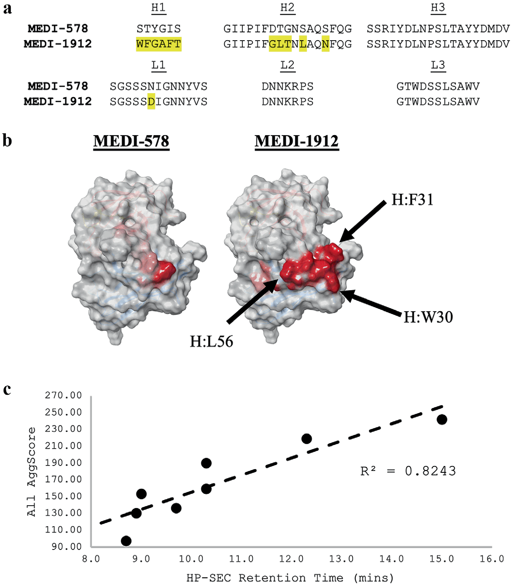

Fig. 2 (a) MEDI-578과 MEDI-1912 항체 CDR 서열 비교; 차이를 노란색으로 강조. (b) MEDI-578과 MEDI-1912의 3차원 구조와 응집 표면 모델; AggScore를 낮음(흰색)에서 높음(빨간색)으로 색상 구분. 응집 경향에 가장 큰 기여를 한 잔기(H:W30, H:F31, H:L56)는 MEDI-1912에 표시됨. (c) MEDI-1912 변이체에 대한 AggScore 예측과 실험적 HP-SEC 유지 시간 간 상관 플롯

응집 경향에 대한 돌연변이의 영향을 넘어, 리드 또는 리드 최적화 후보를 보다 다양한 치료용 항체 또는 레퍼토리 항체와 비교하는 것도 prudent하다. 이 영역의 방법론은 항체 개발 가능성의 핵심 구동력을 몇 가지 기술자로 요약하는 것을 목표로 한다. 특히 TAP [130]과 TA-DA [131]라는 두 가지 접근법은 표면 전하, 표면 소수성, 전체 CDR 길이와 같은 일부 서열과 구조 유래 기술자가 특정 항체의 치료적 유사성을 설명하기에 충분함을 보여준다. 이러한 접근법은 일련의 가능한 리드 항체에 적용하여 어떤 항체가 최적화를 위해 더 나은 개발 가능성 프로파일을 가질 수 있는지 결정하거나, 친화도 성숙 후 중요한 부작용이 도입되지 않았는지 확인할 수 있다.

### 3  방법

이전 섹션에서 제공된 세부사항을 기반으로, 인 실리코 항체 친화도 성숙의 모범 사례를 설명하는 단계별 프로토콜을 수립할 수 있다 (Fig. 3).

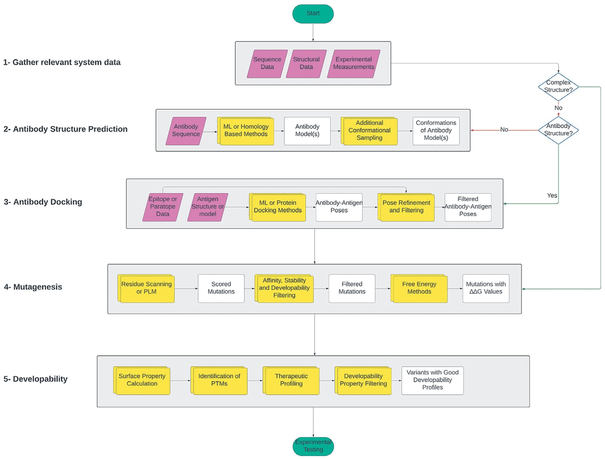

Fig. 3 일반적인 계산적 항체 친화도 성숙 캠페인의 주요 데이터(분홍), 방법(노랑), 출력(흰색) 흐름도. 데이터 가용성에 따라 사용자를 안내하기 위한 결정 트리가 표시됨.

계산적 친화도 성숙 캠페인을 시작할 때는 조사 대상 시스템의 기존 실험 데이터를 먼저 탐색해야 한다. 최소 요구사항에는 고품질의 항체와 항원 서열 접근이 포함된다. 이 맥락에서 고품질 서열은 원하는 모델과 정확히 일치하고, 누락된 영역이 없으며, 이상적으로는 fasta 또는 csv와 같은 표준 서열 파일 형식이 아닌 Excel 스프레드시트 형태를 갖추는 것이다. X선 결정학(crystallography)이나 저온전자현미경(cryo-EM)과 같은 방법으로 얻은 실험적으로 결정된 구조의 존재는 매우 유리하며, 이상적으로는 자유 항체 또는 가급적 항체–항원 복합체 구조를 확보하는 것이 좋다. 특히 등온 적정 열량법(ITC)이나 등온 적정 형광법(ITF)을 통한 단백질 안정성, 또는 표면 플라즈몬 공명(SPR), 형광 편광/이방성(FP/FA) 및 관련 기법을 포함하는 친화도 기반 방법의 시험 결과는 매우 가치 있다. 적어도 100배의 차이를 제공하는 높은 동적 범위 조건에서 얻어진 결과, 최소 2배 차이의 변이체와 함께, 워크플로의 초기 벤치마킹에서 중요한 역할을 할 수 있다.

#### 3.1  실험 데이터 가용성

일시적인(transient) 또는 불안정한(labile) 단백질–단백질 상호작용을 보고하는 추가 실험 정보, 예를 들어 단백질 가교결합(cross-linking) 실험도 과정에 유용한 통찰을 제공한다. 조사 대상 항체의 다른 항원 변이체나 종에 대한 교차반응성(cross-reactivity) 지식 또한 돌연변이 과정에서 고려해야 할 부위를 식별하는 데 유용할 수 있다. 특히 실험적 복합체 구조가 해결되지 않은 경우, 수소–중수소 교환(HDX) 데이터는 결합 및 비결합 상태에서 항체 또는 항원이 상대적인 중수소 흡수율에 의해 인터페이스에 있는 잔기를 식별하는 데 매우 유용할 수 있으며, 이러한 정보는 도킹 실험을 안내하거나 결과 자세를 필터링하는 데 사용될 수 있다.

실험적 구조를 확보할 수 없는 시나리오에서는 항체 구조 예측이 사용 가능한 예측 도구를 활용하여 가능해진다. 이는 일반적으로 두 가지 주요 범주로 분류된다:

#### 3.2  단백질 구조 모델링

항체 구조의 상동성 모델링(homology modeling)은 일반적으로 알려진 상동 구조를 기반으로 하며, 다단계 절차로 진행된다:

3.2.1  상동성 모델링 프로토콜

i.	 상동 구조 식별: 이 단계는 주로 골격 영역(FR)의 구조를 예측하기 위한 것으로, 공개 단백질 구조 데이터베이스(예: Protein Data Bank—PDB) 또는 자체 독점 데이터베이스를 검색하여 상동 구조를 찾아낸다. 목표 항체와 높은 서열 유사성을 공유하고 항체 Fv 영역에서 가장 높은 해상도와 구조 완전성을 가진 템플릿 구조를 선택한다. 서열과 해상도 중 어느 것을 우선순위로 할지 결정할 때는 일반적으로 더 높은 서열 유사성을 가진 템플릿을 선택하는 것이 좋지만, 약 3.0 Å 이상의 해상도를 가진 구조는 사용을 피하는 것이 가장 좋다. 이러한 템플릿은 골격과 측사슬 기하학 모두에서 상당한 모호성을 갖고 있어, 모델링 후 상당한 정제를 요구하거나 unreliable한 모델을 생성할 수 있기 때문이다(참고 Note 1).

ii.	 루프 모델링: 일반적으로 루프 모델링 프로토콜은 실험적으로 결정된 항체 루프 구조를 포함하는 루프 데이터베이스나 라이브러리 검색에 의존한다. 항체 캐노니컬 CDR 루프(H1, H2, L1, L2, L3)의 고품질 루프 모델은 1.5 Å 이하의 평균제곱근 편차(RMSD)로 달성할 수 있다. H3 루프의 서열과 구조의 높은 변이성으로 인해 추가적인 구조 정제가 일반적으로 권장된다(참고 Note 2).

iii.	 모델 구축 및 정제: 이는 CDR 루프를 골격 좌표에 이식(grafting)하고, 측사슬을 재패킹(repacking)하며, 결과 구조의 에너지 최소화를 포함한다. 가능할 경우 여러 모델을 구축해야 하며, 일반적으로 5개 이상이 후속 과정에서 구조적 앙상블(conformational ensemble)을 제공하기 위해 필요하다(참고 Note 3).

ML 기반 항체 구조 예측 프로토콜은 일반적으로 사용자의 개입이 최소한으로 이루어진다. 과정은 일반적으로 항체 중쇄와 경쇄의 쿼리 서열을 입력으로 제공하는 것을 포함한다. 최종 출력은 일반적으로 각 구조 모델과 함께 해당 점수가 포함된 여러 구조 모델로 구성된다. AlphaFold2와 AlphaFold3와 같은 알고리즘은 이후 모델 호출에서 구조 영역에 pLDDT라는 신뢰도 점수(confidence score)를 할당한다. 낮은 pLDDT를 보이는 영역에 대해서는 후속 정제가 권장된다.

3.2.2  ML 기반 접근법

이전에 언급한 두 가지 접근법(상동성 모델링 또는 ML 기반 프로토콜) 모두를 사용하여 여러 모델을 구축하는 것이 매우 권장된다. 이 모델들은 이어서 분자 동역학(MD) 시뮬레이션의 입력으로 사용하여 생성된 항체 모델의 구조적 앙상블을 생성할 수 있다. 이 앙상블은 동적 조건에서 항체가 채택할 수 있는 다양한 구조의 집합을 나타낸다. 가장 관련성이 높은 구조를 식별하는 것은 구조적 클러스터링(structural clustering)을 통해 수행할 수 있으며, 분자 동역학 궤적의 구조들이 기하학에 기반하여 그룹화된다. 결과 ‘그룹’ 또는 클러스터는 일반적으로 클러스터 구성원의 평균 기하학에서 파생된 단일 중심 구조(centroid structure)로 나타낼 수 있다. 클러스터의 분포(population) 역시 유용할 수 있으며, 더 높은 구조 분포를 가진 클러스터가 물리적으로 가장 관련성이 높을 가능성이 크다. 계산적 모델링 기법과 MD 시뮬레이션의 강점을 결합함으로써 연구자들은 항체 구조 예측의 정확도와 신뢰성을 향상시킬 수 있다. 결과 구조적 앙상블은 생리학적 조건과 더 가까운 시스템에서 항체의 동적 행동을 연구할 수 있는 귀중한 자원을 제공한다.

3.2.3  추가 구조적 샘플링

항원–항체 복합체의 구조를 확보할 수 없는 경우, 항체와 항원 사이의 상호작용은 단백질–단백질 도킹과 같은 계산적 방법 또는 AlphaFold Multimer 또는 AlphaFold3와 같은 고급 ML 기반 기법을 통해 연구할 수 있으며, 이는 단백질 구조를 예측하는 머신러닝 방법이다.


#### 3.3  단백질–단백질 상호작용

단백질 도킹은 결합 파트너의 다양한 구조적 상태나 자세(poses)가 샘플링되고 점수가 매겨지는 방법이다. 대부분의 현대 단백질 도킹 알고리즘에서 기본 매개변수는 일반적으로 포괄적인 탐색을 허용하기에 충분하지만, 특히 큰 항원의 경우 샘플링되는 회전 수를 늘리는 것이 prudent하다. 단백질 도킹의 점수 평가 구성 요소는 결합 인터페이스의 형태와 물리화학적 유사성에 기반한 점수를 각 자세에 적용한다. 그런 다음 자세는 순위가 매겨지며, 가장 높은 순위를 가진 자세가 이상적으로는 실제 복합체 상태에 해당해야 한다. 항체 도킹 실험을 수행할 때 일반적인 과정은 다음과 같다:

3.3.1  단백질–단백질 도킹

i.	 구조 준비: 도킹을 위해 항체와 항원의 구조를 준비하여 구조가 최적화되고 도킹 소프트웨어에 맞게 올바르게 형식화되었는지 확인한다. 경우에 따라 도킹 알고리즘 자체가 후속 단계 전에 자동으로 준비를 적용하거나 업데이트할 수 있다.

ii.	 마스킹과 제약: 항체의 경우 결합은 주로 CDR을 통해 이루어지므로, 출력에서 무관한 자세의 발생을 최소화하기 위해 비-CDR 영역을 마스킹할 것을 권장한다; 대부분의 도킹 알고리즘에는 해당 옵션이 있다. 실험에서 중요한 잔기가 알려진 경우(예: 실험적 돌연변이, 교차반응성, HDX), 중요한 잔기에 제약(restraint)을 추가하는 것이 매우 유익할 수 있다. 도킹 계산에 긍정적인 제약을 추가하면 중요한 인터페이스 잔기가 더 높은 순위로 매겨지는 자세가 얻어지는 경향이 있다. 반대로 결합에 관여하지 않는 것으로 알려진 부위가 있다면, 반발 제약(repulsive restraint)을 추가할 수 있다.

iii.	 구조적 탐색: 이 단계에서 결합 파트너 사이의 복합체 구조에 대한 수천 개의 추측이 3차원 공간에서 분자를 이동시키고 회전시키면서 생성된다. 구조적 탐색의 가장 일반적인 알고리즘에는 빠른 푸리에 변환(FFT) 기반 방법, 기하학적 해싱(geometric hashing), 몬테 카를로 기반 접근법이 포함된다.

iv.	 자세 점수 평가: 다양한 결합 자세의 에너지학을 평가하기 위해 점수 함수는 바an der Waals 힘, 정전기적 상호작용, 수소 결합, 그리고 용매화 에너지를 평가한다. 다른 점수 알고리즘은 이러한 요소에 서로 다른 가중치를 부여하며, 원래와 유사한 자세의 순위를 개선하기 위한 추가 항목을 종종 포함한다.

v.	 자세 필터링: 결합에 관여하는 잔기에 대한 지식이 있다면, 출력 자세를 필터링하여 잔기가 결합 인터페이스에서 멀리 (>5.0 Å) 있는 자세를 제외하는 것이 종종 좋은 관행이다. 여러 인터페이스 잔기가 알려진 경우에는 필터링 기준에 일부 여유를 두는 것이 prudent하다. 예를 들어 여덟 개의 인터페이스 잔기가 알려진 경우, 여섯 개만 인터페이스에 있는 자세가 허용될 수 있다. 나머지 두 개는 인터페이스 임계값 외부에 약간 위치하거나 후속 자세 정제 과정에서 인터페이스로 재배열될 수 있기 때문이다.

vi.	 자세 정제: 에너지 최소화나 MD 시뮬레이션과 같은 기법을 복합체의 기하학을 최적화하고 처음 예측된 결합 자세를 정제하여 정확도를 향상시키는 데 적용할 수 있다. 일반적으로 상위 순위의 일부 자세만 정제하는 것이 가장 좋으며(에너지 최소화의 경우 상위 50–100개, 분자 동역학의 경우 상위 5개), 정제 절차는 계산 비용이 많이 들 수 있기 때문이다.

단백질 도킹과 필터링 워크플로의 종료 시점에서 사용자는 점수에 따라 순위가 매겨진 일련의 자세를 가지게 되며, 이상적으로는 실험적 정보에 의해 안내받는다(참고 Note 4).

AlphaFold Multimer와 AlphaFold3와 같은 차세대 모델의 일반적인 입력은 사용자의 개입이 최소한인 항체와 항원의 서열이다. AlphaFold3의 경우, 항체–항원 인터페이스 예측 성능이 목표당 시드 수가 1000개까지 증가함에 따라 크게 향상되는 것으로 밝혀졌다. 이 개선은 항체–항원 인터페이스 예측 작업에만 관찰되며, Chai-1이나 HelixFold3와 같은 유사하게 사용 가능한 모델들에서 체계적으로 탐구되지 않았다. Chai-1은 현재 기존 실험 데이터를 기반으로 제약을 추가할 수 있는 유일한 차세대 모델이며, 이는 추론 시 입력된다. 단백질–단백질 도킹과 마찬가지로, 출력 모델을 분자 동역학으로 정제하고 데이터가 허용하는 경우 후향적 인 실리코 돌연변이 실험을 통해 검증하는 것이 prudent하다.

3.3.2  AlphaFold Multimer 및 차세대 ML 모델

항체–항원 복합체 구조의 정제된 모델이 생성되면, 다양한 계산적 방법론이 단일 또는 다중 돌연변이의 도입이 복합체의 친화도와 안정성에 미치는 영향을 예측하기 위해 적용될 수 있다. 아래 방법론을 미래로 적용하기 전에 반드시 후향적 검증(retrospective validation)을 수행해야 한다. 이 과정은 생성된 항체–항원 복합체가 원하는 생물물리학적 현상을 충분히 정확히 포착하는지 확인하고, 모델링 프로토콜의 최적화를 안내하는 데 도움이 된다. 다음 지침은 단일 돌연변이 전략에 초점을 맞춘다. 동시에 발생하는 돌연변이의 탐색은 여러 복잡성을 도입할 수 있다. 가능한 여러 돌연변이의 수가 빠르게 계산 기술로 합리적으로 탐색 가능한 규모를 넘어갈 수 있으며, 실제로 brute force 돌연변이 접근법은 친화도를 향상시키지 않지만 동일한 변이체 내 다른 유리한 돌연변이의 결과로 도입되는 ‘캐리어 돌연변이(carrier mutations)’의 도입으로 이어질 수 있다. 또한 잔기 스캐닝과 같은 방법의 경우 제한된 구조적 샘플링으로 인해 돌연변이 사이의 잠재적인 협력 효과(cooperative effects)가 쉽게 감지되지 않으며, 개별 돌연변이의 효과는 일반적으로 가산적(additive)이다. 따라서 단일 돌연변이로 진행한 후, 유리한 변이체를 최종 단계에서 결합하여 향상된 샘플링 방법(예: FEP+)을 활용하여 조합 효과를 계산할 것을 권장한다.


#### 3.4 친화도 향상을 위한 인 실리코(in silico) 단백질 공학

MM-PBSA/GBSA를 활용한 잔기 스캐닝(residue scanning)은 정확도와 계산 효율 사이에서 유리한 균형을 제공하므로 널리 사용된다. 돌연변이(mutation)는 표준 노트북에서 수 초에서 수 분 내에 수행할 수 있지만, 실험값 대비 피어슨 상관계수(Pearson correlation coefficient)는 낮으며 보통 0.5 미만이다. 따라서 잔기 스캐닝은 많은 아이디어를 효율적으로 평가하는 초기 단계로 권장되며, 정량적 자유 에너지 계산에 앞서 농축(enrichment) 또는 사전 필터링(prefiltering) 접근법으로 기능한다. 인 실리코 친화도 성숙(affinity maturation) 워크플로는 일반적으로 다음 단계로 구성된다.

i. 구조 준비: 복합체 구조는 완전하고 잘 정제되어 있어야 하며, 이는 누락된 측쇄(side chain)나 루프(loop)가 재구축되고 기하학적 최적화가 수행되었음을 의미한다(참고 Note 5).

ii. 부위 선정: 일반 원칙으로, 항원과 계면을 이루는 부위만 돌연변이 유도(mutagenesis)를 위해 선택해야 한다. MM-GBSA 유형 방법을 이용한 알라닌 스캐닝(alanine scanning)은 어떤 부위가 돌연변이에 불안정한지 유용한 통찰을 제공할 수 있다. 실제로 알라닌 돌연변이에 의해 결합 친화도(binding affinity)가 현저히 감소하는 부위는 후속 돌연변이 단계에서 제외해야 한다(참고 Note 6).

iii. 잔기 스캐닝: 부위 선정 단계에서 돌연변이에 적합하다고 판단된 부위에 대해, 시스테인을 제외한 다른 모든 아미노산으로의 돌연변이를 권장한다. 시스테인은 높은 화학적 반응성으로 인해 번역 후 변형(post-translational modification)의 위험이 더 크므로 일반적으로 제외된다. 유전적으로 암호화된 다른 모든 아미노산으로의 돌연변이는 비교적 간단하며, 부위 수에 따라 수 분에서 수 시간 내에 수행할 수 있다. 대부분의 잔기 스캐닝 알고리즘은 사용자가 상대적 친화도와 안정성(stability)을 동시에 계산할 수 있도록 허용하며, 가능하면 이 옵션을 활용해야 한다.

iv. 잔기 돌연변이 필터링: 잔기 스캐닝 계산의 출력은 일반적으로 테스트된 돌연변이 목록과 친화도 및 안정성에 대한 에너지 변화(∆E)이다. 돌연변이는 친화도 변화가 가장 좋은 것부터 가장 나쁜 것 순으로 순위를 매기고, 안정성에 해로운 영향을 미치는 돌연변이는 제거해야 한다.

v. 응집 예측 및 필터링: 자유 에너지 계산을 수행하기 전에 돌연변이 탐색 공간(mutational search space)을 더 줄이기 위해, 각 필터링된 항체 변이체는 상대적 응집 경향성(aggregation propensity)에 대해 평가해야 한다. 이 계산은 항원 없이 항체 단독으로 수행해야 한다. AggScore의 경우, 각 변이체에는 점수가 부여되며 점수가 높을수록 응집 경향이 높음을 의미한다(참고 Note 7).

vi. 돌연변이 자유 에너지 계산: 잔기 스캐닝과 응집 예측에서 상위에 오른 필터링된 변이체는 FEP+와 같은 자유 에너지 방법을 사용한 정량적 예측으로 이어가야 한다. 안정성을 해치지 않으면서 유리한 돌연변이를 식별하기 위해, 잔기 스캐닝 결과의 상위 25–30%에 대해 친화도와 안정성을 모두 고려하여 자유 에너지 계산을 수행한다(참고 Note 8).

친화도에는 유리하면서 안정성에 부정적인 영향을 주지 않는 돌연변이가 식별되고 정량화되면, 이들은 친화도와 안정성의 실험적 검증을 위해 진행되어야 한다. 돌연변이 유도 워크플로에서 실험적 복합체 구조가 사용되지 않으면, 최고 품질의 구조 모델에도 내재된 부정확성이 발생할 가능성이 더 높다. 이러한 경우, 실험적 검증의 첫 라운드와 모델 정제(model refinement)는 후속 친화도 성숙 워크플로를 개선하는 데 매우 가치가 있을 수 있다 [31, 132].

항체–항원 복합체 구조가 없더라도, 현재 사용 가능한 광범위한 단백질 모델링 알고리즘과 워크플로는 많은 프로젝트에서 계산적 항체 친화도 성숙을 위한 견고한 기반을 제공한다. 이러한 방법론의 강점을 활용하면서 과학적·기술적 한계를 이해함으로써, 연구자들은 돌연변이 탐색 공간을 효과적으로 줄이는 워크플로를 개발할 수 있다. 이러한 접근법은 실험 방법만 사용하는 것보다 종종 더 짧은 시간 내에 향상된 개발 가능성(developability) 프로파일을 가진 유리한 돌연변이를 식별할 수 있게 한다. 이러한 프로토콜의 특정 임계값이나 매개변수는 방법론이 발전함에 따라 진화할 수 있지만, 안정성과 개발 가능성 같은 핵심 고려사항은 항체 치료제의 계산적 설계에서 계속 중심이 될 것이다(참고 Note 9).

#### 3.5 결론과 미래 전망

FEP+ [114–116]와 같은 방법은 잔기 스캐닝 기술의 한계를 극복하고 합리적인 항체 친화도 성숙을 위한 정량적 통찰을 제공함으로써 그 가치를 입증해 왔다. 그러나 많은 수의 동시 돌연변이를 탐색할 때는 상대적 에너지 변화를 예측하기 위한 강건한 정확도를 갖춘 확장 가능한 접근법이 명확히 필요하다. 돌연변이가 시너지(synergistically) 또는 길항적으로(antagonistically) 결합된 경우에도 주의 깊게 고려해야 하며, 이러한 효과는 설계 전략에 상당한 영향을 미칠 수 있다. Schrödinger가 최근 도입한 람다 역학(lambda dynamics)을 통합한 FEP+ 잔기 스캐닝은 유망한 진전이다. 이 방법은 단백질 안정성과 결합 친화도에 대한 상대적 자유 에너지를 빠르고 신뢰성 있게 계산할 수 있게 한다. 또한, 잔기 스캐닝이나 람다 역학과 같은 기술을 사용하여 불리한 돌연변이를 사전에 제외함으로써 더 효율적인 합리적 설계를 가능하게 한다. 이 간소화된 접근법은 실험적 노력을 안내하거나 더 계산 집약적인 방법(예: 단백질 FEP+)을 위한 돌연변이 우선순위를 정함으로써 항체 공학 워크플로의 효율성과 정확도를 향상시킬 수 있다.

요약하면, 계산적 방법은 항체 치료제의 설계와 최적화에서 없어서는 안 될 도구가 되었다. 확립된 워크플로에 고급 인 실리코 기술을 통합함으로써, 연구자들은 계산 효율성과 예측 정확도 사이의 균형을 달성할 수 있다. 이러한 방법론이 계속 발전함에 따라, 실험 일정 단축, 개발 가능성 향상, 그리고 항체 공학 분야의 혁신을 이끌어낼 가능성이 있다.

### 4 참고(Note)

1. 해당 실험 구조가 없으면 새로운 항체에 대한 예측 모델을 진정으로 검증하는 것은 명백히 불가능하다. 따라서 좋은 전략은 일반적으로 다섯 개 이상 여러 모델을 생성하여 실제 실험 구조에 가까운 모델을 찾을 가능성을 높이거나, 단백질의 본질적인 역동적 특성과 CDR 루프의 유연성을 고려할 때 불합리하지 않은, 여러 형태의 구조적 특성을 평균화하는 것이다.

2. 대부분의 항체 모델링 알고리즘은 자동 루프 템플릿 선택 모드를 제공하지만, 수동 선택이 필요한 경우에는 쿼리 서열과 가장 높은 유사성을 가진 템플릿을 선택해야 한다.

3. 항체 모델링과 정제 과정에서 여러 모델이 생성되며, 각 모델에는 해당 점수나 에너지 값이 부여된다. 이러한 점수—특히 높거나 불리한 값을 찾아—저품질 모델이나 비현실적인 형태를 식별하는 데 도움이 될 수 있다.

4. 항체–항원 도킹에서 여러 후보 포즈가 사용 가능할 때—특히 상당한 형태적 다양성을 보이는 경우—후향적 돌연변이 분석(retrospective mutagenesis)이 유용한 통찰을 제공할 수 있다. 이러한 경우, 인 실리코 돌연변이 유도를 수행하여 실험 데이터와 비교할 수 있다. 일반적으로 항체와 항원 모두의 여러 형태를 고려하는 앙상블 도킹(ensemble docking)을 사용하는 것이 바람직하다. 이 접근법은 분자 유연성을 포착하고 잠재적 결합 상호작용에 대한 더 넓은 시각을 제공한다. 실제로는 각 결합 파트너의 여러 형태에 대해 도킹 시뮬레이션을 반복함으로써 형태 샘플링과 예측 정확도를 향상시킨다.

5. 인 실리코 단백질 공학에서 구조 준비를 위해, 아스파르트산, 글루탐산 및 히스티딘 잔기의 양성자화 상태(protonation state)를 올바르게 지정하는 것이 중요하며, 실제로 종종 수동 점검이 필요하다.

6. 공학 부위 선정 시, 단백질 언어 모델(PLM)은 유망한 위치와 돌연변이를 식별하는 데 도움이 될 수 있으며, 이상적으로는 인 실리코 알라닌 스캐닝을 통해 교차 검증해야 한다.

7. 응집 위험 평가에서 AggScore의 절대 점수에 대한 확정적인 임계값은 일반적으로 없으나, 부모 항체가 좋은 개발 가능성 프로파일을 가진 것으로 알려져 있다면 동일하거나 더 낮은 점수를 가진 변이체를 진행하는 것이 합리적이다.

8. 가능한 한 많은 돌연변이를 수행하면 유리한 돌연변이를 찾을 가능성이 높아지므로, 원 잔기 스캐닝 돌연변이 수의 상위 25–30% 이상에 대해 FEP+와 같은 자유 에너지 계산을 수행하는 것이 권장되며, 잔기 스캐닝에서 더 좋은 순위를 받은 것들을 우선시해야 한다. 잔기 스캐닝과 마찬가지로, 친화도와 안정성 계산을 모두 수행하여 잠재적으로 유리한 돌연변이가 항체 안정성을 해치지 않도록 해야 한다.

9. 항체–항원 복합체 구조가 없더라도, 현대 단백질 모델링 알고리즘은 계산적 항체 친화도 성숙을 위한 강력한 기반을 제공한다. 이러한 도구를 전략적으로 사용하고 그 한계를 이해함으로써, 연구자들은 돌연변이 탐색 공간을 효율적으로 좁히고 향상된 개발 가능성을 가진 유리한 돌연변이를 식별할 수 있다. FEP+와 같은 기술은 전통적인 잔기 스캐닝 대비 정량적 이점을 제공하며, 특히 안정성과 친화도를 평가할 때 그렇다. 람다 역학을 통합한 Schrödinger의 FEP+ 잔기 스캐닝은 확장성과 예측력을 향상시켜 더 빠르고 정확한 유망 변이체 선별을 가능하게 한다. 이러한 계산적 접근법은 이제 실험적 노력을 안내하고, 워크플로를 최적화하며, 항체 치료제 설계를 가속화하는 데 필수적이다.

### 참고문헌

1.	Wang B, Gallolu Kankanamalage S, Dong J, 
Liu Y (2021) Optimization of therapeutic 
antibodies. Antib Therap 4(1):45–54
	
2.	Lu R-M et al (2020) Development of therapeutic antibodies for the treatment of diseases. 
J Biomed Sci 27:1–30
	
3.	Goulet DR, Atkins WM (2020) Considerations 
for the design of antibody-based therapeutics. 
J Pharm Sci 109(1):74–103
	
4.	Bailly M et al (2020) Predicting antibody 
developability profiles through early stage discovery screening. In: MAbs, vol 12. Taylor & 
Francis, p 157
	
5.	Mackness BC et al (2019) Antibody Fc engineering for enhanced neonatal Fc receptor 
binding and prolonged circulation half-life. 
In: MAbs, vol 11. Taylor & Francis, p 157
	
6.	Ovacik M, Lin K (2018) Tutorial on monoclonal antibody pharmacokinetics and its considerations in early development. Clin Transl 
Sci 11(6):540–552
	
7.	Elgundi Z et al (2017) The state-of-play and 
future of antibody therapeutics. Adv Drug 
Deliv Rev 122:2–19

8.	Kuhlman B et al (2003) Design of a novel 
globular protein fold with atomic-level accuracy. Science 302(5649):1364–1368
	
9.	Huang P-S, Boyken SE, Baker D (2016) The 
coming of age of de novo protein design. 
Nature 537(7620):320–327
	 10.	Quinn TP et al (1994) Betadoublet: de novo

design, synthesis, and characterization of a 
beta-sandwich protein. Proc Natl Acad Sci 
USA 91(19):8747–8751
	 11.	Kaplan J, DeGrado W (2004) De novo design

of catalytic proteins. Proc Natl Acad Sci USA 
101(32):11566–11570
	 12.	Joh NH et al (2014) De novo design of a

transmembrane Zn2+-transporting four-helix 
bundle. Science 346(6216):1520–1524
	 13.	Huang PS, Love JJ, Mayo SL (2007) A de

novo designed protein–protein interface. 
Protein Sci 16(12):2770–2774
	 14.	Pantazes R, Maranas CD (2010) OptCDR: a

general computational method for the design 
of antibody complementarity determining 
regions for targeted epitope binding. Protein 
Eng Des Selection 23(11):849–858

15.	Chowdhury R, Allan MF, Maranas CD (2018)

generative models for protein structures. Adv 
Neural Inf Process Syst 35:9754–9767
	 30.	Peng Z et al (2023) Generative diffuOptMAVEn-2.0: de novo design of variable 
antibody regions against targeted antigen 
epitopes. Antibodies 7(3):23
	 16.	Li T, Pantazes RJ, Maranas CD (2014)

sion models for antibody design, docking, 
and 
optimization. 
bioRxiv 
https://doi.
org/10.1101/2023.09.25.559190
	 31.	Cannon DA et al (2019) Experimentally

OptMAVEn—a new framework for the de 
novo design of antibody variable region models targeting specific antigen epitopes. PLoS 
One 9(8):e105954
	 17.	Wong WK et al (2021) Ab-Ligity: identifying

guided computational antibody affinity maturation with de novo docking, modelling 
and rational design. PLoS Comput Biol 
15(5):e1006980
	 32.	Kiyoshi M et al (2014) Affinity improvement

sequence-dissimilar antibodies that bind to 
the same epitope. In: MAbs, vol 13. Taylor & 
Francis, p 157
	 18.	Nimrod G et al (2018) Computational design

of a therapeutic antibody by structure-based 
computational design: generation of electrostatic interactions in the transition state stabilizes the antibody-antigen complex. PLoS 
One 9(1):e87099
	 33.	Lippow SM, Wittrup KD, Tidor B (2007)

of epitope-specific functional antibodies. Cell 
Rep 25(8):2121–2131. e2125
	 19.	Shanehsazzadeh A et al (2023) In vitro

validated antibody design against multiple therapeutic antigens using generative inverse folding. bioRxiv https://doi.
org/10.1101/2023.12.08.570889
	 20.	Callan CG Jr, Mora T, Walczak AM (2017)

Computational design of antibody-affinity 
improvement beyond in vivo maturation. Nat 
Biotechnol 25(10):1171–1176
	 34.	Yoshida K et al (2019) Exploring designability

Repertoire sequencing and the statistical 
ensemble approach to adaptive immunity. 
Curr Opin Syst Biol 1:44–47
	 21.	Greiff V et al (2017) Systems analysis reveals

of electrostatic complementarity at an antigen-antibody interface directed by mutagenesis, biophysical analysis, and molecular 
dynamics simulations. Sci Rep 9(1):4482
	 35.	Regep C et al (2017) The H3 loop of antihigh genetic and antigen-driven predetermination of antibody repertoires throughout B 
cell development. Cell Rep 19(7):1467–1478
	 22.	Greiff V et al (2017) Learning the high-dibodies shows unique structural characteristics. 
Proteins 85(7):1311–1318
	 36.	Weitzner BD, Dunbrack RL, Gray JJ (2015)

mensional immunogenomic features that predict public and private antibody repertoires. 
J Immunology 199(8):2985–2997
	 23.	Asti L, Uguzzoni G, Marcatili P, Pagnani

The origin of CDR H3 structural diversity. 
Structure 23(2):302–311
	 37.	Dunbar J et al (2014) SAbDab: the structural antibody database. Nucleic acids Res 
42(D1):D1140–D1146
	 38.	Dalton JA, Jackson RM (2007) An evaluation

A (2016) Maximum-entropy models of 
sequenced immune repertoires predict antigen-antibody affinity. PLoS Comput Biol 
12(4):e1004870
	 24.	Miho E et al (2018) Computational strateof automated homology modelling methods 
at low target–template sequence similarity. 
Bioinformatics 23(15):1901–1908
	 39.	Lihan M, Lupyan D, Oehme D (2023)

gies for dissecting the high-dimensional complexity of adaptive immune repertoires. Front 
Immunol 9:224
	 25.	Shanehsazzadeh A et al (2023) Unlocking

Target-template relationships in protein structure prediction and their effect on the accuracy of thermostability calculations. Protein 
Sci 32(2):e4557
	 40.	Ruffolo JA et al (2020) Geometric potende novo antibody design with generative 
artificial intelligence. bioRxiv https://doi.
org/10.1101/2023.01.08.523187
	 26.	Chungyoun M, Gray JJ (2023) AI models for

tials from deep learning improve prediction 
of CDR H3 loop structures. Bioinformatics 
36(Supplement_1):i268–i275
	 41.	Bujotzek A et al (2015) Prediction of VH–

protein design are driving antibody engineering. Curr Opin Biomed Eng 100473
	 27.	Krause B et al (2023) Improving antibody

VL domain orientation for antibody variable 
domain modeling. Proteins 83(4):681–695
	 42.	Leem J et al (2016) ABodyBuilder: automated

affinity using laboratory data with language 
model guided design. bioRxiv https://doi.
org/10.1101/2023.09.13.557505
	 28.	Mason DM et al (2021) Optimization of

antibody structure prediction with data–
driven accuracy estimation. In: MAbs, vol 8. 
Taylor & Francis, p 157
	 43.	Dunbar J, Fuchs A, Shi J, Deane CM (2013)

therapeutic antibodies by predicting antigen 
specificity from antibody sequence via deep 
learning. Nat Biomed Eng 5(6):600–612
	 29.	Luo S et al (2022) Antigen-specific antibody

ABangle: characterising the VH–VL orientation in antibodies. Protein Eng Des Selection 
26(10):611–620

design and optimization with diffusion-based

44.	Deane CM, Blundell TL (2001) CODA: a

60.	Almagro JC et al (2014) Second antibody

combined algorithm for predicting the structurally variable regions of protein models. 
Protein Sci 10(3):599–612
	 45.	Choi Y, Deane CM (2011) Predicting antimodeling assessment (AMA-II). In: Wiley 
Online Library
	 61.	Porter KA, Desta I, Kozakov D, Vajda S

(2019) What method to use for protein–protein docking. Curr Opin Struct Biol 55:1–7
	 62.	Kozakov D, Brenke R, Comeau SR, Vajda S

body complementarity determining region 
structures without classification. Mol Biosyst 
7(12):3327–3334
	 46.	Krivov GG, Shapovalov MV, Dunbrack JrRL

(2006) PIPER: an FFT-based protein docking program with pairwise potentials. Proteins 
65(2):392–406
	 63.	De Vries SJ, Van Dijk M, Bonvin AM (2010) The

(2009) Improved prediction of protein sidechain conformations with SCWRL4. Proteins 
77(4):778–795
	 47.	Abanades B, Georges G, Bujotzek A,

HADDOCK web server for data-driven biomolecular docking. Nat Protoc 5(5):883–897
	 64.	Vangone A et al (2017) Sense and simplicity

Deane  CM (2022) ABlooper: fast accurate 
antibody CDR loop structure prediction 
with accuracy estimation. Bioinformatics 
38(7):1877–1880
	 48.	Ruffolo JA, Sulam J, Gray JJ (2022) Antibody

in HADDOCK scoring: lessons from CASP-
CAPRI round 1. Proteins 85(3):417–423
	 65.	Pierce BG et al (2014) ZDOCK server: interactive docking prediction of protein–protein complexes and symmetric multimers. 
Bioinformatics 30(12):1771–1773
	 66.	Pons C et al (2010) Optimization of pyDock

structure prediction using interpretable deep 
learning. Patterns 3(2):100406–100414
	 49.	Leman JK et al (2020) Macromolecular modeling and design in Rosetta: recent methods 
and frameworks. Nat Methods 17(7):665–680
	 50.	Ruffolo JA, Chu L-S, Mahajan SP, Gray JJ

for the new CAPRI challenges: docking of 
homology-based 
models, 
domain–domain 
assembly and protein-RNA binding. Proteins 
78(15):3182–3188
	 67.	Yan Y, Huang S-Y (2020) Modeling pro

(2023) Fast, accurate antibody structure prediction from deep learning on massive set of 
natural antibodies. Nat Commun 14(1):2389
	 51.	Jumper J et al (2021) Highly accurate protein

tein–protein or protein–DNA/RNA complexes using the HDOCK webserver. Protein 
Struct Predict 2165:217–229. https://doi.
org/10.1007/978-1-0716-0708-4
	 68.	Yan Y, Tao H, He J, Huang S-Y (2020) The

structure prediction with AlphaFold. Nature 
596(7873):583–589
	 52.	Abramson J et al (2024) Accurate structure

prediction of biomolecular interactions with 
AlphaFold 3. Nature 630(8016):493–500
	 53.	Liu L et al (2024) Technical Report of

HDOCK server for integrated protein–protein docking. Nat Protoc 15(5):1829–1852
	 69.	Nussinov R, Papin JA and Vakser I (2017)

HelixFold3 for biomolecular structure prediction. Preprint at https://doi.org/10.48550/
arXiv.2408.16975
	 54.	Discovery C et al (2024) Chai-1: decoding the

Computing the dynamic supramolecular 
structural proteome. In: Public Library of 
Science San Francisco, CA
	 70.	Vakser IA (2014) Protein-protein docking:

molecular interactions of life. bioRxiv https://
doi.org/10.1101/2024.10.10.615955
	 55.	Abanades B et al (2023) ImmuneBuilder:

from interaction to interactome. Biophys J 
107(8):1785–1793
	 71.	Desta IT et al (2020) Performance and its

deep-Learning models for predicting the 
structures of immune proteins. Commun Biol 
6(1):575
	 56.	Zhu K, Day T (2013) Ab initio structure

limits in rigid body protein-protein docking. 
Structure 28(9):1071–1081. e1073
	 72.	Torchala M et al (2013) SwarmDock: a

server for flexible protein–protein docking. 
Bioinformatics 29(6):807–809
	 73.	Moal IH, Chaleil RA and Bates PA (2018) Flexible

prediction of the antibody hypervariable H3 
loop. Proteins 81(6):1081–1089
	 57.	Zhu K et al (2014) Antibody structure deterprotein-protein docking with SwarmDock. 
Protein Complex Assembly 1764:413–428. 
https://doi.org/10.1007/978-1-4939-7759-8
	 74.	Sircar A, Gray JJ (2010) SnugDock: paratope

mination using a combination of homology 
modeling, energy-based refinement, and loop 
prediction. Proteins 82(8):1646–1655
	 58.	Fiser A and Šali A (2003) Modeller: genstructural optimization during antibody-antigen docking compensates for errors in antibody homology models. PLoS Comput Biol 
6(1):e1000644
	 75.	Jeliazkov JR, Frick R, Zhou J, Gray JJ

eration and refinement of homology-based 
protein structure models. In: Methods in 
enzymology, vol 374. Elsevier, pp 461–491
	 59.	Schwede T, Kopp J, Guex N, Peitsch MC

(2003) SWISS-MODEL: an automated protein homology-modeling server. Nucleic 
Acids Res 31(13):3381–3385

(2021) Robustification of Rosetta antibody and Rosetta snugdock. PLoS One 
16(3):e0234282

76.	Moal IH, Torchala M, Bates PA, Fernández-

interactions: a novel approach to evaluate binding free energies. J Am Chem Soc 
121(36):8133–8143
	 92.	Schramm CA, Douek DC (2018) Beyond hot

Recio J (2013) The scoring of poses in protein-protein docking: current capabilities and 
future directions. BMC Bioinforma 14:1–15
	 77.	Sunny S, Jayaraj P (2022) Protein–protein

spots: biases in antibody somatic hypermutation and implications for vaccine design. Front 
Immunol 9:1876
	 93.	Sheng Z et al (2017) Gene-specific substitudocking: past, present, and future. Protein J 
41(1):1–26
	 78.	Gromiha MM, Yugandhar K, Jemimah S

(2017) Protein–protein interactions: scoring schemes and binding affinity. Curr Opin 
Struct Biol 44:31–38
	 79.	Jung Y et al (2023) MetaScore: a novel machine-

tion profiles describe the types and frequencies of amino acid changes during antibody 
somatic 
hypermutation. 
Front 
Immunol 
8:537
	 94.	Burkovitz A, Sela-Culang I, Ofran Y (2014)

learning-based approach to improve traditional 
scoring functions for scoring protein–protein 
docking conformations. Biomolecules 13(1):121
	 80.	Stebliankin V et al (2023) PIsToN: evaluLarge-scale analysis of somatic hypermutations 
in antibodies reveals which structural regions, 
positions and amino acids are modified to 
improve affinity. FEBS J 281(1):306–319
	 95.	Fernández-Quintero 
ML 
et 
al 
(2020) 
Antibody CDR loops as ensembles in solution 
vs. canonical clusters from X-ray structures. 
In: MAbs, vol 12. Taylor & Francis, p 157
	 96.	Briney BS, Willis JR, Crowe J (2012) Location

ating protein binding interfaces with transformer 
networks. 
bioRxiv 
https://doi.
org/10.1101/2023.01.03.522623
	 81.	Wang X, Flannery ST, Kihara D (2021)

Protein docking model evaluation by graph 
neural networks. Front Mol Biosci 8:647915
	 82.	Barradas-Bautista D et al (2023) Improving

and length distribution of somatic hypermutation-associated DNA insertions and deletions 
reveals regions of antibody structural plasticity. Genes Immun 13(7):523–529
	 97.	Srinivasan J et al (1998) Continuum solvent

classification of correct and incorrect protein–
protein docking models by augmenting the 
training set. Bioinforma Adv 3(1):vbad012
	 83.	Evans R et al (2021) Protein complex prediction

with AlphaFold-Multimer. bioRxiv https://
doi.org/10.1101/2021.10.04.463034
	 84.	Ketata MA et al (2023) DiffDock-PP: rigid

studies of the stability of DNA, RNA, and 
phosphoramidate−DNA helices. J Am Chem 
Soc 120(37):9401–9409
	 98.	Kollman PA et al (2000) Calculating strucprotein-protein docking with diffusion models. Preprint at https://doi.org/10.48550/
arXiv.2304.03889
	 85.	Ganea O-E et al (2021) Independent se

tures and free energies of complex molecules: 
combining molecular mechanics and continuum models. Acc Chem Res 33(12):889–897
	 99.	Hou T, Wang J, Li Y, Wang W (2011)

(3)-equivariant models for end-to-end rigid 
protein docking. Preprint at https://doi.
org/10.48550/arXiv.2111.07786
	 86.	Sverrisson F et al (2022) Physics-informed

Assessing the performance of the MM/PBSA 
and MM/GBSA methods. 1. The accuracy 
of binding free energy calculations based on 
molecular dynamics simulations. J Chem Inf 
Model 51(1):69–82
	100.	Sun H et al (2014) Assessing the performance

deep neural network for rigid-body protein 
docking. In: MLDD workshop of ICLR 
2022. p 157
	 87.	Gaudreault F, Corbeil CR, Sulea T (2023)

of MM/PBSA and MM/GBSA methods. 4. 
Accuracies of MM/PBSA and MM/GBSA 
methodologies evaluated by various simulation protocols using PDBbind data set. Phys 
Chem Chem Phys 16(31):16719–16729
	101.	Schymkowitz J et al (2005) The FoldX web

Enhanced antibody-antigen structure prediction 
from 
molecular 
docking 
using 
AlphaFold2. Sci Rep 13(1):15107
	 88.	Ghani U et al (2021) Improved docking of

protein models by a combination of alphafold2 and cluspro. bioRxiv https://doi.
org/10.1101/2021.09.07.459290
	 89.	Chiu ML, Goulet DR, Teplyakov A, Gilliland

server: an online force field. Nucleic Acids Res 
33(suppl_2):W382–W388
	102.	Guerois R, Nielsen JE, Serrano L (2002)

GL (2019) Antibody structure and function: the basis for engineering therapeutics. 
Antibodies 8(4):55
	 90.	Huo S, Massova I, Kollman PA (2002)

Predicting changes in the stability of proteins 
and protein complexes: a study of more than 
1000 mutations. J Mol Biol 320(2):369–387
	103.	Sulea T, Hogues H, Purisima EO (2012)

Computational alanine scanning of the 1: 
1 human growth hormone–receptor complex. 
J Comput Chem 23(1):15–27
	 91.	Massova I,  Kollman PA (1999) Computational

Exhaustive search and solvated interaction 
energy (SIE) for virtual screening and affinity 
prediction. J Comput Mol Des 26:617–633
	104.	Naïm M et al (2007) Solvated interaction

alanine scanning to probe protein−protein

energy (SIE) for scoring protein−ligand

binding affinities. 1. Exploring the parameter 
space. J Chem Inf Model 47(1):122–133
	105.	Sulea T and Purisima EO (2012) The sol119.	Bai Z et al (2023) Design of nanobody-based

bispecific constructs by in silico affinity maturation and umbrella sampling simulations. 
Comput Struct Biotechnol J 21:601–613
	120.	Lee H (2021) All-atom simulations and

vated interaction energy method for scoring 
binding 
affinities. 
Comput 
Drug 
Discov 
Des 
819:295–303. 
https://doi.
org/10.1007/978-1-61779-465-0
	106.	Ó Conchúir S et al (2015) A web resource for

free-energy calculations of antibodies bound 
to the spike protein of SARS-CoV-2: the binding strength and multivalent hydrogen-bond 
interactions. Adv Theory Simul 4(5):2100012
	121.	Hanasaki I, Haga T, Kawano S (2008) The

standardized benchmark datasets, metrics, and 
Rosetta protocols for macromolecular modeling and design. PLoS One 10(9):e0130433
	107.	Rohl CA, Strauss CE, Misura KM, Baker D

antigen–antibody unbinding process through 
steered molecular dynamics of a complex 
of an Fv fragment and lysozyme. J Phys 
20(25):255238
	122.	Do P-C, Le VT (2024) Steered molecu

(2004) Protein structure prediction using 
Rosetta. In: Methods enzymology, vol 383. 
Elsevier, pp 66–93
	108.	Beard H et al (2013) Applying physics-based

lar dynamics simulation as a post-process to 
optimize the iBRAB-designed Fab model. 
J Comput Mol Des 38(1):1–16
	123.	Wang L, Friesner RA, Berne B (2011) Replica

scoring to calculate free energies of binding for 
single amino acid mutations in protein-protein complexes. PLoS One 8(12):e82849
	109.	Vivcharuk V et al (2017) Assisted design of

exchange with solute scaling: a more efficient version of replica exchange with solute tempering (REST2). J Phys Chem B 
115(30):9431–9438
	124.	Bhadane R, Salo-Ahen OM (2022) High-

antibody and protein therapeutics (ADAPT). 
PLoS One 12(7):e0181490
	110.	Sulea T et al (2018) Application of Assisted

design of antibody and protein therapeutics 
(ADAPT) improves efficacy of a Clostridium 
difficile toxin A single-domain antibody. Sci 
Rep 8(1):2260
	111.	Saka K et al (2021) Antibody design using

throughput 
molecular 
dynamics-based 
alchemical free energy calculations for predicting the binding free energy change associated with the selected omicron mutations in 
the spike receptor-binding domain of SARS-
CoV-2. Biomedicines 10(11):2779
	125.	Zhu F et al (2022) Large-scale application of

LSTM based deep generative model from 
phage display library for affinity maturation. 
Sci Rep 11(1):5852
	112.	Shin J-E et al (2021) Protein design and varifree energy perturbation calculations for antibody design. Sci Rep 12(1):12489
	126.	Julian MC et al (2017) Efficient affinity maturaant prediction using autoregressive generative 
models. Nat Commun 12(1):2403
	113.	Alley EC et al (2019) Unified rational protion of antibody variable domains requires co-selection of compensatory mutations to maintain 
thermodynamic stability. Sci Rep 7(1):45259
	127.	Shehata L et al (2019) Affinity maturation

tein engineering with sequence-based deep 
representation 
learning. 
Nat 
Methods 
16(12):1315–1322
	114.	Duan J, Lupyan D, Wang L (2020) Improving

enhances antibody specificity but compromises conformational stability. Cell Rep 
28(13):3300–3308. e3304
	128.	Dobson CL et al (2016) Engineering the

the accuracy of protein thermostability predictions for single point mutations. Biophys J 
119(1):115–127
	115.	Scarabelli G, Oloo EO, Maier JK, Rodriguez-

surface properties of a human monoclonal 
antibody prevents self-association and rapid 
clearance in vivo. Sci Rep 6(1):38644
	129.	Sankar K et al (2018) AggScore: prediction

Granillo A (2022) Accurate prediction of protein thermodynamic stability changes upon 
residue mutation using free energy perturbation. J Mol Biol 434(2):167375
	116.	Sampson JM et al (2024) Robust prediction

of aggregation-prone regions in proteins 
based on the distribution of surface patches. 
Proteins 86(11):1147–1156
	130.	Raybould MI et al (2019) Five computational

of relative binding energies for protein-protein complex mutations using free energy perturbation calculations. J Mol Biol 168640
	117.	Clark AJ et al (2017) Free energy perturbadevelopability 
guidelines 
for 
therapeutic 
antibody profiling. Proc Natl Acad Sci USA 
116(10):4025–4030
	131.	Negron C et al (2022) Separating clinical antition calculation of relative binding free energy 
between broadly neutralizing antibodies and 
the gp120 glycoprotein of HIV-1. J Mol Biol 
429(7):930–947
	118.	Clark AJ et al (2019) Relative binding affinbodies from repertoire antibodies, a path to in 
silico developability assessment. In: MAbs, vol 
14. Taylor & Francis, p 157
	132.	Doria-Rose NA, Joyce MG (2015) Strategies

ity prediction of charge-changing sequence 
mutations with FEP in protein–protein interfaces. J Mol Biol 431(7):1481–1493

to guide the antibody affinity maturation process. Curr Opvirol 11:137–147

# 제2부 다양성 생성 및 후보 선정

제2부

다양성 생성 및 후보 선정

## 제5장 나이브 및 면역 인간 Fab 파지 디스플레이 라이브러리 구축

Jia Xuan Yeoh, Jing Yi Lai, Angela Chiew Wen Ch’ng and Theam Soon Lim

### 초록

파지 디스플레이(phage display)는 다양한 표적 항원에 대해 단일클론항체(mAb)를 신속히 분리하는 데 널리 사용되는 접근법이다. 다양한 항체 라이브러리의 확보는 모든 파지 디스플레이 캠페인의 핵심 구성 요소이다. 항체 라이브러리의 생성은 단일클론항체의 확인을 가능하게 하는 반복적 과정인 패닝(biopanning)과 결합된다. 항체 라이브러리는 인간 말초혈액 단핵세포(PBMC)로부터 얻거나, 직접 분류된 B 세포 집단으로부터 얻은 항체 레퍼토리로 구성된다. 원하는 항체 라이브러리의 분류에 따라 사용되는 항체 이소형이 달라진다. 나이브 라이브러리는 IgM 레퍼토리를 활용하며, 면역 라이브러리는 항체 유전자 구성 요소로 IgG 레퍼토리를 적용한다. 항체 유전자는 중합효소연쇄반응(PCR)으로 증폭되고, 다양한 라이브러리 레퍼토어를 생성하기 위해 조합 방식으로 클로닝된다. 이 프로토콜은 Fab 형태의 나이브 또는 면역 인간 항체 라이브러리 구축에 적용할 수 있는 2단계 클로닝 접근법을 설명한다. 또한 이 프로토콜은 Fab 라이브러리를 사용한 표준 패닝 프로토콜도 포함한다.

Keywords  나이브 항체 레퍼토리, 면역 항체 레퍼토리, 항체 라이브러리, 조합, Fab, 인간, 파지 디스플레이, 파지미드, 단일클론항체

### 1  Introduction

George P. Smith은 1985년에 파지 디스플레이(phage display)를 처음 기술했으며, 박테리오파지가 표면에 펩티드를 디스플레이하여 선별할 수 있는 능력을 보여준 선구적인 연구를 발표했다. 이후 이 기술은 단일클론항체(mAb) 발굴을 포함한 다양한 응용으로 확장되었다 [1]. 파지 디스플레이는 표현형과 유전자형 사이에 직접적인 물리적 연결이 형성될 수 있는 고유한 특성 덕분에 방향성 진화를 위한 독특한 도구다. 일반적인 항체 파지 디스플레이 설계는 관심 유전자(항체 유전자)를 파지 외피 단백질 유전자와 융합하는 방식이다. 이렇게 발현된 융합 단백질은 패키징 시 박테리오파지 표면에 고정된다 [2]. 파지 디스플레이는 이후 효소 [3], 스캐폴드 [4, 5], 수용체 [6], 항체 [7–10] 등 다른 복잡한 생체분자의 디스플레이로 응용이 확대되어, 이 방법의 견고하고 다재다능한 특성을 잘 보여준다.

모든 항체 파지 디스플레이 캠페인의 기본 요건은 다양한 항체 라이브러리의 확보다. 항체 레퍼토리의 기원에 따라 항체 라이브러리는 naïve(비면역), immune(면역), synthetic(합성) 라이브러리로 분류된다. Naïve 라이브러리는 일반적으로 샘플 채취 시점에 건강한 개인의 IgM 레퍼토리로 생성된다 [11]. Naïve 라이브러리 레퍼토리는 면역계의 견고한 특성 덕분에 편향이 없고 다양하다고 일반적으로 인식된다. 그러나 IgM과 관련된 면역 기억의 영향이 유전자 다양성에 잠재적 영향을 미칠 수 있다는 점을 고려해야 한다 [12]. 따라서 개인이 평생 다양한 감염을 경험하고 예방접종을 받았기 때문에 완전히 편향이 없는 레퍼토리는 달성하기 어려울 수 있다. 그럼에도 불구하고 naïve 라이브러리는 질병 특이적 항원을 포함한 다양한 표적에 대해 우수한 친화도를 가진 mAb를 생성할 만큼 충분히 다양하다는 것이 입증되었다 [13, 14]. 반면 면역 라이브러리는 레퍼토리 다양성이 더 낮다고 여겨지지만 특정 질병 쪽으로 편향되어 있다. 이는 면역 라이브러리 생성 시 질병에 감염된 개인으로부터 얻은 항체 레퍼토리를 사용하기 때문이다. 면역 라이브러리는 감염의 경우 일반적으로 IgG 아이소타입을 사용하지만, 알레르기 항원의 경우 때로는 IgE를 사용해 생성하기도 한다. 면역 라이브러리에서 생성된 mAb는 레퍼토리의 친화도 성숙(affinity maturation) 덕분에 naïve 라이브러리에서 유래한 mAb보다 일반적으로 친화도가 더 높다 [15, 16]. 이는 면역 라이브러리의 일반적인 트레이드오프(trade-off)로, 편향된 레퍼토리 때문에 해당 감염에만 주로 적용 가능하다. 따라서 다른 감염에 대한 항체를 얻으려면 새로운 라이브러리가 필요하며, 이는 일부 실험실에 번거롭고 비용이 많이 드는 요인이 될 수 있다.

파지 디스플레이는 단백질 발현과 파지 패키징을 위해 박테리아 숙주 시스템을 활용한다. 따라서 전체 길이의 IgG 항체는 박테리아 발현 기구에 수용하기에는 너무 크다. 이 때문에 M13 박테리오파지 표면에 대형 단백질을 디스플레이하는 것은 비효율적인 과정이 된다. 결과적으로 항체의 파지 표면 디스플레이 효율을 높이기 위해 더 작은 재조합 포맷이 도입되었다. 파지 패키징 기구의 크기 내성을 극복하기 위해 사용되는 일반적인 작은 재조합 포맷에는 단일 도메인 항체(sdAb), 단일 사슬 가변 영역 항체(scFv), 항원 결합 단편(Fab)이 포함된다 [17]. sdAb는 중쇄(VH) 또는 경쇄(VL) 가변 도메인 중 하나만 디스플레이되는 가장 작은 항체 포맷이다 [18]. scFv 포맷은 중쇄와 경쇄의 가변 도메인을 짧고 유연한 링커로 연결하여 VH-VL 구성을 형성한다 [19]. Fab 단편은 중쇄와 경쇄의 가변 도메인과 함께 해당 불변 도메인을 추가로 포함한다. 이로 인해 중쇄(VH, CH1)와 경쇄(VL, CL)로 구성된 구조가 형성되며, 중쇄와 경쇄 도메인은 이황화 결합으로 서로 연결된다 [20]. Fab의 크기는 상대적으로 더 크기 때문에 scFv보다 파지 프레젠테이션에서 더 큰 어려움을 제기한다. 그러나 Fab 항체는 안정성과 후속 응용을 위한 IgG 분자로의 쉬운 재포맷(reformatting) 측면에서 유리하다 [20, 21].

항체 라이브러리 구축 과정의 핵심은 클로닝 접근법이다. 일반적으로 mRNA로부터 B-림프구를 통해 RT-PCR로 cDNA를 얻는다. 항체 레퍼토리는 이 cDNA로부터 유전자 특이적 프라이머를 사용해 증폭한 후 파지미드(phagemid)로 클로닝된다. 수년간 PCR 어셈블리 [22], TOPO 중간 클로닝 [23], 등온 롤링 서클 증폭 [24], Golden Gate 클로닝 [25] 등 여러 접근법이 보고되었다. 라이브러리 클로닝의 전통적인 전략은 두 단계 클로닝 과정으로, 먼저 경쇄를 파지미드에 삽입하여 중간 미니 라이브러리를 생성한 후, 중쇄를 삽입하여 완전한 라이브러리 레퍼토리를 생성하는 방식이다 [26]. 클로닝 과정은 라이브러리 레퍼토리가 매우 다양하면서도 서열 중복과 클로닝 편향을 줄이도록 보장하는 데 핵심적인 역할을 한다. 일반적으로 naïve 라이브러리의 크기는 추정된 항체 친화도와 비례 관계가 있다고 여겨진다. 따라서 아나노몰(sub-nanomolar) 친화도를 가진 항체를 얻을 가능성은 더 큰 라이브러리에서 증가한다고 믿어진다 [28–31].

이 프로토콜에서는 표준 두 단계 클로닝 방법을 사용하여 다양한 인간 Fab 항체 파지 디스플레이 라이브러리를 구축하는 방법을 설명한다. 이 프로토콜은 naïve 라이브러리와 면역 라이브러리 모두에 적용할 수 있으며, 유일한 차이점은 레퍼토리 증폭에 사용되는 아이소타입 특이적 프라이머의 선택이다. 또한 이 프로토콜은 Fab 단일클론항체 생성의 패닝 과정도 설명한다. 본 프로토콜이 초보 항체 개발자에게 일반적인 참고 자료로 활용되기를 바란다.

### 2  Materials

1. Ficoll-Paque™ PLUS (Cytiva).

#### 2.1  Isolation of

B-cells

2. Phosphate-buffered saline (PBS), pH 7.4: 8 g NaCl, 0.2 g KCl,

1.44 g Na2HPO4·2H2O, 0.24 g KH2PO4 in 1 L dH2O, autoclave and store at room temperature.

3. RNA Blood Mini Kit.

1. 300–500 ng RNA.

#### 2.2  First-Strand

cDNA Synthesis

2. SuperScript First-Strand Synthesis System for RT-PCR

(Invitrogen).

1. Vent® DNA Polymerase (NEB) (see Note 1).

#### 2.3  Amplification of

HC and LC Fab Gene 
Repertoire

2. Pfu DNA Polymerase (Thermo Scientific) (see Note 1).

3. Forward and reverse primers for first amplification of HC and

LC (see Table 1).

4. Forward and reverse primers for second amplification of HC

and LC with restriction endonuclease sites (see Table 2).

5. 10 mM dNTP mixture.

Table 1
Primers for first amplification of Fab HC and LC gene repertoire

Primer name
Primer sequence

Fab HC amplification

VH1 Fw
5’- CAG GTC CAG CTK GTR CAG TCT GG -3’

VH157 Fw
5’- CAG GTG CAG CTG GTG SAR TCT GG -3’

VH2 Fw
5’- CAG RTC ACC TTG AAG GAG TCT G -3’

VH3 Fw
5’- GAG GTG CAG CTG KTG GAG WCY -3’

VH4 Fw
5’- CAG GTG CAG CTG CAG GAG TCS G -3’

VH4 DP63 Fw
5’- CAG GTG CAG CTA CAG CAG TGG G -3’

VH6 Fw
5’- CAG GTA CAG CTG CAG CAG TCA -3’

Human Fab IgM CH1 Rv
5’- TGG AAG AGG CAC GTT CTT TTC TTT -3’

Human Fab IgG CH1 Rv
5’- TCT TGT CCA CCT TGG TGT TG -3’

Fab LC amplification

Vλ1 Fw
5’- CAG TCT GTS BTG ACG CAG CCG CC -3’

Vλ1459 Fw
5’- CAG CCT GTG CTG ACT CAR YC -3’

Vλ15910 Fw
5’- CAG CCW GKG CTG ACT CAG CCM CC -3’

Vλ2 Fw
5’- CAG TCT GYY CTG AYT CAG CCT -3’

Vλ3 Fw
5’- TCC TAT GWG CTG ACW CAG CCA A -3’

Vλ3 DPL16 Fw
5’- TCC TCT GAG CTG AST CAG GAS CC -3’

Vλ338 Fw
5’- TCC TAT GAG CTG AYR CAG CYA CC -3’

Vλ6 Fw
5’- AAT TTT ATG CTG ACT CAG CCC C -3’

Vκ1 Fw
5’- GAC ATC CRG DTG ACC CAG TCT CC -3’

Vκ246 Fw
5’- GAT ATT GTG MTG ACB CAG WCT CC -3’

Vκ3 Fw
5’- GAA ATT GTR WTG ACR CAG TCT CC -3’

Vκ5 Fw
5’- GAA ACG ACA CTC ACG CAG TCT C -3’

Fab Lambda CL1 Rv
5’- TGA ACA TTC TGT AGG GGC CAC TG -3’

Fab Lambda CL2 Rv
5’- TGA ACA TTC CGT AGG GGC AAC TG -3’

Fab Kappa CL Rv
5’- ACA CTC TCC CCT GTT GAA GCT CTT -3’

Table 2
Primers with restriction endonucleases site for second amplification

Primer name
Primer sequence

Fab HC amplification

VH1 NcoI Fw
5’- CCC AGC CGG CCA TGG CC CAG GTC CAG CTK GTR 
CAG TCT GG -3’

VH157 NcoI Fw
5’- CCC AGC CGG CCA TGG CC CAG GTG CAG CTG GTG 
SAR TCT GG -3’

VH2 NcoI Fw
5’- CCC AGC CGG CCA TGG CC CAG RTC ACC TTG AAG 
GAG TCT G -3’

VH3 NcoI Fw
5’- CCC AGC CGG CCA TGG CC GAG GTG CAG CTG KTG 
GAG WCY -3’

VH4 NcoI Fw
5’- CCC AGC CGG CCA TGG CC CAG GTG CAG CTG CAG 
GAG TCS G -3’

VH4 DP63 NcoI Fw
5’- CCC AGC CGG CCA TGG CC CAG GTG CAG CTA CAG 
CAG TGG G -3’

VH6 NcoI Fw
5’- CCC AGC CGG CCA TGG CC CAG GTA CAG CTG CAG 
CAG TCA -3’

Human Fab IgM CH1 MluI Rv
5’- ATG ACG CGT TGG AAG AGG CAC GTT CTT TTC TTT 
-3’

Human Fab IgG CH1 MluI Rv
5’- ATG ACG CGT TCT TGT CCA CCT TGG TGT TG -3’

Fab LC amplification

Vλ1 SalI Fw
5’- TGT GAC AAA GTC GAC G CAG TCT GTS BTG ACG 
CAG CCG CC -3’

Vλ1459 SalI Fw
5’- TGT GAC AAA GTC GAC G CAG CCT GTG CTG ACT 
CAR YC -3’

Vλ15910 SalI Fw
5’- TGT GAC AAA GTC GAC G CAG CCW GKG CTG ACT 
CAG CCM CC -3’

Vλ2 SalI Fw
5’- TGT GAC AAA GTC GAC G CAG TCT GYY CTG AYT 
CAG CCT -3’

Vλ3 SalI Fw
5’- TGT GAC AAA GTC GAC G TCC TAT GWG CTG ACW 
CAG CCA A -3’

Vλ3 DPL16 SalI Fw
5’- TGT GAC AAA GTC GAC G TCC TCT GAG CTG AST 
CAG GAS CC -3’

Vλ338 SalI Fw
5’- TGT GAC AAA GTC GAC G TCC TAT GAG CTG AYR 
CAG CYA CC -3’

Vλ6 SalI Fw
5’- TGT GAC AAA GTC GAC G AAT TTT ATG CTG ACT 
CAG CCC C -3’

Vκ1 SalI Fw
5’- TGT GAC AAA GTC GAC G GAC ATC CRG DTG ACC 
CAG TCT CC -3’

Vκ246 SalI Fw
5’- TGT GAC AAA GTC GAC G GAT ATT GTG MTG ACB 
CAG WCT CC -3’

(continued)

Table 2
continued

Primer name
Primer sequence

Vκ3 SalI Fw
5’- TGT GAC AAA GTC GAC G GAA ATT GTR WTG ACR 
CAG TCT CC -3’

Vκ5 SalI Fw
5’- TGT GAC AAA GTC GAC G GAA ACG ACA CTC ACG 
CAG TCT C -3’

Fab Lambda CL1 NheI Rv
5’- CTT GCT AGC TTA TGA ACA TTC TGT AGG GGC CAC 
TG -3’

Fab Lambda CL2 NheI Rv
5’- CTT GCT AGC TTA TGA ACA TTC CGT AGG GGC AAC 
TG -3’

Fab Kappa CL NheI Rv
5’- CTT GCT AGC TTA ACA CTC TCC CCT GTT GAA GCT 
CTT -3’

6. Agarose.

7. 10× TBE buffer, pH 8.0: 108 g Tris, 55 g boric acid, and 7.4 g

EDTA in 1 L dH2O, autoclave and store at room temperature.

8. Gel Extraction Kit.

1. Antarctic Phosphatase.

#### 2.4  Two-step Cloning

2. T4 DNA Ligase.

3. 3 M sodium acetate, pH 5.2: sodium acetate in 800 mL

dH2O, adjust pH to 5.2 with glacial acetic acid, top up to 1 L 
with dH2O and store at room temperature.

4. In-house pLABEL-Fab phagemid vector or any other commercially available phagemid vector like pHEN, pComb, 
pSEX, and pADL which is modified for Fab.

5. Plasmid Maxi Kit.

6. PCR Purification Kit.

7. Ampicillin stock solution (50 mg/mL): 2.5 g ampicillin

sodium salt in 50 mL of 50% (v/v) ethanol, filter sterilize and 
store at −20 °C.

8. 40% (w/v) glucose: 40 g d-(+)-glucose in 100 mL of dH2O,

autoclave and store at 4 °C.

9. 2× YT medium: 16 g tryptone, 10 g yeast extract, and

5 g NaCl in 1 L dH2O, autoclave and store at room 
temperature.

10. 2× YT agar: 16 g tryptone, 10 g yeast extract, 5 g NaCl, and

15.5 g agar in 1 L dH2O, autoclave.

11. 2× YT-amp medium: 2× YT medium, 0.1 mg/mL ampicillin,

and 2% (v/v) glucose.

12. 2× YT-amp agar plate: 2× YT agar, 0.1 mg/mL ampicillin,

and 2% (v/v) glucose.

13. 80% (v/v) glycerol: 40 mL glycerol in 10 mL dH2O, autoclave and store at room temperature.

14. Sterile Petri Dish, 90 mm.

15. Square BioAssay Dish.

16. MicroPulser™Electroporator (Bio-Rad, USA).

1. NcoI.

2.4.1  First Step Cloning 
(Fab HC)

2. MluI.

3. ElectroMAX™ DH10β Cells (Invitrogen, USA), genotype: F-

mcrA Δ(mrr-hsdRMS-mcrBC) Φ80lacZΔM15 ΔlacX74 recA1 
endA1 araD139Δ(ara, leu)7697 galU galK λ-rpsL nupG.

1. SalI.

2.4.2  Second Step 
Cloning (Fab LC)

2. NheI.

3. XL1-Blue MRF’ Competent Cells (Agilent Technologies,

USA), genotype: recA1 endA1 gyrA96 thi-1 hsdR17 supE44 
relA1 lac [F´ proAB lacIq Z∆M15 Tn10 (Tetr)].

1. DreamTaq DNA Polymerase (Thermo Scientific, USA).

#### 2.5  Colony PCR

2. Forward primer, LMB3: 5’-CAG GAA ACA GCT ATG AC-3’.

3. Reverse primer, pIII: 5’-TTA GAT CGT TAC GCT AAC-3’.

1. 2× YT medium: 16 g tryptone, 10 g yeast extract, and 5 g NaCl

#### 2.6  Fab Phage

Library Packaging

NaCl in 1 L dH2O, autoclave and store at room temperature.

2. 2× YT agar: 16 g tryptone, 10 g yeast extract, 5 g NaCl, and

15.5 g agar in 1 L dH2O, autoclave.

3. Ampicillin stock solution (50 mg/mL): 2.5 g ampicillin

sodium salt in 50 mL of 50% (v/v) ethanol, filter sterilize and 
store at −20 ºC.

4. Kanamycin stock solution (30 mg/mL): 1.5 g kanamycin sulfate in 50 mL of dH2O, filter sterilize and store at −20 ºC.

5. 40% (w/v) glucose: 40 g d-(+)-glucose in 100 mL of dH2O,

autoclave and store at 4 ºC.

6. 2× YT-amp medium: 2× YT medium, 0.1 mg/ mL ampicillin, and 2% (v/v) glucose.

7. 2× YT-amp/kan medium: 2× YT medium, 0.1 mg/mL ampicillin, and 0.06 mg/mL kanamycin.

8. 2× YT-amp agar: 2× YT agar, 0.1 mg/mL ampicillin, and 2%

(v/v) glucose.

9. 2× YT-kan agar: 2× YT agar and 0.06 mg/mL kanamycin.

10. M13K07 helper phage (Invitrogen, USA).

11. PEG/NaCl solution: 200 g polyethylene glycol 6000 (PEG

6000) and 146 g NaCl in 1 L dH2O, autoclave and store at 
room temperature.

12. 1 M Isopropyl-β-d-thiogalactopyranoside (IPTG): 2.38 g

IPTG in 10 mL dH2O, filter sterilize and store at −20 ºC.

13. Phosphate-buffered saline (PBS), pH 7.4: 8 g NaCl, 0.2 g

KCl, 1.44 g Na2HPO4·2H2O, 0.24 g KH2PO4 in 1 L dH2O, 
autoclave and store at room temperature.

1. 2× YT medium: 16 g tryptone, 10 g yeast extract, and 5 g NaCl

#### 2.7  Phage Titration

in 1 L dH2O, autoclave and store at room temperature.

2. 2× YT agar: 16 g tryptone, 10 g yeast extract, 5 g NaCl, and

15.5 g agar in 1 L dH2O, autoclave.

3. 2× YT-amp agar: 2× YT agar, 0.1 mg/mL ampicillin, and 2%

(v/v) glucose.

4. 2× YT-kan agar: 2× YT agar and 0.06 mg/mL kanamycin.

5. Phosphate-buffered saline (PBS), pH 7.4: 8 g NaCl, 0.2 g KCl,

1.44 g Na2HPO4·2H2O, 0.24 g KH2PO4 in 1 L dH2O, autoclave and store at room temperature.

6. TG1 Electrocompetent Cells (Lucigen, USA), genotype: supE

thi-1 Δ(lac-proAB) Δ(mcrB-hsdSM)5(rK - mK -) [F' traD36 
proAB lacIqZ ΔM15].

1. 96-well clear polystyrene high bind Stripwell™ microplate.

#### 2.8  Fab Library

Panning

2. Coating buffer, pH 9.6: 1.59 g Na2CO3 and 2.93 g NaHCO3

in 1 L dH2O, store at 4 ºC.

2.8.1  Fab Selection

3. Phosphate-buffered saline (PBS), pH 7.4: 8 g NaCl, 0.2 g

KCl, 1.44 g Na2HPO4·2H2O, 0.24 g KH2PO4 in 1 L dH2O, 
autoclave and store at room temperature.

4. PBST: 1 mL Tween 20 in 1 L PBS.

5. PTM blocking buffer: 2 g skim milk in 100 mL PBST (see

Note 2).

6. Trypsin (10 µg/mL): 10 μg trypsin in 1 mL dH2O, store at

−20 ºC.

7. Ampicillin stock solution (50 mg/mL): 2.5 g ampicillin

sodium salt in 50 mL of 50% (v/v) ethanol, filter sterilize and 
store at −20 ºC.

8. Kanamycin stock solution (30 mg/mL): 1.5 g kanamycin sulfate in 50 mL of dH2O, filter sterilize and store at −20 ºC.

9. 40% (w/v) glucose: 40 g d-(+)-glucose in 100 mL of dH2O,

autoclave and store at 4 ºC.

10. 2× YT medium, pH 7.2: 16 g tryptone, 10 g yeast extract

and 5 g NaCl in 1 L dH2O, autoclave and store at room 
temperature.

11. 10× amp: 1 mg/mL ampicillin and 20% (v/v) glucose in PBS.

12. 2× YT-amp: 2× YT medium with 0.1  mg/mL ampicillin and

2% (v/v) glucose.

13. 2× YT-amp/kan: 2× YT medium with 0.1mg/mL ampicillin

and 0.06 mg/mL kanamycin.

14. 1 M Isopropyl-β-d-thiogalactopyranoside (IPTG): 2.38 g

IPTG in 10 mL dH2O, filter sterilize and store at −20 ºC.

15. XL1-Blue Competent Cells (Agilent Technologies, USA),

genotype: recA1 endA1 gyrA96 thi-1 hsdR17 supE44 relA1 
lac [F´ proAB lacIq Z∆M15 Tn10 (Tetr)].

1. Bovine Serum Albumin (BSA) Fraction V (Sigma-Aldrich,

2.8.2  Polyclonal and 
Monoclonal Phage ELISA

USA).

2. PBST: 1 mL Tween-20 in 1 L PBS.

3. PTM blocking buffer: 2 g skim milk in 100 mL PBST (see

Note 2).

4. Anti-M13 Horseradish Peroxidase (HRP): Prepare at 1:5000

dilution in PTM blocking buffer.

5. 2,2´-azino-bis(3-ethylbenzothiazoline-6-sulphonic acid) (ABTS)

Tablets (Roche, USA).

6. ABTS Buffer (Roche, USA).

### 3  Methods

Blood samples collected from either healthy or disease-related donors 
would depend on the type of library (naïve or immune) to be generated (see Note 3).

#### 3.1  Isolation of

B-cells

1. Dilute EDTA-treated fresh blood with PBS at a 1:1 ratio.

2. Carefully layer 10 mL of whole blood on top of 7.5 mL of

Ficoll-Paque™ PLUS (see Note 4) and centrifuge at 1200 × g 
for 15 min at 18 °C.

3. Aspirate lymphocytes layered between Ficoll-Paque™ PLUS

and plasma with care. Transfer the lymphocytes to a new sterile 
50  mL polypropylene tube.

4. Dilute the isolated lymphocytes with PBS to a final volume of

50 mL and centrifuge at 250 × g for 10 min at 18 °C.

5. Remove the supernatant using a clean filter-tip.

6. Repeat steps 4 and 5 once.

7. Subject the isolated lymphocytes to RNA extraction using a

total RNA extraction kit based on the manufacturer’s protocols (see Note 5).

8. Store the extracted total RNA at −80 °C until use.

1. Synthesize the first-strand cDNA from the mRNA using

#### 3.2  First-Strand

cDNA Synthesis

SuperScript™ II Reverse Transcriptase according to manufacturer’s procedure.

2. Store the cDNA at −20 °C until use.

The cDNA will serve as template for PCR amplification of the Fab 
heavy chain (HC) and Fab light chain (LC) repertoire. Fab HC 
fragment comprises of the VH and CH1 while the Fab LC fragment 
includes the VL and CL regions. Depending on the type of library, 
different reverse primers are used for the heavy chain amplification. 
IgM CH1 Rv is used for naïve library construction whereas IgG CH1 
Rv is used for immune library construction. The forward primers 
used are the same for both libraries, which includes 7 VH primers, 
8 Vλ primers, and 4 Vκ primers (see Table 1).

#### 3.3  Amplification of

HC and LC Fab Gene 
Repertoire

1. Set up a PCR reaction using 200 ng of cDNA, 200 µM dNTPs,

0.2 µM Fw and Rv primers (Table 1), 2 µL of Pfu buffer with 
MgSO4 and 0.5 U Pfu DNA Polymerase. Top up the reaction 
to 20 µL using dH2O (see Note 6).

2. Carry out PCR using the following program: initial denaturation at 95 °C for 2 min, 30 cycles of amplification with denaturation at 95 °C for 30 s, annealing at 55 °C or 62 °C for 30 s, 
elongation at 72 °C for 45 s and a final elongation at 72 °C for 
5 min (see Note 7).

3. Separate the amplified PCR product on 1% TBE agarose gel

using gel electrophoresis at 110 V for 50 min. Excise the target band (~650–700 bp) and extract using Gel Extraction Kit 
according to the manufacturer’s protocol (see Note 8).

4. Determine the concentration of the extracted DNA and proceed to second amplification to introduce the restriction endonuclease sites with overhangs. Alternatively, store the DNA at 
−20 °C until use.

5. For the second amplification, set up the PCR reaction using

20 µg of the amplified HC or LC Fab fragment, 200 µM dNTPs, 
0.2 µM Fw and Rv primers (Table 2), 2 µL of ThermoPol® 
buffer and 0.4 U Vent® DNA Polymerase. Top up the reaction 
to 20 µL using dH2O.

6. Carry out PCR using the following program: initial denaturation at 95 °C for 2 min, 30 cycles of amplification with denaturation at 95 °C for 30 s, annealing at 55 °C or 62 °C for 30 s, 
elongation at 72 °C for 45 s and a final elongation at 72 °C for 
5 min (see Note 7).

7. Separate the amplified PCR product on 1% TBE agarose gel

using gel electrophoresis at 110 V for 50 min. Excise the band 
(~650–700 bp) and extract using Gel Extraction Kit according 
to the manufacturer’s protocol (see Note 8).

8. Pool the DNA according to subfamilies in groups of 5 donors.

Determine the concentration and store the DNA at −20 °C 
until use (see Note 9).

The library cloning is carried out using a two-step cloning strategy. 
The first cloning step will generate a mini library containing the Fab 
HC repertoire using DH10β cells, whereas the second cloning step 
will introduce the Fab LC (κ and λ) repertoire to the HC-mini library 
to generate the final Fab library using XL1-Blue cells. The schematic 
diagram of the Fab library construction process is outlined in Fig. 1.

#### 3.4  이중 단계 조합(Two-step Cloning)

1.	 pLABEL-Fab 배지와 Fab HC(중쇄 하부 영역) repertoire를 NcoI와 MluI로 결합(double digest)하여 37 °C에서 이overnight 동안 반응한 후 실온에서 인큐베이션 한다 (see Note 10). 반응을 65 °C에서 20분 동안 가열 안정화 한다 (see Note 11).

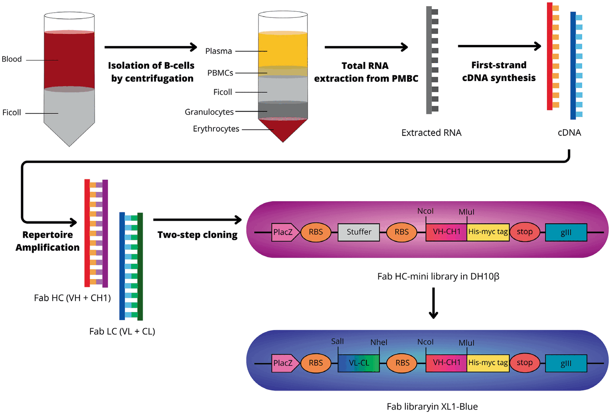

Fig. 1 Fab 라이브러리 구축 과정의 개략도. peripheral 혈구 분리군(PBMC)을 RNA 추출용으로 분리한다. 총 RNA는 다음 reverse transcribe를 통해 cDNA로 변환된다. cDNA에서 설계한 primers를 사용해 Fab LC와 Fab HC repertoire가 각각 PCR amplificate 하여 확인된다. Fab HC는 phagemid에 cloning하여 중간 mini-라이브러리를 생성한 후, Fab LC가 intermediate phagemid에 cloning되어 최종 Fab 라이브러리를 구축한다.

2.	 double-digest 된 pLABEL-Fab 배지에 alkaline phosphatase를 5 U 가하여 37 °C에서 1 시간 동안 인큐베이션 한다. 반응을 80 °C에서 2 분 동안 가열 안정화 한다.

3.	 digested vector를 gel electrophoresis를 사용해 1% TBE agarose gel 위에 분리(separate)하고, band를 Excise하여 manufacturer's protocol에 따라 Gel Extraction Kit를 사용하여 분리 한다.

4.	 digested Fab HC를 PCR Purification Kit에 따라 manufacturer's protocol에 정제(purify)한다.

5.	 digested pLABEL-Fab와 digested Fab HC repertoire를 T4 DNA Ligase를 사용하여 1:2 비율로 ligation 하고 (see Note 12), ligation 반응을 16 °C에서 overnight 동안 인큐베이션 한다. 반응을 65 °C에서 10 분 동안 가열 안정화 한다.

6.	 ligation된 DNA를 ethanol의 2.5 부피와 sodium acetate의 0.1 부피를 사용하여 Precipitate 하고 −80 °C에서 1 시간 동안 보관, 14,000 × g에서 20 분 동안 centrifuge 한다.

7.	 DNA pellet를 ethanol의 70%(v/v)를 500 µL 사용하여 세척(wash), 14,000 × g에서 20 분 동안 다시 centrifuge 한다.

8.	 ligation 반응당 4 µL dH2O로 pellet를lysolysis 하여 해결 한다.

9.	 DH10β cells를 ice에서 2 분 동안 thaw 하고 2 µL DNA와 혼합 한다.

10.	 혼합물을 pre-chilled 0.1 cm electroporation cuvette에 Transfer 하고 electroporator를 사용해 1.7 kV로 transform 한다.

11.	 electroporated mixture를 pre-warmed 2× YT medium으로 Resuspend 하고 1.5 mL microcentrifuge tube에 Transfer 한다. cell suspension를 37 °C, 700 rpm에서 1 시간 동안 incubate 한다.

12.	 subfamilies에 따라 cell suspension을 Pool 하고 cloning 효율성을 측정하기 위해 cells를 10 µL 채취 한다. cells를 90 µL 2× YT-amp에 dilute하고 90 mm petri dish에 2× YT-amp agar plate에 plating 하여 Container에 배양한다.

13.	 남은 pooled cell suspension를 30 BioAssay Dish에 2× YT-amp agar에 plating 하고 agar plate를 37 °C에서 overnight 동안 incubate 한다.

14.	 BioAssay Dish 위의 colonies를 2× YT-amp로 Scraping 한다.

15.	 library stock을 titrating하여 라이브러리 diversity를 추정 한다 (see Sect 3.4.3).

16.	 Fab HC-mini 라이브러리의 glycerol stock를 Prepare한다 (see Sect 3.4.4).

17.	 colonies를 90 mm petri dish에서 colony PCR를 수행하여 Fab HC repertoire의 cloning 효율성을 추정 한다 (see Sect 3.5) (see Note 13).

3.4.2  Fabricang LC의 Second Step Cloning

1.	 Fab HC-mini 라이브러리 glycerol stock의 tube를 overnight 동안 500 mL의 2× YT-amp에서 37 °C, 200 rpm에서 shaking 하여 Culture 한다.

2.	 plasmid를 Plasmid Maxi Kit에 따라 manufacturer's protocol에 따라 Extract한다.

3.	 Fab HC-mini 라이브러리와 Fab LC(κ and λ)를 SalI와 NheI로 double digest하여 37 °C에서 overnight 동안 반응하고 (see Note 11), 반응을 65 °C에서 20 분 동안 가열 안정화 한다.

4.	 Step 2–8 of Sect. 3.4.1에서의 digestion과 ligation을 수행한다.

5.	 Fab 라이브러리를 XL1-Blue MRF’ cells에 Transform한다.

6.	 subfamily combinations에 따라 cell suspension을 Pool 하고 cloning 효율성을 측정하기 위해 cells를 10 µL 채취 한다. cells를 90 µL 2× YT-amp에 dilute하고 90 mm petri dish에 2× YT-amp agar plate에 plating 하여 Container에 배양한다.

7.	 남은 pooled cell suspension를 40 BioAssay Dish에 2× YT-amp agar에 plating 하고 agar plate를 37 °C에서 overnight 동안 incubate 한다.

8.	 BioAssay Dish 위의 colonies를 2× YT-amp로 Scraping 한다.

9.	 Scraped library stock을 titrating하여 라이브러리 diversity를 추정 한다 (see Sect 3.4.3) (see Note 14).

10.	 Fab 라이브러리의 glycerol stock를 Prepare한다 (see Sect. 3.4.4).

11.	 colonies를 90 mm petri dish에서 colony PCR를 수행하여 Fab LC repertoire의 성공적인 cloning을 확인 한다 (see Sect. 3.5) (see Note 13).

3.4.3  Library Size Estimation

1.	 scraped library suspension에서 cells를 10 µL 채취하여 10^-13까지 10-fold serial dilution을 수행한다.

2.	 dilution을 2× YT-amp agar plate에 Spot 하고 37 °C에서 overnight 동안 incubate 한다.

3.	 다음 공식을 사용하여 library size를 계산 한다:

=
×
Library size
number of colonies
dilution factor
total volume

3.4.4  Bacteria Library Stock의 Preparation

1.	 BioAssay Dish에서 Scraped colonies를 4,500 × g, 10 분 동안 pelleting 하여 pellet을 Generate한다.

2.	 pellet을adequate amount의 2× YT-amp로 Resuspend 하고 cells suspension에 glycerol을 80%(v/v) 가하여 20% glycerol library stock를 생성 한다 (see Note 15).

3.	 final library suspension을 cryogenic vial에 aliquot하여 −80 °C에서 사용까지 보관 한다.

1.	 single colonies를 무작위로 Pick하고 10 µL dH2O로 resuspend 한다.

#### 3.5  Colony PCR

1.	 library glycerol stock의 tube를 ice에서 thaw 하고 inoculate 한다.

2.	 PCR reaction을 설계(Set up)한다: colony 2 µL, dNTPs 200 µM, LMB3 Fw primer 0.5 µM, pIII Rv primer 0.5 µM, 1× DreamTaq buffer, DreamTaq DNA Polymerase 0.5 U, dH2O로 반응을 top up한다.

3.	 다음 프로그램을 사용해 PCR을 Run 한다: 초기 denaturation 95 °C에서 5 min, 20 cycle의 amplification에서 denaturation 95 °C에서 30 s, annealing 55 °C에서 30 s, elongation 72 °C에서 2 min, 최종 elongation 72 °C에서 5 min.

4.	 amplificate된 PCR product를 gel electrophoresis로 1% TBE agarose gel 위에 분리하고, 110 V에서 50 min 동안 run한다 (see Note 16).

5.	 sequencing을 위해 올바른 band 크기를 가진 colonies를 Send한다.

6.	 IMGT/V-quest application(www.imgt.org/IMGT_vquest/vquest)으로 DNA sequence를 Analyze한다 (see Note 17).

#### 3.6  Fab Phage Library Packaging

1.	 Fab phage 라이브러리 glycerol stock의 tube를 ice에서 thaw 하고 500 mL의 2× YT-amp에 inoculate 한다. OD600 ~0.5까지 37 °C, 200 rpm에서 shaking 하여 Culture 한다.

2.	 culture를 10^12 M13KO7 helper phage로 Infect 하고 infection multiplicity (MOI)를 1:20에 따른다. 37 °C에서 static로 30 min 동안 인큐베이션 한다.

3.	 culture를 3,500 × g, 10 min 동안 pelleting 한다. supernatant를 Remove 한다 (see Note 18).

4.	 pellet을 300 mL 2× YT-amp/kan과 IPTG를 100 µM 가하여 resuspend 한다. 30 °C, 200 rpm에서 overnight 동안 culture 한다 (see Note 19).

5.	 cells를 10,000 × g, 10 min 동안 pelleting 한다. phage가 포함된 supernatant를 새로운 50 mL polypropylene tube로 Transfer 한다.

6.	 supernatant의 PEG/NaCl solution 1/5 부피를 Add하고 4/5 부피의 supernatant와 Mix 한다. ice에서 1 시간 동안 incubate 한다 (see Note 20).

7.	 mixture를 10,000 × g, 30 min 동안 12 °C에서 centrifuge 한다. supernatant를 Remove 하고 phage pellet을 PBS의 8 mL로 resuspend 한다.

8.	 PEG/NaCl solution의 2 mL를 Add하고 Mix 하고 ice에서 20 min 동안 incubate 한다.

9.	 mixture를 10,000 × g, 30 min 동안 12 °C에서 centrifuge 한다. supernatant를 Remove 하고 나머지 PEG/NaCl solution를 pipette 한다.

10.	 phage pellet을 PBS의 2 mL로 Resuspend 한다.

11.	 pellet를 remaining bacterial cells를 제거하기 위해 10,000 × g, 10 min 동안 centrifuge 한다. нет pellet을 관찰할 때까지 반복 centrifugation을 수행한다.

12.	 packaged Fab 라이브러리의 titer를 확인하기 위해 phage를 10 µL 채취 한다 (see Sect. 3.7).

13.	 Fab antibody 라이브러리를 4 °C에서 사용까지 보관 한다 (see Note 21).

#### 3.7  Phage Titration

1.	 Fab phage 라이브러리를 PBS의 90 µL에 dilute하고 10-fold serial dilution을 수행한다.

2.	 OD600 ~0.5의 TG1 또는 XL1-Blue MRF’ cells를 100 µL serial diluted phage에 Add 한다.

3.	 infected cells의 10 µL를 2× YT-amp agar plate와 2× YT-kan agar plate에 Spot 한다. 37 °C에서 overnight 동안 incubate 한다 (see Note 22).

4.	 다음 공식을 사용하여 phage titer를 계산 한다:

Phage titer (cfu/mL) = (number of colonies × dilution factor) / total volume spotted

#### 3.8  Fab Library Panning

1.	 microtiter well에 antigen를 coating buffer로 1–10 µg를 coating하고 최종 volume인 100 µL에 coat한다. subsequent panning round의 antigen량을 줄여 선별의 엄격도(stringency)를 높인다. 4 °C에서 overnight 동안 incubate 한다 (see Note 23).

3.8.1  Fab Selection

2.	 ELISA plate washer를 사용해 antigen-coated wells를 PBST로 3 x Wash한다 (see Note 24).

3.	 antigen-coated well에 PTM blocking buffer를 300 µL 사용해 1 시간 동안 room temperature에서 Block 하고 PBST로 3 x Wash 한다.

4.	 동시에 10^11 phage particles를 PTM blocking buffer의 최종 volume 200 µL에 dilute하여 preincubate 한다. blocked microtiter well에 1 시간 동안 incubate 한다 (see Note 25).

5.	 preincubated phage를 antigen-coated well에 Transfer 하고 room temperature에서 constant shaking하여 2 시간 동안 incubate 한다.

6.	 unbound 및 non-specific phage을 PBST로 10 x Wash 한다. subsequent panning round마다 wash step을 10 x 더 증가시킨다.

7.	 bound phage를 trypsin의 10 µg/mL 100 µL로 Elute 하고 37 °C에서 static로 30 min 동안 incubate 한다 (see Note 26).

8.	 eluted phage를 새로운 2 mL microcentrifuge tube에 Transfer 하고 OD600 ~0.5의 XL1-Blue MRF’ cells를 100 µL Add 한다. static로 37 °C에서 30 min incubate 하고 shaking하여 37 °C에서 30 min 동안 incubate 한다.

9.	 infected culture에서 10 µL을 채취하여 rescued phage titer를 확인 한다 (see Sect. 3.7).

10.	 remaining culture에 amp의 20 µL을 Add하고 37 °C, 700 rpm에서 overnight 동안 Culture 한다.

11.	 overnight culture를 2× YT-amp의 190 µL에 inoculate 하고 10 µL overnight culture를 Add 한다. 37 °C, 700 rpm에서 2.5 시간 동안 Culture 한다.

12.	 remaining overnight culture에 glycerol을 80%(v/v)의 65 µL로 Mix 하고 glycerol stock를 −80 °C에 저장한다.

13.	 culture를 10^11 M13KO7 helper phage로 Infect 하고 static로 37 °C에서 30 min 동안 incubate 한다.

14.	 culture를 3,500 × g, 10 min 동안 pelleting 한다. cell pellet을 2× YT-amp/kan을 100 µM IPTG로 Supplementando 230 µL를 resuspend 한다. 30 °C, 700 rpm에서 overnight 동안 Culture 한다.

15.	 overnight culture를 3,500 × g, 10 min 동안 pelleting 한다.

16.	 supernatant를 새로운 tube로 Transfer 한다. subsequent panning round에 phage를 100 µL 채취 하고 polyclonal ELISA를 위한 나머지 phage를 4 °C에 보관한다. each panning round에서 amplified phage titer를 Determine 한다 (see Sect. 3.7) (see Note 27).

A successful panning campaign would yield an increasing trend in the polyclonal ELISA absorbance readout with each subsequent panning round. It is critical to choose the best panning round for monoclonal antibody selection in order to isolate different monoclonal antibodies with good specificity and diversity.

3.8.2  Polyclonal and Monoclonal Phage ELISA

1.	 microtiter wells에 antigen를 coating buffer로 1–10 µg/mL를 coating하고 최종 volume 100 µL에 coat한다. 4 °C에서 overnight 동안 incubate 한다. 동시에 비음(negative control)과 같은 양의 BSA를 Wells를 coated한다. non-specific binder를 각 시료에서 관찰하기 위해.

2.	 ELISA plate washer를 사용해 coated wells를 PBST로 3 x Wash한다 (see Note 24).

3.	 PTM blocking buffer를 300 µL로 coating wells를 1 시간 동안 room temperature에서 Block 하고 PBST로 3 x Wash 한다.

4.	 phage를 PTM blocking buffer의 50 µL에 dilute하고 (phage 50 µL, PTM blocking buffer 50 µL) correspondent antigen-coated wells와 control wells에 100 µL Mixture를 Add 한다. room temperature에서 shaking하며 2 시간 동안 incubate 한다.

5.	 wells를 PBST로 3 x Wash한다.

6.	 anti-M13-HRP를 antigen-coated wells와 control wells에 각각 100 µL Add 한다. room temperature에서 shaking하며 37 °C에서 1 시간 동안 incubate 한다.

7.	 wells를 PBST로 3 x Wash한다.

8.	 Wells를 ABTS solution의 100 µL로 Develop 하고 30 min 동안 dark에서 incubate 한다. microtitre plate spectrophotometer로 405 nm에서 Absorbance를 Measure 한다.

9.	 monoclonal selection의 panning round를 결정한 후 나머지 phage를 10 µL 채취하여 10-fold serial dilution을 수행하고 OD600 ~0.5의 XL1-Blue MRF’ cells를 37 °C, static로 infect 하고 100 µL에 Plate 한다. infected cell를 2× YT-amp agar plate에 plating 한다.

10.	 monoclonal antibody clone를 최소 92개를 무작위로 Pick하여 2× YT-amp의 200 µL에 inoculate 한다. 37 °C, 1250 rpm에서 overnight 동안 Culture 한다 (see Note 28).

11.	 monoclonal Fab antibody를 Sect. 3.8.1의 Step 11–15에 따라 Package 한다.

12.	 monoclonal ELISA을 이 Section의 Step 1–8에 따라 수행한다. monoclonal phage ELISA의 경우 antigen coated의 면적을 wells당 200 ng에서 500 ng 사이로 줄일 수 있다.

13.	 colony PCR에 좋은 signal/noise ratio를 가진 positive clones를 Identify 하고 DNA analysis를 위해 sequencing에 Send한다.

### 4  Notes

1.	 다른 high-fidelity proof-reading polymerases를 대체로 사용할 수 있다. 그러나 다른 polymerase로 PCR condition을 최적화 하기 위해 미리 작업이 필요하다.

2.	Blocking agent로 bovine serum albumin (BSA), casein, ovalbumin, gelatin을 대체로 사용할 수 있다. 그러나 Blocking solution은 미세한 기(microorganism)contamination을 방지하기 위해 fresh로 Prep 한다.

3.	naïve 라이브러리 repertoire과 immune 라이브러리 repertoire의 sampling requirements가 다르다. 다음과 같은 고려사항 포함:

a.	 Families의 질병 background를 가진 Donor, autoimmune disorder를 suffering 하며 ongoing infection을 가지고 fever 같은 infection symptoms를 경험하는 사람, blood collection 기준 월 이내에 약물(antibiotics, immuno suppressors 포함)를 복용한 사람은 naïve 라이브러리 sampling에 적합하지 않다.

b.	 immune 라이브러리 sampling을 위해 Donor's medication history (치료 type, 상태)를 기록해야 한다. treatment regimen의 유형은 disease에 의해 elicit되는 Donor의immune response에 영향을 주지 않게 하려면 라이브러리 generation process를 표준화하는 것이 중요하다. antibody generation을 위한 효과적인 repertoire를isolate 하기 위해서는 필수적이다. immuno suppressors가 Prescribed된 Donor는 immune response가 불안전하기 때문이지 적합하지 않다. 그러나 disease의 mechanism에 따라 exclusion or inclusion에 대한 medication/treatment consideration이 달라질 수 있다.

4.	 blood layer가 Ficoll-Paque™ PLUS solution과 혼합되지 않도록 하여 적혈구(erythrocytes)의 aggregation을 방지한다. aggregate에 trapped된 lymphocytes가 erythrocytes와 bottom의 tube로 sediment하여 lymphocytes의 yield가 줄어들게 된다.

5.	 lymphocytes에서 추출된 총 RNA의 integrity와 concentration은 Bioanalyzer Instrument (Agilent, USA) 또는 기타 suitable equipment로 분석할 수 있다.

6.	 antibody repertoire의 PCR amplificate에 다른 proof-reading polymerases를 사용하는 경우 PCR condition을 최적화 하기 위해 작업이 필요할 수 있다.

7.	 HC와 LC repertoire을 각 Donor에서 독립적으로 amplificate하여 sample pooling에 의한 편향과 레퍼토리 손실을 피한다. 이 단계가 높은 repertoire diversity의 recovery를 보장한다.

8.	 Fab HC and LC fragment은 약 650–700 base pair (bp); 그러나 V-gene rearrangement의 nature로 인해 기타 band의 presence가 예상된다. targeted band size를 Meticulous하게 Excise 하고 agarose gel에서 band separation이 좋은지 확인한 후 band를 Excise 한다.

9.	 proposed pooling configuration은 user의 specific situation에 따라 변경될 수 있는 suggestion이다. pooling process는 minimum repertoire diversity 손실 대 feasible한 final sample size 사이의 균형을 achieve하기 위해 수행된다. Ideally, repertoire diversity의 충분 recovery를 보장하기 위해 sample pooling을 최소화하는 것이 좋다.

10.	 사용된 phagemid는 Fab HC를 pIII gene에 fusion하여 phage particle에 직접 dock하는 구조로 설계되었다. Fab LC는 periplasm space에서 Fab HC와 co-express 되며 disulfide bond를 형성하여 mature Fab molecule이 phage particle에 displayed 된다.

11.	 cloning procedure의 following step을 위한 충분한 DNA를 obtain하려면 restriction enzyme digestion 반응의 수를 증가시킨다. restriction endonucleases pair가 incompatible reaction buffer를 사용하는 경우 salt content가 digestion efficiency에 영향을 주므로 sequential digestion을 수행한다.

12.	 highly diverse 라이브러리를 위해 충분한 DNA material을 obtain하기 위해 multiple ligation 반응이 필요할 수 있다. heavy chain repertoire의 라이브러리 size는 VH가 antigen binding의 predominant region이므로 가능한 한 높아야 한다. naïve 라이브러리에서는 10^7–10^9 또는 그 이상, immune 라이브러리에서는 10^5–10^7 또는 그 이상이 권장된다.

13.	 first step cloning에서 Fab HC의 expected band size는 approximately 1200 bp이고, second step cloning에서 whole Fab의 expected band size는 1800 bp이다.

14.	 마지막 라이브러리 size는 naïve 라이브러리에서는 10^9에서 10^12 사이 또는 그 이상, immune 라이브러리에서는 10^6–10^8 사이 또는 그 이상이어야 한다.

15.	 라이브러리 stock tube는 library packaging 동안 500 mL의 2× YT-amp으로 culturing into 시작 OD600 ~0.1을 허용하도록 prepared한다.

16.	 Fab HC-mini 라이브러리와 full Fab 라이브러리의 cloning efficiency는 >80%이 preferred이다. cloning efficiency이 80% 이상이면 라이브러리에 empty phagemid가 없는 확률을 줄일 수 있다.

17.	 대안적으로 library repertoire diversity은 deep sequencing로Determine 할 수 있다.

18.	 과잉 glucose가 HC::pIII fusion protein과 free LC의 expression을 suppress하므로 cells를pelleting 하고 glucose를 포함하는 medium를 제거해야 한다.

19.	 Fab phage packaging 동안 100 µM IPTG의 addition이 HC::pIII fusion protein과 LC monomers의 expression을 induce한다. phage particle에 Fab antibody molecules의 natural formation을facilitate할 것이다.

20.	 PEG/NaCl solution에 의해 phage particles가 Precipitate되는 양을 증가시키려면 ice-cold incubation을 2 h로 연장할 수 있다.

21.	 phage preparation을 4주 이상 4 °C에 저장하지 않는다. displayed antibodies의 proteolysis로 인해 binding이 잃어지는 것을 방지하려 phage를 freshly Package 한다.

22.	 ampicillin agar plate의 colonies는 kanamycin plate에 비해 최소 이-fold만큼 높아야 한다. 이는phage library와 동시에 생성되는 helper phage의 양이 적다는 것을 의미한다. 또한 colonies를 panning을 prior로 phage library size를 Quantify 할 수 있다.

23.	 panning을 앞두고 antigen의 purity를 SDS-PAGE와 Western blot로 Evaluate한다. panning에서 사용되는 antigen의 purity는 specific Fab antibody binder의 isolation을 보장한다.

24.	 대안적으로 squirt bottle를 manual로 Wells를 Wash 한다. Wells를 PBST로 Fill하고 wash buffer를 decant 한다. clean dry paper towels의 stack 위에서 Wells를 Tap하여 나머지 PBST를 제거한다. Wash step에서 remaining PBST가 air bubble로 mixed되어 overflow되는 것을 방지하기 위해 주의를 기울여야 한다.

25.	 첫 번째 panning round에서 사용되는 phage의 양은 라이브러리 size의 두-fold보다 두 배 이상이어야 한다.

26.	 이 단계에서 사용 가능한 기타 elution buffer나 method이 있다. Competitive elution은 free antigen로 경쟁하여 수행할 수 있다. glycine-HCL, pH 2.2를 사용한 acid-based elution도 사용할 수 있다. 각 user의 requirement과 preference에 의해 최고 elution method가 결정된다.

27.	 각 panning round의 phage recovery은 rescued phage titer를 input phage titer로 나누어 계산한다. phage recovery는 panning rounds에 수직적으로 증가하여 binding clones의 enrichment를 나타내야 한다.

28.	 최소 92개 clones를 Evaluate해야 한다. 일부 경우에는 unique monoclonal antibody를 식별하기 위해 수백 개의 colonies를 Pick해야 할 수 있다.

Acknowledgments

This work was supported by a Universiti Sains Malaysia, Special (Matching) Short-Term Grant with Project No: 304.CIPPM.6315708.

Conflict of Interest  The work was supported by Malaysia Ministry of Higher Education Fundamental Research Grant Scheme Project No: FRGS/1/2024/STG01/USM/02/10.

### 참고문헌

1.	Smith 
GP 
(1985) 
Filamentous 
fusion 
phage: novel expression vectors that display cloned antigens on the virion surface. 
Science 228(4705):1315–1317. https://doi.
org/10.1126/science.4001944
	 2.	McCafferty J, Griffiths AD, Winter G et

of an artificial phage-display library based 
on a new scaffold improved for average stability of the randomized proteins. Sci Rep 
13(1), 
1339. 
https://doi.org/10.1038/
s41598-023-27710-4
	 5.	Möller M, Jönsson M, Lundqvist M, Hedin B,

al (1990) Phage antibodies: filamentous 
phage displaying antibody variable domains. 
Nature 
348(6301):552–554. 
https://doi.
org/10.1038/348552a0
	 3.	Chan SK, Lai JY, Gan CY, Lim TS (2023)

Larsson L, Larsson E, Rockberg J, Uhlén M, 
Lindbo S, Tegel H, Hober S (2023) An easyto-use high-throughput selection system for the 
discovery of recombinant protein binders from 
alternative scaffold libraries. Protein Eng Des 
Sel 36:gzad011. https://doi.org/10.1093/
protein/gzad011
	 6.	Ch’ng ACW, Lam P, Alassiri M, Lim TS (2022)

A semi-rational mutagenesis approach for 
improved substrate activity of microbial transglutaminase. Food Chem 419:136070. https://
doi.org/10.1016/j.foodchem.2023.136070
	 4.	Gomes M, Fleck A, Degaugue A, Gourmelon

Application of phage display for T-cell receptor 
discovery. Biotechnol Adv 54:107870. https://
doi.org/10.1016/j.biotechadv.2021.107870
	 7.	Lawrie J, Waldrop S, Morozov A et al (2021)

F, Léger C, Aumont-Nicaise M, Mesneau 
A, Jean-Jacques H, Hassaine G, Urvoas A, 
Minard P, Valerio-Lepiniec M (2023) Design

Engineering of a small protein scaffold to

recognize sulfotyrosine with high specificity. 
ACS Chem Biol 16(8):1508–1517. https://
doi.org/10.1021/acschembio.1c00382
	 8.	Rahumatullah A, Abdul Karim IZ, Noordin

Int J Biol Macromol 163:640–648. https://
doi.org/10.1016/j.ijbiomac.2020.06.268
	18.	Almagro JC, Pedraza-Escalona M, Arrieta HI

et al (2019) Phage display libraries for antibody therapeutic discovery and development. 
Antibodies 8(3):44
	19.	Shim H (2017) Antibody phage display. Adv

R, Lim TS (2017) Antibody-based protective 
immunity against helminth infections: antibody 
phage display derived antibodies against BmR1 
antigen. Int J Mol Sci 18(11):2376. https://
doi.org/10.3390/ijms18112376
	 9.	Bertoglio F, Ko YP, Thomas S, Giordano L,

Exp Med Biol 1053:21–34. https://doi.
org/10.1007/978-3-319-72077-7_2
	20.	Feng M, Bian H, Wu X et al (2019) Construction

Scommegna FR, Meier D, Polten S, Becker 
M, Arora S, Hust M, Höök M, Visai L (2023) 
Antibodies to coagulase of Staphylococcus 
aureus crossreact to Efb and reveal different 
binding of shared fibrinogen binding repeats. 
Front Immunol 14:1221108. https://doi.
org/10.3389/fimmu.2023.1221108
	10.	Omar N, Hamidon NH, Yunus MH et al (2018)

and next-generation sequencing analysis of a 
large phage-displayed VNAR single-domain antibody library from six naive nurse sharks. Antib 
Ther 2(1):1–11
	21.	Kang AS, Barbas CF, Janda KD et al (1991)

Linkage of recognition and replication functions by assembling combinatorial antibody 
Fab libraries along phage surfaces. PNAS 
88(10):4363–4366
	22.	Steinwand M, Droste P, Frenzel A et al (2014)

Generation and selection of naïve Fab library 
for parasitic antigen: anti-bmsxp antibodies for 
lymphatic filariasis. Biotechnol Appl Biochem 
65(3):346–354. 
https://doi.org/10.1002/
bab.1591
	11.	Valldorf B, Hinz SC, Russo G, Pekar L,

The influence of antibody fragment format on 
phage display based affinity maturation of IgG. 
mAbs 6(1):204–218. https://doi.org/10.4161/
mabs.27227
	23.	Bates A, Power CA (2019) David vs. Goliath:

Mohr L, Klemm J, Doerner A, Krah S, Hust 
M, Zielonka S (2021) Antibody display technologies: selecting the cream of the crop. 
Biol Chem 403(5-6):455–477. https://doi.
org/10.1515/hsz-2020-0377
	12.	Lai JY, Lim TS (2020) Infectious disease antithe structure, function, and clinical prospects of 
antibody fragments. Antibodies 8(2):28
	24.	Nannini F, Parekh F, Wawrzyniecka P et al

(2020) A primer set for the rapid isolation of 
scFv fragments against cell surface antigens from 
immunised rats. Sci Rep 10(1), 19168. https://
doi.org/10.1038/s41598-020-76069-3
	25.	Rahumatullah A, Ahmad A, Noordin R et al

bodies for biomedical applications: a mini review 
of immune antibody phage library repertoire. 
Int J Biol Macromol 163:640–648. https://
doi.org/10.1016/j.ijbiomac.2020.06.268
	13.	Chan SK, Rahumatullah A, Lai JY et al (2017)

(2015) Delineation of bmsxp antibody V-gene 
usage from a lymphatic filariasis based immune 
scFv antibody library. Mol Immunol 67(2, Part 
B):512–523. 
https://doi.org/10.1016/j.
molimm.2015.07.040
	26.	Huovinen T, Brockmann E-C, Akter S et al

Naïve human antibody libraries for infectious 
diseases. In: Lim TS (ed) Recombinant antibodies for infectious diseases. Springer International 
Publishing, 
Cham, 
35–59 
https://doi.
org/10.1007/978-3-319-72077-7_3
	14.	Weill J-C, Reynaud C-A (2020) IgM memory B

(2012) Primer extension mutagenesis powered 
by selective rolling circle amplification. PLoS 
One 7(2):e31817. https://doi.org/10.1371/
journal.pone.0031817
	27.	Shahsavarian MA, Le Minoux D, Matti KM et

cells: specific effectors of innate-like and adaptive responses. Curr Opin Immunol 63:1–6. 
https://doi.org/10.1016/j.coi.2019.09.003
	15.	Vaughan TJ, Williams AJ, Pritchard K et al

al (2014) Exploitation of rolling circle amplification for the construction of large phage-display antibody libraries. J Immunol Methods 
407:26–34. 
https://doi.org/10.1016/j.
jim.2014.03.015
	28.	Chockalingam K, Peng Z, Vuong CN et al

(1996) Human antibodies with sub-nanomolar affinities isolated from a large non-immunized phage display library. Nat Biotechnol 
14(3):309–314. 
https://doi.org/10.1038/
nbt0396-309
	16.	Roth KDR, Wenzel EV, Ruschig M et al (2021)

(2020) Golden gate assembly with a bi-directional promoter (GBid): a simple, scalable method for phage display Fab library 
creation. Sci Rep 10(1), 2888. https://doi.
org/10.1038/s41598-020-59745-2
	29.	Sheets MD, Amersdorfer P, Finnern R et al

Developing recombinant antibodies by phage 
display against infectious diseases and toxins 
for diagnostics and therapy. Front Cell Infect 
Microbiol 11:617
	17.	Lai JY, Lim TS (2020) Infectious disease antibodies for biomedical applications: a mini review 
of immune antibody phage library repertoire.

(1998) Efficient construction of a large nonimmune phage antibody library: the production

of high-affinity human single-chain antibodies 
to protein antigens. PNAS 95(11):6157–6162. 
https://doi.org/10.1073/pnas.95.11.6157
	30.	de Haard HJ, van Neer N, Reurs A et al (1999)

Chem 274(26):18218–18230. https://doi.
org/10.1074/jbc.274.26.18218
	31.	Erasmus MF, D’Angelo S, Ferrara F et al (2021)

A single donor is sufficient to produce a highly 
functional in vitro antibody library. Commun 
Biol 
4(1):350. 
https://doi.org/10.1038/
s42003-021-01881-0

A large non-immunized human fab fragment 
phage library that permits rapid isolation and 
kinetic analysis of high affinity antibodies. J Biol

## 제6장 나이브 인간 scFv 파지 디스플레이 라이브러리의 생성과 패닝

Jia Xuan Yeoh, Jing Yi Lai, Angela Chiew Wen Ch’ng and Theam Soon Lim

### 초록

항체 라이브러리는 파지 디스플레이 실험에서 단일클론항체를 분리하는 핵심 요소이다. 나이브 항체 라이브러리는 다양한 표적에 대한 단일클론항체를 확인하는 데 사용되어 왔으며, 작은 분자부터 큰 단백질 표적까지 포함한다. 좋은 나이브 라이브러리 생성의 기본 요건은 다양한 항체 유전자 집합을 유전적 공급원으로 확보하는 것이다. 나이브 항체 라이브러리에 사용되는 항체 유전자 풀은 건강한 기증자에서 얻은 IgM 레퍼토리이다. 얻은 항체 유전자는 일반적으로 파지 디스플레이에 선호되는 작은 크기와 특성 때문에 단일체 가변 영역(scFv) 형태로 클로닝된다. 이 프로토콜은 2단계 클로닝 방법을 사용한 라이브러리 클로닝 과정과 이후의 바이오패닝 선별 과정을 포함한다.

핵심어  나이브 라이브러리, scFv, Human, 파지 디스플레이, 파지미드, 단일클론항체

### 1  서론

항체 개발 기술은 하이브리도마 기술이 등장한 이후로 계속 발전해왔다. 지난 수년간 디스플레이 기술의 도입으로 항체 기술이 급속히 진화했다. 최근 몇 년 동안 여러 다른 디스플레이 기술이 적용되었지만, 파지 디스플레이는 여전히 단일클론항체(mAb)를 분리하는 표준적인 방법으로 널리 인정받고 있다 [1]. 파지 디스플레이 기술은 처음에는 펩타이드 표시용으로 사용되었으나, 빠르게 항체를 포함한 더 큰 단백질을 표시하도록 발전했다.

성공적인 항체 파지 디스플레이 패닝 실험을 수행하려면, 다양한 면역글로불린(Ig) 유전자 레퍼토리가 라이브러리로 함께 모아져 있어야 한다. 항체 유전자는 적절한 파지미드 벡터에 클로닝되며, 일반적으로 pIII 유전자와의 코트 단백질 융합 형태이다. 클로닝된 유전자는 파지 패키징 과정에서 번역되어 인체 유래 단일클론항체가 박테리오파지 표면에 라이브러리 형태로 표시된다 [2]. 파지 디스플레이에 이상적인 필라멘트성 파지의 핵심 특성은 견고하고 안정적인 파지 입자의 특성이다. 파지 디스플레이가 표면에 항체 단편을 안정적으로 표시할 수 있는 능력 덕분에 다양한 조건 하에서 표적에 대한 항체 선별에 성공적으로 활용되어 왔다 [3]. 파지 디스플레이를 통해 표적 특이적 항체를 확인할 성공률을 높이기 위해, 항체 유전자 라이브러리의 품질은 중요한 영향 요인이다 [3]. 고품질 파지 디스플레이 항체 라이브러리를 준비할 때 가장 중요한 고려 사항은 다양성과 순도가 높은 항체 유전자 공급원이다. 항체 유전자 집합의 다양성은 생체 내 자연 항체 반응의 다양성을 재현할 만큼 충분히 커야 한다 [4].

항체 파지 디스플레이 라이브러리는 원칙적으로 각 개별 파지 입자가 표면에 고유한 항체 클론을 표시하는 대규모 파지 입자 집합으로 구성된다. 이 고유한 항체 클론은 파지 내부의 고유한 항체 유전자와 대응된다 [5]. 항체 라이브러리에 이상적으로 필요한 고유 항체 서열의 수는 라이브러리 유형에 따라 108개에서 1011개의 고유 클론 사이에서 달라질 수 있다. 파지 입자는 일반적으로 표시에 필요한 소량의 코트 단백질과 항체 구조가 융합되도록 설계된다. 이 특징은 파지미드 설계에 통합되며, 항체 단편이 소량의 코트 단백질인 pIII 옆에 클로닝된다 [6].

항체 라이브러리는 나이브, 면역형, 합성형 라이브러리로 분류할 수 있다 [7]. 라이브러리 분류는 라이브러리 생성에 사용된 항체 V 유전자 공급원의 출처에 따라 결정된다 [7]. 나이브 항체 라이브러리는 최근 감염이 없고 일반적으로 IgM 이소타입의 레퍼토리에 초점을 맞춘 건강한 기증자에서 유래한다 [1]. IgM 이소타입 항체는 일반적으로 체세포 과돌연변이가 적고, 다클론이며 자가반응성으로 인해 낮은 내재 친화도 또는 낮은 특이성을 보인다 [8]. 기증자 수집 시점에 알려진 감염이 없거나 예방접종이 이루어지지 않았다고 가정하면, 나이브 라이브러리의 레퍼토리는 특정 항원 그룹에 편향되지 않을 것이다 [9]. 그러나 나이브 항체 라이브러리에서 분리된 항체는 일반적으로 면역형 라이브러리보다 낮은 친화도를 보이는데, 이는 레퍼토리가 생체 내 친화도 성숙을 거치지 않았기 때문이다 [3]. 따라서 라이브러리의 크기와 레퍼토리 다양성이 충분히 정의되어야 하며, 이는 생성되는 단일클론항체의 품질에 영향을 미친다. 라이브러리 크기와 항체 친화도 사이에는 직접적인 상관관계가 있으며, 라이브러리 크기는 항체 친화도에 직접적으로 비례한다 [7]. 대규모 항체 라이브러리를 생성하기 위해 여러 “나이브” 기증자의 레퍼토리를 결합하면 라이브러리의 전체 항체 레퍼토리가 증가할 수 있다 [10]. 따라서 성공적인 항체 파지 디스플레이 라이브러리 생성을 위해 기증자 수와 클로닝 다양성 사이의 섬세한 균형을 달성해야 한다.

항체 라이브러리 생성은 일반적인 인간 항체 형식의 사용을 포함한다. 가장 일반적인 형식은 단일체 가변 영역(scFv), 항원 결합 단편(Fab), 그리고 도메인 항체이다 [11]. 이 재조합 항체 단편은 E. coli의 폴딩 기계 한계와 파지 표시에 따른 크기 제한으로 인해 완전한 IgG 형식이 아닌 항체 파지 디스플레이에 일상적으로 사용된다 [12]. 그러나 scFv 형식은 다양한 형식 중 가장 많이 사용되는 형식으로, 중쇄와 경쇄의 가변 영역 모두의 다양성을 허용 가능한 크기로 파지에 제시할 수 있기 때문이다 [13]. scFv 형식의 항체는 중쇄(VH)와 경쇄(VL)의 가변 영역으로 구성되며, 유연한 펩티드 링커로 연결되어 E. coli에서 기능적인 형태로 쉽게 발현될 수 있다 [13]. 이 형식은 분해에 취약하지 않고 비교적 쉽게 발현되며, 중쇄와 경쇄의 추가적인 다양성을 제공한다 [14].

바이오패닝은 파지 디스플레이의 체외 선별 과정을 설명하는 용어로 널리 사용된다. 이 과정은 사용자가 다양한 라이브러리에서 양성 클론을 선별하고 이후 양성 집단을 확인할 수 있게 한다 [15]. 선별 과정은 친화도 기반 선별에 기초하며, 강한 친화도를 가진 클론이 표적에 결합하고 양성 집단이 회수 과정을 통해 농축된다 [15]. 바이오패닝 선별 과정은 표적 결합 파지 클론의 반복적인 결합, 세척, 증폭 주기를 포함한다 [15]. 이 과정을 통해 표적 결합 집단이 여러 차례의 선별을 거쳐 주된 집단이 나타날 때까지 농축된다.

이 장은 이전에 출판된 장을 업데이트하여 인간 나이브 scFv 항체 라이브러리의 구축과 이후 표적 특이적 단일클론항체를 확인하기 위한 바이오패닝 과정을 설명한다. 파지 디스플레이는 고친화도 단일클론항체를 빠르게 생성하고 수정할 수 있으므로 오늘날 많은 분야에서 필수적인 기술이 되었다 [16]. 이 프로토콜은 인간 scFv 항체 파지 디스플레이 라이브러리의 구축과 바이오패닝 과정을 포함하는 2단계 클로닝 방법을 적용한다. 이 프로토콜은 기초 연구, 진단 및 치료 목적의 항체 개발 프로젝트에 적응 가능하다.

### 2  재료

1.	 Ficoll-Paque™ PLUS (Cytiva).

#### 2.1  B 세포 분리

2.	 Phosphate-buffered saline (PBS), pH 7.4: 8 g NaCl, 0.2 g KCl,

1.44 g Na2HPO4·2H2O, 0.24 g KH2PO4 in 1 L dH2O, autoclave and store at room temperature.

3.	 RNA Blood Mini Kit

1.	 300–500 ng RNA.

#### 2.2  1차 cDNA 합성

2.	 SuperScript First-Strand Synthesis System for RT-PCR

(Invitrogen).

1.	 Vent® DNA Polymerase (NEB) (see Note 1).

#### 2.3  중쇄(HC)와 경쇄(LC) 유전자 레퍼토리 증폭

2.	 Pfu DNA Polymerase (Thermo Scientific) (see Note 1).

3.	 Forward and reverse primers for first amplification of VH and

VL (see Table 1).

4.	 Forward and reverse primers for second amplification of VH

and VL with restriction endonuclease sites (see Table 2).

5.	 10 mM dNTP mixture.

Table 1
Primers for first amplification of VH and VL gene repertoire

Primer name
Primer sequence

VH amplification

VH1 Fw
5’- CAGGTCCAGCTKGTRCAGTCTGG -3’

VH157 Fw
5’- CAGGTGCAGCTGGTGSARTCTGG -3’

VH2 Fw
5’- CAGRTCACCTTGAAGGAGTCTG -3’

VH3 Fw
5’- GAGGTGCAGCTGKTGGAGWCY -3’

VH4 Fw
5’- CAGGTGCAGCTGCAGGAGTCSG -3’

VH4 DP63 Fw
5’- CAGGTGCAGCTACAGCAGTGGG -3’

VH6 Fw
5’- CAGGTACAGCTGCAGCAGTCA -3’

Human scFv IgM CH1 Rv
5’- AAGGGTTGGGGCGGATGCACT -3’

VL amplification

Vλ1 Fw
5’- CAGTCTGTSBTGACGCAGCCGCC -3’

Vλ1459 Fw
5’- CAGCCTGTGCTGACTCARYC -3’

Vλ15910 Fw
5’- CAGCCWGKGCTGACTCAGCCMCC -3’

Vλ2 Fw
5’- CAGTCTGYYCTGAYTCAGCCT -3’

Vλ3 Fw
5’- TCCTATGWGCTGACWCAGCCAA -3’

Vλ3 DPL16 Fw
5’- TCCTCTGAGCTGASTCAGGASCC -3’

Vλ338 Fw
5’- TCCTATGAGCTGAYRCAGCYACC -3’

Vλ6 Fw
5’- AATTTTATGCTGACTCAGCCCC -3’

Vλ78 Fw
5’- CAGDCTGTGGTGACYCAGGAGCC -3’

Vκ1 Fw
5’- GACATCCRGDTGACCCAGTCTCC -3’

Vκ246 Fw
5’- GATATTGTGMTGACBCAGWCTCC -3’

Vκ3 Fw
5’- GAAATTGTRWTGACRCAGTCTCC -3’

Vκ5 Fw
5’- GAAACGACACTCACGCAGTCTC -3’

scFv Fab Lambda CL1 Rv
5’- TGAACATTCTGTAGGGGCCACTG -3’

scFv Fab Lambda CL2 Rv
5’- TGAACATTCCGTAGGGGCAACTG -3’

scFv Fab Kappa CL Rv
5’- ACACTCTCCCCTGTTGAAGCTCTT -3’

Table 2
Primers with restriction endonucleases site for second amplification

Primer name
Primer sequence

VH amplification

VH1 NcoI Fw
5’- CCC AGC CGG CCA TGG CC CAG GTC CAG CTK GTR CAG TCT GG -3’

VH157 NcoI Fw
5’- CCC AGC CGG CCA TGG CC CAG GTG CAG CTG GTG SAR TCT GG -3’

VH2 NcoI Fw
5’- CCC AGC CGG CCA TGG CC CAG RTC ACC TTG AAG GAG TCT G -3’

VH3 NcoI Fw
5’- CCC AGC CGG CCA TGG CC GAG GTG CAG CTG KTG GAG WCY -3’

VH4 NcoI Fw
5’- CCC AGC CGG CCA TGG CC CAG GTG CAG CTG CAG GAG TCS G -3’

VH4 DP63 NcoI

5’- CCC AGC CGG CCA TGG CC CAG GTG CAG CTA CAG CAG TGG G -3’

Fw

VH6 NcoI Fw
5’- CCC AGC CGG CCA TGG CC CAG GTA CAG CTG CAG CAG TCA -3’

Human scFv IgM

5’- ACCG CTC GAG AC AAG GGT TGG GGC GGA TGC ACT -3’

CH1 XhoI Rv

VL amplification

Vλ1 SalI Fw
5’- TGT GAC AAA GTC GAC G CAG TCT GTS BTG ACG CAG CCG CC -3’

Vλ1459 SalI Fw
5’- TGT GAC AAA GTC GAC G CAG CCT GTG CTG ACT CAR YC-3’

Vλ15910 SalI Fw
5’- TGT GAC AAA GTC GAC G CAG CCW GKG CTG ACT CAG CCM CC -3’

Vλ2 SalI Fw
5’- TGT GAC AAA GTC GAC G CAG TCT GYY CTG AYT CAG CCT -3’

Vλ3 SalI Fw
5’- TGT GAC AAA GTC GAC G TCC TAT GWG CTG ACW CAG CCA A -3’

Vλ3 DPL16 SalI

5’- TGT GAC AAA GTC GAC G TCC TCT GAG CTG AST CAG GAS CC -3’

Fw

Vλ338 SalI Fw
5’- TGT GAC AAA GTC GAC G TCC TAT GAG CTG AYR CAG CYA CC -3’

Vλ6 SalI Fw
5’- TGT GAC AAA GTC GAC G AAT TTT ATG CTG ACT CAG CCC C -3’

Vλ78 SalI Fw
5’ - TGT GAC AAA GTC GAC G CAG DCT GTG GTG ACY CAG GAG CC -3’

Vκ1 SalI Fw
5’- TGT GAC AAA GTC GAC G GAC ATC CRG DTG ACC CAG TCT CC -3’

Vκ246 SalI Fw
5’- TGT GAC AAA GTC GAC G GAT ATT GTG MTG ACB CAG WCT CC -3’

Vκ3 SalI Fw
5’- TGT GAC AAA GTC GAC G GAA ATT GTR WTG ACR CAG TCT CC -3’

Vκ5 SalI Fw
5’- TGT GAC AAA GTC GAC G GAA ACG ACA CTC ACG CAG TCT C -3’

scFv Lambda

5’- ATG ATG ATG TGC GGC CGC AGA GGA SGG YGG GAA CAG AGT GAC 
-3’

NotI Rv

scFv Kappa NotI

5’- ATG ATG ATG TGC GGC CGC GAA GAC AGA TGG TGC AGC CAC AGT 
-3’

Rv

6.	 Agarose.

7.	 10× TBE buffer, pH 8.0: 108 g Tris, 55 g boric acid, and 7.4 g

EDTA in 1 L dH2O, autoclave and store at room temperature.

8.	 Gel Extraction Kit

1.	 Antarctic Phosphatase.

#### 2.4  2단계 클로닝

2.	 T4 DNA Ligase.

3.	 3 M sodium acetate, pH 5.2: sodium acetate in 800 mL

dH2O, adjust pH to 5.2 with glacial acetic acid, top up to 1 L 
with dH2O and store at room temperature.

4.	 In house pLABEL phagemid vector or any other commercially available phagemid vector like pHEN, pComb, pSEX, 
and pADL.

5.	 Plasmid Maxiprep Kit

6.	 PCR Purification Kit

7.	 Gel Extraction Kit

8.	 Ampicillin stock solution (50 mg/mL): 2.5 g ampicillin

sodium salt in 50 mL of 50% (v/v) ethanol, filter sterilize and 
store at −20 °C.

9.	 40% (w/v) glucose: 40 g d-(+)-glucose in 100 mL of dH2O,

autoclave and store at 4 °C.

10.	 2× YT medium: 16 g tryptone, 10 g yeast extract, and 5 g

NaCl in 1 L dH2O, autoclave and store at room temperature.

11.	 2× YT agar: 16 g tryptone, 10 g yeast extract, 5 g NaCl, and

15.5 g agar in 1 L dH2O, autoclave.

12.	 2× YT-amp medium: 2× YT medium, 0.1 mg/mL ampicillin,

and 2% (v/v) glucose.

13.	 2× YT-amp agar plate: 2× YT agar, 0.1 mg/mL ampicillin,

and 2% (v/v) glucose.

14.	 80% (v/v) glycerol: 40 mL glycerol in 10 mL dH2O, autoclave and store at room temperature.

15.	 Sterile Petri Dish, 90 mm.

16.	 Square BioAssay Dish, 25 × 25 cm

17.	 MicroPulser™ Electroporator (Bio-Rad, USA).

1.	 SalI.

2.4.1  1단계 클로닝 (VL)

2.	 NotI.

3.	 ElectroMAX™ DH10β Cells (Invitrogen, USA), genotype: F-

mcrA Δ(mrr-hsdRMS-mcrBC) Φ80lacZΔM15 ΔlacX74 recA1 
endA1 araD139Δ(ara, leu)7697 galU galK λ-rpsL nupG

1.	 NcoI.

2.4.2  2단계 클로닝 (VH)

2.	 XhoI.

3.	 XL1-Blue MRF’ Competent Cells (Agilent Technologies,

USA), genotype: recA1 endA1 gyrA96 thi-1 hsdR17 supE44 
relA1 lac [F´ proAB lacIq Z∆M15 Tn10 (Tetr)].

1.	 DreamTaq DNA Polymerase (Thermo Scientific, USA).

#### 2.5  콜로니 PCR

2.	 Forward primer, LMB3: 5’-CAG GAA ACA GCT ATG AC-3’

3.	 Reverse primer, pIII: 5’-TTA GAT CGT TAC GCT AAC-3’

1.	 2× YT medium: 16 g tryptone, 10 g yeast extract, and 5 g

2.6  scFv 파지 라이브러리 패키징

NaCl in 1 L dH2O, autoclave and store at room temperature.

2.	 2× YT agar: 16 g tryptone, 10 g yeast extract, 5 g NaCl, and

15.5 g agar in 1 L dH2O, autoclave.

3.	 Ampicillin stock solution (50 mg/mL): 2.5 g ampicillin

sodium salt in 50 mL of 50% (v/v) ethanol, filter sterilize and 
store at −20 °C.

4.	 Kanamycin stock solution (30 mg/mL): 1.5 g kanamycin sulfate in 50 mL of dH2O, filter sterilize and store at −20 °C.

5.	 40% (w/v) glucose: 40 g d-(+)-glucose in 100 mL of dH2O,

autoclave and store at 4 °C.

6.	 2× YT-amp medium: 2× YT medium, 0.1 mg/mL ampicillin,

and 2% (v/v) glucose.

7.	 2× YT-amp/kan medium: 2× YT medium, 0.1 mg/mL ampicillin, and 0.06 mg/mL kanamycin.

8.	 2× YT-amp agar: 2× YT agar, 0.1 mg/mL ampicillin, and 2%

(v/v) glucose.

9.	 2× YT-kan agar: 2× YT agar and 0.06 mg/mL kanamycin.

10.	 M13K07 helper phage (Invitrogen, USA).

11.	 PEG/NaCl solution: 200 g polyethylene glycol 6000 (PEG

6000) and 146 g NaCl in 1 L dH2O, autoclave and store at 
room temperature.

12.	 Phosphate-buffered saline (PBS), pH 7.4: 8 g NaCl, 0.2 g

KCl, 1.44 g Na2HPO4·2H2O, 0.24 g KH2PO4 in 1 L dH2O, 
autoclave and store at room temperature.

1.	 2× YT medium: 16 g tryptone, 10 g yeast extract, and 5 g NaCl

#### 2.7  파지 타이트레이션

in 1 L dH2O, autoclave and store at room temperature.

2.	 2× YT agar: 16 g tryptone, 10 g yeast extract, 5 g NaCl, and

15.5 g agar in 1 L dH2O, autoclave.

3.	 2× YT-amp agar: 2× YT agar, 0.1 mg/mL ampicillin, and 2%

(v/v) glucose.

4.	 2× YT-kan agar: 2× YT agar and 0.06 mg/mL kanamycin.

5.	 Phosphate-buffered saline (PBS), pH 7.4: 8 g NaCl, 0.2 g KCl,

1.44 g Na2HPO4·2H2O, 0.24 g KH2PO4 in 1 L dH2O, autoclave and store at room temperature.

6.	 TG1 Electrocompetent Cells (Lucigen, USA), genotype: supE

thi-1 Δ(lac-proAB) Δ(mcrB-hsdSM)5(rK - mK -) [F'traD36 
proAB lacIqZ ΔM15].

1.	 96-well clear polystyrene high bind Stripwell™ microplate ).

2.8  scFv 라이브러리 바이오패닝

2.	 Coating buffer, pH 9.6: 1.59 g Na2CO3 and 2.93 g NaHCO3

in 1 L dH2O, store at 4 °C.

2.8.1  scFv 선별

3.	 Phosphate-buffered saline (PBS), pH 7.4: 8 g NaCl, 0.2 g

KCl, 1.44 g Na2HPO4·2H2O, 0.24 g KH2PO4 in 1 L dH2O, 
autoclave and store at room temperature.

4.	 PBST: 1 mL Tween 20 in 1 L PBS.

5.	 PTM blocking buffer: 2 g skim milk in 100 mL PBST (see

Note 2).

6.	 Trypsin (10 µg/mL): 10 μg trypsin in 1 mL dH2O, store at

−20 °C.

7.	 Ampicillin stock solution (50 mg/mL): 2.5 g ampicillin

sodium salt in 50 mL of 50% (v/v) ethanol, filter sterilize and 
store at −20 °C.

8.	 Kanamycin stock solution (30 mg/mL): 1.5 g kanamycin sulfate in 50 mL of dH2O, filter sterilize and store at −20 °C.

9.	 40% (w/v) glucose: 40 g d-(+)-glucose in 100 mL of dH2O,

autoclave and store at 4 °C.

10.	 2× YT medium, pH 7.2: 16 g tryptone, 10 g yeast extract

and 5 g NaCl in 1 L dH2O, autoclave and store at room 
temperature.

11.	 10× amp: 1 mg/mL ampicillin and 20% (v/v) glucose in PBS.

12.	 2× YT-amp: 2× YT medium with 0.1 mg/mL ampicillin and

2% (v/v) glucose.

13.	 2× YT-amp/kan: 2× YT medium with 0.1 mg/mL ampicillin

and 0.06 mg/mL kanamycin.

14.	 XL1-Blue Competent Cells (Agilent Technologies, USA),

genotype: recA1 endA1 gyrA96 thi-1 hsdR17 supE44 relA1 
lac [F´ proAB lacIq Z∆M15 Tn10 (Tetr)].

1.	 Bovine Serum Albumin (BSA) Fraction V.

2.8.2  다클론 및 단일클론 파지 ELISA

2.	 PBST: 1 mL Tween-20 in 1 L PBS.

3.	 PTM blocking buffer: 2 g skim milk in 100 mL PBST (see

Note 2).

4.	 Anti-M13 Horseradish Peroxidase (HRP): Prepare at 1:5000

dilution in PTM blocking buffer.

5.	 2,2’-azino-bis 
(3-ethylbenzothiazoline-6-sulphonic 
acid) 
(ABTS) Tablets (Roche, USA).

6.	 ABTS Buffer (Roche, USA).

### 3  방법

시료 채취 전에 기증자 선정 및 제외 기준을 명확히 정의해야 하며, (see Note 3)에서 일부 고려 사항이 포함된다. 인간 나이브 라이브러리 구축에 사용되는 항체 레퍼토리는 이상적으로 최근 감염이 없고 약물을 복용하지 않으며 완전한 예방접종 기록을 가진 건강한 기증자의 혈액 시료에서 얻어야 한다.
#### 3.1  총 림프구

분리

1.	 EDTA 처리한 신선 혈액을 채혈한 후 PBS로 1:1 비율로 희석한다.

2.	 전체 혈액 10 mL를 7.5 mL Ficoll-Paque™ PLUS (Note 4 참고) 위에 조심스럽게 층을 쌓고, 18 °C에서 1200 × g로 15분간 원심분리한다.

3.	 Ficoll-Paque™ PLUS와 혈장 사이에 층을 이룬 림프구를 조심스럽게 흡인하여 멸균 50 mL 폴리프로필렌 튜브에 옮긴다.

4.	 분리한 림프구를 PBS로 최종 부피 50 mL까지 희석한 후, 18 °C에서 250 × g로 10분간 원심분리한다.

5.	 깨끗한 필터 팁으로 상층액을 제거한다.

6.	 4단계와 5단계를 한 번 더 반복한다.

7.	 분리한 림프구는 제조사의 프로토콜에 따라 전체 RNA 추출 키트를 사용하여 RNA 추출을 수행한다. 전체 RNA의 품질과 양은 확인해야 한다(Note 5 참고).

8.	 추출한 전체 RNA는 사용 시까지 −80 °C에 보관한다.

1.	 추출한 전체 RNA는 1차 가닥(first-strand) cDNA

#### 3.2  1차 가닥

cDNA 합성

합성에 사용된다.

2.	 1차 가닥 cDNA는 제조사의 절차에 따라 SuperScript™ II Reverse

Transcriptase를 사용하여 합성한다.

3.	 cDNA는 사용 시까지 −20 °C에 보관한다.

파지 디스플레이(phage display)에 일반적으로 사용되는 여러 형식이 있다. 그러나 중쇄(VH)와 경쇄(VL) 가변 영역으로 구성되고 유연한 펩타이드 링커로 연결된 scFv 단편이 가장 흔히 사용되는 형식이다. 합성된 cDNA는 라이브러리 클로닝을 위해 VH와 VL 레퍼토리(repertoire)를 증폭하는 주형(template)으로 사용된다. VH와 VL 모두 여러 V 유전자 패밀리가 존재하므로, 레퍼토리 증폭을 위해 여러 프라이머의 완전한 세트가 필요하다. 이를 위해 7개의 VH 프라이머, 9개의 Vλ 프라이머, 4개의 Vκ 프라이머로 구성된 사전 설계된 프라이머 세트가 사용된다(Table 1 참고).

#### 3.3  중쇄와 경쇄

유전자 레퍼토리 증폭

1.	 각 PCR 반응은 cDNA 200 ng, dNTP 200 µM, Fw와 Rv 프라이머(Table 1) 각 0.2 µM, MgSO₄가 포함된 Pfu 완충액 2 µL, Pfu DNA Polymerase 0.5 U로 준비한다. 반응은 dH₂O로 최종 부피 20 µL까지 채운다.

2.	 PCR 프로그램은 다음과 같이 설정한다: 초기 변성 95 °C (2분), 30회 증폭 사이클(변성 95 °C, 사이클당 30초), 어닐링 55 °C 또는 62 °C (30초), 신장 72 °C (45초), 최종 신장 72 °C (5분) (Note 6 참고).

3.	 증폭된 PCR 산물은 1% TBE 아가로스 젤에서 전기영동(110 V, 50분)으로 분리한다. 해당 밴드(VH 약 400 bp, LC 약 650 bp)를 절제하여 제조사 프로토콜에 따라 겔 추출 키트를 사용해 추출한다(Note 7 참고).

4.	 각 정제된 PCR 산물의 농도를 확인한 후 2차 증폭 단계로 진행한다. 2차 증폭 단계는 클로닝을 위한 제한 효소(restriction endonuclease) 부위를 도입하기 위해 수행된다. 또는 DNA를 사용 시까지 −20 °C에 보관한다.

5.	 2차 증폭을 위해 각 PCR 반응은 정제된 VH 또는 LC 20 µg, dNTP 200 µM, Fw와 Rv 프라이머(Table 2) 각 0.2 µM, ThermoPol® 완충액 2 µL, Vent® DNA Polymerase 0.4 U로 준비한다. dH₂O로 반응을 20 µL까지 채운다. 이 단계에서 LC는 특정 LC(카파 또는 람다)에 해당하는 Rv 프라이머로 증폭되어 가변 도메인(VL domain)만 포함하도록 단편을 짧게 만든다(Note 7 참고).

6.	 PCR 프로그램은 다음과 같다: 초기 변성 95 °C (2분), 30회 증폭 사이클(변성 95 °C, 사이클당 30초), 어닐링 55 °C 또는 62 °C (30초), 신장 72 °C (45초), 최종 신장 72 °C (5분) (Note 6 참고).

7.	 증폭된 PCR 산물을 1% TBE 아가로스 젤에서 전기영동(110 V, 50분)으로 분리한다. 밴드(VH와 VL 모두 약 400 bp)를 절제하여 제조사 프로토콜에 따라 겔 추출 키트로 추출한다.

8.	 정제된 DNA 산물은 각 5명의 공여자(donor) 세트로 하위 패밀리(subfamily)별로 합친다. 농도를 확인한 후 사용 시까지 DNA를 −20 °C에 보관한다(Note 8 참고).

라이브러리 클로닝에는 2단계 클로닝 전략이 사용된다. 1단계 클로닝은 DH10β 세포를 사용하여 변환 효율을 높이기 위해 VL(λ과 κ) 레퍼토리를 포함하는 미니 라이브러리(mini library)를 생성한다. 그러나 2단계 클로닝은 XL1-Blue 세포를 사용하여 VH 레퍼토리를 VL 미니 라이브러리에 도입한다. scFv 라이브러리 구성 과정의 개략도는 Fig. 1에 제시되어 있다.

#### 3.4  2단계 클로닝

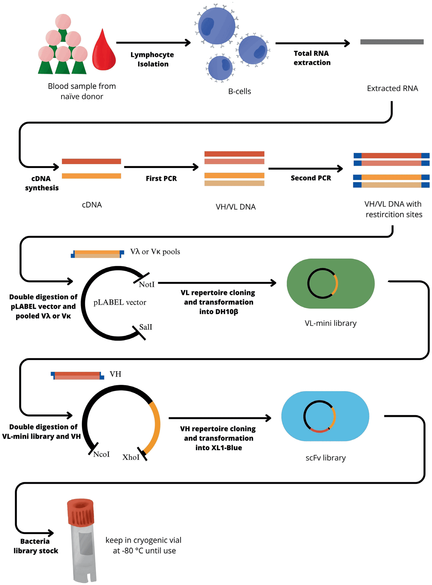

Fig. 1 scFv 순수 라이브러리(naïve library) 구성 과정의 개략도. 건강한 공여자의 총 림프구에서 전체 RNA를 분리한다. 역전사(reverse transcription)를 통해 cDNA를 합성한다. 1차 PCR 증폭으로 VH와 VL 레퍼토리를 생성한다. 2차 PCR 증폭은 VH와 VL 레퍼토리에 제한 효소 부위를 도입하기 위해 수행된다. 2단계 클로닝은 VL 레퍼토리를 먼저 파지미드(phagemid) 벡터에 클로닝한 후, VH 레퍼토리를 클로닝하는 방식으로 이루어진다. V 유전자를 포함하는 파지미드 벡터는 변환되고 합쳐져 scFv 순수 파지 라이브러리의 글리세롤 저장액(glycerol stock)을 생성한다.

1.	 pLABEL 벡터와 풀링된 Vλ 또는 Vκ를 SalI과 NotI으로 37 °C에서 하룻밤 동안 이중 절단(double digest)한다. 65 °C에서 20분간 열 비활성화한다(Note 9 참고).

3.4.1  1단계 클로닝 (VL)

2.	 이중 절단된 pLABEL 벡터에만 알칼리 포스파타제(alkaline phosphatase) 5 U를 첨가하고 37 °C에서 1시간 인큐베이션한다. 80 °C에서 2분간 열 비활성화한다.

3.	 절단된 벡터를 1% TBE 아가로스 젤에서 전기영동(110 V, 50분)으로 분리한다. 관심 밴드를 절제하여 제조사 프로토콜에 따라 겔 추출 키트로 DNA를 추출한다.

4.	 절단된 Vλ와 Vκ 단편은 PCR 정제 키트를 사용하여 정제한다(제조사 프로토콜 준수).

5.	 절단된 pLABEL과 절단된 Vλ 또는 Vκ 풀을 T4 DNA 리가제(T4 DNA Ligase)를 사용하여 1:2 비율로 연결한다(Note 10 참고). 연결 반응을 16 °C에서 하룻밤 인큐베이션한다. 65 °C에서 10분간 열 비활성화한다.

6.	 연결된 DNA를 에탄올 2.5배 부피와 3 M sodium acetate 0.1배 부피를 사용하여 침전(precipitate)한다. DNA를 −80 °C에서 1시간 인큐베이션하거나 액체 질소에서 순간 냉동(flash freeze)한 후, 14,000 × g로 20분간 원심분리한다(Note 11 참고).

7.	 DNA 펠릿을 70% (v/v) 에탄올 500 µL로 세척하고, 다시 14,000 × g로 20분간 원심분리한다.

8.	 DNA 펠릿을 각 연결 반응당 dH₂O 4 µL로 용해한다.

9.	 DH10β 세포를 얼음 위에서 2분간 해동하고 DNA 2 µL와 혼합한다.

10.	 혼합물을 사전에 냉각한 0.1 cm 전기천공(electroporation) 큐vette로 옮긴다. 1.7 kV로 전기천공하여 변환한다.

11.	 전기천공된 혼합물을 사전에 데운 2× YT 배지 1 mL로 다시 현탁(resuspend)하고 1.5 mL 마이크로원심분리 튜브로 옮긴다. 세포 현탁액을 37 °C, 700 rpm에서 1시간 인큐베이션한다.

12.	 세포 현탁액을 하위 패밀리별로 합치고, 클로닝 효율을 확인하기 위해 세포 10 µL를 채취한다. 10 µL 세포 분주액(aliquot)을 90 µL 2× YT-amp로 희석하여 90 mm 페트리 디쉬의 2× YT-amp 아가로스 플레이트에 도말한다.

13.	 나머지 풀링된 세포 현탁액을 2× YT-amp 아가로스가 들어 있는 30개의 BioAssay Dish에 도말한다. 아가로스 플레이트를 37 °C에서 하룻밤 인큐베이션한다.

14.	 BioAssay Dish 위의 집락(colony)을 2× YT-amp로 긁어낸다(scrape).

15.	 긁어낸 라이브러리 저장액의 역가(titer)를 측정하여 라이브러리 다양성(diversity)을 추정한다(§ 3.4.3 참고).

16.	 VL 미니 라이브러리의 글리세롤 저장액을 준비한다(§ 3.4.4 참고).

17.	 90 mm 페트리 디쉬의 집락을 사용하여 콜로니 PCR을 수행하여 VL 레퍼토리의 클로닝 효율을 확인한다(§ 3.5 참고)(Note 12 참고).

3.4.2  2단계 클로닝 (VH)

1.	 VL 미니 라이브러리 글리세롤 저장액 한 튜브를 500 mL 2× YT-amp에서 37 °C, 200 rpm으로 하룻밤 배양한다.

2.	 상용 플라스미드 추출 maxi 키트를 사용하여 제조사 프로토콜에 따라 플라스미드를 추출한다.

3.	 VL 미니 라이브러리와 VH를 NcoI과 XhoI으로 37 °C에서 하룻밤 이중 절단한다. 65 °C에서 20분간 열 비활성화한다(Note 9 참고).

4.	 1단계 클로닝 절차의 2–8步骤와 유사하게 소화와 연결을 수행한다(§ 3.4.1 참고).

5.	 scFv 라이브러리를 XL1-Blue MRF’ 세포로 변환한다.

6.	 세포 현탁액을 하위 패밀리별로 합치고, 클로닝 효율 확인을 위해 세포 10 µL를 채취한다. 10 µL 세포를 90 µL 2× YT-amp로 희석하여 2× YT-amp 아가로스 플레이트(90 mm 페트리 디쉬)에 도말한다.

7.	 나머지 풀링된 세포 현탁액을 2× YT-amp 아가로스가 들어 있는 40개의 BioAssay Dish에 도말한다. 아가로스 플레이트를 37 °C에서 하룻밤 인큐베이션한다.

8.	 BioAssay Dish 위의 집락을 2× YT-amp로 긁어낸다.

9.	 긁어낸 라이브러리 저장액의 역가를 측정하여 라이브러리 다양성을 추정한다(§ 3.4.3 참고)(Note 13 참고).

10.	 scFv 라이브러리의 글리세롤 저장액을 준비한다(§ 3.4.4 참고).

11.	 90 mm 페트리 디쉬의 집락으로 콜로니 PCR을 수행하여 VH 레퍼토리의 성공적인 클로닝을 확인한다(§ 3.5 참고)(Note 12 참고).

3.4.3  라이브러리 크기 추정

1.	 긁어낸 라이브러리 현탁액에서 세포 10 µL를 채취하여 10⁻¹³까지 10배 연속 희석을 수행한다.

2.	 희석액 10 µL를 2× YT-amp 아가로스 플레이트에 점적(spot)하고 37 °C에서 하룻밤 인큐베이션한다.

3.	 다음 공식을 기반으로 라이브러리 크기를 산출한다:

라이브러리 크기
집락 수
희석 계수
점적한 전체 부피
=
×

3.4.4  세균 라이브러리 저장액 준비

1.	 모든 BioAssay Dish의 집락을 4500 × g, 10분간 50 mL 폴리프로필렌 튜브로 긁어내고 2× YT-amp를 사용한다.

2.	 집락을 한 튜브로 합치고, 14,000 × g로 15분간 원심분리하여 집락을 침전시킨다.

3.	 침전물(pellet)을 적절한 양의 2× YT-amp로 다시 현탁하고, 세포 현탁액에 80% (v/v) 글리세롤을 첨가하여 20% 글리세롤 라이브러리 저장액을 만든다(Note 14 참고).

4.	 최종 라이브러리 현탁액을 2 mL 극저온 바이알(cryogenic vial)에 분주(aliquot)하고 사용 시까지 −80 °C에 보관한다.

#### 3.5  콜로니 PCR

1.	 단일 집락을 무작위로 선택하여 dH₂O 10 µL에 다시 현탁한다.

2.	 콜로니 상층액 2 µL를 사용하여 PCR 반응을 설정한다. dNTP 200 µM, LMB3 Fw와 pIII Rv 프라이머 각 0.5 µM, 1× DreamTaq 완충액, DreamTaq DNA Polymerase 0.5 U를 사용한다. 반응은 dH₂O로 최종 부피 20 µL까지 채운다.

3.	 다음 PCR 프로그램을 적용한다: 초기 변성 95 °C (5분), 20회 증폭 사이클(변성 95 °C, 사이클당 30초), 어닐링 55 °C (30초), 신장 72 °C (2분), 최종 신장 72 °C (5분).

4.	 증폭된 PCR 산물을 1% TBE 아가로스 젤에서 전기영동(110 V, 50분)으로 분리한다(Note 11과 15 참고).

5.	 올바른 밴드 크기를 가진 집락을 시퀀싱을 위해 보낸다.

6.	 V, D, J 유전자 사용과 돌연변이를 IMGT/V-quest (www.imgt.org/IMGT_vquest/vquest)를 사용하여 분석한다(Note 16 참고).

3.6  scFv 파지 라이브러리 패키징

1.	 라이브러리 글리세롤 저장액 한 튜브를 해동하여 500 mL 2× YT-amp에 접종한다. 37 °C에서 200 rpm으로 흔들어 배양하고 OD₆₀₀이 약 0.5에 도달할 때까지 배양한다.

2.	 배양액 250 mL에 M13KO7 헬퍼 파지(helper phage) 10¹²를 감염시키고, 감염 다중도(multiplicity of infection, MOI) 1:20을 따른다. 37 °C에서 30분간 정지 인큐베이션한다.

3.	 배양액을 3500 × g로 10분간 원심분리하여 침전시킨다. 상층액을 제거한다(Note 17 참고).

4.	 침전물을 300 mL 2× YT-amp/kan으로 다시 현탁한다. 30 °C, 200 rpm에서 하룻밤 배양한다.

5.	 세포를 10,000 × g로 10분간 침전시킨다. 파지를 포함하는 상층액을 새 50 mL 폴리프로필렌 튜브로 옮긴다.

6.	 상층액 4/5 부피에 PEG/NaCl 용액 1/5 부피를 첨가한다. 잘 혼합하고 얼음 위에서 1시간 인큐베이션한다(Note 18 참고).

7.	 혼합물을 12 °C에서 10,000 × g로 30분간 원심분리하고 상층액을 버린다.

8.	 남은 파지 펠릿을 PBS 8 mL로 다시 현탁한다.

9.	 PEG/NaCl 용액 2 mL를 첨가하고 잘 혼합한 후, 얼음 위에서 20분간 인큐베이션한다.

10.	 혼합물을 12 °C에서 10,000 × g로 30분간 원심분리하고 상층액을 버린다.

11.	 짧게 한 번 더 원심분리하고 남아 있는 PEG/NaCl 용액을 피펫으로 제거한다.

12.	 파지 펠릿을 PBS 2 mL로 다시 현탁한다.

13.	 10,000 × g로 10분간 원심분리하여 파지 침전물에서 남아 있는 세균 세포를 제거한다. 세균 펠릿이 관찰되지 않을 때까지 원심분리를 반복한다.

14.	 파지 10 µL를 채취하여 패키징된 scFv 라이브러리의 역가를 확인한다(§ 3.7 참고).

15.	 scFv 항체 라이브러리를 사용 시까지 4 °C에 보관한다(Note 19 참고).

3.7  파지 역가 측정

1.	 scFv 파지 라이브러리 10 µL를 PBS 90 µL로 희석하여 10배 연속 희석을 수행한다.

2.	 희석된 파지에 OD₆₀₀이 약 0.5인 TG1 또는 XL1-Blue MRF’ 세포 100 µL를 첨가한다.

3.	 감염된 세포 10 µL를 2× YT-amp 아가로스 플레이트와 2× YT-kan 아가로스 플레이트에 점적한다. 37 °C에서 하룻밤 인큐베이션한다(Note 20 참고).

4.	 다음 공식을 사용하여 파지 역가를 계산한다:

파지 역가 (cfu/mL) = (집락 수 / (희석 계수 × 점적한 전체 부피)) ×

표면에 표시된 항체 단편의 수집(collection)은 바이오패닝(biopanning)을 통해 스크리닝(screening)할 수 있다. 바이오패닝 라운드 수는 일반적으로 파지 발견율(phage discovery rates)에 따라 달라진다. 성공적인 경우 각 후속 라운드마다 발견율이 증가한다. 일반적으로 3–4회 라운드로 적절히 풍부화된(subpopulation) 항체를 표시하는 파지 하위 집단을 얻기에 충분하다[17].

3.8  scFv 라이브러리 바이오패닝

3.8.1  scFv 선별(scFv Selection)

1.	 코팅 완충액(coating buffer)을 사용하여 항원 1–10 µg을 마이크로타이터 웰에 코팅한다. 최종 부피는 100 µL이다. 후속 바이오패닝 라운드에서는 선택 강도를 높이기 위해 항원의 양을 줄일 수 있다. 4 °C에서 하룻밤 인큐베이션한다(Note 21 참고).

2.	 항원 코팅 웰을 PBST 300 µL로 3회 세척한다(ELISA 플레이트 세척기 사용)(Note 22 참고).

3.	 항원 코팅 월을 PTM 차단 완충액(blocking buffer) 300 µL로 1시간 실온에서 일정한 흔들림과 함께 차단한다. 웰은 호흡 가능한 테이프로 밀봉한다. 이후 PBST 300 µL로 3회 세척한다.

4.	 파지 10¹¹ 입자를 PTM 차단 완충액에 희석하여 최종 부피 200 µL로 만든 후, 차단된 마이크로타이터 웰에서 1시간 전흡수(pre-absorption)를 위해 인큐베이션한다(Note 23 참고).

5.	 사전 흡수된 파지 100 µL를 항원 코팅 웰로 옮기고 실온에서 700 rpm으로 일정하게 흔들며 2시간 인큐베이션한다.

6.	 결합되지 않은 파지와 비특이적(non-specific) 파지 입자를 PBST로 10회 세척하여 제거한다. 후속 바이오패닝 라운드마다 추가 10회의 세척 단계가 추가된다.

7.	 결합된 파지를 10 µg/mL 트립신(trypsin) 100 µL로 용출(elute)하고 37 °C에서 30분간 정지 인큐베이션한다(Note 24 참고).

8.	 용출된 파지를 새 2 mL 마이크로원심분리 튜브로 옮기고, OD₆₀₀이 약 0.5인 XL1-Blue MRF’ 세포 100 µL를 첨가한다. 세포를 37 °C에서 30분간 정지 인큐베이션한 후, 700 rpm으로 30분간 흔들며 인큐베이션한다.

9.	 감염된 배양액 10 µL를 채취하여 구조된(rescued) 파지 역가를 확인한다(§ 3.7 참고).

10.	 나머지 배양액에 10× amp 20 µL를 첨가하고 37 °C, 700 rpm에서 하룻밤 배양한다.

11.	 하룻밤 배양액 190 µL에 2× YT-amp 190 µL를 접种하고 10 µL의 하룻밤 배양액으로 접종한다. 37 °C, 700 rpm으로 2.5시간 배양한다.

12.	 나머지 하룻밤 배양액에 80% (v/v) 글리세롤 65 µL를 혼합하고 글리세롤 저장액을 −80 °C에 보관한다.

13.	 배양액에 M13KO7 헬퍼 파지 10¹¹을 감염시키고 37 °C에서 30분간 정지 인큐베이션한다.

14.	 배양액을 3500 × g로 10분간 침전시킨다. 세포 침전물을 230 µL 2× YT-amp/kan으로 다시 현탁한다. 30 °C, 700 rpm에서 하룻밤 배양한다.

15.	 하룻밤 배양액을 3500 × g로 10분간 침전시킨다.

16.	 상층액을 새 깨끗한 튜브로 옮긴다. 후속 바이오패닝 라운드에 사용할 파지 100 µL를 채취하고, 나머지 파지 용액은 다클론 ELISA(polyclonal ELISA)를 위해 4 °C에 보관한다. 각 바이오패닝 라운드의 증폭된 파지 역가는 확인된다(§ 3.7 참고)(Note 25 참고).

성공적인 바이오패닝 캠페인은 바이오패닝 라운드가 증가함에 따라 다클론 ELISA에서 흡광도(abundance) 패턴이 증가하는 결과를 보여준다. 각 라운드에서 최적의 바이오패닝 라운드를 선택하여 특이성(specificity)과 다양성이 좋은 다양한 단일클론항체(monoclonal antibodies)를 분리하는 것이 중요하다.

3.8.2  다클론 및 단일클론 파지 ELISA

1.	 적절한 수의 마이크로타이터 웰에 코팅 완충액을 사용하여 항원 1–10 µg/mL를 코팅한다. 최종 부피는 100 µL이다. 4 °C에서 하룻밤 인큐베이션한다. 동시에 각 시료의 음성 대조군(negative control)으로 비특이적 결합체(non-specific binders)를 관찰하기 위해 동일한 양의 BSA가 포함된 빈 웰을 동일하게 코팅한다.

2.	 코팅된 웰을 PBST로 3회 세척한다(다중 웰 ELISA 플레이트 세척기 사용)(Note 22 참고).

3.	 코팅된 웰을 PTM 차단 완충액 300 µL로 700 rpm으로 1시간 실온에서 흔들며 차단한 후, PBST로 3회 세척한다.

4.	 파지 50 µL를 PTM 차단 완충액 50 µL와 혼합하여 100 µL의 혼합물을 해당 항원 코팅 웰과 대조 웰에 첨가한다. 700 rpm으로 실온에서 2시간 인큐베이션한다.

5.	 웰을 PBST로 3회 세척한다.

6.	 항원 코팅 웰과 대조 웰 각각에 항-M13-HRP 100 µL를 첨가한다. 700 rpm으로 실온에서 1시간 인큐베이션한다.

7.	 웰을 PBST로 3회 세척한다.

8.	 ABTS 용액 100 µL로 웰을 발색(develop)하여 어두운 곳에서 30분간 방치한다. 마이크로타이터 플레이트 분광광도계(microtitre plate spectrophotometer)를 사용하여 405 nm에서 흡광도를 측정한다.

9.
 단일클론 선택을 위한 바이오패닝 라운드를 확인한 후, 10배 연속 희석을 수행하기 위해 나머지 파지 10 µL를 채취하고 OD₆₀₀이 약 0.5인 XL1-Blue MRF’ 세포 100 µL에 37 °C에서 정지 상태로 감염시킨다. 감염된 세포를 2× YT-amp 아가로스 플레이트에 도말한다.

10.	 단일클론 항체 클론 92개를 무작위로 선택하여 200 µL 2× YT-amp에 접종한다. 37 °C, 1250 rpm으로 하룻밤 배양한다.

11.	 단일클론 scFv 항체를 § 3.8.1의 11–15 단계에 기술된 대로 패키징한다.

12.	 이 절의 1–8 단계에 기술된 절차를 사용하여 단일클론 파지 ELISA를 수행한다. 단일클론 파지 ELISA에서는 웰당 코팅된 항원의 양을 200 ng에서 500 ng 범위로 줄일 수 있다.

13.	 낮은 신호/잡음 비율(signal/noise ratio)을 가진 양성 클론을 콜로니 PCR(§ 3.5)을 위해 확인하고 시퀀싱 분석을 위해 보낸다.

### 4  참고(Note)

1.	 다른 고충실성 교정 효소(high-fidelity proof-reading polymerase)도 대안으로 사용할 수 있다. 그러나 PCR 조건은 효소에 따라 달라질 수 있으므로 추가적인 PCR 조건 최적화가 먼저 이루어져야 한다.

2.	 소 혈청 알부민(BSA), 카제인(casein), 오발부민(ovalbumin), 젤라틴(gelatin) 및 기타 적절한 차단제(blocking agent)를 대안으로 사용할 수 있다. 차단제는 미생물 오염을 방지하기 위해 매번 새로 만들어야 한다.

3.	 제안된 샘플링 요구사항은 다음과 같다:

a.	 포함 기준: 건강한 배경의 공여자, 표준 일반 예방접종 완료, 채혈일로부터 과거 6개월 내 감염 없음, 면역억제제 또는 기타 약물 복용 없음.

b.	 제외 기준: 심각한 질병 가족력, 자가면역 질환, 진행 중인 감염, 감염 증상 또는 항생제와 면역억제제를 포함한 약물 복용(혈액 채혈일로부터 한 달 내).

4.	 혈액 층이 Ficoll-Paque™ PLUS 용액과 섞이지 않도록 주의해야 한다. 그렇지 않으면 적혈구 응집(aggregation)이 발생하여 림프구 수확률이 낮아질 수 있으며, 응집물에 갇힌 림프구는 적혈구와 함께 튜브 바닥으로 침전된다.

5.	 림프구에서 추출한 전체 RNA의 무결성(integrity)과 농도는 Bioanalyzer Instrument(Agilent, USA) 또는 유사한 장비를 사용하여 분석할 수 있다.

6.	 VH와 VL 레퍼토리는 편향과 레퍼토리 손실을 방지하기 위해 각 공여자에서 독립적으로 증폭한다. 이 단계는 더 나은 레퍼토리 다양성을 보장한다.

7.	 VH 단편의 길이는 약 400 염기쌍(bp)이다. 그러나 V-유전자 재배열(rearrangement)로 인해 크기가 약간 달라질 수 있는 밴드가 나타날 수 있으나 약 400 bp에 가까운 밴드를 주의 깊게 절제해야 한다. LC 증폭의 경우, 1차 LC 증폭의 Rv 프라이머는 불변 도메인(constant domain)보다 더 아래쪽에서 어닐링한다. 2차 증폭의 Rv 프라이머는 가변 도메인 끝까지 단편을 증폭한다.

8.	 합칠 공여자 수는 처리 능력에 따라 조정할 수 있다. 공여자 샘플을 합치는 목적은 하류 샘플 처리와 가공의 부담을 줄이는 것이다. 너무 많은 공여자의 레퍼토리를 함께 합쳐 과도한 희석이 발생하지 않도록 주의해야 한다.

9.	 필요한 DNA 양을 확보하기 위해 소화 반응 수를 필요에 따라 늘릴 수 있다. 서로 호환되지 않는 반응 완충액을 가진 다른 제한 효소를 사용할 경우, 소화 효율이 염含량에 영향을 받으므로 순차적 소화(sequential digestion)가 필요할 수 있다.

10.	 중쇄 레퍼토리의 순수 라이브러리 크기는 약 10⁷–10⁹ 이상이어야 한다. 중쇄(VH)는 항원 결합의 주요 영역이므로, 높은 다양성 라이브러리를 얻기 위해 여러 연결 반응이 필요할 수 있다.

11.	 DNA 에탄올 침전을 수행할 때 DNA 펠릿이 보이지 않을 수 있다. 보기 어렵다면 GlycoBlue와 같은 색소 공동 침전제(color dye coprecipitant)를 샘플에 첨가하여 DNA 펠릿을 눈에 띄게 만든 후 더 쉽게 처리할 수 있다.

12.	 콜로니 PCR의 예상 밴드 크기는 1단계 클로닝에서 약 750 bp, 2단계 클로닝에서 1200 bp이다.

13.	 최종 순수 라이브러리 크기는 10⁹에서 10¹² 이상이어야 한다.

14.	 라이브러리 저장액은 500 mL 2× YT-amp로 해동하여 라이브러리 패키징 중 시작 OD₆₀₀이 약 0.1이 되도록 준비된다.

15.	 VL 미니 라이브러리와 전체 scFv 라이브러리 모두 80% 이상의 클로닝 효율을 가진 삽입물(insert)을 갖는 것이 바람직하다.

16.	 라이브러리 레퍼토리의 다양성을 확인하기 위해 딥 시퀀싱(deep sequencing)도 사용할 수 있다.

17.	 세포를 침전시키고 글루코스 함유 배지를 제거하여 scFv ::pIII 융합 단백질의 발현을 억제하는 과잉 글루코스를 제거해야 한다.

18.	 PEG/NaCl 용액으로 침전되는 파지 입자 수의 증가는 얼음 냉각 인큐베이션 시간을 2시간으로 연장하여 달성할 수 있다.

19.	 파지 준비물은 4 °C에서 4주 이상 보관하지 않는다. 표시된 항체의 프로테올리시스(proteolysis)로 인한 결합 손실을 방지하기 위해 파지를 새로 패키징하여 사용해야 한다.

20.	 아미피실린 아가로스 플레이트의 집락 수는 카나마이신 플레이트보다 적어도 두 배 이상 높아야 하며, 이는 파지 라이브러리와 함께 생성되는 헬퍼 파지의 양이 적음을 나타낸다. 또한 이 집락은 바이오패닝 전에 파지 라이브러리의 크기를 추정하는 데 사용할 수 있다.

21.	 농축이 어렵게 얻어질 경우 코팅할 항원의 양을 증가시킬 수 있다. 바이오패닝 전에 항원의 순도를 확인하기 위해 SDS-PAGE와 웨스턴 블롯(Western blot)을 사용하여 특정 scFv 항체 결합체의 분리(isolation)를 개선한다.

22.	 웰은 PBST로 채운 스퀴트 병(squirt bottle)을 사용하여 세척한 후 수동으로 흔들고 세척 완충액을 제거한다. 건조한 종이 타월 위에 웰을 여러 번 두드려 잔류물을 제거한다. 세척 중 기포가 다음 단계로 넘어가지 않도록 주의해야 한다.

23.	 첫 바이오패닝 라운드에서는 전체 라이브러리 크기의 100배에 해당하는 파지를 사용해야 한다. 라이브러리 크기가 10⁹인 경우, 총 10¹¹개의 파지 입자를 사용해야 한다.

24.	 이 단계에서는 다른 용출 완충액이나 방법을 사용할 수도 있다. 경쟁 용출(competitive elution)은 자유 항원과 경쟁하여 수행할 수도 있다. pH 2.2의 글리신-HCl을 사용한 산성 기반 용출(acid-based elution)도 사용할 수 있다. 최적의 용출 방법은 각 사용자의 요구사항과 선호도에 따라 달라진다.

25.	 각 바이오패닝 라운드의 파지 회수율(phage recovery)을 확인하기 위해 구조된 파지 역가를 입력 파지 역가로 나눈다. 각 바이오패닝 사이클에서 결합 클론의 성공적인 풍부화를 나타내는 파지 회수율의 점진적인 증가를 관찰해야 한다.

Acknowledgments

이 연구는 Universiti Sains Malaysia의 특별(매칭) 단기 연구 지원금(Project No: 304.CIPPM.6315708)에 의해 지원받았다.

Conflict of Interest  이 연구는 말레이시아 고등교육부 기본 연구 지원금 제도(Project No: FRGS/1/2024/STG01/USM/02/10)의 지원을 받았다.

### 참고문헌

1.	Ledsgaard L, Ljungars A, Rimbault C,

61(4):286–303.
https://doi.org/10.1007/
s12033-019-00156-8
	 6.	Khajeh S, Tohidkia MR, Aghanejad A,

Sørensen CV, Tulika T, Wade J, Wouters Y,
McCafferty J, Laustsen AH (2022) Advances
in antibody phage display technology. Drug
Discov Today 27(8):2151–2169. https://doi.
org/10.1016/j.drudis.2022.05.002
	 2.	Lu R-M, Hwang Y-C, Liu IJ, Lee C-C, Tsai

Mehdipour T, Fathi F, Omidi Y (2018) Phage
display selection of fully human antibody fragments to inhibit growth-promoting effects of
glycine-extended gastrin 17 on human colorectal cancer cells. Artif Cells Nanomed Biotechnol
46(Suppl 2):1082–090. https://doi.org/10.1
080/21691401.2018.1478846
	 7.	Kumar R, Parray HA, Shrivastava T, Sinha S,

H-Z, Li H-J, Wu H-C (2020) Development
of therapeutic antibodies for the treatment of
diseases. J Biomed Sci 27(1):1. https://doi.
org/10.1186/s12929-019-0592-z
	 3.	Kügler J, Tomszak F, Frenzel A, Hust M (2018)

Luthra K (2019) Phage display antibody libraries: a robust approach for generation of recombinant human monoclonal antibodies. Int J
Biol Macromolecules 135:907–918. https://
doi.org/10.1016/j.ijbiomac.2019.06.006
	 8.	Pashov A, Shivarov V, Hadzhieva M, Kostov

Construction of human immune and naive scFv
libraries. Methods Mol Biol 1701:3–24. https://
doi.org/10.1007/978-1-4939-7447-4_1
	 4.	Liu B, Yang D (2022) Easily established and

multifunctional synthetic nanobody libraries as
research tools. Int J Mol Sci 23(3):1482
	 5.	Sioud M (2019) Phage display libraries: from binders to targeted drug delivery
and human therapeutics. Mol Biotechnol

V, Ferdinandov D, Heintz KM, Pashova S,
Todorova M, Vassilev T, Kieber-Emmons
T, Meza-Zepeda LA, Hovig E (2019)
Diagnostic profiling of the human public

IgM repertoire with scalable mimotope libraries. Front Immunol 10:2796. https://doi.
org/10.3389/fimmu.2019.02796
	 9.	Almagro JC, Pedraza-Escalona M, Arrieta HI,

Design and production of bispecific antibodies.
Antibodies 8(3):43
	14.	Khaing KK, Rangnoi K, Michlits H, Boonkerd

N, Teaumroong N, Tittabutr P, Yamabhai M
(2021) Application of recombinant human scFv
antibody as a powerful tool to monitor nitrogen
fixing biofertilizer in rice and legume. Microbiol
Spectr 9(3):e02094–e02021.
https://doi.
org/10.1128/Spectrum.02094-21
	15.	Lim CC, Woo PCY, Lim TS (2019)

Pérez-Tapia SM (2019) Phage display libraries
for antibody therapeutic discovery and development. Antibodies 8(3):44
	10.	Lai JY, Lim TS (2020) Infectious disease antibodies for biomedical applications: a mini
review of immune antibody phage library repertoire. Int J Biol Macromolecules 163:640–
648.
https://doi.org/10.1016/j.ijbiomac.
2020.06.268
	11.	Reader RH, Workman RG, Maddison BC,

Development of a phage display panning
strategy utilizing crude antigens: isolation of
MERS-CoV nucleoprotein human antibodies.
Sci Rep 9(1):6088. https://doi.org/10.1038/
s41598-019-42628-6
	16.	Bashir S, Paeshuyse J (2020) Construction of

Gough KC (2019) Advances in the production and batch reformatting of phage antibody
libraries. Mol Biotechnol 61(11):801–815.
https://doi.org/10.1007/s12033-019-
00207-0
	12.	Sandomenico A, Sivaccumar JP, Ruvo M

antibody phage libraries and their application
in veterinary immunovirology. Antibodies 9(2).
https://doi.org/10.3390/antib9020021
	17.	Xu H, Li L, Deng B, Hong W, Li R, Guo

(2020) Evolution of Escherichia coli expression
system in producing antibody recombinant
fragments. Int J Mol Sci 21(17). https://doi.
org/doi:10.3390/ijms21176324
	13.	Wang Q, Chen Y, Park J, Liu X, Hu Y, Wang

Z, Hou J, Govinden R, Chenia HY (2022)
Construction of a T7 phage display nanobody
library for bio-panning and identification of
chicken dendritic cell-specific binding nanobodies. Sci Rep 12(1):12122. https://doi.
org/10.1038/s41598-022-16378-x

T, McFarland K, Betenbaugh MJ (2019)

## 제7장 통합 파지 및 포유류 세포 디스플레이 라이브러리로부터 단일클론항체 스크리닝

Diao Yu, Huixian Li, Yujia Jin, Yu Kong, Tianlei Ying, Yanling Wu
and Chao Tu

### 초록

파지 디스플레이와 포유류 세포 디스플레이 기술은 항체 스크리닝에서 각자 고유한 장점과 한계를 지닌다. 여기서는 이 두 플랫폼을 통합하여 전장 IgG 항체의 동시에 친화도 스크리닝을 수행하는 혁신적인 방법론을 소개한다. 이 새로운 전략은 파지 디스플레이의 고처리량 능력을 활용하면서, 포유류 세포 디스플레이를 이용해 친화도가 최적이 아니거나 발현이 부족한 항체를 효과적으로 걸러낸다. 이 기술들을 병합함으로써, 이 방법은 친화도가 향상된 단일클론항체의 발견을 가속화하고 면역원성이 감소된 항체를 발굴하는 것을 목표로 한다.

핵심어  파지 디스플레이, 포유류 세포 디스플레이, 항체 스크리닝, FACS, ELISA

### 1  서론

파지 디스플레이 기술은 1985년 George Smith가 처음 개발했고, 이후 Gregory Winter는 치료용 단일클론항체 개발에 이 기술을 적용해 발전시켰다[1]. 그 이후 파지 디스플레이는 항체 약물 발견과 개발의 중요한 플랫폼으로 진화했다. 이 기술은 외래 단백질이나 폴리펩티드의 유전자 서열을 파지 외피 단백질의 구조 유전자 내 특정 위치에 삽입함으로써, 재조합 자손 파지들을 통해 외래 펩타이드나 단백질이 파지 표면에 발현되도록 한다. 이는 파지 캡시드에서 융합 단백질의 상대적 공간 구조와 생물학적 활성을 보존하는 방식이다[2]. 파지 디스플레이 시스템 중 M13 파지 pIII 디스플레이 시스템이 가장 널리 쓰인다. 이 시스템에서는 관심 유전자가 pIII 외피 단백질의 C말단 영역과 융합되며, 그 결과 융합 단백질이 파지 꼬리 끝에서 발현된다. Scripps Research Institute가 개발한 pComb3x 파지 벡터는 일반적으로 pIII 끝에서 관심 유전자를 표시하는 데 사용된다. pComb3x 벡터는 F1 파지 replicon만 포함하고 있어, 파지 복제와 E. coli 내 포장에는 E. coli replicon ori를 가진 VCSM13 헬퍼 파지가 필요하다. pComb3x 벡터는 앰피실린(Amp) 내성을 암호화하고, VCSM13 헬퍼 파지는 카나마이신(Kan) 내성을 부여한다. 두 항생물질의 이중 선택 압력 아래에서는 목표 유전자를 포함한 파지가 효율적으로 스크리닝될 수 있다.

이 방법에서 설명하는 포유류 세포 디스플레이 기술은 표면에 전장 기능성 항체를 표시할 수 있는 CHO 세포를 의미한다[3]. 이 접근법은 Flp-In™ 시스템(Invitrogen)을 활용하며, Flp 재조합효소가 단일 FRT(Fip Recombination Target) 부위에서 DNA 재조합을 중재하여 표적 유전자(FVTM)를 포함하는 발현 벡터를 숙주 게놈에 통합한다. 이를 통해 개별 숙주 세포 내에서 특정 항체만 발현된다. 이 벡터는 선택 가능한 하이그로마이신 내성 유전자를 포함하지만, 이 유전자는 시작 코돈과 프로모터가 없으므로 숙주 세포 게놈 내 FRT 부위의 ATG 코돈과 상류 프로모터와 통합되어야만 발현된다. 형광 활성 세포 분류법(FACS)과 결합하면, 세포 표면에서 발현된 항체의 항원 결합 활성을 직접 확인하고 분리할 수 있다.

파지 디스플레이 기술은 높은 스크리닝 처리량, 낮은 비용, 짧은 주기를 포함한 여러 장점을 제공한다. 그러나 주요 한계는 번역 후 수정이 없으며 전장 IgG 항체를 표시하는 데 비효율적이어서, 이후 진핵 세포 발현 시스템에서 검증 시 거짓양성이 발생할 수 있다는 점이다. 이에 비해 포유류 세포 디스플레이 기술은 라이브러리 용량이 낮고 비용이 높으며 주기가 길지만, 파지 디스플레이에서 부족한 번역 후 수정을 보완하여 고친화력, 완전히 기능적인 IgG 항체를 발견할 가능성을 크게 높인다. 포유류 세포 디스플레이를 통해 스크리닝된 항체는 종종 뛰어난 개발 가능성을 보인다. 두 시스템의 장점을 결합하기 위해 우리는 파지 디스플레이와 포유류 세포 디스플레이를 통합한 새로운 방법을 제안하며[4], 전장 IgG 항체의 동시에 친화도 스크리닝이 가능하면서 각 접근법의 강점을 활용한다. 이 결합 전략을 사용하여 우리는 다표적, 고친화력의 완전 인간 단일클론항체를 성공적으로 확보했으며, 체외·체내 실험으로 효능이 확인되었다.

### 2  재료

건강한 자원봉사자 40명의 혼합 PBMC cDNA를 이용해 대규모 파지 디스플레이 나이브 인간 Fab 라이브러리를 구축했으며, 그 역가는 1.5 × 10¹¹에 달했다[5]. 모든 용액은 초순수와 분석 등급 시약을 사용해 준비한다. 폐기물 처리 규정을 엄격히 준수하며 폐기물 처리 및 폐기 시 주의한다[6].

#### 2.1  파지 디스플레이와 항체 스크리닝

1. EZ-Link Sulfo-NHS-LC-Biotin (Thermo).

2. 원심분리 여과관.

3. TG1.

4. M13KO7 헬퍼 파지.

5. PBS.

6. 20% PEG8000/2.5 M NaCl: PEG8000 200 g과 NaCl 146 g을 물 1 l에 녹인다. 완충액을 0.22 mm 필터로 여과한다. 121 °C에서 30 분간 고압멸균한 후 4 °C에 보관한다.

7. M-PBS: 탈지유 1.2 g을 PBS 40 ml에 녹인다.

8. Dynabeads™ M-280 Streptavidin (Invitrogen).

9. 0.05% PBS-T: Tween-20 500 µl를 물 1 l에 첨가한다. 완충액을 0.22 mm 필터로 여과한다.

10. 20% 포도당: 20 g을 물 100 ml에 녹인다. 포도당 완충액을 0.22 mm 필터로 여과한다.

11. 앰피실린.

12. 카나마이신.

13. Anti-M13-HRP 다클론항체.

14. 2YT 한천판과 2YT 배지.

15. Plasmid Mini Kit.

16. 0.22 µm 주사기 필터.

17. 96 반웰 플레이트.

18. TMB–HRP 기질.

19. pComb3x 벡터.

20. 원심분리기(상온 및 4 °C).

21. DNA/단백질 분석기.

22. 자석 선반.

23. 무균 작업대.

24. 항온 인큐베이터.

25. 항온 진탕기.

26. 회전 혼합기.

27. 마이크로플레이트 리더.

1. FVTM 벡터.

#### 2.2  포유류 세포 디스플레이 라이브러리

2. BsmBI.

3. SfiI.

4. Gel Extraction Kit.

5. E. coli DH5α Electro-Cells.

6. EndoFree Plasmid Maxi Kit.

7. 0.25% Trypsin–EDTA.

8. FCHO 세포.

9. F12 배지.

10. FBS.

11. 하이그로마이신 B.

12. Dye Labeling Kit FITC.

13. FITC mouse anti-human IgG 항체.

14. PE mouse anti-human Ig light chain κ 항체.

15. Propidium Iodide (PI).

16. T4 DNA Ligase.

17. T175 세포 배양 플라스크.

18. Versene 용액.

19. 염색 완충액: FBS 1 ml를 PBS 49 ml에 첨가.

20. 세포 배양 동결 배지: FBS 9 ml를 DMSO 1 ml에 첨가.

21. 장비:

(a) 원심분리기(상온 및 4 °C).

(b) 전기영동 시스템(BJLIUYI).

(c) PCR 기기.

(d) 유세포 분석기.

(e) CO₂ 인큐베이터.

(f) 전기천공 시스템(Bio-rad).

1. pTT 벡터.

#### 2.3  전장 IgG 생산 및 특성 규명

2. Quick Extract™ DNA Extraction Solution (Epicenter).

3. PEI 형질주입 시약.

4. Rabbit anti-human-Fab-HRP.

5. Expi293 세포.

6. 48웰 플레이트.

7. BSA.

8. 장비:

(a) PCR 기기.

(b) 전기영동 시스템.

(c) 마이크로플레이트 리더.

(d) 유세포 분석기

### 3  방법

모든 절차는 무균 조건에서 수행한다.

#### 3.1  표적 항원의 비오틴화

1. EZ-Link Sulfo-NHS-LC-Biotin 시약 1 mg 바이알에 초순수 180 µl를 첨가하여 10 mM 용액을 준비한다(참고 Note 1).

2. 표적 항원 단백질을 PBS에 준비한다.

3. 단백질 용액에 10 mM 비오틴 시약 용액의 적절한 양(“비오틴 시약 사용법 계산” 참고)을 첨가한다.

4. 얼음 위에서 2 시간 또는 상온에서 30 분간 반응을 인큐베이션한다.

5. 표지된 단백질을 3 kD 초여과관에 넣고, 4 °C에서 최소 세 번 초여과하여 반응하지 않은 비오틴을 제거한 후 완충액을 PBS로 교체한다. 비오틴 표지된 단백질은 필요에 따라 −80 °C에 보관한다.

1. 스크리닝 전날, TG1 세포를 2YT 한천판에 접종하고 30 °C에서 하룻밤 인큐베이션한다. 스크리닝 당일, TG1 단일 클론을 2 mL 2YT 배지에 접종하고 37 °C에서 진탕 배양하여 OD₆₀₀이 0.6이 될 때까지 배양한다(약 1.5–2 시간)(참고 Note 2).

#### 3.2  인간 Fab 파지 디스플레이 라이브러리 스크리닝

2. 20% PEG8000/NaCl 250 µl를 인간 Fab 파지 라이브러리(약 1 × 10¹² pfu/ml) 글리세롤 저장액 1 ml에 첨가하고 얼음 위에서 30 분간 방치하여 파지를 침전시킨다(참고 Note 3). 4 °C에서 7104 × g로 10 분간 원심분리한 후 상층액을 주의 깊게 버린다. 파지 침전물을 무균 PBS 100 µl에 재현탁한다.

3. 재현탁한 파지 라이브러리(100 µl)와 M-PBS(330 µl), PBS, 비오틴 표지 항원 단백질(5 µg)을 EP 튜브에 혼합하여 1 ml 인큐베이션 시스템을 형성하고, 회전 혼합기로 상온에서 30 분간 인큐베이션한다. 이후 Dynabeads™(M-280 Streptavidin) 20 µl를 첨가하고 상온에서 추가로 1.5 시간 인큐베이션한다.

4. 인큐베이션된 시스템을 자석 선반 위에 놓는다. 상온에서 최소 5 분간 방치한 후 자석 비드가 단단히 흡착되면 액체를 주의 깊게 제거한다.

5. 자석 선반에서 EP 튜브를 분리하고 PBS-T 1 ml를 첨가하여 튜브 벽면의 자석 비드를 부드럽게 떨어뜨린다. 피펫으로 위아래 혼합한다. 자석 비드를 새 EP 튜브로 옮긴다. 자석 선반 위에 5 분간 방치하고 PBS 1 ml를 첨가하여 자석 비드를 다시 세척한 후 최종적으로 자석 비드를 PBS 100 µl에 재현탁한다(참고 Note 4).

6. 자석 비드를 1단계의 TG1 세포 배양액에 첨가하고, 감염을 위해 37 °C에서 45 분간 흔들지 않고 인큐베이션한다. 감염 후 2% 포도당 용액과 100 µg/ml 앰피실린을 첨가하고, 성공적으로 감염된 파지를 증폭하기 위해 TG1-자석 비드-파지를 195 × g, 37 °C에서 2 시간 추가 배양한다.

7. M13 헬퍼 파지 10 µl(최종 농도 1 × 10¹¹ pfu/ml)을 첨가한다. 감염을 위해 37 °C에서 45 분간 흔들지 않고 인큐베이션한다.

8. 이후 자석 선반에서 비드를 제거한다. 상온에서 7104 × g로 10 분간 원심분리하고 상층액을 버려 당과 과잉 헬퍼 파지를 제거한다.

9. TG1 세포를 앰피실린(100 µg/ml)과 카나마이신(50 µg/ml)을 포함한 2YT 배지 10 ml에 재현탁한 후, 222 × g, 30 °C에서 12–16 시간 하룻밤 진탕 배양한다(참고 Note 5).

10. 다음 날, 2단계와 같이 상층액 내 파지를 20% PEG8000/NaCl로 침전시켜 두 번째 라운드 스크리닝을 진행한다. 남은 파지는 4 °C에서 최대 1개월까지 보관한다.

11. 두 번째 스크리닝 라운드에서는 위 단계를 반복하되, 비오틴 표지 항원 단백질의 양을 3 µg로 줄이고 자석 비드의 PBS-T 세척 단계를 두 번 반복한다. 두 번째 라운드에서 자석 비드로 TG1을 감염시킨 후, Plasmid Mini Kit을 사용하여 TG1 세포에서 플라스미드(pComb3x-Fab)를 추출하고, 이 플라스미드는 이후 포유류 세포 디스플레이 라이브러리 구축에 사용된다.

스크리닝 과정의 농축 정도는 다클론 파지 ELISA로 평가할 수 있다(참고 Note 6).

#### 3.3  다클론 파지 ELISA

1. 96 반웰 플레이트를 항원 단백질(PBS 내 100 ng/웰) 50 µl로 하룻밤 코팅한다.

2. 마이크로플레이트 세척기로 PBS-T 150 µl를 사용하여 웰을 세 번 세척한다.

3. 3% (w/v) 탈지유의 PBS(차단 용액) 100 µl를 각 웰에 청가하여 37 °C에서 1 시간 차단한다.

4. 2단계와 같이 세척한다. 이후 첫 번째와 두 번째 스크리닝 라운드에서 얻은 파지(1 × 10¹¹ pfu)를 각 웰에 50 µl씩 항원 코팅 플레이트에 첨가하고 37 °C에서 1.5 시간 인큐베이션한다.

5. 2단계와 같이 세척한다. PBS 내 HRP-anti-M13(1:5000 희석) 50 µl를 각 웰에 첨가하고 37 °C에서 45 분간 인큐베이션한다.

6. 2단계와 같이 세척한다. 각 웰에 TMB–HRP 기질 용액 50 µL를 첨가하고 파란색이 발현될 때까지 상온에서 2–10 분간 인큐베이션한다. 마이크로플레이트 리더로 405 nm에서 OD를 측정한다.

7. 두 라운드 스크리닝의 OD₄₀₅ₙₘ 값을 비교한다. 두 번째 라운드의 값이 더 높으면 항원 단백질을 표적으로 하는 파지가 효과적으로 농축되었음을 나타내며, 이는 이후 포유류 세포 디스플레이 라이브러리 구축에 활용할 수 있다(참고 Note 7).

FVTM 벡터(그림 1)는 이중 포유류 발현 카세트와 고유한 제한 효소 BsmBI와 SfiI가 인식하는 서열을 포함하며, 이 효소들은 자가 결찰을 방지하기 위해 고유한 비팔린드롬 서열을 인식하고 절단할 수 있다. 전장 경쇄와 중쇄 가변 도메인 유전자가 네 방향 결찰을 통해 한 번에 벡터에 삽입된다. 세포 표면에 항체가 발현되도록 하는 막관통 도메인을 포함한다. Flp-In 시스템을 사용하여 개별 FCHO 세포 게놈에 단일 사본 벡터가 통합되도록 보장한다.

#### 3.4  경쇄/중쇄 교체 포유류 세포 디스플레이 라이브러리 구축

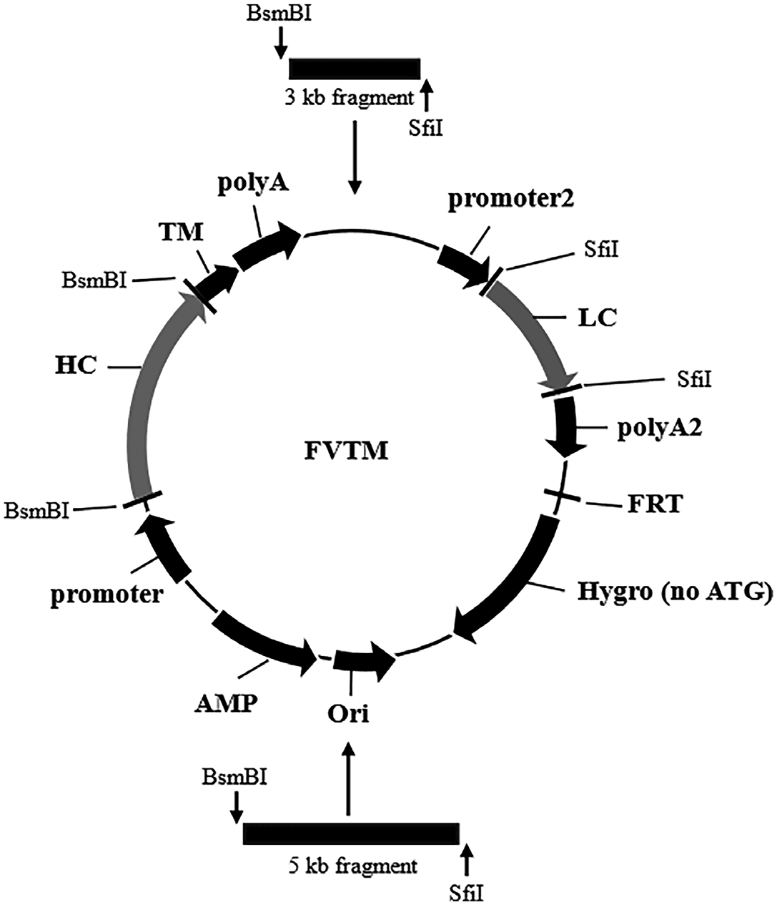

그림 1 이중 발현 벡터 FVTM의 설계 및 구축 개요. 네 개의 프래그먼트는 PCR로 증폭하거나 소화 및 결찰하여 네 방향 결찰로 FVTM 벡터를 형성한다.

1. 두 번째 라운드 파지 스크리닝에서 추출한 플라스미드(Pcomb3x-Fab)를 주형으로 PCR 증폭과 제한 효소 절단을 수행하여 가변 중쇄(VH)와 경쇄 DNA 프래그먼트를 얻는다. FVTM 포유류 세포 디스플레이 벡터와 호환되는 5′과 3′에 BsmBI 제한 부위를 가진 VH용 프라이머를 설계한다. 마찬가지로 경쇄용 프라이머는 FVTM의 원하는 SfiI 제한 부위와 일치하도록 설계한다.

2. 50 µl 중합효소 연쇄 반응(PCR) 반응을 준비한다. 정방향 프라이머와 역방향 프라이머 각각 200 nM, VH 또는 LC를 포함한 주형 벡터 50 ng, 2× Master Mix 25 µl를 포함한다.

3. 증폭 조건은 다음과 같다: 주형 변성을 위해 94 °C에서 5 분, 이후 94 °C에서 30 초, 55 °C에서 30 초, 증폭할 DNA 길이 1 kb당 72 °C에서 1 분씩 연장하는 30 사이클을 수행하고, 최종적으로 72 °C에서 7 분 연장으로 마무리한다.

4. PCR 산물을 1% 아가로스 겔에서 전기영동하고 QIAquick Gel Extraction Kit으로 정제한다(참고 Note 8).

5. VH 또는 LC 프래그먼트 10 µg, 제한 효소 1 µl, 1× rCutSmart Buffer를 포함하는 50 µl 소화 반응을 준비한다. VH와 LC 프래그먼트는 각각 55 °C(BsmBI) 또는 50 °C(SfiI)에서 3 시간 소화하고, 전기영동 후 겔 정제로 회수한다(참고 Note 8).

6. 벡터 FVTM을 BsmBI와 SfiI로 이중 소화한다. 반응 조건은 50 °C에서 3 시간, 이후 55 °C에서 3 시간 소화이다. 전기영동 후 겔 정제로 5 kb와 3 kb(참고 Note 9) 벡터 프래그먼트를 회수한다(참고 Note 8). PCR과 소화는 모두 PCR 기기를 사용하여 수행한다.

7. 경쇄 교체 라이브러리 구축: 네 개의 프래그먼트를 결찰한다. 포함 내용은 다클론 파지의 VH 프래그먼트(1단계), PBMC의 경쇄 유전자, 5 kb 프래그먼트(1단계), 3 kb 프래그먼트(1단계)이다.

8. 중쇄 교체 라이브러리 구축: 네 개의 프래그먼트를 결찰한다. 포함 내용은 다클론 파지의 경쇄 프래그먼트(1단계), PBMC의 VH 유전자, 5 kb 프래그먼트(1단계), 3 kb 프래그먼트(1단계)이다.

9. 네 프래그먼트를 총량 약 100 ng을 포함하는 10 µl 총 결찰 혼합액에서 1:1:1:1 몰 비율로 혼합한다. T4 DNA Ligase 1 unit과 1× T4 DNA Ligase Reaction Buffer를 함께 사용한다. 최소 2 시간 결찰 후, 결찰 혼합액 1 µl를 제조사 지침에 따라 50 µl 능력세포를 이용한 형질전환에 사용한다. 각각 중쇄 교체 라이브러리와 경쇄 교체 라이브러리 결찰 혼합액 150 µl와 100 µl를 형질전환에 연결한다.

10. 형질전환 후 DH5α 박테리아를 100 µg/ml 앰피실린이 포함된 150 mm 2YT 플레이트에 첨가하고 무균 작업대에서 10 분간 건조시킨다. 스크레이퍼를 사용하여 플레이트 위에 플라스미드를 고르게 펴 바른다. 37 °C에서 하룻밤 배양한다.

11. 하룻밤 배양 후 플레이트에 2YT 2 ml를 첨가한다. 박테리아의 일부를 원심분리로 수집하고 7% DMSO에 −80 °C로 저장하여 박테리아 라이브러리 저장액으로 사용한다. 다른 일부의 세포는 제조사 지침에 따라 QIAGEN Plasmid Kit으로 사슬 교체 라이브러리 플라스미드를 추출하는 데 사용한다.

12. 형질주입 하루 전, FCHO 세포를 0.05% 트립신으로 소화한 후 T175 세포 배양 플라스크당 3 × 10⁷ 밀도로 분주한다.

13. 사슬 교체 라이브러리 플라스미드를 이용하여 FCHO 세포를 일시적으로 형질주입하여 포유류 세포 디스플레이 라이브러리를 구축한다. 경쇄 교체 라이브러리 일시 형질주입 시스템에는 다음 성분을 사용한다: 경쇄 교체 라이브러리 FVTM 플라스미드 100 µg(10단계), En44 20 µg, F12 배지 8.5 ml, PEI 300 µg, F12 배지 8.5 ml.

14. 중쇄 교체 라이브러리 일시 형질주입 시스템은 경쇄 교체 라이브러리와 동일한 비율로 세 배 증폭한다.

15. 혼합액을 T175 세포 배양 플라스크에 약간 흔들어가며 한 방울씩 첨가하고, FCHO 세포를 5% CO₂ 인큐베이터에서 37 °C로 4–6 시간 인큐베이션한 후 P/S와 10% FBS를 포함한 새 F12 배지로 교체한다.

16. 24 시간 후, FCHO 세포를 T175 세포 배양 플라스크와 함께 계대하고 세포 현탁액 1 mL를 6웰 세포 배양 플레이트에 분주하여 라이브러리 크기를 계산한다. 48 시간 후, 배양액에 하이그로마이신 B를 최종 농도 500 µg/ml로 첨가하여 선택 압력을 가하고, 5% CO₂ 인큐베이터에서 37 °C로 약 1–2주간 배양을 계속한다. 하이그로마이신 B를 포함한 배지로 2–3일마다 교체한다.

17. 72 시간 후, 소수의 FCHO 형질주입 세포(16단계)를 0.05% 트립신으로 소화하여 FACS를 통해 항체 발현을 평가한 후 염색 완충액으로 한 번 세척하고, 세포(5 × 10⁵)를 형광 이소티오시아네이트(FITC)-접합 마우스 anti-human IgG(FITC-IgG) 및/또는 피코에리트린(PE)-접합 마우스 anti-human κ 경쇄 항체(PE-kappa)로 50 µl 총 부피, 4 °C에서 염색한 후 FACS 분석을 수행한다. 이중 염색 시스템에서 이중 양성 신호(FITC+ PE+)의 검출은 경쇄와 중쇄 단백질이 FCHO 세포 표면에서 동시에 성공적으로 발현되었음을 나타낸다.

18. 단일 클론이 자라나면(약 1주 후). 배지를 제거하고 Crystal Violet을 첨가하여 6웰 세포 배양 플레이트의 세포를 염색한다. 이후 라이브러리 크기를 다음과 같이 계산한다(VL 약 10⁴, VH 약 10⁵): 1 ml 세포 현탁액에서 자란 단일 클론의 총 수에 현탁액의 총 부피(16단계)를 곱한다.

19. FCHO 형질주입 세포를 0.05% 트립신으로 소화한다. PBS로 한 번 세척한 후 경쇄 교체 라이브러리와 중쇄 교체 라이브러리를 세포 배양 동결 배지와 함께 −80 °C에서 동결한다. 각 세포 라이브러리에서 일부 세포를 연속 배양과 이후 스크리닝을 위해 분리한다.

FACS 분류 기술을 기반으로 포유류 세포 디스플레이 라이브러리의 양성 클론이 스크리닝된다. 스크리닝 원리는 PE anti-human Ig 경쇄 κ 항체로 염색된 경쇄 교체 라이브러리(또는 중쇄 교체 라이브러리)와 FITC 표지 표적 항원 단백질이 함께 인큐베이션되는 것이다. 결합하지 않은 과잉 단백질이나 시약을 세척한 후, FACS로 FITC+ PE+ 이중 양성 세포를 검출하여 양성 클론으로 판정하며, 이는 경쇄와 중쇄 단백질이 올바르게 발현되고 표적 항원과 결합 활성을 가진 세포다. 스크리닝 과정은 다음과 같다:

#### 3.5  포유류 세포 디스플레이 라이브러리 스크리닝

1. 이후 사용을 위해 표적 항원 단백질을 FITC 시약으로 표지한다.

2. 경쇄 교체 라이브러리와 중쇄 교체 라이브러리를 Versene으로 소화한다. 이후 흐름 염색 시스템을 별도로 준비한다. 각 50 µl 염색 시스템에는 2 × 10⁵개의 FCHO 세포, 25 nM FITC-Ag(1단계), PE anti-human Ig 경쇄 κ 항체 1 µl를 포함한다. 세포를 얼음 위에서 30 분간 인큐베이션한다. 염색하지 않은 대조군과 단일 염색 대조군을 준비하며, 염색 시스템은 실제 필요에 따라 확대할 수 있다.

3. 상온에서 710 × g로 5 분간 원심분리한 후 상층액을 주의 깊게 흡인 제거한다. 각 염색군에 염색 완충액 1 ml를 첨가하고 최소 두 번 세척한다. 이중 염색 세포는 염색 완충액 1–2 ml에 재현탁하며, 대조 세포는 염색 완충액 500 µl에 재현탁한다.

4. 흐름 분류 중, 사멸 세포를 배제하기 위해 이중 염색 세포 현탁액에 Propidium Iodide(PI) 10 µl를 첨가한다(참고 Note 10). 흐름 분류 기술을 사용하여 FITC+ PE+ 이중 양성 세포를 96웰 플레이트로 분류한다. 각 라이브러리당 4–6개의 96웰 플레이트를 분류하고, 남은 세포는 FITC+ PE+ 이중 양성 세포 풀을 분류하는 데 사용할 수 있다(참고 Note 11). 분류된 세포는 10% FBS를 포함한 F12 배지와 함께 37 °C, 5% CO₂ 인큐베이터에서 배양한다.

5. 단일 세포 클론(4단계)이 96 반웰 플레이트에서 포화 상태에 도달하면, 각 웰에서 FCHO 세포 2 × 10⁵를 취하여 25 nM FITC-Ag와 PE anti-human Ig 경쇄 κ 항체 1 µl로 염색하여 유세포 분석 재검사를 수행한다. FITC+ PE+ 이중 양성 신호를 유지하는 클론이 양성 클론으로 확인된다.

6. 양성 클론은 배양을 위해 확장한다. 각 양성 클론의 일부는 −80 °C에서 동결하고, 나머지 부분은 이후 DNA 추출에 사용한다.

1. 유세포 분석으로 양성으로 확인된 단일클론 세포는

#### 3.6 전장 IgG 생산

1. 위에서 설명한 바와 같이 유세포 분석을 통해 양성으로 확인된 단일클론 세포들에 번호를 매긴다. 제조사의 권장 사항에 따라 DNA 추출 키트를 사용하여 이 세포들로부터 게놈 DNA(Genomic DNA)를 추출한다.

2. 게놈 DNA를 주형으로 사용하여, 포유류 세포 발현 벡터(pTT)와 호환되는 BsmBI 제한효소 부위를 갖는 VH 증폭용 프라이머와, pTT 벡터와 호환되는 SfiI 제한효소 부위를 갖는 LC 증폭용 프라이머를 설계한다.

3. 이어서 PCR을 수행하여 VH 및 LC 단편을 증폭한다. 증폭 조건은 다음과 같이 설정한다: 주형 변성을 위한 94 °C 5분, 이어서 94 °C 30초, 55 °C 30초, 증폭할 DNA 길이 1 kb당 72 °C 1분의 신장으로 이루어진 30주기, 마지막으로 72 °C에서 7분간 최종 신장.

4. 그 후 VH 및 LC 단편을 항체 발현 벡터(pTT)에 각각 클로닝하여 재조합 플라스미드를 제작한다 (see Note 12).

5. 형질주입 하루 전, 0.05% 트립신으로 Expi293 세포를 떼어내어 48웰 플레이트에 웰당 3 × 10⁴ 세포의 밀도로 접종한다.

6. 경쇄 pTT 플라스미드와 이에 대응하는 중쇄 pTT 플라스미드를 짝지어, 중쇄와 경쇄의 1:2 몰비 조건에서 PEI를 사용하여 Expi293 세포에 공동 형질주입(co-transfection)한다. 다음 성분을 사용한다: 경쇄 pTT 플라스미드 0.4 µg(4단계), 중쇄 pTT 플라스미드 0.2 µg, F12 배지 50 µL, PEI 1.8 µL.

7. 형질주입 48시간 후 세포 배양액을 원심분리하고, 가용성 IgG 항체가 포함된 상층액을 회수한다.

8. 가용성 항체를 표적 항원을 안정적으로 발현하는 세포와 함께 얼음 위에서 30분간 인큐베이션한다. 염색 완충액 1 mL로 세척하여 결합하지 않은 항체를 제거한다. 이어서 PE 항-인간 Ig 경쇄 κ 항체를 첨가하고 얼음 위에서 30분간 인큐베이션한다. 최소 2회 세척을 거친 후, 유세포 분석을 통해 가용성 항체의 세포 표면 항원 결합 활성을 검출하고, 양성 클론(PE+)을 플라스미드 염기서열 분석에 의뢰한다.

9. 염기서열 분석 결과(8단계)에 따라 서열 정렬(alignment)을 수행하여 중복 서열을 제거한 후, 고유한 서열을 지닌 항체들을 발현 및 정제하여 ELISA를 진행한다.

#### 3.7 전장 IgG 특성 규명

1. 96 하프웰 ELISA 플레이트에 웰당 50 µL의 표적 항원 단백질(PBS 내 100 ng/웰)을 넣고 4 °C에서 밤새 코팅한다.

2. 마이크로플레이트 세척기를 사용하여 웰을 150 µL의 PBS-T로 3회 세척한다.

3. 웰당 100 µL의 3% BSA/PBS를 넣고 37 °C에서 1시간 동안 인큐베이션하여 플레이트를 블로킹한다.

4. 2단계와 동일하게 세척한 후, 500 nM부터 3배 단계 희석한 IgG 항체를 각 웰에 50 µL씩 첨가하며, 농도당 3개의 반복 웰을 만든다. 37 °C에서 1.5시간 동안 인큐베이션한다.

5. 2단계와 동일하게 세척한 후, 1% BSA에 희석한 HRP-anti-human Fab(1:40,000 희석)를 웰당 50 µL씩 넣고 37 °C에서 45분간 인큐베이션한다.

6. 2단계와 동일하게 세척한 후, 웰당 50 µL의 TMB–HRP 기질 용액을 첨가하고 청색이 나타날 때까지 실온에서 2~10분간 인큐베이션한다. 마이크로플레이트 리더를 사용하여 405 nm에서 흡광도를 측정한다.

7. GraphPad Prism 8.0.2 소프트웨어를 사용하여 OD405nm 측정값 기반의 결합 곡선으로부터 EC50 값을 산출한다. 이를 통해 서로 다른 친화도를 갖는 항체 변이체들을 식별할 수 있다.

### 4 참고(Note)

1. 항원 벡터에 Avi-tag이 포함되어 있는 경우, 비오틴 리가아제(BirA)를 사용하여 융합 항원 단백질을 부위특이적으로 비오틴화할 수 있다.

2. TG1 접종 플레이트가 신선한지 확인해야 한다. 자기 비드와 함께 인큐베이션할 때 TG1 균체 배양액은 반드시 대수 증식기(logarithmic growth phase)에 있어야 한다.

3. 파지 침전 시간은 라이브러리의 품질에 따라 1시간, 3시간 또는 밤새도록 유연하게 조절할 수 있다.

4. 자기 비드를 세척할 때 기포가 생기지 않도록 주의한다.

5. 이 단계에서는 포도당을 첨가하지 않는다.

6. 농축이 충분하지 않은 경우 스크리닝 라운드 수를 늘린다.

7. 대부분의 경우 2차 라운드에서 더 높은 측정값이 관찰된다. 그렇지 않다면 파지가 농축될 때까지 동일한 양의 항원 단백질을 사용하여 3차 스크리닝 라운드를 수행해야 한다.

8. 메스를 사용하여 아가로스 겔에서 목적 DNA 단편을 잘라낸다. 겔 부피의 3배에 해당하는 Buffer QG를 첨가하고 50 °C에서 10분간 인큐베이션한다. 겔이 완전히 녹으면 겔 부피의 1배에 해당하는 이소프로판올을 넣고 컬럼에 시료를 로딩한 뒤 1분간 원심분리한다. 500 µL Buffer QG와 750 µL Buffer PE로 세척한 후, 30~50 µL Buffer EB 또는 물로 DNA를 용출한다. 모든 원심분리 단계는 17,900 × g에서 수행한다.

9. FVTM 벡터의 3 kb 단편은 hIgG1 서열과 중쇄의 C말단에 막관통 도메인을 포함하고 있어 온전한 IgG 항체가 FCHO 세포 표면에 제시될 수 있도록 한다.

10. 프로피디움 요오드화물(PI)은 적색 형광을 띠는 핵 및 염색체 대조염색 시약이다. 살아있는 세포막을 통과하지 못하므로, 세포 집단 내에서 사멸 세포를 검출하는 데 흔히 쓰인다.

11. FITC+ PE+ 이중 양성 세포 풀은 추후 사용을 위해 동결 보관하거나 양성 단일 클론을 추가로 분취하는 데 활용할 수 있다.

12. pTT 중쇄 발현 벡터는 중쇄 서열의 C말단에 hIgG1 서열을 포함하고 있다. LC 벡터는 hIgG1 서열을 포함하지 않는다.

이해상충

저자들은 본 장의 내용과 관련하여 어떠한 이해상충도 없음을 밝힌다.

### 참고문헌

1. Smith GP (1985) Filamentous fusion phage: novel expression vectors that display cloned antigens on the virion surface. Science 228(4705):1315–1317
2. Winter GP (1989) Antibody engineering. Philos Trans R Soc Lond B Biol Sci 324(1224):537–546.
3. Ledsgaard L, Kilstrup M, Karatt-Vellatt A et al (2018) Basics of antibody phage display technology. Toxins 10(6):236.
4. Zhou C, Jacobsen FW, Cai L et al (2014) Development of a novel mammalian cell surface antibody display platform. mAbs 2(5):508–518
5. Jin Y-J, Yu D, Tian X-L et al (2021) A novel and effective approach to generate germline-like monoclonal antibodies by integration of phage and mammalian cell display platforms. Acta Pharmacol Sin 43(4):954–962
6. Yu F, Song H, Wu Y et al (2017) A potent germline-like human monoclonal antibody targets a pH-sensitive epitope on H7N9 influenza hemagglutinin. Cell Host Microbe 22(4):471–483

## 제8장 리보솜 디스플레이를 이용한 항체의 시험관 내 선별

He Huang, Xinran Gao, Guangbo Kang

### 초록

리보솜 디스플레이(ribosome display)는 펩타이드나 단백질을 고처리량으로 선별할 수 있는 강력한 공학적 연구 도구로서, 거의 모든 관심 항원에 결합하는 고성능 결합체를 제작할 수 있게 해 준다. 무세포(cell-free) 디스플레이 시스템인 리보솜 디스플레이는 20년 이상 발전을 거듭하며 수많은 탁월한 성과를 거두어 왔다. 다른 관련 디스플레이 기법과 비교할 때 리보솜 디스플레이는 독보적인 장점과 발전 전망을 지닌다. 이 도구는 시험관 내(in vitro)에서 기능적이고 특이적인 결합체를 선별하는 데 성공적으로 응용되어 왔다. 본 장에서는 리보솜 디스플레이 천연 나노바디 라이브러리의 구축 및 특성 규명 방법을 다루며, 이를 통해 특이적 나노바디 스크리닝을 수행할 수 있다.

핵심어  리보솜 디스플레이, 나노바디, 시험관 내 선별, 디스플레이 기술

### 1 서론

지난 수십 년간 분자생물학과 단백질체학이 급속히 발전함에 따라 연구자들은 다양한 디스플레이 기법을 확립해 왔다. 이러한 학문과 관련 기법의 진보는 대규모 개체군과 폭넓은 다양성을 특징으로 하는 항체 [1], 폴리펩타이드 [2, 3], 핵산 라이브러리 [4, 5]의 제작을 가능하게 했다. 결합체 라이브러리와 결합된 디스플레이 기술은 높은 효능을 지닌 특이적 변이체를 분리할 수 있는 강력한 수단을 제공했다 [6, 7]. 이러한 디스플레이 방식은 크게 세포 기반(cell-based) 기법과 무세포(cell-free) 기법의 두 가지 범주로 나뉜다 [8]. 디스플레이 기술의 핵심 원리는 표현형(표면에 제시된 결합 분자)과 유전자형(해당 결합 분자를 암호화하는 유전 정보) 간의 물리적 연결 고리를 형성한다는 점이다 [9]. 세포 기반 디스플레이 기법은 박테리아 디스플레이, 효모 디스플레이 [10], 포유류 세포 디스플레이 [11, 12]처럼 살아있는 세포를 직접 이용하거나, 파지 디스플레이 [13, 14]처럼 세포를 간접적으로 활용한다. 그러나 세포 기반 디스플레이 기법에는 몇 가지 한계가 존재한다. 낮은 형질전환 효율로 인해 라이브러리 크기가 줄어들고 라이브러리 다양성이 제약을 받아, 뛰어난 친화도를 지닌 결합체를 곧바로 분리하기가 어려워진다 [15]. 또한 세포 기반 선별법은 다양화 단계를 도입하기 위해 시험관 내 다양화와 생체 내 선별 사이를 반복적으로 오가야 한다 [16].

지난 20년 동안 리보솜 디스플레이는 다른 디스플레이 기술에 비해 독보적인 장점을 지니고 있어 과학자들의 주목을 받아 왔다 [17, 18]. 이 기술의 광범위한 응용 분야에는 항체 공학, 단백질체학, 진단 및 치료가 포함된다 [19]. 우리 연구실에서는 나노바디 기반 항암 결합체 스크리닝에 리보솜 디스플레이와 파지 디스플레이 [20]를 모두 적용해 보았으며, 나노바디 제작에서 리보솜 디스플레이가 파지 디스플레이에 비해 더 강력한 이점을 지님을 확인했다 [21]. 일례로 리보솜 디스플레이 나노바디 라이브러리를 구축할 때는 단 세 번의 연속적인 PCR 반응만 거치면 되므로 복잡한 클로닝 과정이 필요 없다. 이 방법은 라이브러리 구축의 작업 부담을 대폭 줄여주며 막대한 잠재적 다양성(10¹²개 초과)을 지닌 라이브러리를 손쉽게 만들어 낼 수 있다. 이처럼 거대한 라이브러리에서는 높은 친화도를 지닌 희귀 서열을 발굴할 가능성이 매우 높다. 또한 리보솜 디스플레이는 파지 디스플레이에 비해 스크리닝 과정을 단순화한다. 고친화도 기능성 단백질 [23, 24], 특히 항체의 신속한 분리와 지향 진화(directed evolution) [22]는 리보솜 디스플레이의 가장 강력한 응용 분야다 [25].

이에 따라 본 장에서는 리보솜 디스플레이 천연 나노바디 라이브러리의 구축 및 특성 규명 방법과, 이 라이브러리를 이용하여 특이적 나노바디를 스크리닝하는 절차를 상세히 기술한다. 이 기술은 새로운 활성 항체의 선별과 발굴을 가속화할 것이다.

### 2 재료

실험에 사용된 cDNA 주형은 생후 2주 된 신장 박트리아 낙타(Xinjiang Bactrian camel)로부터 준비하여 얻었다. 실험에 필요한 시약 목록은 표 1과 같다.

#### 2.1 배양 배지 준비

1. LB 배지: 트립톤 10 g, 효모 추출물 5 g, NaCl 10 g을 탈이온수 800 mL에 넣어 녹이고 pH를 7.0으로 조정한 후 1 L로 채워 121 °C에서 20분간 멸균한다.

2. 2×TY 배지: 트립톤 16 g, 효모 추출물 10 g, NaCl 5 g을 탈이온수 800 mL에 넣어 녹이고 pH를 7.0으로 조정한 후 1 L로 채워 121 °C에서 20분간 멸균한다.

3. 2×TYE 배지: 트립톤 16 g, 효모 추출물 10 g, NaCl 5 g, 한천 15 g을 탈이온수 800 mL에 넣어 녹이고 pH를 7.0으로 조정한 후 1 L로 채워 121 °C에서 20분간 멸균한다.

#### 2.2 용액 준비

1. 코팅 완충액: Na2CO3 1.59 g, NaHCO3 2.93 g을 DEPC 처리수 800 mL에 넣어 녹이고 pH를 9.6으로 조정한 후 1 L로 채운다. 무균 조건에서 0.22 µm 멤브레인 필터로 여과하여 제균한다.

표 1
실험에 필요한 시약

| 실험 시약 | 제조사 |
| :--- | :--- |
| TNT® T7 Quick for PCR DNA | Promega |
| High Pure RNA Isolation Kit | Roche |
| Phanta® Max Super-Fidelity DNA Polymerase | Vazyme |
| DNA marker | TransGen |
| 6× DNA loading buffer | TransGen |
| EasyPure PCR Purification Kit | TransGen |
| BSA standard sample | Solarbio |
| DEPC | Solarbio |
| PBS | Solarbio |
| 4× protein loading buffer | Solarbio |
| IPTG | Solarbio |
| L-메티오닌 | Solarbio |
| 아세트산 마그네슘 | Solarbio |
| Protein marker | Thermo Fisher Scientific Inc |
| 아가로스 | Biowest |
| 탈지유 | BD Difco |
| 96웰 효소 표지 플레이트 | UNUC |

2. RNase-free PBS 용액: DEPC 처리수 800 mL에 PBS 분말을 녹이고 pH를 7.4로 맞춘 후 1 L로 채운다. 121 °C에서 20분간 멸균한다.

3. PBST 용액: 0.05% Tween-20을 포함하는 RNase-free PBS 용액으로, 121 °C에서 20분간 멸균한다.

4. PBSM 용액: 5 mM MgCl2를 포함하는 RNase-free PBS 용액으로, 무균 조건에서 0.22 µm 필터 멤브레인으로 여과하여 제균한다.

5. PBSTM 용액: 5 mM MgCl2를 포함하는 PBST 용액.

6. PBSMBH 용액: 9 mM MgCl2, 3% BSA, 2.5 mg/mL 헤파린 나트륨을 포함하는 RNase-free PBS 용액. 한편 5 mM MgCl2를 포함하는 PBSMBH 용액은 스크리닝 효소 반응의 블로킹 용액으로 사용한다.

7. EB 완충액: 100 mM EDTA와 10 µg/mL 효모(Saccharomyces cerevisiae) RNA를 포함하는 RNase-free PBS 용액.

8. 2% MPBS 용액: 2% 탈지분유를 포함하는 PBS 용액.

### 3 방법

본 절에서는 리보솜 디스플레이를 위한 천연 나노바디 DNA 주형의 구축 과정을 설명한다. 분자 클로닝 기법을 이용하여 VHH 암호화 서열을 필수 리보솜 디스플레이 요소들과 조립함으로써 완전한 디스플레이 작제물을 제작한다. 완성된 벡터는 나노바디의 항원 결합 도메인과 리보솜 디스플레이 시스템 안정성에 필요한 핵심 구조 성분을 모두 포함하며, 이를 통해 후속 시험관 내 디스플레이 및 선별 실험의 분자적 토대를 마련한다.

#### 3.1 리보솜 디스플레이용 천연 나노바디 라이브러리 구축

나노바디 가변 영역 증폭을 위한 프라이머 설계는 표 2에 상세히 제시되어 있다.

#### 3.1.1 프라이머 설계

낙타과 림프구로부터 VHH 유전자를 중첩(nested) PCR 증폭하는 과정을 다룬다.

#### 3.1.2 VHH 유전자의 중첩 PCR 증폭

1. 역전사를 통해 얻은 1차 가닥 cDNA를 주형으로 하고, P1 F 및 P1 R 프라이머를 사용하여 1차 PCR을 수행한다. 이를 통해 중쇄 항체와 통상 항체 모두의 신호 펩타이드 영역부터 CH2 도메인에 이르는 유전자 단편을 증폭한다. 반응 혼합액 조성과 열 순환 조건은 표 3과 표 4에 제시되어 있다.

2. VHH 유전자를 추가 증폭하기 위해, EasyPure Quick Gel Extraction Kit에 따라 1차 PCR 산물 중 약 700 bp 크기의 밴드를 잘라내어 다음과 같이 회수한다:
전기영동 후 아가로스 겔에서 약 700 bp 부근의 DNA 밴드를 잘라내어 무게를 미리 측정한 깨끗한 원심분리 튜브에 넣고 무게를 잰다(예: 겔 무게가 100 mg이면 100 µL로 간주하는 방식).

표 2
DNA 카세트 구축에 사용된 프라이머 목록

| 프라이머 명칭 | 프라이머 서열 |
| :--- | :--- |
| P1 F | GTCCTGGCTGCTCTTCTACAAGG |
| P1 R | GGTACGTGCTGTTGAACTGTTCC |
| P2 F | AACAGACCACCATGGTCACTGCAGAGTCTGGG |
| P2 R | ATGGTGATGATGATGATGATTTGCGGCCGCTGAGGAGACGGTGACCTG |
| gene III F | ATCATCATCATCATCACCATGGTGGCTCTGGTTCCGGTG |
| gene III R | CCGCACACCAGTAAGGTGTGCGGTATCACCAGTAGCACCATTAC |
| T7 F | GCAGCTAATACGACTCACTATAGGGAACAGACCACCATGG |

표 3
PCR 반응 시스템

| 성분 | 부피(µL) |
| :--- | :--- |
| cDNA | 5 |
| 2× Phanta Max Buffer | 25 |
| dNTP Mix (각 10 mM) | 1 |
| P1 F (10 µM) | 2 |
| P1 R (10 µM) | 2 |
| Phanta Max Super-Fidelity DNA Polymerase | 1 |
| ddH2O | 최종 50까지 채움 |

표 4
PCR 반응 프로시저

| 단계 | 온도(°C) | 시간 | 주기 수 |
| :--- | :--- | :--- | :--- |
| 초기 변성 | 95 | 3분 | 1 |
| 변성 | 95 | 15초 | 30 |
| 어닐링 | 55–65 | 15초 | |
| 신장 | 72 | 40초 | |
| 최종 신장 | 72 | 5분 | 1 |

3. 부피 대 무게 1:3 비율로 GSB 용액을 첨가하고 55 °C 수조에서 10분간 인큐베이션하며, 2~3분 간격으로 튜브를 위아래로 뒤집어 섞어 겔이 잘 녹도록 한다.

4. 수집 튜브에 담긴 흡착 컬럼을 원심분리한 후 녹인 겔 용액을 흡착 컬럼으로 옮겨 실온에서 2분간 정치하고, 12,000 rpm에서 1분간 원심분리한 뒤 수집 튜브의 액체를 버린다.

5. 컬럼을 수집 튜브에 다시 장착하고 650 µL의 WB 용액을 넣은 뒤, 12,000 rpm에서 1분간 원심분리하고 수집 튜브의 액체를 버린다.

6. 컬럼을 수집 튜브에 다시 장착하고 12,000 rpm에서 2분간 원심분리하여 잔류 WB 용액을 제거한다.

7. 후속 시험에 방해가 되지 않도록 컬럼 내 에탄올이 완전히 휘발되도록 실온에서 뚜껑을 연 채로 5분간 둔다.

8. 컬럼을 새 원심분리 튜브에 넣고 65 °C로 예열된 EB 용액 30~50 µL를 첨가하여 실온에서 2분간 정치한 후 12,000 rpm에서 1분간 원심분리한다.

9. 용출액을 다시 컬럼에 로딩하고 원심분리를 1회 더 반복한다. 얻은 용액 5 µL를 전기영동하여 크기, 순도, 농도를 확인한다. 남은 용액은 2차 PCR의 주형으로 사용한다.

10. 1차 PCR 후 정제된 산물을 2차 PCR 주형으로 사용하여 VHH 유전자를 증폭한다.

11. EasyPure PCR Purification Kit 설명서에 따라 PCR 산물에서 목적 유전자 단편을 정제한다. PCR 산물들을 한데 모으고 1:5(v/v) 비율로 BB 용액을 첨가한다. 혼합 후 수집 튜브에 담긴 흡착 컬럼으로 옮겨(용액 부피가 800 µL를 초과하면 여러 번 나누어 로딩 가능) 실온에서 2분간 정치한 뒤 16,000 × g에서 1분간 원심분리하고 통과액을 버린다(DNA 회수율을 높이기 위해 통과액을 흡착 컬럼에 다시 넣어 원심분리할 수 있다).

12. 컬럼을 수집 튜브에 다시 장착하고 650 µL의 WB 용액을 넣은 뒤 16,000 × g에서 1분간 원심분리하고 수집 튜브의 액체를 버린다.

13. 컬럼을 수집 튜브에 다시 장착하고 16,000 × g에서 2분간 원심분리하여 잔류 WB 용액을 제거한다.

14. 원심분리 컬럼의 뚜껑을 연 채로 실온에서 5분간 방치한 후 새 원심분리 튜브에 넣는다.

15. 65 °C로 예열된 EB 용액을 컬럼 중앙에 넣어 용출시키고 2분간 정치한 후 16,000 × g에서 1분간 원심분리한다.

16. 용출액을 다시 컬럼으로 옮겨 15단계를 반복한다.

17. 용출액 5 µL를 아가로스 겔 전기영동에 사용하고 Nanodrop 미량 자외선 분광광도계로 농도를 측정한다.

18. 남은 용액은 −20 °C에 보관한다.

#### 3.1.3 Gene III 단편 증폭

VHH 유전자와의 후속 융합을 위해 gene III 단편을 증폭하는 절차로, 궁극적으로 리보솜 디스플레이 기술에 필요한 pIII 융합 단백질 발현 주형을 구축한다.

표 5
PCR 반응 시스템

| 성분 | 부피(µL) |
| :--- | :--- |
| M13KO7 | 3 |
| 2× Phanta Max Buffer | 25 |
| dNTP Mix (각 10 mM) | 1 |
| Gene III F (10 µM) | 2 |
| Gene III R (10 µM) | 2 |
| Phanta Max Super-Fidelity DNA Polymerase | 1 |
| ddH2O | 최종 50까지 채움 |

표 6
PCR 반응 프로시저

| 단계 | 온도(°C) | 시간 | 주기 수 |
| :--- | :--- | :--- | :--- |
| 초기 변성 | 95 | 30초 | 1 |
| 변성 | 95 | 15초 | 30 |
| 어닐링 | 55–65 | 15초 | |
| 신장 | 72 | 30초 | |
| 최종 신장 | 72 | 5분 | 1 |

1. −80 °C 냉동고에서 역가 4.25 × 10¹³ pfu/mL의 M13KO7 파지를 꺼내어 (see Note 1), 해동 후 파지 3 µL를 100배 희석하여 gene III 단편 증폭용 PCR 주형으로 사용한다. 반응 혼합액과 열 순환 조건은 표 5와 표 6에 제시되어 있다.

2. 반응이 끝나면 DNA Marker(Trans2K Plus)를 기준으로 유전자 밴드(약 250 bp)의 정확성을 확인한다. 3.1.2절의 설명에 따라 EasyPure PCR Purification Kit 지침에 맞춰 gene III 단편을 정제한다.

#### 3.1.4 중복 연장 PCR을 이용한 DNA 디스플레이 주형 구축

증폭된 gene III 단편의 5′ 말단이 VHH 유전자의 3′ 말단과 상보적이므로, 중복 연장(overlap extension) PCR을 통해 두 단편을 연결하여 완전한 DNA 디스플레이 주형을 구축한다.

표 7
PCR 반응 시스템

| 성분 | 부피(µL) |
| :--- | :--- |
| Gene III 단편, VHH 유전자 | 10 pg–30 ng |
| 2× Phanta Max Buffer | 25 |
| dNTP Mix (각 10 mM) | 1 |
| T7 F (10 µM) | 2 |
| Gene III R (10 µM) | 2 |
| Phanta Max Super-Fidelity DNA Polymerase | 1 |
| ddH2O | 최종 50까지 채움 |

표 8
PCR 반응 프로시저

| 단계 | 온도(°C) | 시간 | 주기 수 |
| :--- | :--- | :--- | :--- |
| 초기 변성 | 95 | 30초 | 1 |
| 변성 | 95 | 15초 | 25 |
| 어닐링 | 58–70 | 15초 | |
| 신장 | 72 | 45초 | |
| 최종 신장 | 72 | 5분 | 1 |

1. gene III 단편과 VHH 유전자를 동몰비로 혼합하여 중복 연장 PCR의 주형으로 사용한다. 반응 혼합액과 열 순환 조건은 표 7과 표 8에 제시되어 있다.

2. 반응이 끝나면 DNA Marker(Trans2K Plus)를 바탕으로 올바른 유전자 밴드를 확인한다. EasyPure Quick Gel Extraction Kit 설명서에 따라 중복 연장 PCR 생성물을 정제한다 (see Sect. 3.1.2). 정제된 용액(리보솜 디스플레이 천연 나노바디 라이브러리)을 Nanodrop(260 nm)으로 측정한 후 −80 °C 냉동고에 보관한다.

#### 3.2 리보솜 디스플레이용 천연 나노바디 라이브러리 검증

형질전환체 수를 계산하거나 고처리량 염기서열 분석을 통해 이론적 라이브러리 크기를 추정하여 다운스트림 스크리닝을 위한 충분한 클론 다양성을 확보하고 품질 관리를 위한 중요 매개변수를 확보한다.

#### 3.2.1 라이브러리 용량 확인

여기서 라이브러리 용량이란 라이브러리에 포함된 DNA 분자 수를 의미한다. DNA 질량과 염기 수로부터 식 (1)을 이용하여 라이브러리 용량을 계산한다.

$$
1000\text{ bp DNA } 1\,\mu\text{g 내 분자 수} = 1.52\text{ pmol} = 9.1 \times 10^{11}\text{ 개} \tag{1}
$$

#### 3.2.2 라이브러리 다양성 확인

서열 분석을 통해 라이브러리의 서열 다양성과 구조적 온전성을 평가하여, 증폭 편향이나 클론 손실을 최소화하면서 나노바디 변이체의 폭넓은 범위를 확보함으로써 후속 기능 스크리닝의 기반을 마련한다.

1. 신선한 고체 배지 플레이트에서 pCANTAB 5Em 플라스미드를 포함하는 단일 콜로니를 따서 (see Note 2) 5 mL의 2×TY/A 액체 배지에 넣고 37 °C, 220 rpm의 진탕기에서 밤새 배양한다. 다음 날 TIANprep Mini Plasmid Kit II 지침에 따라 pCANTAB 5Em 플라스미드를 추출한다.

2. pCANTAB 5Em 플라스미드와 VHH 유전자 라이브러리를 NcoI 및 NotI으로 이중 절단한다. 먼저 두 절단 시스템에 NcoI을 첨가하여 37 °C에서 10분간 절단한 후 65 °C에서 15분간 가열하여 NcoI을 비활성화한다. 이어서 반응계에 NotI을 첨가하여 37 °C에서 절단한다(pCANTAB 5Em 플라스미드는 30분간, VHH 유전자는 5분간 절단). 그 후 80 °C 수조에서 5분간 가열하여 효소를 비활성화한다. 절단 후 EasyPure Quick Gel Extraction Kit를 사용하여 pCANTAB 5Em 플라스미드 단편을 정제하고, EasyPure PCR Purification Kit를 사용하여 VHH 유전자 단편을 정제한다. 상세 절차는 3.1.2절을 참조한다.

3. 정제된 pCANTAB 5Em 및 VHH 유전자 이중 절단 산물을 T4 DNA ligase를 사용하여 라이게이션함으로써 재조합 플라스미드를 구축한다. 22 °C 수조에서 2~3시간 동안 라이게이션을 수행한다. 라이게이션 후 65 °C 수조에서 15분간 반응계를 비활성화한 다음 EasyPure PCR Purification Kit를 사용하여 정제한다. 상세 절차는 3.1.2절을 참조한다.

4. 신선한 2×TYE/A 플레이트에서 TG1 단일 콜로니를 따서 (see Note 3) 5 mL의 2×TY/A 액체 배지에 접종하고 37 °C, 220 rpm으로 밤새 진탕 배양한다.

5. 다음 날 배양액을 200 mL의 신선한 2×TY/A 액체 배지에 옮긴다. OD600 = 0.8에 도달할 때까지 37 °C, 220 rpm으로 진탕 배양한다.

6. 배양액을 얼음 위에 30분간 둔다. 그 후 무균 조건에서 4 °C, 2000 × g로 10분간 원심분리하여 균체를 회수한다.

7. 무균 조건에서 적당량의 미리 차갑게 식힌 멸균수로 균체를 재현탁하여 세척한 뒤, 4 °C, 2000 × g에서 10분간 원심분리하고 상층액을 버린다. 이 세척 과정을 3회 반복한다.

8. 균체를 얼음 위에서 미리 차갑게 식힌 멸균수 500 µL로 재현탁하여 TG1 수용 세포(수용체 세포)를 준비한다.

9. 정제된 연결 반응액 50 µL를 수용 세포 500 µL에 넣고 조심스럽게 섞은 후 5개의 전기천공 큐벳에 나누어 담는다. 즉시 2.5 kV, 25 µF, 200 Ω에서 전기형질전환을 수행한다. 라이게이션 시스템 조성은 표 9와 같다.

표 9
라이게이션 시스템

| 성분 | 부피 |
| :--- | :--- |
| NcoI/NotI 절단 pCANTAB 5Em 단편 | 100 ng |
| NcoI/NotI 절단 VHH 유전자 단편 | 20 ng |
| 10× T4 DNA ligase 완충액 | 2 µL |
| T4 DNA ligase | 0.5 µL |
| ddH2O | 최종 50 µL까지 채움 |

10. 전기형질전환 직후 전기천공 큐벳에 1 mL의 SOC 배지를 첨가하고, 파이펫팅으로 섞은 균체액을 멸균 원심분리 튜브로 옮긴 후 37 °C, 240 rpm의 진탕기에서 1시간 동안 소생(resuscitation)시킨다.

11. 회복된 균체액을 2000 × g에서 5분간 원심분리하고 상층액 일부를 버린 뒤, 남은 배지(200 µL)로 세포를 재현탁한다. 지름 150 mm의 2×TYE/A 플레이트에 현탁액을 골고루 펴 바르고 37 °C에서 밤새 뒤집어 배양한다.

12. 플레이트에서 100개의 고유한 콜로니를 무작위로 선택하여 2×TY/A 액체 배지에 접종하고, 37 °C, 220 rpm으로 밤새 진탕 배양한다. 그 후 염기서열 분석을 통해 클론을 검증한다.

13. SnapGene Viewer 소프트웨어를 사용하여 염기서열 분석 결과를 분석한다.

본 절에서는 합성 라이브러리로부터 항원 특이적 나노바디를 단계별로 선별하고 특성을 규명하는 절차를 설명한다.

#### 3.3 특이적 나노바디 스크리닝

본 절에서는 스크리닝에 사용할 기능성 나노바디 단백질을 생성하기 위한 시험관 내 전사/번역 과정을 상세히 다룬다.

#### 3.3.1 나노바디 라이브러리의 시험관 내 전사 및 번역

1. 실험을 시작하기 전에 RNase-free 환경을 준비한다. 모든 시약과 소모품이 RNase가 없는 상태인지 확인한다.

2. −80 °C 냉동고에서 800 ng 나노바디 라이브러리와 TNT® T7 Quick for PCR DNA Kit를 꺼낸다. 손의 온기로 TNT® T7 Quick Master Mix를 빠르게 녹인 후 즉시 얼음 위에 놓는다. 나머지 구성 성분은 실온에서 해동한 뒤 모두 얼음으로 옮긴다.

3. 효소가 없는(enzyme-free) 원심분리 튜브에 모든 구성 요소를 모으고, 파이펫팅으로 부드럽게 섞은 후 짧게 원심분리하여 액체를 튜브 바닥으로 모은다 (see Note 4). 반응 시스템 조성은 표 10과 같다.

표 10
반응 시스템

| 성분 | 부피(µL) |
| :--- | :--- |
| VHH 유전자 라이브러리 | 800 ng |
| TNT® T7 Quick Master Mix | 40 |
| L-메티오닌 (1 mM) | 1 |
| 아세트산 마그네슘 (50 mM) | 1 |
| RNase-free 물 | 최종 50까지 채움 |

4. 전체 반응계를 30 °C 수조에서 60~90분간 인큐베이션한다. 반응이 끝나면 시스템을 즉시 얼음 위로 옮긴다. 미리 냉각된 동일한 부피의 PBSMBH 용액(9 mM MgCl2 포함)을 첨가하고 파이펫팅하여 부드럽게 혼합한다.

#### 3.3.2 항원 특이적 나노바디 스크리닝

결합체를 분리하기 위해 표적 항원을 상대로 패닝을 수행하는 절차를 다룬다.

1. 코팅 완충액을 사용하여 항원을 0.1 mg/mL로 희석한 후 96웰 플레이트로 옮긴다. 웰당 200 µL씩 넣고 플레이트를 밀봉한 뒤 4 °C에서 밤새 인큐베이션한다.

2. 코팅액을 버리고, 미리 냉각된 PBSM 용액으로 각 웰을 3회 세척한다(세척당 3분).

3. 각 웰에 200 µL의 PBSMBH 용액(5 mM MgCl2 포함)을 넣는다. 실온에서 2시간 동안 인큐베이션하여 블로킹한다.

4. 블로킹 용액을 버린다. 미리 냉각된 PBSTM 용액으로 3회 세척(세척당 3분)한 다음, 미리 냉각된 PBSM으로 2회 세척한다(세척당 3분). 마지막으로 플레이트를 얼음 위에서 20분간 사전 냉각한다.

5. 번역된 라이브러리를 파이펫으로 각 웰에 100 µL씩 넣고 얼음 위에서 부드럽게 흔들어주며 2시간 동안 인큐베이션한다.

6. 라이브러리 용액을 버린다. 미리 냉각된 PBSTM 용액으로 매회 5분씩 3회 세척한 다음, 미리 냉각된 PBSM으로 매회 5분씩 2회 세척한다.

7. 각 웰에 200 µL의 EB 완충액을 첨가한다. 플레이트를 42 °C 수조에 5분간 두어 mRNA를 용출한다.

#### 3.3.3 mRNA 정제

다운스트림 처리를 위해 선별된 풀에서 mRNA를 정제하는 절차를 규정한다.

1. 용출액에 동일한 부피의 Binding Buffer를 섞고 볼텍싱하여 잘 혼합한다. 혼합액을 RNA 결합 스핀 컬럼으로 옮기고 12,000 × g에서 1분간 원심분리한다. 컬럼을 통과한 액체는 버린다.

2. 컬럼에 Wash Buffer I을 첨가하고 12,000 × g에서 30초간 원심분리한다. 통과액을 버린다. Wash Buffer II를 사용하여 동일하게 반복하고 다시 원심분리한다. 12,000 × g에서 2분간 원심분리하여 컬럼을 완전히 건조한다.

3. DNA 오염을 제거하기 위해 실온에서 15분 동안 컬럼을 DNase I으로 처리한다. 그 후 2단계와 동일하게 다시 세척한다.

4. 70 °C로 예열된 Elution Buffer 30~50 µL를 컬럼에 첨가한다. 2분간 기다린 후 12,000 × g에서 1분간 원심분리하여 정제된 RNA를 회수한다. 수율을 높이려면 용출된 RNA를 컬럼에 한 번 더 통과시킨다.

5. RNA 농도와 순도를 측정한다(A260/A280 비율은 약 2.0이어야 한다). 즉시 사용하지 않을 경우 mRNA를 −80 °C에 보관한다.

#### 3.3.4 DNA 디스플레이 주형 재구축

디스플레이 시스템과의 호환성을 위해 DNA 주형을 재엔지니어링하는 과정을 설명한다.

1. First Strand cDNA Synthesis Kit를 사용하여 3.3.3절에서 얻은 mRNA를 주형으로 1차 가닥 cDNA를 합성한다.

2. 합성된 cDNA 1차 가닥을 주형으로 PCR 증폭하여 디스플레이 주형을 재구축한다.

3. 3.1.2절에 기술된 대로 EasyPure Quick Gel Extraction Kit를 사용하여 증폭된 디스플레이 주형을 정제한다. 정제된 라이브러리는 다음 라운드 스크리닝에 사용한다.

#### 3.3.5 특이적 나노바디의 예비 검증

기본적인 분석법을 통해 후보 나노바디의 초기 결합 활성을 검증한다.

1. 4차례의 스크리닝을 마친 후, 마지막 라운드에서 얻은 VHH 유전자 라이브러리를 NcoI 및 NotI으로 이중 절단한다. 3.2.2절에 기술된 바와 같이 절단된 단편을 pCANTAB 5Em 플라스미드에 클로닝한 다음 재조합 플라스미드를 TG1 컴피턴트 세포에 형질전환한다.

2. 96웰 플레이트의 각 웰에 300 µL의 2×TY/A 액체 배지를 넣는다. 이전 플레이트에서 200개의 단일 콜로니를 무작위로 따서 96웰 플레이트에 접종한다. OD600이 0.4~0.6에 도달할 때까지 37 °C, 220 rpm으로 진탕 배양한다.

3. 각 웰에 20:1 비율(M13KO7:TG1)로 헬퍼 파지 M13KO7을 첨가한다. 37 °C에서 45분간 인큐베이션한다.

4. 플레이트를 4 °C, 2000 × g에서 10분간 원심분리하고 상층액을 버린 후, 각 웰에 300 µL의 신선한 2×TY/A/K 배지를 넣어 균체 침전물을 재현탁하고, 30 °C, 180 rpm에서 흔들어주며 밤새 배양한다.

5. 4 °C, 10,000 × g에서 5분간 원심분리하여 상층액을 회수한다.

6. 코팅 완충액을 사용하여 항원과 BSA 표준품을 0.1 mg/mL로 희석한다. 희석된 항원과 BSA를 96웰 효소 표지 플레이트에 옮겨 웰당 100 µL씩 넣는다. BSA를 음성 대조군으로 사용하여 4 °C 냉장고에서 밤새 인큐베이션한다.

7. 코팅액을 버리고 PBST 용액으로 매회 3분씩 플레이트를 3회 세척한다. 이어서 각 웰에 300 µL의 2% MPBS 용액을 넣고 플레이트를 밀봉한 후 실온에서 1시간 동안 인큐베이션한다.

8. 이전 단계의 상층액 100 µL를 각 웰에 넣고 실온에서 2시간 동안 부드럽게 흔들어준다.

9. 파지 상층액을 버린다. PBST 용액으로 매회 6분씩 플레이트를 3회 세척한다. 이어서 PBS 용액으로 매회 6분씩 플레이트를 3회 세척한다.

10. HRP 표지 마우스 항-M13 단일클론항체를 2% MPBS 용액에 1:2000으로 희석하여 각 반응 웰에 100 µL씩 첨가하고 실온에서 1시간 동안 인큐베이션한다.

11. 웰에서 2차 항체 용액을 버린다. 매회 10분씩 PBST 완충액으로 마이크로플레이트를 3회 세척한 후, 매회 5분씩 PBS 완충액으로 3회 세척하여 전체 세척 절차를 완료한다.

12. 각 웰에 새로 조제한 TMB 기질 100 µL를 넣고(먼저 기질 A와 B를 동량으로 부드럽게 혼합), 차광 상태에서 37 °C로 20분간 인큐베이션한다.

13. 각 웰에 100 µL의 1 M 황산 용액을 첨가하여 반응을 정지시킨다. 웰 내 용액의 색상이 청색에서 황색으로 변하는 것을 확인한다.

14. 반응 후 15분 이내에 마이크로플레이트 리더로 각 웰 용액의 450 nm 흡광도를 측정한다.

### 4 참고(Note)

1. 헬퍼 파지 M13KO7은 본 연구실에서 유지 및 관리했다.

2. 파지미드 벡터 pCANTAB 5E는 Genewiz Biotechnology사에서 변형한 것으로, 다중 클로닝 영역의 SfiI 부위 뒤에 NcoI 제한 부위가 추가되었다. 변형된 벡터는 pCANTAB 5Em으로 명명되었다.

3. 대장균 TG1 균주는 본 연구실에서 유지 및 관리했다.

4. 3.3.1절의 단계는 얼음 위에서 수행한다. TNT® T7 Quick Master Mix는 CO2에 민감하므로 뚜껑을 여는 시간을 최소화해야 한다. 사용 후 남은 해동된 Master Mix는 즉시 액체 질소로 급속 냉동하여 −80 °C에 보관한다. 동결-해동을 2회 이상 반복하지 않도록 한다.

이해상충

저자들은 본 장의 내용과 관련하여 어떠한 이해상충도 없음을 밝힌다.

### 참고문헌

1. Zimmermann I, Egloff P, Hutter CAJ et al (2020) Generation of synthetic nanobodies against delicate proteins. Nat Protoc 15(5):1707–1741
2. Dotter H, Boll M, Eder M et al (2021) Library and post-translational modifications of peptide-based display systems. Biotechnol Adv 47:107699
3. Pitt A, Nims Z (2019) Peptide display technologies. Methods Mol Biol 2001:285–298
4. Guilbaud A, Pecorari F (2023) Construction of synthetic VHH libraries in ribosome display format. Methods Mol Biol 2681:19–31
5. Kalichuk V, Kambarev S, Béhar G et al (2020) Affitins: ribosome display for selection of Aho7c-based affinity proteins. Methods Mol Biol 2070:19–41
6. Ghani S, Bandehpour M, Yarian F et al (2024) Production of a ribosome-displayed mouse scFv antibody against CD133, analysis of its molecular docking, and molecular dynamic simulations of their interactions. Appl Biochem Biotechnol 196(3):1399–1418
7. Shabani S, Moghadam MF, Gargari SLM et al (2023) Rapid generation and molecular docking analysis of single-chain fragment variable (scFv) antibody selected by ribosome display targeting cholecystokinin B receptor (CCK-BR) for reduction of chronic neuropathic pain. Int J Mol Sci 24(13):11035
8. Farajnia S, Ahmadzadeh V, Tanomand A et al (2014) Development trends for generation of single-chain antibody fragments. Immunopharmacol Immunotoxicol 36(5):297–308
9. McCafferty J, Schofield D (2015) Identification of optimal protein binders through the use of large genetically encoded display libraries. Curr Op Chem Biol 26:16–24
10. Shenoy A, Barb AW (2022) Recent advances toward engineering glycoproteins using modified yeast display platforms. Methods Mol Biol 2370:185–205
11. Ministro J, Manuel AM, Goncalves J (2020) Therapeutic antibody engineering and selection strategies. Adv Biochem EngBiotechnol 171:55–86
12. Valdés-Tresanco MS, Molina-Zapata A, Pose AG et al (2022) Structural insights into the design of synthetic nanobody libraries. Molecules 27(7):2198
13. André AS, Moutinho I, Dias JNR et al (2022) In vivo phage display: a promising selection strategy for the improvement of antibody targeting and drug delivery properties. Front Microbiol 13:962124
14. Ledsgaard L, Ljungars A, Rimbault C et al (2022) Advances in antibody phage display technology. Drug Discov Today 27(8):2151–2169
15. Chan DTY, Groves MAT (2021) Affinity maturation: highlights in the application of in vitro strategies for the directed evolution of antibodies. Emerg Top life Sci 5(5):601–608
16. Harel Inbar N, Benhar I (2012) Selection of antibodies from synthetic antibody libraries. Arch Biochem Biophys 526(2):87–98
17. Kunamneni A, Ogaugwu C, Bradfute S et al (2020) Ribosome display technology: applications in disease diagnosis and control. Antibodies 9(3):28
18. Salimi F, Forouzandeh Moghadam M, Rajabibazl M (2018) Development of a novel anti-HER2 scFv by ribosome display and in silico evaluation of its 3D structure and interaction with HER2, alone and after fusion to LAMP2B. Mol Biol Rep 45(6):2247–2256
19. Kunamneni A, Montera MA, Durvasula R et al (2021) Isolation and characterization of a novel GRP78-specific single-chain variable fragment (scFv) using ribosome display method. Med Oncol 38(9):115
20. Hanes J, Plückthun A (1997) In vitro selection and evolution of functional proteins by using ribosome display. Proc Natl Acad Sci USA 94(10):4937–4942
21. Lagoutte P. (2020) La présentation sur ribosome - évolution et sélection acellulaire de banques moléculaires [Ribosome display: evolution and acellular selection of molecular libraries for high affinity binder generation]. Med Sci 36(8-9):717–724
22. Hammerling MJ, Fritz BR, Yoesep DJ et al (2020) In vitro ribosome synthesis and evolution through ribosome display. Nat Commun 11(1):1108
23. Chen X, Gentili M, Hacohen N et al (2021) A cell-free nanobody engineering platform rapidly generates SARS-CoV-2 neutralizing nanobodies. Nat Commun 12(1):5506
24. Nakai H, Isshiki K, Hattori M et al (2022) Cell-free synthesis of human endothelin receptors and its application to ribosome display. Anal Chem 94(9):3831–3839
25. Li J, Yang Y, Li J et al (2023) Cell-free display techniques for protein evolution. Adv Biochem Eng Biotechnol 185:59–90

## 제9장 효모 디스플레이와 경쟁적 FACS: scFv 라이브러리에서 희귀 클론을 선별하는 강력한 도구

Yue Sun, Bhupal Ban, Diane A. Blake

### 초록

재조합 항체와 새로운 디스플레이 기술은 항체 개발을 크게 진전시켰다. 그러나 거대한 재조합 라이브러리에서 햅텐(hapten) 특이적인 희귀 클론을 선별하기 위해서는 여전히 새로운 기법이 요구된다. 본 장에서는 비교적 큰 규모의 면역 라이브러리(약 4.4 × 10⁶)로부터 희귀 재조합 항체를 발굴하고 분리하기 위한 새로운 선별 절차를 설명한다. 면역 파지 라이브러리의 사전 선별과 효모 디스플레이, 경쟁적 FACS를 결합한 이 기법을 통해 최종 선별된 세포 풀에서 높은 비율(20%~40%)의 햅텐 특이적 scFv를 확보할 수 있었다.

핵심어  파지 디스플레이, 효모 디스플레이, 항-햅텐 항체, 경쟁적 형광활성화 세포선별기(competitive FACS)

### 1 서론

재조합 항체 기술은 항체 발굴 분야에 혁신을 가져왔으며, 사실상 거의 모든 표적 분자에 결합하는 항체를 선별할 수 있게 했다. 이러한 분자생물학적 기법은 선별, 스크리닝 및 공학적 개량을 통해 표적 결합력을 높이고 개발 가능성(developability) 특성을 개선한다 [1]. 효모 표면 디스플레이(YSD)는 치료, 진단, 생명공학적 응용에 요구되는 특성을 갖추도록 단백질 분자를 개발하고 조작하는 강력한 지향 진화 방법이다 [2–4]. 단백질 공학에서 YSD의 효능은 기존 단백질 결합 스캐폴드의 친화도 성숙을 통해 처음 입증되었으나 [5], 이후 나이브 조합 라이브러리와 면역 라이브러리 모두에서 데 노보(de novo) 단백질 결합체를 분리하는 데에도 중요한 역할을 하는 것으로 밝혀졌다 [6]. 다수의 면역글로불린 및 비면역글로불린 스캐폴드로 구성된 조합 라이브러리는 기존 친화도를 높이거나 금속 이온, 저분자 유기 화합물, 펩타이드, 수용성 및 막 단백질을 아우르는 광범위한 표적에 대해 새로운 결합 기능을 부여하기 위해 제작되어 왔다 [7]. 결합 항체의 친화도를 향상시키는 것 외에도, YSD 기술은 교차반응성 단백질 결합체 개발 [8], 입체형태 특이적 결합체 제작 [9, 10], 항체의 안정성 및 생물물리학적 특성 개선 [11, 12] 등에 폭넓게 응용되어 왔다. 다양한 항체 단편을 제시하기 위해 서로 다른 효모 균주와 수많은 세포벽 앵커(anchor)가 활용되었지만 [13–15], 교배 단백질 a-아글루티닌의 *Saccharomyces cerevisiae* Aga2 단백질이 여전히 가장 널리 쓰인다. 이 시스템에서 단백질 스캐폴드는 두 개의 이황화 결합을 통해 a-아글루티닌 Aga1 단백질과 연결된 Aga2 단백질과의 융합체로 발현되어 효모 세포 표면에 공유결합 복합체를 형성한다 (그림 1). Aga1 단백질을 암호화하는 유전자는 효모 염색체에 안정적으로 삽입되어 있는 반면, 단백질 스캐폴드-Aga2 융합체를 암호화하는 유전자는 선택적 성장을 위한 영양 요구성 마커를 이용하여 효모 내에서 에피솜(episome) 형태로 유지되는 원형 효모 디스플레이 플라스미드 벡터에 클로닝된다 (그림 2).

Aga1과 Aga2의 발현은 갈락토오스 유도 프로모터에 의해 조절된다. 항체 결합체의 기능을 저해할 수 있는 입체 장애를 방지하기 위해 융합 방향은 실험적으로 결정해야 한다. 그러나 대부분의 항체 작제물은 Aga2의 C말단에 융합되었을 때 우수한 거동을 보인다.

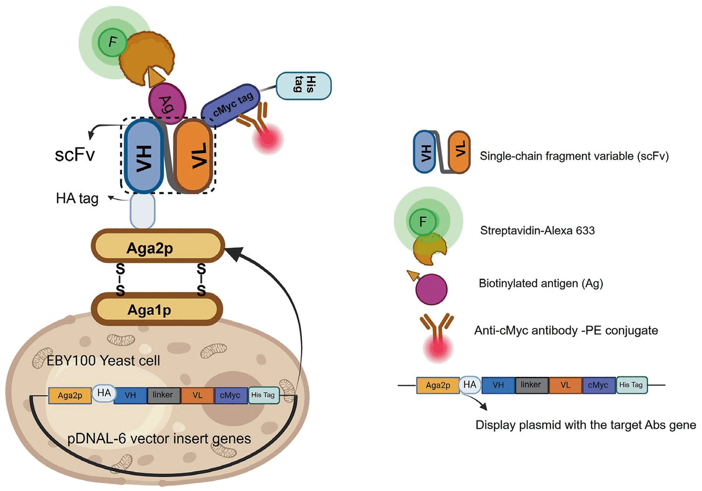

그림 1 scFv 효모 표면 디스플레이의 모식도 및 선별 전략에 사용된 표지. 항체 라이브러리 유전자를 상동 재조합을 통해 효모 디스플레이 벡터에 클로닝하고 효모 표면에 발현시킨다. 형광 접합 항-c-Myc 항체를 사용하여 scFv 항체를 검출할 수 있으며, 결합된 항원은 형광 접합 스트렙타비딘(Streptavidin-Alexa Fluor 633)을 활용하여 검출할 수 있다.

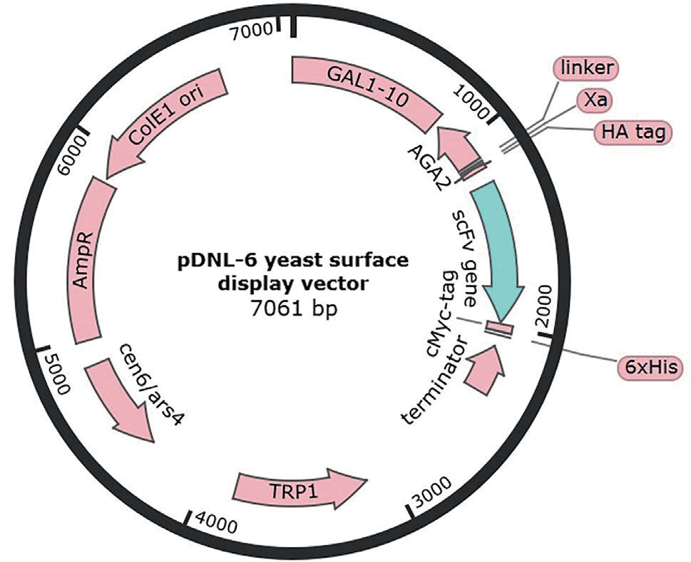

그림 2 pDNL6 벡터 맵. 벡터는 다음 요소들을 포함한다: GAL1-10 프로모터, Aga2 유전자, HA 에피토프 태그, c-Myc 에피토프 태그, 포스포리보실안트라닐산 이성질화효소 유전자(TRP1), 동원체 서열(CEN6), 자율 복제 서열(ARSH4), MF α-1 종결인자, TEM-1 β-락타마아제 유전자(AmpR), ColE1 복제원점.

각 효모 세포는 통상 약 5 × 10⁴ 카피의 재조합 항체 단편-Aga2 융합체를 표면에 제시하지만, 개별 발현 수준은 항체 단편의 안정성과 용해도에 따라 더 낮거나 높을 수 있다.

또한 YSD는 형광활성화 세포선별기(FACS)를 이용하여 조합 라이브러리의 고처리량 정량적 스크리닝과 생물물리학적 특성 규명을 가능하게 한다. 이는 여러 이점을 제공한다. 첫째, 효모 디스플레이는 진핵생물의 번역 후 기전(예: 이황화 결합 이성질화 및 글리코실화)에 의존한다. 이는 박테리아 발현계에서 발현되기 어려운 다수의 이황화 결합을 포함하는 거대 당화 항체 단백질의 폴딩과 분비를 촉진한다. 둘째, 평형 결합, 제한된 가용성 표적에 대한 경쟁, 동역학적 경쟁 등 다양한 단백질 표적 표지 방식을 적용함으로써, 효모 디스플레이와 유세포 분석의 결합은 표적에 대한 결합 친화도가 서로 다른 단백질 결합체들을 정량적이고 정밀하게 구별할 수 있게 해 준다. 셋째, 항체 발현(anti-HA 또는 anti-c-Myc 태그)을 위한 형광단과 특이적 표적 결합을 위한 또 다른 형광단을 결합한 2색 표지 플롯을 사용하면, 효모에 제시된 각 항체를 더 높은 친화도, 특이성, 안정성에 대해 동시에 선별할 수 있다. 마지막으로 유세포 분석을 통해 단일 세포를 분리하면 서브클로닝, 가용성 발현, 정제 과정 없이도 세포 표면 융합체 상태에서 개별 단백질 결합체의 생물물리학적 특성을 규명할 수 있다.

효모 디스플레이 기술에도 한계는 있다. YSD의 라이브러리 다양성(약 10⁷~10⁹)은 통상 박테리아(약 10⁹~10¹¹), 파지(약 10⁹~10¹¹), mRNA(약 10¹³~10¹⁴) 디스플레이 등 다른 디스플레이 시스템에 비해 수 자릿수 정도 낮다 [16]. 이러한 이유로 대부분의 연구자들은 먼저 더 높은 다양성을 지닌 라이브러리를 스크리닝하여 잠재적인 결합 단백질을 확인한 후 선별된 집단을 YSD 시스템으로 이전한다 [7]. 그러나 YSD는 효모 내부에서 분비 단백질의 번역 후 처리가 일어나기 때문에 이처럼 더 큰 라이브러리들에 비해 기능적 라이브러리 다양성이 더 높은 편이다 [17]. 이러한 추가적인 가공 처리는 어느 정도 YSD의 낮은 라이브러리 다양성을 보완해 준다. 효모와 포유류 세포는 글리코실화 패턴에서 차이를 보이지만, 최근 연구들은 이러한 한계를 극복할 수 있음을 보여주었다 [18, 19]. 마지막으로 올리고머 단백질 표적의 경우, 효모 표면에 존재하는 다수의 항체 카피로 인해 원치 않는 다가 결합(multivalent binding)이 발생할 수 있으며, 이는 단일 단백질 에피토프와 상호작용하는 고친화도(친화도가 아닌 avidity에 기인한 것이 아닌) 결합체를 식별하는 데 방해가 될 수 있다. 다가 결합은 저분자 화합물이나 펩타이드 표적을 겨냥한 항체 작제물을 발굴할 때도 간섭을 일으킬 수 있다.

기존에 보고된 선별 프로토콜들 [9, 20]은 단백질 항체 선별 효율을 대폭 향상시킨 강력한 도구를 제공했지만, 저분자량 햅텐에 대한 항체를 선별할 때 발생하는 문제를 해결하지는 못했다. 햅텐은 면역 반응을 유도하기 위해 운반체 단백질과 공유결합으로 접합되어야 하는데, 우리 연구에 따르면 햅텐-단백질 접합체를 사용하여 생성된 항체는 유리 햅텐보다 단백질에 접합된 햅텐에 100~10,000배 더 강하게 결합한다 [21–23]. YSD는 스크리닝 단계에서 단백질에 접합된 햅텐을 필요로 하므로 (그림 1), 일반적인 YSD 프로토콜로는 수용성 햅텐을 인식하는 항체와 햅텐-단백질 접합체에 일차적 특이성을 갖는 항체를 효과적으로 분리해 내지 못한다. 본 장에서는 이러한 항-햅텐 항체를 분리하기 위한 상세하고 업데이트된 프로토콜을 제공한다. 이 연구의 독창성은 고도로 특이적인 결합 특성을 지닌 희귀 scFv 집단을 분리하도록 설계된 경쟁적 FACS 절차를 도입한 데 있다. 여기에 설명된 절차는 햅텐 특이적 scFv를 위한 것이지만, 고도의 선택성을 가진 항체가 필요한 경우라면 언제든 이 일반적인 방법을 응용할 수 있다.

#### 1.1 본 절차의 성공에 필수적이었던 두 가지 핵심 요소

먼저, 효모 라이브러리에서 경쟁적 FACS 선별을 진행할 다양한 scFv 풀을 확보하기 위해 파지 면역 라이브러리의 초기 패닝을 제한적으로 수행해야 했다. 이에 따라 원래의 파지 라이브러리에서 일부 하위 집합을 선별하기 위한 최소한의 프로토콜을 고안했다 [7]: 1단계는 고정화된 햅텐-단백질 접합체(페난트렌 또는 메틸화 페난트렌-BSA)에 결합하는 클론을 선별하는 것이었다. 2단계에서는 용매 조건(1% DMSO)을 도입하여 이 용매에서 불안정한 항체를 배제했다. 이 두 단계에서는 pH 2.2의 글리신 완충액을 사용하여 고정화된 햅텐-단백질 접합체에 여전히 결합해 있는 파지 입자들을 회수했다. 3단계에서는 고정화된 햅텐-단백질 접합체에 결합된 파지 입자를 용출하기 위해 1% DMSO가 포함된 완충액에 녹인 가용성 햅텐(페난트렌 또는 메틸화 페난트렌, 100 µM)을 사용했다. 세 번째 단계는 가용성 햅텐을 인식하는 scFv를 라이브러리에 농축하도록 설계되었다. 가용성 햅텐에 대한 결합은 경쟁적 파지 ELISA로 확인했다(자세한 내용은 [7] 참조). 이 세 차례의 패닝 단계 후, 미니프렙 키트로 선별된 파지미드를 분리하고 전달 프라이머 쌍(참고 6에 설명)을 사용하여 scFv 유전자를 증폭했다. 효모 디스플레이 플라스미드 pDNL6-GFP-c-Myc을 BssHII 및 NheI 제한효소로 절단하고, GFP 삽입물이 제거된 선형 플라스미드를 겔 정제했다. 절단된 pDNL6 플라스미드와 정제된 scFv 유전자 PCR 산물을 시판 효모 형질전환 키트를 사용하여 EBY100 효모 컴피턴트 세포에 형질전환했다. 플라스미드의 상동 영역과 PCR 산물의 인접 영역이 효모의 상동 복구 메커니즘을 유도하여 scFv 삽입물을 지닌 원형 플라스미드가 형성되었다. 이것이 추가 분석에 사용된 효모 라이브러리다. 그림 3은 경쟁적 FACS 분석 전략을 보여준다. scFv를 발현하고(x축 신호) 비오틴화된 햅텐-BSA 접합체에 결합하는(y축 신호) 효모 세포 집단을 가용성 햅텐(Phen 또는 2MePhen) 존재하에 인큐베이션한다.

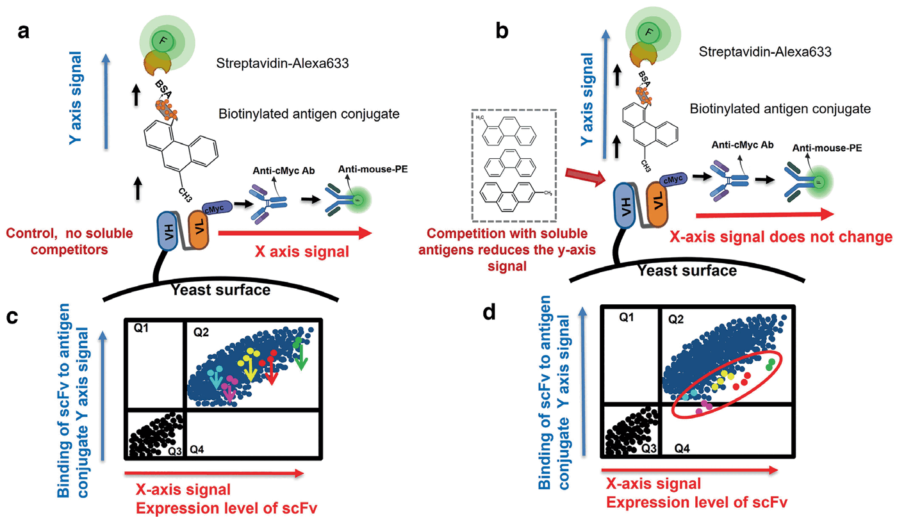

그림 3 경쟁적 FACS에 의한 선별을 보여주는 이론적 모델. (a) 가용성 항체가 없는 상태에서 scFv를 발현하고(x축 신호) 비오틴화된 Phen-BSA 접합체에 결합하는(y축 신호) 효모 세포 집단의 FACS 분석. (b) 동일한 효모 세포 집단을 가용성 항체 존재하에 인큐베이션한 결과. (c 및 d) 가용성 햅텐에 결합하는 클론은 y축 신호의 감소를 나타내며 (d) 패널에 원으로 표시된 Q2 사분면 영역에 농축된다. Y. Sun et al (2016) Anal. Chem. 88:9181–9189에서 허가를 받아 전재함. Copyright 2016 American Chemical Society.

가용성 항원에 결합하는 클론은 가용성 항원이 항체 결합 부위를 두고 Alexa633 표지 접합체와 경쟁하기 때문에 y축에서 더 낮은 신호를 나타낸다. 이러한 햅텐 특이적 클론은 그림 3d에 원으로 표시된 바와 같이 Q2 사분면 영역에 농축된다. 그러나 실제 실험에서는 이 원형 영역이 비오틴화 BSA 접합체에 비특이적으로 결합하는 효모 세포에 의해 자주 오염된다는 사실을 발견했다.

#### 1.2 경쟁적 FACS 절차의 두 번째 핵심 요소는 햅텐-BSA-비오틴 접합체가 아닌 비오틴화 BSA에 결합하는 세포를 제거하기 위해 고안된 음성 선별(Negative Selection) 전략이었다

이 음성 선별 절차를 위해서는 소 혈청 알부민(BSA)을 BSA-햅텐-비오틴 접합체와 동등한 치환도로 비오틴화해야 했다 [7]. (비오틴 치환도는 비색법이나 형광법으로 측정할 수 있으며, 일부 비오틴화 키트에는 이 분석에 필요한 시약이 포함되어 있다.) 비오틴화 BSA를 세포 집단과 함께 인큐베이션했을 때, 비오틴화 BSA에 결합하는 다수의 클론이 관찰되었다 (그림 4a의 Q2). 이러한 세포들은 그림 4b, c에 나타난 바와 같이 경쟁적 FACS를 진행하기 위해 Q4 영역(빨간색 사각형)의 세포만을 회수함으로써 후속 분석에서 제거되었다. 모든 효모 라이브러리가 이 음성 선별 절차를 필요로 하는 것은 아니다. 비오틴화 BSA와 인큐베이션한 후 얻은 FACS 프로파일에서 대부분의 세포가 Q4 사분면에 위치하고 Q2 사분면의 세포가 극소수라면, 이 음성 선별 프로토콜은 생략할 수 있다.

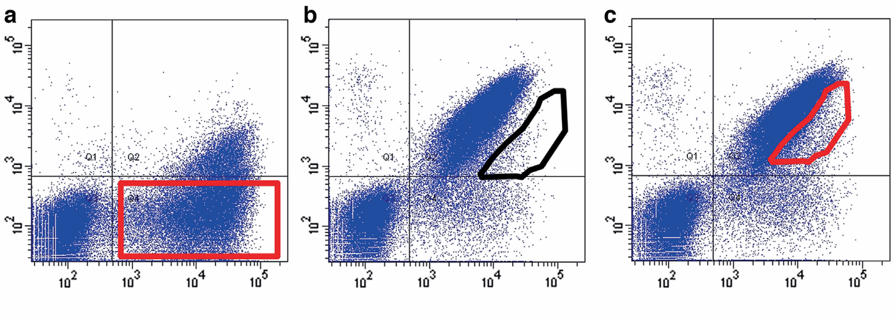

그림 4 음성 선별이 필요했던 세포 집단의 FACS 분석. x축은 스트렙타비딘-Alexa633이 비오틴화 단백질(비오틴화 햅텐-BSA 또는 비오틴화 BSA)에 결합하여 발생하는 신호를 나타낸다. y축은 피코에리트린 표지 염소 항-마우스 항체가 scFv 상의 c-Myc 에피토프를 인식하는 마우스 단일클론항체 9E10에 결합하여 발생하는 신호를 나타낸다. (a) 세포는 비오틴-BSA와 인큐베이션했을 때 상당한 배경 신호를 보였다(Q2 신호 참조). Q4에서 빨간색 테두리로 표시된 클론들을 회수하여 재배양하고 후속 선별을 진행했다. (b) 패널 (a)의 Q4에서 회수한 효모 세포를 비오틴-BSA-페난트렌 접합체와 인큐베이션했다. (c) 패널 A의 효모 세포를 비오틴-BSA-페난트렌 접합체 및 200 µM 가용성 페난트렌과 함께 인큐베이션했다. 가용성 페난트렌이 존재할 때 원형 영역에 더 많은 수의 세포가 나타남에 주목하라. 추가 분석을 위해 패널 (c)의 빨간색 원 안의 세포들을 회수했다. Y. Sun et al (2016) Anal. Chem. 88:9181–9189에서 허가를 받아 전재함. Copyright 2016 American Chemical Society.

최종 선별된 개별 클론(그림 4c에서 빨간색 원으로 표시된 클론들)을 재배양하여 단일클론 경쟁적 FACS 분석을 수행했다(해당 데이터는 문헌 [7] 참조). 분석된 184개 클론 중 70개(38%)가 y축 신호에서 뚜렷한 하향 이동(downward shift)을 나타냈다. 단일클론 FACS를 통해 확인된 70개 클론 모두를 발현 벡터에 서브클로닝하여 가용성 scFv 단백질을 생산했으며, 효모 디스플레이 시스템에서 발생할 수 있는 결합력(avidity)이나 기타 간섭 현상 없이 scFv의 가용성 햅텐 결합을 경쟁적 ELISA로 확인하기 위해 조 페리플라즘 추출물(crude periplasmic extract)을 사용했다. 경쟁적 유세포 분석으로 확인된 70개 클론(확보 가능한 약 1,000,000개의 고유 서열 중) 가운데 65개 클론이 경쟁적 ELISA 형식에서도 활성을 나타냈다. 염기서열 분석 결과 서로 구별되는 7개의 고유 scFv 서열이 확인되었다. 이미 생체 내에서 상당한 선별이 일어난 면역 라이브러리에서는 이러한 서열 중복이 자연스러운 현상이다. 유사한 결합 특성을 지닌 중복 클론들이 분리되었다는 사실은 본 방법의 탁월한 성능과 선택성을 잘 보여준다. 경쟁적 FACS 기법을 통해 발현 벡터에 서브클로닝하고 가용성 발현을 유도하여 경쟁적 ELISA로 테스트해야 하는 클론의 수를 극적으로 줄임으로써(약 1,000,000개에서 70개로), 수 주에서 수 개월에 달하는 실험실 연구 시간을 크게 단축할 수 있었다.

### 2 재료

#### 2.1 항원 준비

1. 혼합 산무수물법(mixed anhydride method)을 통한 햅텐 접합 반응에 사용되는 화학물질:

   a. 1,4-디옥산(1,4-dioxane).

   b. 트리부틸아민(tributylamine).

   c. 클로로포름산 이소부틸(isobutyl chloroformate) (see Note 1).

2. EZ-Link™ Sulfo-NHS-Biotin (Thermo Scientific 또는 동등 제품).

3. Pierce™ BCA 단백질 정량 키트 (Thermo Scientific 또는 동등 제품).

4. Pierce™ Biotin 정량 키트 (Thermo Scientific 또는 동등 제품).

#### 2.2  효모 디스플레이

선별(Selection)

EBY100 *S. cerevisiae* 효모에 형질전환된 scFv 유전자(참고(Note) 2 참조).

2.	 효모 배양 및 유도 배지(표 1).

•	
YPD 효모 복합 배지(YPD Yeast Complex Media).

•	
SD-CAA 효모 최소 배지(SD-CAA-Yeast Minimal Media).

•	
SG/R-CAA 효모 최소 배지(SG/R-CAA-Yeast Minimal Media).

3.	 Anti-c-Myc 항체, Clone 9E10(자체 제작 및 검증, 참고(Note) 3 참조).

4.	 염소 항-마우스-PE(Goat anti-mouse-PE, Life Technologies).

5.	 스트렙타비딘-Alexa633(Streptavidin-Alexa633, Life Technologies).

6.	 세척 완충액 I: 0.5% BSA 및 2 mM EDTA가 첨가된 PBS.

표 1
배양 배지

YPD 효모 복합 배지

Bacto 펩톤
20 g

효모 추출물
10 g

포도당(Dextrose)
20 g

물을 가하여 1 l로 맞추고 여과 멸균한다

SD-CAA 효모 최소 배지

Na2HPO4 • 7H2O
10.19 g

NaH2PO4 • H2O
8.56 g

카사미노산(Casamino acids)
5 g

황산암모늄이 없는 효모 질소원 베이스(Yeast N2 base WITHOUT ammonium sulfate amino acids)
1.7 g

황산암모늄(Ammonium sulfate)
5.3 g

포도당(Dextrose)
20 g

물을 가하여 1 l로 맞추고 여과 멸균한다

SG/R-CAA 효모 최소 배지

Na2HPO4 • 7H2O
10.19 g

NaH2PO4 • H2O
8.56 g

카사미노산
5 g

황산암모늄이 없는 효모 질소원 베이스
1.7 g

황산암모늄
5.3 g

갈락토스(Galactose)
20 g

라피노스(Raffinose)
20 g

포도당
1 g

물을 가하여 1 l로 맞추고 여과 멸균한다

2xYT 세균 배양 배지

트립톤(Tryptone)
16 g

효모 추출물
10 g

염화나트륨(Sodium chloride)
5 g

물을 가하여 1 l로 맞추고 여과 멸균한다

7.	 세척 완충액 II: 0.5% BSA가 첨가된 PBS.

8.	 PBS 완충액: 10 mM NaHPO4, 1.8 mM KH2PO4, 137 mM NaCl, 2.7 mM KCl, pH 7.4.

9.	 96-웰 필터 플레이트.

10.	 멸균 96-웰 딥웰 플레이트.

11.	 30 °C 및 37 °C 설정이 가능한 인큐베이터.

12.	 유세포 분석기.

13.	 형광활성화 세포선별(FACS) 시스템(참고(Note) 4 참조).

14.	 96-웰 플레이트 세척용 진공 여과 장치.

1.	 BL21(DE3) 세균 균주.

#### 2.3  수용성 scFv

발현

2.	 POE-c-Myc 발현 플라스미드(참고(Note) 5 참조).

3.	 2xYT 세균 배양 배지(표 1).

4.	 전달 프라이머(Transfer primers, 참고(Note) 6 참조).

5.	 Zymoprep™ Yeast Plasmid Miniprep II 키트.

6.	 효소: BssHII, NheI, T4 리가아제.

7.	 용해 완충액(Lysis buffer): EDTA-free 단백질분해효소 저해제 칵테일(Thermo Scientific, Waltham, MA)을 포함하는 PBS 내 1 mg/ml 리소자임.

1.	 PBST: 0.05% Tween 20이 첨가된 PBS 완충액.

#### 2.4  결합

특성 규명

2.	 Anti-c-Myc 항체, Clone 9E10(참고(Note) 3 참조).

3.	 Anti-mouse-HRP.

4.	 페록시다아제용 비색 기질.

### 3  방법

1.	 효모 라이브러리의 분주액을 성장 배지인

#### 3.1  효모 디스플레이

라이브러리 또는 선별된 효모 풀의 유도

SD-CAA에 접종하고 30 °C에서 밤새 인큐베이션하여 활성화한다(참고(Note) 7 참조).

2.	 16–20 h 후 활성화된 효모 세포를 유도 배지인 SG/R-CAA에 OD600 = 0.5로 희석하고, 20 °C에서 밤새 배양한다(참고(Note) 8 참조).

3.	 유도 후 유도된 효모 세포 107개(OD600 = 0.5에서 2 ml)를 원심분리하고 세척 완충액 I 0.5 ml로 2회, 세척 완충액 II 0.5 ml로 1회 세척한다. 이 세포들은 이제 선별이나 특성 규명에 사용할 준비가 되었다. 모든 세포 세척은 완충액을 첨가한 뒤 볼텍싱하여 혼합하는 방식으로 2 ml 에펜도르프 튜브에서 수행하며, 마이크로원심분리기(~12,000 × g)로 원심분리한 후 세포 침전물에서 상층액을 조심스럽게 제거한다.

a)	 햅텐 항원의 접합

#### 3.2  항원

준비

카복실 작용기를 가진 저분자(햅텐 항원)는 혼합 무수물법(mixed anhydride method)을 통해 운반 단백질(BSA 또는 KLH)에 접합할 수 있다 [24].

1.	 카복실화된 햅텐 0.05 mmol을 무수 1,4-다이옥세인 2 ml에 용해한다.

2.	 햅텐 용액에 트라이뷰틸아민과 아이소뷰틸 클로로포메이트를 동몰량으로 첨가하고 얼음 위에서 30 min 동안 반응시켜 혼합 무수물 중간체를 형성한다.

3.	 이어서 pH 8.5의 운반 단백질 용액 2.5 ml(BSA 40 mg 또는 KLH 20 mg)에 혼합 무수물을 한 방울씩 떨어뜨리고 실온에서 교반하며 4 h 동안 인큐베이션한다(참고(Note) 9 참조).

4.	 반응 혼합물을 원심분리하여 침전물을 제거한다. 최종 생성물은 반응을 멈추기 위해 먼저 pH 9의 0.01 M 글라이신에 대해 투석한 다음, 약 1 l의 PBS 완충액에서 추가로 2일간 투석한다.

5.	 접합체에 햅텐 유도체가 존재하는지는 간접 ELISA 또는 LC-MS로 확인할 수 있다.

b)	 BSA-항원 접합체 및 대조군 BSA의 비오틴화.

1.	 효모 디스플레이 스크리닝을 위해 BSA 및 햅텐-BSA 접합체를 추가로 비오틴화해야 한다. 햅텐-BSA 접합체와 대조군 BSA는 모두 동일한 방법과 동일한 치환도로 비오틴화되어야 한다. 비오틴화에는 EZ-Link™ Sulfo-NHS-Biotin과 같은 상용 키트를 사용할 수 있다.

2.	 PBS를 완충액으로 사용하는 PD-10 탈염 컬럼을 이용해 반응하지 않은 sulfo-NHS-biotin을 제거한다.

BCA 방법으로 단백질 농도를 측정하고, Biotin Quantitation Kit를 이용해 비오틴 접합 정도를 측정한다. 비오틴 치환도는 비오틴화된 햅텐-BSA와 대조군으로 사용되는 비오틴화된 BSA에서 유사해야 한다. 이는 이후의 음성 FACS 선별 단계에서 중요하다.

a)	 음성 선별(Negative selection)

#### 3.3  선별

먼저 효모 라이브러리의 비특이적 결합 신호를 분석해야 하며, 필요한 경우 정제를 위해 음성 선별 단계를 거쳐야 한다(참고(Note) 10 및 그림 4a 참조).

1.	 유도된 효모 세포(위 3.1절 참조)를 비오틴화 대조군 100 nM(비특이적 결합의 마커로 사용되는 비오틴화-BSA 등)과 항-c-Myc 항체 2 μg/ml(scFv 발현의 마커로 사용)가 포함된 세척 완충액 II 0.5 ml와 함께 30 min 동안 인큐베이션한다. 그림 1은 scFv 디스플레이 시스템과 선별 전략에 사용된 모든 표지를 개식적으로 보여 준다. 그림 3은 세포가 사분면 1, 2, 3, 4(Q1, Q2, Q3, Q4)에 이론적으로 어떻게 위치해야 하는지 설명한다(참고(Note) 11 참조).

2.	 세척 완충액 II(0.5% BSA가 첨가된 PBS, 세척 절차는 참고(Note) 12 참조) 0.5 ml로 효모 세포를 3회 세척한다.

3.	 염소 항-마우스-PE 4 μg/ml 및 스트렙타비딘-Alexa633 10 μg/ml가 포함된 세척 완충액 II 0.5 ml를 사용하여 암실 4 °C에서 1 h 동안 세포를 염색한다.

4.	 염색된 효모 세포를 세척 완충액 II 0.5 ml로 3회 세척하고 유세포 분석을 위해 PBS 1 ml에 재현탁한다.

5.	 비특이적 결합 신호를 보이는 세포(즉, 비오틴화-BSA에 결합하는 세포)는 FACS 플롯의 Q2에 위치하게 된다(그림 4a). 이러한 세포는 이후의 경쟁적 FACS 선별을 방해할 수 있다. Q4 사분면에 위치한 세포만을 추가 분석을 위해 선별함으로써 이들 세포를 제거한다(그림 4a의 붉은색 상자 안 세포).

b)	 양성 선별(수용성 햅텐 없음). 양성 선별은 경쟁적 선별에 앞서 라이브러리 내 햅텐 결합 클론을 농축하는 데 사용된다. 이 절차는 음성 선별 과정에서 Q4 사분면으로부터 선별된 효모 세포에 대해서만 수행된다. 이 Q4 세포를 3.1절(위)에 기술된 대로 증식시키고 유도한다.

1.	 유도 및 세척된 효모 세포를 비오틴화 BSA-햅텐(농도 1–100 nM)과 항-c-Myc 항체 2 μg/ml가 포함된 세척 완충액 II 0.5 ml와 함께 30 min 동안 인큐베이션한다.

2.	 위에서 설명한 대로 세척 완충액 II로 효모 세포를 3회 세척한다.

3.	 염소 항-마우스-PE 4 μg/ml 및 스트렙타비딘-Alexa633 10 μg/ml가 포함된 세척 완충액 II 0.5 ml에서 암실 4 °C 조건으로 1 h 동안 세포를 염색한다.

4.	 염색된 효모 세포를 세척 완충액 II로 3회 세척하고 유세포 분석을 위해 PBS 1 ml에 재현탁한다. 비오틴화 BSA-햅텐에 결합하는 세포(그림 3c에 표시된 Q2의 대각선 번짐 형태 세포군)를 선별한다.

5.	 선별된 효모 개체군을 미리 덥힌 YPD 배지 2 ml에 넣고 30 °C에서 흔들지 않고 30 min 동안 인큐베이션한 후 30 °C 진탕배양기로 옮겨 2일간 배양한다(참고(Note) 13 참조).

6.	 분리된(sorted) 풀을 유도하고 동일한 염색 절차를 사용하여 유세포 분석을 반복한다.

7.	 각 유세포 분석 실험에는 보정(compensation) 테스트를 위해 다섯 가지 음성 대조군이 포함된다: (1) 1차 항체와 2차 항체를 모두 처리하지 않은 효모 세포, (2) 염소 항-마우스-PE만 처리한 효모 세포, (3) 스트렙타비딘-Alexa633만 처리한 효모 세포, (4) 9E10(항-c-Myc) 및 염소 항-마우스-PE를 처리한 효모 세포, (5) 비오틴화 항원 및 스트렙타비딘-Alexa633을 처리한 효모 세포.

c)	 경쟁적 선별(양성 선별에서 얻은 세포, 수용성 햅텐 첨가 및 무첨가):

1.	 유도된 세포(위 3.1절 참조)를 두 집단으로 나눈다: 절반의 세포는 25 °C에서 회전시키며 200 µM의 경쟁 물질(햅텐 항원)과 함께 30 min 동안 인큐베이션한 후, 비오틴화 항원(최종 농도 10 nM)과 항-c-Myc 항체(최종 농도 2 μg/ml)를 첨가하고 추가로 30 min 동안 인큐베이션한다. 나머지 절반의 세포는 비오틴화 항원(최종 농도 10 nM)과 항-c-Myc 항체(최종 농도 2 μg/ml)만 넣고 인큐베이션한다(참고(Note) 14 참조).

2.	 효모 세포를 세척 완충액 II로 3회 세척한다.

3.	 암실 4 °C 조건에서 염소 항-마우스-PE 4 μg/ml 및 스트렙타비딘-Alexa633 10 μg/ml로 1 h 동안 염색한다.

4.	 염색된 효모 세포를 세척 완충액 II로 3회 세척하고 유세포 분석을 위해 PBS 1 ml에 재현탁한다.

5.	 경쟁 물질 존재 하에 또는 없이 인큐베이션한 효모 세포를 비교하여 집단 이동(population shift)을 확인한다(그림 4b, c 참조). 이동된 효모 집단(그림 4c에서 동그라미로 표시된 세포)을 미리 덥힌 YPD 배지 2 mL에 분리 분주하고, 30 °C에서 흔들지 않고 30 min 동안 인큐베이션한 후 30 °C 진탕배양기로 옮겨 2일간 배양한다.

d)	 단일클론 효모 세포 분석

1.	 최종 분리 선별에서 수집한 효모 세포를 단계 희석하여 SD-CAA 한천 평판 배지에 도말한다. 단일 집락(colony)이 형성될 때까지 30 °C 인큐베이터에서 배양한다. FACS 장비를 사용할 수 있다면, 선별된 효모 세포를 SD-CAA 배지가 담긴 96-웰 플레이트에 직접 분주하여 30 °C 인큐베이터에서 곧바로 배양할 수도 있다.

2.	 2–3일 후 플레이트에서 개별 집락을 따서 96 딥웰 플레이트의 SD-CAA 배지 0.5 ml에 각각 접종하고 30 °C에서 밤새 배양한다.

3.	 둘째 날, 배양액의 50 μl 분주액을 SG/R-CAA 배지 500 μl로 옮기고 30 °C에서 밤새 배양한다.

4.	 유도된 각 단일클론 효모 세포의 분주액을 96-웰 진공 여과 플레이트로 옮기고 세척 완충액 I 150 μl로 2회, 세척 완충액 II 150 μl로 1회 세척한다. 위에서 기술한 조건을 사용하여 FACS용 세포 및 적절한 대조군을 염색하고 분석을 위해 PBS 200 μl에 현탁한다. 위 (c)에서 설명한 바와 같이 아래쪽으로의 집단 이동으로 정의되는 햅텐 결합에 대해 개별 클론을 분석한다. 단일클론 효모 세포의 집단 이동에 대한 대표적인 데이터는 [7](그림 6)에서 확인할 수 있다.

1.	 단일클론 효모 세포를 SD-CAA 배지 3 ml에

#### 3.4  수용성 scFv

발현 및 정제

접종하고 30 °C에서 밤새 배양한다.

2.	 Zymoprep™ Yeast Plasmid Miniprep II 키트를 사용하여 밤새 배양한 효모 배양액으로부터 플라스미드를 준비한다.

3.	 BssHII 및 NheI 제한효소 부위를 포함하는 5′ 및 3′ 전달 프라이머를 사용하여 scFv 단편을 PCR 증폭한다.

4.	 증폭된 scFv 단편(VH + VL, 그림 1 참조)과 POE-c-Myc 플라스미드를 모두 BssHII 및 NheI 제한효소로 절단한 다음, T4 리가아제로 DNA 조각들을 연결(ligation)한다.

5.	 연결 반응 혼합물의 분주액을 사용하여 결찰된 POE-c-Myc 플라스미드로 BL21(DE3) 세균을 형질전환한다. 이렇게 형질전환된 세균은 이후 수용성 scFv 생산에 사용된다.

6.	 고유한 scFv 클론을 지닌 BL21(DE3) 세포를 암피실린이 첨가된 2xYT 배지 1.4 l에서 대수 증식기(OD600 = 0.5)까지 37 °C로 배양한다.

7.	 0.5 mM IPTG로 scFv 발현을 유도하고, 30 °C에서 추가로 16 h 동안 세포를 배양한다.

8.	 유도 후 4 °C에서 8000 × g로 15 min 동안 원심분리하여 세균을 수확하고, 침전물을 −20 °C에서 최소 2 h 동안 보관한다.

9.	 냉동된 침전물을 잠시 해동한 다음 용해 완충액 40 ml(PBS 내 1 mg/ml 리소자임 및 제조사 지침에 따라 사용된 EDTA-free 단백질분해효소 저해제(Thermo Scientific))에 현탁한다.

10.	 용해 혼합물을 얼음 위에서 1 h 동안 인큐베이션한 다음 10 mM MgCl2 및 1 μg/ml DNaseI을 첨가한다. 이 혼합물을 25 °C에서 20 min 동안 인큐베이션한다.

11.	 DNaseI 처리된 용해 혼합물을 12,000 × g에서 20 min 동안 원심분리하고 상층액을 수거하여 주변세포질 추출물(periplasmic extract)로 사용한다.

12.	 금속 친화성 크로마토그래피를 사용하여 주변세포질 추출물로부터 수용성 scFv를 정제한다(정제에 대한 자세한 내용은 참고(Note) 15 참조).

경쟁 ELISA 또는 간접 ELISA를 사용하여 햅텐 항원에 대한 수용성 scFv의 결합을 특성 규명한다.

#### 3.5  결합

특성 규명

1.	 96-웰 고결합 플레이트의 각 웰을 2–5 μg/ml의 햅텐-단백질 접합체로 4 °C에서 밤새 코팅한다.

2.	 플레이트를 실온에서 3% BSA가 포함된 PBS로 2 h 동안 차단(blocking)한다.

3.	 플레이트를 PBST로 3회 세척한다.

4.	 수용성 햅텐의 존재 하에 또는 없이 항원이 코팅된 웰에 주변세포질 추출물 또는 정제된 scFv를 넣고 실온에서 1 h 동안 인큐베이션한다.

5.	 플레이트를 PBST로 3회 세척한다.

6.	 안티-c-Myc 항체와 함께 실온에서 1 h 동안 플레이트를 인큐베이션한다.

7.	 플레이트를 PBST로 3회 세척한다.

8.	 염소 항-마우스-HRP 항체와 함께 실온에서 1 h 동안 플레이트를 인큐베이션한다.

9.	 플레이트를 PBST로 3회 세척한다.

10.	 TMB 마이크로웰 페록시다아제 기질(KPL)을 사용하여 발색시킨다. 5 min 후 1 N HCl을 사용하여 반응을 중단시킨다.

11.	 마이크로플레이트 광도계에서 OD405–OD600 값을 측정하여 발색을 정량한다. 햅텐을 인식하는 수용성 scFv는 수용성 햅텐이 존재할 때 더 낮은 흡광도(색상)를 나타낸다.

### 4  참고(Notes)

1.	 아이소뷰틸 클로로포메이트(Isobutyl chloroformate)는 휘발성이 강하고 부식성이 매우 높은 물질이며, 흡입 시 독성이 있을 수 있다. 이 시약은 냉장 보관해야 하며 화학 흄후드 안에서 사용해야 한다. 장갑과 보안경 착용이 필수적이다. 아이소뷰틸 클로로포메이트는 접합 과정 중에 비활성화되며 이후의 투석 과정에서 안전하게 제거될 수 있다.

2.	 효모 디스플레이 플라스미드 pDNL6은 로스앨러모스 국립연구소(Los Alamos National Laboratory) 생명과학부에서 친절히 제공해 주었다. 본 연구실에서는 원래의 V5 태그를 c-Myc 단백질 유래의 10개 아미노산 태그(EQKLISEEDL, 본 장에서는 c-Myc 태그로 지칭함)로 교체하도록 수정하였다.

3.	 c-Myc 태그에 대한 항체를 분비하는 하이브리도마(클론 9E10)는 미국 아이오와주 아이오와시티(Iowa City, IA 52242-1324, 210 E. Iowa Ave., 028 BBE) 아이오와 대학교 생물학과의 발달 연구 하이브리도마 은행(Developmental Studies Hybridoma Bank, dshb@uiowa.edu)에서 구하였다. 상용 안티-c-Myc 항체(클론 9E10)를 사용할 수도 있으나, 우리 경험상 자체 제작한 9E10 항체가 활성이 더 우수하고 비용이 훨씬 저렴하다.

4.	 본 연구에는 Beckman FACS Aria 시스템이 사용되었다.

5.	 POE 발현 플라스미드는 로스앨러모스 국립연구소 생명과학부에서 친절히 기증해 주었다. 우리 연구실에서는 원래의 V5 태그를 c-Myc 태그로 교체하도록 수정하였다.

6.	 선별 후 파지미드로부터 회수된 scFv 유전자는 한 쌍의 전달 프라이머를 사용하여 증폭된다:

Phage to Yeast forward: TCTGGTGGTGGT GGTTCTGGTGGTGGTGGTTCTGCTAGA AGCGCGCATGCC
Phage to Yeast reverse: CGTTCAGGTCTTCTTCAGAGATCAGTTTCTGTTCAGCAC CTGAGCTAGCGCGTTT

7.	 효모 라이브러리의 세포는 다음 유도 단계 전에 반드시 대수 증식기에 있어야 한다. 배양에 접종하는 효모 세포의 수는 라이브러리 다양성의 최소 10배 이상이어야 한다.

8.	 pDNL-6 플라스미드에서 scFv의 발현은 GAL1-10 프로모터의 제어를 받는데, 이는 포도당에 의해 억제되고 갈락토스와 라피노스에 의해 유도된다. 따라서 배양 배지를 SD-CAA에서 SG/R-CAA로 교체하면 효모 표면에서 scFv 발현이 유도된다.

9.	 접합 효율을 극대화하기 위해 햅텐:BSA의 몰 접합비는 100:1을 초과한다. KLH의 경우 이 비율이 더 낮은데, 이는 낮은 치환도가 마우스 면역화 시 더 높은 항체가(titer)로 이어지기 때문이다.

10.	 햅텐 항체 스크리닝에서 가장 큰 어려움 중 하나는 원하는 햅텐 특이적 양성 클론의 빈도가 원치 않는 클론에 비해 매우 낮다는 점이다. 원치 않는 클론에는 비오틴화된 운반 단백질에 결합하는 클론과 비오틴화된 햅텐-단백질 접합체에는 결합하지만 수용성 햅텐에는 결합하지 않는 클론이 포함된다. FACS를 이용해 원치 않는 클론을 식별하고 제거하는 작업은 세 단계로 진행되었다: (1) 음성 선별을 통해 효모 라이브러리에서 비오틴화-BSA에 결합하는 클론을 제거한다. 그림 4a는 우리 라이브러리의 대규모 클론 집단이 비오틴화-BSA에 결합하고 있음을 보여 준다(Q2에 표시). 우리는 Q4 사분면에 위치한 세포만을 선별하여 증식시킴으로써 라이브러리에서 이들 세포를 제거하였다(그림 4a의 붉은색 상자). (2) 경쟁적 선별에 앞서 라이브러리 내 햅텐 결합 클론을 농축하기 위해 양성 선별을 사용하였다(데이터 미제시). (3) 그런 다음 경쟁적 FACS를 사용하여 수용성 햅텐의 존재 하에 및 부재 하에 인큐베이션된 세포 집단을 비교하고, 수용성 항원이 존재할 때 x축 상의 위치가 아래쪽으로 이동한 클론들이 농축된 수집 윈도우를 선택하였다. 그림 4b와 c는 각각 수용성 항원의 부재 및 존재 하에서의 FACS 결과를 보여 준다. 각 실험 조건에서 세포를 수집하기 위해 동일한 x 및 y 좌표를 사용하였다(동그라미 참조).

11.	 본 논문의 그림 3은 FACS 분석의 Q1, Q2, Q3, Q4에서 이론적으로 발견될 것으로 예상되는 세포들의 특성을 설명한다. 플롯의 x축은 각 효모 세포에서의 scFv 발현 수준을 측정한다. 이는 scFv의 C말단에 존재하는 c-Myc 태그(10개 아미노산 서열)의 존재로 정량화된다. c-Myc 태그는 9E10 마우스 단일클론항체에 의해 인식되며, 피코에리트린(phycoerythrin)이 접합된 시판 염소 항-마우스 항체와 함께 인큐베이션하여 FACS에서 검출된다. y축은 scFv와 비오틴화 햅텐-BSA 접합체 간의 결합 강도를 측정하며, 시판 스트렙타비딘-Alexa633 접합체와 함께 인큐베이션하여 FACS에서 검출된다. 그래프의 좌측 상단 사분면(Q1)은 scFv 발현 수준이 낮고 비오틴화 햅텐-BSA 접합체에 대한 결합이 거의 없거나 전혀 없는 세포를 나타낸다. 우측 상단 사분면인 사분면 2(Q2)는 증가된 scFv 발현 수준과 비오틴화 햅텐-BSA 접합체에 대한 증가된 결합을 나타낸다. 사분면 3(Q3)은 표지되지 않은 세포를 나타낸다. 사분면 4(Q4)는 scFv를 발현하지만 비오틴화 햅텐-BSA 접합체에는 거의 또는 전혀 결합하지 않는 세포를 나타낸다.

12.	 모든 세척은 원심침전된 세포에서 상층액을 조심스럽게 제거하고 세척 완충액 0.5 ml를 첨가한 후 마이크로원심분리기에서 약 12,000 × g로 원심분리하여 수행한다. 우리는 분젠 버너 위에서 팁의 얇은 부분을 가열 용융하고 부드러워진 유리를 잡아당겨 더 작은 구멍을 만든 9인치 유리 피펫을 자주 사용한다.

13.	 세포 선별(cell sorting)은 효모 세포에 손상을 줄 수 있으므로, 선별된 집단을 미리 덥힌 배지(30 °C)에 수집하고 진탕 수조에 넣기 전 30 min 동안 회복시켰다.

14.	 경쟁 물질과 햅텐-단백질 항원의 인큐베이션 순서는 결정적으로 중요하다. scFv는 햅텐-단백질 접합체보다 유리 햅텐에 덜 강하게 결합할 가능성이 높기 때문에, 햅텐-단백질 접합체를 첨가하기 전에 과량의 수용성 햅텐과 함께 효모 세포를 미리 인큐베이션하는 것이 중요하다. 경쟁적 FACS 실험에 사용된 수용성 햅텐과 비오틴화 햅텐-BSA 접합체의 농도는 일반적인 지침으로 제공된 것이다. 다른 햅텐을 표적으로 하는 효모 라이브러리의 경우 농도를 조정해야 할 수 있다. 햅텐에 결합하는 클론은 햅텐-단백질 접합체에도 결합하므로, 이러한 경쟁적 FACS 실험에서는 수용성 햅텐이 없는 대조군을 항상 함께 진행해야 하며 완충액 조건도 동일해야 한다.

예를 들어, 우리 실험에서는 페난트렌 햅텐을 가용화하기 위해 2% DMSO를 첨가하였으므로 수용성 햅텐이 없는 대조군 완충액에도 2% DMSO를 포함시켰다. 그림 3에서 예측된 바와 같이 햅텐 결합 클론은 Q2 사분면에서 아래쪽으로 이동하게 된다. 경쟁적 FACS의 실제 결과는 그림 (b)와 (c)에 나타나 있다.

15.	 제조사의 프로토콜에 따라 준비된 HisPur Cobalt Resin(Life Technology)을 사용하여 주변세포질 추출물로부터 수용성 scFv를 정제한다. 먼저 주변세포질 추출물(40 ml)을 1 ml의 레진과 함께 회전시키며 1 h 동안 인큐베이션한 다음 레진을 컬럼(1 × 1 cm)에 자연 중력으로 패킹한다. 흘러나온 액(flow-through)의 280 nm 흡광도가 기준선에 도달할 때까지 평형 완충액(50 mM 인산나트륨, 300 mM 염화나트륨, 10 mM 이미다졸, pH 7.4)으로 레진을 세척한다. 50 mM 인산나트륨, 300 mM 염화나트륨, 150 mM 이미다졸, pH 7.4를 사용하여 scFv를 용출한다. 모든 단백질이 용출되었는지 확인하기 위해(280 nm에서의 흡광도) 1 ml 분획을 몇 개 수집한 다음 단백질을 포함하는 분획을 모은다. Amicon ultra-15 장치(EMD Millipore)를 사용하여 모은 분획을 농축하고 PBS로 완충액을 교환한다. SDS-PAGE로 scFv의 순도를 분석하고 BCA 단백질 정량법(Pierce)을 사용하여 단백질 농도를 측정한다.

이해 상충

본 연구는 미국 에너지부[Grant DE-SC0004959]의 지원을 받았다. 저자들은 본 장의 내용과 관련하여 선언할 이해 상충이 없다.

### 참고문헌

1.	Mieczkowski C, Zhang X, Lee D et al (2023)

6.	Feldhaus MJ, Siegel RW, Opresko LK et al

Blueprint for antibody biologics developability. 
MAbs 15:2185924
	 2.	Boder ET, Raeeszadeh-Sarmazdeh M, Price JV

(2003) Flow-cytometric isolation of human 
antibodies from a nonimmune Saccharomyces 
cerevisiae surface display library. Nat Biotechnol 
21:163–170
	 7.	Sun Y, Ban B, Bradbury A et al (2016)

(2012) Engineering antibodies by yeast display. 
Arch Biochem Biophys 526:99–106
	 3.	Raeeszadeh-Sarmazdeh M, Boder ET (2022)

Combining yeast display and competitive 
FACS to select rare hapten-specific clones from 
recombinant antibody libraries. Anal Chem 
88:9181–9189
	 8.	Garcia-Rodriguez C, Levy R, Arndt JW et

Yeast surface display: new opportunities for 
a time-tested protein engineering system. 
Methods Mol Biol 2491:3–25
	 4.	Oh EJ, Liu R, Liang L et al (2020) Multiplex

evolution of antibody fragments utilizing a 
yeast surface display platform. ACS Syn Biol 
9:2197–2202
	 5.	Boder ET, Wittrup KD (1997) Yeast surface

al (2007) Molecular evolution of antibody 
cross-reactivity for two subtypes of type A botulinum neurotoxin. Nat Biotechnol 25:107–116
	 9.	Zahradník J, Dey D, Marciano S et al. (2020) An

display for screening combinatorial polypeptide 
libraries. Nat Biotechnol 15:553–557

enhanced yeast display platform demonstrates 
the binding plasticity under various selection

pressures. bioRxiv 2020:12.16.423176. https://
doi.org/10.1101/2020.12.16.423176v1 
	10.	McMahon C, Baier AS, Pascolutti R et al

18.	Fiebig D, Bogen JP, Carrara SC et al (2022)

Streamlining the transition from yeast surface display of antibody fragment immune 
libraries to the production as IgG format in 
mammalian cells. Front Bioeng Biotechnol 
10:794389
	19.	Shenoy A, Yalamanchili S, Davis AR et al

(2018) Yeast surface display platform for rapid 
discovery of conformationally selective nanobodies. Nat Struct Mol Biol 25:289–296
	11.	Traxlmayr MW, Obinger C (2012) Directed

evolution of proteins for increased stability and 
expression using yeast display. Arch Biochem 
Biophys 526:174–180
	12.	Rosace A, Bennett A, Oeller M et al (2023)

(2021) Expression and display of glycoengineered antibodies and antibody fragments with 
an engineered yeast strain. Antibodies 10:38
	20.	Teymennet-Ramírez KV, Martínez-Morales

Automated optimisation of solubility and conformational stability of antibodies and proteins. 
Nat Commun 14:1937 
	13.	Ananphongmanee V, Srisala J, Sritunyalucksana

F, Trejo-Hernández MR (2022) Yeast surface 
display system: strategies for improvement and 
biotechnological applications. Front Bioeng 
Biotechnol 9:794742
	21.	Blake DA, Chakrabarti P, Khosraviani M

K et al (2015) Yeast surface display of two proteins previously shown to be protective against 
White Spot Syndrome Virus (WSSV) in shrimp. 
PLoS ONE 10:e0128764
	14.	Mei M, Zhou Y, Peng W et al (2017)

et al (1996) Metal binding properties of a 
monoclonal antibody directed toward metal-chelate complexes. J Biol Chem 271:
27677–27685
	22.	Khosraviani M, Blake RCII, Pavlov AR et al

Application of modified yeast surface display technologies for non-antibody protein 
engineering. Microbiological Res 196:118–128
	15.	Lozančić M, Hossain AS, Mrša V (2019) Surf

(2000) Binding properties of a monoclonal 
antibody directed toward lead-chelate complexes. Bioconj Chem 11:267–277
	23.	Blake RCII, Pavlov AR, Khosraviani M et al

display—an alternative class enzyme immobilization. Catalysts 9:728
	16.	Ban B, Blake DA (2012) Recombinant anti

(2004) Novel monoclonal antibodies with 
specificity for chelated uranium(VI): Isolation 
and 
binding 
properties. 
Bioconj 
Chem 
15:1125–1136
	24.	Matschulat D, Deng A, Niessner R, Knopp D

bodies and non-antibody scaffolds for immunoassays. In: Advances in immunoassay technology. 
Intech Publishing, Rijeka, Croatia, pp1–22
	17.	Patel CA, Wang J, Wang X et al (2011) Parallel

(2005) Development of a highly sensitive monoclonal antibody-based ELISA for detection 
of benzo[a]pyrene in potable water. Analyst 
130:1078–1086

selection of antibody libraries on phage and 
yeast surfaces via a cross-species display. Protein 
Eng Des Selection 24:711–719

# 파트 III 항체의 특성 규명

Part III

Characterization of Antibody

## 제10장 항체 및 항체 단편의 일시적 발현과 특성 규명

Greg del Val, Florence Gauye, Romain Ollier, Damien Nevoltris

### 초록

이 장에서는 면역글로불린 G(IgG) 및 그에 대응하는 항체 단편, 즉 항원 결합 단편(Fab)과 단일 사슬 가변 단편(scFv)의 클로닝 전략, 발현, 정제 및 특성 규명을 설명한다. 예시로는 표준 항체로서 항-HER2 항체인 트라스투주맙(Trastuzumab)을 사용한다. 첫 번째 방법은 깁슨 어셈블리(Gibson assembly)를 사용하여 표준 인간 IgG1을 항체 단편으로 쉽고 빠르게 재형식화(reformatting)할 수 있는 클로닝 전략을 상세히 다룬다. 이 접근법은 CMV 프로모터의 제어 하에 경쇄 또는 중쇄 유전자를 운반하는 두 개의 플라스미드를 생성한다. 두 번째 방법이자 대안적 설계로서, 두 유전자가 내부 리보솜 진입 부위(IRES)로 분리되어 경쇄와 중쇄 유전자를 모두 운반하는 단일 벡터 접근법을 제시한다. 마지막으로, 이 장에서는 차이니즈 햄스터 난소(CHO) 포유류 세포에서의 일시적 형질주입 과정에 이어 실험실 적용을 위한 항체 정제 및 특성 규명 단계를 개략적으로 설명하며, IgG, Fab 및 scFv에서 최적의 결과를 얻기 위한 핵심 참고 사항을 강조한다.

핵심어  항체, 면역글로불린 G(IgG), 항원 결합 단편(Fab), 단일 사슬 가변 단편(scFv), 내부 리보솜 진입 부위(IRES), 깁슨 어셈블리(Gibson assembly), 항체 정제, SDS-PAGE 겔, 크기 배제 크로마토그래피

### 1	 서론

단일클론항체(mAb)의 일시적 발현은 연구, 진단 및 치료 응용을 위한 항체 발굴에서 필수적인 단계이다. 이를 통해 선택된 항체 서열의 빠른 생산과 특성 규명이 가능해진다. 이러한 목적으로, 치료용 항체 생산에 가장 널리 사용되는 세포주이므로 안정적인 세포주 공학으로의 원활한 전환을 보장하기 위해 초기 개발 단계에서 차이니즈 햄스터 난소(CHO) 포유류 세포가 자주 사용된다 [1, 2].

항체의 모듈식 구조는 표준 면역글로불린 G(IgG)보다 더 작은 단편의 생산을 가능하게 한다. 예를 들어

Greg del Val, Florence Gauye – The authors contributed equally as Co-authors.

항원 결합 단편(Fab)과 단일 사슬 가변 단편(scFv)이 있다. 더 작은 형태를 사용하면 조직 침투력을 높이는 데 유리할 수 있으며, 이는 입체 장애로 인해 IgG가 접근할 수 없는 에피토프에 도달하거나 세포 내 표적화를 위해 필요할 수 있다 [3]. Fab 단편은 일반적으로 안정적인 항체 형태이지만, scFv는 종종 낮은 열안정성과 콜로이드 불안정성, 그리고 결정화 가능한 단편(Fc) 영역의 부재로 인한 항체 이펙터 기능의 소실과 현저히 감소된 반감기와 관련이 있다.

본 장에서는 항-HER2(Human Epidermal Growth Factor Receptor 2) 항체인 트라스투주맙(Trastuzumab)을 예로 들어, 한 쌍의 가변 도메인 서열에서 시작하여 재조합 전항체, Fab 및 scFv 단편을 생성하는 방법을 설명한다.

먼저 가변 도메인을 설계하여 DNA 구성 블록을 생성하는 방법을 설명한다. 이렇게 생성된 단편들은 깁슨 어셈블리(Gibson assembly) 시스템을 사용하여 포유류 발현 벡터에 클로닝된다(그림 1). 그 다음, 전체 IgG를 생성하기 위한 두 가지 방법을 설명한다. 첫째는 각각 경쇄와 중쇄용 플라스미드를 사용하는 두 플라스미드 표준 접근법으로, 중쇄와 경쇄의 서로 다른 서열 조합을 테스트하는 데 특히 편리하다. 둘째는 내부 리보솜 진입 부위(IRES)를 포함하는 비시스트론 발현 벡터 방법으로, 단일 플라스미드를 사용함으로써 형질주입 과정을 단순화한다. 유사한 접근법은

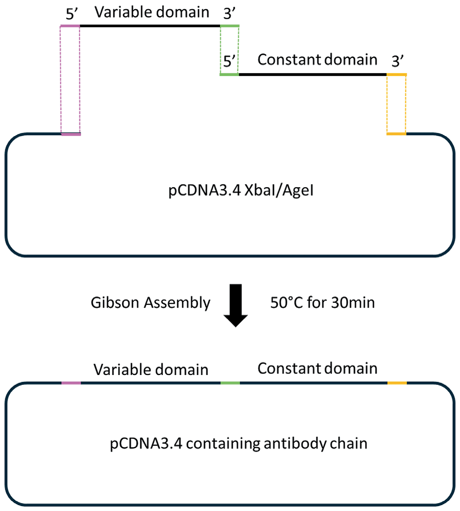

그림 1 깁슨 어셈블리를 통한 IgG 클로닝 전략. 가변 및 불변 IgG 도메인은 5' 및 3' 말단에 플랭킹 영역을 포함하여 합성된다. 두 인서트와 사전 절단된 XbaI/AgeI 발현 벡터 사이의 완전한 혼성화와 사전 결합을 가능하게 하기 위해 일치하는 영역 서열이 동일해야 한다

genome 통합을 통해 CHO 안정 세포주를 준비하기 위해 Yeo 등 [4]이 이전에 보고한 바 있다.

클로닝 후, 위에서 클로닝된 플라스미드(들)를 사용하여 포유류 CHO 세포에서의 일시적 형질주입과 이후 단백질 A 레진을 이용한 IgG 정제를 설명한다. Fab 및 scFv의 정제에 대해서는 각각 CH1 친화성 레진 또는 코발트 친화성 레진을 사용하는 유사한 프로토콜이 제시된다.

마지막으로, 본 장에서는 재조합 생산된 항체의 순도와 품질을 평가하기 위한 두 가지 필수적인 품질 관리 방법인 SDS-PAGE와 크기 배제 크로마토그래피(SEC)를 자세히 설명한다.

### 2	 재료

1.	 pcDNA3.4 벡터(참고(Note) 1 및 2 참조).

#### 2.1	 발현용

XbaI 및 AgeI 절단

pcDNA3.4 벡터의 준비

2.	 초순수(Ultrapure water).

3.	 제한효소: XbaI 및 AgeI, 최적화된 절단 완충액 포함.

4.	 1 kb plus DNA 래더.

5.	 DNA 염색 용액을 포함하는 1% 아가로스 겔(참고(Note) 3 참조).

6.	 5× TBE 완충액: Tris base 54 g, 붕산(boric acid) 27.5 g, 0.5 M EDTA pH 8.0 20 mL를 초순수에 녹여 최종 부피 1 L로 제조.

7.	 겔 전기영동 시스템.

8.	 자외선(UV) 겔 이미징 시스템.

9.	 메스(Scalpel).

10.	 마이크로원심분리기.

11.	 컬럼 기반 겔 DNA 정제 키트.

12.	 UV/가시광선(UV/vis) 분광광도계.

1.	 DNA 합성 또는 PCR을 통해 얻은 DNA 단편.

#### 2.2	 인서트 설계,

발현 벡터로의 클로닝,

플라스미드 생산

2.	 XbaI 및 AgeI으로 절단된 pcDNA3.4 발현 벡터.

3.	 깁슨 어셈블리 클로닝 키트.

4.	 PCR 튜브 또는 마이크로튜브.

5.	 서멀 사이클러(또는 히팅 블록).

6.	 컴피턴트 E. coli DH5α 세포.

7.	 유리, 금속 또는 일회용 세균 스프레더.

8.	 진탕배양기.

9.	 Luria-Bertani(LB) E. coli 배지: 탈이온수 1 L에 효모 추출물 5 g, 카제인 펩톤 10 g, NaCl 10 g을 녹인 후 유리병에 담아 고압증기멸균.

10.	 암피실린 100 mg/mL: 탈이온수 10 mL에 암피실린 1 g을 녹임. 0.2 µm 필터로 여과 멸균하고 분주액으로 나누어 −20 °C에 보관.

11.	 암피실린이 첨가된 LB 한천 평판: 탈이온수 1 L에 LB 한천 분말 40 g을 현탁. 고압증기멸균 후 약 50 °C로 식힌 뒤 100 mg/mL 암피실린 1 mL를 첨가(최종 농도 100 µg/mL)(참고(Note) 4 참조).

12.	 100 µg/mL 암피실린이 첨가된 LB 액체 배지.

13.	 컬럼 기반 플라스미드 정제 키트.

14.	 초순수(예: Milli-Q).

15.	 마이크로원심분리기.

16.	 원심분리기.

17.	 UV/vis 분광광도계.

1.	 ExpiCHO-S 세포(ThermoFisher Scientific).

#### 2.3	 ExpiCHO-S 세포의

일시적 형질주입

2.	 ExpiCHO 발현 배지: CHO 세포용 무혈청 배지로 고역가 발현 가능(ThermoFisher Scientific).

3.	 세포 계수기.

4.	 세포 계수기용 슬라이드.

5.	 트리판 블루 용액.

6.	 CO2 공급 및 온도 제어가 가능한 가습 세포 배양기(5%–8% CO2, 32–37 °C).

7.	 속도 조절이 가능한 오비탈 진탕기.

8.	 OptiPRO SFM(ThermoFisher Scientific).

9.	 ExpiFectamine CHO 형질주입 키트(ThermoFisher Scientific).

10.	 삼각플라스크: 최종 세포 배양 부피보다 5배 큰 크기(예: 25 mL 형질주입의 경우 125 mL).

11.	 대용량 0.2 µm 필터.

1.	 Protein A Sepharose(참고(Note) 5 참조).

#### 2.4	 IgG, Fab 및

scFv 정제

2.	 CH1 친화성 레진(IgG 및 Fab용).

3.	 코발트 친화성 레진(His-tag 단백질, Fab 및 scFv용).

4.	 플라스틱 일회용 중력 흐름 크로마토그래피 컬럼(10–25 mL).

5.	 보정된 pH 미터.

6.	 평형 완충액: 1× PBS pH 7.4.

7.	 세척 완충액: 1× PBS pH 7.4, 200 mM NaCl.

8.	 단백질 A 용출 완충액: 100 mM 글라이신-HCl, 100 mM NaCl, pH 2.8–3.2. 1 L 용액 조제법: 초순수 800 mL에 글라이신 7.5 g과 NaCl 5.84 g을 녹인다. 보정된 pH 미터를 사용하여 5 M HCl로 pH를 2.8–3.2로 조심스럽게 맞춘 뒤 초순수로 최종 부피를 1 L로 맞춘다.

9.	 중화 완충액: 1 M Tris-HCl, pH 7.6. 200 mL 용액 조제법: 초순수 150 mL에 Tris base 24.2 g을 녹인다. 보정된 pH 미터를 사용하여 5 M HCl로 pH를 7.6으로 조심스럽게 맞춘 뒤 초순수로 최종 부피를 200 mL로 맞춘다.

10.	 단백질 A 재생 완충액: 50 mM NaOH, 1 M NaCl.

11.	 CH1 용출 완충액: 50 mM 아세트산나트륨, pH 4.0.

12.	 CH1 재생 완충액: 0.1 M 시트르산, pH 3.0.

13.	 코발트 평형 완충액: 1× PBS, 300 mM NaCl, pH 8.0.

14.	 코발트 세척 완충액: 1× PBS, 300 mM NaCl, 5 mM 이미다졸, pH 8.0(참고(Note) 6 참조).

15.	 코발트 용출 완충액: 1× PBS, 300 mM NaCl, 250 mM 이미다졸, pH 8.0.

16.	 코발트 재생 완충액: 20 mM MES 일수화물[2-(N-모르폴리노)에탄설폰산 나트륨염], 300 mM NaCl, pH 5.0.

17.	 보관 완충액: 20% 에탄올(EtOH).

1.	 UV/vis 분광광도계.

#### 2.5	 단백질 정량 및

투석에 의한 완충액 교환

2.	 투석 튜브 또는 카세트: 분획분자량(cut-off) 10 및 50 kDa.

1.	 전압 조절식 전원 공급 장치를 갖춘 SDS-PAGE 전기영동 시스템.


#### 2.6	 비환원 및 환원 조건 하

SDS-PAGE를 통한 단백질

순도 평가

2.	 SDS-PAGE 농도구배 겔 4%–12%.

3.	 10× SDS-PAGE 전기영동 완충액: 탈이온수 1 L에 Tris base 30.3 g, 글라이신 144.4 g, SDS 10 g을 녹인다. 희석 후 최대 5회까지 재사용 가능.

4.	 디싸이오스레secondary(DTT) 100 mM: 초순수 10 mL에 디싸이오스레secondary 154.25 mg을 용해. 0.5 mL 분주액으로 나누어 −20 °C에 보관(참고(Note) 7 참조).

5.	 4× SDS-PAGE 로딩 완충액: 250 mM Tris–HCl(pH 6.8), 8% (w/v) 도데실황산나트륨(SDS), 0.2% (w/v) 브로모페놀 블루, 40% (v/v) 글리세롤.

6.	 95 °C 히팅 블록.

7.	 쿠마시 블루 염색 용액: 쿠마시 브릴리언트 블루 1 g, 50% 메탄올(v/v), 10% 빙초산(v/v), 탈이온수 40%(참고(Note) 8 참조).

8.	 탈염색 용액: 40% 메탄올(v/v), 10% 아세트산(v/v), 탈이온수 50%.

1.	 FPLC 시스템.

#### 2.7	 크기 배제 크로마토그래피를

통한 단백질 순도 및

품질 평가

2.	 약 800 kDa에서 5 kDa 사이의 단백질 분리 범위를 제공하는 크기 배제 크로마토그래피(SEC) 컬럼(예: Superdex 200 Increase 10/300 GL 크로마토그래피 컬럼).

3.	 주입 루프(예: 100 및 500 µL).

4.	 완충액 여과 및 탈기를 위한 진공 펌프.

5.	 대용량 0.2 µm 필터.

6.	 크로마토그래피 완충액: 여과 및 탈기된 1× PBS 완충액 pH 6–8(참고(Note) 9 참조).

7.	 소형 일회용 0.2 µm 필터.

8.	 1 mL 눈금 주사기.

### 3	 방법

아래 절차는 깁슨 어셈블리 시스템(참고(Note) 10 참조)을 사용하여 두 개의 플라스미드(각 사슬당 하나) 또는 단일 비시스트론 플라스미드(경쇄와 중쇄가 모두 서브클로닝됨) 형태로 항체의 경쇄와 중쇄를 포유류 발현 벡터에 클로닝하는 과정을 설명한다. 이어서 CHO 세포 형질주입, 단백질 정제 및 특성 규명이 진행된다.

#### 3.1	 발현용 pcDNA3.4 벡터의

XbaI 및 AgeI

절단 준비

1.	 pcDNA3.4 벡터를 약 10 µg의 XbaI 및 AgeI 제한효소로 최종 부피 100 µL에서 다음과 같이 절단한다:

성분(Component)
부피(Volume)

멸균 H2O
79 μl

10X 절단 완충액
10 μl

AgeI (20,000 units/mL)
0.5 μl

XbaI (20,000 units/mL)
0.5 μl

DNA (1 mg/mL)
10 μl (10 μg)

총량(Total)
100 μl

2.	 부드럽게 섞고 37 °C에서 2 h 동안 인큐베이션한다.

3.	 절단된 플라스미드 20 µL 분주액/웰과 DNA 래더를 1% 아가로스 겔에 로딩한다. 절단된 플라스미드를 나타내는 가장 큰 단편(약 6 kb)을 분리할 수 있을 만큼 충분한 분리가 이루어지도록 0.5x TBE 완충액에서 150–180 V로 겔을 전기영동한다. UV 광선 아래에서 겔을 분석하며, 절단이 완전하다면 절단된 플라스미드를 나타내는 1개의 밴드가 ~6 kb에서 보여야 한다.

4.	 보호 장구를 착용한 상태에서 UV 광선 아래에서 ~6 kb 밴드를 자른다.

5.	 자른 아가로스 밴드를 2 mL 튜브로 옮긴다. 제조사의 지침에 따라 컬럼 기반 겔 정제 키트를 사용하여 절단된 pcDNA3.4 벡터를 정제한다.

#### 3.2	 인서트 설계,

발현 벡터로의 클로닝,

플라스미드 생산

1.	 깁슨 어셈블리를 위한 플랭킹(flanking) 영역을 포함하는 원하는 합성 DNA 단편을 설계하고 주문한다(참고(Note) 11 참조). 포유류 발현의 경우 가변 사슬 또는 scFv의 5′ 말단에 코작(Kozak) 서열과 신호 펩타이드 코딩 서열을 포함하는 것이 중요하다(예: 마우스 IgG 가변 카파 사슬, IgGk). 가변 및 불변 도메인의 아미노산 서열은 표 1과 표 2에 기술되어 있다. 플랭킹 영역에 사용되는 DNA 서열은 표 3과 그림 2에 기술되어 있다(참고(Note) 12 및 13 참조).

2.	 IRES를 포함하는 플라스미드의 경우 다음 요소를 포함하는 완전한 단편을 주문한다(그림 3): (a) CMV 프로모터, (b) 종결 코돈으로 끝나는 경쇄 유전자에 융합된 신호 펩타이드, (c) Type II IRES 서열(표 4) [5], (d) 종결 코don으로 끝나는 중쇄 유전자에 융합된 신호 펩타이드, 그리고 (e) 단백질 발현을 향상시키기 위해 SV40 poly A가 뒤따르는 WPRE로 구성된 두 개의 조절 요소. 생성된 유전자 인서트는 약 2200 bp 크기이다(참고(Note) 14 및 15 참조).

3.	 그림 2에 나타난 바와 같이 절단된 pcDNA3.4 발현 벡터에 단편들을 클로닝한다.

4.	 제조사의 권장 사항에 따라 필요한 인서트의 양을 계산한다(참고(Note) 16 참조). 이를 위해 일반적으로 2:1 비율(인서트:벡터)이 사용된다. 인서트를 희석하고 그에 따라 PCR 튜브에 반응 혼합물을 준비한다. 중쇄(HC) 및 경쇄(LC) 클로닝을 위한 반응 예시를 아래에 제시한다. Fab, scFv 및 IRES 구조체의 경우에도 동일한 원리를 따른다.

성분(Component)
양(Quantity)

깁슨 어셈블리 마스터 믹스 (2×)
5 µl

절단된 벡터 6 kb
50 ng

가변 단편 500 bp
8.5 ng

불변 단편 1 kb (CH) / 500 bp (CL)
17 ng (CH) / 8.5 ng (CL)

총량(Total)
10 µL

5.	 서멀 사이클러(또는 히팅 블록)를 사용하여 50 °C에서 30 min 동안 인큐베이션한다. 세균 형질전환 전까지 반응물을 4 °C에 보관한다.

6.	 제조사 지침에 따라 컴피턴트 E. coli DH5α 세포를 형질전환한다(참고(Note) 17 참조).

7.	 암피실린이 첨가된 LB 한천 평판 배지에 형질전환된 세포를 도말한다. 결과 플레이트를 37 °C에서 밤새 인큐베이션한다.

표 1
항-HER2 항체(트라스투주맙)의 신호 펩타이드 및 가변 도메인 아미노산 서열

종(Species)
이름(Name)
가변 도메인 아미노산 서열(Variable domain amino acid sequence)

METDTLLLWVLLLWVPGSTG

마우스(Mouse)
신호 펩타이드(Signal peptide)

(인간 Ig 카파 사슬 V-III 영역 MOPC 63)
VL
DIQMTQSPSSLSASVGDRVTITCRASQDVNTAVAWYQQKPGKAPKLLIYSASFLYSGVPSRFSGSRSGTDFTLTISSLQPEDFATYYCQQHYTTPPTFGQGTKVEIK

인간(Human)

VH
EVQLVESGGGLVQPGGSLRLSCAASGFNIKDTYIHWVRQAPGKGLEWVARIYPTNGYTRYADSVKGRFTISADTSKNTAYLQMNSLRAEDTAVYYCSRWGGDGFYAMDYWGQGTLVTVSS

표 2
불변 도메인의 아미노산 서열

종(Species)
이름(Name)
불변 도메인 아미노산 서열(Constant domain amino acid sequence)

CL kappa
RTVAAPSVFIFPPSDEQLKSGTASVVCLLNNFYPREAKVQWKVDNALQSGNSQESVTEQDSKDSTYSLSSTLTLSKADYEKHKVYACEVTHQGLSSPVTKSFNRGEC

인간(Human)
CH IgG1
ASTKGPSVFPLAPSSKSTSGGTAALGCLVKDYFPEPVTVSWNSGALTSGVHTFPAVLQSSGLYSLSSVVTVPSSSLGTQTYICNVNHKPSNTKVDKKVEPKSCDKTHTCPPCPAPELLGGPSVFLFPPKPKDTLMISRTPEVTCVVVDVSHEDPEVKFNWYVDGVEVHNAKTKPREEQYNSTYRVVSVLTVLHQDWLNGKEYKCKVSNKALPAPIEKTISKAKGQPREPQVYTLPPSRDELTKNQVSLTCLVKGFYPSDIAVEWESNGQPENNYKTTPPVLDSDGSFFLYSKLTVDKSRWQQGNVFSCSVMHEALHNHYTQKSLSLSPGK

인간(Human)
CH1 IgG1 Fab
ASTKGPSVFPLAPSSKSTSGGTAALGCLVKDYFPEPVTVSWNSGALTSGVHTFPAVLQSSGLYSLSSVVTVPSSSLGTQTYICNVNHKPSNTKVDKKVEPKSC

인간(Human)
C-말단 His-Tag
GSHHHHHH

8.	 다음 날, 표 5에 기술된 정방향 및 역방향 프라이머 등을 사용하여 클론을 생거 시퀀싱(Sanger sequencing)에 보낸다(참고(Note) 18 및 19 참조).

9.	 다음 절차를 사용하여 DNA 플라스미드를 준비한다. 밤새 배양한 배양액 100 µL를 피펫으로 취해 250 mL 삼각플라스크의 LB 암피실린 배지 50 mL에 접종한다. 37 °C, 240 rpm에서 밤새 배양한다(참고(Note) 20 참조).

10.	 다음 날, 세포 배양액을 50 mL 튜브로 옮기고 4 °C에서 3200 rcf로 20 min 동안 원심분리한다. 상층액을 버리고 컬럼 기반 플라스미드 미디프렙 정제 키트 공급업체의 권장 사항에 따라 플라스미드를 정제한다(참고(Note) 21 참조).

11.	 생거 시퀀싱을 통해 올바른 플라스미드 서열을 확인한다.

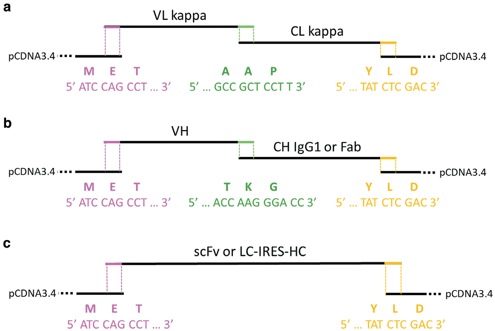

그림 2 5′ 및 3′ 말단에 플랭킹 영역이 포함된 인서트 설계 세부 사항. pcDNA3.4 벡터에 (a) 경쇄, (b) 중쇄 또는 Fab 사슬, (c) scFv 서열 또는 LC-IRES-HC 카세트가 포함된 구조. 색상 선은 각각의 인서트에 추가될 플랭킹 영역에 해당한다. 플랭킹 영역은 표 3에 상세히 기술되어 있다

표 3
pcDNA3.4용 플랭킹 영역의 DNA 서열

종(Species)
인서트(Insert)
신호 펩타이드를 포함하는 5′ 플랭킹 영역(5′ flanking region with signal peptide)
3′ 플랭킹 영역(3’ flanking region)

인간(Human)
VL kappa
CTAGAGGATCGAACCCTTGCCACCATGGAAACCGACACACTGCTGCTGTGGGTGCTGCTCTTGTGGGTGCCAGGATCTACAGGA
CGGACAGTGGCCGCTCCTTATCCAGCCTCCGGACT

인간(Human)
VH IgG1
CTAGAGGATCGAACCCTTGCCACCATGGAAACCGACACACTGCTGCTGTGGGTGCTGCTCTTGTGGGTGCCAGGATCTACAGGA
GCTTCTACCAAGGGACC

인간(Human)
scFv
CTAGAGGATCGAACCCTTGCCACCATGGAAACCGACACACTGCTGCTGTGGGTGCTGCTCTTGTGGGTGCCAGGATCTACAGGA
TGAAAGGGTTCGATCCCTACCGGTTAGTAATGAGTTTGATATCTCGAC

인간(Human)
CL kappa
/
TGAAAGGGTTCGATCCCTACCGGTTAGTAATGAGTTTGATATCTCGAC

인간(Human)
CH IgG1
/
TGAAAGGGTTCGATCCCTACCGGTTAGTAATGAGTTTGATATCTCGAC

인간(Human)
CH Fab
/
TGAAAGGGTTCGATCCCTACCGGTTAGTAATGAGTTTGATATCTCGAC

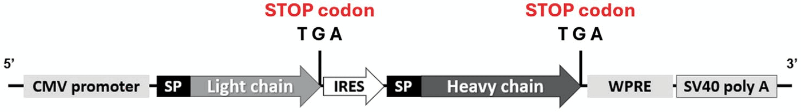

그림 3 IRES 카세트 설계는 다음 순서를 따른다: CMV 프로모터, 경쇄 유전자에 융합된 신호 펩타이드, 내부 리보솜 진입 부위(IRES) 서열, 중쇄 유전자에 융합된 신호 펩타이드, 그리고 SV40 poly A가 뒤따르는 WPRE로 구성된 두 개의 조절 요소를 포함하는 DNA 카세트

표 4
Type II ECMV IRES의 DNA 서열

종(Species)
인서트(Insert)
DNA 서열(DNA sequence)

뇌심근염 바이러스(ECMV)
Type II ECMV IRES
GCCCCTCTCCCTCCCCCCCCCCTAACGTTACTGGCCGAAGCCGCTTGGAATAAGGCCGGTGTGCGTTTGTCTATATGTTATTTTCCACCATATTGCCGTCTTTTGGCAATGTGAGGGCCCGGAAACCTGGCCCTGTCTTCTTGACGAGCATTCCTAGGGGTCTTTCCCCTCTCGCCAAAGGAATGCAAGGTCTGTTGAATGTCGTGAAGGAAGCAGTTCCTCTGGAAGCTTCTTGAAGACAAACAACGTCTGTAGCGACCCTTTGCAGGCAGCGGAACCCCCCACCTGGCGACAGGTGCCTCTGCGGCCAAAAGCCACGTGTATAAGATACACCTGCAAAGGCGGCACAACCCCAGTGCCACGTTGTGAGTTGGATAGTTGTGGAAAGAGTCAAATGGCTCTCCTCAAGCGTATTCAACAAGGGGCTGAAGGATGCCCAGAAGGTACCCCATTGTATGGGATCTGATCTGGGGCCTCGGTGCACATGCTTTACATGTGTTTAGTCGAGGTTAAAAAAACGTCTAGGCCCCCCGAACCACGGGGACGTGGTTTTCCTTTGAAAAACACGATGATAATATGGCCACAACC

표 5
플라스미드 pcDNA3.4 상의 유전자 구조체 5′ 및 3′ 말단에 위치한 시퀀싱 프라이머 예시

유형(Type)
서열(Sequence)

정방향 프라이머(Forward primer)
CCTCCATAGAAGACACC

역방향 프라이머(Reverse primer)
AGCAGCGTATCCACATAGCG

#### 3.3	 ExpiCHO-S 세포의

일시적 형질주입

1.	 플라스크 내 무혈청 배지에서 항생제 없이 37 °C, 가습 환경, 120 rpm 오비탈 진탕 및 8% CO2 조건으로 ExpiCHO-S 세포를 배양한다. 3–4일마다 계대 배양한다(미리 덥힌 신선한 ExpiCHO 배지 30 mL 사용)(참고(Note) 22 및 23 참조).

2.	 제조사의 권장 사항에 따라 ExpiFectamine CHO 형질주입 키트(ThermoFisher Scientific)를 사용하여 배양액 mL당 1 µg의 플라스미드로 ExpiCHO-S 세포를 형질주입한다(참고(Note) 24 참조). 아래에 작성된 시약, 세포 및 배지 양은 25 mL 배양 형질주입을 기준으로 한 것이다. 필요에 따라 부피를 확장하거나 축소할 수 있다(참고(Note) 25 참조).

3.	 세포를 25 mL 배지에 6 × 10⁶ cells/mL 농도로 희석한다. 최적 조건에서 형질주입 당일 세포 역가는 7–10 × 10⁶ viable cells/mL에 도달해야 하며 생존율은 95%에서 99% 사이여야 한다.

4.	 먼저, 25 µg의 플라스미드 DNA를 1 mL의 차가운 OptiPRO 배지와 혼합한다(참고(Note) 26 및 27 참조). 둘째로, 다른 튜브에서 80 µL의 ExpiFectamine을 0.92 mL의 차가운 OptiPRO 배지와 혼합한다(참고(Note) 28 참조). 그런 다음 ExpiFectamine과 플라스미드를 포함하는 두 용액을 섞고 복합체를 실온에서 1–5 min 이하로 인큐베이션한다. 마지막으로 ExpiFectamine-플라스미드 복합체 혼합물을 세포에 한 방울씩 첨가하며 첨가 중 플라스크를 부드럽게 흔들어 준다. 플라스크를 배양기에 다시 넣고 형질주입된 세포를 37 °C, 가습 환경, 120 rpm 오비탈 진탕 및 8% CO2 조건에서 배양한다.

5.	 형질주입 후 18–22 h에 150 µL의 ExpiFectamine CHO Enhancer와 7.5 mL의 ExpiCHO Feed를 세포에 공급하고, 위와 동일한 조건에서 7–10일 동안 세포를 배양한다(참고(Note) 29–31 참조).

6.	 세포 배양액을 원심분리 튜브로 옮기고 실온에서 3200 rcf로 10 min 동안 원심분리하여 세포를 수확한다.

7.	 상층액을 수거하고 세포 침전물은 버린다.

8.	 세포 찌꺼기와 대형 단백질 응집체를 제거하기 위해 주사기 또는 진공 펌프를 사용하여 0.2 µm 필터로 상층액을 여과한다.

9.	 배양 부피에 따라 여과된 상층액을 새로운 튜브나 병에 수집한다(참고(Note) 32 참조).

수율과 정제를 최적화하기 위해 IgG, Fab 및 scFv 단백질 매개변수를 계산한다(참고(Note) 33 참조). 핵심 요소로는 (a) 몰농도 계산 및 분석(예: SDS-PAGE, SEC)을 위한 분자량, (b) 정량을 위한 OD 280 nm에서의 흡광계수, (c) 최적의 제형 완충액 및 용해도를 위한 등전점(pI)이 포함된다.

#### 3.4	 IgG, Fab 및

scFv 정제

3.4.1	 IgG 및 Fab 단편의 정제

1.	 여과된 세포 상층액을 사전 평형화된 단백질 A 또는 CH1 레진(참고(Note) 34 참조)과 혼합하여 각각 인간 IgG1 또는 Fab 단편을 포획한다. 결합 용량과 예상 역가에 맞춰 레진 부피를 조절하되, 50%의 여유 레진 부피를 추가한다. 진탕 플라스크에서 얻어지는 항체 역가는 일반적으로 20에서 300 mg/L 사이이다(참고(Note) 35 참조).

2.	 튜브를 부드럽게 회전시켜 레진이 현탁된 상태를 실온에서 30 min에서 최대 2 h 동안 유지하거나, 4 °C에서 더 오랜 시간 유지한다.

3.	 레진 현탁액 혼합물을 빈 크로마토그래피 컬럼으로 옮기고 통과액(pass-through)을 수집한다(참고(Note) 36 참조). 필요한 경우 상층액-레zin 현탁액 전체 부피를 옮기기 위해 이 단계를 반복한다. 패킹된 레zin의 부피가 1 컬럼 부피(CV)에 해당한다.

4.	 대부분의 레zin을 회수하기 위해 용기를 몇 mL의 세척 완충액으로 헹군다.

5.	 컬럼에 5 CV의 세척 완충액을 가한다(예: 2 mL 레zin의 경우 10 mL). 이 단계를 반복한다.

6.	 용출 부피의 1/5에 해당하는 부피의 중화 완충액이 담긴 수집 튜브 2개를 준비한다(참고(Note) 37 참조). 단백질 A 또는 CH1 용출 완충액 3 CV(예: 2 mL 레zin의 경우 6 mL)로 IgG 또는 Fab를 용출한다. 중화 완충액이 담긴 튜브에 용출액을 수집한다. 튜브를 닫고 조심스럽게 위아래로 몇 번 뒤집어 섞어 준다. 이 튜브를 분획 1(fraction 1)로 명명한다. 이 단계를 반복하여 분획 2를 수집한다(참고(Note) 38 참조).

7.	 제조사의 권장 사항에 따라 단백질 A 또는 CH1 재생 완충액을 사용하여 레zin을 재생한다.

3.4.2	 scFv의 정제

1.	 레zin 결합 용량을 높이기 위해 세포 상층액을 시료 부피보다 100배 큰 부피의 1× PBS 완충액에서 최소 3회 투석할 것을 권장한다(참고(Note) 39 참조). 투석은 4 °C에서 수행하며, 매회 최소 5–6 h 동안 진행한다.

2.	 투석된 세포 상층액을 필요한 사전 평형화된 레zin과 혼합한다(참고(Note) 34 참조). 결합 용량과 예상 역가에 맞춰 레zin 부피를 조절하되, 50%의 여유 레zin 부피를 추가한다(참고(Note) 35 참조). 진탕 플라스크에서 얻어지는 scFv 역가는 일반적으로 1에서 100 mg/L 사이이다.

3.	 튜브(또는 병)를 부드럽게 회전시켜 실온에서 최대 20–30 min 동안 레zin이 현탁된 상태를 유지한다.

4.	 레zin 현탁액 혼합물을 빈 크로마토그래피 컬럼으로 옮기고 통과액을 수집한다(참고(Note) 36 참조). 필요한 경우 상층액-레zin 현탁액 전체 부피를 옮기기 위해 이 단계를 반복한다. 패킹된 레zin의 부피가 1 컬럼 부피(CV)에 해당한다.

5.	 대부분의 레zin을 회수하기 위해 용기를 몇 mL의 코발트 세척 완충액으로 헹군다.

6.	 컬럼에 5 CV의 코발트 세척 완충액을 가한다(예: 2 mL 레zin의 경우 10 mL). 이 단계를 반복한다.

7.	 2 CV의 코발트 용출 완충액 부피(예: 2 mL 레zin의 경우 6 mL)로 scFv를 용출하고 첫 번째 튜브에 용출액을 수집한다. 이 튜브를 분획 1로 명명한다. 이 단계를 반복하여 분획 2를 수집한다(참고(Note) 38 참조).

8.	 제조사의 권장 사항에 따라 코발트 재생 완충액을 사용하여 레zin을 재생한다.

#### 3.5	 단백질 정량 및

투석에 의한 완충액 교환

1.	 UV 분광광도계와 계산된 흡광계수를 사용하여 정제된 IgG 및 Fab를 OD 280 nm에서 정량한다(참고(Note) 40 참조).

2.	 정량된 단백질을 scFv 및 Fab 단편의 경우 <10 kDa, IgG의 경우 <50 kDa 분획분자량의 투석 막을 사용하여 선택된 완충액(참고(Note) 41 참조)에서 투석한다. 마그네틱 바로 부드럽게 교반하며 4 °C에서 밤새 완충액 교환을 수행한다(참고(Note) 42 참조).

3.	 본 절의 1단계에서 설명한 대로 UV 분광광도계를 사용하여 OD 280 nm에서 IgG, Fab 및 scFv의 단백질 농도를 다시 정량한다.

#### 3.6	 비환원 및 환원 조건 하

SDS-PAGE를 통한 단백질

순도 평가

분자의 무결성, 올바른 조립 및 이황화 결합 형성을 평가하기 위해서는 환원 및 비환원 조건 모두에서 SDS-PAGE를 수행하는 것이 결정적으로 중요하다. 비환원 조건에서 IgG, Fab 및 scFv는 각각 ~150, ~50 및 ~25–30 kDa 위치에서 단량체로 나타난다. 환원 조건에서 IgG는 ~25 kDa의 경쇄와 ~50 kDa의 중쇄로 분리되며, Fab 경쇄와 중쇄는 모두 ~25 kDa 위치에, scFv는 ~25–30 kDa 위치에 나타난다(참고(Note) 43 참조).

1.	 비환원 및 환원 조건에서 각 시료를 다음과 같이 준비한다:

비환원(Non-reducing)
환원(Reducing)

시료 (1–2 µg)
X µl
X µl

SDS-PAGE 로딩 완충액
5 µl
5 µl

DTT 100 mM
0 µl
1 µl

탈이온수 H2O
15–X µl
14–X µl

총 부피(Total Volume)
20 µl
20 µl

2.	 시료를 95 °C에서 5 min 동안 가열한 후 실온에서 1–2 min 동안 식힌다.

3.	 겔을 분리 시스템에 장착하고 탱크를 적절한 1x SDS-PAGE 전기영동 완충액으로 채운다. 겔에 20 µL 시료를 로딩하고 120–130 V로 분리를 진행한다. 분리가 거의 끝나갈 때 로딩 염료가 완전한 분리를 위해 겔 바닥에 도달하도록 한다.

4.	 겔을 용기에 조심스럽게 옮기고 쿠마시 블루 염색 용액에서 최소 30 min에서 1 h 동안 염색한다. 쿠마시 블루 염색 용액을 제거하고 탈이온수로 겔을 가볍게 헹군다.

5.	 사용한 염색 용액에 따라 최소 2–5 h 동안 겔을 탈염색한다. 필요에 따라 탈염색 용액을 교체한다.

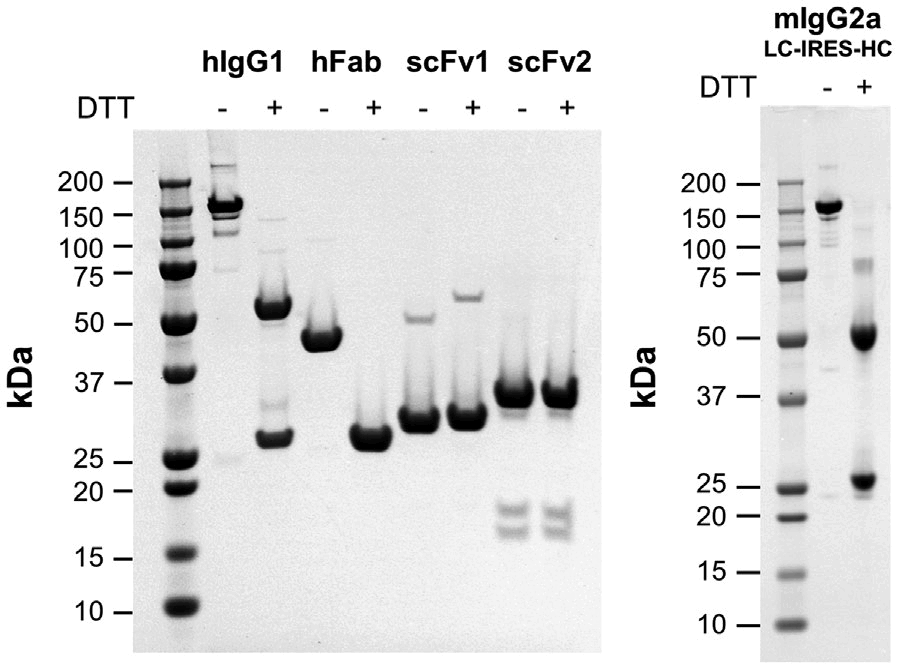

그림 4 SDS-PAGE 4%–12%, 쿠마시 블루 염색을 통한 정제된 IgG, Fab 및 scFv의 대표적인 분석. 1 mM 디싸이오스레secondary(DTT)가 포함된 환원 및 비환원 조건, 2 µg 단백질 로딩. 좌측 패널: 인간 IgG1(hIgG1) 및 인간 Fab(hFab)에 대해 두 개의 플라스미드를 사용한 표준 클로닝, scFv의 경우 단일 플라스미드. 우측 패널: IRES 구조체인 단일 플라스미드로 생산된 마우스 IgG2a(mIgG2a)

6.	 겔 이미징 시스템이나 디지털 카메라를 사용하여 추가 분석을 위해 쿠마시 블루 염색된 겔 사진을 촬영한다(그림 4)(참고(Note) 44 참조).

#### 3.7	 크기 배제 크로마토그래피를

통한 단백질 순도 및

품질 평가

IgG, Fab 및 scFv의 폴딩과 응집을 모니터링하는 것은 매우 중요하다. SEC는 단량체보다 더 빨리 용출되는 응집체와 더 큰 기능성 올리고머(이합체, 삼합체 등)를 검출한다. 또한 단백질분해 산물과 같이 더 낮은 분자량의 단편도 식별한다(참고(Note) 45 참조).

1.	 분리를 시작하기 전에 관심 단백질의 등전점(pI)에 따라 최소 150 mM NaCl 및 ± 0.5–1 pH 단위가 보정된 크로마토그래피 완충액을 사용하는 것이 중요하다(참고(Note) 41 참조).

2.	 선택된 완충액을 대용량 0.2 µm 멤브레인 필터로 여과하고 탈기한다(참고(Note) 10 참조).

3.	 잠재적으로 큰 단백질 응집체나 기타 찌꺼기로 인해 컬럼이 막히는 것을 방지하기 위해 테스트할 시료를 4 °C에서 20,000 × g로 2–3 min 동안 원심분리한다(참고(Note) 46 참조).

4.	 0.5–0.75 mL/min의 유속과 단백질 용출을 모니터링하기 위한 UV 280 nm 검출기를 사용하여 크로마토그래피 컬럼에서 분석법을 실행한다(참고(Note) 47 참조).

5.	 pH가 조정된 PBS 2 CV로 컬럼을 평형화한다.

6.	 시료 농도에 따라 100 µL 루프를 사용하여 시료를 로딩한다(참고(Note) 48 참조).

7.	 아래에 기술된 분리 프로그램을 사용한다:

단계 1: 신호 안정화: 1–2 mL.
단계 2: 시료 주입: 100 µL 루프 기준 0.2 mL.

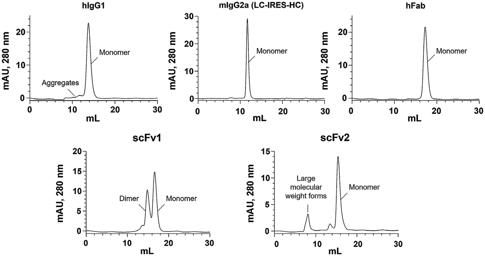

그림 5 IgG, Fab 및 scFv의 대표적인 분리 크로마토그램. Superdex 200 Increase 10/300 GL 컬럼에 ~0.5–1 mg/ml 단백질 100 µL 주입. PBS pH 7.4 완충액, 4 °C, 0.7 mL/min

단계 3: 용출: 1.5 CV.
단계 4: 컬럼 세척/평형화: 1 CV.

8.	 분리된 결과 크로마토그램을 면적에 따라 피크별로 적분한다(그림 5). 그런 다음 각 피크의 면적을 분리된 총 단백질의 백분율로 보고한다. 즉, 적분된 모든 피크의 합은 100%와 같다. 정제된 IgG 또는 Fab의 경우 최적의 항체라면 최소 95%의 단량체 함량을 가져야 한다. 더 높은 분자량 형태는 응집체로 간주되며, 더 낮은 분자량 형태는 조립되지 않은 경쇄(LC) 및 중쇄(HC) 또는 분해 산물이 풍부한 것으로 간주되는데, 둘 다 항체 안정성의 결여를 나타낼 수 있다. 대조적으로, scFv는 그 안정성에 따라 더 큰 올리고머 형태를 가질 수 있다. 이러한 모든 관찰은 정제된 항체를 사용한 향후 분석 결과를 예측하거나 해석하는 데 기여한다(참고(Note) 49–52 참조).

9.	 마지막으로, 원하는 단량체와 올리고머를 분리하고 응집체나 분해 산물을 제거하기 위해 분획을 수집하는 분취용(preparative) SEC를 사용하여 단백질을 농축할 수 있다.

### 4  참고(Notes)

1.	 pcDNA3.4는 세균에서 증폭될 수 있는 포유류 발현 플라스미드로, 암피실린 내성 유전자, CMV 프로모터, 우드척 간염 바이러스 전사후 조절 인자(WPRE)를 포함한다.

2.	 포유류 발현에 적합한 벡터라면 어느 것이든 사용할 수 있다. 제한효소는 선택한 벡터에 맞게 조정해야 한다.

3.	 초순수 아가로스는 전자레인지로 가열하여 1× TBE 완충액에 녹일 수 있다. DNA 염색 용액은 용액이 식은 후에 첨가한다.

4.	 너무 높은 온도에서 암피실린을 첨가하면 항생제가 분해되어 플라스미드 선별에 영향을 미칠 수 있다.

5.	 인간 IgG는 단백질 A 또는 G 레진을 사용하여 포획하지만, IgG3는 예외적으로 단백질 G 레진으로만 포획 및 정제된다. 마우스 IgG는 단백질 A 또는 G 레진으로 포획되나, IgG1은 단백질 G 레진을 사용할 때 더 효율적으로 포획된다.

6.	 5 mM 농도의 이미다졸은 레진에 비특이적으로 결합한 단백질을 제거하는 데 도움이 된다.

7.	 디싸이오스레이톨(dithiothreitol, DTT)은 다이싸이올(dithiol) 화합물로서 이황화 결합을 유리 시스테인으로 완전히 치환할 수 있기 때문에 모노싸이올인 β-머캅토에탄올보다 선호된다. 또한 DTT는 이황화 결합을 환원시키는 산화환원 전위가 −330 mV로, β-머캅토에탄올(−260 mV)에 비해 더 낮다. 그러나 DTT 수용액은 실온과 4 °C에서 안정하지 않으므로 냉동하여 −20 °C에 보관한다.

8.	 폴리아크릴아마이드 겔에 포함된 SDS는 염색 중에 저분자 단백질을 가용화시켜 씻겨 나가게 만들 수 있으며, 이로 인해 검출되지 않을 수 있다. 이러한 경우 쿠마시 블루 염색 전에 단백질을 겔 내에 침전시키기 위해 먼저 10% 빙초산에 실온에서 1 h 동안 겔을 인큐베이션하는 것이 권장된다.

9.	 완충액의 완전한 탈기는 여과된 액체를 진공 상태에서 10 min 동안 유지하거나 초음파 수조로 옮겨 실온에서 5 min 동안 초음파 처리함으로써 달성할 수 있다.

10.	 다른 클로닝 전략을 사용할 수도 있다. 클로닝 중 깁슨 어셈블리와 빌딩 블록을 사용하는 주된 장점은 IgG를 다양한 형식(예: Fab)이나 다양한 이소형(예: 마우스 IgG2a에서 인간 IgG1으로)으로 쉽고 빠르게 재형식화할 수 있다는 점이다.

11.	 플라스미드 형태의 DNA 주형이 이미 확보되어 있다면 가변 또는 불변 도메인의 DNA 단편을 PCR로 증폭할 수도 있다.

12.	 CH1 기반 레진을 사용하는 대신 코발트 기반 레진으로 정제하기 위해 Fab HC의 C-말단에 His-tag을 추가할 수 있다.

13.	 표 6은 인간 람다 경쇄, 인간 IgG4 중쇄, 그리고 마우스 IgG2a 경쇄 및 중쇄 불변 도메인의 추가 단백질 서열을 보여 준다.

표 6
불변 도메인의 추가 아미노산 서열

종
이름
불변 도메인 아미노산 서열

인간
CL lambda
GQPKANPTVTLFPPSSEELQANKATLVCLISDFYPGAVTVAWKADGSPVKAGVETTKPSKQSNNKYAASSYLSLTPEQWKSHRSYSCQVTHEGSTVEKTVAPTECS

인간
CH IgG4S228P
ASTKGPSVFPLAPCSRSTSESTAALGCLVKDYFPEPVTVSWNSGALTSGVHTFPAVLQSSGLYSLSSVVTVPSSSLGTKTYTCNVDHKPSNTKVDKRVESKYGPPCPPCPAPEFLGGPSVFLFPPKPKDTLMISRTPEVTCVVVDVSQEDPEVQFNWYVDGVEVHNAKTKPREEQFNSTYRVVSVLTVLHQDWLNGKEYKCKVSNKGLPSSIEKTISKAKGQPREPQVYTLPPSQEEMTKNQVSLTCLVKGFYPSDIAVEWESNGQPENNYKTTPPVLDSDGSFFLYSRLTVDKSRWQEGNVFSCSVMHEALHNHYTQKSLSLSLGK

마우스
CL lambda
QPKSSPSVTLFPPSSEELETNKATLVCTITDFYPGVVTVDWKVDGTPVTQGMETTQPSKQSNNKYMASSYLTLTARAWERHSSYSCQVTHEGHTVEKSLSRADCS

마우스
CK kappa
RADAAPTVSIFPPSSEQLTSGGASVVCFLNNFYPKDINVKWKIDGSERQNGVLNSWTDQDSKDSTYSMSSTLTLTKDEYERHNSYTCEATHKTSTSPIVKSFNRNEC

마우스
CH IgG2a
AKTTAPSVYPLAPVCGDTTGSSVTLGCLVKGYFPEPVTLTWNSGSLSSGVHTFPAVLQSDLYTLSSSVTVTSSTWPSQSITCNVAHPASSTKVDKKIEPRGPTIKPCPPCKCPAPNLLGGPSVFIFPPKIKDVLMISLSPIVTCVVVDVSEDDPDVQISWFVNNVEVHTAQTQTHREDYNSTLRVVSALPIQHQDWMSGKEFKCKVNNKDLPAPIERTISKPKGSVRAPQVYVLPPPEEEMTKKQVTLTCMVTDFMPEDIYVEWTNNGKTELNYKNTEPVLDSDGSYFMYSKLRVEKKNWVERNSYSCSVVHEGLHNHHTTKSFSRTPGK

14.	 다른 IRES 유형은 이들 세포에서 침묵(silent)될 수 있으므로, CHO 및 HEK와 같은 광범위한 포유류 세포에서 발현을 보장하려면 Type II IRES(ECMV IRES, 588 bp)를 선택하는 것이 중요하다 [6, 7]. IRES 3′ 말단이 2개의 ATG를 코딩하고 있더라도, 리보솜이 여기에 접근하지 않고 중쇄의 신호 펩타이드 ATG에서 번역이 개시되므로 이 서열들을 수정하지 않고 그대로 두어야 한다. 또한 신호 펩타이드는 소포체로 들어갈 때 절단되므로 잔여 펩타이드가 남을 가능성이 제거된다. 결정적으로, mRNA 산물의 2차 및 3차 구조에서 핵산이 수행하는 본질적인 역할 [8], 즉 IRES 3′ 말단에서의 리보솜 인식 및 개시 인자 eIF4G, eIF3, eIF4A, eIF4B와 같은 다양한 전사 인자의 결합으로 인해 IRES 서열의 코돈 최적화는 반드시 피해야 한다 [9, 10]. 주목할 점은, IRES 뒤에 오는 두 번째 유전자(여기서는 중쇄)의 번역 속도가 첫 번째 유전자보다 낮다는 것이다 [9, 10]. 기술된 구조체의 유전자 배열 순서는 항체의 분비와 역가를 높이고 응집 수준을 낮추기 위해 중쇄 유전자에 비해 경쇄 유전자의 몰 과량이 요구된다는 점에서 항체 발현에 매우 유리하다 [11, 12]. 놀랍게도 이 구조체 유형은 2-플라스미드 접근법과 유사한 IgG 역가를 제공하여, 본 IRES 기반 단일 플라스미드 형질주입의 가치를 입증한다.

15.	 IRES 구조체의 클로닝은 2차 구조의 존재로 인해 까다로울 수 있다. 따라서 직접 합성된 유전자를 주문하는 것이 권장된다.

16.	 인서트와 벡터의 길이에 따라 필요한 인서트 양을 계산하는 데 온라인 도구인 NEBioCalculator를 활용할 수 있다.

17.	 DH5α Mix&Go 컴피턴트 세포의 형질전환에는 42 °C 열충격(heat-shock)이 필요하지 않으나, 표준 DH5α 또는 다른 세포를 사용할 경우 열충격을 가한 후 배지에서 회복 과정을 거칠 수 있다.

18.	 시퀀싱 전에 콜로니 PCR로 클론을 검증하여 인서트가 예상 크기를 갖는지 확인할 수 있다. 플라스미드 시퀀싱은 2–3개의 분리된 집락을 직접 보내거나 개별 미니프렙을 수행하여 보낼 수 있다. 시퀀싱할 집락은 배지에 접종하거나 한천 평판에 도말하여 항상 보존해 두어야 한다.

19.	 시퀀싱할 영역이 1 kb 미만인 경우 정방향 프라이머만 사용한다. 1 kb보다 크면 전체 인서트를 시퀀싱하기 위해 두 프라이머를 모두 사용한다. 정방향 프라이머는 CMV 프로모터 서열 끝부분에 결합하고 역방향 프라이머는 WPRE 서열 시작 부분에 결합한다.

20.	 밤새 배양한 배양액을 4 °C에서 며칠간 보관해야 하는 경우, 수 마이크로리터를 LB 암피실린 한천 평판에 스트리킹하고 37 °C에서 밤새 인큐베이션한다. 다음 날 아침 단일 분리 집락을 따서 14 mL 튜브 내 2 mL LB 암피실린 배지에 접종하고 37 °C, 280 rpm 진탕 조건으로 배양한다. 저녁에 혼탁해진 전배양액 100 µL를 취해 250 mL 삼각플라스크 내 50 mL LB 암피실린 배지에 접종한다. 37 °C, 240 rpm에서 밤새 배양한다.

21.	 대수 증식기에 있는 50 mL 세균 배양액의 분주액을 취해 25% 글리세롤 조건으로 −80 °C에 보관하면 향후 플라스미드 생산 시 세균의 재형질전환이나 플라스미드 소실을 방지할 수 있다.

22.	 HEK293T 세포뿐만 아니라 다른 CHO 발현 시스템도 고려할 수 있다.

23.	 세포를 계수한 후 트리판 블루를 사용하여 생존율을 측정한다. 세포는 (a) 3–6 × 106 cells/mL 범위의 세포 밀도와 (b) 90% 이상의 생존율을 갖는 대수 증식기에 계대배양할 것을 권장한다.

24.	 리포펙타민(lipofectamine)과 같은 동등한 형질주입 시약을 사용할 수도 있다.

25.	 이 방법은 수 리터에 이르는 다양한 형질주입 부피뿐만 아니라 24-딥웰 플레이트에도 적용할 수 있다.

26.	 2중 플라스미드 형질주입의 경우 보통 25 mL 세포 배양액 기준으로 LC 플라스미드 12.5 µg과 HC 플라스미드 12.5 µg을 사용한다. 그러나 scFv 및 IRES 구조체의 경우 동일한 세포 배양 부피에 대해 단일 플라스미드 25 µg을 사용한다. 대안적으로, 올바른 항체 폴딩 및 분비를 유도하기 위해 LC 양을 HC보다 많게 설정하는 2:1 등 다른 LC:HC 플라스미드 비율을 테스트할 수도 있다.

27.	 시약을 얼음 위에 보관할 필요는 없다. 그러나 높은 형질주입 효율을 보장하기 위해 차가운 시약을 사용하여 ExpiFectamine과 플라스미드 복합체를 준비하는 것이 중요하다.

28.	 ExpiFectamine CHO 시약은 플라스미드를 첨가하기 직전에 차가운 OptiPRO 배지로 희석하고, 희석된 플라스미드 DNA에 첨가하기까지 5 min 이상 지체하지 않는 것이 좋다. 시간이 지체되면 단백질 역가가 감소할 수 있다.

29.	 세포는 리포펙타민 계열 시약에 의해 스트레스를 받으며, 배지에 피딩 배지를 보충하지 않으면 48 h 후부터 죽기 시작한다.

30.	 형질주입 후 첫 번째 피딩 이후 세 가지 프로토콜을 사용할 수 있다. 즉 표준, 고역가, 최대 역가 프로토콜이다. 표준 프로토콜은 위에 기술된 내용을 따른다. 고역가를 위해서는 세포를 32 °C, 5% CO2 조건에서 10–12일간 배양한다. 최대 역가를 위해서는 5일째에 두 번째 피딩을 추가하고 그 후 더 오랜 기간(12–14일) 동안 배양하는 고역가 프로토콜을 반복한다.

31.	 트리판 블루를 사용하여 정기적으로 세포 생존율을 확인한다. 생존율이 70% 미만이 되면 세포 배양을 중단하고 수확한다.

32.	 수확 전에 ELISA 또는 생물층 간섭법(BLI)을 사용하여 항체 생산 역가를 시간 경과에 따라 모니터링하여 최대 생산 시점을 파악할 수 있다.

33.	 온라인 도구(예: ExPASy ProtParam 또는 ProtParam.net)를 사용하여 분자량, 이론적 pI, 280 nm에서의 몰 흡광계수와 같은 단백질 매개변수를 아미노산 서열로부터 결정할 수 있다. scFv의 경우 단일 아미노산 서열을 사용하면 된다. IgG 또는 Fab의 경우 경쇄와 중쇄 아미노산 서열을 누적하여(예: 하나의 경쇄와 하나의 중쇄, 두 번 반복하여 전체 단백질 질량을 얻음) 이를 확인한다.

34.	 레진은 공급업체의 지침에 따라 세척 및 평형화 완충액으로 미리 평형화해야 한다.

35.	 예를 들어, 예상 역가가 100 mg/L이고 레진 결합 용량이 20 mg/mL이라면 100 mL 상층액에 7.5 mL의 레진을 추가하면 된다.

36.	 레진이 마르지 않도록 주의하며 컬럼에 로딩한다. 통과액은 잠재적으로 결합되지 않은 분자를 확인하기 위해 SDS-PAGE로 분석할 수 있도록 보관해 둔다.

37.	 낮은 pH(pH 2.8–3.2)에서의 장시간 노출은 항체 응집 및 변성을 유발할 수 있으므로, 용출 즉시(5–10 min 이내) 중화 완충액과 혼합하여 pH를 중성으로 되돌려야 한다.

38.	 대부분의 정제 단백질은 분획 1에서 용출되며 분획 2는 일반적으로 소량만 함유한다. 일반적으로 scFv는 IgG나 Fab에 비해 생산 역가가 낮아 정제 수율도 더 낮다.

39.	 무혈청 배지에 포함된 아미노산이나 비타민 등의 성분은 금속 친화성 크로마토그래피(IMAC) 레진의 결합을 방해하므로, scFv 정제 전 충분한 투석을 거치는 것이 필수적이다.

40.	 1 mg/mL 농도의 전형적인 IgG 흡광도는 OD 280 nm에서 1.37을 기준으로 삼을 수 있으나 서열별 정확한 흡광계수를 사용하는 것이 더 정확하다. 이미다졸은 280 nm에서 강하게 흡광하므로 scFv 농도 측정 전 반드시 투석이나 탈염으로 이미다졸을 완전히 제거해야 한다.

41.	 단백질은 자신의 pI 부근의 pH에서 전하가 중성화되어 응집 및 침전될 위험이 급격히 증가한다. 따라서 투석 완충액의 pH는 pI와 최소 0.5–1 단위 이상 차이가 나도록 설정해야 한다. 또한 최소 150 mM NaCl을 포함시켜 염용(salting-in) 효과를 통해 단백질 용해도를 유지해야 한다.

42.	 정제된 단백질의 안정성을 유지하기 위해 정제 후 24 h 이내에 목표 완충액으로의 교환을 완료하는 것이 바람직하다.

43.	 환원제(DTT 등)에 의해 사슬 간 및 사슬 내 이황화 결합이 절단되면 폴리펩타이드 사슬이 완전히 선형화되어 비환원 상태의 구형 분자에 비해 겔 내에서 겉보기 분자량이 다소 높게 관찰될 수 있다.

44.	 비정형 글리코실화나 글리칸 불균일성으로 인해 SDS-PAGE 상에서 밴드가 다소 넓게 번지거나(smear) 예상 분자량보다 약간 높게 이동할 수 있다.

45.	 SEC 분석에는 FPLC 또는 HPLC 시스템을 모두 활용할 수 있으며 두 시스템 모두 높은 재현성과 실시간 자외선 흡광 모니터링을 제공한다.

46.	 미세한 불용성 응집체나 입자가 컬럼 필터를 막는 것을 방지하기 위해 SEC 주입 전 시료를 반드시 고속 원심분리(20,000 × g)하거나 0.2 µm 필터로 여과해야 한다.

47.	 광범위한 분자량 범위(800 kDa ~ 5 kDa)를 갖는 Superdex 200 Increase 10/300 GL 컬럼은 단량체뿐만 아니라 고분자량 응집체까지 동시에 평가할 수 있어 최적이다.

48.	 분리 분해능을 유지하기 위해 컬럼 규격에 맞는 적정 주입 루프 부피(예: 100–500 µL)를 엄격히 준수해야 한다.

49.	 Superdex 200 Increase 10/300 GL 컬럼에서 온전한 IgG 단량체(~150 kDa)는 대략 11–12 mL 부근에서 용출된다. 단백질 A 1단계 포획만으로도 IRES 기반 IgG는 매우 높은 단량체 순도를 보여 준다.

50.	 Fab 단편의 분자량은 약 50 kDa이지만 형태적 특성으로 인해 Superdex 200 컬럼에서 25–30 kDa 표준 단백질에 해당하는 약 16–17 mL에서 용출된다.

51.	 scFv 단량체(~25–30 kDa)는 Superdex 200 컬럼에서 약 16–18 mL에서 용출된다. scFv 구조체는 상당 비율의 이합체(~50 kDa) 및 고분자량 중합체를 형성하는 경향이 있다.

52.	 scFv는 Fab보다 물리적 크기가 작지만, 크로마토그래피 분리 중 나타나는 입체 구조적 특성으로 인해 두 분자는 유사한 머무름 시간(retention time)을 나타낸다.

이해 상충

Greg del Val, Florence Gauye, Romain Ollier, Damien Névoltris는 AC Immune의 직원이며 주식매수선택권(스톡옵션) 및/또는 주식을 보유할 권리가 있다. 본 연구는 AC Immune SA의 재정 지원을 받았다.

### 참고문헌

1.	Walsh G (2018) Biopharmaceutical benchvectors. BMC Biotechnol 4:16. https://doi.
org/10.1186/1472-6750-4-16
	 8.	Lozano 
G, 
Martinez-Salas 
E 
(2015) 
Structural insights into viral IRES-dependent 
translation mechanisms. Curr Opin Virol 
12:113–120. 
https://doi.org/10.1016/j.
coviro.2015.04.008
	 9.	Abdullah SW, Wu J, Wang X, Guo H, Sun

marks 2018. Nat Biotechnol 36(12):1136–
1145. https://doi.org/10.1038/nbt.4305
	 2.	Szkodny AC, Lee KH (2022) Biopharmaceutical

manufacturing: historical perspectives and 
future directions. Annu Rev Chem Biomol 
Eng 13:141–165. https://doi.org/10.1146/
annurev-chembioeng-092220-125832
	 3.	Bates A, Power CA (2019) David vs. Goliath:

S (2023) Advances and breakthroughs in 
IRES-directed 
translation 
and 
replication 
of Picornaviruses. mBio 14(2):e0035823. 
https://doi.org/10.1128/mbio.00358-23
	10.	Pestova TV, Kolupaeva VG, Lomakin IB,

The structure, function, and clinical prospects of antibody fragments. Antibodies 
(Basel) 8(2):28. https://doi.org/10.3390/
antib8020028 
	 4.	Yeo JHM, Mariati, Yang Y (2018) An IRES-

Pilipenko EV, Shatsky IN, Agol VI, Hellen 
CU (2001) Molecular mechanisms of translation initiation in eukaryotes. Proc Natl Acad 
Sci USA 98(13):7029–7036. https://doi.
org/10.1073/pnas.111145798
	11.	Li J, Zhang C, Jostock T, Dubel S (2007)

mediated 
tricistronic 
vector 
for 
efficient 
generation of stable, high-level monoclonal 
antibody producing CHO DG44 cell lines. 
Methods Mol Biol 1827:335–349. https://
doi.org/10.1007/978-1-4939-8648-4_17
	 5.	Pelletier J, Sonenberg N (1988) Internal iniAnalysis of IgG heavy chain to light chain ratio 
with mutant Encephalomyocarditis virus internal ribosome entry site. Protein Eng Des Sel 
20(10):491–496. https://doi.org/10.1093/
protein/gzm038
	12.	Ho SC, Koh EY, van Beers M, Mueller M, Wan

tiation of translation of eukaryotic MRNA 
directed by a sequence derived from poliovirus 
RNA. Nature 334(6180):320–325. https://
doi.org/10.1038/334320a0
	 6.	Bochkov 
YA, 
Palmenberg 
AC 
(2006) 
Translational efficiency of EMCV IRES in bicistronic vectors is dependent upon IRES sequence 
and gene location. Biotechniques 41(3):283–
284. https://doi.org/10.2144/000112243 
	 7.	Douin V, Bornes S, Creancier L, Rochaix P,

C, Teo G, Song Z, Tong YW, Bardor M, Yang 
Y (2013) Control of IgG LC:HC ratio in stably 
transfected CHO cells and study of the impact 
on expression, aggregation, glycosylation and 
conformational stability. J Biotechnol 165
(3–4):157–166. https://doi.org/10.1016/j.
jbiotec.2013.03.019

Favre G, Prats AC, Couderc B (2004) Use 
and comparison of different internal ribosomal entry sites (IRES) in tricistronic retroviral

## 제11장 단백질-단백질 상호작용 분석을 위한 Biacore 활용 지침 최신 개정판

Hui Ma, Stephen Hearty, Paul Leonard, Richard O’Kennedy

### 초록

거대 분자 상호작용을 연구하기 위한 광학 바이오센서의 활용은 이제 잠재적 치료제 및 진단 시약의 생물물리학적 특성을 규명하는 데 필수적인 기술로 자리 잡았다. 실제로 Cytiva(2025, Key-SPR-applications)에 따르면 지금까지 50,000편이 넘는 Biacore 관련 논문이 발표되었으며, 그 방대한 양과 다양성은 이제 막 Biacore를 시작하는 연구자가 지식을 축적하고 파악하는 데 상당한 부담을 안겨 준다. 본 장은 독자가 Biacore에서 반응속도론(kinetic) 실험을 준비, 설계 및 효율적으로 수행하는 데 필요한 도구를 제공하도록 구성되었다. 본 문서는 Biacore 사용자를 위한 기본 이론, 시스템 유지보수 및 분석 설정을 안내하는 동시에, Biacore 기반 연구에 유용한 실용적인 팁을 제공하도록 작성되었다. 반응속도론 기반의 수많은 스크리닝 분석은 분석에 앞서 철저한 시료 준비와 정제를 요구한다. 이러한 절차를 명확히 보여 주기 위해 본 프로토콜에서는 항체 친화성 포획(antibody affinity capture) 방식을 활용하여 정제되지 않은 조 세균 용해물로부터 단일 사슬 가변 단편(scFv) 항체 단편의 반응속도론적 특성을 규명하는 과정을 설명한다. 여기서는 반응속도론 분석에 앞서 항-HA 태그 단일클론항체가 고정화된 표면에 HA-태그 scFv 항체 단편을 포획하는 과정을 구체적으로 기술하지만, 이러한 방법론은 보편적으로 적용 가능하며 실질적으로 모든 친화성 쌍과 대부분의 Biacore 시스템에 활용될 수 있다.

핵심어  항체, 표면 플라즈몬 공명(SPR), Biacore, 반응속도론, 바이오센서, 분석, 단백질–단백질 상호작용

### 1  서론

단백질 발굴 및 항체 생산 방법론 모두에서 최근 이루어진 발전은 분자 수준에서 단백질–단백질 상호작용을 신속하게 연구할 수 있는 방법에 대해 전례 없는 수요를 창출하였다. 이 기간 동안 Biacore 시스템과 같은 표면 플라즈몬 공명(SPR) 바이오센서 [1, 2]는 단백질 특성 규명 및 결합 상호작용 연구의 표준 도구로 함께 발전해 왔다. 성숙기에 접어든 이러한 바이오센서 시장의 잠재력은 학술 연구 기관, 제약 및 식품 산업 전반에서 SPR 기반 분석의 도입이 증가하고 있는 점 [3–5], SPR 기반 센싱 기술을 활용한 출판물의 양과 다양성 [1–6], 그리고 Meso Scale Discovery(MSD), Kinetic Exclusion Assay(KinExA), 용액 기반 열량 측정, Carterra LSA, ForteBio Octet Red384, Octet RED96, IBIS MX96 등과의 비교 연구에서 도출된 Biacore 데이터의 뛰어난 품질을 통해 명백히 입증된다 [7–13]. Biacore 기반 바이오센서는 포유류 세포 [14–16], 세균 [17–22], 바이러스 [23], 단백질 [24–27], 독소 [28, 29] 및 햅텐 [30–32] 분석에 널리 활용되어 왔으나, 항체의 특성 규명 및 선별이 단연 가장 보편적인 응용 분야이다 [33–38].

SPR은 금속 박막–액체 경계면에서 일어나는 빛의 전반사(total internal reflection) 결과로 나타나는 광학적 현상이다. 전반사 조건 하에서 입사광은 금박막 내의 플라즈몬을 여기시키며, 이 현상이 발생하는 각도(SPR 각도)는 용액의 굴절률 변화에 매우 민감하다. Biacore 바이오센서는 칩 표면의 질량 변화에 따른 SPR 각도의 이동을 측정하므로 표지(label)를 사용하지 않고도 단백질–단백질 상호작용을 실시간으로 검출하고 측정할 수 있다. 수용성 일가 분석물질(A)과 고정화된 일가 리간드(B) 사이의 생체분자 상호작용에 대한 가장 기본적인 설명은 다음과 같이 나타낼 수 있다:

≓

A
B
AB
[ ]
[ ]
[
]

여기서 한 분자 [A](일반적으로 농도를 알고 있으며 표면 위로 흘려보냄)는 다른 분자 [B](일반적으로 센서 표면에 고정화됨)에 가역적으로 결합한다 [39]. 상호작용의 강도는 식 (1)로 기술될 수 있다:

=
A
B
AB
K
[ ]*[ ]/[
]
D

복합체 [AB]의 형성 속도는 다음 미분 방정식으로 기술된다:

=
−
AB
t
k
A B
k
AB
d[
]/d
*[ ][ ]
*[
]
a
d

여기서 해리 속도 상수 kd (s−1)에 대한 결합 속도 상수 ka (M−1s−1)의 비는 친화도 상수 Ka(ka/kd = Ka)를 나타낸다. 평형 상태에서는 복합체 [AB]의 농도 변화가 0이 되므로 평형 해리 상수(또는 친화도) KD(KD = 1/Ka = kd/ka)는 식 (2)로부터 다음과 같이 유도될 수 있다:

0
*[ ][ ]
*[
]
*[
]
*[ ][ ]
/
[ ][ ]/[
]
(위 식 (1)로부터)

k
A B
k
AB
k
AB
k
A B
k
k
A B
AB
K

=
−
=

=
=

a
d

d
a

d
a
D

### 2  재료

별도로 명시하지 않는 한, 본 절에 나열된 재료는 스웨덴 웁살라의 Cytiva에서 구입할 수 있다.

1.	 Biacore CM5 및 유지보수용 센서 칩

#### 2.1  장비 세척 및

표면 준비

2.	 BIAdesorb 용액 1: 0.5% (w/v) SDS로 구성

3.	 BIAdesorb 용액 2: 50 mM 글라이신-NaOH, pH 9.5로 구성

4.	 러닝 완충액(Running buffer): 중성보다 약간 높은 pH의 더 높은 이온 강도를 가진 완충액(예: HBS-EP+)을 러닝 완충액으로 사용 [40]

5.	 초순수 H2O(25 °C에서 18.2 MΩ·cm)

6.	 100 mM HCl 및 50 mM NaOH

1.	 HBS 러닝 완충액

#### 2.2  리간드

사전 농축

2.	 10% (v/v) 아세트산으로 pH 4–5로 조정한 10 mM 아세트산나트륨

3.	 항-HA 태그 단일클론항체(친화성 생체 시약)

4.	 20 mM NaOH

1.	 HBS 러닝 완충액

#### 2.3  고정화

2.	 0.4 M EDC(N-에틸-N′-(다이메틸아미노프로필)카보다이이미드)

3.	 0.1 M NHS(N-하이드록시석신이미드)

4.	 적절한 pH의 아세트산나트륨 완충액에 희석된 항-HA 태그 단일클론항체

5.	 1 M 에탄올아민-HCl

6.	 20 mM NaOH

7.	 선택 사항: 적절한 기준 플로우 셀의 사용 및 준비(참고(Note) 1 참조).

1.	 HBS 러닝 완충액

#### 2.4  표면

재생

2.	 재생 완충액 전 세트(참고(Note) 15 참조)

3.	 항-HA 태그 단일클론항체

1.	 HBS 러닝 완충액

#### 2.5  반응속도론 연구 및

데이터 분석

2.	 발현된 단일 사슬 Fv(scFv) 항체 단편을 함유하는 세균 용해물

3.	 정제된 선택 단량체 분석물질

4.	 HBS 러닝 완충액 내 120 mg/mL CM Dextran

5.	 HBS 러닝 완충액 내 120 mg/mL 우태아혈청알부민(BSA)

6.	 최적화된 재생 완충액

### 3  방법

다양한 기기를 사용한 수많은 센서그램, 분석 형식 및 상세 프로토콜이 문헌에 기술되어 있으나 [41–45], Biacore 기술을 사용한 항체/항원 복합체 분석은 일반적으로 센서 칩 표면에 한쪽 상호작용 물질(비교적 순수한 형태)을 고정화한 다음 두 번째 상호작용 물질을 주입하는 방식을 요구하며, 결합 속도 상수 ka의 계산을 위해서는 주입하는 물질의 농도를 정확히 알아야 한다. 친화성 기반 고정화(친화성 포획) [24–28]는 표면 재생과 항체의 배향 정렬을 용이하게 하는 대안적 형식이다 [46]. 기본적으로 본 장에서 설명하는 친화성 기반 고정화 프로토콜은 분석물질 주입 전에 재조합 scFv 항체 단편을 표면에 가역적으로 고정하기 위해 고친화성 리간드(항-HA 태그 단일클론항체)를 비가역적으로 고정화(아민 커플링)하는 과정을 포함한다. scFv 항체 포획의 재현성이 보장된다면 각 결합 주기 후 scFv 항체 단편을 교체(재생)함으로써 항체 결합 활성의 손실을 방지할 수 있다(표면 재생에 관한 3.4절 참조).

실험 설계와 무관하게 바이오센서 데이터의 품질은 항상 사용되는 시약의 품질에 직접적으로 좌우된다 [47]. 조 추출물(crude matrix)로부터 항체의 순위를 매기기 위해 포획 분석을 사용할 수 있지만 [27], 분석물질은 특성 규명이 잘 되어 있어야 하고(정확한 농도를 알고 있어야 함), 고순도(>95%)여야 하며, 우수한 무결성(응집체가 없는 기능성 상태)을 가져야 하고, 1:1 상호작용 연구의 경우 일가(monovalent)여야 한다. Biacore 사용자는 장비 준비에 철저해야 하며(3.1절에서 논의), 상호작용 쌍에 적합한 분석 설정을 선택하는 데 시간을 투자하고(참고(Note) 2 참조), 비특이적 결합과 같은 인공산물(artifact)을 배제하도록 노력해야 하며(참고(Note) 3 참조), 세척(참고(Note) 4 참조) 및 재생 단계(참고(Note) 5 참조)의 영향을 평가하고, 항상 시료 반복 시험군을 포함해야 한다(참고(Note) 6 참조).

본 장에 기술된 방법은 Biacore 3000 및 Biacore X100 장비에서 수행되었으나, 사용 기종에 관계없이 고품질 데이터를 생성하기 위해서는 적절하고 정기적인 시스템 유지보수가 필수적이다. Biacore 핸드북에 나열된 “Desorb” 및 “Sanitize” 유지보수 프로토콜을 수행한 뒤 [40], 새로운 CM5 센서 칩의 사전 조절(preconditioning)을 진행할 것을 권장한다.

#### 3.1  장비 세척 및

표면 준비

1.	 장비의 센서 칩 언도킹(undock)을 수행하고 유지보수 칩을 도킹한다(참고(Note) 7 참조).

2.	 0.5% (w/v) SDS(BIAdesorb 용액 1)로 장비 프라임(prime)을 5회 수행한다.

3.	 0.5% (w/v) SDS 용액을 초순수로 교체하고 시스템 프라임을 1회 수행한다.

4.	 50 mM 글라이신-NaOH, pH 9.5(BIAdesorb 용액 2)로 장비 프라임을 5회 수행한다.

5.	 50 mM 글라이신-NaOH, pH 9.5 용액을 초순수로 교체하고 시스템 프라임을 추가로 5회 수행한다.

6.	 장비의 유지보수 칩을 언도킹하고 새로운 CM5 센서 칩을 도킹한다. 러닝 완충액으로 칩 프라임을 3회 수행한다.

7.	 장비 유속을 100 μL/min으로 설정하고, 100 mM HCl, 50 mM NaOH 및 0.5% (w/v) SDS를 각각 주입당 10 s 동안 2회 연속 주입하여 칩의 사전 조절(preconditioning)을 진행한다.

낮은 이온 강도의 완충액은 양전하를 띤 단백질(단백질의 등전점(pI)보다 낮은 pH를 갖는 저이온 완충액 내 단백질)이 음전하를 띤 덱스트란 표면에 정전기적으로 흡착되도록 유도하여, 후속 고정화를 위한 센서 표면으로의 단백질 “사전 농축(preconcentration)”을 극대화하고 이에 따라 고정화 리간드의 잠재적 수율을 높인다. 생체 성분의 양성자화된 아민기와 칩 표면의 음전하를 띤 카복실기 사이의 정전기적 결합은 pH를 단백질의 등전점(pI) 이하로 조정함으로써 촉진된다. 따라서 10 mM 아세트산나트륨과 같은 저이온 강도 완충액에서 다양한 pH 범위로 단백질 용액을 준비하고, 이 용액들을 유도체화되지 않은(underivatized) 칩 표면 위로 통과시키며 정전기적 결합 정도를 모니터링해야 한다. 유도체화되지 않은 표면 위로 충분한 단백질 사전 농축이 관찰되는 가장 높은 pH(참고(Note) 8 참조)를 고정화 pH로 선택해야 한다. 사용자 선호도에 따라 아래 설명된 방법은 수동 작동 기능, 애플리케이션 마법사 또는 메서드 제어 기능을 사용하여 수행할 수 있다.

#### 3.2  리간드

사전 농축

1.	 pH 4에서 5까지 단계별 pH를 갖는 10 mM 아세트산나트륨 완충액에 25 μg/mL 항-HA 태그 단일클론항체(참고(Note) 9 참조)를 준비한다.

2.	 사전 조절된 CM5 센서 칩(3.1절 참조)의 플로우 셀 2 또는 4(Biacore X100의 경우 플로우 셀 2만 사용) 위로 각 시료를 10 μL/min의 유속으로 30 s 동안 주입한다(참고(Note) 10 참조).

3.	 선택 사항: 리간드 사전 농축 후 반응이 기준선으로 돌아오지 않는 경우(일부 리간드는 덱스트란 표면에 비특이적으로 달라붙는 경향이 있음), 각 사전 농축 단계 후 20 mM NaOH를 15 s 동안 주입한다.

4.	 사전 농축 반응의 크기와 기울기를 평가하고(그림 1 참조) 원하는 리간드 밀도를 달성할 수 있는지 확인한다. 원하는 고정화 수준을 달성할 수 있는 가장 온화한 pH 조건을 사용한다.

CM5 센서 칩 표면에 리간드를 고정화하는 과정은 표면 활성화, 리간드 사전 농축/고정화, 그리고 최종 표면 비활성화 단계를 포함한다. 커플링에 사용 가능한 잔기에 따라 CM 덱스트란 표면에 리간드를 커플링하기 위한 다양한 고정화 화학법이 존재하지만, 가장 보편적으로 사용되는 전략은 EDC(N-에틸-N′-(다이메틸아미노프로필)카보다이이미드) 및 NHS(N-하이드록시석신이미드) 화학법이다. 카보다이이미드 EDC를 사용하면 NHS 존재 하에 CM 덱스트란 카복실기를 활성 에스터 작용기로 변환할 수 있다. 그런 다음 표면의 NHS 에스터는 단백질 내 적절한 아미노기와 반응할 수 있으며, 1 M 에탄올아민-HCl(pH 8.5) 주입을 통해 표면을 비활성화(capping)한다. 이는 또한 단백질과 CM-덱스트란(카복시메틸 덱스트란 나트륨염) 사이의 정전기적 인력을 줄여 비공유 결합된 단백질을 제거하는 역할도 한다.

#### 3.3  고정화

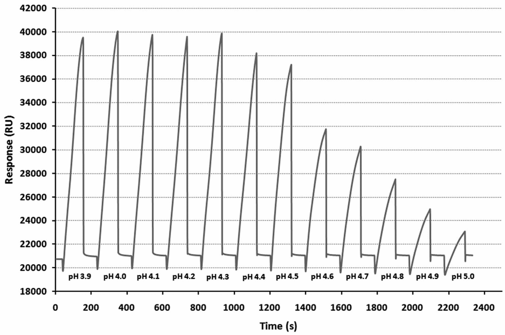

그림 1 CM-덱스트란 센서 칩 표면과 정전기적으로 상호작용하는 단일클론 포획 항체의 전형적인 사전 농축 프로파일. 다양한 단계별 pH(센서그램에 표시됨)의 10 mM 아세트산나트륨 완충액 내 50 μg/mL 항체 용액을 비활성화된 CM-덱스트란 표면 위로 10 μL/min 유속으로 2 min 동안 통과시켰다. 아세트산 완충액의 낮은 이온 강도는 음전하를 띤 덱스트란 층과 양전하를 띤 단백질(즉, 등전점 이하) 사이의 정전기적 인력을 촉진한다. 사전 농축 정도는 각 시료 주입이 끝나기 직전의 반응값으로부터 측정되었으며, 150 mM NaCl을 함유하는 HBS 러닝 완충액의 이온 강도는 표면으로부터 정전기적으로 유인된 항체를 제거하기에 충분하였다. 단일클론항체를 CM-덱스트란 칩 표면에 고밀도로 고정화(> 10,000 RU)하기 위해 사용된 pH는 pH 4.5였다(비록 pH 4.8까지도 효율적인 사전 농축이 관찰되었음)

1.	 0.4 M EDC 100 μL, 0.1 M NHS 100 μL, 25 μg/mL 항-HA 태그 단일클론항체(포획 항체) 200 μL 및 1 M 에탄올아민-HCl 100 μL를 준비한다.

2.	 동량의 0.4 M EDC와 0.1 M NHS를 혼합하고, 사전 농축을 진행했던 플로우 셀 2 또는 4(Biacore X100의 경우 플로우 셀 1만 사용) 위로 10 μL/min 유속으로 70 μL를 주입한다(참고(Note) 11 참조).

3.	 활성화된 표면 위로 포획 항체 150 μL를 10 μL/min 속도로 주입한다(참고(Note) 12 참조).

4.	 표면의 과잉 반응성 작용기를 비활성화하기 위해 1 M 에탄올아민-HCl 70 μL를 10 μL/min 유속으로 주입한다.

5.	 20 mM NaOH를 15 s씩 5회 주입하여 표면의 사후 조절(post-conditioning)을 수행한다.

6.	 선택 사항: 플로우 셀 1 또는 3(Biacore X100의 경우 플로우 셀 1만 사용)에 위 1–5단계를 반복하여 기준 표면을 준비하되, 3단계의 포획 항체를 25 μg/mL의 다른 비특이적 단백질로 대체한다(참고(Note) 13 참조).

MCK는 결합 측정을 위한 고전적인 표준 방법이다. MCK에서는 개별 주입 후 각 분석물질 농도[0 농도의 분석물질(러닝 완충액만 주입하는 블랭크 사이클) 하나 이상 포함]를 별도의 사이클로 실행하며, 각 주입 후 표면 재생을 수행한다(그림 2a 참조). 사이클 간에 일관된 표면 성능을 유지하기 위해 충분한 재생이 필수적이다 [48, 49].

#### 3.4  표면 재생을 동반한

다중 사이클 속도론(MCK) 또는

표면 재생 없는 단일 사이클

속도론(SCK)

그럼에도 불구하고 MCK의 성공은 사이클 간 일관된 표면 특성에 좌우되므로, 적절한 재생 조건을 찾기 어려운 경우(예: 표면 재생에 필요한 조건이 리간드의 기능을 손상시키거나 비가역적으로 비활성화하는 경우)에는 MCK를 적용할 수 없다. 이러한 경우 SCK(반응속도론적 적정(kinetic titration)으로도 알려짐)를 적용할 수 있으며, 이는 단백질 및 DNA 검출에 성공적으로 적용되어 왔다 [50–52].

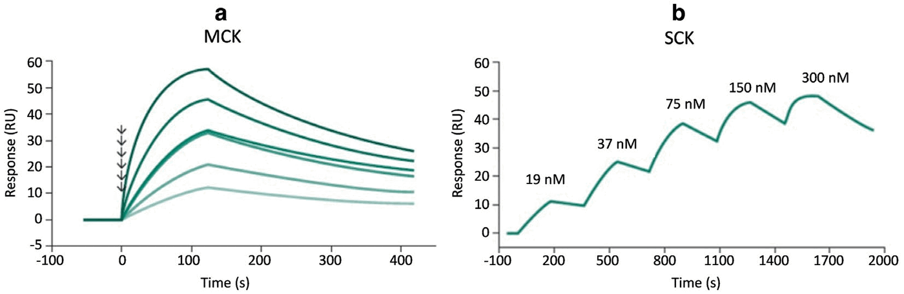

그림 2 a와 b로 표시된 두 개의 선 그래프로 구성된 이미지. "MCK"라는 제목의 그래프 A는 시간에 따라 피크가 증가하는 여러 곡선을 보여 주며, 0에서 400 s의 시간 범위 동안 0에서 60 RU(반응 단위)의 다양한 반응 수준을 나타낸다. "SCK"라는 제목의 그래프 B는 19, 37, 75, 150 및 300 nM로 표시된 다양한 농도에서 피크를 갖는 단일 선을 보여 주며, 0에서 2000 s의 시간 범위 동안 반응 수준 역시 0에서 60 RU 범위이다. 두 그래프 모두 시간에 따른 반응 변화를 보여 준다

SCK를 실행하기 위해 리간드 위로 분석물질을 저농도에서 고농도로 순차적으로 주입한다. 각 시료 사이에는 해리나 재생 단계를 두지 않는다. 다만 가장 높은 농도인 마지막 분석물질 농도 주입 후에는 한 번의 긴 해리 단계를 둔다(그림 2b) [48, 49]. 따라서 SCK는 MCK에 비해 분석 시간이 적게 소요되며, MCK에서는 여러 번 재생되고 재적용되는 반면 SCK에서는 한 번만 적용되므로 리간드 비용을 절감할 수 있다. 그러나 SCK는 사이클 지속 시간이 길어 더 높은 안정성을 요구하기 때문에 드리프트(drift)에 더 민감하며, 이는 센서그램 분석을 더 어렵게 만들고 적절히 분석하지 않을 경우 잘못된 결과 해석으로 이어질 수 있다 [49].

MCK와 SCK 모두 장단점이 있으므로, 어떤 방법을 선택할지 결정하기 전에 가능한 모든 요소를 검토하여 신중하게 실험을 설계해야 한다. 본 장에서는 두 가지 접근법을 모두 설명한다.

항체 결합 표면의 효율적이고 재현 가능한 재생은 직접 “실시간” 바이오센싱 기술에서 요구되는 재사용 가능한 센서 형식에서 매우 중요하지만, 달성하기 어려운 경우가 많다 [46]. 정확한 반응속도론 분석을 위해서는 리간드의 무결성을 유지하면서 표면을 재생하는 것이 대단히 중요하다(참고(Note) 14 참조). 표면 재생 연구는 일반적으로 적절한 재생 완충액의 탐색(재생 스카우팅)과 표면의 성능 평가(표면 성능 테스트)를 포함한다. 재생 연구의 목적은 완전히 기능하는 리간드 표면을 유지하면서 결합된 모든 분석물질을 제거하는 적절한 완충액을 찾는 것이다. 리간드 표면을 파괴하지 않기 위해 완충액 스카우팅은 항상 온화한 완충액부터 시작하여 쉽게 재생되지 않을 경우 더 가혹한 완충액으로 높여 가는 것이 권장된다. 적합한 완충액(또는 여러 완충액)이 확인되면 반복적인 결합 연구를 통해 시간에 따른 리간드 안정성에 미치는 영향을 평가하여 반응속도론 연구에 적합한지 결정한다(즉, 연구 기간 동안 완전히 활성화된 표면을 유지하는가?). 다수의 분석물질을 스크리닝할 때 포획 반응속도론 실험은 광범위한 분석물질 친화도로 인해 재생에 서로 다른 완충액 조건이 요구될 수 있는 직접 결합 연구에 비해 단 하나의 결합 상호작용(포획 리간드 결합 상호작용) 조건만 요구되므로 재생 연구를 단순화한다.

3.4.1  표면 재생을 동반한 MCK

•	 재생 스카우팅(Regeneration scouting)

1.	 테스트할 재생 완충액 패널을 준비한다(참고(Note) 15 참조).

2.	 항-HA 태그 단일클론항체 고정화 표면 및 기준 표면 위로 고농도의 HA-태그 scFv 항체(참고(Note) 16 참조) 60 μL를 30 μL/min 속도로 주입한다. 기준선과 결합 수준을 모두 모니터링한다.

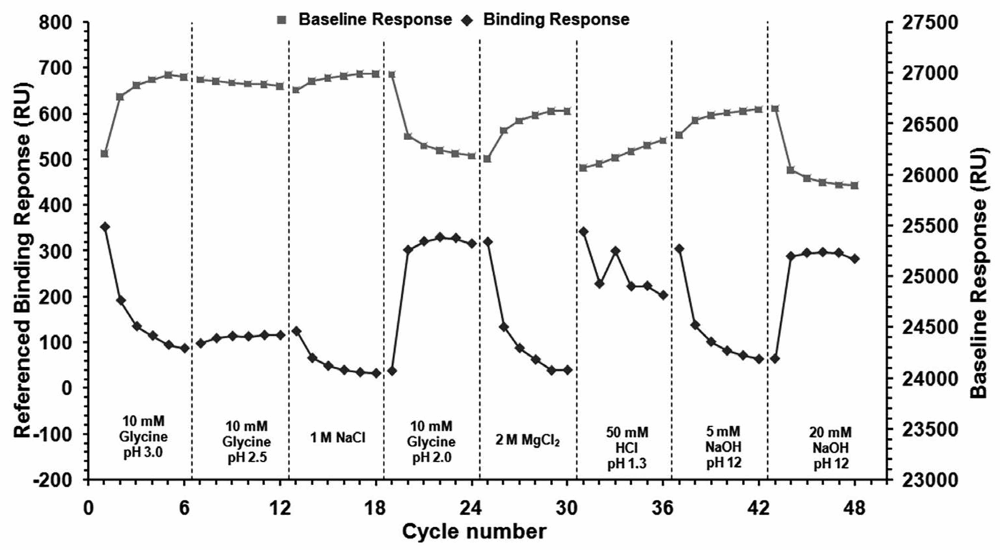

그림 3 온화한 완충액 조건부터 가혹한 조건(그래프에 표시됨)으로 재생된 반복적인 scFv 용해물 결합 사이클을 사용한 항-HA 태그 항체 표면 성능 연구. 각 완충액에 대해 6회의 결합 사이클을 수행하였으며, 기준선(사각형)과 결합 반응(다이아몬드)을 측정하였다. 10 mM 글라이신-HCl, pH 1.5가 안정적인 기준선과 반복적인 결합을 제공하는 가장 효과적인 완충액으로 확인되었다

3.	 가장 온화한 완충액부터 시작하여 재생 완충액 15 μL를 30 μL/min 속도로 주입한다.

4.	 2단계와 3단계를 5회 반복한 후 그 다음으로 온화한 완충액으로 변경한다.

5.	 scFv 포획 반응(scFv 주입 전 기준선으로부터 측정된 상대 반응값)과 절대 기준선 수준의 경향을 추적한다(그림 3 참조) [43].

•	 표면 성능 테스트(Surface performance test)

1.	 3.4.1절에서 확인된 재생 완충액 1 mL와 scFv 항체 용해물 2 mL를 준비한다.

2.	 플로우 셀 1(기준 표면) 및 2(포획 표면), 또는 3(기준 표면) 및 4(포획 표면) 위로 scFv 항체 30 μL를 주입한다(Biacore X100의 경우 플로우 셀 1과 2만 사용).

3.	 재생 완충액 15 μL를 30 μL/min 속도로 주입한다.

4.	 2단계와 3단계를 20–30회 반복하고 기준선과 결합 반응을 평가한다. 결합 반응은 재현 가능해야 하며(변동 계수 CV < 5%), 기준선 드리프트는 최소화되어야 한다.

3.4.2  표면 재생 없는 단일 사이클 속도론(SCK)

1.	 반응속도론 실험에 사용될 농도 범위(예: 1.56, 3.125, 6.25, 12.5, 25, 50, 100 nM)로 분석물질을 희석한다.

2.	 리간드 표면을 준비하고 적절한 포획 수준을 확인한다.

3.	 분석물질을 가장 낮은 농도부터 순차적으로 주입하되 시료 사이에 재생 단계를 두지 않는다. 각 농도 주입 후 짧은 해리 단계(예: 1–2 min)를 거치고 즉시 다음 농도를 주입한다.

4.	 최고 농도 주입 후 충분히 긴 해리 단계(예: 10–20 min)를 거쳐 정확한 해리 속도 상수 kd를 결정할 수 있도록 한다.

5.	 이중 참조(double referencing)를 위해 동일한 주입 횟수와 간격을 갖는 러닝 완충액(블랭크) 사이클을 반드시 수행한다.

반응속도론 실험을 실행하기 전에 (a) 사용할 온도, (b) 고정화 수준, (c) 주입 시간 및 유속, (d) 해리 시간, (e) 사용할 분석물질 농도와 같은 매개변수를 평가해야 한다 [42]. 실험 설계에는 체계적 인공산물을 제거하기 위한 블랭크 주입, 반복 분석물질 주입, 유로 시스템과 센서 표면을 조절하기 위한 시작(start-up) 사이클이 포함되어야 한다 [42, 48, 49].

#### 3.5  반응속도론 연구 및

데이터 분석

1.	 러닝 완충액에 분석물질을 100에서 1.56 nM까지 2배 단계 희석하여 준비하고(참고(Note) 17 참조), 장비 인공산물을 제거하기 위한 이중 참조용 완충액 시료를 포함한다.

2.	 발현된 scFv 항체를 함유하는 세균 용해물을 12 mg/mL BSA 및 12 mg/mL CM 덱스트란이 포함된 러닝 완충액에 1/10로 희석한다.

3.	 표면 성능의 재현성을 확인하고 유로 시스템과 표면을 조절하기 위해 3–5회의 “시작(start up)” 사이클을 수행한다.

4.	 분석물질 Rmax가 약 50 RU(반응 단위)가 되도록 발현된 scFv를 함유하는 충분한 농도의 세균 용해물을 주입한다(참고(Note) 18 참조). 조류(avian) scFv 항체를 발현하는 세균 용해물의 경우 20 μL/min 속도로 2–3 min 주입을 사용한다.

5.	 100 nM 분석물질 90 μL를 30 μL/min 속도로 주입하고 완충액에서 10 min 동안 해리시킨다.

6.	 최적화된 재생 용액 15 μL를 30 μL/min 속도로 주입한다.

7.	 위 4–6단계를 3–5회 반복하고 결합 반응을 평가하여 재현성을 확인한다.

8.	 1단계에 나열된 분석물질 농도 범위에 대해 반응속도론 분석을 수행하되, 최소 하나 이상의 농도를 중복(duplicate) 또는 3중(triplicate)으로 실행하고 이중 참조를 위한 완충액 주입을 실행한다.

9.	 플로우 셀 1과 2 또는 3과 4(기준 표면 및 활성 표면 위; Biacore X100의 경우 플로우 셀 1과 2만 사용) 위로 scFv를 함유하는 세균 용해물(2단계에서 준비됨) 60 μL를 20 μL/min 속도로 주입한다.

10.	 MCK의 경우 각 분석 사이클마다 90 μL의 분석물질을 30 μL/min 유속으로 주입하고(반복 검체 및 완충액 주입을 포함하여 분석물질 농도를 무작위로 주입) 완충액에서 15–20 min 동안 해리시킨다.
SCK의 경우 블랭크 사이클에 시료 사이클과 동일한 횟수의 영농도(zero-concentration) 시료 주입이 포함되어야 한다. 이중 참조를 위해 활성 표면과 기준 표면 모두에 블랭크 시료를 주입한다. 평가 중에 모든 사이클에 나타나는 불규칙성을 제거하기 위해 시료 사이클에서 블랭크 사이클을 감산한다. 둘 이상의 블랭크 사이클을 포함하는 경우 블랭크 감산에 평균값을 사용할 수 있다 [48, 49].

11.	 최적화된 재생 용액 15 μL를 30 μL/min 속도로 주입한다.

12.	 선택 사항: 재생 후 주입 니들, 튜빙 및 유로를 세척하기 위해 IFC(통합 미세유체 카트리지) 세척 절차를 수행한 후 짧은 완충액 주입을 진행한다(참고(Note) 4 참조).

13.	 모든 분석물질 농도가 분석될 때까지 위 8–12단계를 반복한다.

14.	 BIAevaluation에서 위 반응속도론 분석 실험 결과 파일을 열고 데이터 분석을 준비한다. Biacore X100의 경우 분석 실행이 완료되면 평가 소프트웨어가 자동으로 시작되므로 Biacore X100에서는 14–18단계를 수행할 필요가 없다 [53].

15.	 기준 표면이 감산된 데이터를 오버레이하고 분석물질 주입 전의 기준선을 0으로 조정한 후, 오버레이된 센서그램을 x축 시간 기준으로 정렬한다.

16.	 센서그램에서 재생 데이터, 포획 데이터 및 기타 불필요한 데이터를 제거한다.

17.	 체계적 편차를 제거하기 위해 분석물질 반응에서 영농도 분석물질 반응을 감산한다(“이중 참조”).

18.	 데이터에 가장 적합한 상호작용 모델을 선택하고 피팅 절차를 시작한다. 곡선 피팅 절차는 평가 소프트웨어가 결정할 매개변수의 기본 시작값을 사용하여 이론적 결합 곡선을 계산하고 잔차의 최소제곱 피팅을 통해 실험 데이터와 비교하는 반복적인 수학적 과정이다(그림 4 참조).

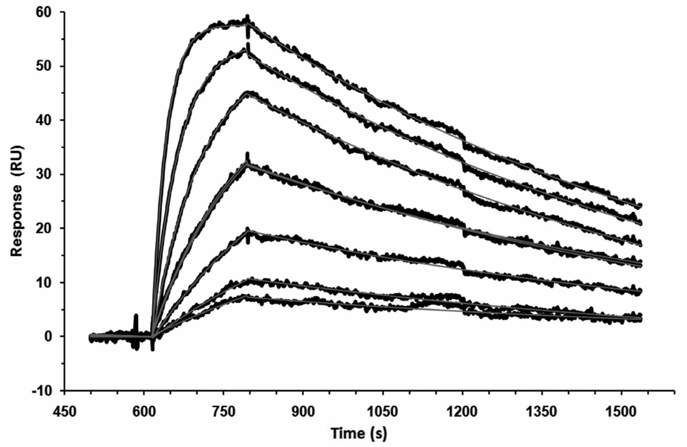

그림 4 인간 질환 단백질 바이오마커에 결합하는 포획된 HA-태그 조류 scFv 항체 단편의 분석에서 얻은 피팅된 반응속도론 데이터 예시(3.5절에 기술된 방법을 사용한 미발표 연구). 피팅된 곡선(드리프트 기준선이 있는 1:1 모델로 피팅됨)은 100, 50, 25, 12.5, 6.25, 3.125 및 1.56 nM에서의 검은색 분석물질 반응(12.5 nM 분석물질 농도는 중복 분석됨) 위에 오버레이된 얇은 회색 실선으로 표시되어 있다. 계산된 반응속도론 매개변수 값은 3.72 × 105 M−1s−1 (ka), 1.07 × 10−3 s−1 (kd), 2.88 × 10−9 M (KD)였다

### 4  참고(Notes)

1.	 기준 플로우 셀 표면을 준비하는 데는 세 가지 다른 방법이 있다:

(i)	 미처리 상태로 두기,

(ii)	 활성화 후 비활성화하기,

(iii)	리간드 고정화 표면의 특성을 모방하기 위해 비활성 리간드(일반적으로 단백질)를 고정화하기.

대부분의 경우 미처리 기준 표면은 수정되지 않은 표면과 시료 간의 상호작용에 대한 음성 대조군을 제공하므로 항체 및 항원 상호작용 분석에 충분할 수 있다. 배경 노이즈가 높은 경우 카복시메틸 덱스트란 표면의 음전하 밀도를 최소화하기 위해 기준 표면을 활성화(EDC/NHS 사용)한 후 비활성화(아민 커플링의 경우 에탄올아민 사용)할 수 있다. 이것으로 해결되지 않으면 기준 표면에 비특이적 리간드(예: 항체 또는 단백질)를 고정화하여 리간드 고정화 표면과 가장 유사한 표면을 생성할 수 있으며, 일반적으로 이것이 가장 적절한 표면으로 간주된다.

2.	 Biacore에서 결합 분석을 설계할 때 상호작용 물질 중 하나는 일반적으로 표면에 포획되거나 고정화되고(리간드), 다른 상호작용 물질은 표면 위를 통과한다(분석물질). 친화성 쌍 중 어느 상호작용 물질을 고정화할지는 안정성(고정화 및 재생이 기능에 미치는 영향), 비특이적 결합(NSB) 성향(pI가 높은 단백질은 덱스트란 표면에 NSB를 보이는 경향이 있어 리간드로 사용하는 것이 좋음), 가수(valency, 가능하면 항상 일가 분자를 분석물질로 사용), 크기(우수한 실험 설계를 통해 최신 Biacore 1 시리즈 기기(예: Biacore X100)는 100 Da만큼 작은 분석물질의 결합 반응도 측정할 수 있지만 더 큰 분자가 분석물질로 선호됨)에 따라 달라진다 [53].

3.	 많은 생물학적 재료가 종종 센서 표면에 결합하는 경향을 보일 수 있으므로 분석 설정 전에 NSB 평가가 필요하다. 이는 분석에 사용될 최고 농도로 각 시약을 블랭크 표면 위로 개별 주입함으로써 간단히 수행할 수 있다. NSB가 높은 경우 실험 완충액 변경을 고려하거나(즉, 시료 완충액에 12 mg/mL CM 덱스트란과 12 mg/mL BSA를 첨가하면 NSB를 줄이는 데 도움이 됨), 센서 칩 화학을 변경(다른 센서 칩 유형을 사용하거나 아민 커플링 후 에탄올아민 대신 에틸렌다이아민으로 비활성화 고려)하는 것을 고려한다.

4.	 반응속도론 분석, 특히 직접 결합 연구(즉, 포획 단계를 거치지 않는 연구)는 결합 사이클 사이에 이월되는 소량의 재생 완충액으로 인해 복잡해질 수 있으며, 이는 시료 플러그를 오염시키고 다음 결합 반응에 영향을 미칠 수 있다. 사이클 사이에 세척 단계와 완충액 주입을 수행하면 이를 배제하는 데 도움이 될 수 있다.

5.	 결합된 분석물질을 완전히 제거하면서 리간드 기능을 유지하는 것은 재현 가능한 반응속도론 실험에 필수적이며, 올바른 조건을 탐색하는 데 들이는 상당한 노력은 얻어지는 반응속도론 데이터의 품질로 보답받게 된다.

6.	 분석의 반복성, 재생 단계 및 시간에 따른 리간드 활성을 입증하기 위해 반복 분석(중복 또는 3중)과 분석물질 무작위화가 필요하다.

7.	 탈착(desorption) 과정 중에 센서 칩 표면의 모든 단백질이 파괴된다. 또한 센서 칩에서 소량의 금이 벗겨져 장비 IFC에 달라붙을 가능성을 방지하기 위해 유지보수 칩(유리만 포함)을 도킹해야 한다.

8.	 사용할 고정화 pH는 적절한 고정화 수준을 제공하는 가장 높은 pH여야 한다. 사용할 완충액 pH는 필요한 고정화 수준(농도 분석 연구에 사용되는 고용량 표면의 경우 시료의 적절한 사전 농축을 제공하기 위해 낮은 pH 완충액이 필요할 수 있는 반면, 반응속도론 표면의 경우 더 낮은 수준 및 온화한 pH를 사용할 수 있음), 시료 안정성(일부 단백질은 낮은 pH에서 안정하지 않음) 및 시료 농도(일부 시료는 공급이 제한될 수 있어 최대 사전 농축 조건이 필요함)에 따라 달라진다.

9.	 가능한 NSB 및 분석 간섭을 피하기 위해 고정화 리간드는 가능하면 최소 95% 순도여야 한다. 많은 상용 항체에는 추가적인 안정화제가 포함되어 있어 고정화 효율을 오염시키고 저하시킬 수 있다. 이러한 안정화제가 존재하는 경우 친화성 크로마토그래피로 항체를 정제해야 한다 [54].

10.	 사전 농축 연구에 사용할 단백질 농도는 리간드 가용성과 원하는 고정화 수준에 따라 달라진다. 일반적으로 단백질은 적절한 완충액에 1–50 μg/mL로 희석된다.

11.	 7 min의 활성화 주입 후 CM5 칩 표면의 카복실기 중 약 40%가 활성화된다. 고밀도 표면이 필요한 경우 이 주입 시간을 늘릴 수 있다.

12.	 포획 실험에 필요한 주입 시간과 고정화 수준은 분석 요구 조건과 리간드 특성에 따라 달라진다. 연구할 scFv 항체의 농도를 미리 알고 있다면 원하는 항-HA 포획 항체 고정화 수준을 이론적으로 계산할 수 있다(참고(Note) 17 참조). 본 실험에서는 항체 발현 수준에서 1000배 이상 차이나는 수백 개의 항체 클론을 특성 규명하는 것을 목표로 하였으므로 고용량 표면(~10,000 RU)을 선택하였다.

13.	 Biacore에서 기준 표면은 (a) 비수정 표면, (b) 활성화-비활성화된 표면, 또는 (c) 비상호작용 더미 리간드가 고정화된 표면일 수 있다. 사용할 기준 표면을 선택하기 위한 전제 조건은 표면의 NSB 수준을 결정하는 것이다. 이는 기준 표면 위로 최고 농도의 분석물질을 주입하면서 결합 수준(있는 경우)을 평가함으로써 수행되어야 한다. 비특이적 결합이 문제가 되지 않는다면 활성 테스트 표면에 사용된 것과 동일한 고정화 수준 및 조건으로 기준 표면을 처리해 보아야 한다. 이렇게 하면 플로우 셀 간에 유사한 환경이 조성된다.

14.	 속도론 [55] 및 농도 분석 [50]을 위해 재생 사이클을 줄인 순차적 결합 상호작용 분석(“단일 사이클”)을 사용하거나 신뢰성 있게 측정되는 적은 수의 분석물질 농도를 정확하게 선택하는 방식 [39]의 인기가 높아지고 있다. 이러한 접근법은 리간드 불안정성으로 인해 재생 스카우팅이 어려운 경우에 매우 유용할 수 있다.

15.	 우리는 보통 10 mM 글라이신 완충액(pH 1.5–3.0), 10–100 mM 인산, HCl, NaOH와 같은 다양한 용액과 1 M NaCl, 2 M MgCl2와 같은 고이온 강도 용액을 준비하고 여과하여 사용한다.

16.	 연구에 사용된 최고 농도 이상의 농도로 HA-태그 scFv 항체를 주입한다. 이는 고발현 클론의 스톡 용해물일 수 있다.

17.	 일반적인 규칙으로, 반응속도론 연구에는 0.1에서 10배 KD 범위의 다중 분석물질 농도를 사용해야 하며, 최소 하나 이상(가급적 더 많이)의 농도를 중복으로 수행해야 한다. 우리 경험상 면역 항체 라이브러리에서 엄격하게 선별된(시험관 내 친화도 성숙 단계를 포함하지 않음) 항체 클론의 친화도는 일반적으로 약 50에서 0.5 nM 범위이다. 따라서 고처리량 스크리닝 실행에서 모든 클론에 대해 “신뢰성 있게 측정될 수 있는” [39] 분석물질 농도 범위를 선택하는 것은 사용자가 설정한 스크리닝 기준에 따라 달라진다(즉, 상세한 반응속도론 분석이 필요한 경우 광범위한 농도를 분석해야 하며 신뢰성 있게 측정될 수 있는 농도가 곡선 피팅 및 통계 분석에 사용된다. 이상적으로 최저 농도는 측정 가능한 반응을 제공하고 최고 농도는 정지 상태(steady-state)에 도달한다. 주입 시간을 연장하면 최고 농도가 정지 상태에 접근하도록 할 수 있다 [49]. 그러나 실험 목적이 많은 수의 클론을 속도론적으로 순위 매기는 것이라면 더 낮은 분석물질 농도 범위를 사용할 수 있으며 선별된 클론은 그 친화도에 더 적합한 분석물질 범위에서 재분석할 수 있다).

18.	 결합 화학량론에 대한 정보[결합 화학량론 = (분석물질 Rmax/리간드 밀도) / (분석물질 MW/리간드 MW), 여기서 MW는 분자량]는 고정화된 리간드의 무결성에 대한 지표를 제공한다. 구체적으로 화학량론이 예상보다 적다면 리간드가 일부 활성을 잃었음을 나타낼 수 있으며, 이는 무작위 고정화 커플링 화학법에서 흔히 볼 수 있는 인공산물이다 [56]. 포획 실험은 리간드 활성을 유지하는 경향이 있으므로 1:1 결합의 경우 분석물질 MW를 리간드 MW로 나누고 여기에 리간드 반응값(RU)을 곱하여 이론적 Rmax를 쉽게 계산할 수 있다. 소수의 시료를 분석할 때 원하는 Rmax를 달성하는 데 필요한 실험적 scFv 포획 수준은 포획 표면 위로 희석된 시료를 반복 주입하여 결정할 수 있다. 그러나 발현 수준에서 1000배 이상의 차이를 보이는 조 세균 용해물로부터 수백 개의 항체를 고처리량으로 스크리닝하는 경우 이는 비실용적이며, 우리 경험상 고용량 항-HA 단일클론항체 표면 위로 scFv 함유 용해물을 1/10 희석하여 2–3 min 동안 주입하는 것으로 대부분의 조류 scFv 항체 클론에 충분하다 [27].

이해 상충

저자들은 본 장의 내용과 관련하여 선언할 이해 상충이 없다.

### 참고문헌

1.	Cytiva 
(2025) 
Key-SPR-applications 
[online]. 
Available 
from 
https://www.
cytivalifesciences.com/en/us/solutions/
protein-research/Interaction-analysis-with-
Biacore-surface-plasmon-resonance-SPR/
Key-SPR-applications
	 2.	Janith 
GI, 
Herath 
HS, 
Hendeniya 
N, 
Attygalle D, Amarasinghe DAS, Logeeshan 
V, Wickramasinghe PMTB, Wijayasinghe YS 
(2023) Advances in surface plasmon resonance 
biosensors for medical diagnostics: an overview of recent developments and techniques. J 
Pharm Biomed Anal Open 2:100019. https://
doi.org/10.3390/bios12030180
	 3.	Olaru A, Bala C, Jaffrezic-Renault N, Aboul-

9.	Forest-Nault C, Koyuturk I, Gaudreault J, et

al (2022) Impact of the temperature on the 
interactions between common variants of the 
SARS-CoV-2 receptor binding domain and the 
human ACE2. Sci Rep 12, 11520. https://doi.
org/10.1038/s41598-022-15215-5
	10.	Gauglitz G (2020) Critical assessment of

relevant methods in the field of biosensors 
with direct optical detection based on fibers and waveguides using plasmonic, resonance, and interference effects. Anal Bioanal 
Chem 
412(14):3317–3349. 
https://doi.
org/10.1007/s00216-020-02581-0
	11.	Knowling S, Clark J, Sjuts H, Abdiche

YN (2020) Direct comparison of labelfree biosensor binding kinetics obtained 
on the Biacore 8K and the Carterra LSA. 
SLAS Discov 25(9):977–984. https://doi.
org/10.1177/2472555220934814
	12.	Li K, Huntwork RHC, Horn GQ, Alam SM,

Enein HY (2015) Surface plasmon resonance 
(SPR) biosensors in pharmaceutical analysis. 
Crit Rev Anal Chem 45(2):97–105. https://
doi.org/10.1080/10408347.2014.881250
	 4.	Nevetha R, Sandhya K, Yashini M, Rajeshwari

S, Mamathi CA, Nirmal TS, Sunil CK (2023) 
Recent advances in surface plasmon resonance 
(SPR) biosensors for food analysis: a review. 
Crit Rev Food Sci Nutr 63(8):1055–1077. 
https://doi.org/10.1080/10408398.2021.1
958745
	 5.	Tiwari PB, Bencheqroun C, Lemus M, et al

Tomaras GD, Dennison SM (2023) Titration 
analysis: a tool for high throughput binding 
kinetics data analysis for multiple label-free 
platforms. Gates Open Res 7:107. https://doi.
org/10.12688/gatesopenres
	13.	Rath C, Burger J, Norval L, Kraemer SD,

Gensch N, van der Kooi A, Reinemann C, 
O'Sullivan C, Svobodova M, Roth G (2019) 
Comparison of different label-free imaging high-throughput biosensing systems for 
aptamer binding measurements using thrombin 
aptamers. Anal Biochem 583:113323. https://
doi.org/10.1016/j.ab.2019.05.012
	14.	Skottrup P, Hearty S, Frokiaer H, Leonard

(2021) SPRD: a surface plasmon resonance database of common factors for better experimental 
planning. BMC Mol Cell Biol 22:17. https://
doi.org/10.1186/s12860-021-00354-w
	 6.	Park JH, Cho YW, Kim TH (2022) Recent

advances in surface plasmon resonance sensors for sensitive optical detection of pathogens. Biosensors 12(3):180. https://doi.
org/10.3390/bios12030180 
	 7.	Brown ME, Bedinger D, Lilov A, Rathanaswami

P, Hejgaard J, O'Kennedy R, Nicolaisen 
M, Justesen AF (2007) Detection of fungal 
spores using a generic surface plasmon resonance immunoassay. Biosens Bioelectron 
22:2724–2729. 
https://doi.org/10.1016/j.
bios.2006.11.017
	15.	Gaudreault J, Forest-Nault C, De Crescenzo

P, Vásquez M, Durand S, Wallace-Moyer 
I, Zhong L, Nett JH, Burnina I, Caffry I, 
Lynaugh H, Sinclair M, Sun T, Bukowski J, 
Xu Y, Abdiche YN (2020) Assessing the binding properties of the anti-PD-1 antibody landscape using label-free biosensors. PLoS One 
15(3):e0229206. https://doi.org/10.1371/
journal.pone.0229206 
	 8.	Drake AW, Myszka DG, Klakamp SL (2004)

G, Durocher Y, Henry O (2021) On the use 
of surface plasmon resonance-based biosensors for advanced bioprocess monitoring. 
Processes 9:1996. https://doi.org/10.3390/
pr9111996
	16.	Wang SH, Yu JD (2016) ata for peptide-bindCharacterizing high-affinity antigen/antibody 
complexes by kinetic- and equilibrium-based 
methods. Anal Biochem 328:35–43. https://
doi.org/10.1016/j.ab.2003.12.025

ing assay with oriented immobilization of 
GRP78 in Biacore. Data Brief 7:1696–1699. 
https://doi.org/10.1016/j.dib.2016.04.064

17.	Brzozowska E, Koba M, Śmietana M, Górska S,

A100. J Immunol Methods 323:172–179. 
https://doi.org/10.1016/j.jim.2007.04.010
	28.	McPartlin DA, Murphy C, Fitzgerald J, Ma H,

Janik M, Gamian A, Bock WJ (2016) Label-free 
Gram-negative bacteria detection using bacteriophage-adhesin-coated long-period gratings. 
Biomed Opt Express 7(3):829–840. https://
doi.org/10.1364/BOE.7.000829
	18.	Hearty S, Leonard P, Quinn J, O'Kennedy

Regan F, O'Kennedy RJ (2019) Understanding 
microcystin-LR antibody binding interactions 
using in silico docking and in vitro mutagenesis. 
Protein Eng Des Sel 32(12):533–542. https://
doi.org/10.1093/protein/gzaa016
	29.	Patel K, Halevi S, Melman P, Schwartz J, Cai S,

R (2006) Production, characterisation and 
potential application of a novel monoclonal 
antibody for rapid identification of virulent 
Listeria monocytogenes. J Microbiol Methods 
66:294–312. 
https://doi.org/10.1016/j.
mimet.2005.12.009
	19.	Leonard P, Hearty S, Quinn J, O'Kennedy R

Singh BR (2017) A novel surface plasmon resonance biosensor for the rapid detection of botulinum neurotoxins. Biosensors 7:32. https://
doi.org/10.3390/bios7030032
	30.	Chatterjee D, Lewis FJ, Sutton HJ, Kaczmarski

(2004) A generic approach for the detection of 
whole Listeria monocytogenes cells in contaminated samples using surface plasmon resonance. 
Biosens Bioelectron 19:1331–1335. https://
doi.org/10.1016/j.bios.2003.11.009
	20.	Leonard P, Hearty S, Wyatt G, Quinn J, O'Kennedy

JA, Gao X, Cai Y, McNamara HA, Jackson 
CJ, Cockburn IA (2021) Avid binding by 
B cells to the Plasmodium circumsporozoite protein repeat suppresses responses to 
protective subdominant epitopes. Cell Rep 
35(2):108996. 
https://doi.org/10.1016/j.
celrep.2021.108996
	31.	Lacy A, Dunne L, Fitzpatrick B, Daly S, Keating

R (2005) Development of a surface plasmon resonance-based immunoassay for Listeria monocytogenes . J Food Prot 68:728–735. https://doi.
org/10.4315/0362-028x-68.4.728
	21.	Tang J, Guo M, Chen M, et al (2023) A

G, Baxter A, Hearty S, O'Kennedy R (2006) 
Rapid analysis of coumarins using surface plasmon resonance. J AOAC Int 89:884–892. 
https://doi.org/10.1093/jaoac/89.3.884
	32.	Winzor DJ (2018) Interpretation of results

link between STK signalling and capsular 
polysaccharide 
synthesis 
in 
Streptococcus 
suis. Nat Commun 14, 2480. https://doi.
org/10.1038/s41467-023-38210-4
	22.	Mamer SB, Page P, Murphy M, et al (2020)

from the competitive Biacore procedure for 
characterizing immunochemical interactions 
in solution. J Mol Recognit 31(7):e2702. 
https://doi.org/10.1002/jmr.2702
	33.	Shen Y, Wang Y, Jiang X, Lu L, Wang C, Luo

The convergence of cell-based surface plasmon 
resonance and biomaterials: the future of quantifying bio-molecular interactions-a review. 
Ann Biomed Eng 48:2078–2089. https://doi.
org/10.1007/s10439-019-02429-4
	23.	Yau YH, Shochat SG (2014) Analysis of affinity of

W, Zhang Y, Li P, Du Z, Dai T, Wu C, Fang A, 
Yao Y, Peng Q, Yang J (2018) Preparation and 
characterization of a high-affinity monoclonal 
antibody against human epididymis protein-4. 
Protein Expr Purif 141:44–51. https://doi.
org/10.1016/j.pep.2017.09.005
	34.	Meschendoerfer W, Gassner C, Lipsmeier F,

dengue virus protein interaction using Biacore. 
Methods Mol Biol 1138:271–284. https://
doi.org/10.1007/978-1-4939-0348-1_17
	24.	Breen JC, Martin SD, Ma H, McQuaid K,

Regula JT, Moelleken J (2017) SPR-based 
assays enable the full functional analysis of 
bispecific molecules. J Pharm Biomed Anal 
132:141–147. 
https://doi.org/10.1016/j.
jpba.2016.09.028
	35.	Conroy PJ, O'Kennedy RJ, Hearty S (2012)

O'Kennedy R, Findlay BCJ (2015) Production 
of functional human vitamin A transporter/
RBP receptor (STRA6) for structure determination. PLoS One 10:e0122293. https://doi.
org/10.1371/journal.pone.0122293
	25.	Drescher DG, Dakshnamurthy S, Drescher

Cardiac troponin I: a case study in rational 
antibody 
design 
for 
human 
diagnostics. 
Protein Eng Des Sel 25:295–305. https://doi.
org/10.1093/protein/gzs018
	36.	Grasmeier MK, Weber S, Treiber M, Thaler

MJ, Ramakrishnan NA (2016) Surface plasmon resonance (SPR) analysis of binding 
interactions of inner-ear proteins. Methods 
Mol 
Biol 
1427:165–187. 
https://doi.
org/10.1007/978-1-4939-3615-1_10
	26.	Drescher DG, Drescher MJ (2023) Protein interMA, Luppa PB (2023) Surface plasmon resonance assays for the therapeutic drug monitoring of infliximab indicate clinical relevance 
of anti-infliximab antibody binding properties. 
Clin Chem Lab Med 8; 61(7):1255–1265. 
https://doi.org/10.1515/cclm-2022-0949 
	37.	Hayes CJ, Leonard P, O'Kennedy R (2012)

action analysis by surface plasmon resonance. 
Methods Mol Biol 2652:319–344. https://
doi.org/10.1007/978-1-0716-3147-8_19
	27.	Leonard P, Safsten P, Hearty S, McDonnell B,

Finlay W, O'Kennedy R (2007) High throughput ranking of recombinant avian scFv antibody 
fragments from crude lysates using the Biacore

Overcoming antibody expression and screening limitations by smart design: applications to

PSA immunoassay development. Protein Expr 
Purif 83:84–91. https://doi.org/10.1016/j.
pep.2012.02.007
	38.	Ross GMS, Bremer MGEG, Wichers JH, van

60(1):1–8. 
https://doi.org/10.1042/
EBC20150001.
	48.	Cytiva (2025) Kinetics and affinity measurements with Biacore systems [online]. Available 
from https://cdn.cytivalifesciences.com/api/
public/content/digi-33041-pdf
	49.	Cytiva (2025) Overview of kinetic analysis

Amerongen A, Nielen MWF (2018) Rapid 
antibody selection using surface plasmon resonance for high-speed and sensitive hazelnut 
lateral flow prototypes. Biosensors 8(4):130. 
https://doi.org/10.3390/bios8040130
	39.	Onell A, Andersson K (2005) Kinetic deterusing Biacore™ systems [online]. Available 
from https://cdn.cytivalifesciences.com/api/
public/content/digi-16794-pdf
	50.	Dillon PP, Killard AJ, Daly SJ, Leonard P,

minations of molecular interactions using 
Biacore-minimum data requirements for efficient experimental design. J Mol Recognit 
18:307–317. 
https://doi.org/10.1002/
jmr.745
	40.	Cytiva (2025) BiacoreTM sensor surface

O'Kennedy R (2005) Novel assay format permitting the prolonged use of regeneration-based 
sensor chip technology. J Immunol Methods 
296:77–82. 
https://doi.org/10.1016/j.
jim.2004.10.013
	51.	Nakagawa F, Kikkawa M, Chen S, Miyashita Y,

[online].. Available from https://cdn.cytivalifesciences.com/api/public/content/
digi-16475-pdf.
	41.	Gomes P, Andreu D (2002) Direct kinetic assay

Hamaguchi-Suzuki N, Shibuya M, Yamashita 
S, Nagase L, Yasuda S, Shiroishi M, Senda T, 
Ito K, Murata T, Ogasawara S (2023) Antinanodisc antibodies specifically capture nanodiscs and facilitate molecular interaction 
kinetics studies for membrane protein. Sci Rep 
13(1), 
11627. 
https://doi.org/10.1038/
s41598-023-38547-2
	52.	Plácido A, Ferreira-da-Silva F, Leite JRSA,

of interactions between small peptides and 
immobilized antibodies using a surface plasmon resonance biosensor. J Immunol Methods 
259:217–230. 
https://doi.org/10.1016/
s0022-1759(01)00503-8
	42.	Karlsson R, Larsson A (2004) Affinity measurement using surface plasmon resonance. 
Methods Mol Biol 248:389–415
	43.	Murphy M, Jason-Moller L, Bruno J (2006)

de-Los-Santos-Álvarez N, Delerue-Matos C 
(2020) A convenient renewable surface plasmon resonance chip for relative quantification 
of genetically modified soybean in food and 
feed. PLoS One 15(2):e0229659. https://doi.
org/10.1371/journal.pone.0229659
	53.	Cytiva 
(2025) 
Biacore 
X100 
Operating 
Instructions [online]. Available from https://
cdn.cytivalifesciences.com/api/public/
content/digi-14524-original
	54.	Darcy E, Leonard P, Fitzgerald J, Danaher

Using Biacore to measure the binding kinetics of an antibody-antigen interaction. Curr 
Protoc 
Protein 
Sci 
19:14. 
https://doi.
org/10.1002/0471142301.ps1914s45
	44.	Myszka DG (2000) Kinetic, equilibrium, and

thermodynamic analysis of macromolecular 
interactions with BIACORE. Methods Enzymol 
323:325–340. 
https://doi.org/10.1016/
S0076-6879(00)23372-7
	45.	Schräml M, Biehl M (2012) Kinetic screenM, Ma H, O'Kennedy R (2017) Purification 
of antibodies using affinity chromatography. 
Methods Mol Biol 1485:305–318. https://
doi.org/10.1007/978-1-4939-6412-3_15
	55.	Karlsson R, Katsamba PS, Nordin H, Pol E,

ing in the antibody development process. 
Methods Mol Biol 901:171–181. https://doi.
org/10.1007/978-1-61779-931-0_11
	46.	Quinn J, Patel P, Fitzpatrick B, Manning B,

Myszka DG (2006) Analyzing a kinetic titration 
series using affinity biosensors. Anal Biochem 
349:136–147. 
https://doi.org/10.1016/j.
ab.2005.09.034
	56.	Shen M, Rusling J, Dixit CK (2017) Site-

Dillon P, Daly S, Okennedy R, Alcocer M, Lee 
H, Morgan M, Lang K (1999) The use of regenerable, affinity ligand-based surfaces for immunosensor applications. Biosens Bioelectron 
14:587–595. 
https://doi.org/10.1016/
s0956-5663(99)00032-9
	47.	Bhalla N, Jolly P, Formisano N, Estrela P (2016)

selective orientated immobilization of antibodies and conjugates for immunodiagnostics 
development. Methods 116:95–111. https://
doi.org/10.1016/j.ymeth.2016.11.010

Introduction to biosensors. Essays Biochem

## 제12장 에피토프 비닝: 단량체 및 다가 항원 상에서 단일클론항체의 군집화

Adva Mechaly, Ohad Mazor

### 초록

진단용 또는 치료용 항체의 개발은 여러 유망 후보 물질(lead)에 대한 광범위한 특성 규명을 요구한다. 특성 규명 과정에서 매우 중요한 단계 중 하나는 에피토프 매핑(비닝, binning)으로, 여기서 서로 다른 항체들은 기능적 활성과 직접적으로 연결된 항원 인식 부위에 따라 여러 “빈(bin)”으로 분류된다. 생물층 간섭법(BLI)은 생체 거대 분자 간의 상호작용을 특성 규명하는 데 사용되는 기술이며, 이에 따라 항체의 특성을 규명하는 데 광범위하게 활용된다. 본 프로토콜은 항체 비닝을 위한 BLI의 활용을 설명한다. 고전적인 쌍체 매핑(pairwise mapping) 모델과 더불어, 본 프로토콜에서는 정제되지 않은 항체의 특성 규명뿐만 아니라 다가 항원 상에서의 비닝 과제도 함께 다룬다.

핵심어  에피토프 비닝(Epitope binning), 생물층 간섭법(BLI), 단일클론항체, 다량체 항원, 하이브리도마 상층액

### 1  서론

항체는 높은 특이성과 친화도, 그리고 수많은 진단 및 치료 플랫폼에서의 성공적인 적용 덕분에 광범위하게 연구되어 왔다. 실제로 임상에서 사용 승인을 받은 FDA 승인 항체의 증가로 인해 단일클론항체는 최근 제약 산업이 경험하고 있는 “바이오의약품 붐”을 이끌고 있다 [1–3]. 단일클론항체의 개발 및 공학적 조작은 천연/면역화/감염된 인간 및 동물을 포함한 다양한 기원 생물뿐만 아니라 합성 항체 라이브러리를 활용하여 여러 다양한 기술(하이브리도마, 파지 디스플레이, 효모 디스플레이, B 세포 선별 등)을 통해 이루어진다 [3]. 친화도 및 기타 의약품 관련 매개변수는 후기 개발 단계에서 개선될 수 있지만, 항체의 기능적 활성과 직접적인 상관관계가 있는 항체 인식 부위(에피토프)는 (현재 존재하는 도구로는) 변경하기가 극히 어렵다. 따라서 에피토프 매핑(비닝)은 항체 개발에서 가장 중요한 매개변수 중 하나이며 가능한 한 조기에 결정되어야 한다 [4, 5]. 이 방법론에서는 모든 항체 후보 물질이 서로 구별되는 항원 결합 에피토프에 따라 클러스터(빈)로 분류된다. 그러나 특성 규명된 항체들이 겹치거나 인접한 에피토프를 덮고 있을 수 있으므로 동일한 클러스터에 속한다고 해서 반드시 동일한 에피토프/활성을 의미하는 것은 아니라는 점에 유의해야 한다 [6]. 항원에 동시에 결합할 수 있는 다양한 결합 부위를 가진 항체를 생성하면 진단 [7, 8] 및 치료 [9–11] 모두에 결정적일 수 있는 올리고클론 제제의 제조가 가능해진다.

생물층 간섭법(BLI)은 거대 분자(예: 단백질, DNA, 바이러스 및 소형 세균) 간의 상호작용을 실시간으로 모니터링할 수 있는 광학적 무표지(label-free) 기술이며, 항체–항원 상호작용의 반응속도론, 정량 및 “다양성 분석”에 성공적으로 적용되어 왔다 [5, 12–14]. BLI 실험에서는 분자 중 하나인 리간드를 센서에 고정화하고, 바이오센서 팁에서 반사되는 백색광의 간섭 패턴을 분석하여 두 번째 분자인 분석물질과의 결합을 모니터링한다. 결합 사건의 결과로 나타나는 간섭 패턴의 변화는 결합된 분자의 수에 비례한다.

쌍체 매핑(pairwise mapping)이라 불리는 항체 비닝의 고전적 형식은 단일클론항체–항원 상호작용의 특이성에 기초하며, 일반적으로 정제된 항체와 수용성 표적 단량체 항원을 사용하여 수행된다. 이 순차적 절차(그림 1a에 개식적으로 표시됨)에서는 정제된 항체(mAb1)를 비오틴화하여 스트렙타비딘 BLI 센서로 포획한다(단계 I, 로딩). 그런 다음 센서를 세척하고(단계 II, 기준선), 결합된 항체가 표적 항원에 결합하도록 한다(단계 III, 스트렙타비딘 결합 항체와 표적 항원의 결합). 추가 세척 단계(단계 IV, 해리) 후, 미리 형성된 첫 번째 항체–항원 복합체에 대한 두 번째 항체(mAb2)의 결합을 측정한다(단계 V, 2차 항체와 항원의 결합). 동시 결합이 일어나면 간섭 패턴의 파장 이동이 유도되며(그림 1b에 나타나 있고 삽입 패널에 확대됨), 이는 두 항체가 겹치지 않는 에피토프에 결합함을 나타낸다(분홍색 선, 그림 1b). 대조적으로 두 항체가 동일하거나 부분적으로 겹치는 에피토프에 결합하는 경우 파장 이동이 일어나지 않거나 매우 낮게 유도된다(청록색 선, 그림 1b). 그런 다음 센서를 세척하고(단계 VI, 항원으로부터 두 번째 항체의 해리), 낮은 pH 완충액으로 재생한 후(단계 VII, 센서를 첫 번째 항체 수준까지 박리), pH를 중화하고 센서의 재사용을 가능하게 하기 위해 퀜칭(quenching)을 수행한다(단계 VIII). 앞서 언급한 고전적 쌍체 비닝 형식의 한 가지 한계는 결과의 올바른 해석을 위해 단량체 항원이 필요하다는 점이다. 이러한 한계를 극복하기 위해 항원이 다가(multivalent) 에피토프를 제시하는 경우 mAb1 자체 차단(self-blocking) 단계를 추가해야 하며, 이를 통해 모든 포획 항체 부위의 포화를 보장한다 [8]. 또 다른 과제는 항체를 발현하는 하이브리도마 또는 포유류 세포 상층액의 특성 규명이다. 이러한 특성 규명을 가능하게 하려면 굴절률 불일치를 상쇄하기 위해 분석 센서와 병행하여 항체가 없는 대조군 센서를 함께 실행해야 한다.

본 프로토콜은 비오틴화 및 분석 보정에서부터 비닝 실험의 실행 및 분석에 이르기까지 항체(IgG 형식)의 고전적 쌍체 비닝을 수행하기 위한 단계별 지침을 제공한다. 다가 항원을 다루는 작업, 항체를 하이브리도마 상층액 형태로 적용하는 작업, 항원에 대한 여러 항체의 순차적·동시적 결합을 검증하는 작업을 포함한 고전적 방법론의 변형은 “참고(Notes)” 절에서 제시될 것이다. 본 프로토콜은 항체 비닝을 기준으로 설명되었으나 이론적으로 관심 있는 대부분의 리간드/분석물질 쌍에 적용될 수 있음을 강조하고자 한다(참고(Note) 1 참조).

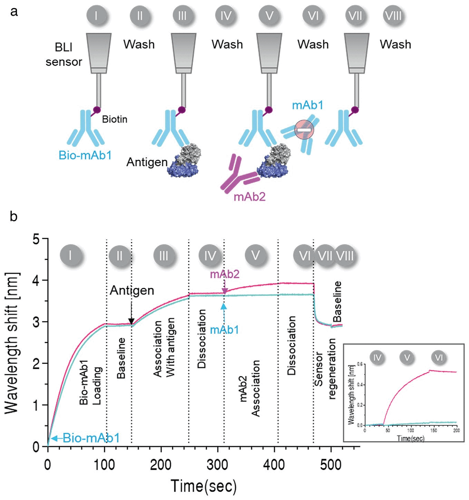

그림 1 고전적 에피토프 비닝(쌍체 매핑). (a) 고전적 에피토프 비닝 체계의 모식도. (b) 두 단일클론항체의 에피토프 비닝 대표 실행 결과. 두 개의 BLI 스트렙타비딘 센서를 사용하여 정제된 Bio-mAb1을 포획한다(I, 로딩). 그런 다음 센서를 세척하고(II, 기준선) 항원에 결합하도록 한다(III, 항원 결합). 추가 세척 단계(IV, 해리) 후 항원을 표지되지 않은 2차 항체와 반응시킨다(V, 항체 결합): mAb2(분홍색) 또는 mAb1(청록색). 추가 세척 단계(VI, 항체 해리) 후 센서를 재생하고(VII) 퀜칭한다(VIII). 세척 단계(II, IV, VI, VIII)는 점선으로 표시된다. 삽입 그래프: 0으로 정렬된 2차 항체 결합 곡선

### 2  재료

1.	 Octet® RED96, ForteBio (또는 기타 Octet 모델)

#### 2.1  장비

2.	 Streptavidin (SA) Dip and Read™ 바이오센서, ForteBio

3.	 검은색 96-웰 F-바닥 마이크로플레이트(폴리프로필렌)

4.	 Amicon Ultra 0.5 ml, 50,000 NMWL

5.	 일반 실험실 소모품(1.5 ml 마이크로 튜브, 15 및 50 ml 원심분리 튜브 등)

1.	 EZ-Link Sulfo-NHS 비오틴 키트(Thermo Fisher Scientific)

#### 2.2  시약 및

완충액

2.	 Octet® 결합 완충액: PBS(pH 7.4), 10 mg/ml 우태아혈청알부민(BSA), 0.1% (v/v) Tween 20(이 완충액은 ForteBio에서 구입 가능)

3.	 Octet® 재생 완충액: 50 mM 글라이신-HCl pH 2.7

1.	 Octet® Data Acquisition 소프트웨어 버전 8.1(또는 사용되는 Octet® BLI 무표지 검출 시스템에 적합한 다른 고급 버전)

#### 2.3  소프트웨어

2.	 Octet® Data Analysis 소프트웨어 버전 8.1

### 3  방법

BLI는 바이오센서 표면(팁) 근처에서 일어나는 상호작용의 실시간 모니터링을 가능하게 한다. 앞서 언급한 바와 같이(그림 1) 실험은 센서를 완충액, 항체 또는 항원이 담긴 서로 다른 웰에 순차적으로 담그는 단계별 방식으로 수행된다(이 때문에 “Dip and Read™” 바이오센서라는 이름이 붙었다). 따라서 실험 진행 중에 모든 결합/해리 사건이 모니터링되며, 실제 실험(항체–항원 상호작용)의 배경에서는 센서로부터 첫 번째 항체가 해리되는 현상이 일어난다. 이 배경 해리 속도가 항체–항원의 해리 속도보다 빠르면 실제 비닝 결과가 가려질 수 있다. 따라서 비오틴 표지된 항체를 아비딘 코팅 센서에 결합시켜(KD = 1.3 × 10−15 M) 배경 드리프트를 방지하고 결과의 올바른 해석을 돕는 것이 권장된다(참고(Note) 2 참조). 선택된 IgG 항체를 비오틴화하려면 다음을 수행해야 한다:

#### 3.1  항체

비오틴화

1.	 항체가 1차 아민을 포함하지 않는 완충액(예: PBS)에 용해되어 있는지 확인한다. 완충액 교환에는 50K NMWL 이하의 분획분자량을 갖는 모든 크기 여과용 원심분리 필터(예: Amicon Ultra)를 사용할 수 있다.

2.	 제조사의 지침에 따라 원하는 상용 키트(예: EZ-Link™ Sulfo-NHS-Biotin)를 사용하여 항체를 비오틴화한다. 항체가 IgG 형식이 아닌 경우 문헌을 참고하여 적절한 상용 키트 또는 대안적 비오틴화 전략(예: AviTag)을 확인한다.

3.	 원심분리 여과 필터(1단계에 기술됨)를 사용하여 과잉의 비오틴을 제거하고 항체 농도를 결정한다(예: Nanodrop 사용).

비닝 전에 예비 보정 실험을 수행해야 한다. 이 실험의 목적은 항체가 실제로 비오틴화되었고 활성이 있는지(센서에 결합하고 항원과 상호작용할 수 있는지) 확인하고, 작업 항원 농도를 결정하며, 센서를 재사용할 수 있는지 확립하는 것이다. 이 실험에서는 실험 중에 발생할 수 있는 모든 비특이적 상호작용을 확인해야 한다.

#### 3.2  분석 조건의

보정

분석 조건을 보정하기 위해 그림 2에 모식적으로 나타낸 다음과 같은 실험을 설정한다. 별도로 명시하지 않는 한 모든 시약은 Octet 결합 완충액(참고(Note) 3 참조)으로 희석하여 96-웰 검은색 마이크로플레이트에 로딩(200 µl/웰)한다. Octet 장비에서 모든 단계는 1500 rpm 진탕 조건 하에 30 °C에서 수행된다.

3.2.1  보정 분석 수행

1.	 그림 2a의 플레이트 1에 나타낸 바와 같이 96-웰 검은색 마이크로플레이트가 장착된 바이오센서 랙에서 4개의 스트렙타비딘 바이오센서를 실온에서 최소 10 min 동안 수화(Octet® 결합 완충액 사용)한다.

2.	 다음과 같은 본 실험(레인 A)과 세 가지 대조군(레인 B–D)을 준비한다(그림 2a, 플레이트 2):

•	
레인 A—특이적 비오틴화 항체와 표적 항원을 모두 포함한다.

•	
레인 B—특이적 비오틴화 항체를 포함하되 항원은 포함하지 않는다(기준 웰). 이 레인은 드리프트 감산을 가능하게 한다.

•	
레인 C—비특이적 단일클론 또는 다클론 비오틴화 항체(특이적 항체와 동일한 종 및 이소형이 알려져 있다면 가급적 동일한 것 권장)와 표적 항원을 포함한다. 이 레인은 Fc 비특이적 결합의 검출을 가능하게 한다.

•	
레인 D—항체를 포함하지 않고 표적 항원만 포함한다(기준 센서). 이 레인은 센서에 대한 항원의 비특이적 결합 검출을 가능하게 한다.

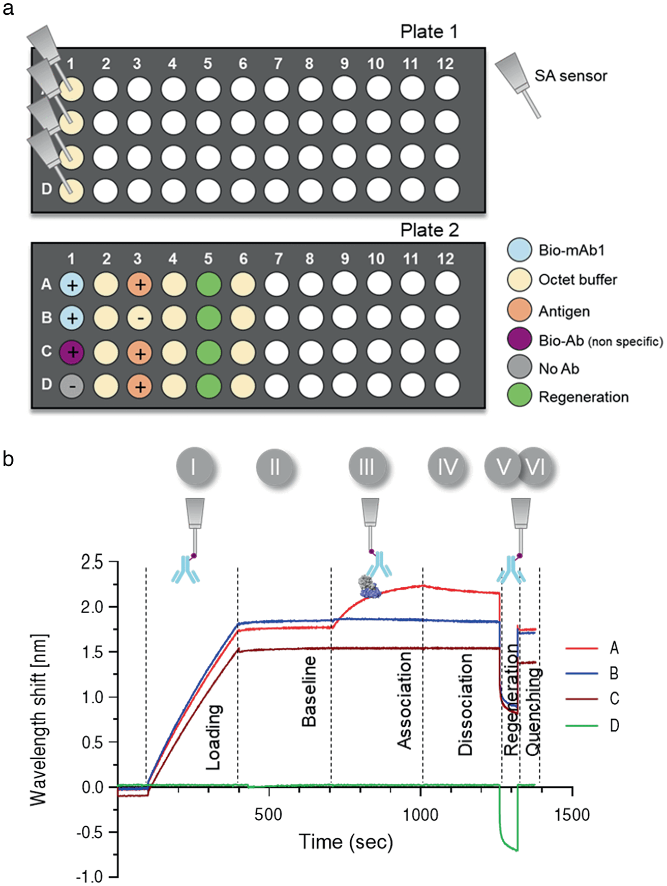

그림 2 분석 매개변수의 보정. (a) 권장 플레이트 레이아웃. 플레이트 1: 4개의 스트렙타비딘 센서의 수화. 플레이트 2: 초기 특성 규명 및 분석 매개변수 보정을 위해 제안된 로딩. (b) 예비 보정 실험의 대표적 실행 결과. 수화 후 센서는 (Octet의 광학 박스에 의해) 플레이트 1에서 수거되어 플레이트 2의 첫 번째 열에 담긴다. 수화된 4개의 센서 중 2개(레인 A 및 B)에는 Bio-mAb1이 로딩되고(I, 로딩), 나머지 2개에는 비특이적 항체 또는 무항체 조건이 로딩된다(각각 레인 C 및 D). 그런 다음 센서는 (Data Acquisition 소프트웨어의 프로그램에 따라) 플레이트 2의 열 사이를 순차적으로 이동하며 세척(II, 기준선)되고 항원과 반응(3열)한다(III, 결합). 3B 웰에는 항원이 로딩되지 않는다(대조군). 세척 사이클(IV, 해리) 후 센서는 재생되고(V) 다시 세척된다(VI, 퀜칭)

3.	 비오틴화 항체를 5–10 µg/ml의 최종 농도로 희석한다.

4.	 항원을 50–200 nM의 최종 농도로 희석한다(참고(Note) 4 참조).

5.	 플레이트 2(그림 2a)에 따라 Octet 결합 완충액, 희석된 항체, 희석된 항원 및 재생 용액을 로딩한다.

6.	 Octet® Data acquisition 소프트웨어에 다음 단계를 프로그래밍한다:

I.	로딩: 300 s

II.	기준선: 300 s

III.	결합: 300 s

IV.	해리: 250 s

V.	재생 펄스: 20–30 s(참고(Note) 5 참조)

VI.	퀜칭: 60 s

7.	 실험을 실행한다. 모든 시간과 농도는 사용자가 조정할 수 있다.

보정 실험의 예가 그림 2b에 제시되어 있다. 레인 A–D는 그림 2a에 기술된 대로 로딩되었다.

3.2.2  보정 실험 분석

1.	 센서에 의해 비오틴화 항체가 포획된 모든 레인(그림 2의 레인 A, B, C)은 유의미한 로딩을 보여야 한다(단계 I, 그림 2b). 최적으로는 0.5–1.5 nm의 파장 이동이 수 분 내에 도달해야 하며 최종적으로 바람직한 파장 이동은 1에서 4 nm 사이이다(참고(Note) 6 참조). 이 단계는 비오틴화 효율과 항체 농도의 영향을 받으므로 원하는 이동이 관찰되지 않는 경우 더 높은 항체 농도를 사용하거나 비오틴화 과정을 반복할 수 있다(참고(Note) 7 참조). 레인 C(비특이적 항체)와 레인 A 및 B(특이적 항체)에서 달성된 서로 다른 파장 이동에서 볼 수 있듯이 항체마다 도달하는 로딩 수준이 다를 수 있다.

2.	 레인 A의 특이적 비오틴화 항체는 유의미한 항체–항원 상호작용(최소 0.2–0.5 nm의 파장 이동, 붉은색 선-결합 단계)을 입증해야 한다. 원하는 이동을 얻기 위해 항원 농도(더 낮게/더 높게)를 조정해야 한다.

3.	 레인 B(파란색 선)는 결합 단계에서 파장 이동을 보이지 않아야 하며, 이는 레인 A에서 관찰된 상호작용이 항체–항원 상호작용에 의한 것임을 나타낸다. 실험 중 기준선 드리프트가 발생하는 경우 레인 A에서 레인 B를 감산하면 이 문제를 보정할 수 있다.

4.	 레인 C(갈색 선)는 항원이 존재함에도 불구하고 결합 단계에서 파장 이동을 보이지 않아야 하며, 이는 항원이 동일 종 항체의 Fc와 비특이적으로 상호작용하지 않음을 나타낸다. 상호작용이 관찰되는 경우 항체 Fab 분획을 사용하거나 가능한 경우 항체를 변경(예: 항원의 하위 단위 사용)하는 것을 고려한다.

5.	 레인 D(초록색 선)는 평평한 직선이어야 한다. 결합 단계에서 어떠한 상호작용도 관찰되지 않아야 하며, 이는 항원이 센서와 비특이적으로 상호작용하지 않음을 시사한다. 상호작용이 관찰되는 경우 센서(참고(Note) 2 참조)나 항원(이전 항목에서 설명한 바와 같음)을 변경하는 것을 고려한다.

6.	 재생 및 퀜칭 후의 기준선이 로딩 후 달성된 기준선과 동일한 경우 센서를 재사용할 수 있다(참고(Note) 5 참조). 더 높은 기준선은 센서 표면에 대한 비특이적 흡착 또는 비가역적 항체–항원 상호작용을 나타내며, 더 낮은 기준선은 센서 표면의 항체가 손상되었음을 나타낼 수 있다. 두 경우 모두 재생 시간과 완충액을 더 온화하거나 더 가혹한 재생 조건으로 변경할 수 있다. 사용한 센서를 장기 보관하려면 결합 완충액에 담가 냉장 보관해야 한다(센서가 한 번 마르면 재사용하지 않는다).

분석 매개변수가 결정되면 그림 3에 기술된 대로 비닝 실험을 진행한다. 이 실험에서는 Bio-mAb1이 로딩된 센서를 (보정 실험 중에 확립된) 단일의 사전 결정된 항원 농도와 함께 인큐베이션하고 세척한 후, 그림 3a에 나타낸 일련의 표지되지 않은 항체(mAb1–8)와 함께 인큐베이션한다. 음성 대조군으로서 항상 표지되지 않은 mAb1(센서에 포획된 항체와 동일함)을 2차 무표지 항체 중 하나로 적용한다. 동일한 항체가 로딩된 센서를 연속적으로 적용하는 대안적 비닝 설정도 가능하다(참고(Note) 8 참조). 이 대안적 설정은 센서가 효과적인 재생을 거쳐 직접 재사용될 수 있는 경우에만 적용할 수 있으며, 실제로 훨씬 경제적이어서 여러 항체 쌍의 동시적 행렬 특성 규명을 가능하게 한다. 본 참고 사항(참고(Note) 8 참조)은 또한 하이브리도마 상층액과 같은 미정제 항체를 사용한 비닝 실험을 수행하기 위한 적절한 대조군(항원 로딩 없이 동일한 모든 시료에 담긴 병렬 센서)을 보여 준다. 상기 모든 설정에 적용된 형식은 고전적인 “샌드위치” 설정인 항체–항원–항체이다. 다른 형식(예: 센서에 의해 포획된 비오틴화 항체와 포획된 항원에 연속적으로 반응할 수 있는 두 개의 표지되지 않은 항체)도 권장되며 다른 연구자들에 의해 사용되었다(Brooks 등 [4]).

#### 3.3  에피토프 비닝

1.	 3.2.1절에 기술된 대로 스트렙타비딘 센서를 수화한다(제시된 예시에서는 8개의 센서).

3.3.1  비닝 실험 수행

2.	 비오틴화된 mAb1(Bio-mAb1)을 Octet® 완충액에 희석하여 최종 농도 5–10 µg/ml, 최종 부피 1600 µl(8개 웰 × 200 µl/웰)로 준비한다.

3.	 표지되지 않은 mAb(mAb1부터 mAb8까지)를 Octet® 완충액에 희석하여 각각 최종 농도 5–10 µg/ml, 최종 부피 200 µl로 준비한다. 표지되지 않은 mAb1을 2차 항체로 적용하는 것은 필수적이다. 이 센서는 분석에서 음성 대조군으로 사용된다.

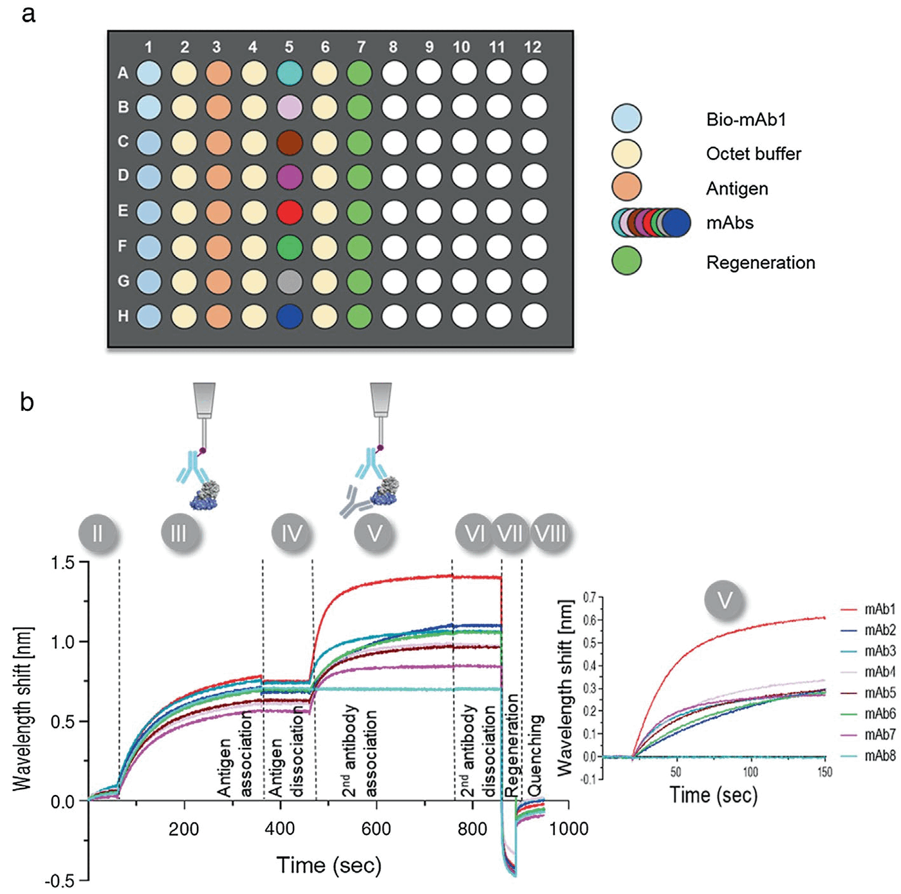

그림 3 에피토프 비닝 실험—병렬 설정. (a) 권장 플레이트 레이아웃. (b) 8개의 서로 다른 단일클론항체의 동시 특성 규명 대표 실행 결과. 8개의 개별 스트렙타비딘 센서에 비오틴화된 mAb1을 로딩하고(1열, I), 세척(II)한 후 항원과 상호작용시킨다(3열, III). 추가 세척 단계(IV) 후 복합체를 8개의 서로 다른 표지되지 않은 mAb(mAb1–8)와 반응시키고(V), 세척(VI), 재생(VII) 및 퀜칭(VIII)을 진행한다. 표지되지 않은 mAb1(청록색)이 음성 대조군으로 사용된다. 모든 세척 단계는 점선으로 표시된다. 단계 V(0으로 정렬된 항체 결합)는 삽입 그래프에 확대되어 있다

4.	 보정 실험에서 사전 결정된 최종 농도(일반적으로 50–200 nM)로 Octet® 완충액에 항원을 최종 부피 1600 µl로 희석한다.

5.	 그림 3a에 표시된 대로 플레이트를 로딩한다.

6.	 Data Acquisition 소프트웨어에 다음 단계를 프로그래밍한다:

I.	로딩: 300 s

II.	기준선: 60 s

III.	결합(항원): 300 s

IV.	해리: 100 s

V.	결합(무표지 항체): 300 s

VI.	해리: 100 s

VII.	재생: 30 s

VIII.	퀜칭: 60 s

7.	 실험을 실행한다. 모든 시간과 농도는 변경할 수 있다.

대표적인 비닝 분석 결과가 그림 3b에 제시되어 있다. 명확성을 위해 항체 로딩(단계 I)은 그림에서 생략되었으며 묘사된 결과는 기준선(단계 II)에 이어 항원 결합부터 시작된다.

3.3.2  비닝 실험 분석

1.	 음성 대조군 레인(그림 3b, 청록색 선)에서 mAb1으로 포획된 항체–항원에 대한 표지되지 않은 mAb1의 “결합”(단계 V, 청록색 선)은 평평하거나(그림 3b의 청록색 선에 나타난 바와 같이) 하향 추세선을 보여야 하며, 이는 mAb1의 단일 인식 부위가 이미 점유되어 있음을 나타낸다(간섭 패턴에서 파장 이동이 관찰되지 않음). 어떠한 결합도 일어나지 않으므로 이 추세선은 실제로 mAb1–항원 해리 속도를 나타낸다. 그러나 음성 대조군의 단계 V에서 결합 사건이 관찰된다면 항원 표면에 해당 항체의 결합 부위가 둘 이상 존재함을 의미할 수 있다. 이러한 경우 복합체를 2차 항체로 탐침하기 전에 항원 포획 후 (표지되지 않은 mAb1을 사용한) 항원 포화 단계를 추가하는 다른 비닝 전략을 적용해야 한다(참고(Note) 9 참조).

2.	 그림 3에 묘사된 구체적인 예에서 검사된 모든 mAb(2–8)는 검사된 항원 상에서 mAb1과 다른 에피토프를 인식한다(이것이 그들 모두가 동일한 에피토프를 인식한다는 것을 의미하지는 않는다).

3.	 항원에 대해 친화도가 크게 다른 두 mAb를 테스트할 때는 가능한 경우 고친화도 항체를 리간드로 사용할 것을 권장한다.

4.	 정확한 “빈(bin)” 분류를 위해 항체 쌍의 상호 교차(reciprocal) 테스트가 권장된다(특히 항체들이 겹치는 에피토프에 결합하는 경우). 동일한 빈에 속하는 모든 항체와 경쟁하지만 다른 빈의 항체와는 경쟁하지 않는 경우 해당 항체는 동일한 빈에 속하는 것으로 분류된다.

5.	 항체 “칵테일”을 사용할 수 있는지 여부(한 항체가 자신의 고유 에피토프에 결합하는 것이 다른 항체들의 결합을 방해하지 않는지 여부)를 결정하려면 각 항체를 단독으로 또는 다른 모든 항체와 동시에 검사하는 결합 실험을 실행한다(참고(Note) 10 참조).

### 4  참고(Notes)

1.	 용해성 무표지 분석물질이 가시적인 파장 간섭 변화를 생성하기에 너무 작지 않은 한(<150 Da), 상기 프로토콜을 다른 리간드/분석물질 쌍에 적용할 수 있다. 분석물질이 너무 작은 경우 앞서 입증된 바와 같이 상호 교차 패러다임(분석물질이 센서 결합 리간드가 되고 리간드가 수용성 무표지 분석물질이 되는 방식)을 사용할 수 있다 [4]. 또 다른 옵션은 이전에 입증된 바와 같이 신호 증폭 단계를 추가하는 것이다 [15]. 자세한 내용은 ForteBio Bio-layer Interferometry Tutorial(https://www.doe-mbi.ucla.edu/wp-content/uploads/2020/01/Kinetic-Presentation.pdf)을 참조한다.

2.	 앞서 언급한 바와 같이 비닝 실험 결과를 올바르게 분석하려면 항체–항원 해리 속도가 센서–항체 해리 속도보다 빠른지 확인하는 것이 중요하다. 따라서 항-Fc 또는 단백질 A/G/L 센서를 적용할 수도 있지만 최소한의 해리 드리프트를 보장하는 비오틴화 항체와 스트렙타비딘 센서를 사용할 것을 적극 권장한다. 공유결합 커플링이 가능한 센서를 사용할 수도 있다. 항-GST, 항-His tag 또는 기타 센서의 성능은 사용 전에 검토되어야 한다.

3.	 BLI 기술은 센서 표면 근처에서 일어나는 변화에 민감하다. 따라서 완충액의 굴절률 변화는 센서 팁 근처에서 파장 이동으로 기록된다(예: 그림 1의 재생 단계 참조). 따라서 결합 단계에 사용되는 시료는 기준선 및 해리 단계에 활용되는 완충액과 동일한 완충액으로 희석할 것을 권장한다. 이것이 불가능한 경우(항원/항체가 다른 완충액에 낮은 농도로 존재하는 경우), 완충액 효과를 피하기 위해 병렬 기준 센서(리간드 로딩 단계 없이 로딩된 센서와 동일한 모든 시료에 담김)를 함께 실행하고 실제 실험에서 감산한다. 예를 들어 참고(Note) 8을 참조한다.

4.	 센서 표면 근처의 파장 이동은 상호작용 물질의 크기와 친화도 모두에 따라 달라진다. 따라서 저분자량 항원은 상호작용 시 가시적이고 유의미한 파장 이동(0.2–0.5 nm)을 달성하기 위해 더 높은 항원 농도를 사용해야 한다. 따라서 결과로 나타나는 이동이 너무 낮으면 더 높은 항원 농도와 더 긴 결합 시간을 사용하거나 로딩 시간을 늘려 리간드 용량을 증가시킨다(항체가 비오틴화 시 활성을 잃지 않았음을 확인한 후 진행. 이는 ELISA 분석에서 표지된 항체와 표지되지 않은 항체의 성능을 비교하여 확인할 수 있음).

5.	 재생 단계의 목적은 센서를 박리하여 후속 분석에서 재사용할 수 있도록 하는 것이다. 따라서 포획된 항체에 잔류 항원이 남아 있지 않으면서 항체가 온전한 활성을 유지할 수 있도록 재생 펄스의 길이와 사용되는 완충액의 가혹성 사이에 균형을 유지해야 한다. 센서를 재사용할 때는 일련의 실험 전후에 알려진 표준 물질(특성 규명된 항원일 수 있음)을 실행하고 상호작용 시 파장 간섭의 진폭을 비교할 것을 권장한다. 진폭이 동일해야 해당 센서로 수행된 모든 실험이 유효함을 나타낸다. 다른 센서(아민 커플링 센서 제외)를 사용할 때 재생 후의 기준선은 사용하지 않은 센서의 기준선(로딩 단계가 아님!)과 동일해야 하며, 재사용을 위해서는 각 사이클마다 로딩 단계를 수행해야 한다는 점에 유의한다.

6.	 리간드 로딩 밀도는 특히 친화도 측정을 수행할 때 결과 해석에 영향을 미칠 수 있는 중요한 매개변수이다. 친화도 측정의 경우 결합력(avidity) 효과를 최소화하기 위해 더 낮은 리간드 밀도가 권장된다. 그러나 비닝의 경우 저친화도 항체의 검출을 가능하게 하기 위해 높은 밀도(3–4 nm 또는 센서가 포화될 때까지)가 권장된다.

7.	 때때로 비오틴화 과정이 결합 활성의 손실로 이어질 수 있다. 이러한 경우 더 낮은 비오틴/항체 몰 과량 비율을 적용하여 더 온화한 반응을 수행할 수 있다(제조사의 지침 참조). 대안적으로 다른 센서를 사용할 수 있다(참고(Note) 2 참조).

8.	 그림 4에 나타낸 바와 같이 동일한 로딩 센서를 활용하여 연속적인 방식으로 비닝 실험(그림 3에 기술된 것과 유사함)을 수행할 수도 있다. 이 예시(그림 4a, 파란색 선)에서는 스트렙타비딘 센서에 항체(Bio-mAb1)를 로딩하고 순환 방식으로 쌍체 실험을 수행하며, 2차 항체와의 상호작용 후 센서를 재생하여 직접 재사용한다. 이 예시에서 테스트된 항체는 정제되지 않은 하이브리도마 상층액(Octet 완충액과 1:1 희석됨)으로 적용되었음에 유의한다. 이 경우 결정적인 요소는 항원이 로딩되지 않은 추가 기준 센서이다(그림 4a, 붉은색 선). 확인할 수 있듯이(그림 4b, 보라색 선), 기준 센서를 감산하여 (완충액 조성의 불일치로 인한) 굴절률 변화 효과를 제거한 후에야 결과를 명확히 해석할 수 있다. 또 다른 중요한 대조군(앞서 언급한 바와 같음)은 센서에 의해 포획된 것과 동일한 항체를 표지되지 않은 항체로 실행하는 것이다. 이 경우 표지되지 않은 mAb1(음성 대조군)은 mAb1으로 포획된 항원과 상호작용하지 않음이 명확하다(음성 대조군 항체의 결합 시도 중에 관찰되는 하향 추세는 실제로 센서 결합 mAb1으로부터 항원이 해리되는 속도이다). 또한 mAb2와 4는 mAb1과 다른 에피토프와 상호작용하는 반면 mAb3은 동일한 에피토프를 인식함을 유추할 수 있다(그림 4b). 특성 규명 대상 항체들이 조 하이브리도마 상층액으로 테스트되는 반면 센서 결합 항체는 정제 및 비오틴화되어야 한다는 점을 지적하는 것이 중요하다(3.3절에 기술된 바와 같이 이것이 불가능한 경우 다른 형식을 사용할 수 있음). 증발을 피하기 위해 긴 실험 중에는 BLI 플레이트를 덮어 둘 것(장비가 허용하는 경우)을 권장한다. 증발은 완충액 조성을 변화시켜 기준선 드리프트를 유발한다.

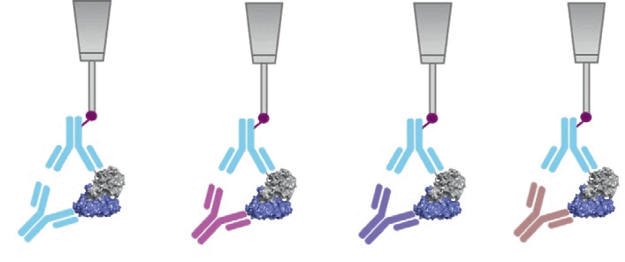

그림 4 순차적 에피토프 비닝 형식—조 하이브리도마 상층액 특성 규명을 위한 적용. (a) 테스트 센서(A—파란색) 및 대조군 센서(B—빨간색)의 대표적 실행 결과. (b) 대조군이 감산된 테스트 센서그램(A–B). 두 개의 스트렙타비딘 센서에 Bio-mAb1을 로딩한다. 고전적 쌍체 매핑의 4개 사이클(기준선, 항원 결합, 항원 해리, 2차 무표지 하이브리도마 상층액(Octet 완충액에 1:1 희석) 결합, 2차 항체 해리, 재생 및 퀜칭)을 연속적으로 실행한다. 대조군 센서는 항원 없이 동일한 시료/완충액에 담근다

9.	 다가 항원을 사용할 때는 mAb1으로 포획된 항원 상의 mAb1의 모든 부위를 차단하는 것이 결정적으로 중요하다. 따라서 그림 5에 나타낸 바와 같이 2차 항체를 첨가하기 전에 (포화될 때까지) 차단 단계를 추가해야 한다. 결과의 올바른 해석을 위해 두 개의 독립적인 사이클을 실행하는데, 첫 번째는 이전 절에서 기술된 고전적 비닝과 동일하며(그림 5, 사이클 I), 두 번째는 복합체를 2차 항체로 탐침하기 전에 추가 차단 단계를 거친다. 첫 번째 사이클을 통해 상호작용 시 간섭 패턴의 최대 이동을 결정할 수 있으므로 두 번째 사이클에서 관찰된 결과의 해석이 가능해진다. 음성 대조군으로 표지되지 않은 mAb1을 2차 항체로 사용한다. 첫 번째 및 두 번째 사이클에서의 2차 항체 결합 곡선(0으로 정규화됨)이 그림 5b에 제시되어 있다.

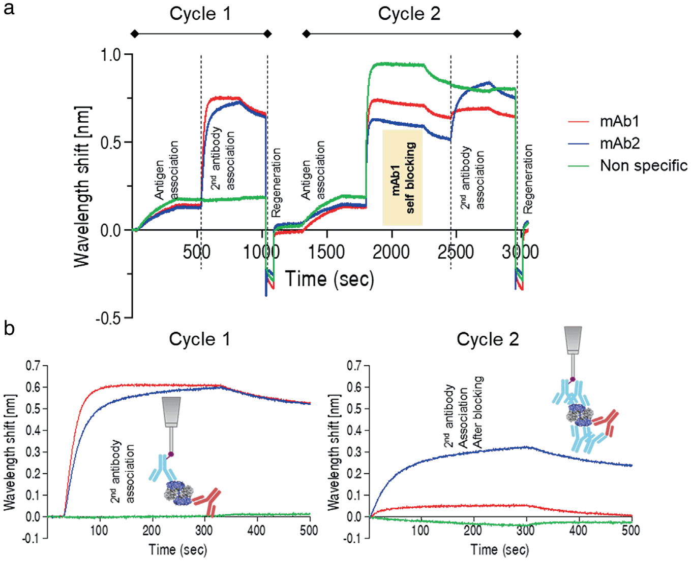

그림 5 다가 항원을 이용한 에피토프 비닝. (a) 다가 항원을 이용한 비닝의 2-사이클 대표 실행 결과. (b) 사이클 1 및 2의 2차 항체 결합 단계(0으로 정렬됨). 스트렙타비딘 센서를 Bio-mAb1과 반응시켜 항원을 포획하는 데 사용한다. 첫 번째 사이클에서 mAb1 포획 항원은 2차 항체인 mAb1, mAb2 또는 비특이적 항체와 직접 반응한다(각각 빨간색, 파란색 및 초록색 선). 재생 후 절차를 반복하되, 이번에는 2차 항체를 첨가하기 전에 mAb1 자체 차단 단계(노란색 상자로 표시됨, 450 s 동안 100 nM mAb1)를 포함한다

차단이 없을 때 mAb1(빨간색 선)은 mAb1–항원 복합체에 결합할 수 있지만(사이클 1), 차단 후(사이클 2)에는 결합이 거의 관찰되지 않음이 분명하다. 대조적으로 mAb2는 차단 유무에 관계없이 항원에 결합한다. 두 번째 사이클에서의 최대 파장 이동은 차단 없이 관찰된 이동(첫 번째 사이클)의 약 절반이며, 이는 아마도 일부 입체적 간섭이 발생함을 나타낸다.

10.	 (특정 항원 상의 서로 다른 에피토프를 인식하는) 모든 항체가 동시에 결합할 수 있는지 확인하기 위해 다음 실험을 실행한다(그림 6): 정제 및 비오틴화된 mAb1을 스트렙타비딘 센서로 포획하고 항원과 상호작용시킨다. 그런 다음 서로 다른 “빈”을 대표하는 mAb 2, 3, 4, 5를 결과로 생성된 mAb1–항원 복합체와 동시에 반응시킨다. 최대 파장 이동을 확립하기 위한 대조군으로서 동일한 mAb1–항원 복합체에 대해 각 항체를 개별적으로 실행한다.


그림 6 단일클론항체의 동시 결합. mAb1을 센서에 고정화하고 항원을 로딩한다(이 단계들은 도시된 센서그램에서 생략됨). 형성된 복합체를 표시된 항체들이 담긴 웰에 순차적으로 담근다(빨간색 선). 각 항체의 결합 후 세척 단계(점선으로 표시됨)를 수행한다. mAb1–항원 복합체에 대한 mAb 2, 3, 4, 5의 개별 반응도 함께 묘사되어 있다(각각 파란색, 초록색, 분홍색 및 갈색 선)

항체가 단독으로 결합하든 다른 항체 다음에 결합하든 최대 파장 이동은 동일해야 한다. 센서 결합 항체와 연속 결합 항체의 순서가 서로 다른 여러 가능한 조합을 실행한다. 일부 방해가 관찰되면 해당 항체 중 하나를 “칵테일”에서 제외하는 것을 고려한다.

이해 상충

저자들은 본 장의 내용과 관련하여 선언할 이해 상충이 없다.

### 참고문헌

1.	Kaplon 
H, 
Crescioli 
S, 
Chenoweth 
A, 
Visweswaraiah J, Reichert JM (2023) Antibodies 
to watch in 2023. MAbs 15(1):2153410. 
https://doi.org/10.1080/19420862.2022.2
153410
	 2.	Lu RM, Hwang YC, Liu IJ, Lee CC, Tsai

Mechaly A (2021) Sensitive immunodetection 
of severe acute respiratory syndrome coronavirus 2 variants of concern 501Y.V2 and 501Y.
V1. J Infect Dis 224(4):616–619. https://doi.
org/10.1093/infdis/jiab278
	 8.	Mechaly A, Vitner EB, Levy Y, Gur D,

HZ, Li HJ, Wu HC (2020) Development of 
therapeutic antibodies for the treatment of 
diseases. J Biomed Sci 27(1):1. https://doi.
org/10.1186/s12929-019-0592-z
	 3.	Wang Z, Wang G, Lu H, Li H, Tang M,

Barlev-Gross M, Sittner A, Koren M, Levy 
H, Mamroud E, Fisher M (2021) Epitope 
binning of novel monoclonal anti F1 and 
anti LcrV antibodies and their application in 
a simple, short, HTRF test for clinical plague 
detection. Pathogens 10(3):285. https://doi.
org/10.3390/pathogens10030285 
	 9.	Li M, Lee D, Obi CR, Freeberg JK, Farr-Jones

Tong A (2022) Development of therapeutic 
antibodies for the treatment of diseases. Mol 
Biomed 3(1):35. https://doi.org/10.1186/
s43556-022-00100-4
	 4.	Brooks BD, Miles AR, Abdiche YN (2014)

S, Tomic MT (2018) An ambient temperature-stable antitoxin of nine co-formulated 
antibodies for botulism caused by serotypes A, 
B and E. PLoS One 13(5):e0197011. https://
doi.org/10.1371/journal.pone.0197011
	10.	Noy-Porat T, Alcalay R, Epstein E, Sabo T,

High-throughput epitope binning of therapeutic 
monoclonal antibodies: why you need to bin the 
fridge. Drug Discov Today 19(8):1040–1044. 
https://doi.org/10.1016/j.drudis.2014.
05.011
	 5.	Zhang W, Wang H, Feng N, Li Y, Gu J,

Kronman C, Mazor O (2017) Extended therapeutic window for post-exposure treatment 
of ricin intoxication conferred by the use of 
high-affinity antibodies. Toxicon 127:100–105. 
https://doi.org/10.1016/j.toxicon.2017.
01.009
	11.	Rasetti-Escargueil C, Avril A, Miethe S, Mazuet

Wang Z (2022) Developability assessment at 
early-stage discovery to enable development 
of antibody-derived therapeutics. Antibody 
Therapeutics 
6(1):13–29. 
https://doi.
org/10.1093/abt/tbac029
	 6.	Mechaly A, Alcalay R, Noy-Porat T, Epstein

C, Derman Y, Selby K, Thullier P, Pelat T, 
Urbain R, Fontayne A, Korkeala H, Sesardic 
D, Hust M, Popoff MR (2017) The European 
AntibotABE framework program and its 
update: development of innovative botulinum 
antibodies. Toxins (Basel) 9(10). https://doi.
org/10.3390/toxins9100309
	12.	Le HT, Liu M, Grimes CL (2023) Application

E, Gal Y, Mazor O (2018) Novel phage display-derived 
anti-abrin 
antibodies 
confer 
post-exposure protection against abrin intoxication. Toxins (Basel) 10(2):80. https://doi.
org/10.3390/toxins10020080 
	 7.	Barlev-Gross M, Weiss S, Paran N, Yahalom-

Ronen Y, Israeli O, Nemet I, Kliker L, 
Zuckerman N, Glinert I, Noy-Porat T, Alcalay 
R, Rosenfeld R, Levy H, Mazor O, Mandelboim 
M, Mendelson E, Beth-Din A, Israely T,

of bioanalytical and computational methods in 
decoding the roles of glycans in host-pathogen 
interactions. Curr Op Chem Biol 74:102301.

https://doi.org/10.1016/j.cbpa.2023.
102301
	13.	Murali S, Rustandi RR, Zheng X, Payne A,

Characterization of antibody-antigen interactions using biolayer interferometry. STAR Protoc 
2(4):100836. 
https://doi.org/10.1016/j.
xpro.2021.100836
	15.	Mechaly A, Cohen H, Cohen O, Mazor O

Shang L (2022) Applications of surface plasmon resonance and biolayer interferometry 
for virus-ligand binding. Viruses 14(4):717. 
https://doi.org/10.3390/v14040717
	14.	Noy-Porat T, Alcalay R, Mechaly A, Peretz E,

(2016) A biolayer interferometry-based assay 
for rapid and highly sensitive detection of 
biowarfare agents. Anal Biochem 506:22–27. 
https://doi.org/10.1016/j.ab.2016.04.018

Makdasi E, Rosenfeld R, Mazor  O (2021)

## 제13장 AbMap을 이용한 항체 결합 에피토프의 고처리량 프로파일링

Wen-jing Du, Huan Qi, Sheng-ce Tao

### 초록

항체는 기초 연구와 임상 실무 모두에서 결정적인 역할을 담당한다. 항체와 그 항원 사이의 결합 경계면, 즉 에피토프는 항체의 본질을 규정하는 핵심 특징이다. 정확한 에피토프 매핑은 항체 기반 시약 및 치료제 개발뿐만 아니라 지식재산권 보호에도 필수적이다. 여기서는 새로운 고처리량 기술인 항체 결합 에피토프 매핑(AbMap) 버전 1.0의 상세한 절차를 제시한다. 다목적 파지 디스플레이 펩타이드 라이브러리와 차세대 염기서열 분석(NGS)을 결합한 AbMap은 단 한 번의 실행으로 수백에서 수천 개의 항체 결합 에피토프를 포괄적으로 프로파일링할 수 있게 해 준다.

핵심어  AbMap, 에피토프 매핑(Epitope mapping), 파지 디스플레이, 펩타이드 스크리닝, 차세대 염기서열 분석(NGS)

### 1  서론

항체는 과학 연구, 진단, 질병 치료에서 핵심적인 역할을 한다. 항체가 항원의 표면에 있는 에피토프를 통해 특정 항원을 인식하는 능력은 항체 기능의 근간이다. 에피토프 매핑(epitope mapping)은 항원-항체 상호작용의 기전을 이해하는 데 매우 중요하며, 항체 기반 시약과 치료제의 개발, 그리고 지적재산 보호에도 기여한다.

현재까지 약 700만 개의 항체가 생산되었지만, 이들 대부분은 에피토프 정보가 알려져 있지 않다 [1]. 항체의 에피토프를 효율적으로 규명하기 위해 우리는 Antibody binding epitope Mapping(AbMap) 기술을 개발하였다 [2]. AbMap은 파지 디스플레이된 무작위 펩타이드 라이브러리(phage-displayed random peptide library)와 차세대 염기서열 분석(NGS)을 강력하게 결합하여 고처리량(high-throughput) 에피토프 프로파일링을 가능하게 한다 [3, 4]. AbMap에서는 각 항체를 파지 디스플레이된 무작위 펩타이드 라이브러리와 함께 인큐베이션한다. 항체에 결합한 파지는 단백질 G 코팅된 자성 비드(protein G-coated magnetic beads)로 농축(co-immunoprecipitated)되고, 결합하지 않은 파지는 세척하여 제거된다. 항체에 결합한 펩타이드는 농축된 파지의 염기서열을 해독함으로써 확인되며, 이 결합 펩타이드로부터 에피토프를 계산할 수 있다.

무작위 펩타이드 라이브러리의 다용성과, 바코드가 부착된 혼합 시료를 고처리량으로 해독할 수 있는 NGS의 강력한 능력 덕분에, AbMap은 한 번의 실험으로 수백에서 수천 개의 항체 에피토프를 해독할 수 있다. AbMap의 기본 워크플로는 세 가지 주요 단계로 구성된다: (1) 항체 결합 파지의 스크리닝, (2) NGS용 라이브러리 구성, (3) 에피토프의 처리와 계산(Fig. 1). 이 장에서는 연구자들이 효율적이고 신뢰성 있게 에피토프를 프로파일링할 수 있도록 AbMap 기술(버전 1.0)의 상세한 실험 절차를 제공한다.

### 2  재료

1.	 96-well 폴리프로필렌 PCR 마이크로플레이트(ABI 호환, 반스커트(semi-skirted), 투명, 비멸균).

2.	 자체접착 밀봉 필름(self-adhesive sealing film).

3.	 Tris 완충 생리식염수(Tris-buffered saline, 10× TBS): 1.5 M NaCl, 0.5 M Tris-HCl, pH 7.4.

4.	 TBST: 0.5% Tween-20이 포함된 1× TBS.

5.	 차단액(blocking solution): TBST에 3% (m/V) 소 혈청 알부민(BSA)을 녹인 것.

6.	 파지 디스플레이 무작위 펩타이드 라이브러리, Ph.D.-12 (New England Biolabs).

7.	 테스트할 항체(antibodies to be tested).

8.	 양성 대조군(positive control): 항-His(anti-His, Sigma-Aldrich, cat. no. 05-949) 및 항-GST 태그(anti-GST tag, Sigma-Aldrich, cat. no. G7781) 항체.

9.	 96-well 플레이트용 자석 스탠드(magnetic stand for 96-well plates).

10.	 면역침전용 단백질 G 자성 비드(protein-G magnetic beads for immunoprecipitation).

#### 2.1  항체 결합 파지의 스크리닝

1.	 Q5® Hot Start High-Fidelity DNA Polymerase (New England Biolabs).

2.	 Q5® Reaction Buffer Pack (New England Biolabs).

3.	 바코딩 및 인덱싱용 프라이머(primers for barcoding and indexing; Tables 1 및 2 참조).

4.	 6× DNA 로딩 완충액(DNA loading buffer).

5.	 DNA 염색용 형광 염료(fluorescent dye for DNA staining).

6.	 DNA 표준 마커(DNA standard marker).

7.	 Luria-Bertani 배지(LB broth media): 트립톤(tryptone) 10 g/l, 효모 추출물(yeast extract) 5 g/l, 염화나트륨(sodium chloride) 10 g/l.

8.	 암피실린(ampicillin, 100 ng/ml)이 첨가된 LB-agar 플레이트.

9.	 겔 DNA 추출 키트(gel DNA extraction kit).

10.	 Taq DNA 중합효소(Taq DNA polymerase).

11.	 pMD™18-T Vector Cloning Kit (TaKaRa. 이 시약은 TA 클로닝(TA cloning)에 사용되며, 매우 일반적인 실험이므로 다른 공급업체의 유사 제품도 잘 작동함).

12.	 DH5α 적격 세포(DH5α competent cells).

13.	 UV 영상 시스템(UV imaging system).

14.	 UV-Vis 마이크로볼륨 분광광도계(UV-Vis microvolume spectrophotometer).

#### 2.2  NGS용 라이브러리 구성

1.	 Trimmomatic 소프트웨어(https://github.com/usadellab/Trimmomatic).

2.	 MEME 웹서버(https://memesuite.org/meme/tools/meme).

#### 2.3  NGS 데이터 처리 및 분석

### 3  방법

#### 3.1  항체 결합 파지의 스크리닝

1.	 96-well 플레이트의 각 웰에 차단액 200 μl를 넣는다. 자체접착 밀봉 필름으로 밀봉하고 4°C에서 하룻밤(12–16 h) 회전시킨다.

2.	 차단액을 버리고, 흡수지로 깐 원심분리용 바스켓을 사용하여 1,000 × g에서 1분간 원심분리하여 배출한다(참고 Note 1).

3.1.1  차단

#### 3.1.2  항체와 파지 디스플레이된 무작위 펩타이드 라이브러리의 인큐베이션

1.	 각 웰당 필요한 파지 라이브러리와 TBST의 부피를 계산한다. 파지 라이브러리와 TBST를 미리 혼합하고, 차단된 96-well 플레이트의 각 웰에 이 혼합액을 분주하여, 이론적 라이브러리 다양성(diversity)의 100배 커버리지(100-fold coverage)에 해당하는 입력량이 각 웰에 들어가도록 하고, 최종 부피를 TBST로 200 μl로 맞춘다(참고 Note 2).

2.	 미리 설계된 배치에 따라 각 웰에 항체 1 μg을 넣는다. 이때 양성 대조군인 항-His 및 항-GST 항체를 포함시킨다. 또한 배경 잡음(background noise)을 제거하기 위해 항체를 전혀 넣지 않는 공백 대조군(blank control) 웰을 최소 세 개 이상 남겨둔다(참고 Note 3).

3.	 자체접착 밀봉 필름으로 플레이트를 밀봉하고 4°C에서 하룻밤(12–16 h) 회전시켜 항체와 파지 간의 상호작용이 일어나도록 한다. 그런 다음 짧게 원심분리하여 튜브 벽과 밀봉 필름에 맺힌 액적을 모은다.

#### 3.1.3  항체 결합 파지의 유전체 획득

1.	 자석 스탠드 위에서 TBST로 단백질 G 자성 비드 현탁액을 세 번 세척하고, 각 세척 시 최소 세 번 이상 피펫으로 불어넣는다(참고 Note 4).

2.	 각 웰에 단백질 G 자성 비드 현탁액 10 μl를 넣는다.

3.	 플레이트를 밀봉하고 4°C에서 4시간 회전시킨다. 그런 다음 짧게 원심분리하여 튜브 벽과 밀봉 필름에 맺힌 액적을 모은다.

4.	 플레이트를 자석 랙에 몇 분간 올려 비드를 응집시키고 상층액(supernatant)을 조심스럽게 제거하여 버린다. 비드를 200 μl TBST로 세 번 세척한 후, 마지막으로 ddH2O로 한 번 더 헹군다(참고 Note 5).

5.	 각 웰에 ddH2O 25 μl를 넣는다. 플레이트를 밀봉하고 보텍스(vortex)하여 내용물을 재현탁시킨다. 그런 다음 짧게 원심분리하여 튜브 벽에 맺힌 액적을 모으고, 비드 현탁액을 새 96-well 플레이트로 옮긴다.

6.	 플레이트를 95°C에서 5분간 가열하여 파지 DNA를 방출시킨다(참고 Note 6).

7.	 샘플을 실온에서 냉각시킨다. 그런 다음 짧게 원심분리하여 액적을 모은다.


Fig. 1 AbMap의 개략도와 워크플로. (a) 각 항체에 결합한 파지는 단백질 G 코팅된 자성 비드로 선별되어 농축된다. (b) 농축된 파지로부터 DNA를 방출하고 PCR을 통해 고유의 바코드와 인덱스 쌍으로 태그한다. (c) 혼합된 PCR 산물을 NGS 염기서열 분석에 사용하고, 염기서열 데이터를 처리하여 에피토프를 결정한다.

농축된 파지 유전체는 두 차례의 PCR을 통해 증폭되며, 서로 다른 인덱스와 바코드를 도입하여 Fig. 2에 나타난 구조의 NGS 라이브러리를 완성한다.


Fig. 2 NGS 라이브러리의 유전자 구조

Fig. 3 NGS 라이브러리의 품질 관리 예시. 15개의 단일 클론 중 13개가 선택된 프라이머와 동일한 인덱스 서열을 공유한다. 따라서 NGS 라이브러리 내 DNA의 80% 이상이 올바른 구조를 가지고 있음을 추정할 수 있다.

#### 3.2  NGS용 라이브러리 구성

3.2.1  첫 번째 PCR: 바코딩

1.	 각 웰을 서로 구분할 수 있도록 서로 다른 바코드를 도입하는 초기 PCR용 프라이머를 선택한다(Table 1; 참고 Note 7).

2.	 항체 결합 파지에서 방출된 DNA를 주형(template)으로 사용한다. 아래 설명과 같이 새 96-well 플레이트에서 각 웰의 PCR 반응을 준비한다(참고 Note 8).

| 구성 성분 | 부피(μl) | 최종 농도 |
|---|---|---|
| Template | 15 | — |
| Q5 reaction buffer (5×) | 5 | 1× |
| First PCR primer-F (10 μM) | 0.5 | 0.2 μM |
| First PCR primer-R (10 μM) | 0.5 | 0.2 μM |
| dNTPs (10 mM) | 0.5 | 200 μM |
| Q5 polymerase (2 units/μl) | 0.25 | 0.02 units/μl |
| ddH2O | 3.25 | — |
| **Total** | **25** | — |

3.	 자체접착 밀봉 필름으로 96-well PCR 플레이트를 밀봉한다. 그런 다음 보텍스하여 혼합하고, 1,000 × g에서 1분간 원심분리하여 모든 액체를 모은다.

4.	 플레이트를 PCR 기기에 넣고 아래 절차에 따라 반응을 수행한다.

| 온도 | 시간 |
|---|---|
| 98°C | 10 min |
| 94°C | 30 s |
| 25 cycles | 55°C | 30 s |
| | 72°C | 30 s |
| 72°C | 2 min |
| 4°C | Hold on |

5.	 2% 아가로스 겔로 전기영동하여 PCR 산물(~170 bp)을 확인한다: 각 웰에 6× DNA 로딩 완충액 5 μl를 넣고, 혼합액 25 μl를 120 V에서 45분간 전기영동한다.

6.	 UV 광 아래에서 겔을 관찰하고 ~170 bp의 관심 밴드를 절취한다. 그런 다음 겔 DNA 추출 키트를 사용하여 DNA를 추출하고 정제한다. DNA 용출 시에는 65–70°C로 예열한 ddH2O 30 μl를 사용하는 것이 권장된다.

3.2.2  두 번째 PCR: 인덱싱

1.	 서로 다른 플레이트에 해당하는 서로 다른 인덱스를 도입하는 두 번째 PCR용 프라이머를 선택한다(Table 2; 참고 Note 7).

2.	 첫 번째 PCR에서 정제된 DNA를 주형으로 사용한다. 아래 설명과 같이 새 96-well 플레이트에서 각 웰의 두 번째 PCR을 준비한다(참고 Note 9).

| 구성 성분 | 부피(μl) | 최종 농도 |
|---|---|---|
| Template | 5 | — |
| Q5 reaction buffer (5×) | 5 | 1× |
| Second PCR primer-F (10 μM) | 1.25 | 0.5 μM |
| Second PCR primer-R (10 μM) | 1.25 | 0.5 μM |
| dNTPs (10 mM) | 0.5 | 200 μM |
| Q5 polymerase (2 units/μl) | 0.25 | 0.02 units/μl |
| ddH2O | 11.75 | — |
| **Total** | **25** | — |

3.	 자체접착 밀봉 필름으로 96-well PCR 플레이트를 밀봉한다. 그런 다음 보텍스하여 혼합하고, 1,000 × g에서 1분간 원심분리한다.

4.	 플레이트를 PCR 기기에 넣고 아래에 제시된 절차에 따라 증폭을 수행한다.

| 온도 | 시간 |
|---|---|
| 98°C | 10 min |
| 94°C | 30 s |
| 10 cycles | 55°C | 30 s |
| | 72°C | 30 s |
| 72°C | 2 min |
| 4°C | Hold on |

5.	 두 번째 PCR 산물의 평가는 첫 번째 PCR과 동일하다: 각 웰에 6× DNA 로딩 완충액 5 μl를 넣고, 혼합액 25 μl를 2% 아가로스 겔에 로딩하여 120 V에서 45분간 전기영동한다.

6.	 UV 광 아래에서 겔을 관찰하고 ~240 bp의 관심 밴드를 절취한다. 그런 다음 겔 DNA 추출 키트를 사용하여 DNA를 추출하고 정제한다. DNA 용출 시에는 65–70°C로 예열한 ddH2O 30 μl를 사용한다.

7.	 UV–Vis 마이크로볼륨 분광광도계를 사용하여 각 정제된 PCR 산물의 농도를 측정한다. 각 정제된 PCR 산물의 등몰량(equimolar amounts)을 합쳐 혼합물을 만들면, 이것이 NGS 라이브러리가 된다.

NGS 라이브러리는 TA 클로닝과 Sanger 염기서열 분석으로 평가한다.

3.2.3  NGS 라이브러리의 품질 관리

1.	 아래와 같이 아데노신 첨가 반응(adenosine-adding reaction)을 준비한다.

| 구성 성분 | 부피 | 최종 농도 |
|---|---|---|
| Template | 250 ng | 10 ng/μl |
| Taq buffer (10×) | 2 μl | 1× |
| dNTPs (10 mM) | 0.5 μl | 200 μM |
| Taq polymerase (5 units/μl) | 0.4 μl | 2 U |
| Bacteria free ddH2O | Up to 25 μl | — |
| **Total** | **25 μl** | — |

2.	 내용물을 부드럽게 혼합한다. 그런 다음 튜브를 PCR 기기에 넣고 72°C에서 30분간 인큐베이션한다.

3.	 아래와 같이 증폭된 유전자를 TA 클로닝 벡터에 삽입한다.

| 구성 성분 | 부피 |
|---|---|
| Adenosine-adding products | 4 μl (50 μg) |
| pMD-18T vector | 1 μl (50 μg) |
| Solution I | 5 μl |
| **Total** | **10 μl** |

4.	 내용물을 부드럽게 혼합한다. 그런 다음 튜브를 PCR 기기에 넣고 16°C에서 30분간 인큐베이션하여 증폭된 유전자와 TA 벡터의 연결(ligation)이 일어나도록 한다.

5.	 TA 클로닝 산물 10 μl를 DH5α 적격 세포 100 μl에 넣고 부드럽게 저어 혼합한다.

6.	 세포 혼합물을 얼음 위에서 30분간 인큐베이션한다.

7.	 세포를 42°C에서 45초간 열충격(heat shock)한 후 즉시 얼음 욕조(ice bath)로 2분간 옮긴다.

8.	 항생제가 없는 LB 배양액 900 μl를 넣는다. 변형된 대장균(E. coli) 세포를 200 rpm 셰이커에서 37°C에서 1시간 배양한다.

9.	 배양액을 1500 × g에서 2분간 원심분리한다. 상층액 900 μl를 버리고 침전물(pellet)을 재현탁시킨다.

10.	 마지막으로, 세균 현탁액을 암피실린(100 ng/ml)이 첨가된 두 개의 LB-agar 플레이트 위에 펼친다. 이때 한 플레이트에는 30 μl, 다른 플레이트에는 60 μl를 사용한다.

11.	 플레이트를 37°C에서 하룻밤 인큐베이션하여 세균이 자라도록 한다.

12.	 플레이트에서 단일 클론(single clone)을 무작위로 여러 개(보통 약 15개) 골라 각각 1 ml의 암피실린(100 ng/ml)이 포함된 LB 액체 배지에 접종한다. 200 rpm 셰이커에서 37°C에서 6시간 배양한다. 그런 다음 각 삽입체의 구조와 인덱스 및 바코드 쌍의 염기서열을 검증하기 위해 Sanger 염기서열 분석을 수행한다(Figs. 2 및 3).

13.	 정제 및 검증된 DNA를 차세대 염기서열 분석(NGS)로 보낸다.

Trimmomatic(버전 0.35) 소프트웨어를 사용하여 원시 데이터(raw data)에서 품질이 낮은 리드를 필터링하였다. MINLEN 파라미터를 150으로 설정하고, 나머지 파라미터는 기본값(default)을 유지하였다. 라이브러리의 삽입 크기가 103 bp이므로 각 리드의 나머지 47 bp는 3′ 어댑터로 트리밍된다. 염기서열 분석의 정확도를 최대한 보장하기 위해, 삽입 서열(103 bp 영역)이 동일한 길이를 가진 쌍 리드(paired reads)만 후속 분석에 사용한다.

#### 3.3  NGS 데이터 처리 및 분석

3.3.1  NGS 데이터의 품질 관리

3.3.2  펩타이드 개수 정규화

1.	 각 필터링된 유효 데이터를 해당 항체의 바코드와 인덱스 서열에 따라 할당한다. 그런 다음 파지 디스플레이된 펩타이드를 암호화하는 36 bp 뉴클레오타이드 서열을 12-mer 아미노산 서열로 번역한다.

2.	 각 항체에 대해 각 펩타이드 서열의 리드 수(read count)를 해당 항체의 전체 염기서열 리드 수로 나누어 정규화한다. 이렇게 하면 각 샘플의 각 펩타이드에 대한 정규화된 리드 수(normalized read count)가 산출된다.

아래 공식에서 r_peptide X는 펩타이드 서열의 리드 수를, R_total은 샘플의 전체 염기서열 리드 수를 나타낸다. 산출된 정규화된 리드 수는 샘플이 포획한 펩타이드의 빈도(frequency)를 나타내며, 이를 F_peptide X로 표현한다.

$$ r_{\text{peptide X}} = \frac{R_{\text{peptide X}}}{R_{\text{total}}} $$

3.3.3  각 항체에 대한 결합 펩타이드 식별

1.	 각 펩타이드의 농축 인자(enrichment factor, E)는 항체 샘플의 정규화된 리드 수를 공백 대조군(blank control)의 정규화된 리드 수로 나눈 값으로 정의된다. 공백 대조군에서 펩타이드의 리드 수가 0이면 0.1을 할당한다.

아래 공식에서 F_peptide X는 공백 대조군에서의 펩타이드 정규화된 리드 수를 나타낸다.

$$ E = \frac{F_{\text{peptide X}}}{f_{\text{peptide X}}} $$

공백 대조군의 펩타이드 리드 수는 배경 잡음의 존재로 인해 항체보다 현저히 높은 E 값을 자주 보인다. 따라서 항체 샘플의 정규화된 리드 수를 공백 대조군의 정규화된 리드 수로 나누어 역 농축 인자(reverse enrichment factor, E⁻¹)를 계산한다.

$$ E^{-1}_{\max} = 1 \times \text{cutoff} $$

각 항체별로 각 펩타이드의 1× 및 3× 컷오프(cutoff)를 계산한다. E > 1× 컷오프인 펩타이드만 후속 분석을 위한 결합 펩타이드로 유지한다.

2.	 최대 역 농축 인자(E⁻¹_max)를 사용하여 1× 컷오프를 산출한다. 각 항체별로 각 펩타이드의 1× 및 3× 컷오프를 계산한다. 농축 인자가 1× 컷오프보다 큰 펩타이드만 후속 분석을 위한 결합 펩타이드로 유지한다.

각 항체의 결합 펩타이드를 MEME의 독립형 버전(standalone version)에 제출하여 에피토프 분석을 수행한다. 파라미터는 -evt 0.001, -nepitopes 8, -minw 6, -maxw 10으로 설정하고 나머지는 기본값으로 둔다. E 값이 0.05 미만인 에피토프는 각 항체에 대한 신뢰할 수 있는 에피토프(reliable epitopes)로 간주할 수 있다.

3.3.4  에피토프 분석

### 4  참고(Note)

1.	 차단된 96-well 플레이트는 −80°C에서 장기간 보관할 수 있다.

2.	 예를 들어, 측정된 역가(titer)가 8 × 10¹⁰ pfu/μl이고 이론적 다양성이 1 × 10⁹인 Ph.D.-12 라이브러리의 경우, 각 웰에 라이브러리 10 μl를 넣고 TBST로 부피를 200 μl로 맞추면 충분하다.

3.	 일반적으로 각 웰에 항체 1 μg이 충분하다. 그러나 테스트할 항체의 친화도(affinity)가 비교적 낮다면 더 높은 항체 용량을 시도할 수 있다.

4.	 세척에 사용되는 TBST 완충액의 부피는 일반적으로 원래 비드 현탁액의 부피와 대략 동일하지만, 편의상 약간 더 많거나 적어도 무방하다. 단, 마지막 세척 후 비드를 재현탁하는 데 사용되는 TBST 완충액의 부피는 원래 비드 현탁액의 부피와 일치해야 하며, 이를 통해 각 웰에 추가되는 비드의 양이 일정하게 유지된다.

5.	 세척을 위한 충분한 공급을 확보하기 위해, 미리 200 μl 피펫 팁을 대량으로 준비해야 하며, 급한 상황에서는 멸균하지 않아도 무방하다.

6.	 밀봉 후 웰에 공기 방울이 있으면 먼저 원심분리하고, 그다음 보텍스하여 내용물이 가열 전에 현탁되도록 한다. 가열 후 플레이트는 4°C에서 보관할 수 있다.

7.	 굵은 글씨로 표시된 서열은 바코드와 인덱스 영역을 나타낸다. 이 프라이머는 Illumina에서 권장하는 것으로, 변경 및 적응이 가능하다.

8.	 PCR 구성 성분도 전체 양에 따라 미리 혼합한 후 분주해야 한다. 각 항체용 프라이머는 보통 96-well 플레이트에 미리 할당되어 있다. PCR 혼합액을 먼저 분주하고, 마지막으로 주형 15 μl를 추가한다.

9.	 두 번째 PCR 구성 성분도 주형을 제외한 나머지를 미리 혼합한 후, 새 96-well PCR 플레이트의 각 웰에 분주한다. 마지막으로 각 웰에 주형 5 μl를 추가한다.

감사의 말

이 연구는 중국 자연과학기금(Natural Science Foundation of China, No. 92374110 및 32271492), 중국 제14차 5개년 국가 중점 연구개발 프로그램(2023YFC2307200), 그리고 광저우 국가 실험실 R&D 프로그램(No. GZNL2023A01005)의 부분적인 지원을 받았다.

이해 상충  이 연구는 중국 제14차 5개년 국가 중점 연구개발 프로그램(2023YFC2307200), 광저우 국가 실험실 R&D 프로그램(No. GZNL2023A01005), 중국 자연과학기금(No. 32571104 및 92374110), 그리고 SJTU Transmed Awards Research(STAR) 프로그램의 지원을 받았다. 저자들은 이 장의 내용과 관련하여 선언할 이해 상충이 없다.

참고문헌

1.	 Helsby MA, Leader PM, Fenn JR et al (2014)

3.	 Ma ML, Qi H, Hu CS et al (2021) The bindCiteAb: a searchable antibody database that ranks antibodies by the number of times they have been cited. BMC Cell Biol 15:6. https://doi.org/10.1186/1471-2121-15-6

2.	 Qi H, Ma ML, Hu CS et al (2021) Antibody binding epitope of sintilimab on PD-1 revealed by AbMap. Acta Biochim Biophys Sin (Shanghai) 53(5):628–635

4.	 Qi H, Ma ML, Jiang HW et al (2021) Systematic profiling of SARS-CoV-2-specific IgG epitopes at amino acid resolution. Cell Mol Immunol 18(4):1067–1069

ing epitope mapping (AbMap) of hundred antibodies in a single run. Mol Cell Proteomics 20:100059

## Chapter 14 초희석 조건에서 항체 자가회합 및 비특이적 결합의 개발 가능성 분석

Na-Young Kwon, Murat Karadag and Peter M. Tessier

### 초록

초기 단계에서 항체의 개발 가능성(developability) 특성을 스크리닝하는 것은 강력한 생물학적 활성을 가진 단일클론항체(mAb) 후보 중, 유리한 생물물리학적 특성을 가진 후보를 식별하는 데 중요하다. 그러나 이는 다수의 mAb 후보, 그리고 이들의 낮은 양, 농도, 순도 때문에 어려운 과제이다. 본 장에서는 자가회합(self-association)과 비특이적 결합(non-specific binding) 수준을 기준으로 초희석 농도(~0.01–0.05 mg/ml)에서 mAb의 개발 가능성을 평가하는 방법을 제시한다. 자가회합 측정은 AC-SINS와 CS-SINS 분석법을 사용하여 면역금(immunogold) 접합체에 mAb를 포획하고, 제형(formulation, CS-SINS) 또는 생리학적(AC-SINS) 용액 조건에서 플라즈몬 이동(plasmon shifts)을 평가함으로써 수행된다. 비특이적 결합 측정은 PSP 분석법을 사용하여 단백질 A 기능화된 자성 비드에 mAb를 포획하고, 생리학적 용액 조건에서 단백질 시약과의 상호작용을 유세포 분석법(flow cytometry)을 사용하여 평가함으로써 수행된다. 이 방법들을 함께 사용하면 높은 자가회합(예: 높은 점도 또는 낮은 용해도)과 높은 비특이적 결합(예: 빠른 항체 제거)과 관련된 개발 위험을 감소시킨 mAb를 식별할 수 있다.

Keywords  mAb, IgG, AC-SINS, CS-SINS, Polyreactivity, Polyspecificity, Nonspecificity, Selfinteraction, Protein engineering, Biophysical

### 1  서론

항체 의약품은 우수한 활성, 개발 가능성(developability), 안전성 프로파일이 조화를 이루고 있어 치료 목적으로 널리 활용되고 있다 [1–9]. 표적 항원을 특이적으로 인식하는 항체의 주된 활성은 항원 결합 가변 단편(Fv) 내의 상보성 결정 영역(CDR)에 의해 매개된다. 하전 잔기와 소수성 잔기의 조성이 매우 다양한 CDR의 극단적인 다양성으로 인해 항체 간의 개발 가능성 특성은 크게 달라질 수 있으며, 가장 활성이 뛰어난 항체가 반드시 개발 가능성이 가장 우수한 항체인 것은 아니다 [6, 10–15].

Na-Young Kwon, Murat Karadag – 저자들은 공동 제1저자로서 동등하게 기여하였음.

이러한 현상은 시험관 내(in vitro) 및 생체 내(in vivo) 항체 개발 가능성 측면 모두에서 관찰된다. 실제로 항체들은 in vitro에서 매우 다양하고 예측하기 어려운 수준의 고농도 점도 및 용해도를 나타낼 뿐 아니라, in vivo에서도 제각기 다른 소실 속도를 보이는 것으로 보고되어 왔다 [10, 15–17].

따라서 개발 후기 단계에서 발생할 수 있는 난관을 방지하기 위해, 발굴 및 공학적 개량의 초기 단계에서 유리한 개발 가능성 특성을 지닌 항체를 식별하는 데 광범위한 관심이 쏠리고 있다 [7, 15, 18, 19]. 이러한 초기 단계에서는 수백에서 수천 종에 달하는 후보 항체가 비교적 낮은 농도(<1 mg/ml)와 보통 수준의 순도[예: 1단계 단백질 A(Protein A) 정제 상태]로 존재하는 경우가 흔하다 [15]. 그러므로 자기회합(self-association)이나 비특이적 결합(non-specific binding)과 같은 개발 가능성 특성을 극저농도(~0.01–0.05 mg/ml)에서, 그리고 수백~수천 건의 측정으로 손쉽게 확장 가능한 방식으로 측정할 수 있어야 한다.

극저농도(~0.01–0.05 mg/ml)에서 자기회합을 측정할 때 항체 농도가 너무 낮아 종래의 광산란법은 적용하기 어렵다.


그림 1 생리적 용액 조건(pH 7.4, PBS)의 극저농도에서 항체 자기회합을 측정하는 친화성 포획 자기상호작용 나노입자 분광법(AC-SINS) 개요. (1) 금 나노입자에 (2) 포획 항체를 코팅하고, (3) 티올화 BSA(thio-BSA)로 블로킹한다. 이어서 (4) 금 면역접합체를 (5) 0.05 mg/ml 농도의 단일클론항체(mAb)와 함께 인큐베이션한다. 마지막으로 (6) 플라즈몬 파장을 측정하여 항체의 자기회합을 결정한다. 하단 행에는 (1) 비기능화 금 나노입자, (4) 항-인간 Fc 및 thio-BSA가 코팅된 금 나노입자, (6) 두 대조 항체(트라스투주맙(tras.) 및 보코시주맙(boco.))를 포함한 mAb가 고정된 접합체의 흡광 스펙트럼이 제시되어 있다. 본 그림은 BioRender.com을 사용하여 제작되었다.

이에 본 연구진은 나노입자 기반의 두 가지 방법, 즉 친화성 포획 자기상호작용 나노입자 분광법(AC-SINS; 그림 1)과 전하 안정화 자기상호작용 나노입자 분광법(CS-SINS; 그림 2)을 개발했다 [19–28]. 두 방법 모두 금 나노입자 표면에 포획 항체(항-인간 IgG 항체)를 고정화한 뒤 플라즈몬 파장 측정을 통해 항체 간 자기회합을 평가하는 원리다. 일반적으로 인력에 의한 자기상호작용은 상대적인 적색 이동(red shift)을, 척력에 의한 상호작용은 상대적인 청색 이동(blue shift)을 유도한다.

비특이적 결합 측정에는 간편성 덕분에 ELISA가 흔히 쓰이지만 대체로 감도가 보통 수준에 머문다. IgG의 비특이적 결합에 대한 유세포 분석 측정은 세포 단백질의 비오틴화 혼합물에 결합하는 효모 디스플레이 IgG 연구에서 처음 입증되었듯이 훨씬 높은 감도를 제공할 잠재력을 지닌다 [29]. 그러나 효모 디스플레이 방식은 가용성 IgG를 직접 분석하는 데 사용할 수 없으며 독점적인 효모 표면 디스플레이 기술이 필요하다.


그림 2 일반적인 제형 조건(pH 6, 10 mM 히스티딘)의 극저농도에서 항체 자기회합을 측정하는 전하 안정화 자기상호작용 나노입자 분광법(CS-SINS) 개요. (1) 금 나노입자에 (2) 포획 항체 및 폴리라이신을 코팅한다. 이어서 (3) 금 면역접합체를 (4) 0.01 mg/ml 농도의 mAb와 함께 인큐베이션한다. 마지막으로 (5) mAb가 코팅된 면역접합체의 플라즈몬 파장을 측정하여 항체 자기회합을 결정한다. 하단 행에는 (1) 비기능화 금 나노입자, (3) 항-인간 Fc 및 폴리라이신이 코팅된 금 나노입자, (5) 낮은 자기회합 수준(토실리주맙(toc.)) 또는 높은 자기회합 수준(페피네맙(pepin.))을 보이는 두 항체를 포함한 mAb 고정 면역접합체의 흡광 스펙트럼이 제시되어 있다. 본 그림은 BioRender.com을 사용하여 제작되었다.

이에 본 연구진은 단백질 A로 작용기화된 마이크로미터 크기의 자기 비드에 항체를 고정하고 유세포 분석법을 통해 다양한 다특이성 시약에 대한 결합을 평가하는 비드 기반의 분석법, 즉 다특이성 입자(PSP, PolySpecificity Particle) 분석법을 개발했다(그림 3) [30]. 본 장에서는 자기회합(AC-SINS 및 CS-SINS) 및 비특이적 결합(PSP) 측정을 위한 최적화된 실험 절차를 보고하며, 흔히 발생하는 문제점과 이를 극복하는 방법을 함께 제시한다.


그림 3 항체의 비특이적 상호작용을 평가하는 다특이성 입자(PSP) 분석법 개요. PSP 분석법에서는 (1) 단백질 A가 코팅된 마이크로미터 크기의 자기 비드에 시료 및 대조군 IgG 항체를 고정화한다. (2) 다음으로 이 접합체를 CHO 세포에서 분리한 가용성 막 단백질(SMP) 시약 등 비오틴화된 다특이성 시약 중 하나와 함께 인큐베이션한다. (3) 다특이성 시약과의 인큐베이션 후, 비드를 두 종류의 2차 시약과 반응시킨다: (i) 단백질 A 비드 상의 mAb 고정화를 검출하는 형광 표지 인간 Fc 특이적 F(ab')2 항체, (ii) 비오틴화 다특이성 시약에 대한 항체 결합을 검출하는 형광 표지 스트렙타비딘. (4) 유세포 분석을 수행하고 결과를 평가하여 항체의 다특이성 점수를 산출한다. (4)의 좌측 두 세포분석도(cytogram)는 전방 산란(488 nm) 대 측방 산란(488 nm) 결과를 보여주며, R2 게이트에 항체 코팅 자기 비드의 단일체(singlet) 모집단이 강조되어 있다. (4)의 우측 두 세포분석도는 R2 게이트 내 mAb 고정화(488 nm) 및 항체 비특이적 결합(647 nm) 형광 강도를 나타낸다. 본 그림은 BioRender.com을 사용하여 제작되었다.

### 2  재료

#### 2.1  AC-SINS

##### 2.1.1  면역접합체 준비

1.	 인산염 완충액: 일염기성 인산염 1.36 g을 탈이온수(DI water) 1000 ml에 녹이고, 이염기성 인산염 1.74 g을 탈이온수 1000 ml에 녹여 각각 50 mM 짝산 및 짝염기 용액을 제조한다. 산 및 염기 용액을 사용하여 인산염 완충액의 pH를 pH 8로 조정한다. 0.22 µm 필터로 멸균 여과한 뒤 실온에서 보관한다.

2.	 포획 항체: 염소 항-인간 Fc 특이적 항체(Goat anti-human Fc-specific antibody, Jackson ImmunoResearch).

3.	 탈염 컬럼(desalting column).

4.	 트라우트 시약(Traut's reagent).

5.	 소혈청알부민(BSA).

6.	 금 나노입자(Ted Pella).

7.	 PBS.

8.	 미세원심분리기(microcentrifuge).

9.	 미량 분광광도계(microvolume spectrophotometer).

##### 2.1.2  AC-SINS 측정

1.	 384웰 폴리스티렌 플레이트.

2.	 마이크로플레이트 밀봉 필름.

3.	 마이크로플레이트 리더기.

#### 2.2  CS-SINS

##### 2.2.1  면역접합체 준비

1.	 아세트산 완충액: 아세트산나트륨 0.82 g을 탈이온수 500 ml에 녹여 20 mM 아세트산나트륨 용액을 준비한다. 탈이온수 500 ml에 아세트산 574.7 µl를 넣어 20 mM 아세트산 용액을 만든다. 20 mM 아세트산을 사용하여 용액의 pH를 pH 4.3으로 맞춘다. 0.22 µm 필터로 멸균 여과한 뒤 실온에서 보관한다.

2.	 포획 항체: 염소 항-인간 Fc 특이적 항체(Jackson ImmunoResearch).

3.	 탈염 컬럼.

4.	 폴리라이신(polylysine): 폴리라이신 5 mg(>70 kDa; Sigma-Aldrich)을 탈이온수 1 ml에 용해한다. 10 μl씩 소분(aliquot)하여 −80 °C에서 보관한다.

5.	 금 나노입자(Ted Pella).

##### 2.2.2  CS-SINS 측정

1.	 384웰 폴리스티렌 플레이트.

2.	 마이크로플레이트 밀봉 필름.

3.	 히스티딘 완충액: 탈이온수 900 ml에 히스티딘 1.55 g을 녹이고 6 M HCl을 사용하여 pH 6.0으로 조정한다. 탈이온수를 가해 최종 부피를 1000 ml로 맞추어 10 mM 히스티딘 용액을 제조한다. 0.22 µm 필터로 멸균 여과한 뒤 실온에서 보관한다.

4.	 대조 항체: 인간 다클론항체(Jackson ImmunoResearch), NISTmAb(Sigma-Aldrich).

5.	 보정용 항체 패널 #1 [28]: 토실리주맙(tocilizumab), 세툭시맙(cetuximab), 에볼로쿠맙(evolocumab), 데노수맙(denosumab), 펨브롤리주맙(pembrolizumab), 오말리주맙(omalizumab) 가변 영역과 공통 인간 IgG1 골격을 가진 IgG 항체군(인간 IgG1 골격을 지닌 토실리주맙의 NCATS Inxight Drugs ID: I031V2H011; 세툭시맙: PQX0D8J21J; 에볼로쿠맙: LKC0U3A8NJ; 데노수맙: 4EQZ6YO2HI; 펨브롤리주맙: DPT0O3T46P; 오말리주맙: 2P471X1Z11) [31].

6.	 BioTek Synergy Neo2 플레이트 리더기(BioTek, Winooski, VT).

#### 2.3  PSP

다특이성 분석은 세 가지 서로 다른 시약, 즉 가용성 막 단백질(SMP), 가용성 세포질 단백질(SCP), 오브알부민(ovalbumin)을 사용하여 수행할 수 있다. 오브알부민은 시판 제품을 구입할 수 있으며, SMP 및 SCP 시약은 포유류(CHO) 세포를 이용하여 직접 제조해야 한다.

##### 2.3.1  다특이성 시약의 제조

1.	 CHO 세포.

2.	 10% 콜리포어(Kolliphor) 용액: 탈이온수 500 ml에 콜리포어 50 g을 녹인다. 0.22 μm 필터로 멸균 여과하여 4 °C에서 보관한다.

3.	 세포 배양 배지: F17 배지 1000 ml에 10% 콜리포어 용액 1 ml와 200 mM l-글루타민 20 ml를 첨가한다.

4.	 세포 배양 튜브 또는 플라스크.

5.	 PBSB: PBS(1×, pH 7.4) 1000 ml에 BSA 1 g을 녹인다. 0.22 μm 필터로 멸균 여과하여 4 °C에서 보관한다.

6.	 용해 완충액(lysis buffer): 탈이온수 700 ml에 HEPES 11.92 g, NaCl 8.77 g, CaCl2 0.22 g, KCl 0.37 g, MgCl2 0.48 g, 글리세롤 100 ml를 녹인다. NaOH로 pH를 pH 7.2로 맞춘다. 탈이온수를 가해 최종 부피를 1000 ml로 채우고 0.22 μm 필터로 멸균 여과한다. 4 °C에서 보관한다.

7.	 EDTA-free 단백질분해효소 억제제 칵테일(protease inhibitor cocktail).

8.	 단백질분해효소 억제제 첨가 용해 완충액: 2.5× EDTA-free 단백질분해효소 억제제 칵테일이 보충된 용해 완충액.

9.	 초음파 균질기(ultrasonic homogenizer).

10.	 고속 고정각 로터 바닥 거치형 원심분리기: 온도 조절이 가능하며 최고 속도가 40,000 × g 이상인 기기.

11.	 고속 원심분리 튜브.

12.	 BCA 단백질 정량 키트.

13.	 바운스 균질기(Dounce homogenizer) 키트.

14.	 계면활성제 호환 단백질 분석 키트(detergent-compatible protein assay kit).

15.	 흡광 마이크로플레이트 리더기(가시광선 스펙트럼 영역용).

16.	 가용화 완충액(solubilization buffer): 탈이온수 800 ml에 HEPES 11.92 g, NaCl 8.77 g, CaCl2 0.22 g, KCl 0.37 g, MgCl2 0.48 g을 녹인다. NaOH로 pH를 pH 7.2로 맞춘다. 탈이온수를 가해 최종 부피를 1000 ml로 채운다. 0.22 μm 필터로 멸균 여과하여 4 °C에서 보관한다. 사용 직전에 제조된 완충액 50 ml에 n-도데실-β-d-말토피라노시드(n-dodecyl-β-d-maltopyranoside) 0.5 g과 1× EDTA-free 단백질분해효소 억제제 칵테일을 첨가한다. 0.22 μm 필터로 멸균 여과하여 4 °C에서 보관한다.

17.	 Sulfo-NHS-LC-비오틴(Sulfo-NHS-LC-biotin, Thermo Fisher Scientific).

18.	 하이드록실아민 용액(1.5 M, pH 7.2): 약 25 ml의 탈이온수에 Hydroxylamine-HCl 5.21 g과 10× PBS(pH 7.4) 5 ml를 녹인다. NaOH로 pH를 pH 7.2로 맞춘다. 탈이온수를 추가해 최종 부피를 50 ml로 맞춘다. 0.22 μm 필터로 멸균 여과하고 실온에서 보관한다.

19.	 오브알부민.

20.	 탈염 컬럼.

##### 2.3.2  PSP 비드 접합 및 측정

1.	 단백질 A Dynabeads: 단백질 A가 코팅된 마이크로미터 크기의 자기 비드.

2.	 1.5 ml 원뿔형 원심분리 튜브와 호환되는 자기 비드 분리용 자석 랙.

3.	 PBSB.

4.	 96웰 무처리(non-treated) U자형 바닥 마이크로플레이트.

5.	 마이크로플레이트 밀봉 필름.

6.	 대조 항체: 엘로투주맙(elotuzumab), 에미베투주맙(emibetuzumab) 및/또는 익세키주맙(ixekizumab) 가변 영역과 공통 인간 IgG1 골격을 가진 IgG 항체군(인간 IgG1 골격을 지닌 엘로투주맙의 NCATS Inxight Drugs ID: 1351PE5UGS; 에미베투주맙: MO4K3GDN1I; 익세키주맙: BTY153760O) [31].

7.	 스트렙타비딘 Alexa Fluor 647.

8.	 염소 항-인간 Fc F(ab')2 Alexa Fluor 488.

9.	 최소 2개 레이저 구성(예: 488 nm 및 640 nm 레이저)과 마이크로플레이트 처리 옵션을 갖춘 유세포 분석기.

### 3  방법

#### 3.1  AC-SINS

##### 3.1.1  면역접합체 준비

1.	 50 mM 인산염 완충액으로 2개의 탈염 컬럼을 3회 평형화한다(500 μl 컬럼 기준 평형화당 ~300 μl). 탈염 컬럼에 염소 항-인간 Fc 특이적 항체(~2.4 mg/ml) 150 µl를 넣는다. 1,500 × g에서 1분간 원심분리한다. 이 완충액 교환 과정을 한 번 더 반복한다. 미량 분광광도계로 280 nm에서의 흡광도(A280)를 측정하고 염소 항체의 질량 흡광 계수(1.26 ml/(mg*cm))를 이용하여 농도를 계산한다. 이 단계의 전형적인 항체 농도는 1.7–1.9 mg/ml이다. 인산염 완충액을 사용하여 항체를 0.2 mg/ml로 희석한다.

2.	 매 실험 전 트라우트 시약(Traut's reagent)을 신선하게 준비한다. 탈이온수 1 ml에 트라우트 시약 1 mg을 녹여 1 mg/ml 용액을 만든다. 잘 섞은 트라우트 시약 3.1 µl를 포획 항체 2 ml(0.2 mg/ml)에 넣고 실온에서 1시간 동안 인큐베이션한다(참고(Note) 1 참조).

3.	 활성화된 티올화 포획 항체 2 ml에 금 나노입자 용액 9 ml를 첨가한다. 얼음 위에서 2시간 동안 인큐베이션한다.

4.	 15 ml 튜브를 사용하여 11 ml의 금/항체 접합체에 BSA 2.5 mg을 직접 녹이고, 튜브를 조심스럽게 세 번 뒤집어 섞는다. 4 °C에서 밤새 인큐베이션한다.

5.	 접합체를 1.5 ml 튜브에 옮겨 담고(튜브당 ~1 ml, 통상 11개 튜브), 4 °C에서 13,000 × g로 15분간 원심분리한다.

6.	 상층액(~950–980 μl)을 버리고 PBS(pH 7.4; 튜브당 ~100 μl)를 넣은 뒤 각 튜브의 침전물을 재현탁한다. ~5–6개 튜브씩 모아 튜브당 ~1000 μl가 되도록 2개의 1.5 ml 튜브로 합친다. 4 °C에서 13,000 × g로 15분간 원심분리한다.

7.	 상층액(~950–980 μl)을 버리고 단일 튜브당 최종 부피가 225 µl가 되도록(혹은 두 튜브를 합쳐 하나의 튜브로 만들 경우 최종 450 μl가 되도록) 침전물을 PBS(pH 7.4)에 재현탁한다.

##### 3.1.2  AC-SINS 측정

1.	 평가 대상 인간 mAb를 PBS(pH 7.4)에서 50 µg/ml 농도로 희석한다.

2.	 384웰 플레이트의 각 웰에 접합체 5 µl를 첨가한다(각 항체 시료당 3회 반복). 시료를 주입하기 전에 피펫 팁을 플레이트 바닥이나 측면에 접촉시켜 용액을 웰 바닥 또는 벽면에 놓는다.

3.	 각 인간 mAb 45 µl를 첨가한다. 피펫팅을 빠르게 반복하여 각 시료를 최소 3~4회 섞어준다.

4.	 마이크로플레이트 필름으로 플레이트를 밀봉하고 실온에서 2시간 동안 인큐베이션한다.

5.	 흡광 스펙트럼(450–650 nm, 1 nm 간격)을 측정한다(참고(Note) 2 참조).

##### 3.1.3  데이터 처리

1.	 최대 흡광도를 나타내는 파장인 플라즈몬 파장은 최대 흡광도 주변의 ~40개 데이터 포인트를 2차 방정식으로 피팅하고 1차 도함수를 0으로 설정하여 결정했다(참고(Note) 3 참조).

2.	 플라즈몬 파장 이동(plasmon shift)은 PBS 대조군에 대한 각 인간 mAb 플라즈몬 파장의 차이로 계산했다. 플라즈몬 파장 이동을 높은 자기회합 항체(예: 보코시주맙) 및 낮은 자기회합 항체(예: 트라스투주맙)의 값으로 정규화하는 것도 가능하다. 낮은 자기회합을 판정하는 여러 기준값(cutoff)이 보고되어 있는데, 본 절차를 적용했을 때 보코시주맙 플라즈몬 이동의 25%(~5–6 nm) [24] 또는 유사한 절차를 적용했을 때 11.8 ± 6.2 nm [4] 등이 포함된다.

#### 3.2  CS-SINS

##### 3.2.1  면역접합체 준비

1.	 아세트산 완충액으로 2개의 탈염 컬럼을 3회 평형화한다(500 μl 컬럼 기준 평형화당 ~300 μl). 탈염 컬럼에 염소 항-인간 Fc 특이적 항체(~2.4 mg/ml) 150 µl를 넣는다. 1,500 × g에서 1분간 원심분리한다. 이 완충액 교환 과정을 한 번 더 반복한다. 미량 분광광도계로 280 nm에서의 흡광도를 측정하고 염소 항체의 흡광 계수(1.26 ml/(mg*cm))를 이용하여 농도를 계산한다. 이 단계의 전형적인 항체 농도는 2.0–2.2 mg/ml이다. 아세트산 완충액을 사용하여 항체를 0.8 mg/ml로 희석한다.

2.	 포획 접합체 200 µl(즉, 항-Fc 항체와 폴리라이신을 포함하지만 인간 mAb는 없는 접합체)를 준비하기 위해 농축된 금 나노입자 100 µl를 준비해야 한다. 금 나노입자(스톡 용액) 1.2 ml가 담긴 1.5 ml 튜브 2개를 21,300 × g에서 6분간 원심분리한다. 각 1.5 ml 튜브에서 상층액 1150 µl를 제거하여 버리고, 튜브당 남아 있는 ~50 μl로 침전물을 재현탁한 뒤, 재현탁된 용액들을 새 1.5 ml 튜브 하나로 합쳐 최종 부피 100 µl가 되도록 한다.

3.	 폴리라이신 10 µl(5 mg/ml)에 아세트산 완충액 8.73 µl를 첨가하여 최종 농도 2.67 mg/ml의 폴리라이신 용액을 만든다.

4.	 1.5 ml 튜브에 폴리라이신 3.05 µl를 넣고 포획 항체 97 µl를 첨가한다. 피펫팅을 3~4회 반복하여 완전히 섞는다(폴리라이신/IgG 분율 0.10).

5.	 포획 항체/폴리라이신 혼합액 100 μl가 들어 있는 1.5 ml 튜브에 농축 금 나노입자 100 µl를 첨가한 후 피펫팅을 3~4회 반복하여 균일하게 혼합한다(참고(Note) 4 참조).

6.	 금 나노입자 접합체 200 µl를 실온에서 밤새 인큐베이션한다.

##### 3.2.2  CS-SINS 측정

1.	 평가 대상 인간 mAb를 히스티딘 용액(pH 6)에서 11.1 µg/ml의 최종 농도로 희석한다(참고(Note) 5 참조).

2.	 384웰 플레이트의 각 웰에 접합체 5 µl를 첨가한다(항체 시료당 3개 웰 반복).

3.	 동일한 웰에 인간 mAb 45 µl를 첨가한다. 피펫팅을 빠르게 반복하여 각 시료를 최소 3~4회 섞어준다.

4.	 마이크로플레이트 필름으로 플레이트를 밀봉하고 실온에서 4시간 동안 인큐베이션한다.

5.	 흡광 스펙트럼(450–650 nm, 1 nm 간격)을 측정한다(참고(Note) 2 참조).

##### 3.2.3  데이터 처리

1.	 최대 흡광도를 나타내는 파장인 플라즈몬 파장은 최대 흡광도 주변의 ~40개 데이터 포인트를 2차 방정식으로 피팅하고 1차 도함수를 0으로 설정하여 결정했다(참고(Note) 3 참조).

2.	 인간 다클론항체와 NISTmAb의 플라즈몬 파장을 평가하여 보정 시험 #1(Calibration Test #1)을 수행한다(그림 4). 플라즈몬 파장이 사전 설정된 한계값(인간 다클론항체의 경우 <534 nm, NISTmAb의 경우 <533 nm) 미만이면 보정 시험 #2로 진행한다.

3.	 보정 패널 #1에 대한 CS-SINS 점수를 평가하여 보정 시험 #2를 수행한다. CS-SINS 점수는 오직 보정 시험 #2를 위한 목적으로 토실리주맙(매개변수 #1) 및 오말리주맙(매개변수 #2) CS-SINS 플라즈몬 파장의 과거 데이터를 사용하여 계산된다(참고(Note) 6 참조).

$$\text{CS-SINS score} = \frac{\lambda_{\text{mAb}} - \text{parameter \#1}}{\text{parameter \#2} - \text{parameter \#1}}$$

4.	 이와 별도로 두 mAb(토실리주맙 및 오말리주맙)에 대해 아래 항을 최소화함으로써 신규 측정값과 과거 측정값 사이의 선형 적합도(linear fit) 일치도를 극대화하도록 CS-SINS 점수 방정식의 매개변수를 피팅한다(참고(Note) 7 참조):

$$(1 - \text{slope})^2 + (\text{intercept})^2$$

5.	 과거 기준 데이터와 신규 데이터 간의 선형 적합도 수준이 다음 요구조건을 만족하는지 비교한다:

$$\text{선형 적합도의 기울기(Slope)} : 0.9 < \text{slope} < 1.1$$
$$\text{선형 적합도의 절편(Intercept)} : -0.1 < \text{intercept} < 0.1$$
$$\text{선형 적합도의 } R^2 : R^2 > 0.9$$


그림 4 적합(pass) 및 부적합(fail) 판정을 받은 CS-SINS 보정의 예. 시험 #1에서 성공적인 보정으로 판정되려면 인간 다클론항체(pAb) 및 NIST mAb의 플라즈몬 파장이 각각 534 nm 미만 및 533 nm 미만이어야 한다. 시험 #2에서는 기준 실험과 신규 실험 보정 간의 선형 적합 매개변수가 이상적인 값의 10% 이내여야 한다(기울기 1 ± 0.1, 절편 0 ± 0.1, $R^2$ 1 ± 0.1). 부적합 사례는 낮은 농도의 폴리라이신을 사용했거나 실온에서 6주간 보관된 노화 히스티딘 완충액을 사용하여 발생했다. 낮은 폴리라이신 농도로 인한 첫 번째 부적합 사례는 시험 #1과 시험 #2를 모두 통과하지 못했고, 두 번째 부적합 사례는 시험 #1은 통과했으나 선형 적합 매개변수가 이상적인 범위를 벗어나 시험 #2에서 부적합 판정을 받았다.

6.	 두 보정 시험을 모두 통과하면 추가 항체들에 대한 CS-SINS 점수 평가를 진행한다. 이때 점수는 토실리주맙과 오말리주맙의 플라즈몬 파장 자체가 아닌 피팅된 매개변수 #1과 #2를 사용하여 산출한다.

#### 3.3  PSP

다음의 다특이성 시약 제조 프로토콜은 이전 문헌을 바탕으로 약간의 수정을 거쳐 최적화한 것이다 [29, 30].

##### 3.3.1  다특이성 시약의 제조

1.	 세포 은행에서 동결 보관된 CHO 세포(10% DMSO 포함 배지 1 ml 스톡) 약 1,000만 개를 세포 배양 배지 16 ml에 접종하여 스타터 배양을 시작한다. 37 °C, 5% CO2, 250 rpm 조건의 세포 배양기에서 인큐베이션한다. 초기 세포 밀도를 ml당 30만 개로 맞추고 2일마다 계대 배양하며 세포를 유지한다.

2.	 CHO 세포 $1 \times 10^9$개를 550 × g에서 3분간 원심분리하여 침전시키고 상층액을 버린다. 이후의 모든 단계는 4 °C 또는 얼음 위에서 차가운 완충액을 사용하여 수행한다(참고(Note) 8 참조).

3.	 세포를 PBSB 100 ml에 재현탁한다. 550 × g에서 3분간 원심분리한 후 상층액을 버린다.

4.	 세포를 용해 완충액 30 ml에 재현탁하여 새 50 ml 원뿔형 튜브에 모두 모아 옮긴다. 550 × g에서 3분간 원심분리하고 상층액을 버린다.

5.	 세포 침전물 부피의 3배에 해당하는 단백질분해효소 억제제 첨가 용해 완충액(~5–6 ml)으로 세포를 재현탁한다.

6.	 초음파 파쇄기(sonic dismembrator)를 사용하여 재현탁된 세포를 4사이클 동안 균질화한다(사이클당 30초 펄스 후 30초 냉각).

7.	 현탁액을 40,000 × g에서 1시간 동안 원심분리한다. 원심분리 후 상층액에는 SCP 분획이 포함되고, 침전물에는 SMP 분획이 포함된다.

8.	 SCP 분획이 포함된 상층액을 새 튜브로 옮기고, SMP 분획이 든 침전물은 얼음 위에 둔다. BCA 단백질 정량법으로 상층액의 단백질 농도를 측정하고, 단백질분해효소 억제제가 든 용해 완충액을 사용하여 최종 농도 1 mg/ml로 희석한다. 이것이 비오틴화에 사용할 SCP 시약이다. 비오틴화를 진행할 때까지 −80 °C에서 보관한다.

9.	 8단계에서 얻은 침전물을 추가 원심분리 없이 단백질분해효소 억제제가 든 용해 완충액 1 ml로 1회 헹구고 상층액을 버린다.

10.	 단백질분해효소 억제제가 든 용해 완충액 3 ml로 침전물을 재현탁한 뒤 바운스 균질기(Dounce homogenizer) 튜브로 옮긴다. 유봉(pestle)을 위아래로 부드럽게 30~35회 움직여 현탁액을 균질화한다.

11.	 농축된 막 분획을 새 튜브(예: 15 ml 원뿔형 튜브)로 옮기고, 유봉에 묻은 잔여물은 단백질분해효소 억제제가 든 용해 완충액으로 헹궈 모은다. 계면활성제 호환 단백질 정량 키트로 단백질 농도를 측정하고 가용화 완충액을 사용하여 최종 농도 1 mg/ml로 희석한다. 4 °C에서 밤새 엔드오버엔드(end-over-end) 회전 교반하여 현탁액을 혼합한다.

12.	 다음 날 현탁액을 40,000 × g에서 1시간 동안 원심분리하고 가용성 막 단백질이 포함된 상층액을 하나 이상의 새 튜브에 회수한다.

13.	 계면활성제 호환 단백질 정량 키트로 단백질 농도를 측정하고 가용화 완충액을 사용하여 최종 농도 1 mg/ml로 희석한다. 이것이 비오틴화에 사용할 SMP 시약이다. 비오틴화를 진행할 때까지 −80 °C에서 보관한다.

14.	 Sulfo-NHS-LC-비오틴을 탈이온수에 약 11.5 mg/ml 농도로 용해한다.

15.	 SCP 및 SMP의 비오틴화를 위해, 15 ml 원뿔형 튜브에 담긴 4.5 ml의 SMP 또는 SCP에 Sulfo-NHS-LC-비오틴 용액 150 μl를 첨가한다. 실온에서 45분간 엔드오버엔드 회전시키며 인큐베이션한다. 1.5 M 하이드록실아민 용액(pH 7.2) 10 μl를 첨가하여 반응을 정지(quenching)시킨다. 비오틴화된 시약을 소분하여 −80 °C에서 최대 6개월간 보관한다.

16.	 오브알부민의 비오틴화를 위해, 먼저 1× PBS(pH 7.4)에 오브알부민을 5 mg/ml로 용해한 후 탈염 컬럼을 사용하여 PBS(1×, pH 7.4)로 2회 완충액을 교환함으로써 비오틴화 반응을 방해할 수 있는 불순물을 제거한다. 이어서 15 ml 원뿔형 튜브에 담긴 5 mg/ml 오브알부민 5 ml에 Sulfo-NHS-LC-비오틴 용액 590 μl를 첨가한다. 실온에서 30분간 엔드오버엔드 회전시키며 인큐베이션한다. 1.5 M 하이드록실아민 용액(pH 7.2) 50 μl를 첨가하여 반응을 정지시킨다. 탈염 컬럼을 사용하여 PBS(1×, pH 7.4)로 완충액을 교환한다. 최종 농도를 1 mg/ml로 맞춘다. 비오틴화된 시약을 소분하여 −80 °C에서 최대 6개월간 보관한다.

##### 3.3.2  PSP 비드 접합 및 측정

1.	 1.5 ml 원뿔형 원심분리 튜브를 자석 랙에 거치하고, 차가운 PBSB 1 ml와 30 mg/ml 단백질 A Dynabeads 10 μl를 각각 첨가한다(참고(Note) 9 참조). 모든 비드가 자석 주변에 모일 때까지 기다린다(통상 1분 미만).

2.	 비드를 건드리지 않고 피펫팅을 통해 완충액을 제거한다.

3.	 1단계 및 2단계에서 기술한 방식대로 차가운 PBSB 1 ml를 사용하여 비드를 2회 추가 세척한다.

4.	 비드를 PBSB 550 μl에 재현탁한 뒤 15 ml 원뿔형 튜브에 담긴 차가운 PBSB 5 ml로 옮긴다. 이로써 단백질 A Dynabeads의 최종 농도는 ~54 μg/ml가 된다.

5.	 96웰 플레이트의 각 웰(음성 및 양성 IgG 대조군 포함)에 54 μg/ml 비드 현탁액(4단계) 30 μl를 첨가한다. 다음으로 각 웰에 15 μg/ml 항체 용액 85 μl를 첨가하고 피펫팅을 여러 번 반복하여 부드럽게 섞는다.

6.	 마이크로플레이트 필름으로 플레이트를 밀봉하고 4 °C에서 밤새 인큐베이션한다.

7.	 다음 단계로 진행하기 전에 참고(Note) 10을 확인한다.

8.	 다음 날 플레이트를 2,500 × g에서 5분간 원심분리하고 상층액을 버린다.

9.	 항체가 접합된 비드를 차가운 PBSB 200 μl에 재현탁한다.

10.	 플레이트를 2,500 × g에서 5분간 원심분리하고 상층액을 버린다.

11.	 9단계와 10단계를 반복한다.

12.	 비드를 0.1 mg/ml 비오틴화 다특이성 시약(차가운 PBSB로 1 mg/ml 스톡 용액에서 희석한 SMP, SCP 또는 오브알부민) 200 μl에 재현탁한다. 피펫팅을 여러 번 반복하여 부드럽게 섞는다.

13.	 마이크로플레이트 필름으로 플레이트를 밀봉하고, SMP 및 SCP 시약의 경우 4 °C 또는 얼음 위에서 20분간 인큐베이션한다. 오브알부민 시약의 경우 실온에서 3시간 동안 인큐베이션한다.

14.	 플레이트를 2,500 × g에서 5분간 원심분리하고 상층액을 버린다.

15.	 9단계와 10단계를 반복한다.

16.	 차가운 PBSB 내 0.001× 스트렙타비딘 Alexa Fluor 647 및 0.001× 염소 항-인간 Fc F(ab')2 Alexa Fluor 488로 구성된 2차 시약 용액 200 μl에 비드를 재현탁하고 얼음 위에서 4분간 인큐베이션한다.

17.	 플레이트를 2,500 × g에서 5분간 원심분리하고 상층액을 버린다.

18.	 9단계와 10단계를 반복한다.

19.	 마지막으로 비드를 100–150 μl의 차가운 PBSB에 재현탁한다.

20.	 유세포 분석을 위해 먼저 488 nm 레이저로부터 전방 산란(FSC) 대 측방 산란(SSC)을 평가하고 단일체(singlet) 모집단을 게이팅한다(그림 3). 이어서 게이팅된 모집단에 대해 새 세포분석도(cytogram)를 생성하고 Alexa Fluor 647 대 Alexa Fluor 488의 형광 강도 중앙값(MFI)을 평가한다(참고(Note) 11 참조). 시료당 5,000개 이벤트를 기록하여 분석한다.

##### 3.3.3  데이터 처리

1.	 다음 공식을 사용하여 각 항체의 다특이성 점수(polyspecificity score)를 계산한다:

$$\text{다특이성 점수(Polyspecificity score)} = \frac{\text{MFI (해당 항체)} - \text{MFI (elotuzumab)}}{\text{MFI (ixekizumab)} - \text{MFI (elotuzumab)}}$$

2.	 익세키주맙의 대안으로 에미베투주맙을 양성 대조군으로 사용한 경우, 다음 공식을 사용하여 다특이성 점수를 계산한다(참고(Note) 12 참조):

$$\text{다특이성 점수(Polyspecificity score)} = \frac{\text{MFI (해당 항체)} - \text{MFI (elotuzumab)}}{[\text{MFI (emibetuzumab)} - \text{MFI (elotuzumab)}] \times 1.72}$$

### 4  참고(Note)

1.	 트라우트 시약(Traut's reagent)은 1 mg/ml 용액으로 완전히 용해되는 데 충분한 시간이 필요하다. 완전한 용해를 위해 충분한 시간(실온에서 수 분간)을 확보해야 한다.

2.	 BioTek 플레이트 리더기의 경우, 스펙트럼 측정을 위해 1 nm 간격 설정과 표준(normal) 판독 속도 옵션을 사용한다(스윕(sweep) 옵션은 사용하지 않는다).

3.	 플라즈몬 파장과 보정된 CS-SINS 점수를 계산하기 위한 흡광 스펙트럼 분석 방법은 다음 링크를 참조한다: https://github.com/Tessier-Lab-UMich/Methods_data_analysis

4.	 농축된 금 나노입자를 첨가할 때 피펫 팁 끝이 포획 항체 용액에 잠기지 않도록 주의한다. 금 나노입자를 신속하게 첨가하고 즉시 피펫팅하여 섞는다. 혼합물의 색상은 짙은 분홍색(dark pink)을 띠어야 한다. 만약 짙은 보라색이거나 너무 어두운 색상이라면 실험을 다시 시작하는 것이 좋다.

5.	 히스티딘 완충액은 정기적으로, 최소 2주마다 신선하게 제조하는 것이 중요하다.

6.	 매개변수 1은 낮은 자기회합 항체(531.01 nm, 토실리주맙)의 플라즈몬 파장이다. 매개변수 2는 높은 자기회합 항체(532.97 nm, 오말리주맙)의 플라즈몬 파장이다.

7.	 보정 패널 #1: 토실리주맙(CS-SINS 점수 0), 데노수맙(0.085), 펨브롤리주맙(0.22), 에볼로쿠맙(0.36), 세툭시맙(0.47), 오말리주맙(1).

8.	 완충액은 전날 제조하여 4 °C에서 보관하거나, 실험 당일 아침 일찍 제조하여 세포 침전 단계 전까지 얼음 위(4 °C)에 보관할 수 있다.

9.	 단백질 A 자기 비드는 용기 바닥으로 빠르게 가라앉는 경향이 있다. 따라서 단백질 A 자기 비드를 첨가하기 전에 부드러운 볼텍싱을 짧게 여러 차례 수행하여 균일하게 혼합되었는지 확인해야 한다.

10.	 다음 날 플레이트를 다루기 전에, 먼저 다특이성 시약(비오틴화 SMP, SCP 또는 오브알부민)을 해동하고 차가운 PBSB로 희석한 뒤 사용 전까지 얼음 위에 보관하는 것이 좋다. 세척 단계에서 지연이 발생하면 단백질 A와 항체 간의 상호작용에 영향을 미쳐 결과의 재현성이 저하될 수 있다.

11.	 매 실험마다 2차 시약이나 기기 상태에 따라 발생할 수 있는 형광 강도 변동을 제거하기 위해, 먼저 음성 대조군(엘로투주맙)을 측정하고 전압 설정을 조정하여 Alexa Fluor 647의 형광 강도 중앙값을 40~60 MFI 사이로 맞추는 것을 권장한다.

12.	 불리한 콜로이드 안정성 때문에 목적하는 품질(>95% 단량체)을 갖춘 익세키주맙을 충분한 양으로 생산하는 것은 비교적 어려울 수 있다. 이 문제를 해결하기 위해 높은 단백질 품질로 재현성 있게 생산하기 쉬운 에미베투주맙을 대체 양성 대조군으로 활용할 수 있다. 에미베투주맙과 비교하여 익세키주맙이 1.72배 더 높은 MFI를 나타내는 것으로 계산되었다 [30].

감사의 글

원고에 대한 피드백을 제공해 준 Tessier 연구실 구성원들에게 감사드린다. 본 연구는 미국국립보건원(P.M.T.에게 수여된 RF1AG059723, R01AG050598, R35GM136300, R21NS132018), 미국국립과학재단(P.M.T.에게 수여된 CBET 1804313), 알버트 M. 매톡스 석좌기금(Albert M. Mattocks Chair, P.M.T.)의 지원을 받았다.

이해상충

P.M.T.는 Nabla Bio, Aureka Biotechnologies, Dualitas Therapeutics의 과학자문위원회 위원이며, Sanofi, Eli Lilly, Pfizer 및 생체분자 상호작용 기술 센터(Biomolecular Interaction Technology Center)로부터 본 분석법과 관련된 연구비를 지원받았다. 다른 저자들은 본 원고에서 논의된 재료와 관련하여 어떠한 재정적 또는 비재정적 경쟁 관계, 이해관계, 소속 기관과의 관계가 없음을 밝힌다.

### 참고문헌

1.	Almagro JC, Fransson J (2008) Humanization of antibodies. Front Biosci 13:1619–1633
2.	Ecker DM, Jones SD, Levine HL (2015) The therapeutic monoclonal antibody market. mAbs 7(1):9–14
3.	Grilo AL, Mantalaris A (2019) The increasingly human and profitable monoclonal antibody market. Trends Biotechnol 37(1):9–16
4.	Jain T, Sun T, Durand S, Hall A, Houston NR, Nett JH, Sharkey B, Bobrowicz B, Caffry I, Yu Y, Cao Y, Lynaugh H, Brown M, Baruah H, Gray LT, Krauland EM, Xu Y, Vásquez M, Wittrup KD (2017) Biophysical properties of the clinical-stage antibody landscape. Proc Natl Acad Sci U S A 114(5):944–949
5.	Jarasch A, Koll H, Regula JT, Bader M, Papadimitriou A, Kettenberger H (2015) Developability assessment during the selection of novel therapeutic antibodies. J Pharm Sci 104(6):1885–1898
6.	Makowski EK, Wang T, Zupancic JM, Huang J, Wu L, Schardt JS, De Groot AS, Elkins SL, Martin WD, Tessier PM (2023) Optimization of therapeutic antibodies for reduced self-association and non-specific binding via interpretable machine learning. Nat Biomed Eng 8(1):45–56
7.	Makowski EK, Wu L, Gupta P, Tessier PM (2021) Discovery-stage identification of druglike antibodies using emerging experimental and computational methods. mAbs 13(1):1895540
8.	Waldmann H (2019) Human Monoclonal Antibodies: The Benefits of Humanization. Methods Mol Biol 1904:1–10
9.	Xu Y, Wang D, Mason B, Rossomando T, Li N, Liu D, Cheung JK, Xu W, Raghava S, Katiyar A, Nowak C, Xiang T, Dong DD, Sun J, Beck A, Liu H (2019) Structure, heterogeneity and developability assessment of therapeutic antibodies. mAbs 11(2):239–264
10.	Dobson CL, Devine PWA, Phillips JJ, Higazi DR, Lloyd C, Popovic B, Arnold J, Buchanan A, Lewis A, Goodman J, van der Walle CF, Thornton P, Vinall L, Lowne D, Aagaard A, Olsson LL, Wollberg AR, Welsh F, Karamanos TK, Pashley CL, Iadanza MG, Ranson NA, Ashcroft AE, Kippen AD, Vaughan TJ, Radford SE, Lowe DC (2016) Engineering the surface properties of a human monoclonal antibody prevents self-association and rapid clearance. Sci Rep 6: 38644
11.	Wu SJ, Luo JQ, O'Neil KT, Kang J, Lacy ER, Canziani G, Baker A, Huang M, Tang QM, Raju T, Jacobs SA, Teplyakov A, Gilliland GL, Feng YQ (2010) Structure-based engineering of a monoclonal antibody for improved solubility. Protein Eng Des Sel 23(8):643–651
12.	Ausserwöger H, Schneider MM, Herling TW, Arosio P, Invernizzi G, Knowles TPJ, Lorenzen N (2022) Non-specificity as the sticky problem in therapeutic antibody development. Nat Rev Chem 6(12):844–861
13.	Lee CC, Perchiacca JM, Tessier PM (2013) Toward aggregation-resistant antibodies by design. Trends Biotechnol 31(11):612–620
14.	Perchiacca JM, Tessier PM (2012) Engineering aggregation-resistant antibodies. Annu Rev Chem Biomol 3:263–286
15.	Bailly M, Mieczkowski C, Juan V, Metwally E, Tomazela D, Baker J, Uchida M, Kofman E, Raoufi F, Motlagh S, Yu Y, Park J, Raghava S, Welsh J, Rauscher M, Raghunathan G, Hsieh M, Chen Y-L, Nguyen HT, Nguyen N, Cipriano D, Fayadat-Dilman L (2020) Predicting antibody developability profiles through early stage discovery screening. mAbs 12(1):1743053
16.	Grinshpun B, Thorsteinson N, Pereira JNS, Rippmann F, Nannemann D, Sood VD, Nanfack YF (2021) Identifying biophysical assays and properties that enrich for slow clearance in clinical-stage therapeutic antibodies. mAbs 13(1):1932230
17.	Mock M, Jacobitz AW, Langmead CJ, Sudom A, Yoo D, Humphreys SC, Alday M, Alekseychyk L, Angell N, Bi VV, Catterall H, Chen CC, Chou HT, Conner KP, Cook KD, Correia AR, Dykstra A, Ghimire-Rijal S, Graham K, Grandsard P, Huh J, Hui JO, Jain M, Jann V, Jia L, Johnstone S, Khanal N, Kolvenbach C, Narhi L, Padaki R, Pelegri-O'Day EM, Qi W, Razinkov V, Rice AJ, Smith R, Spahr C, Stevens J, Sun YX, Thomas VA, van Driesche S, Vernon R, Wagner V, Walker KW, Wei YJ, Winters D, Yang MLS, Campuzano IDG (2023) Development of in silico models to predict viscosity and mouse clearance using a comprehensive analytical data set collected on 83 scaffold-consistent monoclonal antibodies. mAbs 15(1):2256745
18.	Fernández-Quintero ML, Ljungars A, Waibl F, Greiff V, Andersen JT, Gjølberg TT, Jenkins TP, Voldborg BG, Grav LM, Kumar S, Georges G, Kettenberger H, Liedl KR, Tessier PM, McCafferty J, Laustsen AH (2023) Assessing developability early in the discovery process for novel biologics. mAbs 15(1):2171248
19.	Liu Y, Caffry I, Wu J, Geng SB, Jain T, Sun T, Reid F, Cao Y, Estep P, Yu Y, Vásquez M, Tessier PM, Xu Y (2014) High-throughput screening for developability during early-stage antibody discovery using self-interaction nanoparticle spectroscopy. mAbs 6(2):483–492
20.	Geng SB, Wittekind M, Vigil A, Tessier PM (2016) Measurements of monoclonal antibody self-association are correlated with complex biophysical properties. Mol Pharmaceutics 13(5):1636–1645
21.	Geng SB, Wu JM, Alam ME, Schultz JS, Dickinson CD, Seminer CR, Tessier PM (2016) Facile preparation of stable antibody-gold conjugates and application to affinity-capture self-interaction nanoparticle spectroscopy. Bioconjugate Chem 27(10):2287–2300
22.	Alam ME, Geng SB, Bender C, Ludwig SD, Linden L, Hoet R, Tessier PM (2018) Biophysical and sequence-based methods for identifying monovalent and bivalent antibodies with high colloidal stability. Mol Pharmaceutics 15(1):150–163
23.	Avery LB, Wade J, Wang MM, Tam A, King A, Piche-Nicholas N, Kavosi MS, Penn S, Cirelli D, Kurz JC, Zhang ML, Cunningham O, Jones R, Fennell BJ, McDonnell B, Sakorafas P, Apgar J, Finlay WJ, Lin L, Bloom L, O'Hara DM (2018) Establishing correlations to screen monoclonal antibodies for physicochemical properties related to favorable human pharmacokinetics. mAbs 10(2):244–255
24.	Makowski EK, Chen HW, Lambert M, Bennett EM, Eschmann NS, Zhang YL, Zupancic JM, Desai AA, Smith MD, Lou WJ, Fernando A, Tully T, Gallo CJ, Lin LR, Tessier PM (2022) Reduction of therapeutic antibody self-association using yeast-display selections and machine learning. mAbs 14(1):2146629
25.	Phan S, Walmer A, Shaw EW, Chai Q (2022) High-throughput profiling of antibody selfassociation in multiple formulation conditions by PEG stabilized self-interaction nanoparticle spectroscopy. mAbs 14(1):2094750
26.	Wu J, Schultz JS, Weldon CL, Sule SV, Chai Q, Geng SB, Dickinson CD, Tessier PM (2015) Discovery of highly soluble antibodies prior to purification using affinity-capture self-interaction nanoparticle spectroscopy. Protein Eng Des Sel 28(10):403–414
27.	Sule SV, Dickinson CD, Lu J, Chow C-K, Tessier PM (2013) Rapid analysis of antibody self-association in complex mixtures using immunogold conjugates. Mol Pharmaceutics 10(4):1322–1331
28.	Starr CG, Makowski EK, Wu L, Berg B, Kingsbury JS, Gokarn YR, Tessier PM (2021) Ultradilute measurements of self-association for the identification of antibodies with favorable high-concentration solution properties. Mol Pharmaceutics 18(7):2744–2753
29.	Xu Y, Roach W, Sun T, Jain T, Prinz B, Yu T-Y, Torrey J, Thomas J, Bobrowicz P, Vásquez M, Wittrup KD, Krauland E (2013) Addressing polyspecificity of antibodies selected from an in vitro yeast presentation system: a FACS-based, high-throughput selection and analytical tool. Protein Eng Des Sel 26(10):663–670
30.	Makowski EK, Wu L, Desai AA, Tessier PM (2021) Highly sensitive detection of antibody nonspecific interactions using flow cytometry. mAbs 13(1):1951426
31.	Siramshetty VB, Grishagin I, Nguyễn Ð-T, Peryea T, Skovpen Y, Stroganov O, Katzel D, Sheils T, Jadhav A, Mathé EA, Southall NT (2021) NCATS inxight drugs: a comprehensive and curated portal for translational research. Nucleic Acids Research 50(D1):D1307–D1316

## 제15장 표면 플라즈몬 공명을 이용한 면역글로불린과 신생아 Fc 수용체 간의 pH 의존적 상호작용 특성 규명

Sébastien Menant, Damien Nevoltris, Romain Ollier

### 초록

음세포작용(pinocytosis)을 통한 항체의 세포 내 흡수와 신생아 Fc 수용체(FcRn) 간의 pH 의존적 상호작용은 체순환 내 항체의 재활용에 결정적인 역할을 한다. 최적의 반감기를 확보하기 위해서는 산성 pH에서의 항체-FcRn 결합과 생리적 pH에서의 방출 특성을 정밀하게 규명해야 한다. 본 장에서는 치료용 후보 항체의 재활용 거동을 평가하기 위해 표면 플라즈몬 공명(SPR)을 이용하여 산성 조건(pH 6.0) 및 생리적 조건(pH 7.4) 모두에서 인간 IgG1 항체의 인간 FcRn에 대한 친화도를 측정하는 방법을 기술한다.

핵심어  SPR, IgG, 신생아 Fc 수용체, 친화도, 항체 재활용

### 1  서론

단일클론항체(mAb)는 긴 혈청 반감기를 갖는 것으로 잘 알려져 있다. 항체의 약동학(PK)은 표적 생물학, 투여 경로, 표면 전하 등 여러 요인의 영향을 받지만, 신생아 Fc 수용체(FcRn)에 대한 결합은 mAb의 연장된 반감기를 결정하는 핵심 요인이다 [1]. FcRn은 혈관 내피세포와 순환 단핵구에 발현되며, pH 의존적인 재활용 메커니즘을 통해 면역글로불린(Ig)의 세포 내 분해를 방지한다. 순환하는 IgG는 음세포작용에 의해 세포 내로 수동 흡수된다. 산성의 엔도솜 구획(pH 6.0)에서 IgG는 결정화 가능 단편(Fc) 도메인을 통해 FcRn에 결합한다. 형성된 FcRn-IgG 복합체는 다시 세포 표면으로 재활용되며, 생리적 pH(pH 7.4)를 띠는 혈액 순환계로 방출된다 [2]. 비록 pH 6.0에서의 FcRn 결합 친화도 차이가 혈청 반감기와 항상 직접적으로 비례하는 것은 아니지만 [3], 가변 도메인과의 상호작용이나 Fc 변형으로 인해 pH 7.4에서 잔류 결합이 발생하는 경우 항체의 빠른 소실 및 반감기 단축과 밀접한 연관이 있는 것으로 밝혀졌다 [4, 5].

따라서 모든 전임상 단계에 진입하기 전, 항체 발굴 초기 단계에서 IgG-FcRn 간의 상호작용을 pH 의존적 방식으로 평가해야 한다. 면역글로불린의 인간 FcRn 결합 및 방출을 평가하는 세포 기반 분석법이나 FcRn 크로마토그래피 등 여러 방법이 존재하지만 [5, 6], 이들 기법은 비용이나 기술적 장벽으로 인해 많은 실험실에서 쉽게 활용하기 어렵다. 본 장에서는 표면 플라즈몬 공명(SPR) 기법을 이용하여 25 °C에서 인간 IgG1과 인간 FcRn 사이의 친화도를 측정하는 방법을 기술한다. 이 방법에서는 비오틴화된 인간 FcRn을 스트렙타비딘 CM5 센서 칩에 포획하여 혈관 내피세포 표면을 모사한다. 이어서 엔도솜 구획(pH < 6.5)을 모사하기 위해 pH 6.0에서, 또는 생리적 조건인 pH 7.4에서 mAb의 친화도를 측정한다. 아울러 본 장에서는 25 °C, pH 6.0 및 pH 7.4 조건에서 인간 IgG1의 전형적인 센서그램과 함께 바람직하지 못한 거동을 나타내는 항체의 사례를 제시한다.

### 2  재료

본 프로토콜은 가장 널리 사용되는 SPR 시스템 중 하나인 Biacore 8K 장비에 최적화되어 있다. 재료와 프로토콜을 적절히 조정한다면 다른 SPR 기기를 사용하여 면역글로불린과 FcRn 간의 상호작용을 측정하는 것도 가능하다. SPR 기기는 정기적인 탈착(desorb) 및 위생 처리(sanitize) 유지보수를 포함하여 제조업체의 권장 사항에 따라 적절히 세척하고 관리해야 한다. 모든 용액은 분석 등급 시약과 초순수 여과수(25 °C에서 18 MΩ·cm의 비저항)를 사용하여 분석 당일에 조제 및 여과해야 한다. 아지드화나트륨(sodium azide)이 포함된 시약의 사용은 피한다. 본 절에 명시된 재료들은 별도의 언급이 없는 한 스웨덴 Cytiva 사에서 구입할 수 있다.

1.	 Biacore 8K 또는 Biacore 8K+.

2.	 Biacore 제어 소프트웨어(Biacore Control software).

3.	 평가 소프트웨어: Biacore Insight Evaluation 소프트웨어.

4.	 미세원심분리기.

5.	 pH 미터.

6.	 Biacore 유지보수 키트 타입 2(Biacore Maintenance kit type 2, 용액 1: 0.5% (w/v) SDS, 용액 2: 50 mM 글리신, pH 9.5 포함).

7.	 정제된 인간 면역글로불린 비오틴화 FcRn/FCGRT&B2M 이종이량체 단백질(ACROBiosystems, PBS pH 7.4에서 동결건조된 상태).

8.	 스트렙타비딘(SA) 센서 칩 시리즈 S(Sensor chip Series S).

9.	 테스트할 인간 IgG1 항체.

10.	 인간 IgG1 대조 항체(참고(Note) 1 참조).

11.	 폴리프로필렌 1.5 ml 원심분리 튜브.

12.	 96웰 플레이트용 마이크로플레이트 호일.

13.	 96웰 플레이트용 셉타(septa).

14.	 폴리프로필렌 96웰 플레이트(Greiner Bio-One).

15.	 폴리프로필렌 딥 96웰 플레이트 1 ml(Greiner Bio-One).

16.	 원심분리 여과 유닛 튜브(0.5 ml, 10k MWCO).

17.	 1× PBS-P+ (0.5% Tween®20 계면활성제가 첨가된 인산염 완충 식염수) pH 6.0: 초순수 900 ml에 10× PBS-P+ 100 ml를 희석하여 완충액 1 l를 제조한다. 1 M HCl을 사용하여 pH를 pH 6.0으로 조정하고 0.22 µm 멤브레인으로 여과한다.

18.	 1× PBS-P+ pH 7.4: 초순수 1800 ml에 10× PBS-P+ 200 ml를 희석하여 완충액 2 l를 제조하고 0.22 µm 멤브레인으로 여과한다.

19.	 컨디셔닝 용액(Conditioning solution): 1 M NaCl, 50 mM NaOH.

20.	 세척 용액(Wash solution): 50% 이소프로판올, 1 M NaCl, 50 mM NaOH.

21.	 초순수(Ultrapure H2O).

### 3  방법

본 방법은 다양한 인간 동형(isotype)이나 타 종 유래 IgG의 pH 의존적 FcRn 결합 특성을 규명하는 데에도 응용될 수 있다. SPR을 이용한 여러 유형의 IgG 특성 분석 데이터가 문헌에 보고되어 있다 [7–9].

#### 3.1  면역글로불린 시료 준비

1.	 최종 부피 500 µl가 되도록 PBS-P+ pH 6.0 또는 PBS-P+ pH 7.4 용액에 mAb 0.5~1 mg을 희석한다(참고(Note) 2 참조).

2.	 멤브레인 표면이 손상되지 않도록 조심하면서 희석된 mAb를 원심분리 여과 유닛에 옮겨 담는다(참고(Note) 3 및 4 참조).

3.	 시료 부피가 약 100 µl로 줄어들 때까지 4 °C, 10,000 × g에서 10분간 원심분리한다. 여과액(flowthrough)은 버린다.

4.	 해당 희석 완충액을 첨가하여 시료 부피를 다시 500 µl로 채운다.

5.	 3단계와 4단계를 4회 반복한다.

6.	 필터 유닛을 새 1.5 ml 튜브에 뒤집어 꽂고 1,500 × g에서 1분간 원심분리하여 최종 시료를 회수한다(참고(Note) 5 참조).

7.	 분광광도계로 280 nm에서의 흡광도를 측정하고 IgG 특이적 흡광 계수를 사용하여 농도를 산출한다. 벌크 굴절률 변화(bulk effect)를 최소화하기 위해 최소 1 mg/ml(6.7 µM에 해당) 이상의 최종 농도가 필요하다.

8.	 동력학 분석 직전에 동일한 완충액을 사용하여 각 시료를 3배 단계 희석하여 3 µM부터 100 nM까지 최소 4개 농도 구간을 준비한다.

#### 3.2  기기 준비

1.	 Biacore 8K 시료 보관함 온도를 20 °C로 설정한다(참고(Note) 6 참조).

2.	 스트렙타비딘 센서 칩을 꺼내어 장비에 장착하기 전 실온에서 5분간 평형화한다(참고(Note) 7 참조).

3.	 완충액 주입 튜브를 러닝 완충액(PBS-P+ pH 7.4) 2 l에 담근다.

4.	 '용액 변경(change solution)' 명령을 실행하여 러닝 완충액으로 기기를 프라이밍(prime)한다.

5.	 스트렙타비딘 센서 칩을 기기에 도킹한다.

#### 3.3  FcRn 고정화

of FcRn

with ultrapure water containing 0.1% (W/V) Bovine Serum Albumin (BSA) at 0.1 mg/ml (see Note 8).

2. In the Biacore control software, perform an immobilization method, aiming at levels between 100 and 200 RU of ligand by executing the following sequence of injections for the selected channels (see Note 9):

• Condition the surface of the Streptavidin sensor chip with three successive injections of conditioning solution for 60 seconds at 10 µl/min in both flow-cells (fc1 and fc2).

• Inject the biotinylated human FcRn ligand diluted in PBS-P+ pH 7.4 at 0.5 µg/ml only on fc2 for 30 s at 10 µl/min (see Notes 10 and 11).

• Wash the fluidic system except the flow-cells of the sensor chip with the wash solution (50% isopropanol, 1 M NaCl, 50 mM NaOH) (see Note 12).

Interactions occurring during the FcRn-mediated recycling of IgG (Fig. 1) are reproduced in the SPR fluidic system by measuring steady state affinity (KD) of the complex formation at pH values mimicking the acidic endosomal and physiological extracellular compartments. For that purpose, binding measurement is executed at pH 6.0 and pH 7.4 by injecting dilution series of immunoglobulin on immobilized FcRn (see Note 13). A human IgG1 with standard FcRn-recycling properties is expected to exhibit binding affinity to human FcRn at pH 6.0 ranging from 100 to 1000 nM and an absence of binding at pH 7.4 [7, 8].

#### 3.4  친화도 측정

pH 6.0 및 pH 7.4에서의 측정

Measurements are performed using a multi-cycle kinetic analysis with the A-B-A injection command on the Biacore 8K. This feature enables the use of a single running buffer, while conducting binding measurements at both pH within a single run (see Notes 14 and 15). In this protocol, a flanking solution A (PBS-P+ at pH 6.0 or 7.4) is injected prior to the solution B (antibody diluted in the matching flanking solution A), followed by dissociation in the corresponding solution A (Fig. 2).


Fig. 1 FcRn-mediated pH dependent recycling of immunoglobulin. Circulating IgGs are internalized by pinocytosis at the surface of endothelial cells and circulating monocytes. Within the acidified endosome (pH < 6.5), interaction between FcRn and IgG occurs. The formed IgG-FcRn complex prevents the degradation of IgG in the recycling endosome. The IgG is then released into the extracellular compartment (physiological pH 7.4) by exocytosis to complete the recycling process


Fig. 2 Representative kinetic sensorgram of a single concentration analyte generated with the A-B-A injection mode using the Biacore 8K. RB: injection of running buffer (PBS-P+ pH 7.4); (A) injection of flanking solution A (PBS-P+ pH 6.0 or pH 7.4), (B) injection of immunoglobulin sample diluted in flanking solution A, Req: response at equilibrium

1. Set the sample compartment temperature at 20°C (see Note 16).

2. Initiate the run with a startup step of at least three cycles; each consisting of single analyte injection of PBS-P+ pH 6.0 for 120 s at 30 µl/min over both reference and active surfaces (fc1 and fc2), followed by two regeneration injections with PBS-P+ pH 7.4 for 30 s at 30 µl/min each. The aim is to stabilize the sensor chip surface prior analysis.

3. Perform separate analysis steps to measure interaction at pH 7.4 (step 1) and pH 6.0 (step 2) in the same run. The two steps have identical series of commands and the same number of cycles applied to both flow-cells. They can be repeated multiples times if needed. Within each step, the cycle starts with an A-B-A command with the following sequence of injections:

• An injection of flanking solution A for 60 s at a flow rate of 30 µl/min to define the baseline.

• An injection of solution B (single antibody dilution) at a flow rate of 30 µl/min for 90 to 120 s, starting with the lowest concentration and finishing with the highest and including at least one preceding blank cycle with matching diluent.

• A post-analyte final injection of the corresponding flanking solution A for 180 s at a flow rate of 30 µl/min (see Note 17).

• A regeneration of the sensor chip surface with two consecutive injections of PBS-P+ pH 7.4 at a flow rate of 30 µl/min for 60 s at the end.

4. Analyze the data using the Biacore Insight evaluation software. Subtract the signal of the preceding blank from the fc2-fc1 signal for each injection (see Notes 18 and 19). Figure 3 shows representative sensorgrams for measurements performed at pH 6.0 and pH 7.4 obtained for two different human IgG1.

5. If the kinetic binding profile is satisfactory at pH 6.0 (e.g., mAb A in Fig. 3), plot the response unit values at equilibrium (90 s) versus respective injected concentrations to create affinity plots for each analyte.

6. Apply a steady-state model fitting to the affinity plot to derive the steady-state equilibrium dissociation constant (KD) from the fitted curve at pH 6.0. Figure 3 shows representative affinity plots with corresponding steady-state fitted curves (see Note 20).

7. Compile binding results from tested and control IgGs at pH 6.0 and pH 7.4. In this setup, a suitable binding profile for a human IgG1 combines a measured affinity to human FcRn at pH 6.0 ranging from 100 to 700 nM at 25°C with an absence of binding at pH 7.4 at the concentration equivalent to the KD at pH 6.0. Antibodies not meeting those criteria may present a risk of fast clearance in vivo and must be further investigated. Ideally, SPR measurements should be integrated in a larger panel of developability assays as described by Dostalek et al. [10].


Fig. 3 Representative overlay of multi-cycle kinetics sensorgrams and affinity plots from binding of two humanized IgG1 mAbs to human FcRn. Both mAbs are injected at five concentrations from threefold serial dilutions ranging from 37 to 3000 nM. mAb A illustrates the expected binding profile of a human IgG1 with a KD value of 611 nM at pH 6.0 and no binding detected at pH 7.4. mAb B is an example of poorly behaving human IgG1 showing higher apparent affinity at pH 6.0 (KD value of 199 nM) and a substantial residual binding at pH 7.4

### 4  참고

1. Typical binding affinity to human FcRn may vary depending on the setup of the experiment or the source of FcRn. Therefore, it is always recommended to include a well characterized reference, such as trastuzumab, in each experiment to assess the affinity of tested antibodies.

2. The buffer exchange process is critical to match the buffer condition used for the FcRn interaction. It is also useful to remove any unwanted component from the antibody formulation. However, it can lead to a loss of material; therefore, it is recommended to use an excess of immunoglobulins.

3. To minimize IgG loss during buffer exchange, it is recommended to pre-hydrate the membrane of the centrifugal filter unit with PBS-P+ at pH 6.0 or pH 7.4, followed by a centrifugation step at 10,000 × g for 10 min at 4°C. Discard the buffer before adding the mAb to the filter unit.

4. Buffer exchange can also be performed by dialysis. However, the use of centrifugal filter units is faster for a low number of samples and allows to concentrate the sample if required.

5. To maximize the recovery of the buffer-exchanged IgG, it is recommended to rinse the membrane of the filter unit quickly after centrifugation with fresh buffer.

6. Routine maintenance of the instrument is critical to ensure good quality SPR data. It is important to clean and sanitize the instrument fluidics frequently according to manufacturer's recommendations.

7. The SA chip can be replicated on the carboxymethyl dextran surface by covalent coupling of streptavidin or an alternative biotin-binding entity such as an anti-biotin antibody, or streptavidin surrogates such as NeutrAvidin®. NeutrAvidin® retains high affinity for biotin, but exhibits a near neutral pI, which can possibly help to minimize non-specific binding events. Ready-to-use NeutrAvidin® Sensor chips are available from Cytiva. The Biotin Capture kit (CAP) also available from Cytiva is a convenient alternative to immobilize biotinylated Fc receptors by facilitating the regeneration of the surface. Refer to specific manufacturers' guidelines to adapt the method accordingly to the chosen immobilization approach [11, 12].

8. Prepare 10 µl aliquots of the solution of reconstituted FcRn diluted in PBS pH 7.4 containing 0.1% BSA as protein carrier and store at −80°C. Avoid repeated freezing/thawing cycles of aliquots.

9. The sequence of injections can be directly adapted from the pre-defined method included in the Biacore control software by creating a new default "Immobilization" method, changing the chip type for SA (streptavidin) and adding a SA-biotin capture step.

10. The assay validity depends greatly on the quality of the ligand. It is critical to use highly pure biotinylated FcRn, ideally with purity above 95%.

11. Biotinylated FcRn from other species can be tested with the same method [7].

12. Verify that the final immobilization level in fc2 is comprised between 100 and 200 RU. For levels below 100 RU, an additional injection of biotinylated FcRn is possible but might require an adjustment of the injection time. The shelf life of the immobilized FcRn sensor chip is relatively short and depends on the number of run/cycles. The ligand stability should be monitored using the reference antibody included in each run. It is recommended to prepare a fresh sensor chip after 48 hours of use.

13. The alternative orientation setup is possible by flushing FcRn as the analyte on immobilized immunoglobulins. This setup is better suited to measure monovalent interactions between the partners but requires more receptor material.

14. Alternate running buffers may be used in place of PBS-P+ such as the common HBS-P+ (Hepes Buffer Saline supplemented with 0.5% Tween®20 detergent), also available from Cytiva, or TBS-P+ (Tris Buffer Saline supplemented with 0.5% Tween®20 detergent). Stability of the ligand in other buffers must be verified prior use and immobilization parameters potentially adapted.

15. It is recommended to perform technical replicated measurements at each pH using different channels.

16. The temperature of the sample compartment can be set below 20°C (down to 10°C) to maximize stability of sensitive samples or if particularly long analysis runs are performed. Binding measurements are performed in the flow cells at 25°C in the method described here. This temperature can be adjusted if required but this change might impact the measurement.

17. In the A-B-A injection command, the post-analyte contact time is equivalent to the dissociation time parameter in the single analyte injection command.

18. A post-run quality check is necessary to validate the analysis by inspecting multiple parameters such as the evolution of absolute baseline levels at each cycle start as well as levels of binding to the reference fc. An increased baseline level at the end of the cycles may be a sign of nonspecific binding and sub-optimal regeneration at the sensor chip surface. If measurements are performed with known or suspected "sticky" immunoglobulins, the addition of soluble dextran solution (NSB reducer, Cytiva) in sample diluent can reduce nonspecific binding to the matrix. Avoid using stronger regeneration conditions to preserve ligand stability and reactivity.

19. The profile of kinetic sensorgrams provides information about the ability of the Ab to interact in a pH-dependent manner to FcRn. As shown in Fig. 3, typical human IgG binding at pH 6.0 produces kinetic sensorgrams with a rapid increasing signal post-injection to reach a steady state equilibrium followed by a rapid dissociation ending with a return to the baseline at either pH 6.0 or 7.4. Very low or very high response levels at pH 6.0, an absence of binding equilibrium or an incomplete dissociation are signs of altered binding properties.

20. A steady state analysis requires to reach the equilibrium at each concentration. The quality of the steady state model fit is often evaluated by determining the chi-square value representing the deviation of experimental data from the fit equation. However, the chi-square is difficult to interpret and a general acceptable chi-square cut-off cannot be established. Therefore, measured KD values must be validated by comparison and repeated testing of reference controls.

Conflict of Interest

Sébastien Menant, Damien Nevoltris, and Romain Ollier are employees of AC Immune and are entitled to options and/or shares. This study was funded by AC Immune SA.

### 참고문헌

1. Ovacik M, Lin K (2018) Tutorial on monoclo11(5):942–955. https://doi.org/10.1080/19
420862.2019.1605270
 	 7.	Neuber T, Frese K, Jaehrling J, Jager S,

nal antibody pharmacokinetics and its considerations in early development. Clin Transl Sci 
11(6):540–552. 
https://doi.org/10.1111/
cts.12567
 	 2.	Roopenian DC, Akilesh S (2007) FcRn:

Daubert D, Felderer K, Linnemann M, Hohne 
A, Kaden S, Kolln J, Tiller T, Brocks B, 
Ostendorp R, Pabst S (2014) Characterization 
and screening of IgG binding to the neonatal 
Fc receptor. MAbs 6(4):928–942. https://doi.
org/10.4161/mabs.28744
 	 8.	Wang X, McKay P, Yee LT, Dutina G, Hass PE,

the neonatal Fc receptor comes of age. Nat 
Rev Immunol 7(9):715–725. https://doi.
org/10.1038/nri2155
 	 3.	Gurbaxani B, Dela Cruz LL, Chintalacharuvu

Nijem I, Allison D, Cowan KJ, Lin K, Quarmby 
V, Yang J (2017) Impact of SPR biosensor 
assay configuration on antibody: neonatal Fc 
receptor binding data. MAbs 9(2):319–332. 
https://doi.org/10.1080/19420862.2016.1
261774
 	 4.	Dall'Acqua WF, Kiener PA, Wu H (2006)

Barman I, Strop P, Chin SM, Pham A, Bolton 
G, McDonough D, Lindquist K, Pons J, Rajpal 
A (2015) The neonatal Fc receptor (FcRn) 
binds independently to both sites of the IgG 
homodimer with identical affinity. MAbs 
7(2):331–343. https://doi.org/10.1080/194
20862.2015.1008353
	10.	Dostalek M, Prueksaritanont T, Kelley RF

Properties of human IgG1s engineered for 
enhanced binding to the neonatal Fc receptor 
(FcRn). J Biol Chem 281(33):23514–23524. 
https://doi.org/10.1074/jbc.M604292200
 	 5.	Schoch A, Kettenberger H, Mundigl O,

Winter G, Engert J, Heinrich J, Emrich 
T (2015) Charge-mediated influence of 
the antibody variable domain on FcRndependent pharmacokinetics. Proc Natl Acad 
Sci U S A 112(19):5997–6002. https://doi.
org/10.1073/pnas.1408766112
 	 6.	Chung S, Nguyen V, Lin YL, Lafrance-

(2017) Pharmacokinetic de-risking tools for 
selection of monoclonal antibody lead candidates. MAbs 9(5):756–766. https://doi.org/
10.1080/19420862.2017.1323160
	11.	Cytiva handbook. Fc receptor binding assays

Vanasse J, Scales SJ, Lin K, Deng R, Williams 
K, Sperinde G, Li JJ, Zheng K, Sukumaran S, 
Tesar D, Ernst JA, Fischer S, Lazar GA, Prabhu 
S, Song A (2019) An in vitro FcRn- dependent transcytosis assay as a screening tool for 
predictive assessment of nonspecific clearance 
of antibody therapeutics in humans. MAbs

using  surface plasmon resonance [online]. 
Available 
at: 
https://cdn.cytivalifesciences.
com/api/public/content/digi-34141-pdf.
	12.	Anna Moberg, Cytiva poster. Facilitating IgG

FcRn analyses [online]. Available at: https://
cdn.cytivalifesciences.com/api/public/
content/7u38tlpYT0Wp_O6AGG4fNg-pdf.

# Part IV 항체 공학 및 최적화

Part IV

Antibody Engineering and Optimization

## 16장 항체의 동시 친화도 성숙 및 결함 제거

Camila Leal, Fortunato Ferrara, Andrew Raymon Morton Bradbury and Andre A. R. Teixeira

### 초록

Antibodies with affinities in the lower nanomolar or sub-nanomolar range or specific off-rate binding kinetic (Koff) are favored for many research, diagnostic, and therapy applications. Many protocols for affinity maturation exist but often fail to produce desired results due to inefficient exploration of the sequence space or because the developability of the parental molecule is compromised. Here we describe a two-phase protocol to explore the sequence space for a given antibody efficiently, enabling simultaneous affinity and developability maturation.

Keywords  Affinity maturation, Liabilities, Yeast display, Library design, Developability

### 1  서론

From the early 90s, rapid development of large antibody repertoires and display methods has been reported using platforms such as phage, ribosome, bacteria, and yeast display [1–5]; those methods allow the generation and screening of large antibody libraries, but, although a correlation between diversity and affinity has been speculated, several selection campaigns result in the selection of binders with an equilibrium dissociation constant (KD) above >100 nM [6].

Antibodies with affinities in the lower nanomolar or sub-nanomolar range or specific on-rate and off-rate binding kinetic (Kon and Koff) are favored for many research, diagnostic, and therapy applications [7, 8]. For this reason, the promising leads identified by phage, yeast display, and even mouse immunization often undergo affinity maturation campaigns to improve their binding activities.

The general idea is to introduce mutations into the antibody gene, create a mutated antibody gene library and select improved binders. While many published methods exist to carry this out, there are currently no universally accepted protocols to achieve this goal. Several mutation strategies have been successfully developed: error-prone PCR [9], site-specific mutation of complementarity-determining regions (CDRs) [10, 11], chain shuffling [12], etc. However, these methods do not control for the insertion of sequence liabilities that may cause issues in the downstream development of the molecules.

Generating comprehensively mutagenized libraries, encoding multiple combinations per clone, requires creating enormously diverse collections of mutants, which is unattainable with current technologies, becoming one of the major limitations and challenges of antibody affinity maturation. Moreover, highly diverse libraries would be very labor-intensive and costly to screen, even if achievable.

In the present chapter, we describe the protocols for an affinity maturation strategy [13] based on yeast display of single-chain variable fragment (scFv), which can also be applied to other antibody formats. Our approach uses a two-step protocol to affinity mature molecules: in phase 1, libraries with diversity in only one or two CDRs are built and filtered for high-affinity binders; in phase 2, a combinatorial library is built from the output of phase 1 and screened to obtain affinity matured variants, with improvements on the order of 500 times better than the parental molecule having been obtained. Using this two-phase approach, one can effectively explore the sequence space in a manner that would be unattainable by generating diversity in the entire molecule as usually done.

Throughout the process, the framework regions (the antibody scaffold) are kept constant. At the same time, CDR sequences are diversified either by using natural CDR sequences identified from next-generation sequencing experiments of human subjects or generated by computationally-guided site-directed mutagenesis and, regardless of the chosen CDRs engineering strategy, CDRs containing sequence liabilities are purged. Oligonucleotides encoding individual CDRs are chemically synthesized, and the resultant CDR diversity is inserted into the lead molecule one or two sites at a time (we use LCDR1-2; LCDR3; and HCDR1-2, but any combination is possible), with the option to keep the HCDR3 untouched or mutated as well. After those "CDR-restricted-mini libraries" have undergone rounds of selection for high-affinity mutants by yeast display (phase 1), the resulting variable regions of each library are combined and further selected using longer or harsher washing steps, and strategies to improve the selection for better off-rate binders (phase 2).

#### 2.4	효모 디스플레이

선별

2.	스트렙타비딘 마이크로비즈(Streptavidin MicroBead, Miltenyi #130-048-102).

3.	자석 분리판 QuadroMACS™ Separator (Miltenyi #130-091-051).

4.	PE 접합 항-V5 단일클론항체(Anti-V5-PE conjugated mAb): 제조사의 지침에 따라 PE/R-피코에리트린 접합 키트—Lightning-Link® (Abcam #ab102918)를 사용하여 V5 항체 600 μg을 접합한다.

5.	스트렙타비딘-Alexa Fluor 633 (1 mg/mL).

6.	APC 접합 뉴트라비딘(Neutravidin-APC conjugated): 제조사의 지침에 따라 APC 접합 키트—Lightning-Link® (Abcam #ab201807)를 사용하여 뉴트라비딘 1 mg을 접합한다.

7.	표적 항원 및 대조 항원.

8.	아민 커플링 기반 비오틴화 키트.

9.	냉장 미세원심분리기.

10.	탁상형 냉장 원심분리기.

11.	2.0 mL 원심분리 튜브.

12.	50 mL 원추형 튜브.

13.	유세포 분석기 호환 원형 바닥 튜브.

14.	회전 교반기(Rotary wheel).

15.	1× PBS.

16.	효모 세척 완충액(Yeast Wash Buffer): 1× PBS 1 L에 소혈청알부민(BSA) 5 g을 녹이고 0.5 M EDTA 용액 4 mL를 첨가한다. 여과 멸균하여 4 °C에서 보관한다.

17.	표적 항원 및 대조 항원.

18.	형광 활성화 세포 분리 기기(FACS, Fluorescent-Activated Cell Sorter).

1.	대장균 균주 OmniMAX 2 T1R (Thermo Fisher).

#### 2.5	단일클론

스크리닝

2.	카르베니실린 스톡 용액(50 mg/mL, 1000×): 탈이온수 20 mL에 카르베니실린 분말 1 g을 녹여 스톡 용액을 제조한다. 여과 멸균한다. 1 mL씩 소분하여 −20 °C에서 보관한다.

3.	30% 포도당 용액: ddH2O 800 mL에 포도당 300 g을 녹인다. ddH2O로 최종 부피를 1 L로 채운다. 여과 멸균하고 실온에서 보관한다.

4.	2×YT 카르베니실린 포도당 평판: 탈이온수 900 mL에 2×YT 배지(Yeast Extract Tryptone) 31 g과 한천 15 g을 넣고 고압증기멸균한다. 50 °C로 식힌다. 카르베니실린 스톡 용액 1 mL와 30% 포도당 100 mL를 첨가한다. 교반기로 섞은 뒤 따뜻할 때 플레이트에 붓는다.

### 3	방법

본 프로토콜은 동일한 에피토프 결합을 유지하고 서열 개발 저해 요소(sequence liabilities)의 수를 능동적으로 줄이면서 선도 항체(antibody leads)의 친화도를 피코몰(pM) 수준의 KD 값까지 개선하기 위해 고안되었다. 이는 항체 영역별로 독립적인 친화도 성숙을 수행하는 1단계(phase 1)와, 이후 개선된 집단들을 단일 라이브러리로 병합하여 최종 사이클을 진행하는 2단계(phase 2)로 구성된 반복적 탐색 전략에 기반한다. 이러한 접근법을 사용하면 이론적인 조합 다양성이 실험적으로 달성 가능한 수준을 훨씬 초과해 종래에는 불가능했던 방대한 서열 공간을 매우 효과적으로 탐색할 수 있다.

확보된 CDR 다양성은 그림 1a에 나타낸 바와 같이 선도 분자에 한 번에 한두 부위(LCDR1-2, LCDR3, HCDR1-2)에 도입된다. HCDR3와 골격 영역은 전 과정에 걸쳐 일정하게 유지된다. 필요에 따라 별도의 라이브러리에서 H3의 돌연변이 스캐닝을 추가할 수 있으며, 그림에 예시되어 있다. 라이브러리는 CDR 풀과 scFv 모체 유전자에서 유래한 나머지 고정 영역들을 결합하여 조립된다. 예를 들어 L1L2 라이브러리는 (1) 합성 올리고 풀로부터 인접 골격 영역을 포함하는 LCDR1 및 LCDR2를 증폭하고, (2) 모체 클론으로부터 scFv의 나머지 부위를 증폭한 뒤, (3) 중첩 PCR(overlap PCR)을 통해 생성된 단편들을 어셈블하고, (4) 제작된 scFv 카세트를 절단된 효모 디스플레이 벡터와 함께 *S. cerevisiae*에 동시 형질주입하여 조립한다(그림 1b). 본 프로토콜은 scFv 클론의 효모 디스플레이 기반 친화도 성숙 캠페인을 기준으로 기술되었으나, 파지 디스플레이 기반의 친화도 성숙이나 다른 항체 형식(scFab, Fab, VHH 등)의 디스플레이에도 동일하게 응용될 수 있다.


그림 1 (a) 1단계 라이브러리 조립의 모식도. 각 단편을 증폭하는 데 사용된 주형이 단편 번호 아래에 표시되어 있다. scFv 상의 프라이머 위치가 표시되어 있으며 단편 설명과 일치하도록 색상으로 구분되어 있다. (b) 라이브러리 제작에 포함된 단계들.

1단계 동안에는 효모 디스플레이를 사용하여 허용 가능한 다양성에 대해 LCDR1-2, LCDR3, HCDR1-2 라이브러리를 농축한다. 2단계 동안에는 농축된 다양성을 회수하여 콤보 라이브러리로 조립하고, 이로부터 향상된 친화도를 지닌 변이체를 선별한다. 생어 시퀀싱을 통한 단일클론 스크리닝을 통해 고유한 클론을 식별하고, 이들이 모체 클론과 함께 결합 동력학 특성을 규명해야 한다.

모체 항체는 친화도 성숙 실험 절차를 위해 디스플레이 형식으로 변환되어야 한다. 우리는 효모 표면에서 scFv 디스플레이를 사용한다. 이는 서열의 간단한 조작이 가능하고 친화도 및 동력학 매개변수를 잘 조정할 수 있게 해주기 때문이다. pYD1 벡터는 대부분의 연구소에서 구할 수 있으며 디스플레이 플랫폼으로 사용할 수 있다. scFv는 NheI 및 XhoI 사이트 사이에 삽입되어야 한다(see Note 1).

#### 3.1	모체 분자 디스플레이 설계

아미노산 서열을 DNA로 변환할 때, 대장균 및 *S. cerevisiae*에서 희귀 코돈을 피하기 위해 ‘하나의 아미노산, 하나의 코돈’ 전략(표 1)을 사용하여 DNA 서열을 생성한다. VL 및 VH 서열 사이에는 Lox 링커 서열([3])이 삽입된다. 본 장에서는 서열과 구조의 예시로 항체 아달리무맙(adalimumab)을 사용한다(표 2).

대부분의 경우 관심 항체-항원 복합체의 구조 정보는 이용할 수 없다. 이러한 경우 CDR 영역에 다양성을 도입하면 결합 인터페이스에 영향을 미칠 가능성을 최대화할 수 있다. 다양한 CDR 정의가 존재하지만, 모든 CDR에 대해 IMGT 정의([14])를 사용하며 LCDR2에 대해서는 Kabat 정의([15])를 사용한다(표 3).

#### 3.2	다양성 설계

여기서 CDR 다양성을 생성하는 두 가지 방법을 예시한다: 딥 변이 스캐닝(deep mutational scanning)과 자연 CDR 서열(natural CDR sequences). 이 디자인된 다양성에서 N-글리코실화, 아스파탐 데아미드화, 아스파르트ate 이중화, 균열(fragmentation), 기타 서열 개발 저해 요소(sequence liabilities)를 포함하는 CDR은 제거하여 최종 항체의 개발 가능성(developability)을 높일 수 있다([4], 표 4).

CDR 다양성과 더불어 각 라이브러리에는 다른 도입 CDR과 동일한 밀도로 모체 CDR 서열이 포함되어야 하며, 이들이 서열 개발 저해 요소를 포함하더라도 동일하게 포함되어야 한다. 이는 모체 CDR 서열이 결합에 필수적인 경우 활성을 보장하기 위함이다(see Note 2).

단일 점 돌연변이를 생성하는 것이 가장 간단한 방법이다. 각 CDR의 각 위치에서 모든 가능한 아미노산(시스테인을 제외한)을 포함하는 변이체를 생성할 수 있다. CDR의 돌연변이 과정에서 서열 개발 저해 요소가 발생할 수 있으므로, 합성 전에 이를 제거하는 것이 필수적이다. 우리는 항상 모체 CDR을 포함한다. 모체 서열이 결합에 결정적인 경우를 대비하여 서열 개발 저해 요소가 있더라도 포함한다.

3.2.1	딥 변이 스캐닝

표 2 예시 항체 아달리무맙(adalimumab)의 scFv 서열(Lox 링커 사용)

지역 | 아미노산 서열 | 뉴클레오타이드 서열

VL | DIQMTQSPSSLSASVG | gatatccagatgacccagtctccatcttctctgtctgcttctgttggtgatcgtgtta
DRVTITCRASQGIRNY | ccatcacctgtcgtgcttctcagggtatccgtaactacctggcttggtaccagcag
aaaccaggtaaagctccaaaactgctgatctacgctgcttctaccctgcagtctg
gtgttccatctcgtttctctggttctggttctggtaccgatttcaccctgaccatctctt
ctctgcagccagaagatgttgctacctactactgtcagcgttacaaccgtgctcc
atacaccttcggtggtggtaccaaagttgaaatcaaa

Linker | SGGSTITSYNVYYTKLSSSGT | tccggagggtcgaccataacttcgtataatgtatactatacgaagttatcctcgag
cggtacc

VH | EVQLVESGGGLVQPG | gaagttcagctggttgaatctggtggtggtctggttcagccaggtcgttctctgcg
RSLRLSCAASGFTFDD | ctgtcttgtgctgcttctggtttcaccttcgatgattacgctatgcactgggttcgtc
taggctccaggtaaaggtctggaatgggtttctgctatcacctggaactctggtca
tcatcgattacgctgattctgttgaaggtcgtttcaccatctctcgtgataacgctaa
taaactctctgtacctgcagatgaactctctgcgtgctgaagacacggccgtgtatt
tactgtgctaaagtttcttacctgtctaccgcttcttctctggattactggggtcaggg	taccctggttaccgtttcttct

YAMHWVRQAPGKGL | 
EWVSAITWNSGHIDY | 
ADSVEGRFTISRDNAK | 
NSLYLQMNSLRAEDT | 
AVYYCAKVSYLSTAS | 
SLDYWGQGTLVTVSS | 

표 3 아달리무맙(adalimumab) CDR 서열(IMGT 정의 기반, LCDR2는 Kabat 정의 사용)

지역 | 아미노산 서열 | 뉴클레오타이드 서열

LCDR1 | QGIRNY | cagggtatccgtaactacct

LCDR2 | AASTLQS | gctgcttctaccctgcagtct

LCDR3 | QRYNRAPYT | cagcgttacaaccgtgctccatacacct

HCDR1 | GFTFDDYA | ggtttcaccttcgatgattacgct

HCDR2 | ITWNSGHI | atcacctggaactctggtcacatc

HCDR3 | AKVSYLSTASSLDY | gctaaagtttcttacctgtctaccgcttcttctctggattact

표 4 서열 개발 저해 요소 예시

유형 | 저해 요소 | 규칙

글리코실화 | NxS 또는 NxT (x는 P가 아닐 때) | N-글리코실화 모티프

아스파탐 데아미드화 | NG, NN, NS, NT, GNF, GNY | 아스파탐 데아미드화 모티프

아스파르트ate 이중화 | DD, DG, DH, DS, DT | 아스파르트ate 이중화/균열 모티프

포스트 번역 수정(Post-Translational) | Cys의 존재 | Cys 포함 여부

수분 가수분해(Hydrolysis) | DP | DP 서열

다중 반응성(Polyreactivity) | GGG, RR, VV, VG, WW, WxW, YY | 다중 반응성 모티프

분자간 상호작용(Intermolecular interaction) | | 분자간 상호작용

양전하(Positive charge) | pH 7에서 전하 >1 | 정전하 모티프

CDR의 스캐닝 돌연변이 생성 Python 예시 코드가 아래에 제공된다. 변수 CDR_AA는 변이시킬 CDR 서열로 변경해야 하며, 제거할 저해 요소 모티프는 MOTIFS 변수로 설정할 수 있다.

```python
from re import search

# 입력 CDR 서열
CDR_AA = "QGIRNY"

# 제거할 저해 요소 모티프
MOTIFS = ["N[^P][ST]",  # N-글리코실화
           "D[DGHSTP]",  # 아스파르트ate 이중화/균열
           "N[GNST]",  # 아스파탐 데아미드화
           "GN[FY]",  # 아스파탐 데아미드화
           ]

# 스캐닝에서 사용되는 아미노산(보통 Cys는 제외)
AA_MUTATIONS = list("ADEFGHIKLMNPQRSTVWY")

# 아미노산 → 뉴클레오타이드 대응
AA_TO_NT = {"A": "GCT", "C": "TGT", "D": "GAT", "E": "GAA", "F": "TTC", "G": "GGT",
            "H": "CAC", "I": "ATC", "K": "AAA", "L": "CTG", "M": "ATG", "N": "AAC",
            "P": "CCA", "Q": "CAG", "R": "CGT", "S": "TCT", "T": "ACC", "V": "GTT",
            "W": "TGG", "Y": "TAC",}

# (continued)

# 돌연변이 생성
# CDR의 모든 위치를 순회
for i in range(len(CDR_AA)):
    # 원하는 모든 아미노산을 순회
    for aa in AA_MUTATIONS:
        # 돌연변이 생성
        _cdr_aa = list(CDR_AA.upper())
        _cdr_aa[i] = aa
        new_cdr_aa = ''.join(_cdr_aa)
        # 저해 요소 존재 확인
        liability = False
        for motif in MOTIFS:
            if search(motif, new_cdr_aa) is not None:
                liability = True
        # 저해 요소가 없으면 출력
        if not liability:
            # 역번역
            new_cdr_nt = ''.join(AA_TO_NT[_aa] for _aa in new_cdr_aa)
            # 출력
            print(new_cdr_aa, new_cdr_nt, sep="\t")
```

CDR 서열 생성 후 합성 전에 플랭킹 프레임워크 서열이 추가되어야 한다. 이는 CDR을 항체 골격으로 증폭 및 어셈블하는 데 사용된다. 플랭킹 영역은 효율적인 조작을 위해 최소 60 °C의 녹는 온도(Tm)를 가져야 한다. 단순화를 위해 항상 상류 및 하류 각각 42개의 뉴클레오타이드를 추가한다.

또는 데이터베이스에서 CDR 서열을 채굴할 수 있다. 자유롭게 이용 가능한 풍부한 저장소는 OAS(관측 항체 공간 데이터베이스; https://opig.stats.ox.ac.uk/webapps/oas/)에서 제공된다. CDR 중 서열 개발 저해 요소를 포함하는 서열은 반드시 필터링해야 한다. 우리는 모체 분자의 동일한 생식계열 가족에 속하는 모든 CDR을 친화도 성숙에 사용한다. 예를 들어 모체 분자의 경쇄가 Vk1이고 중쇄가 VH3인 경우, 특정 생식계열(germline)(예: VH3-23)에 관계없이 해당 가족의 모든 CDR을 사용한다. 우리는 항상 모체 CDR을 포함한다(저해 요소 존재 여부와 무관하게).

3.2.2\t자연 CDR 서열 사용

HCDR3 다양성은 이 방법으로 생성하지 않는다. 오직 위에 설명된 스캐닝 돌연변이 생성법만 사용한다.

5개의 CDR 서열 모음(LCDR1-3, HCDR1-2)은 특정 프라이머를 사용하여 올리고 풀로부터 PCR로 증폭된다. 만약 HCDR3에서 스캐닝 돌연변이 생성을 선택하면 6번째 모음이 추가될 수 있다. 프라이머는 CDR의 플랭킹 영역과 일치하도록 설계된다(표 5). 우리는 42개의 뉴클레오타이드 길이의 프라이머를 사용한다. 이는 동일한 올리고 풀에서 여러 항체의 다양성이 포함될 수 있기 때문이다. 증폭된 단편은 표준 컬럼 정제 키트를 사용하여 겔 추출한다.

#### 3.3\t다양성 증폭

1.\t각 표적 CDR에 대해 아래 설정을 따르라(see Note 3). 예시 프라이머는 표 5에 나타내었다.

2.\t각 표적 CDR에 대해 PCR 반응을 다음과 같이 설정한다:

성분 | 스톡 농도 | 최종 농도 | 부피

다양성 | X ng/μL | 0.15 ng/μL | X μL

순방향 프라이머 | 10 μM | 200 nM | 2

역방향 프라이머 | 10 μM | 200 nM | 2

dNTPs | 10 mM each | 200 μM each | 2

5× | 1× | 20

Q5 고충실 DNA 중합효소 완충액 | 2 U/μL | 0.01 U/μL | 0.5

Q5 고충실 DNA 중합효소 | | |
ddH2O | | | To 100 μL

HCDR1-F | GTTCAGCCAGGTCGTTCTCTGCGTCTGTCTTGTGCTGCTTCT | HCDR1 증폭 순방향 프라이머
HCDR2-F | GTTCGTCAGGCTCCAGGTAAAGGTCTGGAATGGGTTTCTGCT | HCDR2 증폭 순방향 프라이머
HCDR3-F | ATGAACTCTCTGCGTGCTGAAGACACGGCCGTGTATTACTGT | HCDR3 증폭 순방향 프라이머
LCDR1-F | GCTTCTGTTGGTGATCGTGTTACCATCACCTGTCGTGCTTCT | LCDR1 증폭 순방향 프라이머
LCDR2-F | TACCAGCAGAAACCAGGTAAAGCTCCAAAACTGCTGATCTAC | LCDR2 증폭 순방향 프라이머
LCDR3-F | ATCTCTTCTCTGCAGCCAGAAGATGTTGCTACCTACTACTGT | LCDR3 증폭 순방향 프라이머

HCDR1-R | CCATTCCAGACCTTTACCTGGAGCCTGACGAACCCAGTGCAT | HCDR1 증폭 역방향 프라이머
HCDR2-R | ACGAGAGATGGTGAAACGACCTTCAACAGAATCAGCGTAATC | HCDR2 증폭 역방향 프라이머
HCDR3-R | AGACTCGAGAGAAGAAACGGTAACCAGGGTACCCTGACCCCA | HCDR3 증폭 역방향 프라이머
LCDR1-R | CAGTTTTGGAGCTTTACCTGGTTTCTGCTGGTACCAAGCCAG | LCDR1 증폭 역방향 프라이머
LCDR2-R | ATCGGTACCAGAACCAGAACCAGAGAAACGAGATGGAACACC | LCDR2 증폭 역방향 프라이머
LCDR3-R | CGACCCTCCGGATTTGATTTCAACTTTGGTACCACCACCGAA | LCDR3 증폭 역방향 프라이머

이름 | 프라이머 서열 | 목적/설명

표 5 예시 항체 아달리무맙(adalimumab) 합성 CDR 증폭용 예시 프라이머

3.\tPCR 반응 조건은 다음과 같이 실행한다:

주기 | 단계 | 시간 | 온도 (°C)

1 | 초기 변성 | 30 s | 98

20 | 변성 | 5 s | 98

| 연장 | 20 s | 72

1 | 최종 연장 | 2 min | 72

4.\tPCR 산물은 2% 아가로스 겔에서 확인한다. 사다리(ladder)를 함께 실행하여 산물이 적절한 크기로 생성되었는지 확인한다.

4.\t양성 반응은 준비용 2% 아가로스 겔에서 겔 추출한다(see Notes 4 and 5).

6.\t모든 단편을 컬럼 정제한다(see Notes 6 and 7). 제조사의 소형 단편 정제 지침에 따르라.

7.\t정제된 단편의 농도를 측정한다(see Note 8).

scFv 라이브러리 조립에 필요한 나머지 영역은 모체 scFv로부터 특정 프라이머를 사용하여 PCR로 증폭한다. 친화도 성숙 라이브러리에 사용될 동일한 디스플레이 벡터 내의 모체 서열 플라스미드 준비물을 주형으로 사용해야 한다. 프라이머는 CDR의 플랭킹 영역과 일치하도록 설계하며 Tm이 약 60 °C가 되도록 한다(표 6). 증폭된 단편은 표준 컬럼 정제 키트를 사용하여 겔 추출한다.

#### 3.4\t모체 클론 단편 증폭

1.\t디스플레이 벡터 내 모체 서열의 플라스미드 준비물을 단편 증폭의 주형으로 사용한다.

2.\t각 단편에 대해 아래 설정을 따르라(see Note 3).

3.\t각 표적 모체 단편에 대해 PCR 반응을 다음과 같이 설정한다:

성분 | 스톡 농도 | 최종 농도 | 부피

주형 | 10 ng/μL | 0.2 ng/μL | 2 μL

순방향 프라이머 | 10 μM | 200 nM | 2

역방향 프라이머 | 10 μM | 200 nM | 2
dNTPs | 10 mM each | 200 μM each | 2
5× | 1× | 20
고충실 DNA 중합효소 완충액 | 2 U/μL | 0.01 U/μL | 0.5
고충실 DNA 중합효소 | | |
ddH2O | | | To 100 μL

표 6 1단계(그림 1에서 검은색으로 표시) 및 2단계 콤보 라이브러리(그림 2) 출력 다양성 증폭 시 사용되는 어셈블리 프라이머

이름 | 프라이머 서열 | 목적/설명

pYD1-seq-F | GCAGCCCCATAAACACACAGTA | 순방향 프라이머. 1단계 모든 라이브러리의 단편 1 및 2단계 콤보 라이브러리 단편 1. 생어 시퀀싱
LFr1-ASS-R | AGAAGCACGACAGGTGATGG | 역방향 프라이머. L1L2 라이브러리 단편 1
LFr3-ASS-R | ACAGTAGTAGGTAGCAACATCTTCTG | 역방향 프라이mer. L3 라이브러리 단편 1 및 콤보 라이브러리
LFr3-ASS-F | GGTGTTCCATCTCGTTTCTCTG | 순방향 프라이머. L1L2 라이브러리 단편 4 및 2단계 콤보 라이브러리 단편 2
LFr4-ASS-F | TTCGGTGGTGGTACCAAAGTTG | 순방향 프라이머. L3 라이브러리 단편 3 및 2단계 콤보 라이브러리 단편 3
HFr1-ASS-R | AGAAGCAGCACAAGACAGACG | 역방향 프라이머. H1H2 라이브러리 단편 1 및 2단계 콤보 라이브러리 단편 2
HFr3-ASS-R | ACAGTAATACACGGCCGTGTC | 역방향 프라이머. H3 라이브러리 단편 1 및 2단계 콤보 라이브러리 단편 3
HFr3-ASS-F | GATTACGCTGATTCTGTTGAAGGTC | 순방향 프라이머. H1H2 라이브러리 단편 4 및 2단계 콤보 라이브러리 단편 4
HFr4-Ass-F | TGGGGTCAGGGTACCCTGG | 순방향 프라이머. H3 라이브러리 단편 3
pYD1-seq-R | AGATCAGCGGGTTTAAACTCAATG | 역방향 프라이머. 1단계 모든 라이브러리의 마지막 단편. 2단계 콤보 라이브러리 단편 4. 생어 시퀀싱

4.\tPCR 반응 조건은 다음과 같이 실행한다:

주기 | 단계 | 시간 | 온도 (°C)

1 | 초기 변성 | 30 s | 98

| 변성 | 5 s | 98

15 | | 5 s | 60

| 연장 | 20 s | 72

1 | 최종 연장 | 2 min | 72

5.\tPCR 산물은 2% 아가로스 겔에서 확인한다. 사다리와 함께 실행하여 산물이 적절한 크기를 갖는지 확인한다.

6.\t양성 반응은 준비용 2% 아가로스 겔에서 겔 추출한다(see Notes 4 and 5).

7.\t모든 단편을 컬럼 정제한다(see Notes 6 and 7). 소형 단편 정제 제조사 지침에 따르라.

8.\t정제된 단편의 농도를 측정한다(see Note 8).

초기 조합 다양성을 줄이고 각 부자리에서 잠재력을 충분히 탐색하기 위해 1단계(Phase I)에서는 L1L2, H1H2, L3 세 개의 별도 라이브러리를 생성한다(see Note 9). 1단계 라이브러리를 통해 각 라이브러리의 이론적 조합 다양성보다 더 많은 형질전환체를 생성할 수 있다. 또한 각 라이브러리에서 최소 4개의 모체 CDR(HCDR3 포함)을 고정함으로써 탐색 공간이 줄어들어 항원에 동일한 방식으로 결합하는 새로운 변이체를 발견할 가능성이 높아지고, 이는 생물학적 활성을 유지하는 데 필수적이다. 겔 정제된 단편은 두 단계 과정으로 scFv 라이브러리로 어셈블된다: (1) 어셈블: 프라이머 없이 PCR과 유사한 반응에서 단편을 어셈블한 후 외부 프라이머로 PCR을 수행하여 어셈블된 scFv를 증폭한다; (2) 어셈블 증폭: 어셈블된 scFv를 겔 정제한 후 대량 PCR로 재증폭하고 표준 컬럼 정제하여 정제한다.

#### 3.6\t효모 라이브러리 전환

3.6.1\t효모 화학적 전환

1.\t글리세롤 스톡으로부터 EBY100 효모 세포를 YPD 한천 평판에 긋는다(streak). 30 °C에서 2일간 배양한다.

2.\tYPD 평판에서 EBY100 효모 균주 한 개의 콜로니를 10 mL YPD 배양액에 접종하고 30 °C, 250 rpm으로 하룻밤 배양한다. 배양액은 정적인 상태(OD600 > 2)에 도달해야 한다.

3.\t다음날, 하룻밤 배양액의 일부를 초기 OD600이 0.5가 되도록 100 mL YPD 배양액에 접종한다(see Note 11).

4.\t30 °C, 225 rpm의 플랫폼 흔들기에서 OD600이 약 1.5가 될 때까지 배양한다.

5.\t3200 × g에서 3분간 원심분리하여 효모 세포를 수집한다.

6.\t상층액을 버리고 50 mL 멸균 ddH2O에 재현탁한다.

7.\t3200 × g에서 3분간 원심분리하여 효모 세포를 수집한다.

8.\t상층액을 버리고 1 mL 효모 전환 완충액(Yeast Transformation Buffer)에 재현탁한다.

9.\t사용 준비가 될 때까지 4 °C에서 보관한다(see Note 12).

10.\t각 전환용 1.5 mL 튜브에 10 μL의 10 mg/mL 끓인 연어 정액 DNA(boiled salmon testes DNA)를 분주한다.

11.\t절단된 벡터 500 ng과 scFv 라이브러리 단편을 효모 동등 재조합용으로 추가한다.

12.\t100 μL 능동 세포를 추가하고 vortex한다.

13.\t600 μL 효모 평판 버퍼(Yeast Plating Buffer)를 추가하고 vortex한다.

14.\t30 °C에서 30분간 흔들며 배양한다.

15.\t약 70 μL의 10% DMSO(전체 부피의 약 10%)를 추가한다.

16.\t42 °C 물浴에서 15분간 열충격(heat shock)을 가한다.

17.\t미세원심분리기로 5초간 원심분리하고 상층액을 제거한다.

18.\t1 mL ddH2O에 재현탁한다.

19.\tSD-CAA 한천 평판에 세포 현탁액 2 μL를 배양하여 라이브러리 크기를 추정한다.

20.\t나머지 전환된 세포들은 25 mL 선택적 SD-CAA 액체 배양액에 넣고 30 °C에서 2~3일간 배양하여 평판에 콜로니가 나타날 때까지 키운다(see Note 13).

21.\t효모 디스플레이 선별을 진행한다.

22.\t무(naïve) 라이브러리의 글리세롤 스톡을 효모에서 준비한다: 액체 배양액을 3000 × g에서 5분간 원심분리하고 상층액을 제거한 후 500 μL 멸균 80% 글리세롤과 2 mL SD-CAA 액체 배양액에 재현탁한다. 1 mL 분주액을 냉동 튜브에 옮겨 −80 °C에서 보관한다.

3.6.2\t효모 전자탈수소법(Electroporation)

1.\t글리세롤 스톡으로부터 EBY100 효모 세포를 YPD 한천 평판에 긋는다(streak). 30 °C에서 2일간 배양한다.

2.\tYPD 평판에서 EBY100 효모 균주 한 개의 콜로니를 10 mL YPD 배양액에 접종하고 30 °C, 250 rpm으로 하룻밤 배양한다. 배양액은 정적인 상태(OD600 > 2)에 도달해야 한다.

3.\t다음날, 하룻밤 배양액의 일부를 초기 OD600이 0.3이 되도록 100 mL YPD 배양액에 접종한다(see Note 11).

4.\t30 °C, 225 rpm의 플랫폼 흔들기에서 OD600이 약 1.6이 될 때까지 배양한다.

5.\t3200 × g에서 3분간 원심분리하여 효모 세포를 수집하고 배양액을 제거한다.

6.\t세포 침전물을 50 mL 얼음 물로 두 번 세척한다.

7.\t세포 침전물을 50 mL 얼음 효모 전자탈수소 완충액으로 한 번 세척한다.

8.\t세포를 20 mL LiAc/DTT 용액에 재현탁하여 조건화(conditioning)한다. 30 °C, 225 rpm에서 플라스크로 30분간 배양한다.

9.\t조건화된 세포를 원심분리하여 수집한다.

10.\t세포 침전물을 50 mL 얼음 효모 전자탈수소 완충액으로 한 번 세척한다.

11.\t세포 침전물을 100~200 μL 효모 전자탈수소 완충액에 재현탁하여 최종 부피 1 mL가 되도록 한다. 최종 부피는 약 1.6 × 10⁹ 세포/mL에 해당하며, 400 μL 전자능동 세포를 2회 사용하기에 충분한 양이다(see Note 11).

12.\t세포는 전자탈수소 전까지 얼음 위에 보관한다(see Note 12).

13.\t전자탈수소용 DNA 단편은 세포가 준비되면 즉시 형질주입할 수 있도록 미리 준비하거나 병행하여 준비해야 한다(see Note 14).

14.\t아래 지침에 따라 DNA 혼합물을 준비한다:

효모 전환 지침/전자탈수소 | 부피(μL) | scFv 라이브러리 단편(μg) | 절단된 디스플레이 벡터(μg) | 혼합물(세포+플라스미드)(μL) | 예상 형질전환체 수

400 | 12 | 4 | ≤50 | 1 × 10⁸

15.\t400 μL 전자능동 세포와 DNA를 부드럽게 혼합하여 사전 냉각된 전자탈수소 큐벳으로 옮긴다.

16.\t전자탈수소 전 5분간 얼음 위에 보관한다.

17.\t2.5 kV 및 25 μF에서 세포를 전자탈수소한다. 일반적인 시간 상수가 3.0~4.5 ms이다.

18.\t큐벳에서 전자탈수소된 세포를 8 mL 전자탈수소 회복 배양액(Electroporation Recovery Media)으로 옮긴다.

19.\t225 rpm, 30 °C에서 1시간 동안 플랫폼 흔들기에서 배양한다.

20.\t세포를 원심분리하고 250 mL SD-CAA 배양액에 재현탁한다.

21.\t변환된 라이브러리의 10배 연속 희석(10-fold)을 5가지 준비하고 마지막 3개의 희석액 100 μL를 선택적 SD-CAA 평판에 배양하여 30 °C에서 배양한다. 라이브러리 크기는 2~3일 후의 콜로니 수를 통해 확인한다.

22.\t변환된 라이브러리를 48시간 동안 225 rpm, 30 °C의 baffled 플라스크에서 키운다.

23.\t효모 디스플레이 선별을 진행한다(see Note 13).

24.\t무(naïve) 라이브러리의 글리세롤 스톡을 효모에서 준비한다: 액체 배양액을 3000 × g에서 5분간 원심분리하고 상층액을 제거한 후 500 μL 멸균 80% 글리세롤과 2 mL SD-CAA 액체 배양액에 재현탁한다. 1 mL 분주액을 냉동 튜브에 옮겨 −80 °C에서 보관한다.

1.\t대부분의 항원에 대해 1차 아민의 화학적 비오틴화가 사용된다.

#### 3.7  비오틴화 표적 분자

1.	 대부분의 항체에 대해 일차 아민을 화학적으로 비오틴화(NHS 반응성 비오틴 사용)하면 항체 전체에 무작위 비오틴화가 유도되어 평균적으로 모든 에피토프에 접근할 수 있게 된다. 이는 아민 커플링 기반의 비오틴화 키트를 사용하여 제조사의 프로토콜에 따라 수행할 수 있다.

2.	 PBS에서 투석한 후, 표지된 표적 항원에 대해 품질 관리 분석(예: SDS-PAGE, 웨스턴 블롯(WB), 분석용 HPLC-SEC)을 수행한다.

3.	 비오틴 정량 키트를 사용하여 분자당 비오틴 분자 수를 평가하는 것을 권장한다. 분자당 비오틴의 이상적인 개수는 1~3개 사이다.

1단계 동안에는 관심 항원에 결합하는 다양성을 선별하기 위해 자석 보조 세포 분리(MACS, Magnetic-Assisted Cell Sorting) 및 형광 활성화 세포 분리(FACS, Fluorescence-Activated Cell Sorting)를 통해 나이브 라이브러리를 스크리닝한다(참고(Note) 15 및 16 참조). scFv는 갈락토스 프로모터의 유도를 통해 효모 세포 표면에 발현 및 디스플레이된다. 유도 후 효모 세포를 비오틴화 항원으로 염색하여 결합 여부를 평가한다. $10^5$ 이하의 다양성을 갖는 나이브 라이브러리는 FACS로 직접 스크리닝할 수 있다. 다양성이 $10^5$를 초과하는 대규모 라이브러리의 경우, FACS 선별이 가능한 크기로 라이브러리를 줄이기 위해 먼저 자기 비드 선별(MACS)을 수행해야 한다. 라이브러리 크기와 무관하게 명확히 구분되는 결합 신호가 관찰되지 않는다면 항원 농도를 높이거나 MACS를 수행해야 한다. 자기 비드 선별에서는 비오틴화 항원을 스트렙타비딘 코팅 자기 비드에 고정화하고, 비오틴화 항원에 대한 양성 선별을 진행한다. 2단계 동안에도 선별 초기 단계에서 조합 다양성을 충분히 샘플링할 수 있도록 유사한 가이드라인을 따라야 한다. 더 높은 선택 압력은 콤보(Combo) 라이브러리에서 친화도가 향상된 변이체를 농축시키며, 분리(sorting) 전략은 동일한 염색 조건에서 모체 클론과의 비교를 통해 결정해야 한다.

#### 3.8  효모 디스플레이 선별

##### 3.8.1  유세포 분석 평가

1.	 나이브 효모 배양 라이브러리(OD600 > 4로 포화 상태에 도달해야 함)를 SG/R-CAA 배지 100 ml에 OD600 = 0.5가 되도록 희석하고 20 °C에서 밤새 진탕 배양한다. 유도된 라이브러리는 4 °C에서 1주일간 보관할 수 있다(참고(Note) 17 참조).

2.	 세포의 소량 분주액을 항-태그 형광 항체(항-V5-PE)로 염색하여 FACS를 통해 디스플레이 수준을 평가한다.

3.	 유도된 라이브러리 100 μL를 10,000 × g에서 30초간 원심분리한다. 상층액을 제거한다.

4.	 효모 세척 완충액 1 ml로 세척하고 다시 원심분리한다.

5.	 세포를 PBS 내 마우스 항-V5-PE 항체 1:2000 희석액(0.5 µg/ml) 100 μL에 재현탁하고 볼텍싱한다. 암소 조건, 4 °C에서 30분간 인큐베이션한다.

6.	 효모 세척 완충액 1 ml로 세척하고 10,000 × g에서 30초간 원심분리한 뒤 PBS 1 ml에 재현탁한다. 분석 준비가 될 때까지 얼음 위에 보관한다.

7.	 세포를 FACS로 분석하고 10,000개의 단일체(singlet) 이벤트를 기록한다. 항원 염색으로 진행하려면 전체 모집단의 최소 30% 이상이 V5 양성이어야 한다(참고(Note) 18 및 19 참조).

8.	 항원 농도를 점차 낮추면서 친화도 성숙 라이브러리에 대한 초기 유세포 분석 평가를 수행한다.

9.	 유도된 라이브러리의 1:10 희석액의 OD600을 측정하여 세포 밀도를 결정한다. 7개의 1.5 ml 튜브에 $10^6$개의 효모 세포(참고(Note) 17 참조)를 넣고, 10,000 × g에서 30초간 원심분리한 뒤 상층액을 조심스럽게 제거하는 방식으로 효모 세척 완충액 1 ml를 사용하여 2회 세척한다.

10.	 200, 100, 50, 10, 1, 0 nM의 비오틴화 표적 항원이 포함된 PBS 100 μL에 세포를 재현탁한다(참고(Note) 20 참조). 25 °C에서 30분간 인큐베이션한다.

11.	 10,000 × g에서 30초간 원심분리하고 상층액을 조심스럽게 제거하며 각 효모 시료를 효모 세척 완충액으로 2회 세척한다.

12.	 1:2000(0.5 µg/ml) 희석된 항-V5-PE 및 1:400(2.5 μg/ml) 희석된 스트렙타비딘-Alexa Fluor 633을 포함하는 PBS 용액 100 μL와 함께 효모를 암소 조건, 얼음 위에서 30분간 인큐베이션한다.

13.	 10,000 × g에서 30초간 원심분리하고 상층액을 조심스럽게 제거하며 효모 세척 완충액으로 세포를 2회 세척한다.

14.	 각 반응물을 PBS 1 ml에 재현탁한다. 분석 준비가 될 때까지 암소 조건, 얼음 위에 세포를 보관한다.

15.	 유세포 분석기에서 모든 반응물을 분석하여 최소 10% 이상의 결합을 나타내는 최저 항원 농도를 식별하고, 1차 분리(sorting) 라운드에 해당 농도를 적용한다(참고(Note) 20 참조).

##### 3.8.2  자기 보조 세포 분리(MACS)

1.	 다양성이 $10^5$보다 큰 친화도 성숙 라이브러리 또는 콤보(Combo) 라이브러리의 경우 1차 선별 라운드는 MACS를 사용하여 수행해야 한다.

2.	 라이브러리 역가와 유도된 배양액의 세포 밀도를 기반으로 라이브러리 형질전환체 수의 10배 초과량에 해당하는 배양 부피를 계산한다(라이브러리 다양성의 10배 커버리지 보장).

3.	 효모 세포를 50 ml 튜브에 넣고 3,200 × g에서 3분간 원심분리한 뒤 상층액을 조심스럽게 제거하며 효모 세척 완충액 50 ml로 2회 세척한다.

4.	 원하는 농도의 비오틴화 항원 50 ml에 침전물을 재현탁한다. 실온에서 회전시키며 30분간 인큐베이션한 다음 얼음 위에서 5분간 둔다.

5.	 3,200 × g에서 3분간 원심분리하여 효모/항원 복합체를 침전시키고 상층액을 버린 뒤, 차가운 효모 세척 완충액 50 ml로 2회 세척한다.

6.	 세척된 침전물을 차가운 PBS 10 ml에 재현탁하고 스트렙타비딘 코팅 자기 비드 100 µL를 첨가한다.

7.	 얼음 위에서 15분간 인큐베이션하며 매 2분마다 튜브를 뒤집어 부드럽게 혼합한다.

8.	 차가운 효모 세척 완충액 40 ml를 첨가한다. 원심분리하여 침전시키고 상층액을 버린다. 시료를 차가운 효모 세척 완충액 15 ml에 재현탁한다.

9.	 자기 스탠드에 LS 컬럼을 장착하고 차가운 효모 세척 완충액 3 ml로 컬럼을 미리 적신다.

10.	 시료 5 ml를 컬럼에 로딩한다. 완충액이 컬럼을 완전히 통과할 때까지 기다린 뒤(흐름이 멈출 때까지), 차가운 효모 세척 완충액 5 ml로 컬럼을 세척한다. 이 과정을 시료 전량이 컬럼에 적용될 때까지 반복한다.

11.	 차가운 효모 세척 완충액 7 ml로 컬럼을 4회 세척한다.

12.	 컬럼을 자석 스탠드에서 분리하고 50 ml 수거 튜브 위에 거치한다.

13.	 컬럼에 효모 세척 완충액 5 ml를 가하고 제공된 플런저(plunger)를 단단히 밀어 넣어 결합된 세포를 용출한다.

14.	 결합된 세포를 3,200 × g에서 3분간 원심분리하고 상층액을 제거한다.

15.	 침전물을 SD-CAA 배지 20 ml에 재현탁하고 30 °C, 250 rpm 진탕 배양기에서 48시간 동안 배양한다(배양액이 포화 상태(OD600 > 4)에 도달해야 함).

16.	 농축된 집단을 SG/R-CAA 배지 10 ml에 OD600 = 0.5가 되도록 희석하고 20 °C에서 밤새 진탕 배양한다.

17.	 3.8.1절에 기술된 대로 유세포 분석 평가를 수행한다. 결합 신호가 명확히 관찰되면 FACS 분리를 진행한다. 그렇지 않다면 더 높은 항원 농도로 MACS를 한 번 더 반복한다.

##### 3.8.3  평형 상태 염색(Equilibrium Staining)

평형 상태 선별을 수행하기 위해 효모 세포를 비오틴화 항원과 함께 인큐베이션하여 결합 평형에 도달하도록 한다. 항원 농도는 선별 스트린전시(stringency)를 조절하기 위해 라운드가 진행됨에 따라 점진적으로 낮춘다.

1.	 유도된 효모 배양액의 OD600을 측정한다.

2.	 선별 라운드당 $10^7$개의 세포(참고(Note) 17 참조)를 취하여 1.5 ml 튜브에 넣고 10,000 × g에서 30초간 원심분리한 후 상층액을 제거한다.

3.	 효모 세척 완충액 1 ml로 세포를 세척하고 다시 원심분리한다.

4.	 원하는 농도의 비오틴화 항원이 포함된 PBS 100 μL에 세포를 재현탁한다.

5.	 25 °C에서 30분간 인큐베이션한다.

6.	 효모 세척 완충액 1 ml로 2회 세척한다.

7.	 1:2000 희석된 항-V5-PE 및 1:400 희석된 스트렙타비딘-Alexa Fluor 633을 포함하는 PBS 용액 100 μL와 함께 암소 조건, 얼음 위에서 30분간 인큐베이션한다.

8.	 효모 세척 완충액 1 ml로 2회 세척한다.

9.	 세포를 PBS 1 ml에 재현탁하고 분리 직전까지 얼음 위에 보관한다.

##### 3.8.4  평형 상태 스크리닝(Equilibrium Screening)

1.	 유도된 배양액의 OD600을 측정하여 세포 밀도를 결정한다. 조건당 $10^6$개의 세포(참고(Note) 17 참조)를 1.5 ml 튜브에 분주하고, 10,000 × g에서 30초간 원심분리하여 상층액을 조심스럽게 제거하며 효모 세척 완충액 1 ml로 2회 세척한다.

2.	 서로 다른 농도의 비오틴화 표적 항원이 포함된 PBS 100 μL에 세포를 재현탁한다. 25 °C에서 30분간 인큐베이션한다.

3.	 10,000 × g에서 30초간 원심분리하고 상층액을 제거하며 효모 세척 완충액으로 각 효모 시료를 2회 세척한다.

4.	 1:2000 희석된 항-V5-PE 및 1:400 스트렙타비딘-Alexa Fluor 633을 포함하는 PBS 용액 100 μL와 함께 암소 조건, 얼음 위에서 30분간 인큐베이션한다.

5.	 10,000 × g에서 30초간 원심분리하고 상층액을 제거하며 효모 세척 완충액으로 2회 세척한다.

6.	 각 반응물을 PBS 1 ml에 재현탁한다. 분리 직전까지 암소 조건, 얼음 위에 보관한다.

7.	 유세포 분석 평가를 진행한다.

8.	 표적 항원이 없는 음성 대조군과 서로 다른 항원 농도의 신호를 비교한다. 분리의 실험적 목표(결합 scFv 다양성 확보 대 초고친화도 결합체 선별)에 부합하는 항원 양을 갖는 인큐베이션 조건을 선택한다.

##### 3.8.5  동력학 스크리닝(Kinetic Screening)

동력학적 선별을 수행하기 위해, scFv를 디스플레이하는 효모 세포를 표지된 항원으로 포화시킨 후 세척하고 과량의 비표지 항원과 함께 인큐베이션하여 안정적인 결합을 유지하는 클론(느린 해리 속도, slow off-rate)만을 선별한다. 과량의 비표지 항원은 표지된 항원이 해리된 후 다시 결합하는 것을 방지한다. 특정 시간이 경과한 후 여전히 표지 항원에 결합되어 있는 세포만을 분리한다.

1.	 조건당(경쟁 시간대별) $10^6$개의 세포를 10,000 × g에서 30초간 원심분리하고 상층액을 조심스럽게 제거하며 효모 세척 완충액으로 세척한다(참고(Note) 17 참조).

2.	 비제한 농도(non-limiting concentration)의 비오틴화 표적 항원이 포함된 PBS 100 μL/조건에 세포를 재현탁한다. 25 °C에서 30분간 인큐베이션한다. 비제한 농도는 결합 부위가 충분히 포화될 수 있을 만큼 높은 농도여야 한다.

3.	 10,000 × g에서 30초간 원심분리하고 상층액을 제거하며 효모 세척 완충액으로 2회 세척한다.

4.	 10배 과량의 비표지 표적 항원이 포함된 PBS 100 μL에 분주액들을 재현탁한다. 0분 시점을 대표하는 1개의 분주액은 검출 시약과 즉시 인큐베이션해야 한다(참고(Note) 22 참조).

5.	 서로 다른 시간대(예: 4시간, 3시간, 2시간, 1시간, 30분, 15분, 0분)를 대표하는 분주액들을 25 °C에서 해당 시간 동안 인큐베이션한다.

6.	 정해진 시간에 도달하면 해당 분주액을 꺼내어 10,000 × g에서 30초간 원심분리하고 상층액을 제거하며 효모 세척 완충액으로 2회 세척한다.

7.	 1:2000 희석된 항-V5-PE 및 1:400 스트렙타비딘-Alexa Fluor 633을 포함하는 PBS 용액 100 μL와 함께 암소 조건, 얼음 위에서 30분간 인큐베이션한다.

8.	 10,000 × g에서 30초간 원심분리하고 상층액을 제거하며 효모 세척 완충액으로 2회 세척한다.

9.	 각 반응물을 PBS 1 ml에 재현탁한다. 분리 직전까지 암소 조건, 얼음 위에 보관한다.

10.	 유세포 분석 평가를 진행한다.

11.	 해리 속도 경쟁을 진행하지 않은 음성 대조군과 각 시간대별 결합 신호를 비교한다. 가장 강력한 결합체는 경쟁 반응이 가장 오래 지속된 후에도 결합 채널에서 가장 높은 형광 신호를 나타내며(더 느린 해리 속도), 이들을 FACS로 분리한다.

##### 3.8.6  형광 활성화 세포 분리(FACS)

1.	 염색된 효모를 FACS로 분석하고 FSC-A 대 FSC-H를 기준으로 단일 세포를 게이팅한다. 단일 세포는 해당 플롯 상에서 대각선 형태로 나타난다. FSC-A 대 SSC-A, FSC-H 대 FSC-W, SSC-H 대 SSC-W를 기준으로 단일 세포를 게이팅할 수도 있다.

2.	 APC(스트렙타비딘) 대 PE(V5 태그) 플롯에서 대각선 게이트를 적용하여 이중 양성(double-positive) 세포를 게이팅한다(참고(Note) 21 참조).

3.	 라이브러리 최대 다양성의 10배에 해당하는 세포를 분리(sort)한다. 라이브러리의 최대 다양성은 회수된 이중 양성 세포의 수로 정의된다.

4.	 유세포 분석기 호환 원형 바닥 튜브에 담긴 SDCAA 배지 1 ml로 세포를 수거한다.

5.	 분리 후 튜브 내벽을 SDCAA로 헹궈 모든 세포를 회수한다.

6.	 분리된 세포 집단을 SDCAA 배지 10 ml에 희석하고 30 °C, 250 rpm 조건에서 48시간 동안 배양한다. 배양액이 포화 상태(OD600 > 4)에 도달해야 한다.

7.	 분리된 집단을 SGRCAA 배지 10 ml에 OD600 = 0.5가 되도록 희석하고 20 °C에서 밤새 진탕 배양한다.

8.	 원하는 결합 특성(허용된 다양성, 고친화도 등)에 도달했는지 확인하기 위해 유세포 분석 평가를 반복한다.

9.	 추가적인 분리가 필요하지 않다면 2단계 콤보 라이브러리 조립 또는 단일클론 스크리닝을 진행한다.

개선된 결합 특성을 부여하는 허용 가능한 CDR들이 필터링되는 1단계 라이브러리 선별이 완료되면, 개별 선별 출력물을 배양하고 플라스미드를 추출하여 선별된 CDR의 증폭을 위한 주형으로 사용한다. 이 선별 출력물들은 콤보(Combo) 라이브러리로 병합된다(그림 2).

#### 3.9  콤보 라이브러리 조립


그림 2 2단계 라이브러리 단편 및 증폭의 모식도. 각 단편을 증폭하는 데 사용된 주형이 단편 번호 아래에 표시되어 있다.

1.	 1단계 최종 출력 효모 라이브러리 5~10 ml로부터 플라스미드 프렙을 획득한다.

2.	 미세원심분리 튜브에서 효모 배양액을 원심분리하여 침전시킨다.

3.	 약 50 µL의 유리 비드(glass beads)를 첨가한 후 선택한 플라스미드 추출 프로토콜에 따라 세포 재현탁 완충액을 넣는다.

4.	 10분간 볼텍싱하고 일반적인 플라스미드 추출 프로토콜을 진행한다. 최종 부피 50 µL로 용출한다(참고(Note) 23 참조).

5.	 다음과 같이 선별된 다양성을 증폭한다:

| 구성 성분 | 스톡 농도 | 최종 농도 | 부피 |
| :--- | :--- | :--- | :--- |
| 다양성 플라스미드 주형(Diversity) | X | X | 25 µL |
| 정방향 프라이머 | 10 µM | 200 nM | 3 µL |
| 역방향 프라이머 | 10 µM | 200 nM | 3 µL |
| dNTPs | 각 10 mM | 각 200 µM | 3 µL |
| 고충실도 DNA 중합효소 완충액 (5×) | 5× | 1× | 30 µL |
| 고충실도 DNA 중합효소 (2 U/µL) | 2 U/µL | 0.01 U/µL | 0.75 µL |
| ddH2O | | | 최종 150 µL까지 |

6.	 최종 반응액을 3개의 반응 튜브에 나누어 담고 다음 조건에 따라 PCR 반응을 수행한다:

| 사이클 | 단계 | 시간 | 온도 (°C) |
| :--- | :--- | :--- | :--- |
| 1 | 초기 변성 | 30초 | 98 |
| 15 | 변성 | 5초 | 98 |
| | 어닐링 | 5초 | 65 |
| | 신장 | 20초 | 72 |
| 1 | 최종 신장 | 2분 | 72 |

7.	 2% 아가로스 겔 상에서 PCR 산물을 확인한다. DNA 래더를 함께 로딩하여 산물이 적절한 크기인지 검증한다.

8.	 양성 반응 산물을 2% 분취용 아가로스 겔로부터 겔 추출한다(참고(Note) 4 및 5 참조).

9.	 모든 단편을 컬럼 정제한다(참고(Note) 6 및 7 참조). 저분자량 단편 정제에 대한 제조사의 권장 지침을 따른다.

10.	 용출된 물질이 조합 라이브러리 조립에 사용할 다양성 단편이 된다.

11.	 정제된 단편을 정량한다(참고(Note) 8 참조).

12.	 콤보 라이브러리는 '라이브러리 조립' 프로토콜에 따라 어셈블리하고 '효모 전기천공' 프로토콜에 따라 형질전환한다. 마지막으로 콤보 라이브러리는 '효모 디스플레이의 평형 및 동력학 분리'에 기술된 대로 스크리닝한다. 최종 선별 라운드에 도달했는지, 친화도 향상 목표가 달성되었는지를 검증하기 위해 효모에 디스플레이된 scFv 모체 클론과 다클론성(polyclonal) 집단을 직접 비교한다.

라이브러리의 친화도 성숙에 대한 표현형적 수렴(phenotypic convergence)이 관찰되면 시퀀싱을 위해 DNA를 추출할 수 있다. 효모 세포 내의 플라스미드 복제수는 직접 시퀀싱하기에는 너무 낮으므로, 분리된 DNA를 컴피턴트 *E. coli*에 형질전환해야 한다. 집락 시퀀싱을 통해 우세한 서열, 모체 서열로의 수렴, 서열 개발 저해요소의 유무 등을 규명할 수 있다. 식별된 고유 클론은 다시 컴피턴트 효모로 재형질전환한다. 이렇게 확보된 고유 클론들은 효모 표면에서 직접 결합 동력학 및 친화도를 특성화하는 데 사용될 수 있다(참고(Note) 24 참조).

#### 3.10  고유 클론의 스크리닝 및 친화도 결정

##### 3.10.1  생어 시퀀싱을 통한 스크리닝

1.	 미세원심분리 튜브에서 효모 배양액 5~10 ml를 원심분리하여 침전시킨다.

2.	 약 50 µL의 유리 비드를 첨가한 후 선택한 플라스미드 추출 프로토콜에 따라 세포 재현탁 완충액을 넣는다.

3.	 10분간 볼텍싱하고 일반적인 플라스미드 추출 프로토콜을 진행한다.

4.	 최종 부피 50 µL로 용출한다(참고(Note) 23 참조).

5.	 제조사의 지침에 따라 OmniMAX 2 T1 *E. coli* 세포에 플라스미드 추출액 2~4 μL를 형질전환한다.

6.	 형질전환액의 여러 희석액을 개별 Carb/Glu 평판에 도말하고 펼친다.

7.	 평판을 37 °C 정지형 배양기에서 밤새 배양한다.

8.	 50 ml Falcon 튜브에 2×YT 배지 50 ml와 Carb 50 µL를 첨가한다.

9.	 96 딥웰 플레이트의 각 웰에 400 µL씩 분주한다.

10.	 희석 형질전환 평판에서 95개의 단일 집락을 딴다. 딥웰 플레이트의 각 웰에 개별 집락을 접종하고 오염 대조군으로서 H12 웰에는 배지만 남겨둔다.

11.	 기체 투과성 접착 필름으로 플레이트를 밀봉한다.

12.	 3 mm 궤도 진탕 배양기에서 96 딥웰 플레이트를 37 °C, 1000 rpm 조건으로 진탕 배양한다(참고(Note) 25 참조).

13.	 96 딥웰 플레이트를 Carb/Glu 평판에 스탬핑(stamping)하여 복제한다.

14.	 평판을 37 °C 정지형 배양기에서 밤새 배양한다.

15.	 각 웰에 80% 글리세롤 80 µL를 첨가하여 스크리닝 플레이트의 글리세롤 스톡을 제작하고 −80 °C에서 보관한다.

16.	 scFv 외부에 위치한 프라이머를 사용하여 스탬핑된 평판을 생어 시퀀싱에 의뢰한다.

##### 3.10.2  단일클론 효모 형질전환

1.	 글리세롤 스톡의 EBY100 효모 세포를 YPD 한천 평판에 스트리킹한다. 30 °C에서 2일간 배양한다.

2.	 YPD 평판에서 EBY100 효모 균주 단일 집락을 취하여 YPD 배양액 10 ml에 접종하고 30 °C, 250 rpm 진탕 조건에서 밤새 배양한다. 배양액이 정지기(OD600 > 2)에 도달해야 한다.

3.	 검증할 선도 친화도 성숙 클론들의 플라스미드 프렙을 상응하는 *E. coli* 배양액으로부터 확보한다.

4.	 다음 날 밤새 배양한 배양액 분주액을 초기 OD600이 0.5가 되도록 YPD 배지 100 ml에 접종한다(참고(Note) 17 참조).

5.	 접종된 세포를 30 °C, 225 rpm 진탕 배양기에서 OD600이 약 1.5가 될 때까지 배양한다.

6.	 3,200 × g에서 3분간 원심분리하여 효모 세포를 모은다.

7.	 상층액을 버리고 멸균 ddH2O 50 ml에 재현탁한다.

8.	 3,200 × g에서 3분간 원심분리하여 효모 세포를 모은다.

9.	 상층액을 버리고 효모 형질전환 완충액 1 ml에 재현탁한다.

10.	 사용 직전까지 4 °C에서 보관한다(참고(Note) 12 참조).

11.	 형질전환 반응마다 10 mg/ml 끓인 연어 정소 DNA 1 μL와 효모 컴피턴트 세포 10 µL가 필요하다. 원하는 클론 수를 형질전환하는 데 필요한 적절한 부피를 계산한다. 1.5 ml 튜브에서 세포와 DNA를 혼합하고 볼텍싱한다.

12.	 96 딥웰 플레이트의 각 웰에 플라스미드 추출액 50 ng을 넣고, 오염 대조군으로서 H12 웰에는 플라스미드를 넣지 않는다.

13.	 연어 DNA로 블로킹된 컴피턴트 세포 11 μL를 각 웰에 첨가하고 혼합한다.

14.	 효모 도말 완충액 60 μL를 첨가하고 볼텍싱한다.

15.	 30 °C에서 진탕하면서 30분간 인큐베이션한다.

16.	 전체 부피의 10%에 해당하는 DMSO(~7 μL)를 첨가한다.

17.	 42 °C 가열 배양기에서 15분간 열충격을 가한다.

18.	 1분간 원심분리하고 상층액을 제거한다.

19.	 선택적 SD-CAA 액체 배지 1 ml에 재현탁한다.

20.	 형질전환 효율을 확인하기 위해 세포 현탁액 10 μL를 SD-CAA 한천 평판에 도말한다.

21.	 형질전환된 나머지 세포를 3 mm 궤도 진탕 배양기에서 30 °C, 1000 rpm 진탕 조건(참고(Note) 25 참조)으로 평판에 집락이 나타나고 배양액이 포화 상태에 도달할 때까지 2~3일간 배양한다.

22.	 스크리닝 플레이트에 80% 글리세롤을 첨가하여 최종 농도 16% 글리세롤 스톡을 제작하고 −80 °C에서 보관한다.

##### 3.10.3  결합에 대한 단일클론 스크리닝

1.	 포화된 효모 배양액 120 μL를 SG/R-CAA 배지 480 μL가 담긴 새 96 딥웰 플레이트로 옮긴다.

2.	 발현을 유도하기 위해 3 mm 궤도 진탕 배양기에서 20 °C, 1000 rpm 조건으로 18~24시간 동안 진탕 배양한다(참고(Note) 25 참조).

3.	 유도된 세포 $2 \times 10^6$개를 96웰 U자형 바닥 플레이트에 분주한다(참고(Note) 17 참조).

4.	 플레이트를 1,500 × g에서 1분간 원심분리하고 상층액을 제거한다.

5.	 각 웰에 비오틴화 표적 항원 용액 50 μL를 첨가한다. 표적 항원은 최종 선별(sort)에 사용된 농도로 희석되어야 한다.

6.	 플레이트 진탕기에서 250 rpm 조건으로 실온에서 1시간 동안 인큐베이션한다.

7.	 플레이트를 1,500 × g에서 1분간 원심분리하고 상층액을 조심스럽게 제거하며 효모 세척 완충액 200 μL로 세포를 2회 세척한다.

8.	 1:2000 희석된 항-V5-PE mAb 및 1:400 희석된 스트렙타비딘-Alexa Fluor 633을 포함하는 PBS 100 μL에 세포를 재현탁한다. 암소 조건, 4 °C에서 1시간 동안 인큐베이션한다.

9.	 1,500 × g에서 1분간 원심분리하고 상층액을 조심스럽게 제거하며 효모 세척 완충액으로 3회 세척한다.

10.	 효모 세포를 PBS 50 μL에 재현탁한다.

11.	 고처리량 유세포 분석기를 사용하여 개별 클론의 결합을 평가한다.

##### 3.10.4  평형 결합 적정 곡선을 이용한 KD 계산 및 친화도 결정

평형 상태에서 서로 다른 농도로 결합된 항원의 양을 측정함으로써 1~200 nM 범위의 친화도를 효모 디스플레이를 통해 결정할 수 있다(참고(Note) 24 참조). 이 기법은 다양한 항원 농도 범위에서 항원 결합 세포 모집단의 형광 강도 중앙값(MFI)을 측정하는 방식에 기반한다. 친화도가 성숙된 선도 분자들과 상응하는 모체 클론에 대해 KD를 산출하여 친화도 향상 목표가 달성되었는지를 검증한다.

1.	 다음과 같이 항원 희석액을 준비한다:

| 항원 농도 (nM) | 항원 분자 수 | 인큐베이션 부피 (µL) | 항원/scFv 분자 비 |
| :--- | :--- | :--- | :--- |
| 500 | $3 \times 10^{13}$ | 100 | 6000 |
| 100 | $6 \times 10^{12}$ | 100 | 1200 |
| 50 | $3 \times 10^{12}$ | 100 | 600 |
| 25 | $1.5 \times 10^{12}$ | 100 | 300 |
| 10 | $6 \times 10^{11}$ | 100 | 120 |
| 5 | $3 \times 10^{11}$ | 100 | 60 |
| 1 | $3 \times 10^{11}$ | 500 | 60 |
| 0.5 | $1.5 \times 10^{11}$ | 500 | 30 |
| 0.1 | $6 \times 10^{10}$ | 1000 | 10 |
| 0 | | 100 | |

2.	 1.5 ml 튜브에 담긴 희석 항원 용액에 $10^5$개의 효모를 첨가한다(참고(Note) 17 및 26 참조).

3.	 시료를 실온에서 회전시키며 30분간 인큐베이션한다.

4.	 얼음 위에서 5분간 인큐베이션한다.

5.	 10,000 × g에서 30초간 원심분리하고 상층액을 조심스럽게 제거하며 차가운 완충액 500 µL로 시료를 2회 세척한다.

6.	 1:2000 희석된 항-V5-PE mAb 및 1:400 희석된 스트렙타비딘-Alexa Fluor 633을 포함하는 PBS 100 µL에 효모 세포를 재현탁한다.

7.	 얼음 위에서 30분간 인큐베이션한다.

8.	 10,000 × g에서 30초간 원심분리하고 상층액을 조심스럽게 제거하며 차가운 효모 세척 완충액 500 µL로 세포를 1회 세척한다.

9.	 PBS 500 µL에 재현탁하고 분석 준비가 될 때까지 암소 조건, 얼음 위에 보관한다.

10.	 고처리량 유세포 분석기를 사용하여 서로 다른 표적 항원 농도에서 개별 클론의 결합을 평가하고 10,000개의 이벤트를 수거한다.

11.	 항원 농도에 대해 MFI 값을 플롯한다. 비선형 최소제곱법(nonlinear least squares)을 사용하여 곡선을 피팅하고 다음 방정식을 이용하여 KD를 산출한다:

$$y = m_1 + \frac{m_2 \times m_0}{m_3 + m_0}$$

여기서 $y$는 주어진 항원 농도에서의 MFI, $m_0$는 항원 농도, $m_1$은 항원 무첨가 대조군의 MFI, $m_2$는 포화 상태에서의 MFI, $m_3$는 $K_{\text{D}}$를 나타낸다. $R$ 값이 0.998보다 크면 30% 오차 범위 내에서 정밀한 $K_{\text{D}}$ 값을 얻을 수 있다.

### 4	 참고(Note)

1.	 사용한 링커(linker)에 XhoI 사이트가 있다. 벡터는 의도한 효소로 소화하되, scFv를 벡터에 삽입할 때는 다른 조립 방법(예: Gibson, NEBuilder)을 사용한다. 또한 워크플로에서 제한효소를 사용할 계획이라면 설계한 CDR과 scFv에서 가능한 사이트를 제거해야 한다.

2.	 많은 경우 부모 항체의 CDR 중 하나 이상이 이미 최적이며, 여러 선별 라운드 후 클론은 다양성에 표현된 부모 서열로 다시 수렴한다. 이는 부모 서열이 더 적은 변화를 견디고, 라이브러리에 부모 CDR 서열을 포함할 정당성을 시사한다.

3.	 모든 PCR 증폭에 대해 음성 대조반응을 포함한다.

4.	 서로 다른 라이브러리에 해당하는 PCR 증폭 산물을 동일한 준비용 아가로스 젤에서 다루지 않는다. 젤 추출 시 깨끗한 블레이드만 사용한다.

5.	 준비용 아가로스 젤은 저용융점 아가로스(low melting temperature agarose)로 만들고 에티듐 브로마이드로 염색하는 것이 좋다.

6.	 젤 로딩이나 컬럼 정제 중 소량의 흘림, 그리고 라이브러리 구성 중 교차 오염이 선택 과정에서 증폭될 수 있음을 유의해야 한다.

7.	 정제 컬럼의 DNA 결합 용량을 준수한다.

8.	 조립 전에 모든 정제된 산물을 정량해야 한다. 형광계산기(fluorometer)로 측정하는 것이 자외선 분광광도계보다 우수한 민감도(최저 0.005 ng/µL)와 특이성 때문에 권장된다. 필요한 DNA량을 얻기 위해 필요한 경우 PCR 반응 부피를 늘린다.

9.	 이것이 최적의 접근법이라는 근거는 없다. 이 특정 설정이 라이브러리 구성에 가장 편리한 조합이다. HCDR1과 HCDR2를 분리하거나 LCDR1 또는 LCDR2와 결합하는 대안이 이점을 제공할 수 있다.

10.	 3개 이상의 산물 조립 효율은 단계적 접근으로 개선할 수 있다: (1) 프라이머 없이 PCR 유사 반응으로 2개 산물 조립(예: L1L2 라이브러리 Frag.1+Frag.2 및 Frag.3+Frag.4), 외부 프라이머로 PCR하여 조립된 산물 증폭; (2) 두 조립체를 대용량 PCR로 증폭한 후 표준 컬럼 정제로 정제; (3) 이전 두 조립체를 최종 scFv 라이브러리로 조립.

11.	 개별 시약의 준비를 이론적 라이브러리 다양성을 커버하기 위해 필요한 모든 라이브러리 전환 반응 수에 맞춰 비례적으로 확대한다.

12.	 전환에는 방금 준비한 컴피턴트 세포 사용이 권장된다.

13.	 나이브 라이브러리에서 적어도 10개의 클론을 Sanger 시퀀싱하여 조립 성공을 확인한다.

14.	 DNA 혼합물(scFv 라이브러리 산물과 소화된 디스플레이 플라스미드)의 최종 부피는 50 µL 미만이어야 한다. 구성 요소 중 어느 하나가 너무 희석되어 있으면 정제 컬럼으로 농축한다.

15.	 결합 패턴은 친화도 성숙 대상 클론에 특이적이다. 특정 1단계 라이브러리는 다른 라이브러리나 부모 클론에 비해 항원 결합 집단이 더 작거나 클 수 있으며, 이는 해당 CDR 위치와 해당 클론에 대한 개선 잠재력과 서열 변화 허용성을 시사한다.

16.	 유세포 분석 결과에 따라 1단계 라이브러리는 부모보다 현저히 높은 친화도를 가진 클론을 포함할 수 있다. 따라서 친화도 성숙 캠페인의 목표에 따라 1단계 각 위치를 평가하고 어떤 라이브러리가 2단계로 넘어가거나 거기서 중단할지 결정할 수 있다.

17.	 1 OD600 = 10⁷ yeast cells/mL 배양액.

18.	 유도 후 항상 V5-음성 집단이 존재하며, 유도 수준은 실험마다 달라진다.

19.	 0 nM 샘플의 비특이적 결합 집단은 스트렙타비딘 결합체를 나타낸다. 정렬 중 이차 시약 결합체(예: Neutravidin)의 농축을 최소화하기 위해 적절한 형광 염료(APC, Alexa633)로 표지된 다양한 이차 시약을交替 사용한다. 그러나 항원 결합을 감지하기 위해 이차 시약으로 0 nM 염색 대조를 반복해야 한다.

20.	 제시된 농도 범위는 대부분의 친화도 성숙 라이브러리 결합 범위를 일반적으로 커버한다. 농도는 특정 표적에 대한 다양한 라이브러리의 결합 활성에 따라 조정이 필요할 수 있다.

21.	 선택된 정렬 스트링전시(stringency)는 정렬 게이트 배치로 조절할 수 있다. 1단계 라이브러리 게이트의 스트링전시를 낮추는 것을 권장한다.

22.	 참고로, 비표지 표적 항원 경쟁 없이 유사 농도의 바이오티닐화 표적 항원으로 표준 염색을 수행한다. Time 0은 기준점에 해당하며, 즉 비표지 표적 항원 경쟁 없이 유사 농도의 바이오티닐화 표적 항원의 표준 염색이다.

23.	 효모 배양에서 추출한 DNA는 순도와 농도가 낮다. 저장 시 플라스미드 분해를 방지하기 위해 즉시 사용하거나 신선한 배양에서 새로운 플라스미드 DNA를 준비한다.

24.	 1–200 nM 범위 이하의 친화도는 효모 디스플레이로 결정해서는 안 된다. 효모 디스플레이 친화도 검증은 친화도 성숙 캠페인에서 얻은 고亲和력 결합체의 특성화를 위한 편의성이나 민감도가 충분하지 않다. Lead 검증은 IgG 재형성, 발현, 그리고 표면 플라즈몬 공명(SPR) 특성분석으로 이루어져야 한다.

25.	 96-well 플레이트의 플레이트 성장은 DeepWell Maximizers(TaiTec)에서 1000 rpm으로 수행할 수 있으며, 수평 편심 진동을 흔들기 방법으로 사용한다. 표준 궤적 19 또는 25 mm의 진탕 인큐베이터를 사용하면 세포가 침전된다.

26.	 1×10⁵ yeast cells는 약 10⁹–10¹⁰개의 항원 결합部位(scFv)을 가진다. 1×10⁵ scFv/yeast와 세포의 50%가 scFv를 발현한다고 가정한다. 비고갈(ligand) 조건을 유지하기 위해 표시된 scFv 수보다 최소 10배 이상의 항원 분자를 사용한다.

이해관계 충돌(Conflict of Interest)

Andre A R Teixeira와 Andrew Raymon Morton Bradbury는 특허 출원 US17/860,041 및 US18/577,398의 발명자이다. Andrew Raymon Morton Bradbury와 Fortunato Ferrara는 현재 IQVIA에 재직 중이다. Camila Leal은 현재 Sanofi에 재직 중이다.

### 참고문헌

1. Chao G, Lau WL, Hackel BJ, Sazinsky SL, large phage antibody libraries. Nat Biotechnol 18(1):75–80
	 4. Teixeira AAR, Erasmus MF, D’Angelo S, Lippow SM, Wittrup KD (2006) Isolating and engineering human antibodies using yeast surface display. Nat Protoc 1(2):755–768
	 2. Knappik A, Ge L, Honegger A, Pack P, Naranjo L, Ferrara F, Leal-Lopes C, Durrant O, Galmiche C, Morelli A, Scott-Tucker A (2021) Drug-like antibodies with high affinity, diversity and developability directly from next-generation antibody libraries. In: MAbs, vol 1. Taylor & Francis, p 1980942
	 5. Tiller T, Schuster I, Deppe D, Siegers K, Fischer M, Wellnhofer G, Hoess A, WoÈlle J, Plückthun A, Virnekäs B (2000) Fully synthetic human combinatorial antibody libraries (HuCAL) based on modular consensus frameworks and CDRs randomized with trinucleotides. J Mol Biol 296(1):57–86
	 3. Sblattero D, Bradbury A (2000) Exploiting Strohner R, Herrmann T, Berenguer M, Poujol D, Stehle J, Stark Y (2013) A fully synthetic human Fab antibody library based on recombination in single bacteria to make fixed VH/VL framework pairings with favorable biophysical properties. In: MAbs, vol 3. Taylor & Francis, pp 445–470
	 6. Bradbury AR, Sidhu S, Dubel S, McCafferty J immunization: building high affinity human antibodies by chain shuffling. Biotechnol (N Y) 10(7):779–783. https://doi.org/10.1038/nbt0792-779
	 13. Teixeira AAR, D’Angelo S, Erasmus MF, (2011) Beyond natural antibodies: the power of in vitro display technologies. Nat Biotechnol 29(3):245–254. https://doi.org/10.1038/nbt.1791
	 7. Tiwari A, Abraham AK, Harrold JM, Zutshi A, Leal-Lopes C, Ferrara F, Spector LP, Naranjo L, Molina E, Max T, DeAguero A, Perea K, Stewart S, Buonpane RA, Nastri HG, Bradbury ARM (2022) Simultaneous affinity maturation and developability enhancement using natural liability-free CDRs. MAbs 14(1):2115200. https://doi.org/10.1080/19420862.2022.2115200
	 14. Lefranc MP (2011) IMGT unique numbering Singh P (2017) Optimal affinity of a monoclonal antibody: guiding principles using mechanistic modeling. AAPS J 19(2):510–519. https://doi.org/10.1208/s12248-016-0004-1
	 8. Wu H, Pfarr DS, Tang Y, An LL, Patel NK, Watkins JD, Huse WD, Kiener PA, Young JF (2005) Ultra-potent antibodies against respiratory syncytial virus: effects of binding kinetics and binding valence on viral neutralization. J Mol Biol 350(1):126–144. https://doi.org/10.1016/j.jmb.2005.04.049
	 9. Daugherty PS, Chen G, Iverson BL, Georgiou G for the variable (V), constant (C), and groove (G) domains of IG, TR, MH, IgSF, and MhSF. Cold Spring Harb Protoc 2011(6):633–642. https://doi.org/10.1101/pdb.ip85
	 15. Abhinandan K, Martin AC (2008) Analysis and improvements to Kabat and structurally correct numbering of antibody variable domains. Mol immunology 45(14):3832–3839
	 16. Benatuil L, Perez JM, Belk J, Hsieh CM (2010) (2000) Quantitative analysis of the effect of the mutation frequency on the affinity maturation of single chain Fv antibodies. Proc Natl Acad Sci USA 97(5):2029–2034. https://doi.org/10.1073/pnas.030527597
	 10. Rajpal A, Beyaz N, Haber L, Cappuccilli G, An improved yeast transformation method for the generation of very large human antibody libraries. Protein Eng Des Sel 23(4):155–159. https://doi.org/10.1093/protein/gzq002
	 17. Boder ET, Midelfort KS, Wittrup KD (2000) Yee H, Bhatt RR, Takeuchi T, Lerner RA, Crea R (2005) A general method for greatly improving the affinity of antibodies by using combinatorial libraries. Proc Natl Acad Sci USA 102(24):8466–8471. https://doi.org/10.1073/pnas.0503543102
	 11. Tiller KE, Chowdhury R, Li T, Ludwig SD, Directed evolution of antibody fragments with monovalent femtomolar antigen-binding affinity. Proc Natl Acad Sci USA 97(20):10701–10705. https://doi.org/10.1073/pnas.170297
	 18. Boder ET, Wittrup KD (1998) Optimal screening of surface-displayed polypeptide libraries. Biotechnol Prog 14(1):55–62. https://doi.org/10.1021/bp970144q
	 19. VanAntwerp JJ, Wittrup KD (2000) Fine affinity discrimination by yeast surface display and flow cytometry. Biotechnol Prog 16(1):31–37. https://doi.org/10.1021/bp990133s
TP, Bye JM, Winter G (1992) By-passing

## Chapter 17 Antibody Humanization

Tim D. Jones

### Abstract (초록)

항체 인간화(antibody humanization)는 동물(주로 마우스)의 항체를 사람 항체와 더 유사하게 공학적으로 설계하여 임상에서 사용될 때 항약물항체(anti-drug antibody, ADA) 반응을 유발할 가능성이 적도록 하는 과정이다. 이 과정은 사람 항체 수용체(acceptor) 템플릿의 선택으로 시작되며, 항원 결합을 유지하기 위해 인간화된 서열에서 보존해야 할 마우스 서열의 아미노산을 식별하는 것으로 이어진다. 이 아미노산들은 CDR 잔기와 CDR의 전체 구조를 유지하는 데 중요한 추가 골격 영역(framework) 잔기로 구성된다. 항체의 물리화학적 특성과 이러한 특성이 인간화 과정에서 어떻게 최적화될 수 있는지에 대해서도 추가로 고려한다.

핵심어(Key words) ADA, Humanisation, Antibody, CDR, Framework, Donor, Acceptor, Grafting

### 1	 Introduction

The first antibody to enter clinical use was the fully murine monoclonal antibody Muromanab (for allograft rejection) in 1986, which proved to elicit an anti-drug antibody (ADA) response that limited efficacy in a high proportion of patients [1, 2]. Subsequently, in order to reduce the incidence of ADAs, chimeric antibodies were developed that contained murine variable domains fused to human antibody constant domains (e.g., Rituximab and Infliximab) but ADAs were still produced at high frequency [3–5]. The “humanness” of therapeutic antibodies was then further increased by grafting the complementarity determining regions (CDRs) of murine variable (V) domains, together with selected framework residues, onto human antibody sequences [6, 7] with the first humanized antibody to reach the clinic, Daclizumab [8], being licensed in 1997. Over the following decade or so, a number of different humanization methods were developed with the aim of minimizing murine amino acid content and reducing the potential for eliciting ADAs in patients [9], although the distinction between some of these methods can be rather vague and sometimes more an exercise in patent avoidance.

Further evolution of antibody technology allowed the development of “fully-human” antibodies either by selection from human phage display libraries or their isolation from mice transgenic for human antibody genes [10]. Whilst there is a general trend for these technologies to reduce the frequencies of ADAs in the clinic, they do not routinely deliver therapeutic antibodies with low immunogenicity profiles [11] as exemplified by the “fully-human” antibody Adalimumab where the development of ADAs is linked to lack of clinical response [12].

Since 1986, the number of antibodies reaching the clinic has increased rapidly, with over 170 currently licensed by the United States Food and Drug Administration (US FDA). Despite the advent of human phage display libraries and the development of mice transgenic for human antibody genes, humanized antibodies still make up a high proportion of antibody approvals year on year (Fig. 1). The ready availability of a murine monoclonal antibody that has the desired clinical profile obviates the need to go to the time and expense of recreating a fully-human version, especially as there is no guarantee that this will possess exactly the same properties. Furthermore, technologies for creating fully human antibodies tend to be proprietary, particularly transgenic mice, with associated additional costs such as milestone payments and royalties being required for their access. The development of murine antibodies using traditional hybridoma methods or more high-throughput B cell screening methods is relatively


Fig. 1 Yearly cumulative novel antibody approvals by origin of the antibody; current to the end of 2024. Note: “Display” is phage display and ‘TRX Mice’ are mice transgenic for human antibody genes. Data sourced from US FDA (https://www.fda.gov/drugs/development-approval-process-drugs/drug-approvals-and-databases).

accessible and the humanization process is now quite routine, thus the development of clinical candidates using these technologies is still highly relevant. The main disadvantage is that the development pathway is slightly longer as humanization and testing of humanized variants can add an extra 3–4 months.

As described in the review above [9], there are many variations around the process of humanization including: the original CDR grafting technique where CDRs are grafted onto a single human germline acceptor framework, the use of individually selected frameworks that most closely match the murine sequence, the use of shorter segments, or “strings” of human sequence and the generation of composite human sequences. The general purpose of all these methodologies is to reduce to a minimum the amount of murine sequence retained within the humanized antibody in order to reduce the risk of ADAs in patients. This article will discuss just one of these methods, but the choice of those murine residues to be retained in the final antibody design is generally applicable to all design methods.

### 2	 Tools

The design of humanized antibodies is an in silico process and, as such, requires no laboratory materials or equipment; however, computer software and access to the internet are required. There are now many online databases and tools that are useful for the design of humanized antibodies, including sophisticated software for the creation of structural models of antibodies that can be valuable in assisting the humanization process. Some of these tools require licenses, particularly for commercial use. Furthermore, use of these tools over the internet may not be secure and caution should be exercised in their use—although some can be installed as desktop applications. As far as possible, this article will concentrate on the use of freely available software and databases; where licenses are required, this will be indicated. Suggested tools are as follows:

1. IMGT (https://www.imgt.org/) [13, 14]. Databases of antibody genes and tools for their interrogation. Requires a license for commercial use.

2. AbYsis (http://www.abysis.org/abysis/index.html) [15]. Suite of tools for analyzing antibody sequences. Free to use but requires a license for commercial local installation.

3. NCBI IgBlast (https://www.ncbi.nlm.nih.gov/igblast/) [16]. Antibody search tool. Makes use of IMGT germline gene database, which requires a license for commercial use, although there is an alternative, older, and free-to-use germline gene database that does not include entries from IMGT. Executables can be freely downloaded and can be used with user databases.

4. PrfectBlast [17]. Freely available desktop Blast implementation. Version 2.0 is free to download and can be used to interrogate any Blast-formatted database.

5. AbYmod (http://abymod.abysis.org/) [15]. Tool for building models of antibody variable domains. Can be used freely but requires a license for local installation.

6. Swiss-PdbViewer (https://spdbv.unil.ch/) [18]. Free downloadable tool for viewing, comparing and manipulating protein structures.

7. SWISS-MODEL (https://swissmodel.expasy.org/) [19, 20]. Free to use server for homology modeling of protein structures.

8. ProtParam (https://web.expasy.org/protparam/) [21]. Free to use server for calculating protein physicochemical characteristics.

### 3	 Methods

The humanization method will be illustrated using the commercial chimeric antibody Rituximab [22], amino acid sequence extracted from sequence ID: 2 therein. This antibody consists of murine variable domains linked to human IgG1/kappa and was first licensed in 1997 for the treatment of non-Hodgkin's lymphoma. The Kabat system [23] will be used to number the variable domains since humanization will be based upon the Kabat CDR definitions (see Note 1). A detailed description of the Kabat system and how to identify CDRs can be found at http://www.bioinf.org.uk/abs/info.html#kabatnum.

The sequences of the Rituximab variable domains are as follows:

#### 3.1	 Delineation of CDRs

VH: QVQLQQPGAELVKPGASVKMSCKASGYTFTSYNMHWVKQTPGRGLEWIGAIYPGNGDTSYNQKFKGKATLTADKSSSTAYMQLSSLTSEDSAVYYCARSTYYGGDWYFNVWGA GTTVTVSA

VK: QIVLSQSPAILSASPGEKVTMTCRASSSVSYIHWFQQKPGSSPKPWIYATSNLASGVPVRFSGSGSGTSYSLTISRVEAEDAATYYCQQWTSNPPTFGGGTKLEIK

The Kabat/Chothia CDRs are highlighted bold and underlined (see Note 1) with co-ordinates according to the Kabat numbering scheme as follows:

CDRH1: 26-35		 CDRL1: 24-34

CDRH2: 50-65		 CDRL2: 50-56

CDRH3: 95-102	 CDRL3: 89-97

Once the extent of the CDRs has been defined, the closest matching framework regions need to be identified (see Note 2).

#### 3.2	 Selection of Human Germline V Gene Acceptor Sequences

Using the IgBlast search tool, paste the variable heavy chain (VH) or the variable kappa light chain (Vk) sequence above, with CDR residues replaced by “x”s into the sequence box and set the “Search Parameters” to “Blast P” for a protein search. In this instance, a custom “Germline gene databases” option was selected. “Formatting Options” were set to display 10 germline genes with the Kabat V domain delineation system before running the search. The search results are shown in Fig. 2: (a) for the VH search and (b) for the Vk search. For the VH domain, the top hit is the germline gene IGVH1-69 together with two allelic variants. Another allelic variant differs by one amino acid as does the duplicated gene IGHV1-69D. Germline genes IGHV1-46 and IGHV1-18 are also close hits. It is preferable to select germline genes that are well expressed in the human antibody repertoire and this information can be gathered from the IMGT database: On the home page select “Tools” and then from the list of resources select “IMGT/GeneFrequency.” For the VH domain, use the default settings and click “Generate.” This generates a chart with the frequencies of cDNA rearranged immunoglobulin gene sequences assigned to each germline gene within the IMGT/LIGM-DB [24]. Since these databases are generated from essentially randomly selected and sequenced antibody genes, the frequency with which the rearranged genes are found in this database reflects the frequency that the genes are found expressed within human


Fig. 2 Outputs from IgBlast using a custom germline V gene database searched using (a) Rituximab VH and (b) Rituximab Vk with CDR residues replaced by “x.” Note that since a germline gene database is being searched, CDR3 and the J segment (Fw4) are not represented in the output.

repertoire. The chart shows that IGHV1-69 is the most abundant germline gene found within this database, although both IGHV1-46 and IGHV1-18 are also well represented. Therefore, IGHV1-69 was selected as the template for humanization.

For the Rituximab Vk gene (Fig. 2b), the top hits are IGKV3–11, 3–15, 3–20 and their gene duplications plus IGKV1–16 and 1–9. Check how well expressed these are by toggling the selection box for locus to “IGK locus” on the welcome page for the IMGT/Genefrequency tool and click “Generate.” The chart shows that IGKV3–20 is the most frequently found rearranged gene in the IMGT/LIGM-DB database, although 3–11 and 3–15 are also well represented. IGKV1–16 and 1–9 are found less frequently. Therefore, IGKV3–20 was selected as the germline template for humanization of the light chain.

Scan the assembled humanization templates for potential glycosylation sites (motif: NX(S/T) where X is any amino acid except proline). Alternative frameworks should be selected if such sites are found. Care should also be taken not to generate novel glycosylation sites during selection of residues for backmutation (see Sect. 3.4).

The above searches do not find matches for the J segment (framework 4; Fw4) since this is added via gene recombination during antibody gene formation and is therefore not linked to the germline V genes. There are six functional variable heavy chain J segments [25], five functional kappa light chain J segments and two functional lambda light chain J segments [26] (Table 1).

#### 3.3	 Selection of Human Germline J Segments

Due to the small numbers, these can be manually inspected for homology to the Rituximab sequences and the appropriate genes selected. Gene frequencies can also be determined as described for the V genes above. In this example, JH6 was selected for the heavy chain and JK4 for the light chain. Figure 3 shows the sequences of the germline genes assembled and compared to the original mouse sequences.

Table 1
J segment sequences

Heavy chain J segments
Light chain J segments

JH1: AEYFQHWGQGTLVTVSS
JK1: WTFGQGTKVEIK

JH2: YWYFDLWGRGTLVTVSS
JK2: YTFGQGTKLEIK

JH3: DAFDVWGQGTMVTVSS
JK3: FTFGPGTKVDIK

JH4: YFDYWGQGTLVTVSS
JK4: LTFGGGTKVEIK

JH5: NWFDSWGQGTLVTVSS
JK5: ITFGQGTRLEIK

JH6: YYGMDVWGQGTTVTVSS
JL3: VVFGGGTKLTVL

JL7: AVFGGGTQLTVL

As mentioned above, simple transfer of the widest definition of the CDRs from the murine donor to human acceptor is not usually sufficient to retain full antigen binding. Further residues within the variable region frameworks require changing at specific positions from human back to the murine i.e. backmutations. Backmutations are selected based upon: Residues supporting CDR conformation, VH/VL interface residues and antigen contact residues (see Note 3). Figure 3 indicates these selected residues (marked by X below the sequences).

#### 3.4	 Selection of Potential Residues for Backmutation

Additional residues that should be considered for retaining in the final humanization designs include: unusual residues and residues with particular structural functions (i.e. prolines and some glycines) (see Note 4).


Fig. 3 Identification of residues for backmutation. Rituximab VH (a) and Rituximab Vk (b); sequences are numbered according to Kabat with red boxes indicating the positions of the CDRs. Row 1 shows the original murine sequences. Row 2 shows the selected acceptor human germline V gene sequences plus the selected J segments with dots for amino acids identical to the murine sequence. Row 3 shows a preliminary humanized sequence including murine residues (in red) at all positions identified in the subsequent rows. Residues changed to human are shown in green. Rows 4–7 indicate with an “X” those positions identified as having a role in maintaining antigen binding and row 8 shows residues identified using the additional criteria specified in the text. Note that some of the positions identified by Adair [38] have dependencies and these are indicated below the tables.

Unusual residues can be found by interrogating the sequences through the AbYsis database [15]. Select the “Annotate” tab from the homepage and paste the test sequence into the “protein” box, uncheck the “Organism” box and run the search. The output will show, amongst other information, the frequencies of each amino acid at each position in the associated database of antibody sequences. The default output is for all sequences in the database and this should be restricted to just Mus musculus in the “Comparison Organism” selection box. Once the output has refreshed, visually scan the sequence for framework amino acids that are found at a frequency of 1% or less. There are no such residues in the VH, whilst in the Vk, residue V60 is identified as unusual.

Also scan the sequence for residues that are proline in the human germline acceptor sequence and are non-proline in the mouse donor sequence. Finally, scan the sequence for glycine residues in the donor sequence that are changed to any other residue in the acceptor sequence. There are no further residues to consider in the VH, whereas there is potential to introduce a proline at position 80 of the light chain (Fig. 3b).

Preliminary humanized VH and Vk chains are generated by transferring those framework residues that differ in the human acceptor sequence into the murine donor sequence, except those residues that have been identified as backmutations above. Therefore, 12 residues are changed to human in the VH sequence and 11 residues in the Vk sequence. In the VH sequence, 7 residues that differ between donor and acceptor are retained as murine and 13 such residues are retained as murine in the Vk sequence (Fig. 3). One additional residue at position VH64 is changed to the human equivalent (see Note 1).

#### 3.5	 Generate Preliminary Humanized Sequences

It is important to consider the structural locations of the potential backmutations to assess their likely importance in contributing towards retaining binding affinity. This information is used to make a final list of backmutations to be included in humanized variants. For this purpose, it is helpful to generate and interrogate a homology model of the murine V domains. Homology models can be generated using either AbYmod [15] or SWISS-MODEL [18, 20]. For the purposes of this article, SWISS-MODEL will be used.

#### 3.6  뮤린 항체의 구조 모델 생성

SWISS-MODEL 홈페이지에 접속하여 'Start Modeling'을 클릭한다. 'Target Sequence(s)' 상자에 리툭시맙 VH 서열을 붙여넣는다. 새롭게 나타난 'Add Hetero Target' 버튼을 클릭하고 Vk 서열을 입력한다. 프로젝트 제목을 지정한 후 'Search for Templates' 버튼을 클릭한다 (참고 5 참조). 검색된 주형(template) 결과에서 100% 일치도를 보이는 4kaq.1의 선택을 해제하고, 82% 일치도를 나타내는 6ev2.1을 모델링용 주형으로 선택한다. 필요에 따라 주형 검색 결과를 확장하여 리툭시맙 서열과 주형 간의 서열 정렬을 확인할 수 있다.

'Build Model' 버튼을 클릭한 뒤, 'Model Results' 탭에서 'Download Files'를 클릭하고 pdb 포맷을 선택한다.

3.6절에서 생성된 pdb 파일은 Swiss-PdbViewer [18] 등 구조 파일 시각화 소프트웨어를 통해 열 수 있다. 해당 소프트웨어의 사용법을 설명하는 것은 본 장의 범위를 벗어나므로 공식 홈페이지의 상세 매뉴얼을 참조하기 바란다. 이 소프트웨어로 리툭시맙 모델을 3차원으로 시각화하고, 역돌연변이 후보로 잠정 선별된 아미노산 잔기들을 강조 표시하여 검토한다. 표 2는 이러한 잔기들과 구조 내 위치에 대한 설명, 항원 결합 유지에 결정적인 핵심 잔기 및 최종 변이체 세트에 추가로 포함을 고려해야 할 잔기들을 정리한 것이다. HCDR3의 모델링된 구조는 대개 불확실성이 매우 높으므로, 여기에 영향을 미치는 잠재적 역돌연변이 잔기는 신중하게 평가하고 실험적 검증을 고려해야 한다. 본 프로젝트에서는 이에 해당하는 잔기가 발견되지 않았다.

#### 3.7  역돌연변이 선별 잔기의 구조적 평가

표 2
초기 역돌연변이 후보로 선별된 아미노산 잔기들의 구조적 평가

아미노산 좌표
설명
핵심 잔기 여부
변이체 포함 여부

VH

M20
VH 도메인의 코어 내부에 매몰되어 있음. 이에 상응하는 인간 잔기는 V로 부피가 훨씬 작아 도메인의 전체 구조에 영향을 줄 수 있으나, 허용되는 대체 표준 잔기(canonical residue)에 해당함.
N
Y

K38
항원 결합 부위에서 멀리 떨어져 있으나 VH F63의 소수성 포켓 일부를 형성함. 다만 R로의 보존적 치환이 항원 결합에 영향을 미칠 가능성은 낮음.
N
N

R43
항원 결합 부위에서 멀리 떨어져 있음. Q로의 보존적 치환이 항원 결합에 영향을 미칠 가능성은 낮음.
N
N

I48
HCDR2 바로 아래에 위치하여 이를 지지함.
Y
Y

A67
HCDR2 아래에 위치함. 인간 잔기(V)는 부피가 약간 증가하는 보존적 치환임.
N
Y

L69
HCDR2를 지지하고 HCDR1과 상호작용하므로 치환 시 항원 결합에 영향을 줄 수 있음. 다만 인간 잔기(I)는 보존적 치환이며 허용되는 대체 표준 잔기임.
N
Y

S75
CDR1 근처에 위치하나 곁사슬이 항원 결합 부위 반대쪽을 향함. T로의 보존적 돌연변이가 항원 결합에 영향을 줄 가능성은 낮음.
N
N

Vk

Q1
항원 결합 부위에 인접하여 용매에 노출되어 있으며 항원 접촉에 관여할 가능성이 있음.
N
Y

M21
Vk 도메인의 코어 내부에 매몰되어 있음. 인간 잔기 I로의 치환이 전체 구조에 영향을 미칠 가능성이 있음.
N
Y

F36
주요 구조 잔기이며 VH/Vk 경계면에 위치함.
Y
Y

S43
VH/VL 경계면에서 발견되나 인간 잔기 A로의 보존적 치환이 항원 결합에 영향을 미칠 가능성은 낮음.
N
N

K45
항원 결합 부위에서 멀리 떨어져 있고 용매에 노출되어 있음. 인간 잔기 R로의 보존적 치환이 항원 결합에 영향을 미칠 가능성은 낮음.
N
N

P46
주요 구조 잔기이며 VH와 Vk 도메인의 경계면에 위치함.
Y
Y

W47
CDR2 아래에 위치하며 Vk 도메인의 소수성 코어를 지지함. 인간 잔기 대안인 L은 부피가 훨씬 작음.
Y
Y

V58
CDR2의 C말단 아래에 위치함. 인간 잔기 I의 추가적인 부피가 이 CDR의 형태에 영향을 미칠 수 있음.
N
Y

V60
CDR 반대쪽을 향하고 있으며 용매에 노출되어 있음. 항원 결합에 영향을 미칠 가능성은 낮음.
N
N

S70
용매에 노출되어 있고 항원 결합 부위 반대쪽을 향하고 있으나, D로 치환될 경우 R24와 염교(salt bridge)를 형성할 가능성이 있음.
N
N

Y71
CDR1의 형태를 지지함. 대체가 허용되지 않는 표준 잔기로서 항원 결합에 영향을 미칠 가능성이 높음.
Y
Y

A80
항원 결합 부위에서 멀리 떨어진 두 베타 가닥 사이의 루프에 위치함. 항원 결합에 영향을 미칠 가능성은 낮음.
N
N

T85
용매에 노출되어 있으며 항원 결합 부위에서 멀리 떨어져 있으나, 소수성 인간 잔기 V로의 치환이 구조적 영향을 미칠 수 있음.
N
Y

핵심 잔기로 식별된 아미노산은 모든 인간화 변이체에 반드시 포함해야 한다. 추가로 포함할 잔기도 함께 명시했다.

이 모델을 활용하면 주쇄 결합각이 비정상적이어서(주로 글리신) 구조적으로 중요할 가능성이 높은 아미노산을 식별할 수도 있다. Swiss-PdbViewer에 모델의 pdb 파일이 표시되면 분석할 잔기들을 선택하고(개별 사슬별로 진행하는 것이 편리함) 'Ctrl-R'을 눌러 라마찬드란 플롯(Ramachandran plot) [27]을 띄운다 (참고 6 참조). 이 플롯을 보면 CDR 외부에서 VH 영역에 비정상적인 결합각을 갖는 잔기가 3개(15, 44, 106번), Vk에 4개(16, 57, 68, 101번) 존재하지만, 이들은 공여자와 수용체 서열 모두에 공통으로 나타난다.

장기 보관 시 항체의 거동과 생체 내 기능에 영향을 줄 수 있는 요인은 여러 가지가 있다. 개발 초기 단계에 이러한 요인들을 미리 고려하는 것이 바람직하며, 상당수 요인은 인간화 과정의 일환으로 제어할 수 있다 [28–30].

#### 3.8  기타 고려사항

리툭시맙 V 도메인의 등전점(pI)은 Expasy 생물정보학 포털 [31]의 ProtParam [21] 도구를 사용하여 평가할 수 있다 (참고 7 참조). 홈페이지의 입력 상자에 VH와 VK 서열을 단일 아미노산 스트링으로 붙여넣고 'Compute parameters'를 클릭한다. 뮤린 가변 도메인의 pI는 9.06인 반면, 예비 인간화 서열의 pI는 8.95이다. 가변 도메인의 전체 전하를 낮추기 위해 Vk 위치 1번(Q에서 E), 60번(V에서 D), 70번(S에서 D)에 산성 인간 잔기를 선택할 수 있다. 이 잔기들을 모두 인간 잔기로 선택하면 pI를 8.06까지 낮출 수 있으므로, 인간화 변이체에서 이 잔기들을 우선적으로 고려해야 한다. VH 도메인에서는 추가로 선택할 수 있는 산성 잔기가 없다.

##### 3.8.1  항체 등전점(pI)

리툭시맙 서열에서 N 또는 D 다음에 G, A, S 또는 T가 이어지는 배열이 있는지 분석한다 (참고 8 참조). 예비 인간화 변이체의 VH에는 Kabat 위치 54번(NG)에 1개의 잠재적 탈아미드화 부위가 있고, 56번과 86번(모두 DT)에 2개의 잠재적 이성화 부위가 존재한다. 54번과 56번 위치는 CDR2 내에 있으므로, 이들 잔기 중 하나라도 변경 가능한지 확인하려면 추가 실험이 필요하다. 86번 위치의 DT 모티프는 항체의 '인간성'을 훼손하지 않고는 변경하기 어렵다.

##### 3.8.2  탈아미드화/이성화

VK에는 잠재적인 탈아미드화나 이성화 부위가 없다. 82번 위치의 잠재적 부위 1개는 83번 잔기를 뮤린 잔기에서 상응하는 인간 잔기로 치환하면서 제거되었음을 참고한다.

인간화 서열에서 메티오닌과 트립토판 잔기, 특히 상동성 모델상에서 용매에 노출된 잔기를 검색해야 한다. 이들은 광산화에 취약할 수 있기 때문이다 (참고 9 참조).

##### 3.8.3  산화

예비 인간화 VH에는 20, 34, 80번 위치에 3개의 메티오닌 잔기가 있다. 상동성 모델 예측에 따르면 세 잔기 모두 항체 구조의 코어 내부에 매몰되어 있어 용매에 노출될 가능성이 낮다. 그러나 인간화 과정의 일환으로 M20을 V로 변경할 여지가 있다. 비록 표준 잔기이기는 하지만 발린이 허용되는 대안이므로 이 변경을 고려할 만하다. 매몰되지 않은 트립토판 잔기는 존재하지 않는다.

예비 인간화 Vk 서열에는 21번 위치에 1개의 메티오닌 잔기가 있다. 마찬가지로 상동성 모델에서는 이 곁사슬이 매몰되어 있어 산화 위험이 낮은 것으로 예측하지만, 인간화 과정에서 이를 류신으로 변경할 수 있다. CDR3 내(91번 위치)에 부분적으로 용매에 노출될 가능성이 있는 트립토판 잔기가 1개 존재하나, 이는 항원 결합력을 저하시키지 않고 변경하기는 어려울 것으로 보인다.

이전 절들의 모든 정보를 종합하여 인간화 변이체의 합리적 설계를 완성한다. VH와 Vk 모두에서 항원 결합력을 유지하기 위해 반드시 뮤린 잔기로 유지해야 하는 특정 잔기들이 식별되었다. 또한 항원 결합에 영향을 미칠 수 있는 추가 잔기들도 식별되었다 (표 2). 핵심 잔기는 모든 변이체에서 유지되는 반면, 추가 잔기들은 그 중요도를 파악하기 위해 다양하게 조합된다. 추가 잔기를 포함시키는 우선순위는 경험을 바탕으로 결정하되, 항체의 물리화학적 특성을 개선할 수 있는 변경과 CDR에서 더 멀리 떨어진 잔기를 우선시한다. 이를 바탕으로 4종의 VH 변이체와 5종의 Vk 변이체를 설계했다 (표 3).

#### 3.9  최종 변이체의 설계 및 평가

다음 단계는 불변 도메인이 일치하는 키메라 항체와 함께 인간화 변이체들의 모든 조합을 소규모로 발현시키고, 적절한 결합 분석법(표적 항원에 따라 다름)으로 평가하는 것이다. 키메라 Vk와 조합하여 모든 VH 변이체를 발현시키거나 그 반대로 발현시키는 것도 도움이 될 수 있다. 이를 통해 문제의 원인을 특정 사슬로 좁힐 수 있다. 결과에 따라 유지되는 추가 잔기의 조합을 변경하거나, 최종 설계에서 처음에 제외했던 역돌연변이를 하나 이상 다시 추가하는 등 몇 가지 변이체를 추가로 제작하는 것이 바람직할 수 있다.

또 다른 대안은 잠재적 역돌연변이들의 모든 가능한 조합으로 소규모 라이브러리를 구축하고 디스플레이 기술을 사용하여 결합체를 선별하는 것이다.

결합 친화도를 기준으로 선별된 선도 변이체는 기능 분석법(functional assay)으로 평가해야 한다. 결합 친화도와 생물학적 기능이 반드시 일치하는 것은 아니기 때문이다. 특히 세포 신호전달 연쇄 반응에 영향을 미치는 세포 표면 수용체 항원의 경우, 동등한 항원 결합력을 유지하더라도 인간화 항체가 키메라 항체와 동일한 특성을 나타내지 않는 경우가 드물지 않다. 여러 차례의 최적화 과정이 필요할 수 있다.

표 3
인간화 변이체의 최종 설계. 핵심 잔기는 항원 결합에 필수적인 것으로 예측되어 모든 변이체에서 유지되어야 하는 뮤린 잔기다. 추가 잔기는 예비 인간화 변이체에 포함된 뮤린 잔기 중 인간 생식계열 잔기로 치환된 아미노산이다.

변이체 ID
핵심 잔기
추가 잔기
비고

VH_v1
I48
M20V, A67V, L69I
–

VH_v2
I48
A67V, L69I
M 잔기는 산화 가능성이 있음

VH_v3
I48
A67V
–

VH_v4
I48
–
표 1에서 확인된 모든 잠재적 역돌연변이 포함

Vk_v1
F36, P46, W47, Y71
Q1E, M21I, V58I, T85V
–

Vk_v2
F36, P46, W47, Y71
Q1E, V58I, T85V
M 잔기는 산화 가능성이 있음

Vk_v3
F36, P46, W47, Y71
V58I, T85V
Q1E 치환은 전체 pI를 낮춤

Vk_v4
F36, P46, W47, Y71
T85V
–

Vk_v5
F36, P46, W47, Y71
–
표 1에서 확인된 모든 잠재적 역돌연변이 포함

추가 잔기는 항원 결합에 중요할 수 있으므로 실험적 검증이 필요함. 포함 여부에 대한 고려사항은 '비고' 란에 명시함.

### 4  참고(Note)

1.	 CDR의 경계를 적절히 설정하는 것은 인간화 성공의 핵심이다. 안타깝게도 CDR을 정의하는 데는 여러 가지 서로 다른 규약이 존재한다. 주로 서열 변이성에 기반한 방법(Kabat 체계) [23, 32], 구조 데이터를 포함하는 방법(Chothia 체계) [33], 혹은 베타 가닥 사이 루프의 구조적 위치를 엄격히 따르는 방법(IMGT 체계) [34]이 사용된다. 이러한 영역들은 공여자(뮤린) 서열에서 수용체(인간 생식계열) 서열로 통째로 옮겨지는 경우가 많으므로 그 정의가 매우 중요하다. Chothia 체계와 Kabat 체계의 정의는 대체로 유사하나, Chothia 체계는 대개 CDR H1의 시작 부분에 5개의 아미노산을 추가로 포함하고, Kabat 체계는 CDR H2의 C말단 쪽에 추가 잔기를 포함한다.
앞서 언급했듯이 CDR은 원래 가변 도메인 내 특정 위치의 고유한 초변이성에 의해 정의되었으므로 항체의 기능성에 기반을 두었다. 이후 이들은 본질적으로 베타 샌드위치 구조 내의 루프라는 항체의 구조적 특징으로 인식되었다. IMGT CDR 정의 [34]는 엄격한 구조적 분류에 기반하여 CDR을 단순히 베타 가닥들을 연결하는 루프로 간주한다. 후자의 좁은 CDR 정의는 구조적으로는 정확하지만, 이 엄격한 정의 바깥의 잔기들이 고도로 변이하며 항원과 직접 접촉하거나 CDR 형태를 지지함으로써 항원 결합에 기여한다는 구조-기능 상관관계를 충분히 반영하지 못한다 [33, 35].
경험상 뮤린 항체에서 IMGT CDR과 보존된 인접 잔기만을 인간 주형으로 옮길 경우 대개 항원 결합력이 재현되지 않으며, 대부분 결합력이 감지되지 않는 결과를 낳는다. 이식되는 잔기를 가장 넓은 정의의 CDR 잔기(즉, Chothia/Kabat 통합 정의)로 확장하면 일반적으로 어느 정도의 결합력이 회복되며(어떤 경우에는 출발 항체와 동등한 결합력을 보임), 이것이 항체 인간화 프로젝트의 권장 시작점이다. 다만 CDR H2의 C말단 3개 잔기(Kabat 번호 63~65번)는 경험상 항원 결합에 거의 영향을 미치지 않으므로 인간 잔기로 유지할 수 있다. 구조 데이터에 따르면 63번 잔기는 CDR2의 말단을 가변 도메인 본체에 고정하는 소수성 잔기이며, 64번과 65번 잔기는 항원 결합 부위에서 멀리 떨어져 있고 VH/VL 상호작용에도 영향을 미치지 않는다.

2.	 서론에서 기술했듯이 골격 영역을 선택하는 방법에는 여러 가지가 있으며, 본 장에서는 (CDR 서열을 제외하고) 전반적으로 가장 일치도가 높은 골격을 선택한다. 이를 위해서는 인간 생식계열 항체 가변 유전자 데이터베이스가 필요하다. 현재 이용 가능한 가장 포괄적인 온라인 데이터베이스는 IMGT에서 관리하며, DomainGapAlign 도구 [13, 14] 또는 NCBI의 IgBlast 도구 [16]를 통해 검색할 수 있다. 본 장에서는 IgBlast 도구와 함께 주로 HGNC [36]에서 수집한 자체 데이터베이스를 사용한다.

3.	 역돌연변이를 고려해야 하는 잔기들의 포괄적인 목록은 항체 인간화의 실질적 지침서 역할을 하는 특허 WO9109967 및 WO94004679 [37, 38]에서 찾아볼 수 있다. CDR 형태 결정에 결정적인 역할을 하는 잔기들은 CDR 형태를 결정하는 아미노산(즉, '표준 구조(canonical structure)') [33, 39–42], 항원과 접촉할 가능성이 있는 잔기 [35], 혹은 골격의 '베르니에 지대(Vernier Zone)' 잔기 [43]에 관한 항체 결정 구조 데이터를 기반으로 식별되었다. AbYsis 데이터베이스 [15]를 검색해도 이러한 잔기들을 유용하게 확인할 수 있다.

4.	 특이 잔기(unusual residue)란 CDR 외부에 위치하면서 뮤린 항체 서열의 특정 위치에서 드물게 발견되는 잔기를 말하며, 따라서 항체의 친화도 성숙 과정에서 기능을 위해 선택되었을 가능성이 있다. 프롤린은 특히 2차 구조 요소를 종결시키는 것과 관련하여 특정한 구조적 기능을 가지므로, 특정 잔기를 프롤린으로 변경하면 인간화 항체의 전반적인 2차 및 3차 구조에 영향을 줄 수 있다. 마찬가지로 글리신 잔기는 곁사슬이 없어 펩타이드 결합에서 때때로 비정상적인 회전각(Phi 및 Psi)을 허용할 수 있으므로 고유한 구조적 기능을 담당할 수 있다.

5.	 새로운 항체의 경우 이 후속 단계가 필요하지 않으며, 'Build Model' 버튼을 클릭하면 도구가 자동으로 주형을 선택하여 모델을 생성한다. 본 예시에서는 RSCB-PDB 데이터베이스 [44]에 리툭시맙의 구조가 이미 등록되어 있으므로, 실제 과정을 충실히 재현하기 위해 모델링 시 리툭시맙 구조 자체는 선택에서 제외한다.

6.	 라마찬드란 플롯은 단백질 서열 내 모든 아미노산의 알파 탄소 원자 양쪽에 위치한 주쇄 비틀림각(Phi 및 Psi)을 나타내는 2차원 플롯으로, 비정상적인 주쇄 각도를 갖는 잔기를 식별하는 데 사용할 수 있다. Swiss-PdbViewer에 표시되는 이 플롯에서 노란색 등고선은 가장 선호되는 각도를 나타내며, 파란색 등고선은 덜 선호되는 각도를 나타낸다. 파란색 등고선 바깥에 위치한 잔기는 매우 비정상적인 각도를 취하고 있어 구조적으로 중요할 수 있다. 이러한 잔기는 역돌연변이 목록에 포함시키는 것을 고려해야 한다.

7.	 골격의 선택과 항체 가변 도메인의 전체 전하가 생체 내 항체 제거 속도(clearance rate)에 영향을 미칠 수 있으며, 등전점(pI)이 높은 항체는 원치 않게 빠른 소실 속도를 보일 위험이 있다는 증거가 있다 [29, 45]. 따라서 인간화 변이체에 대해 이 특성을 평가해야 한다. 인간화 변이체가 바람직하지 않은 특성을 보일 경우, 인간화를 위한 대체 생식계열 골격 주형을 선택하거나 공여자에서 수용체로 전달할 잔기를 신중하게 선택하여 pI를 허용 범위 내로 유지할 수 있다.

8.	 서열 및 구조적 맥락에 따라 아스파라긴과 아스파르트산 잔기는 각각 탈아미드화 및 이성화에 취약할 수 있다 [46–48]. 이로 인해 아스파라긴은 아스파르트산으로, 아스파르트산은 이소아스파르트산으로 변환될 수 있다. CDR 내부 아스파라긴의 탈아미드화는 항원 결합력에 영향을 미칠 수 있으며, 이소아스파르트산의 형성은 주쇄 형태를 변화시켜 단백질 구조에 해로운 영향을 줄 수 있다. 이 화학 반응은 아스파라긴/아스파르트산 곁사슬이 회전하여 사슬 내 다음 펩타이드 결합(n+1)의 질소 원자와 상호작용해야 하므로, 바로 뒤따르는 아미노산의 종류와 구조적 환경이 반응 가능성을 결정하는 데 중요하다. n+1 위치의 부피가 큰 곁사슬은 아스파라긴/아스파르트산 곁사슬의 필수적인 회전을 입체적으로 방해한다. 따라서 흔히 취약한 모티프로는 N 또는 D 뒤에 G, A, S 또는 T가 오는 서열이 꼽힌다 [28, 46, 47]. 그러나 임상 단계 항체 131종을 대상으로 한 연구에 따르면, 서열 기반 핫스팟에서의 탈아미드화 및 이성화 경향성이 매우 다양할 뿐만 아니라 가장 예측되지 않았던 모티프에서도 분해가 일어남이 밝혀져 구조적 맥락의 중요성이 강조되었다 [47, 49]. 탈아미드화/이성화 부위 예측의 어려움에도 불구하고 인간화 과정에서 이러한 반응의 가능성을 염두에 두고 예측된 핫스팟에 N이나 D가 포함되는 것을 가능한 한 피하는 것이 현명하다. 다만 CDR 내부를 변경하는 것은 항원 결합에 부정적인 영향을 미칠 수 있으므로 인간화 완료 후 추가적인 항체 공학 작업이 필요할 수 있다.

9.	 단백질 내의 메티오닌과 트립토판 잔기는 자외선 광산화에 취약하며 [28, 50], 이는 항체 기능의 상실로 이어질 수 있다 [51, 52]. 국소적인 단백질 미세환경과 마찬가지로 용매 접근성은 이러한 곁사슬의 산화에 중요한 요인이지만, 산화 취약성을 정확히 예측하기는 쉽지 않다 [53]. 따라서 인간화 과정에서 이러한 잔기가 추가로 도입되는 것을 피해야 하며, 가능한 경우 해당 잔기의 제거를 고려해야 한다. 트립토판의 경우 골격 영역에 위치할 때는 거의 항상 구조 내부에 매몰되어 있으며, CDR에 위치할 때는 항원 결합에 중요한 역할을 할 수 있다 [54]. 그 결과 추가적인 실험을 병행하더라도 이를 치환하는 것은 까다로울 수 있다.

이해상충

저자는 본 장의 내용과 관련하여 어떠한 이해상충도 없음을 밝힌다.

### 참고문헌

1.	Thistlethwaite JR, Stuart JK, Mayes JT et al (1988) Complications and monitoring of OKT3 therapy. Am J Kidney Dis 11:112–119
2.	Niaudet P, Jean G, Broyer M, Chatenoud L (1993) Anti-OKT3 response following prophylactic treatment in paediatric kidney transplant recipients. Pediatr Nephrol 7:263–267
3.	Looney RJ, Anolik JH, Campbell D et al (2004) B cell depletion as a novel treatment for systemic lupus erythematosus: a phase I/II dose-escalation trial of rituximab. Arthritis Rheum 50:2580–2589. https://doi.org/10.1002/art.20430
4.	Cassinotti A, Travis S (2009) Incidence and clinical significance of immunogenicity to infliximab in Crohn’s disease: a critical systematic review. Inflamm Bowel Dis 15:1264–1275. https://doi.org/10.1002/ibd.20899
5.	Baert F, Noman M, Vermeire S et al (2003) Influence of immunogenicity on the longterm efficacy of infliximab in Crohn’s disease. N Engl J Med 348:601–608. https://doi.org/10.1056/NEJMoa020888
6.	Verhoeyen M, Milstein C, Winter G (1988) Reshaping human antibodies: grafting an antilysozyme activity. Science 1979:239. https://doi.org/10.1126/science.2451287
7.	Jones PT, Dear PH, Foote J et al (1986) Replacing the complementarity-determining regions in a human antibody with those from a mouse. Nature 321. https://doi.org/10.1038/321522a0
8.	Vincenti F, Kirkman R, Light S et al (1998) Interleukin-2–receptor blockade with daclizumab to prevent acute rejection in renal transplantation. N Engl J Med 338. https://doi.org/10.1056/nejm199801153380304
9.	Almagro JC, Fransson J (2012) Humanization of antibodies. Int Immunol 24:1620–1633. https://doi.org/10.1093/intimm/dxs032
10.	Wang S (2011) Advances in the production of human monoclonal antibodies. Antibody Technol J 1:1–4
11.	Getts DR, Getts MT, McCarthy DP et al (2010) Have we overestimated the benefit of human(ized) antibodies? Mabs 2:682–694
12.	van Schouwenburg PA, Rispens T, Wolbink GJ (2013) Immunogenicity of anti-TNF biologic therapies for rheumatoid arthritis. Nat Rev Rheumatol 9:164–172. https://doi.org/10.1038/nrrheum.2013.4
13.	Lefranc MP, Ehrenmann F, Ginestoux C et al (2012) Use of IMGT databases and tools for antibody engineering and humanization. Methods in molecular biology. Humana Press, Totowa, NJ, 3–37
14.	Ehrenmann F, Lefranc M-P (2011) IMGT/DomainGapAlign: IMGT standardized analysis of amino acid sequences of variable, constant, and groove domains (IG, TR, MH, IgSF, MhSF). Cold Spring Harb Protoc 2011:737–749. https://doi.org/10.1101/pdb.prot5636
15.	Swindells MB, Porter CT, Couch M et al (2017) abYsis: integrated antibody sequence and structure—management, analysis, and prediction. J Mol Biol 429. https://doi.org/10.1016/j.jmb.2016.08.019
16.	Ye J, Ma N, Madden TL, Ostell JM (2013) IgBLAST: an immunoglobulin variable domain sequence analysis tool. Nucleic Acids Res 41. https://doi.org/10.1093/NAR/GKT382
17.	Santiago-Sotelo P, Ramirez-Prado JH (2012) prfectBLAST: a platform-independent portable front end for the command terminal BLAST+ stand-alone suite. Biotechniques 53:299–300. https://doi.org/10.2144/000113953
18.	Guex N, Peitsch MC (1997) SWISS-MODEL and the Swiss-PdbViewer: an environment for comparative protein modeling. Electrophoresis 18:2714–23. https://doi.org/10.1002/elps.1150181505
19.	Bertoni M, Kiefer F, Biasini M et al (2017) Modeling protein quaternary structure of homo- and hetero-oligomers beyond binary interactions by homology. Sci Rep 7. https://doi.org/10.1038/s41598-017-09654-8
20.	Waterhouse A, Bertoni M, Bienert S et al (2018) SWISS-MODEL: homology modelling of protein structures and complexes. Nucleic Acids Res 46. https://doi.org/10.1093/nar/gky427
21.	Gasteiger E, Hoogland C, Gattiker A et al (2005) Protein identification and analysis tools on the expasy server. In: John M. Walker (ed) The Proteomics Protocols Handbook. Humana Press, pp. 571–607
22.	Anderson D, Rastetter W, Hanna N et al (1994) Therapeutic application of chimeric and radiolabeled antibodies to human B lymphocyte restricted differentiation antigen for treatment of B cell lymphoma. WO94011026
23.	Kabat EA, Wu TT, Perry HM et al (1991) Sequences of proteins of immunological interest, vol 91. NIH Publication, Bethesda, p 2719
24.	Giudicelli V, Duroux P, Ginestoux C et al (2006) IMGT/LIGM-DB, the IMGT® comprehensive database of immunoglobulin and T cell receptor nucleotide sequences. Nucleic Acids Res 34:D781. https://doi.org/10.1093/NAR/GKJ088
25.	Ravetch JV, Kirsch IR, Leder P (1980) Evolutionary approach to the question of immunoglobulin heavy chain switching: evidence from cloned human and mouse genes. Proc Natl Acad Sci USA 77:6734. https://doi.org/10.1073/PNAS.77.11.6734
26.	Heiter PA, Maizel JVJ, Leder P (1982) Evolution of human immunoglobulin KJ region gene. J Biol Chem 257:1516–1522
27.	Ramachandran GN, Ramakrishnan C, Sasisekharan V (1963) Stereochemistry of polypeptide chain configurations. J Mol Biol 7:95–99. https://doi.org/10.1016/S0022-2836(63)80023-6
28.	Liu H, Caza-Bulseco G, Faldu D et al (2008) Heterogeneity of monoclonal antibodies. J Pharm Sci 97:2426–2447. https://doi.org/10.1002/JPS.21180
29.	Igawa T, Tsunoda H, Tachibana T et al (2010) Reduced elimination of IgG antibodies by engineering the variable region. Protein Eng Des Sel 23:385–392. https://doi.org/10.1093/PROTEIN/GZQ009
30.	Sampei Z, Igawa T, Soeda T et al (2013) Identification and multidimensional optimization of an asymmetric bispecific IgG antibody mimicking the function of factor VIII cofactor activity. PLoS One 8:57479. https://doi.org/10.1371/JOURNAL.PONE.0057479
31.	Duvaud S, Gabella C, Lisacek F et al (2021) Expasy, the Swiss Bioinformatics Resource Portal, as designed by its users. Nucleic Acids Res 49:W216–W227. https://doi.org/10.1093/NAR/GKAB225
32.	Wu TT, Kabat EA (1970) An analysis of the sequences of the variable regions of Bence Jones proteins and myeloma light chains and their implications for antibody complementarity. J Exp Med 132:211–50
33.	Chothia C, Lesk AM (1987) Canonical structures for the hypervariable regions of immunoglobulins. J Mol Biol 196:901–917
34.	Lefranc M-P, Pommié C, Ruiz M et al (2003) IMGT unique numbering for immunoglobulin and T cell receptor variable domains and Ig superfamily V-like domains. Dev Comp Immunol 27:55–77
35.	MacCallum RM, Martin a C, Thornton JM (1996) Antibody-antigen interactions: contact analysis and binding site topography. J Mol Biol 262:732–745. https://doi.org/10.1006/jmbi.1996.0548
36.	Seal RL, Braschi B, Gray K et al (2023) Genenames.org: the HGNC resources in 2023. Nucleic Acids Res 51:D1003. https://doi.org/10.1093/NAR/GKAC888
37.	Carter P, Presta L (1994) Method for making humanized antibodies. WO94004679
38.	Adair J, Athwal D, Emtage J (1991) Humanised antibodies. WO9109967
39.	Tomlinsonl IM, Cox JR, Gherardi E et al (1995) The structural repertoire of the human V kappa domain. EMBO J 14:4628–4638. https://doi.org/10.1002/J.1460-2075.1995.TB00142.X
40.	Al-Lazikani B, Lesk AM, Chothia C (1997) Standard conformations for the canonical structures of immunoglobulins. J Mol Biol 273:927–948. https://doi.org/10.1006/JMBI.1997.1354
41.	Chothia C, Lesk AM, Gherardi E et al (1992) Structural repertoire of the human VH segments. J Mol Biol 227:799–817. https://doi.org/10.1016/0022-2836(92)90224-8
42.	Martin ACR, Thornton JM (1996) Structural families in loops of homologous proteins: automatic classification, modelling and application to antibodies. J Mol Biol 263:800–815. https://doi.org/10.1006/JMBI.1996.0617
43.	Foote J, Winter G (1992) Antibody framework residues affecting the conformation of the hypervariable loops. J Mol Biol 224:487–499
44.	Burley SK, Bhikadiya C, Bi C et al (2023) RCSB Protein Data Bank (RCSB.org): delivery of experimentally-determined PDB structures alongside one million computed structure models of proteins from artificial intelligence/machine learning. Nucleic Acids Res 51:D488–D508. https://doi.org/10.1093/NAR/GKAC1077
45.	Li B, Tesar D, Boswell CA et al (2014) Framework selection can influence pharmacokinetics of a humanized therapeutic antibody through differences in molecule charge. MAbs 6:1255–1264. https://doi.org/10.4161/MABS.29809
46.	Robinson NE, Robinson AB (2001) Molecular clocks. Proc Natl Acad Sci USA 98:944. https://doi.org/10.1073/PNAS.98.3.944
47.	Irudayanathan FJ, Zarzar J, Lin J, Izadi S (2022) Deciphering deamidation and isomerization in therapeutic proteins: effect of neighboring residue. MAbs 14. https://doi.org/10.1080/19420862.2022.2143006
48.	Sydow JF, Lipsmeier F, Larraillet V et al (2014) Structure-based prediction of asparagine and aspartate degradation sites in antibody variable regions. PLoS One 9:100736. https://doi.org/10.1371/JOURNAL.PONE.0100736
49.	Lu X, Nobrega RP, Lynaugh H et al (2019) Deamidation and isomerization liability analysis of 131 clinical-stage antibodies. MAbs 11. https://doi.org/10.1080/19420862.2018.1548233
50.	Jarasch A, Koll H, Regula JT et al (2015) Developability assessment during the selection of novel therapeutic antibodies. J Pharm Sci 104:1885–1898. https://doi.org/10.1002/JPS.24430
51.	Hageman T, Wei H, Kuehne P et al (2018) Impact of tryptophan oxidation in complementarity-determining regions of two monoclonal antibodies on structure-function characterized by hydrogen-deuterium exchange mass spectrometry and surface plasmon resonance. Pharm Res 36. https://doi.org/10.1007/S11095-018-2545-8
52.	Wei Z, Feng J, Lin HY et al (2007) Identification of a single tryptophan residue as critical for binding activity in a humanized monoclonal antibody against respiratory syncytial virus. Anal Chem 79:2797–2805. https://doi.org/10.1021/AC062311J
53.	Delmar JA, Buehler E, Chetty AK et al (2021) Machine learning prediction of methionine and tryptophan photooxidation susceptibility. Mol Ther Methods Clin Dev 21:466–477. https://doi.org/10.1016/j.omtm.2021.03.023
54.	Ramaraj T, Angel T, Dratz EA et al (2012) Antigen–antibody interface properties: composition, residue interactions, and features of 53 non-redundant structures. Biochim Biophys Acta 1824:520. https://doi.org/10.1016/J.BBAPAP.2011.12.007

## 제18장 1:1 부위특이적 표지에 적합한 항체 단편의 생산

Urša Štrancar, Ario de Marco

### 초록

항체와 같은 면역 시약은 특정 용도에 사용하기 전에 종종 기능화(functionalization) 과정을 거쳐야 하며, 이러한 수식은 시약의 물리화학적 특성에 큰 영향을 미칠 수 있다. 반면 재조합 항체 단편은 선별된 잔기를 정밀하게 조작할 수 있어 목적에 맞춘 맞춤형 시약을 얻기에 용이하다. 이러한 목표를 달성하기 위해 다양한 원리를 활용하고 서로 다른 노력이 요구되는 여러 대체 전략을 활용할 수 있다. 항체 단편을 형광 단백질과 융합하여 직접 표지할 수도 있고, 결합체에 태그 서열을 덧붙인 뒤 화학적 또는 효소적 반응으로 수식할 수도 있다. 본 장에서는 하나의 모델 시스템을 제시하고 다른 대안들과 비교함으로써, 기능화 전략을 선택할 때 어떠한 요인들을 고려해야 하는지 설명한다.

핵심어  재조합 항체, 기능화 전략, 형광 단백질, 비천연 아미노산, 유도체화 태그, AviTag

### 1  서론

항체는 고유한 특이성, 항원에 대한 높은 친화도, 우수한 생체적합성 덕분에 여전히 가장 중요한 생물학적 시약군으로 자리잡고 있다. 그러나 형식(format) 측면에서는 부피가 큰 IgM 및 IgG 형식에서 벗어나 항체 단편뿐만 아니라 압타머(aptamer)나 대체 골격(scaffold) 유래 분자처럼 조직 침투성, 조절 가능한 체내 소실 속도, 초고해상도 현미경 관찰에 더 적합한 소형 결합체로 점차 전환되는 추세이다. 이러한 발전은 진단 감도를 높였을 뿐만 아니라 보다 효과적인 항암 치료와 생체 내 영상화를 가능하게 했다 [1, 2]. 천연 항체를 재조합 거대분자로 대체한 것은 이 분야의 발전을 이끈 또 하나의 핵심 요소다. 재조합 항체는 박테리아에서 저비용으로 대량 생산할 수 있을 뿐만 아니라, 표준 분자생물학 기법을 통해 손쉽게 조작할 수 있다는 결정적인 이점을 지닌다.

천연 항체의 기능화는 분자 표면에 노출된 아미노산의 반응성 작용기를 수식하는 방식으로 이루어진다. 이러한 반응성 작용기는 주로 라이신이 제공하는 1차 아민이다. 단백질 내에 라이신이 흔히 존재하기 때문에 특정 단일 잔기만을 선택적으로 반응시키는 것은 거의 불가능하다. 그 결과 기능화 반응을 거치면 활성화된 라이신의 수와 위치가 서로 다른 고도로 불균일한 시약 집단이 생성된다 [3]. 이러한 변화는 항체의 안정성과 기능을 저하시킬 수 있으며, 수식된 잔기가 파라토프에 속해 있다면 결합력이 완전히 소실될 수도 있다. 설령 결합력이 유지된다 하더라도 생성된 혼합물에는 서로 다른 활성, 안정성, 효능, 안전성 프로파일 및 생체 내 약동학을 지닌 시약들이 뒤섞이게 된다. 나아가 이러한 접근법은 재현성을 확보할 수 없어 배치(batch)마다 시약의 특성이 달라지고, 그에 따라 생체 내 안정성이나 치료 활성과 같은 핵심적인 성질까지 변동을 겪게 된다 [4–6]. 이러한 관점에서는 전장 항체나 단백질 분해로 얻은 단편이나 차이가 없다.

반면 서열이 명확히 밝혀진 재조합 결합체를 사용하면 무작위 변형 대신 부위특이적 수식(site-specific modification)을 정밀하게 제어할 수 있는 대단히 매력적인 대안이 열린다. 특히 시약을 1:1 비율로 기능화할 수 있다는 점은 매우 유용한데, 이는 실험적으로 측정된 결합 반응의 크기를 선형 척도에 따라 정량화할 수 있게 해 주기 때문이다.

재조합 항체나 대체 골격의 제어된 수식에는 그림 1에 요약된 키메라 단백질 생산에 기반한 다양한 전략을 활용할 수 있다. 재조합 결합체를 표지하는 가장 단순한 방법은 추가적인 수식 단계 없이 직접 검출이 가능하도록 형광 단백질과 융합 발현시키는 것이다 [7]. 또는 말레이미드(maleimide) 반응에 적합한 유리 시스테인처럼 단일 반응성 잔기를 항체 단편 서열에 융합할 수도 있다 [8]. 또 다른 대안으로 고유한 부위특이적 비오틴화 기회를 제공하는 AviTag을 부가할 수도 있다 [9]. 물론 융합 키메라는 더욱 정교하게 구성될 수 있으며, SpyTag과 ALFAtag의 두 짧은 서열 조합을 이용하는 것처럼 각각 직교하는(orthogonal) 유도체화 특성을 지녀 추가 기능을 장착할 수 있는 복수의 태그를 포함할 수도 있다 [10, 11]. 기능화 전략을 세울 때는 다운스트림 응용에 필요한 기술적 요구사항과 준비된 시약의 적합성을 평가하기 위해 항체의 최종 용도를 항상 고려해야 한다. 이러한 이유로 맞춤형(용도 특이적) 최종 제품을 위해 DNA 서열을 손쉽게 교체할 수 있는 발현 플라스미드 세트를 구축해 두는 것이 유용하다 [12].

본 프로토콜에서는 부위특이적 비오틴화에 적합한 AviTag이 융합된 나노바디(인간 수용체 CD20 특이적)의 제조 과정을 보여줌으로써 수식 가능한 재조합 항체의 대표적인 생산 절차를 제시한다 (그림 2). 가장 널리 쓰이는 타당한 대안들은 그림 1의 범례에 정리되어 있다.


그림 1 재조합 결합체의 제어된 기능화에 적합한 태그의 모식도. 항체 단편이나 안키린(ankyrin), 아디론(adhiron), 아피머(affimer) 등 대체 골격의 과돌연변이를 통해 얻은 결합체는 1:1 부위특이적 기능화에 적합한 태그와 함께 융합 단백질로 발현될 수 있다. 구조체의 금속 친화성 정제에 유용한 6xHis와 같은 추가 태그를 삽입할 수도 있다. 제시된 목록이 전부는 아니지만 가장 흔히 활용되는 방식들을 요약한 것이다. 구체적으로: (i) 유리 시스테인(cys)은 말레이미드 잔기를 지닌 시약을 부착하는 데 사용된다. (ii) SNAP 태그는 모든 O6-벤질구아닌 유도체를 사용하여 공유결합성 자가 표지를 유도하는 변형된 인간 O6-알킬구아닌-DNA-알킬전이효소에 해당한다 [19]. CLIP은 벤질시토신 유도체를 활용하는 SNAP의 변형 버전이다 [20]. HALO 태그는 작용기가 연결된 클로로알칸 모이어티와 반응할 수 있는 박테리아 할로알칸 탈할로겐화효소의 변형 버전이다 [21]. 이 태그들은 모두 광범위한 시험관 내(in vitro) 및 생체 내(in vivo) 조건에서 매우 효과적인 공유결합을 가능하게 한다. 또한 상용화된 호환 시약이 다양하게 존재하지만, 태그의 분자량이 크기 때문에(20~33 kDa) 일부 응용 분야에서는 불리하게 작용할 수 있다. (iii) ALFAtag은 합리적으로 설계된 태그로, 고친화도 나노바디에 의해 거의 비가역적으로 결합하며, 이 나노바디는 용도에 맞게 표지하여 사용할 수 있다 [22]. (iv) AviTag은 특이적 비오틴화에 적합한 서열이며 (자세한 내용은 그림 2c 참조), 생성된 단일비오틴화 구조체는 아비딘/스트렙타비딘 기반의 모든 시약과 반응할 수 있다 [23]. (v) '소르타아제 태그(sortase tag)'는 N말단 펜타글리신 서열을 지닌 폴리펩타이드와 공유결합으로 연결될 수 있는 짧은 서열(LPXTG)에 해당한다. 이 반응은 박테리아 효소군(트랜스펩티다아제)에 의해 촉매된다 [24]. (vi) 형광 단백질(FP)은 재조합 결합체와 동일한 해독틀로 직접 발현될 수 있다. 가시광선 전 영역을 아우르는 광범위한 FP가 개발되어 있다. (vii) C-Tag은 특정 나노바디에 의해 인식되는 4개의 아미노산 서열(EPEA)로, 요구되는 용도에 맞춰 기능화될 수 있다 [25]. (viii) APX2는 단량체 페록시다아제로, 결합체에 융합되어 표적 항원의 근접 비오틴화(proximity biotinylation)에 적합하다 [26]. 이는 1:1 표지는 아니지만 주변의 다른 대량 단백질에 비해 해당 항원을 (매우) 특이적으로 표지할 수 있다. (ix) SpyTag은 짝을 이루는 파트너인 SpyCatcher의 존재 하에 자발적으로 아미드 결합을 형성하는 펩타이드(RGVPHIVMVDAYKRYK)이며 [27], 최종 용도에 맞춰 표지된 상태로 제작될 수 있다. 직교 시스템으로는 SnoopTag과 DogTag이 있다 [28, 29]. (x) VirD2 태그는 단일가닥 DNA(ssDNA)를 단백질에 공유결합시키는 효소 도메인이다 [30]. (xi) DSLEFIASKLA 서열을 사용하면 태그의 첫 번째 세린 잔기에 CoA 유도체를 1:1로 접합할 수 있다 [31]. (xii) 비천연 아미노산(non-canonical amino acid)을 단백질 서열에 삽입하여 클릭 화학(click chemistry)을 통해 적절한 시약을 부위특이적으로 도입할 수 있다 [32].


그림 2 나노바디-AviTag 구조체 생산에 사용된 벡터의 특성 및 비오틴화 반응의 모식적 기전. 항-CD20 나노바디를 AviTag 및 6xHis 태그와 동일 해독틀(in frame)로 클로닝했다. 벡터의 특성은 (a)에 표시되어 있고, 클로닝 부위 주변 영역과 사용된 프라이머 서열은 (b)에 제시되어 있다. (c) 결합체를 NcoI-NotI 제한효소 부위로 AviTag 및 6xHis와 인프레임 클로닝하여, BirA 효소 활성을 통해 AviTag 내부의 라이신 잔기에서 선택적으로 비오틴화될 수 있는 구조체를 제작한다.

저자들의 경험에 비추어 볼 때, 설프히드릴 산화효소(sulfhydryl oxidase) 존재 하에서 항체 단편을 세포질 발현시키는 방식을 제시하고자 한다. 이 접근법은 개별 융합 파트너들의 (잠재적으로 상충될 수 있는) 산화환원 요구조건과 무관하게 모든 융합 구조체의 제조에 호환되기 때문이다 [7]. 특정 제품을 사용한 경우에만 공급업체 정보를 명시했다. 물론 다른 상용 제품을 사용해도 유사한 결과를 얻을 수 있겠으나, 제품의 다양성으로 인해 본문에서 일일이 다룰 수 없는 프로토콜 조정이 필요할 수 있다.

### 2  재료

#### 2.1  벡터

1.	 아라비노스로 유도 가능한, 대장균(*E. coli*) 세포질 내 설프히드릴 산화효소 및 DsbC 발현에 적합한 벡터 (SOX 플라스미드, 참고 1 참조).

2.	 대장균 세포질 내에서 항체 단편을 생산하기 위한 이소프로필 β-d-1-티오갈락토피라노시드(IPTG) 유도 발현 벡터.

#### 2.2  SOX 과발현 박테리아의 준비

1.	 10 mM MgSO4 및 10 mM MgCl2가 첨가된 Super Optimal Broth (SOB++ 배지).

2.	 BL21 (DE3) 세포.

3.	 디메틸설폭시드(DMSO).

4.	 형질전환 완충액: 10 mM HEPES, 15 mM CaCl2, 250 mM KCl. KOH로 pH를 6.7로 조정한 다음 55 mM MnCl2를 첨가한다.

5.	 Luria Bertani 액체배지(LB).

6.	 해당 로터 및 튜브를 갖춘 냉각 분취용 원심분리기.

7.	 2 L 삼각플라스크.

8.	 액체 질소.

9.	 SOX 플라스미드.

10.	 마이크로원심분리 튜브(1.5 ml).

11.	 페트리 접시.

12.	 1000× 클로람페니콜 스톡 용액 (34 mg/ml).

#### 2.3  발현 벡터 내 클로닝 (AviTag)

1.	 6xHis 및 AviTag에 융합된 단백질 생산을 위한 pET14 유래 벡터 [12] (참고 2 및 그림 2 참조).

2.	 항-CD20 나노바디 주형 DNA [13] (참고 3 참조).

3.	 AviTag 벡터 증폭용 프라이머:
Fw: 5′GGAGCGGCCGCAGGTC3′,
Rev: 5′CCATGGTATATCTCCTTCTTAAAGTTAAACA3′.

4.	 나노바디(Nb) 증폭용 프라이머:
Fw: 5′TTTAACTTTAAGAAGGAGATATACCATGGCGGAAGTGCAACTTCAAG3′,
Rev: 5′GAGCCTCGAAGATGTCGTTCAGACCGCGGCCGCTCCCGATGAAAC3′.
표준 서브클로닝이 가능하도록 NcoI/NotI 제한효소 부위에 상응하는 서열(굵은 글씨)을 보존했다.

5.	 RepliQa HiFi ToughMix (Avantor, VWR) (참고 4 참조).

6.	 PCR 반응용 유전자 증폭기(thermocycler).

7.	 Peqlab peqGOLD Gel Extraction Kit (Avantor, VWR).

8.	 GeneArt Gibson Assembly HiFi Master Mix (ThermoFisher Scientific).

9.	 Peqlab peqGOLD Plasmid Miniprep Kit II (Avantor, VWR).

10.	 DreamTaq Green PCR Master Mix (2×) (ThermoFisher Scientific).

11.	 컴피턴트 DH5α 세포.

#### 2.4  재조합 항-CD20 나노바디-AviTag+6xHisTag 구조체의 세포질 대량 생산

1.	 배양 배지 (LB 또는 TB).

2.	 H2O에 용해된 1 M IPTG.

3.	 아라비노스(분말).

4.	 40% 포도당.

5.	 나노바디 구조체로 동시형질전환된 BL21 (DE3) SOX 과발현 박테리아.

6.	 1 mg/ml DNase I.

7.	 100 mg/ml 라이소자임(lysozyme).

8.	 금속 친화성 크로마토그래피(IMAC) 컬럼.

9.	 용해 완충액: 50 mM Tris-HCl, pH 8.0, 500 mM NaCl 및 5 mM MgCl2 함유 (참고 5 참조).

10.	 세척 완충액: 50 mM Tris-HCl, pH 8.0, 500 mM NaCl 및 15 mM 이미다졸 함유.

11.	 용출 완충액: 50 mM Tris-HCl, pH 8.0, 150 mM NaCl 및 200 mM 이미다졸 함유.

12.	 50 ml 튜브용 로터를 갖춘 냉각 원심분리기.

13.	 미생물 배양용 튜브(12~15 ml).

14.	 단백질 고속 정제 크로마토그래피(FPLC) 기기.

15.	 H2O에 용해된 10 mg/ml 클로람페니콜, 100 mg/ml 암피실린 스톡 용액.

16.	 FPLC 장비용 어댑터를 갖춘 겔 여과 크로마토그래피 컬럼.

17.	 150 mM NaCl을 함유하는 25 mM 완충액.

#### 2.5  결합체 농도 측정 및 기능 평가

1.	 분광광도계(spectrophotometer).

2.	 큐벳(cuvette).

#### 2.6  AviTag에 융합된 재조합 항체의 기능화

1.	 DMSO에 용해된 50 mM D-Biotin (Thermo Fisher Scientific) 용액.

2.	 100 mM ATP.

3.	 1 M MgCl2.

4.	 GST-BirA—대장균 비오틴 연결효소(biotin ligase) (참고 6 참조).

5.	 글루타티온 세파로스(Glutathione sepharose) 레진 (GE Healthcare).

### 3  방법

#### 3.1  컴피턴트 SOX 세포의 준비

1.	 2 L 삼각플라스크를 사용하여 250 ml의 SOB++ 배지에서 BL21 (DE3) 세포를 30 °C에서 OD600이 0.4에 도달할 때까지 배양한다.

2.	 냉각 원심분리기에서 박테리아를 원심침전시킨다 (10,000 × g에서 10분).

3.	 0 °C로 미리 냉각된 형질전환 완충액 100 ml를 사용하여 얼음 위에서 침전물을 조심스럽게 재부유한다.

4.	 세포를 얼음 위에서 20분 동안 인큐베이션한 후 원심분리하여 회수한다 (10,000 × g에서 10분).

5.	 1.4 ml의 DMSO가 첨가된 형질전환 완충액 18.6 ml에 세포를 재부유하고 얼음 위에서 20분 동안 인큐베이션한다.

6.	 컴피턴트 세포를 마이크로원심분리 튜브에 분주(aliquot)한 뒤 액체 질소로 급속 냉동하여 -80 °C에 보관한다.

7.	 BL21 (DE3) 컴피턴트 세포 분주액 30 µl에 SOX 플라스미드 1.5 µl(50 ng)를 첨가하여 얼음 위에서 30분간 인큐베이션하고, 42 °C에서 40초간 열충격을 가한 뒤 다시 얼음 위에 2분간 놓아둔다.

8.	 120 µl의 LB를 첨가하고, 37 °C에서 270 rpm으로 진탕하며 1시간 동안 배양한 후 1× 클로람페니콜이 도포된 LB 한천 배지에 평판 도말한다.

9.	 37 °C에서 밤새 배양한 후 BL21 (DE3) SOX 세포에 해당하는 콜로니를 회수한다.

10.	 LB + 1× 클로람페니콜 배지에서 소규모 액체 배양을 시작하고, 일부 분주액은 -80 °C에 보관한다.

11.	 나머지는 1단계와 같이 SOB++ 배지에 접종하는 데 사용한다. 위의 절차를 반복하여 컴피턴트 SOX 세포를 제조한다. 이렇게 준비된 세포는 결합체 구조체가 클로닝된 벡터와 동시형질전환하는 데 사용할 수 있다.

#### 3.2  발현 벡터의 준비

항-CD20 나노바디를 AviTag과 융합 발현되도록 클로닝한다.

1.	 제조사의 지침에 따라 권장 프라이머와 RepliQa HiFi ToughMix를 사용하여 PCR로 AviTag 벡터 pET-14b를 증폭한다.

2.	 항-CD20 나노바디 DNA를 주형으로 하여 권장 프라이머와 RepliQa HiFi ToughMix를 사용하여 제조사 지침에 따라 PCR 반응을 수행한다.

3.	 증폭 단계를 평가하고 Peqlab peqGOLD Gel Extraction Kit를 사용하여 PCR 생성물을 정제한다.

4.	 GeneArt Gibson Assembly HiFi Master Mix를 사용하여 깁슨 어셈블리(Gibson Assembly) 클로닝을 수행한다. 나노바디와 벡터 간의 몰 비율은 3:1로 사용한다.

5.	 컴피턴트 DH5α 세포를 형질전환하고 평판 도말한다.

6.	 콜로니 PCR 및 DreamTaq Green PCR Master Mix (2×)를 제조사 지침에 따라 사용하여 서브클로닝 효율을 평가한다.

1.	 소규모 단백질 생산 테스트는 다음과 같이 수행할 수 있다.

#### 3.3  단백질의 세포질 대량 생산

1.	 대량 생산으로 넘어가기 전에 다양한 조건을 비교하고 평가하기 위해 소규모 단백질 생산 시험을 수행할 수 있다 (참고 7 참조).

2.	 SOX 플라스미드와 결합체 플라스미드가 동시형질전환된 세포를 25 ml의 LB 배지, 1% 포도당, 25 μl의 클로람페니콜 스톡 용액, 25 μl의 암피실린 스톡 용액이 담긴 200 ml 삼각플라스크에 접종한다.

3.	 진탕 배양기(180 rpm) 내에서 30 °C로 밤새 배양한다.

4.	 다음 날, 500 ml의 LB(또는 TB), 500 μl의 클로람페니콜 스톡 용액, 500 μl의 암피실린 스톡 용액이 담긴 2000 ml 삼각플라스크에 전배양액 3 ml를 첨가한다.

5.	 진탕 배양기(210 rpm)에서 OD600이 0.4에 도달할 때까지 박테리아를 37 °C에서 배양한 후, 온도를 20 °C로 전환한다.

6.	 0.2% 아라비노스를 첨가하여 설프히드릴 산화효소 및 이황화 이성화효소의 발현을 유도한다.

7.	 30분 후(배양액의 OD600이 약 0.6에 도달해야 함), 0.2 mM IPTG를 첨가하여 나노바디 발현을 유도한다.

8.	 20 °C에서 18시간 동안 배양한 다음 원심분리(4 °C, 11,000 × g에서 15분)하여 세포 침전물을 회수한다.

9.	 배지를 제거하고 침전물을 -20 °C에 보관한다.

10.	 1 L 배양액에서 얻은 박테리아 침전물을 20 ml의 용해 완충액에 재부유한다.

11.	 항상 얼음 위에서 냉각 상태를 유지하며 2분간 초음파 파쇄하고 2분간 휴지하는 과정을 3회 반복한다.

12.	 최종 농도가 1 mg/ml가 되도록 라이소자임을 첨가하고, 최종 농도가 50 μg/ml가 되도록 DNase I을 첨가한다. 실온에서 30분 동안 회전 교반한다.

13.	 원심분리(10,000 × g에서 15분)하여 상층액 분획을 분리한다. 이 단계가 끝났을 때 핵산 거대분자의 존재를 나타내는 점성 물질이 전혀 감지되지 않아야 한다.

14.	 세척 완충액으로 미리 평형화하고 FPLC 시스템에 연결된 Ni-NTA 크로마토그래피 컬럼에 상층액을 로딩한다.

15.	 OD280이 기저선(baseline)에 도달할 때까지 동일한 완충액으로 컬럼을 세척한 다음, 용출 완충액으로 나노바디를 용출한다.

16.	 용출 피크에 해당하는 분획을 모으고 투석 또는 탈염 컬럼을 사용하여 완충액을 교환한다. 완충액의 pH는 나노바디 구조체의 등전점에 맞추어 선택한다 (참고 8 참조).

17.	 동일한 완충액 5 컬럼 부피(CV)로 크기 배제 크로마토그래피(SEC) 컬럼을 미리 평형화한다.

18.	 시료를 로딩한다 (참고 9 참조).

19.	 적절한 유속(1 ml/min)으로 겔 여과 크로마토그래피를 수행하고 280 nm에서 흡광도 신호를 기록한다.

20.	 피크 분포를 분석한다 (참고 10 참조).

#### 3.4  결합체 농도 및 순도 측정

1.	 UV 분광광도계와 큐벳을 준비한다.

2.	 측정이 가능하도록 충분한 양의 시료를 큐벳에 채운다.

3.	 240~340 nm 파장 범위에서 스캔을 수행하고 260, 280, 340 nm에서의 흡광도를 기록한다 (참고 11 및 12 참조).

4.	 280 nm에서의 흡광도 값과 단백질 소광계수(extinction coefficient)를 조합하여 나노바디 구조체의 농도를 계산한다 (참고 13 참조).

5.	 260 nm 흡광도 / 280 nm 흡광도 비율(Abs 260/Abs 280)을 계산한다. 이 값은 0.6 ± 0.1이어야 하며, 이를 초과하면 핵산 오염이 문제가 된다.

6.	 100 × Abs 340 nm / (Abs 280 nm - Abs 340 nm) 수식을 계산한다. 이 값은 1 미만이어야 하며, 그렇지 않을 경우 수용성 응집체(soluble aggregate)가 존재할 가능성이 높다.

7.	 이와 병행하여 구조체 시료의 SDS-PAGE를 수행한다 (참고 14 참조).

#### 3.5  결합체 기능화 및 활성 시험

1.	 50 µM의 나노바디-AviTag 융합 단백질을 150 µM 비오틴, 2 mM ATP, 5 µM MgCl2, 1 µM GST-BirA와 함께 30 °C에서 1시간 동안 인큐베이션한다.

2.	 글루타티온 슬러리(glutathione slurry)를 첨가하여 GST-BirA를 제거한다. 30분간 인큐베이션한 뒤 원심분리하여 상층액을 회수한다.

3.	 비오틴화된 구조체를 회수한다 (참고 15 참조).

4.	 비오틴화 효율을 평가한다 (참고 16 참조).

5.	 나노바디의 친화도 측정을 수행한다 (참고 17 참조).

### 4  참고(Note)

1.	 저자들은 두 가지 벡터를 성공적으로 테스트했다: pLysS 유래 바이시스트로닉(Erv1p 및 DsbC) 플라스미드 [14]와 비교적 최근에 제안된 DisCoTune(Erv1p 및 hPDI) [15]이다. 이러한 'SOX 벡터'(Erv1p는 설프히드릴 산화효소 활성을 지님)는 클로람페니콜 저항성을 가지므로 일반적으로 암피실린 또는 카나마이신 저항성을 제공하는 표준 발현 벡터와 호환된다. 결합체가 발현되는 시점에 SOX 활성이 이미 확보되어 있는 것이 중요하므로, SOX의 발현 제어는 표적 단백질의 발현과 독립적이어야 한다. 언급된 두 벡터 모두에서 SOX 발현은 아라비노스에 의해 조절되므로, 재조합 단백질 발현이 IPTG로 유도되는 벡터와 호환된다. 이황화 이성화효소(DsbC 또는 hPDI)의 동시 발현은 표적 단백질이 둘 이상의 이황화 결합을 가질 때 결정적인 역할을 할 수 있다.

2.	 재조합 항체의 부위특이적 기능화의 일례로서, 여기서는 목적 단백질을 AviTag(1:1 유도체화에 사용) 및 친화성 정제에 적합한 6xHis 태그와의 융합 구조체로 발현시킬 수 있는 벡터에 나노바디를 클로닝한 조합을 제시했다. AviTag은 라이신 잔기에서 단일 비오틴 분자를 부착하도록 효소적으로 수식될 수 있다 (그림 2c). 부착된 비오틴은 아비딘과 가역적 복합체를 형성하거나 스트렙타비딘 시약과 유사 공유결합(pseudo-covalent) 복합체를 형성할 수 있다.

3.	 선별된 나노바디는 여러 종양 세포 표면에 과발현되는 생체표지자인 인간 CD20 수용체에 특이적이다. 따라서 응용 관점에서 항-CD20-AviTag은 영상화에 적합한 형광 염료, 반응을 유발할 수 있는 효소, 또는 표적 세포 표면에 방사성 핵종을 전달하기 위한 킬레이트 모이어티 등 다양한 스트렙타비딘 유래 시약으로 기능화될 수 있다.

4.	 이러한 단계를 수행하는 데 사용할 수 있는 상용 키트와 기기는 다양하다. 여기에 나열된 재료들은 저자들의 연구실에서 사용된 것이며, 독자들이 각자의 연구실에 구비된 재료와 특성을 비교할 수 있도록 참고 차원에서 제공했다.

5.	 이는 하나의 예시로 보아야 하며, 완충액의 '최적' pH를 일률적으로 제시하는 것은 오해를 부를 수 있다. 몇 가지 조건(산성 조건은 컬럼에서 이온을 탈락시키므로 피해야 함)을 준수해야 함에도 불구하고, 작업 완충액은 표적 단백질의 등전점(pI)에 맞추어 보정해야 한다. 일반적인 규칙은 단백질 pI와 최소 0.5 단위 이상 차이 나는 pH를 사용하는 것이다. ExPasy의 ProtParam 프로그램(https://web.expasy.org/protparam/)은 모든 아미노산 서열의 pI 및 소광계수와 같은 유용한 파라미터를 제공한다.

6.	 AviTag 비오틴화를 얻기 위해 이용 가능한 전략은 더 존재한다. 가장 직접적인 방법은 동일 세포 내에서 융합 단백질과 BirA 효소를 동시 발현시키고 배양 배지에 비오틴을 공급하는 것이다(생체 내, in vivo 방식). 또는 박테리아 용해물을 원심분리한 후 얻은 상층액에 BirA와 비오틴을 넣고 인큐베이션할 수도 있다(생체 외, ex vivo). 본 프로토콜에서는 시험관 내(in vitro) 방식을 택했는데, 즉 이미 정제된 AviTag 융합 단백질을 사용하여 반응을 수행한다. 가장 긴 프로토콜이기는 하지만, 적어도 저자들의 경험상 독립적인 정제 간에 더 높은 수율과 우수한 재현성을 보였다.

7.	 저자들은 클론의 발현 여부와 정제 특성에 관한 예비 정보를 얻고 서로 다른 배양 조건을 비교하기 위해 대개 소규모(3 ml) 배양을 수행한다 [16]. 이 단계를 거치면 비용 효율적으로 여러 요인을 분석할 수 있으며, 자원이 많이 소모되는 대량 생산으로 전환하기 전에 프로세스 산출물을 개선하기 위한 직접적인 지침을 얻을 수 있다. 소규모 정제의 주요 목적은 단백질의 실제 발현(예상 밴드가 침전물 또는 상층액에 나타나야 함), 표적 단백질의 용해도(상층액 내 밴드), 컬럼에 대한 결합 능력을 확인하는 것이다. 비록 소규모와 대규모 간에 수율 측면에서 일치도가 다소 떨어지는 경우가 관찰되기는 하지만, 이 과정을 표준 프로토콜에 포함시킬 것을 권장한다. 이러한 차이는 시험관/딥웰과 대형 플라스크에서 얻어지는 박테리아 배양액의 산소 공급 차이에서 기인할 가능성이 높다. 소규모 생산 시 교반 속도(rpm)를 높이면 이러한 단점을 부분적으로 보완할 수 있다.

8.	 단백질 pI에 따라 적합한 pH 범위가 결정되면 완충액(예: PBS 또는 25 mM Tris-HCl, 150 mM NaCl)을 조제할 수 있다.

9.	 로딩할 수 있는 시료 부피는 컬럼 사양에 의해 결정되며 공급업체가 제공한 매뉴얼에 명시되어 있다. 단백질 농도가 낮은 경우에는 겔 여과 전에 시료를 농축해야 할 수 있다. 권장량보다 많은 부피를 로딩하면 분석 분해능이 저하되므로 절대 권장 부피를 초과하여 로딩하지 않는다.

10.	 겔 여과 크로마토그래피는 정제된 단백질의 1차 품질 검사를 가능하게 하며 단량체와 가용성 응집체를 분리할 수 있게 해 준다. 활용이 가능하다면 겔 여과를 다각도 광산란(MALS) 장치와 연계하는 것이 바람직하다.

11.	 최근 저자들은 불충분한 단백질 품질 관리가 다운스트림 실험의 신뢰성에 얼마나 자주 악영향을 미치는지를 보고한 바 있으며, 따라서 정제된 단백질을 사용하기 전에 수행해야 할 최소한의 분석 세트를 제안했다 [16, 17]. 상세한 가이드라인은 https://p4eu.org/protein-quality-standard-pqs/ 에서도 확인할 수 있다. 여기에는 가능할 경우 기능 평가가 포함되어야 하며, 적절한 대조군과 친화도를 비교할 수 있는 나노바디의 경우가 이에 해당한다. 태그는 항원 결합 특성에 영향을 미칠 수 있으나, 이는 분자량이 큰 융합 파트너에서 더 두드러지게 나타나며 대개 KD 값보다는 결합 반응속도론(kinetics)을 변화시킨다 [18].

12.	 이 신속 시험을 통해 핵산 오염뿐만 아니라 가용성 응집체의 존재 여부를 감지할 수 있다. 스펙트럼 해석에 관한 자세한 내용은 https://p4eu.org/protein-quality-standard-pqs/ 를 참조한다.

13.	 ProtParam 프로그램(https://web.expasy.org/protparam/)에 관해서는 참고 5를 참조한다.

14.	 참고 11에 기술된 바와 같이 구조체 품질에 관한 완전한 정보를 얻는 것이 대단히 중요하며, 겔 전기영동 분석은 이러한 품질 관리의 핵심적인 부분이다 [17].

15.	 반응하지 않은 잉여 비오틴을 제거해야 한다. 이는 투석, 필터 원심분리, 또는 IMAC을 통한 단백질 재정제로 수행할 수 있다. 연구자들이 각자의 실험실 환경에 맞춰 자유롭게 적용할 수 있도록 프로토콜에 별도의 선호 방식을 지정하지 않았다.

16.	 대체 방법들도 이용 가능하다. 특히 시료를 아비딘/스트렙타비딘 기질과 미리 인큐베이션한 경우 SDS-PAGE를 통해 비오틴화 이후의 이동도 변화(mobility shift)를 확인할 수 있다. ELISA 분석은 수행 시간이 더 길지만 여러 배치 간의 정량적 비교를 보다 우수하게 수행할 수 있다. 먼저 96웰 플레이트에서 0.2 M 탄산나트륨 완충액(pH 9.4) 존재 하에 단백질 시료를 4 °C에서 밤새 인큐베이션한다. 플레이트를 PBS로 4회 세척하고 PBS 내 0.5% BSA로 1시간 동안 블로킹한다. 플레이트를 PBS로 4회 세척한 후 PBS에 1:1000으로 희석한 HRP 접합 스트렙타비딘(GE Healthcare) 100 µl와 함께 21 °C에서 2시간 동안 인큐베이션한다. 플레이트를 PBS로 4회 세척하고 제조사 지침에 따라 테트라메틸벤지딘(TMB)을 첨가한다. 15분 후 반응을 정지시키고 플레이트 리더로 450 nm에서 흡광도를 측정한다.

17.	 화학적 수식으로 인해 결합체의 기능이 손상되지 않았음을 확인하기 위해 비오틴화 전후 구조체의 결합 특성을 비교해야 한다 (참고 11 참조). 비오틴 의존적 기능화를 통해 얻은 최종 구조체에 대해서도 동일한 대조 시험을 수행해야 한다.

이해상충

저자들은 본 장의 내용과 관련하여 어떠한 이해상충도 없음을 밝힌다.

### 참고문헌

1.	Nessler I, Khera E, Vance S et al (2020) Increased tumor penetration of single-domain antibody-drug conjugates improves in vivo efficacy in prostate cancer models. Cancer Res 80:1268–1278
2.	Xavier C, Blykers A, Laoui D et al (2019) Clinical translation of [68Ga]Ga-NOTA-anti-MMR-sdAb for PET/CT imaging of protumorigenic macrophages. Mol Imaging Biol 21:898–906
3.	Gautier V, Boumeester AJ, Lössl P, Heck AJ (2015) Lysine conjugation properties in human IgGs studied by integrating high-resolution native mass spectrometry and bottom-up proteomics. Proteomics 15:2756–2765
4.	Junutula JR, Raab H, Clark S et al (2008) Site-specific conjugation of a cytotoxic drug to an antibody improves the therapeutic index. Nat Biotechnol 26:925–932
5.	Strop P, Liu SH, Dorywalska M (2013) Location matters: site of conjugation modulates stability and pharmacokinetics of antibody drug conjugates. Chem Biol 20:161–167
6.	Shen BQ, Xu K, Liu L et al (2012) Conjugation site modulates the in vivo stability and therapeutic activity of antibody-drug conjugates. Nat Biotechnol 30:184–189
7.	Veggiani G, de Marco A (2011) Improved quantitative and qualitative production of single-domain intrabodies mediated by the co-expression of Erv1p sulfhydryl oxidase. Protein Expr Purif 79:111–114
8.	Ambrosetti E, Bernardinelli G, Hoffecker I et al (2021) A DNA-nanoassembly-based approach to map membrane protein nanoenvironments. Nat Nanotechnol 16:85–95
9.	Sun Z, Lv J, Liu X et al (2018) Development of a nanobody-AviTag fusion protein and its application in a streptavidin-biotin-amplified enzymelinked immunosorbent assay for Ochratoxin A in cereal. Anal Chem 90:10628–10634
10.	D'Ercole C, de Marco A (2023) Isolation of adhirons specific for plant protoplast membrane biomarkers is simplified by phagemid design. Methods Mol Biol 2681:33–45
11.	D'Ercole C, De March M, Veggiani G et al (2023) Biological applications of synthetic binders isolated from a conceptually new adhiron library. Biomolecules 13:1533
12.	Veggiani G, Giabbai B, Semrau MS et al (2020) Comparative analysis of fusion tags used to functionalize recombinant antibodies. Protein Expr Purif 166:105505
13.	Massa PE, Paniccia A, Monegal A et al (2013) Salmonella engineered to express CD20-targeting antibodies and a drug-converting enzyme can eradicate human lymphomas. Blood 122:705–714
14.	Nguyen VD, Hatahet F, Salo KE et al (2011) Pre-expression of a sulfhydryl oxidase significantly increases the yields of eukaryotic disulfide bond containing proteins expressed in the cytoplasm of E . coli. Microb Cell Fact 10:1
15.	Bertelsen AB, Hackney CM, Bayer CN et al (2021) DisCoTune: versatile auxiliary plasmids for the production of disulphide-containing proteins and peptides in the E . coli T7 system. Microb Biotechnol 14:2566–2580
16.	Berrow N, de Marco A, Lebendiker M et al (2021) Quality control of purified proteins to improve data quality and reproducibility: results from a large-scale survey. Eur Biophys J 50:453–460
17.	de Marco A, Berrow N, Lebendiker M et al (2021) Quality control of protein reagents for the improvement of research data reproducibility. Nat Commun 12:2795
18.	Djender S, Schneider A, Beugnet A et al (2014) Bacterial cytoplasm as an effective cell compartment for producing functional VHH-based affinity reagents and Camelidae IgG-like recombinant antibodies. Microb Cell Fact 13:140
19.	Juillerat A, Gronemeyer T, Keppler A et al (2003) Directed evolution of O6-alkylguanine-DNA alkyltransferase for efficient labeling of fusion proteins with small molecules in vivo. Chem Biol 10:313–317
20.	Gautier A, Juillerat A, Heinis C et al (2008) An engineered protein tag for multiprotein labeling in living cells. Chem Biol 15:128–136
21.	Los GV, Encell LP, McDougall MG et al (2008) HaloTag: a novel protein labeling technology for cell imaging and protein analysis. ACS Chem Biol 3:373–382
22.	Götzke H, Kilisch M, Martínez-Carranza M et al (2019) The ALFA-tag is a highly versatile tool for nanobody-based bioscience applications. Nat Commun 10:4403
23.	Beckett D, Kovaleva E, Schatz PJ (1999) A minimal peptide substrate in biotin holoenzyme synthetase-catalyzed biotinylation. Protein Sci 8:921–929
24.	Mao H (2004) A self-cleavable sortase fusion for one-step purification of free recombinant proteins. Protein Expr Purif 37:253–263
25.	Djender S, Beugnet A, Schneider A, de Marco A (2014) The Biotechnological applications of recombinant single-domain antibodies are optimized by the C-terminal fusion to the EPEA sequence (C tag). Antibodies 3:182–191
26.	Lam SS, Martell JD, Kamer KJ et al (2015) Directed evolution of APEX2 for electron microscopy and proximity labeling. Nat Methods 12:51–54
27.	Reddington SC, Howarth M (2015) Secrets of a covalent interaction for biomaterials and biotechnology: SpyTag and SpyCatcher. Curr Opin Chem Biol 29:94–99
28.	Veggiani G, Nakamura T, Brenner MD et al (2016) Programmable polyproteams built using twin peptide superglues. Proc Natl Acad Sci U S A 113:1202–1207
29.	Keeble AH, Yadav VK, Ferla MP et al (2022) DogCatcher allows loop-friendly protein-protein ligation. Cell Chem Biol 29:339–350 .e10
30.	Bernardinelli G, Oloketuyi S, Werner SF et al (2020) A compact nanobody-DNAzyme conjugate enables antigen detection and signal amplification. N Biotechnol 56:1–8
31.	Yin J, Straight PD, McLoughlin SM et al (2005) Genetically encoded short peptide tag for versatile protein labeling by Sfp phosphopantetheinyl transferase. Proc Natl Acad Sci U S A 102:15815–15820
32.	Saleh AM, Wilding KM, Calve S et al (2019) Non-canonical amino acid labeling in proteomics and biotechnology. J Biol Eng 13:43

## 제19장 Fc 단백질 공학 전략의 조합: 항체 이펙터 기능의 설계 및 평가

Carina Lynn Gehlert, Steffen Krohn, Dorothee Winterberg, Ammelie Svea Boje, Thomas Theocharis, Alexander Jochimsen, Marta Lustig, Thomas Valerius, Christian Kellner, Katja Klausz, Matthias Peipp

### 초록

단일클론항체는 암 치료에 혁신을 가져왔으며 현재 표준 치료법의 핵심적인 축을 이루고 있다. 이러한 임상적 효능에도 불구하고 확립된 항체 치료법의 혜택을 모든 암 환자가 누리는 것은 아니다. 전임상 및 임상 연구 결과들은 Fc 매개 이펙터 기능이 항체 요법에서 필수적인 역할을 담당함을 밝혀냈다. 따라서 항체 Fc 공학을 통해 기존 항체 면역치료제를 최적화함으로써 맞춤형 이펙터 기능을 지닌 차세대 단일클론항체를 개발할 수 있다. 항체 의존성 세포 매개 세포독성(ADCC), 항체 의존성 세포 매개 식세포작용(ADCP), 보체 의존성 세포독성(CDC)과 같은 Fc 매개 이펙터 기능의 강화는 향후 항체 기반 면역치료제의 효율을 크게 높일 수 있을 것이다.

핵심어  항체 요법, Fc 공학, ADCC, CDC, ADCP

### 1  서론

항체 기반 면역치료는 암 치료에서 매우 효과적인 기회를 제공하며 다양한 임상 환경에서 널리 적용되고 있다 [1]. 단일클론항체는 특이적 결합 능력과 더불어 Fc 도메인을 통해 환자의 면역계 구성요소와 상호작용하는 능력을 지니고 있어 다양한 암종의 치료 성적을 현저히 향상시켰다 [2]. 그러나 모든 환자가 기존 항체 치료로부터 반응을 얻는 것은 아니며, 내재적 저항성이나 재발은 여전히 중대한 임상 과제로 남아 있다. Fc 매개 이펙터 기능은 많은 단일클론항체의 치료 활성에 필수적이므로, ADCC, ADCP 및 CDC의 개선은 현행 항체 요법의 한계를 극복하는 돌파구가 될 수 있다.

현재 암 치료에서 가장 흔히 사용되는 이소형(isotype)은 인간 IgG1이다. 이에 따라 이 이소형의 Fc 매개 이펙터 기능을 조절하기 위한 다양한 항체 공학 전략이 개발되었다 [2]. 이펙터 기능의 조절은 여러 Fc 공학 전략을 통해 달성할 수 있다 [3]. 치료용 항체의 글리코실화 패턴을 변형하는 것을 Fc 당공학(Fc glyco-engineering)이라 한다 (표 1 [3–8] 참조). 예를 들어 항체 Fc 부분의 퓨코스(fucose) 수준을 낮추면 자연살해(NK) 세포의 Fcγ 수용체(FcγR) IIIa 결합력이 향상되어 결과적으로 더욱 강력한 ADCC가 유도된다 (표 1 [3–8] 참조). FcR 결합에 결정적인 위치의 특정 아미노산 잔기를 치환하는 소위 Fc 단백질 공학(Fc protein-engineering)은 서로 다른 FcγR에 대한 친화도를 증대시켜 조절된 ADCC 및/또는 ADCP 활성을 유도하는 대안적 접근법이다 (표 1 [3–8] 참조). Fc 단백질 공학은 또한 Fc 부분에 대한 C1q 결합력을 변화시키거나, 세포 표면 항원에 결합한 후 Fc–Fc 상호작용을 강화하여 항체의 6량체화(hexamerization) 및 증대된 CDC를 유도함으로써 CDC 활성을 조절하는 데에도 활용된다 (표 2 [3, 9–14] 참조).

지금까지 대다수의 공학 전략은 선별된 Fc 매개 메커니즘을 개별적으로 향상시키는 데 집중되어 왔다. 환자 치료에서 각 이펙터 기능이 기여하는 상대적 비중이 아직 완전히 규명되지 않았기 때문에, FcγR 매개 메커니즘(ADCC 및 ADCP)과 보체 세포독성(CDC)을 조합하여 동시에 최적화하는 전략이 유익할 수 있다. 이전 연구들은 Fc 당공학과 Fc 단백질 공학 전략의 조합을 통해 시험관 내에서 ADCC와 CDC를 모두 향상시킬 수 있음을 입증했다 (표 3 [12, 15, 16] 참조).

본 장에서는 이펙터 세포 활성화를 향상시키는 S239D/I332E 아미노산 치환과 보체 활성화를 증대시키는 E345K 아미노산 치환을 도입하여 향상된 ADCC, ADCP 및 CDC 활성을 겸비한 이중 Fc 단백질 조작 항체의 설계, 발현 및 기능적 특성 분석 프로토콜을 설명한다.

표 1
향상된 Fcγ 수용체 결합력을 갖는 선별된 Fc 조작 IgG1 항체 변이체

Fc 변형 | ID | 야생형 대비 결합 친화도 FcγRIIIa | 야생형 대비 결합 친화도 FcγRIIb | IIIa/IIb 배수 | 야생형 대비 이펙터 기능 프로파일 ADCC | 야생형 대비 이펙터 기능 프로파일 ADCP | 야생형 대비 이펙터 기능 프로파일 CDC | 참고문헌
---|---|---|---|---|---|---|---|---
무퓨코스화(Afucosylation) | Potelligent | ↑↑↑ | n.d.a | n.d.a | ↑↑↑ | n.d.a | + | [5]
S239D/I332E | DE | ↑↑↑ | ↑↑ | 4 | ↑↑↑ | ↑ | + | [6]
S239D/I332E/A330L | DEL | ↑↑↑↑ | ↑↑↑ | 9 | ↑↑↑ | ↑ | − | [6]
L235V/F243L/R292P/Y300L/P396L | VLPLL | ↑↑ | ↓↓ | 1 | ↑ | n.d.a | + | [8]
S298A/E333A/K334A | AAA | ↑↑ | ↓ | 10 | ↑↑↑ | n.d.a | n.d.a | [4]
F243L/R292P/Y300L/V305I/P396L | LPLIL | ↑↑↑ | ↑ | 7 | ↑↑↑ | n.d.a | n.d.a | [7]

IIIa/IIb 배수: FcγRIIIa 결합력 / FcγRIIb 결합력; ↑ 야생형 대비 활성/결합 증가; ↓ 야생형 대비 활성/결합 감소; n.d.a 데이터 없음. [3, 19, 24]에서 수정 인용.

표 2
향상된 CDC 활성을 갖는 선별된 Fc 조작 IgG1 항체

Fc 변형 | ID | 야생형 대비 결합 친화도 C1q | 야생형 대비 이펙터 기능 CDC | 야생형 대비 이펙터 기능 ADCC | 야생형 대비 이펙터 기능 ADCP | 참고문헌
---|---|---|---|---|---|---
S267E/H268F/S324T | EFT | ↑↑↑↑ | ↑↑ | ↓↓ | − | [10]
S267E/H268F/S324T/G236A/I332E | EFTAE | n.d.a | ↑↑↑ | ↑ | − | [10]
E345K 또는 E430G | − | ↑↑↑ | ↑/− | − | − | [13]
C575S 치환이 포함된 꼬리 분절(Tail piece) 연장 | µtp-C575S | − | ↑↑↑ | − | − | [14]
IgG1/IgG3 키메라 | 113F | ↑↑↑ | ↑ | − | n.d.a | [12]
E345R/E430G/S440Y | RGY | n.d.a | ↑ | n.d.a | n.d.a | [11]
K326W | − | ↑ | ↑ | ↓ | n.d.a | [9]
K326W/E333S | WS | ↑↑ | ↑ | ↓ | n.d.a | [9]

↑ 야생형 대비 활성/결합 증가; ↓ 야생형 대비 활성/결합 감소; n.d.a 데이터 없음. [3, 19, 24]에서 수정 인용.

표 3
선별된 IgG1 항체의 복합 Fc 공학 전략

Fc 변형 | ID | 결합 친화도 FcγRIIIa | 결합 친화도 FcγRIIa | 결합 친화도 C1q | 이펙터 기능 ADCC | 이펙터 기능 ADCP | 이펙터 기능 CDC | 참고문헌
---|---|---|---|---|---|---|---|---
S267E/H268F/S324T/G236A/I332E + 무퓨코스화 (EFTAE 대비) | EFTAE-Lec13 | ↑↑ | n.d.a | n.d.a | ↑↑↑ | n.d.a | − | [15, 16]
IgG1/IgG3 키메라 + 무퓨코스화 (IgG1/IgG3 키메라 대비) | 113F (-f) | ↑↑ | − | n.d.a | ↑↑↑ | n.d.a | − | [12]
S239D/I332E/E345K (DE 대비) | DEK | − | − | − | − | − | ↑↑↑ | [23]

↑ 기준 항체 변이체 대비 활성/결합 증가; ↓ 기준 항체 변이체 대비 활성/결합 감소; n.d.a 데이터 없음.

### 2  재료

#### 2.1  발현 벡터의 클로닝

•	 중쇄 및 카파 경쇄를 암호화하는 IgG1 불변 영역 발현 벡터 (GenBank: AH007035.2; AH002839.2).

•	 항체 가변 영역 자원: 하이브리도마 세포주, 분리된 인간 B 세포, 항체 라이브러리의 파지 디스플레이 또는 데이터베이스 정보.

•	 단백질 발현용 통상적인 진핵 발현 벡터를 사용할 수 있다 (참고 1 참조).

#### 2.2  Fc 조작 항체의 발현

##### 2.2.1  CHO-S 세포의 배양

•	 CHO-S 세포 (Thermo Fisher Scientific/Gibco™).

•	 1% GlutaMAX™ (Thermo Fisher Scientific/Gibco™) 및 1% HT-Supplement 100× (Thermo Fisher Scientific/Gibco™)가 첨가된 CD CHO 배지 (Thermo Fisher Scientific/Gibco™).

##### 2.2.2  CHO-S 세포의 형질주입

•	 MaxCyte STx™ High Efficiency Electroporation System (MaxCyte Inc.).

•	 OC-400™ GMP processing assembly (MaxCyte Inc.).

•	 HyClone™ 전기천공 완충액 (MaxCyte Inc.).

•	 엔도톡신 프리(endotoxin-free) 플라스미드 DNA 정제 키트.

##### 2.2.3  형질주입 후 CHO-S 세포 배양 및 항체 생산

•	 1% Pluronic™ F-68 100× (Thermo Fisher Scientific/Gibco™), 1% GlutaMAX™ (Thermo Fisher Scientific/Gibco™) 및 1% HT-Supplement 100× (Thermo Fisher Scientific/Gibco™)가 첨가된 1× CD OptiCHO™ 배지 (Thermo Fisher Scientific/Gibco™).

•	 1 M 부티르산나트륨(sodium butyrate).

•	 피드 스톡(Feed-Stock):
  - CHO CD EfficientFeed™ A 영양 보충 배지 (Thermo Fisher Scientific/Gibco™).
  - 14% Yeastolate 스톡 용액 0.5% (Difco™ TC Yeastolate, 한외여과(UF); Thermo Fisher Scientific/Gibco™).
  - 3.5% GlutaMAX™ (Thermo Fisher Scientific/Gibco™).
  - 12.4% 포도당 용액 200 g/l (Thermo Fisher Scientific/Gibco™).

#### 2.3  항체 정제

##### 2.3.1  CaptureSelect 인간 IgG-CH1 특이적 매트릭스를 이용한 정제

•	 중력 유하식 크로마토그래피 컬럼.

•	 CaptureSelect™ CH1-XL 친화성 매트릭스 (Thermo Fisher Scientific).

•	 CH1-매트릭스 세척 완충액: 1× PBS, pH 7.2.

•	 CH1-매트릭스 용출 완충액: 0.1 M 글리신/HCl pH 3.0 또는 20 mM 시트르산, 150 mM NaCl, pH 3.5.

•	 CH1-매트릭스 중화 완충액: 1 M Tris/HCl, pH 8.0.

##### 2.3.2  Protein A를 이용한 정제

•	 Protein A-Sepharose 비즈.

•	 Protein A 세척 완충액 I: 100 mM Tris/HCl, pH 8.0.

•	 Protein A 세척 완충액 II: 10 mM Tris/HCl, pH 8.0.

•	 Protein A 용출 완충액: 100 mM 글리신/HCl, pH 3.0.

•	 Protein A 중화 완충액: 1 M Tris/HCl, pH 8.0.

##### 2.3.3  크기 배제 크로마토그래피

•	 자동 크로마토그래피 시스템.

•	 크기 배제 크로마토그래피 컬럼.

•	 주행 완충액: 1× PBS.

#### 2.4  단백질 정량

•	 뷰렛 반응 키트 Pierce™ BCA Protein Assay Kit (Thermo Fisher Scientific).

•	 UV/가시광선(vis) 분광광도계.

#### 2.5  SDS-PAGE, 쿠마시 염색 및 웨스턴 블롯 분석

•	 5–14% PROTEAN® TGX™ Precast Protein Gel (BioRad).

•	 12% SDS-Bis-Tris-폴리아크릴아미드 단백질 겔.

•	 쿠마시 블루 염색액.

•	 PVDF 막.

•	 탈지분유(Non-fat dry milk).

•	 소혈청알부민(BSA).

•	 Tris 완충 식염수(TBS): 150 mM NaCl, 10 mM Tris, pH 7.6.

•	 블로킹 용액 A: 150 mM NaCl, 10 mM Tris, pH 7.6, 5% BSA.

•	 세척 용액: 150 mM NaCl, 10 mM Tris, pH 7.6, 0.05% TWEEN 20, 0.2% Triton X-100.

•	 블로킹 용액 B: 150 mM NaCl, 10 mM Tris, pH 7.6, 5% 탈지분유.

•	 염소 항-인간 IgG-HRP 접합체 (Fc 특이적) (Merck/Sigma-Aldrich).

•	 마우스 항-인간 카파 경쇄 항체 (Merck/Sigma-Aldrich).

•	 염소 항-마우스 IgG-HRP 2차 항체 (Thermo Fisher Scientific/Invitrogen™).

•	 ECL 검출 시스템 및 디지털 이미징 시스템.

#### 2.6  유세포 분석

•	 세포 표면에 표적 항원을 발현하는 관련 세포주.

•	 말초혈액 단핵세포(PBMC)에서 분리한 NK 세포 또는 활성화 FcR을 발현하는 세포주.

•	 블로킹 완충액: 1× PBS, 1% BSA, 0.05% 아지드화나트륨(sodium azide).

•	 고정 완충액: 1× PBS, 1% 파라포름알데히드(paraformaldehyde).

•	 2차 염소 F(ab′)2 항-인간 카파-FITC 항체.

•	 인간 혈청.

•	 FITC 접합 항-인간 C1q.

•	 FITC 접합 항-인간 C3b/c.

•	 FITC 접합 항-인간 C4b/c.

•	 C5 차단 항체 (예: 에쿨리주맙, eculizumab).

•	 유세포 분석기.

•	 인간 혈청.

#### 2.7  세포독성 분석(51크롬 방출 분석)

•	 인간 말초혈액.

•	 PBMC에서 분리한 NK 세포.

•	 C5 차단 항체 (예: 에쿨리주맙).

•	 Ficoll-Paque Plus (GE Healthcare).

•	 1× PBS.

•	 10× PBS.

•	 얼음처럼 차가운 증류수.

•	 응고제(트롬빈 억제제)가 포함된 혈액 채취 튜브.

•	 51크롬(51Chromium).

•	 1× PBS 또는 세포 배양 배지에 희석된 2% Triton X-100.

•	 96웰 마이크로타이터 플레이트, 둥근 바닥(round bottom) (Sarstedt).

•	 96웰 시료 플레이트 (MicroBeta 카운터용; Perkin Elmer).

•	 섬광 용액: OptiPhase HiSafe 3 섬광 칵테일 (Perkin Elmer).

•	 TopSeal-A PLUS 호일 (Perkin Elmer).

•	 β-/γ-카운터 기기.

#### 2.8  항체 의존성 세포 매개 식세포작용(ADCP) 분석

•	 인간 말초혈액.

•	 Ficoll-Paque Plus (GE Healthcare).

•	 1× PBS.

•	 10× PBS.

•	 얼음처럼 차가운 증류수.

•	 단핵구 부착 배지(Monocyte Attachment Medium).

•	 NUNC EasYFlask 25 cm2 Nunclon Delta Surface 세포 배양 플라스크 (Thermo Fisher Scientific).

•	 X-VIVO™-15 무혈청 조혈세포 배지 (Lonza).

•	 페니실린-스트렙토마이신(P/S; 10,000 U/ml).

•	 재조합 인간 대식세포 콜로니 자극인자(M-CSF).

•	 무효소 PBS 기반 세포 해리 완충액(Cell Dissociation Buffer).

•	 0.1 M 글리신 pH 3.0.

•	 96웰 마이크로타이터 플레이트, 평평한 바닥(flat bottom).

•	 pHrodo™ Red (Thermo Fisher Scientific/Invitrogen™).

•	 실시간 세포 분석 장비(Live-Cell Analysis Instruments).

### 3  방법

#### 3.1  IgG1 항체 발현 벡터의 구축

1.	 경쇄 및 중쇄 가변 영역(V 영역) 유전자는 하이브리도마 세포주, 분리된 인간 B 세포, 항체 라이브러리의 파지 디스플레이, 또는 데이터베이스 정보 등 다양한 자원에서 얻을 수 있다.

2.	 적절한 분비 리더(secretion leader)의 선택은 효과적인 항체 발현에 중요하다. V 영역의 원래 분비 리더를 사용할 수 있다면 대체로 만족스러운 생산 수율을 얻을 수 있다. 대안으로 뮤린 카파 경쇄 리더, 인간 IL-2 리더 서열, 또는 승인된 CD20 항체인 리툭시맙의 리더 서열과 같이 잘 확립된 리더 서열 뒤에 V 영역을 삽입할 수 있다 (참고 2 참조).

3.	 IgG 항체 발현을 위해, 중쇄 및 경쇄의 V 영역을 상응하는 인간 C 영역의 상류(upstream)에 삽입할 수 있다.

4.	 경쇄 및 중쇄의 DNA 단편을 적절한 발현 벡터(예: pSEC-Tag2-Hygro, pcDNA-3.1, 또는 pEE 계열 벡터)에 클로닝할 수 있다. 항체 발현을 위해 별도의 경쇄 및 중쇄 구조체를 동시형질주입하거나, 경쇄와 중쇄 코딩 서열을 모두 암호화하는 이중 유전자 벡터(double gene vector)를 사용할 수 있다.

#### 3.2  Fc 단백질 조작 항체 생산을 위한 발현 벡터의 구축

선별된 Fc 변이체가 포함된 적절한 클로닝 카세트를 교체함으로써(그림 2, 표 1, 2, 3 및 참고 3 참조), '클로닝 인공산물(cloning artefacts)'에 의한 원치 않는 아미노산 치환을 도입하지 않고 단일 또는 이중 Fc 단백질 조작 항체(그림 1)를 제작할 수 있다. ADCC, ADCP 또는 CDC 활성을 증대시키는 대부분의 아미노산 치환은 하부 힌지(lower hinge), CH2 도메인 또는 CH2/CH3 경계면에 위치하므로, Fc 부분 전체를 교체할 필요가 없는 경우가 많다. 클로닝 카세트는 적절한 인접 제한효소 부위를 갖추어 드 노보(de novo) 화학 합성으로 제작할 수 있다 (그림 2).


그림 1 IgG1 항체 구조의 모식적 모델. (a) 야생형 IgG1 항체. (b) 향상된 FcR 결합 및 이펙터 세포 활성 강화를 유도하는 S239D/I332E 아미노산 치환(파란색)과, 표적 항원 양성 세포 표면에서 6량체 형성을 유도하여 C1q 결합 및 CDC 활성을 증대시키는 E345K 아미노산 치환(주황색)을 지닌 이중 Fc 조작 IgG1 항체 변이체. 짙은 회색: 중쇄, 밝은 회색: 경쇄, 초록색/빨간색: 올리고당, 빨간색: 퓨코스 잔기, 파란색/주황색: 각각의 아미노산 치환 부위. M. Clark가 제공한 pdb 파일 기반의 IgG 모델 구조 [21]와 Rob de Jong 박사가 제공한 IgG1-b12(1HZH) 결정 구조 기반의 6량체 모델 구조를 BIOVIA, Dassault Systèmes, Discovery Studio Visualizer(v21.1.0.20298, San Diego: Dassault Systèmes, 2021)를 사용하여 수정함.


그림 2 항체 발현 벡터의 구축. (a) 경쇄 발현 카세트. (b) 중쇄 발현 카세트 및 Fc 조작 항체 변이체 제작을 위한 클로닝 전략. Kozak 공통 서열, 최적 분비 리더(S), 항체의 가변 경쇄(VL) 및 중쇄(VH), 불변 경쇄(CL) 및 중쇄(CH1-3) 도메인을 암호화하는 DNA 서열을 강력한 프로모터(예: 거대세포바이러스 초기 프로모터, CMV) 제어 하에 발현되도록 pSEC-Tag2-Hygro와 같은 진핵 발현 벡터에 NheI-PmeI 카세트로 클로닝한다. CH2 도메인에 아미노산 치환이 도입된 Fc 조작 변이체 구조체는 PpuMI-BsrGI 카세트(드 노보 합성으로 제작)를 교체하여 도입할 수 있다. CH3 도메인의 아미노산 치환은 BsrGI-PmeI 카세트(드 노보 합성으로 제작)를 교체하여 생성할 수 있다. 또는 부위지정 돌연변이 유발(site-directed mutagenesis)로 치환을 도입할 수도 있다. [19]에서 수정 인용.

#### 3.3  전기천공법을 이용한 포유류 세포주 내 항체 발현

Fc 조작 항체 생산을 위해 해당 항체를 암호화하는 발현 벡터를 사용하여 CHO-S 세포를 형질주입한다.

1.	 형질주입을 위해 8 × 108개의 CHO-S 세포와 1200 µg의 플라스미드 DNA(예: 경쇄 코딩 서열을 암호화하는 플라스미드 DNA 600 µg 및 중쇄 코딩 서열을 지닌 발현 벡터 600 µg)를 사용한다. 제조사 지침에 따라 MaxCyte (STx™) 대용량 전기천공 시스템을 사용하여 전기천공을 수행한다.

2.	 37 °C, 상대습도 95%, 6% CO2 분위기의 진탕 배양기에서 24시간 배양한 후, 형질주입된 세포에 1 mM 부티르산나트륨을 보충하고 32 °C, 상대습도 95%, 5% CO2 조건에서 10~14일간 배양한다.

3.	 매일 5.25 ml의 피드 스톡(Feed-Stock)을 형질주입된 세포에 첨가하고 세포 생존율을 측정한다.

4.	 약 2주 후 세포 생존율이 50%로 떨어지면 원심분리(4 °C, 3214 × g에서 2회, 각 15분)로 세포를 수확하고 항체가 포함된 상층액을 수거한다.

5.	 0.2 µm 필터로 상층액을 여과하고 사용 전까지 4 °C에 보관한다 (참고 4 참조).

#### 3.4  단백질 정제

세포 배양 상층액으로부터 인간 IgG-CH1 특이적 친화성 매트릭스를 이용한 친화성 크로마토그래피 또는 Protein A 정제법(인간 IgG1의 경우 저염 조건 사용)으로 IgG1 항체를 정제할 수 있다.

##### 3.4.1  IgG-CH1 특이적 친화성 매트릭스를 이용한 친화성 크로마토그래피

1.	 제조사의 권장 사항에 따라 자동 크로마토그래피 시스템을 사용하거나 IgG-CH1 특이적 친화성 매트릭스를 이용한 중력 유하식 크로마토그래피로 IgG1 항체 정제를 수행한다 (완충액 조성은 재료 절에 기술됨).

2.	 용출 분획 부피의 1/5에 해당하는 중화 완충액을 즉시 첨가하여 용출 분획을 중화한다.

3.	 4 °C에서 1× PBS, pH 7.2 완충액에 대해 용출 분획을 투석한다.

##### 3.4.2  Protein A를 이용한 친화성 크로마토그래피

1.	 수거한 상층액에 상층액 부피의 1/10에 해당하는 1 M Tris/HCl pH 8.0을 첨가한다.

2.	 0.2 µm 필터로 상층액을 여과하고 사용 전까지 4 °C에 보관한다 (참고 4 참조).

3.	 자동 크로마토그래피 시스템 또는 Protein A 비즈를 이용한 중력 유하식 크로마토그래피를 사용하여, 인간 IgG1 항체에 대해 확립된 프로토콜([17] 또는 제조사 제공 매뉴얼; 완충액 조성은 재료 절에 기술됨)에 따라 항체 정제를 수행한다.

4.	 용출 분획 부피의 1/10에 해당하는 중화 완충액을 즉시 첨가하여 용출 분획을 중화한다.

5.	 4 °C에서 1× PBS, pH 7.2 완충액에 대해 용출 분획을 투석한다.

##### 3.4.3  크기 배제 크로마토그래피

IgG1 단량체로부터 고분자량 응집체를 제거하기 위해 크기 배제 크로마토그래피(SEC)를 수행할 수 있다 (그림 3a).

1.	 2.6 ml/min 유속으로 1.5 컬럼 부피의 1× PBS를 흘려주어 HiLoad 26/600 Superdex 200 pg 컬럼을 평형화한다.

2.	 시료 루프(sample loop)에 항체 용액을 로딩한다.

3.	 자동 크로마토그래피 시스템을 사용하여 0.8~1 ml/min 유속의 1× PBS로 크기 배제 주행을 수행한다. 280 nm에서의 흡광도를 측정하여 피크 분획을 수거한다.

4.	 재분석을 위해 최대 500 µg의 항체 용액을 로딩하고 0.8~1 ml/min 유속으로 주행하여 이전 결과나 적절한 분자량 표준물질과 용출 프로파일을 비교한다.


그림 3 Fc 최적화 CD19 항체 변이체의 제작 및 생산. Fc 조작 CD19 변이체 발현 구조체 제작을 위해 승인된 CD19 항체인 타파시타맙(tafasitamab)의 가변 서열과, FcγR 결합 강화를 위해 CH2 도메인에 아미노산 치환(S239D 및 I332E)을 도입하고 표적 세포 표면에서 항체의 Fc 6량체 형성을 촉진하여 효율적인 C1q 결합을 유도하기 위해 CH3 도메인에 추가적인 E345K 아미노산 치환을 도입한 Fc 서열을 사용했다 [11, 13]. 항체 변이체(CD19-DE; 파란색 [22] 및 CD19-DEK; 주황색(표 3; [23]))는 MaxCyte (STx) 대용량 전기천공 시스템으로 발현 벡터를 CHO-S 세포에 전기천공하여 생산되었으며, 세포 배양 상층액에서 친화성 크로마토그래피로 정제한 뒤 크기 배제 크로마토그래피(SEC)를 진행했다. Fc 조작 항체는 SEC 재분석에서 단일 단백질 피크를 나타냈다 (a). 항체 변이체의 순도는 환원(왼쪽 패널) 또는 비환원(오른쪽 패널) 조건 하의 SDS-PAGE 후 쿠마시 블루 염색 또는 경쇄(항-인간 κ LC) 및 중쇄(항-인간 Fc)에 대한 면역검출 웨스턴 블롯 분석으로 검증했다. 환원 조건에서 분자량 50 kDa의 중쇄(HC)와 25 kDa의 경쇄(LC)에 해당하는 두 개의 예상 밴드가 검출되었다. 비환원 조건에서는 분자량 약 150 kDa에서 완전 항체(FL)의 단일 예상 밴드가 관찰되었다 (b). [23]에서 수정 인용.

#### 3.5  SDS-PAGE, 쿠마시 염색 및 웨스턴 블롯팅

환원 또는 비환원 조건에서 정제된 단백질 1~3 µg을 SDS-PAGE로 전개한다(참고: 비환원 조건에서는 4~12% 농도구배 겔을 사용). 쿠마시 블루 염색액으로 겔을 염색하거나 표준 방법에 따라 PVDF 막에 블롯팅한다 (그림 3b).

##### 3.5.1  인간 카파 경쇄의 검출

1.	 실온에서 1시간 동안 블로킹 용액 A를 사용하여 막을 블로킹한다.

2.	 블로킹 용액 A에 1:10,000으로 희석한 마우스 항-인간 카파 경쇄 항체를 사용하여 인간 카파 경쇄에 대한 면역블롯팅을 수행하고 4 °C에서 밤새 블롯을 인큐베이션한다.

3.	 세척 용액으로 10분간 블롯을 세척한다. 이 세척 과정을 3회 반복한다.

4.	 TBS 내 5% BSA에 1:5000으로 희석한 염소 항-마우스 IgG-HRP 2차 항체와 함께 실온에서 1시간 동안 블롯을 인큐베이션한다.

5.	 세척 용액으로 5분간 블롯을 세척한다. 이 세척 과정을 3회 반복한다.

6.	 ECL 검출 시스템과 디지털 이미징 시스템을 사용하여 단백질 밴드를 시각화한다 (그림 3b).

##### 3.5.2  인간 IgG-Fc의 검출

1.	 실온에서 1시간 동안 블로킹 용액 B를 사용하여 막을 블로킹한다.

2.	 블로킹 용액 B에 1:10,000으로 희석한 염소 항-인간 IgG-HRP 접합체를 사용하여 인간 IgG-Fc에 대한 면역블롯팅을 수행하고 실온에서 1시간 또는 4 °C에서 밤새 인큐베이션한다.

3.	 세척 용액으로 10분간 블롯을 세척한다. 이 세척 과정을 3회 반복한다.

4.	 ECL 검출 시스템과 디지털 이미징 시스템을 사용하여 단백질 밴드를 시각화한다 (그림 3b).

#### 3.6  표적 항원 결합 및 Fc/FcR 상호작용 분석

표적 항원에 대한 항체의 결합 능력을 조사하기 위해 항원 양성 세포주를 사용했다.

Fc 조작 항체 변이체의 다양한 FcγR 결합 분석을 위해, 활성화 FcγR 코딩 발현 벡터로 안정하게 형질주입된 세포주를 사용할 수 있다 [18]. 또는 세포 환경에서 FcγRIIIa에 대한 결합 능력을 조사하기 위해 자기활성화 세포 선별(MACS) 및 음성 선별(예: Miltenyi Biotec)을 사용하여 말초혈액 단핵세포(PBMC)로부터 NK 세포를 분리할 수 있다.

1.	 시험할 모든 항체 농도 및 해당 이소형 대조군에 대해 튜브당 3 × 105개의 세포를 준비한다.

2.	 500 µl의 블로킹 완충액으로 세포를 1회 세척하고, 원심분리(4 °C, 229 × g에서 5분)하여 세포를 침전시킨 뒤 상층액을 버린다.

3.	 블로킹 완충액에 연속 희석한 각 항체 변이체 용액(일반적으로 100~0.001 mg/ml 농도 범위, FcR 상호작용 분석 시에는 최대 500 µg/ml) 25~50 µl에 세포 침전물을 재부유한다.

4.	 얼음 위에서 60분 동안 인큐베이션한다 (참고 5 참조).

5.	 얼음처럼 차가운 블로킹 완충액 1 ml를 첨가하여 세포를 3회 세척하고 원심분리(4 °C, 229 × g에서 5분)하여 상층액을 버린다.

6.	 블로킹 완충액에 1:20으로 희석한 2차 염소 F(ab′)2 항-인간 카파-FITC 항체 25~50 µl에 세포 침전물을 재부유한다.

7.	 얼음 위 암소에서 30분 동안 인큐베이션한다.

8.	 위에서 기술한 바와 같이 세포를 3회 세척한다.


그림 4 Fc 단백질 조작 항체의 결합 특성 비교. CD19-DE(파란색) 및 CD19-DEK(주황색)의 농도 의존적 표적 항원 결합을 이소형 대조군 항체(ctrl-DE 및 ctrl-DEK; 검은색)와 비교하여 CD19 양성 Nalm-6 세포주에서 유세포 분석법으로 평가했다. 두 Fc 최적화 항체는 표적 양성 세포주에서 유사한 결합 능력을 나타내어, Fc 도메인의 아미노산 치환이 CD19 항원 결합에 영향을 미치지 않음을 보여주었다. FcγRIIIa 결합은 형질주입된 새끼 햄스터 신장 세포(BHK-FcγRIIIa)를 사용하여 분석했다. FcγR 결합력이 결여된 Fc 침묵 항체(ctrl-FcKO; 회색)를 음성 대조군 항체로 사용했다. 유세포 분석 결과 활성화 FcR에 대해 CD19 Fc 변이체들이 동등한 친화도를 가짐이 입증되었다. 데이터는 3회의 독립적인 실험의 평균값 ± SEM으로 표시됨. n.s. 유의하지 않음. Bonferroni 사후 검정을 포함한 이원 분산분석(Two-way ANOVA). [23]에서 수정 인용.

9.	 세포 침전물을 500 µl의 블로킹 완충액에 재부유하여 즉시 측정하거나, 고정 완충액(1× PBS, 1% 파라포름알데히드)을 첨가하여 세포를 고정한다.

10.	 유세포 분석기로 시료를 분석하고 항체 농도에 따른 평균 형광 강도(MFI)를 기록한다 (예: 그림 4 참조).

#### 3.7  C1q 결합 및 보체 침착 분석

IgG1 항체의 Fc 도메인에 도입된 E345K 아미노산 치환이 보체 성분 C1q의 결합 및 세포 표면으로의 보체 침착을 증가시키는지 분석하기 위해, 인간 혈청(HS)을 사용한 간접 면역형광 분석을 수행할 수 있다 (3.8.2절 참조).

1.	 시험할 모든 항체 및 해당 이소형 대조군에 대해 배지 내 2 × 105개의 항원 양성 세포/100 µl를 튜브당 준비한다.

2.	 최종 농도가 10 µg/ml가 되도록 목적 항체를 첨가한다.

3.	 세포를 얼음 위에서 15분간 인큐베이션한다.

4.	 인간 혈청에 최종 농도 50~800 µg/ml의 C5 차단 항체를 첨가하고 실온에서 20분간 인큐베이션한다 (참고 6 참조).

5.	 C1q 및 기타 보체 성분의 공급원으로서 'C5가 차단된' 인간 혈청을 항체가 코팅된 표적 세포에 첨가하여 최종 혈청 농도가 25% (v/v)가 되도록 한다.


그림 5 CD19-DEK는 CD19 양성 표적 세포에서 향상된 C1q 결합 및 보체 침착을 유도한다. 항체 의존성 보체 침착을 측정하기 위해 유세포 분석을 수행했다. 표적 항원 양성 세포(SEM 세포주)를 10 µg/ml의 Fc 조작 CD19 항체 또는 해당 대조 항체와 함께 얼음 위에서 인큐베이션한 후, C5 중화를 위해 에쿨리주맙이 첨가된 여러 건강한 공여자의 25% 인간 혈청을 첨가했다. FITC 접합 항-인간 C1q, C4b/c 및 C3b/c 항체를 사용하여 C1q 결합 및 보체 침착을 측정했다. 이중 Fc 최적화 항체인 CD19-DEK만이 표적 세포에서 효율적인 C1q 결합 및 보체 침착을 매개할 수 있었다. 데이터는 3회의 독립적인 실험의 평균값 ± SEM으로 표시됨, *p < 0.05. CD19-DEK 대 CD19-DE, Bonferroni 사후 검정을 포함한 일원 분산분석(One-way ANOVA). [23]에서 수정 인용.

6.	 37 °C, 상대습도 95%, 6% CO2 분위기에서 10분간 세포를 인큐베이션한다.

7.	 얼음처럼 차가운 블로킹 완충액 1 ml를 첨가하여 세포를 3회 세척하고, 원심분리(4 °C, 229 × g에서 5분)하여 상층액을 버린다.

8.	 50 µg/ml 농도의 다클론 FITC 접합 항-인간 C1q, C3b/c 또는 C4b/c 용액 25~50 µl에 세포 침전물을 재부유한다.

9.	 얼음 위에서 1시간 동안 세포를 인큐베이션한다.

10.	 위에서 기술한 바와 같이 세포를 3회 세척한다.

11.	 세포 침전물을 500 µl의 블로킹 완충액에 재부유하여 즉시 측정하거나 고정 완충액을 첨가하여 고정한다.

12.	 유세포 분석기로 시료를 분석한다 (대표적인 예시는 그림 5 참조).

#### 3.8  세포독성 분석 수행

IgG1 항체의 이중 Fc 단백질 공학이 종양 표적 세포에 대해 ADCC, ADCP 또는 CDC 활성을 증대시키는지 조사하기 위해, 각각 NK 세포, 보체 또는 두 이펙터 모두의 공급원으로서 PBMC, 인간 혈청 및 신선한 인간 말초혈액(전혈)을 준비하여 사용한다.

##### 3.8.1  이펙터 세포의 준비

1.	 5 ml의 Ficoll-Paque Plus 용액 위에 갓 채취한 말초혈액(구연산염으로 항응고 처리됨) 7 ml를 조심스럽게 중층한다.

2.	 실온에서 브레이크를 끈 상태로 1321 × g에서 20분간 원심분리한다.

3.	 혈장/Ficoll 경계면에서 PBMC 층을 회수한다.

4.	 회수한 세포 부유액을 1× PBS에 1:10으로 희석한다.

5.	 실온에서 541 × g로 5분간 원심분리한다.

6.	 상층액을 따라내고 세포 침전물을 1× PBS에 재부유한다.

7.	 필요한 경우, 세포 부유액에 얼음처럼 차가운 증류수 45 ml를 30초 동안 첨가하고 튜브를 여러 번 뒤집어 적혈구를 용해시킨다. 즉시 5 ml의 10× PBS를 첨가하고 튜브를 천천히 여러 번 뒤집는다 (참고 7 참조).

8.	 실온에서 541 × g로 5분간 원심분리한다.

9.	 상층액을 따라내고 세포 침전물을 1× PBS에 재부유한다.

10.	 혈소판을 제거하기 위해 1× PBS로 세포 침전물을 3회 세척하고, 최종적으로 세포 배양 배지 5 ml에 세포 침전물을 재부유한다.

11.	 세포 수를 세고 후속 세포독성 분석에서 원하는 이펙터 대 표적 세포(E:T) 비율을 맞추도록 세포 농도를 조정하거나, 37 °C, 상대습도 95%, 6% CO2 배양기에서 2 × 106 cells/ml 밀도로 밤새 배양 배지에 보관한다.

##### 3.8.2  인간 혈청(HS)의 준비

1.	 응고제가 포함된 튜브에 갓 채취한 말초혈액을 수거한다.

2.	 채혈 튜브를 얼음 위에 30분간 놓아둔다.

3.	 4 °C, 845 × g에서 채혈 튜브를 20분간 원심분리한다.

4.	 15 ml 튜브에 혈청을 옮겨 담아 즉시 사용하거나 분주하여 -80 °C에 보관한다.

##### 3.8.3  전혈의 준비

1.	 응고제가 포함된 튜브에 갓 채취한 말초혈액을 수거한다.

2.	 CDC를 차단하기 위해 말초혈액에 최종 농도 50~800 µg/ml의 C5 차단 항체를 첨가하고 실온에서 20분간 인큐베이션한다 (참고 6 참조).

##### 3.8.4  51크롬 방출 분석 (ADCC 및 CDC 분석)

1.	 표적 항원 양성 세포주의 세포 수를 측정한다 (웰당 5000개 세포로 계산).

2.	 0.6 × 106개의 표적 세포를 50 µl PBS 내의 50 µCi 51크롬과 함께 37 °C, 상대습도 95%, 6% CO2 분위기에서 2시간 동안 인큐베이션한다.

3.	 말초혈액에서 PBMC와 HS를 준비하여 각각 ADCC 또는 CDC를 분석하거나, 전혈을 사용하여 복합 이펙터 기능(ADCC 및 CDC)을 분석한다. 흔히 PBMC는 40:1~80:1의 E:T 비율로 적용한다. CDC는 대부분 25%의 HS 농도에서 수행된다. 복합 세포독성 분석은 25% 전혈을 사용하여 수행했다.

4.	 세포 배양 배지 7 ml로 표적 세포를 3회 세척하고 0.1 × 106 cells/ml (웰당 5000개 세포) 농도가 되도록 배양 배지에 세포 침전물을 재부유한다.

5.	 96웰 둥근 바닥 마이크로타이터 플레이트에서 항원 특이적 항체 또는 이소형 대조군 항체와 함께 표적 세포와 PBMC, HS 또는 전혈을 37 °C, 상대습도 95%, 6% CO2 분위기에서 4시간 동안 인큐베이션한다 (= 실험 cpm). 최대 표적 세포 용해(= 최대 cpm)를 위해 표적 세포에만 Triton X-100을 첨가한다. 기저 51크롬 방출(= 기저 cpm)은 표적 세포만을 파이펫팅하여 측정할 수 있다.

실험 cpm
• 50 µl 표적 세포 (5000 cells/웰)
• 50 µl 이펙터 세포 / 인간 혈청 / 전혈 (가변적 세포 수)
• X µl 항체
• X µl 배지
Σ 200 µl/웰

기저 cpm
• 50 µl 표적 세포 (5000 cells/웰)
• 50 µl 이펙터 세포 / 인간 혈청 / 전혈 (가변적 세포 수)
• 100 µl 배지
Σ 200 µl/웰

최대 cpm
• 50 µl 표적 세포 (5000 cells/웰)
• 100 µl 2% Triton-X 100 (1× PBS 또는 배지에 희석)
• 50 µl 배지
Σ 200 µl/웰

6.	 인큐베이션 후 마이크로타이터 플레이트를 845 × g에서 5분간 원심분리하고 25 µl 상층액을 취해 γ-카운터 기기에서 51크롬 방출을 cpm으로 측정한다.

대안으로 액체 섬광/발광 카운터를 사용하여 51크롬 방출을 측정할 수도 있다. 이를 위해 96웰 시료 플레이트에서 125 µl의 섬광 용액과 25 µl의 상층액을 혼합한다. Top Seal A Plus 호일로 플레이트를 밀봉하고 실온에서 15분간 진탕 인큐베이션한다. 제조사 프로토콜에 따라 액체 섬광/발광 카운터에서 cpm을 측정한다.

7.	 다음 공식을 사용하여 표적 세포 용해율을 계산한다 (대표적인 예시는 그림 6 및 7 참조).

% 용해 = (실험 cpm − 기저 cpm) / (최대 cpm − 기저 cpm) × 100


그림 6 이중 Fc 조작 항체 CD19-DEK는 CD19-DE의 최적화된 FcγR 매개 이펙터 기능(ADCC 및 ADCP)을 유지하면서 향상된 CDC 활성을 매개한다. 다양한 건강한 공여자의 25% 인간 혈청과 증가하는 항체 농도를 사용한 3시간 크롬 방출 분석에서 대조 항체와 비교하여 CD19 항체 변이체의 CDC 활성을 분석했다 (a). 6량체 형성 돌연변이를 지닌 CD19-DEK(주황색)만이 농도 의존적으로 Nalm-6 세포의 효율적인 CDC를 유도한 반면, CD19-DE(파란색)는 보체 활성화를 매개하지 못했다. ADCC 활성은 CD19 양성 Nalm-6 세포주를 표적 세포로 사용하여 4시간 51크롬 방출 분석으로 측정했다 (a). 이펙터 세포로는 건강한 공여자의 분리된 인간 PBMC를 40:1의 E:T 비율로 사용했다. CD19-DEK(주황색)와 CD19-DE(파란색)는 용량 의존적으로 유사한 수준의 ADCC를 매개했다. 무관한 항원에 결합하는 항체를 대조군으로 사용했다(ctrl-DEK 및 ctrl-DE; 검은색). pHrodo로 표지된 표적 항원 양성 Nalm-6 세포의 ADCP는 고속 형광 현미경 검사로 분석했다 (a + b). 건강한 공여자의 극성화된 M0 대식세포를 1:1의 E:T 비율로 이펙터 세포로 사용하고 항체를 10 µg/ml 농도로 첨가했다. 식세포작용은 시간에 따른 이미지당 빨간색 객체 수로 시각화했다 (a). CD19-DEK(오른쪽) 및 ctrl-DEK 항체(왼쪽)를 처리하고 실험 시작 시점(0 h, 윗줄)과 5시간 인큐베이션 후(5 h, 아랫줄)에 얻은 대표적인 위상차 및 적색 형광 현미경 사진 (b). 데이터는 3회의 독립적인 실험의 평균값 ± SEM으로 표시됨, *p < 0.05. CD19-DEK 대 CD19-DE, Bonferroni 사후 검정을 포함한 이원 분산분석. [23]에서 수정 인용.

#### 3.9  식세포작용 분석(ADCP) 수행

##### 3.9.1  단핵구 준비 및 대식세포 분화

1.	 NUNC EasYFlask 25 cm2 Nunclon Delta Surface 세포 배양 플라스크에 담긴 단핵구 부착 배지 5 ml에 30~50 × 106개의 PBMC를 접종한다 (참고 8 참조).

2.	 37 °C, 상대습도 95%, 6% CO2 분위기에서 30분간 세포를 인큐베이션한다.


그림 7 이중 Fc 조작 CD19-DEK 항체는 단일 Fc 최적화 CD19-DE에 비해 전혈 분석에서 증가된 세포독성 활성을 나타낸다. 건강한 공여자의 25% 인간 전혈, B-ALL 세포주 SEM 및 증가하는 항체 농도를 사용하여 4시간 크롬 방출 분석에서 세포독성 활성을 평가했다. 보체 매개 종양 세포 용해는 50 µg/ml 에쿨리주맙의 첨가로 억제되었다 (오른쪽). CD19-DEK(주황색)는 보체계(CDC)와 FcγR 양성 이펙터 세포(ADCC)가 모두 존재하는 환경(전혈; 왼쪽)에서 CD19-DE(파란색)에 비해 개선된 세포독성 활성을 나타냈다. C5 중화를 통한 보체 매개 종양 세포 용해 억제 실험은 더 높은 CD19-DEK 농도에서는 CDC가 지배적인 이펙터 기전이었던 반면, 매우 낮은 CD19-DEK 농도에서는 ADCC가 두드러진 기전임을 드러냈다 (오른쪽). 에쿨리주맙의 첨가는 CD19-DE 매개 종양 세포 용해에 영향을 미치지 않았으며, 이는 ADCC가 주된 이펙터 기능이었음을 시사한다. 이러한 데이터는 이중 Fc 조작 항체가 분리된 이펙터 구성요소들과 함께 더 우수한 ADCC, ADCP 및 CDC를 유도함을 입증한다. 그러나 모든 이펙터 집단이 함께 적용될 때 강력한 보체 활성은 NK 세포 매개 이펙터 세포 사멸에 부정적인 영향을 미칠 수 있다. 3회의 독립적인 실험의 평균값 ± SEM, *p < 0.05. CD19-DEK 대 CD19-DE n.s. 유의하지 않음. Bonferroni 사후 검정을 포함한 이원 분산분석. [23]에서 수정 인용.

3.	 1× PBS로 세포를 3회 조심스럽게 세척하고 비부착 세포를 버린다.

4.	 0.5% P/S가 보충된 X-VIVO™-15 배지 5 ml에서 부착 세포를 배양하고 37 °C, 상대습도 95%, 6% CO2 분위기에서 밤새 인큐베이션한다.

5.	 다음 날, M0 대식세포 분화를 위해 50 ng/ml 재조합 인간 M-CSF를 첨가한다 (참고 9 참조).

6.	 37 °C, 상대습도 95%, 6% CO2 분위기에서 세포를 배양하고 3~4일마다 X-VIVO™-15 배지와 M-CSF를 새로 교체한다.

7.	 대식세포는 약 10~14일 후에 분석에 사용할 수 있다.

##### 3.9.2  ADCP 분석

1.	 실온에서 세포 해리 완충액으로 약 20분간 대식세포를 탈착시킨다. 세포를 조심스럽게 긁어 모으고 세포 수를 측정한다.

2.	 96웰 평평한 바닥 플레이트의 100 µl X-VIVO™-15 배지에 웰당 40,000개의 대식세포를 접종하고 실온에서 30~60분간 세포를 부착시킨다 (참고 10 참조).

3.	 제조사 지침에 따라 pHrodo로 항원 양성 표적 세포를 표지한다.

4.	 96웰 평평한 바닥 플레이트에서 대식세포와 표적 세포를 1:1의 E:T 비율로 혼합하고, 최종 농도 10 µg/ml의 항원 특이적 항체 또는 이소형 대조군 항체와 함께 37 °C, 상대습도 95%, 6% CO2 분위기에서 최대 8시간 동안 인큐베이션한다 (= 실험 형광). 최대 형광 신호(= 최대 형광)를 얻기 위해 표적 세포 단독에 0.1 M 글리신 pH 3.0을 첨가한다. 기저 형광 신호(= 기저 형광)는 표적 세포만을 사용하여 측정할 수 있다.

실험 형광
• 50 µl 표적 세포 (5000 cells/웰)
• 100 µl 대식세포
• X µl 항체
• X µl 배지
Σ 200 µl/웰

기저 형광
• 50 µl 표적 세포 (5000 cells/웰)
• 150 µl 배지
Σ 200 µl/웰

최대 형광
• 50 µl 표적 세포 (5000 cells/웰)
• 100 µl 0.1 M 글리신 pH 3.0
• 100 µl 배지
Σ 200 µl/웰

5.	 제조사 지침에 따라 Incucyte® 실시간 세포 분석 장비에서 측정을 시작한다 (최대 8시간 동안 20분마다 웰당 2~4장의 사진을 촬영) (참고 11 참조).

6.	 제조사 권장 사항에 따라 전용 소프트웨어로 형광 이미지를 분석한다. 식세포작용은 시간에 따른 이미지당 적색 객체 수(red object count) 또는 시간에 따른 적색 객체 면적(red object area)으로 나타낼 수 있다 (예: 그림 6 참조).

### 4  참고(Note)

1.	 진핵 발현을 위해 포유류 발현 벡터인 pSEC-Tag2-Hygro(Thermo Fisher Scientific/Invitrogen™), pcDNA™3.1(+) 포유류 발현 벡터(Thermo Fisher Scientific/Invitrogen™) 또는 GS 발현 시스템(예: pEE 계열 벡터, Lonza) 등을 사용할 수 있다.

2.	 생산 수율은 각 구조체마다 상이하게 나타나며, 이는 가변 영역의 종류와 사용된 분비 리더에 기인할 가능성이 높다.

3.	 Lec13 등의 숙주세포에서 Fc 단백질 조작 항체 변이체를 발현시키면 Fc 당공학과 Fc 단백질 공학이 복합된 변이체를 생산하고 분석할 수 있다 [15, 16, 19].

4.	 통상적으로 단백질 정제를 진행할 때 수거한 세포 배양 상층액에 단백질분해효소 억제제(protease inhibitor)를 첨가할 필요는 없다.

5.	 면역형광 분석 시 항원의 세포 내 흡입(internalization)을 방지하기 위해 모든 염색 절차는 4 °C에서 수행한다.

6.	 C5를 차단하면 CDC가 억제되어 표적 세포의 용해를 방지할 수 있다.

7.	 적혈구 용해를 위해서는 시간 엄수와 효율적인 세포 침전물 재부유가 결정적이다. 여전히 많은 양의 적혈구가 보인다면 해당 단계를 반복한다.

8.	 96웰 플레이트 1개 분량의 ADCP 분석에는 대식세포가 배양된 NUNC EasYFlask 25 cm2 Nunclon Delta Surface 플라스크 약 2개가 필요하다.

9.	 Zeller 등이 기술한 바와 같이 극성화된 M1 및 M2 대식세포를 활용할 수 있다 [20].

10.	 대식세포는 탈착 후 즉시 ADCP 분석에 사용할 수도 있고, 96웰 평평한 바닥 플레이트에 미리 분주하여 37 °C, 상대습도 95%, 6% CO2 분위기에서 밤새 배양해 둘 수도 있다.

11.	 응결 현상과 측정 오차를 방지하기 위해 웰 내부의 기포를 제거하고 미리 예열된 뚜껑을 사용한다.

이해상충

저자들은 본 장의 내용과 관련하여 어떠한 이해상충도 없음을 밝힌다.

### 참고문헌

1.	Scott AM, Wolchok JD, Old LJ (2012) Antibody therapy of cancer. Nat Rev Cancer 12(4):278–287
2.	Carter PJ, Lazar GA (2018) Next generation antibody drugs: pursuit of the ‘high-hanging fruit’. Nat Rev Drug Discov 17(3):197–223
3.	Liu R et al (2020) Fc-engineering for modulated effector functions-improving antibodies for cancer treatment. Antibodies (Basel) 9(4):64
4.	Shields RL et al (2001) High resolution mapping of the binding site on human IgG1 for Fc gamma RI, Fc gamma RII, Fc gamma RIII, and FcRn and design of IgG1 variants with improved binding to the Fc gamma R. J Biol Chem 276(9):6591–604
5.	Yamane-Ohnuki N et al (2004) Establishment of FUT8 knockout Chinese hamster ovary cells: an ideal host cell line for producing completely defucosylated antibodies with enhanced antibody-dependent cellular cytotoxicity. Biotechnol Bioeng 87(5):614–622
6.	Lazar GA et al (2006) Engineered antibody Fc variants with enhanced effector function. Proc Natl Acad Sci U S A 103(11):4005–4010
7.	Stavenhagen JB et al (2007) Fc optimization of therapeutic antibodies enhances their ability to kill tumor cells in vitro and controls tumor expansion in vivo via low-affinity activating Fcgamma receptors. Cancer Res 67(18):8882–8890
8.	Nordstrom JL et al (2011) Anti-tumor activity and toxicokinetics analysis of MGAH22, an anti-HER2 monoclonal antibody with enhanced Fcgamma receptor binding properties. Breast Cancer Res 13(6):R123
9.	Idusogie EE et al (2001) Engineered antibodies with increased activity to recruit complement. J Immunol 166(4):2571–2575
10.	Moore GL et al (2010) Engineered Fc variant antibodies with enhanced ability to recruit complement and mediate effector functions. MAbs 2(2):181–189
11.	Diebolder CA et al (2014) Complement is activated by IgG hexamers assembled at the cell surface. Science 343(6176):1260–1263
12.	Natsume A et al (2008) Engineered antibodies of IgG1/IgG3 mixed isotype with enhanced cytotoxic activities. Cancer Res 68(10):3863–3872
13.	de Jong RN et al (2016) A novel platform for the potentiation of therapeutic antibodies based on antigen-dependent formation of IgG hexamers at the cell surface. PLoS Biol 14(1):e1002344
14.	Sopp JM et al (2021) On-target IgG hexamerisation driven by a C-terminal IgM tail-piece fusion variant confers augmented complement activation. Commun Biol 4(1):1031
15.	Wirt T et al (2017) An Fc double-engineered CD20 antibody with enhanced ability to trigger complement-dependent cytotoxicity and antibody-dependent cell-mediated cytotoxicity. Transfus Med Hemother 44(5):292–300
16.	Roßkopf S et al (2020) Enhancing CDC and ADCC of CD19 antibodies by combining Fc protein-engineering with Fc glyco-engineering. Antibodies (Basel) 9(4):63
17.	Harlow E, Lane D (1988) A laboratory manual, vol 579. Cold Spring Harbor Laboratory, New York, 44
18.	Lux A et al (2013) Impact of immune complex size and glycosylation on IgG binding to human FcgammaRs. J Immunol 190(8):4315–4323
19.	Kellner C et al (2018) Fc Glyco- and Fc protein-engineering: design of antibody variants with improved ADCC and CDC activity. Methods Mol Biol 1827:381–397
20.	Zeller T et al (2022) Dual checkpoint blockade of CD47 and LILRB1 enhances CD20 antibody-dependent phagocytosis of lymphoma cells by macrophages. Front Immunol 13:929339
21.	Clark MR (1997) IgG effector mechanisms. Chem Immunol 65:88–110
22.	Schewe DM et al (2017) An Fc-engineered CD19 antibody eradicates MRD in patient-derived MLL-rearranged acute lymphoblastic leukemia xenografts. Blood 130(13):1543–1552
23.	Gehlert CL et al (2022) Dual Fc optimization to increase the cytotoxic activity of a CD19-targeting antibody. Front Immunol 13:957874
24.	Peipp M, van de Winkel JG, Valerius T (2011) Molecular engineering to improve antibodies' anti-lymphoma activity. Best Pract Res Clin Haematol 24(2):217–229

## 제20장 인테인 매개 단백질 트랜스-스플라이싱을 통한 IgG 유사 이중특이성 항체의 체계적 생산

Hiroki Akiba, Kouhei Tsumoto

### 초록

이중특이성 항체는 뛰어난 치료 잠재력을 지니고 있어 생물학적 제제 개발을 위한 스크리닝 전략이 큰 주목을 받고 있다. 그러나 많은 이중특이성 항체 형식은 개별 분자마다 최적화된 공학적 설계나 미세 조정된 정제 공정을 요구하므로, 특히 불순물이 허용되지 않는 조건에서 단순한 스크리닝을 진행하는 데 걸림돌이 된다. 본 장에서는 두 개의 폴리펩타이드 단위를 번역 후 융합시키는 인테인 매개 단백질 트랜스-스플라이싱(intein-mediated protein trans-splicing)을 통해 IgG 유사 이중특이성 항체를 생산하는 방법을 설명한다. 이 방법은 두 항원 결합 단편을 분리 발현할 수 있게 하여 경쇄 미스페어링 문제(light chain problem)를 근본적으로 해결한다. 또한 동종이가(homobivalent) 분자에 의한 오염이 발생하지 않는다. 아울러 크기 배제 크로마토그래피로 마무리되는 공통 정제 공정을 통해 시험관 내(in vitro) 스크리닝에 적합한 이중특이성 항체를 체계적으로 생산할 수 있다.

핵심어  항체, 이중특이성 항체, 이중파라토프 항체, 스크리닝, 인테인, 단백질 트랜스-스플라이싱

### 1  서론

이중특이성 항체(BsAb)는 서로 다른 두 항원 분자 또는 에피토프를 표적화할 수 있어 치료 물질로 널리 활용되고 있다 [1]. 대부분의 BsAb는 서로 다른 두 가변 단편(Fv)을 결합하여 개발된다. 다양한 유형의 BsAb가 존재하지만 [2], IgG 유사(IgG-like) BsAb는 불리한 물리화학적 특성을 지닌 단일사슬 Fv(scFv)와 같은 단편 항체를 사용하지 않는다는 점에서 큰 이점을 지닌다. 또한 IgG 유사 BsAb의 Fc 부분은 혈청 내 반감기를 연장하고 Fc 매개 면역 반응을 유도할 수 있게 해 준다 [2].

Fc 영역의 이종이량체(heterodimer) 형성을 유도하는 여러 접근법이 IgG 유사 BsAb 생산에 성공적으로 적용되었다 [2, 3]. 그러나 이러한 접근법들의 주된 한계는 경쇄 미스페어링 문제(light chain problem, 그림 1a)이다 [2]. 중쇄-경쇄 경계면은 대개 상보성 결정 영역에 의존하지 않기 때문에, 단일 발현 시스템에서 서로 다른 두 항원 결합 단편(Fab)을 생산할 때 중쇄와 경쇄의 결합에 오류가 발생하기 때문이다.


그림 1 경쇄 미스페어링 문제(light chain problem)와 그 해결책. (a) 경쇄 문제. 단일 배양 시스템에서 이중특이성 항체(BsAb)를 생산할 때, 이론적으로 4가지 가능한 중쇄-경쇄 쌍이 동일한 비율로 생성되므로 올바른 쌍의 수율은 25%에 불과하다. (b–d) 공통 경쇄(common light chain) 사용 (b), 조작된 중쇄-경쇄 경계면 (c), 제어된 Fab-arm 교환 (d)을 포함한 경쇄 문제의 해결 전략.

그 결과 추가적인 조작 없이는 올바른 쌍 형성의 이론적 수율이 25%로 제한된다. 이 문제를 극복하기 위해 세 가지 접근법이 적용되어 왔다. 첫째, 공통 경쇄(common light chain)를 사용하면 이 문제를 완전히 해결할 수 있다 (그림 1b) [4, 5]. 그러나 이는 일반적으로 항체 쌍의 시험관 내 선별을 포함한 광범위한 공학적 노력이 요구된다. 둘째, 특이적 결합이 가능하도록 중쇄-경쇄 경계면을 조작하는 방법이다 (그림 1c) [6, 7]. 그러나 조작된 경계면이 항상 100%의 특이성을 보장하는 것은 아니며 종종 복잡한 정제 과정이 수반된다. 셋째, 두 Fab를 별도의 시스템에서 생산한 후 번역 후(post-translationally) 단계에서 혼합하는 방식이다 [8, 9]. 제어된 Fab-arm 교환(controlled Fab-arm exchange)이 대표적인 예인데 (그림 1d) [8], 이 접근법은 Fc 동종이량체(homodimer)의 오염을 허용하는 경우가 많아 정제 공정의 정밀한 최적화가 요구될 수 있다.

본 장에서는 인테인 매개 단백질 트랜스-스플라이싱(intein-mediated protein trans-splicing, IMPTS; 그림 2a)을 활용한 접근법에 초점을 맞춘다. IMPTS는 별도로 생산된 두 폴리펩타이드 사슬 간의 반응으로 주쇄 펩타이드 결합을 번역 후에 재형성하는 기전이다 [10]. 각각 C말단에 IntN이 융합된 폴리펩타이드 사슬과 N말단에 IntC가 융합된 폴리펩타이드 사슬을 환원 조건에서 혼합하면 트랜스-스플라이싱 반응이 일어난다 (그림 2b). 이 기술은 본래 Han 등에 의해 개발되었으며 [11, 12], 다양한 BsAb 생산에 활용되어 왔다 [13, 14]. 이중특이성 항체 생산을 위해 유사한 전략들도 보고된 바 있다 [15, 16]. 이러한 전략들은 최종 산물의 구조에서 차이를 보인다 (그림 3). 그림 2a에 나타난 바와 같이 두 Fab는 서로 다른 분리된 시스템에서 발현되므로 경쇄 문제가 근본적으로 배제된다. 아울러 동종이량체 형태의 기존 유사 항체에 의한 오염도 원천적으로 차단된다.

본 장에서는 힌지 영역 내에 2개의 아미노산 치환이 도입된 인간 IgG1 서브클래스의 IgG 유사 BsAb를 제조하는 방법을 설명한다 [15]. 이 방법은 시험관 내 분석에 적합한 양(0.1~1 mg)의 BsAb를 체계적으로 생산하는 데 특화되어 있다. 크기 배제 크로마토그래피(SEC)를 사용하는 공통 최종 정제 단계를 거쳐 BsAb의 균일성을 확보한다. 이 기술은 본 연구진이 이중파라토프 항체(biparatopic antibody) 생산에 적용했던 것처럼 [17], 단일특이성 이가(monospecific bivalent) 분자의 혼입이 허용되지 않는 BsAb 스크리닝 시스템에 매우 유용하다.

본 장에서 BsAb는 두 항체 A와 B의 가변 영역을 사용하여 제작된다. 항체 A의 Fv는 IntN에 융합되어 FabA-IntN을 형성하고, 항체 B의 Fv는 IntC-Fc에 융합되어 FabB/IntC-Fc를 형성한다 (그림 2a).


그림 2 (a) 인테인 매개 단백질 트랜스-스플라이싱을 통한 BsAb 제작 설계. (b) 인테인 매개 단백질 트랜스-스플라이싱의 원리.


그림 3 인테인 매개 이중특이성 항체 생산 시스템 간의 최종 산물 구조 설계 비교 [12, 15, 16].

### 2  재료

#### 2.1  벡터 설계 및 클로닝

1.	 포유류 단백질 발현에 적합한 발현 벡터 (참고 1 참조).

2.	 경쇄의 불변 영역 및 이황화 결합 도입 knobs-into-holes (dKiH) 돌연변이가 포함된 인테인 융합 중쇄를 암호화하는 DNA [4]. 정제 및 안정성 향상을 위해 His 태그와 말토오스 결합 단백질(MBP)이 융합되어 있다. 이들 재료의 아미노산 서열은 표 1에 정리되어 있다 (참고 2–5 참조).

3.	 항체의 가변 영역을 암호화하는 DNA (참고 6 및 7 참조).

4.	 유전자 증폭기(thermal cycler).

5.	 중합효소 연쇄 반응(PCR)용 효소 및 PCR 프라이머로 사용되는 올리고뉴클레오티드 (참고 8 참조).

6.	 DpnI 제한효소.

7.	 PCR 정제 키트.

8.	 심리스 클로닝(seamless cloning) 시약 (참고 9 참조).

표 1
인테인과 융합된 불변 영역의 아미노산 서열1

발현 단백질 | 벡터 | 서열
---|---|---
FabA-IntN | VLA-Cκ3 | (신호)-(VLA)-TVAAPSVFIFPPSDEQLKSGTASVVCLLNNFYPREAKVQWKVDNALQSGNSQESVTEQDSKDSTYSLSSTLTLSKADYEKHKVYACEVTHQGLSSPVTKSFNRGEC
FabA-IntN | VHA-CH1-IntN-MBP2 | (신호)-(VHA)-ASTKGPSVFPLAPSSKSTSGGTAALGCLVKDYFPEPVTVSWNSGALTSGVHTFPAVLQSSGLYSLSSVVTVPSSSLGTQTYICNVNHKPSNTKVDKKVEPKSCLSYDTEILTVEYGFLPIGKIVEERIECTVYTVDKNGFVYTQPIAQWHNRGEQEVFEYCLEDGSIIRATKDHKFMTTDGQMLPIDEIFERGLDLKQVDGLPGGSGGGGSGGSKIEEGKLVIWINGDKGYNGLAEVGKKFEKDTGIKVTVEHPDKLEEKFPQVAATGDGPDIIFWAHDRFGGYAQSGLLAEITPDKAFQDKLYPFTWDAVRYNGKLIAYPIAVEALSLIYNKDLLPNPPKTWEEIPALDKELKAKGKSALMFNLQEPYFTWPLIAADGGYAFKYENGKYDIKDVGVDNAGAKAGLTFLVDLIKNKHMNADTDYSIAEAAFNKGETAMTINGPWAWSNIDTSKVNYGVTVLPTFKGQPSKPFVGVLSAGINAASPNKELAKEFLENYLLTDEGLEAVNKDKPLGAVALKSYEEELVKDPRIAATMENAQKGEIMPNIPQMSAFWYAVRTAVINAASGRQTVDEALKDAQGHHHHHH
FabB/IntC-Fc | VLB-Cκ3 | (신호)-(VLB)-TVAAPSVFIFPPSDEQLKSGTASVVCLLNNFYPREAKVQWKVDNALQSGNSQESVTEQDSKDSTYSLSSTLTLSKADYEKHKVYACEVTHQGLSSPVTKSFNRGEC
FabB/IntC-Fc | VHB-CH1-Fc(knob) | (신호)-(VHB)-ASTKGPSVFPLAPSSKSTSGGTAALGCLVKDYFPEPVTVSWNSGALTSGVHTFPAVLQSSGLYSLSSVVTVPSSSLGTQTYICNVNHKPSNTKVDKKVEPKSCDKTHTCPPCPAPELLGGPSVFLFPPKPKDTLMISRTPEVTCVVVDVSHEDPEVKFNWYVDGVEVHNAKTKPREEQYNSTYRVVSVLTVLHQDWLNGKEYKCKVSNKALPAPIEKTISKAKGQPREPQVYTLPPCREEMTKNQVSLWCLVKGFYPSDIAVEWESNGQPENNYKTTPPVLDSDGSFFLYSKLTVDKSRWQQGNVFSCSVMHEALHNHYTQKSLSLSPGK
FabB/IntC-Fc | MBP-IntC-Fc(hole)4 | MVRLPLQCVLWGCLLTAVHPSGHHHHHHGGSGKIEEGKLVIWINGDKGYNGLAEVGKKFEKDTGIKVTVEHPDKLEEKFPQVAATGDGPDIIFWAHDRFGGYAQSGLLAEITPDKAFQDKLYPFTWDAVRYNGKLIAYPIAVEALSLIYNKDLLPNPPKTWEEIPALDKELKAKGKSALMFNLQEPYFTWPLIAADGGYAFKYENGKYDIKDVGVDNAGAKAGLTFLVDLIKNKHMNADTDYSIAEAAFNKGETAMTINGPWAWSNIDTSKVNYGVTVLPTFKGQPSKPFVGVLSAGINAASPNKELAKEFLENYLLTDEGLEAVNKDKPLGAVALKSYEEELVKDPRIAATMENAQKGEIMPNIPQMSAFWYAVRTAVINAASGRQTVDEALKDAQGSGSSGGVKIISRKSLGTQNVYDIGVEKDHNFLLKNGLVASNCFNTHTCPPCPAPELLGGPSVFLFPPKPKDTLMISRTPEVTCVVVDVSHEDPEVKFNWYVDGVEVHNAKTKPREEQYNSTYRVVSVLTVLHQDWLNGKEYKCKVSNKALPAPIEKTISKAKGQPREPQVCTLPPSRDELTKNQVSLSCAVKGFYPSDIAVEWESNGQPENNYKTTPPVLDSDGSFFLVSKLTVDKSRWQQGNVFSCSVMHEALHNHYTQKSLSLSPGK

1 [15] 참조. 2 밑줄 친 부분은 각각 IntN과 His 태그임. 말토오스 결합 단백질(MBP)은 IntN의 C말단에 융합되어 있으며, C말단 헥사히스티딘 태그와 추가로 연결됨. 3 Cλ를 대신 사용할 수 있음. 4 밑줄 친 부분은 각각 His 태그와 IntC임. MBP는 IntC의 N말단에 융합되어 있으며, N말단 헥사히스티딘 태그와 추가로 연결됨. N말단 신호 서열은 제시된 서열에 한정되지 않음.

9.	 플라스미드 제작에 적합한 대장균 균주의 컴피턴트 세포(예: DH5α 또는 JM109), 해당 균주 및 발현 벡터에 적합한 배지와 항생제.

10.	 진탕 배양기.

11.	 DNA 분리 키트 (미니프렙 키트 및 미디프렙 또는 맥시프렙 키트).

#### 2.2  인테인 융합 항체 재료의 발현 및 정제

1.	 세포 균주, 배지 및 형질주입 시약이 포함된 Expi293F 배양 시스템 (Thermo Fisher Scientific) (참고 10 참조).

2.	 Opti-MEM I (Thermo Fisher Scientific).

3.	 가습 CO2 배양기 (37 °C, 8% CO2).

4.	 항체 발현 벡터 (각각 125 µg 이상).

5.	 통기성(vented) 폴리카보네이트 삼각플라스크.

6.	 투석막 (분획분자량 MW 13,000).

7.	 중력 유하식 크로마토그래피용 컬럼.

8.	 헥사히스티딘 태그의 친화성 포집을 위한 금속 친화성 크로마토그래피(IMAC) 레진 (참고 11 참조).

9.	 2 M Tris-HCl, pH 7.5 (pH는 실온에서 측정).

10.	 2 M 이미다졸, pH 7.5 (pH는 실온에서 측정).

11.	 완충액 A: 재료 9를 사용하여 조제한 20 mM Tris-HCl, 300 mM NaCl.

12.	 세척 완충액: 재료 9와 10을 사용하여 조제한 20 mM Tris, 300 mM NaCl, 20 mM 이미다졸.

13.	 용출 완충액: 재료 9와 10을 사용하여 조제한 20 mM Tris, 300 mM NaCl, 500 mM 이미다졸.

14.	 필터 유닛 (기공 크기 0.2 µm).

15.	 FPLC 크로마토그래피 시스템.

16.	 IgG 정제에 적합한 분취용 SEC 컬럼.

17.	 초원심분리 필터 유닛 (분자량 컷오프 30 kDa).

18.	 SDS-PAGE 장비.

19.	 SDS-PAGE용 10× 전기영동 완충액 (250 mM Tris-HCl, 1.92 M 글리신, 1% SDS, pH 8.3 함유).

20.	 농도구배 겔 (폴리아크릴아미드 10–20%) (참고 12 참조).

21.	 단백질 농도 측정용 분광광도계.

#### 2.3  트랜스-스플라이싱 반응

1.	 200 mM Tris(2-carboxyethyl)phosphine (TCEP) 염산염 (참고 13 참조).

2.	 200 mM 수산화나트륨.

3.	 37 °C 항온 배양기.

4.	 200 mM 산화형 글루타티온(GSSG).

5.	 중력 유하식 크로마토그래피 컬럼에 충전된 0.5 mL 베드 부피의 IMAC 레진.

6.	 IgG 정제에 적합한 SEC 컬럼 (참고 14 참조).

### 3  방법

#### 3.1  벡터 설계 및 클로닝

1.	 발현 벡터를 설계한다. 경쇄는 기존 항체 발현 벡터와 공유된다. 중쇄는 IntN 또는 IntC와 융합된다. 중쇄 벡터로는 세 가지 유형이 사용된다: VH-CH1-IntN-MBP, VH-CH1-Fc(knob), MBP-IntC-Fc(hole). 연구 목적에 따라 각 VH는 하나 또는 두 개의 발현 벡터에 클로닝된다.

2.	 불변 영역을 암호화하는 포유류 발현 벡터를 준비하기 위해 제조사 지침에 따라 선형화된 벡터와 불변 영역 코딩 DNA 단편을 PCR로 증폭한다 (참고 15 및 16 참조).

3.	 PCR 증폭된 DNA를 DpnI과 함께 37 °C에서 1시간 동안 인큐베이션한 후 PCR 정제 키트를 사용하여 DNA를 정제한다.

4.	 심리스 클로닝으로 선형화된 벡터와 단편을 어셈블리한다 (참고 9 참조).

5.	 조립된 플라스미드로 컴피턴트 세포를 형질전환한다. 제조사 지침에 따라 세포를 배양하고 플라스미드를 분리한다.

6.	 DNA 염기서열을 확인한 후 동일한 방법(2~5단계)을 적용하여 가변 영역 코딩 DNA를 발현 벡터에 클로닝한다.

7.	 DNA 염기서열을 재확인한 후 플라스미드를 대량(>125 µg)으로 준비한다.

#### 3.2  인테인 융합 항체 재료의 발현 및 정제

1.	 제조사 지침에 따라 Expi293F 세포를 배양한다.

2.	 1 L 폴리카보네이트 플라스크 내 300 mL 배지 부피에서 세포를 계대 배양하여 세포 밀도가 3.0 × 106 cells/mL를 넘도록 한다 (참고 17 참조).

3.	 1일차에 제조사 프로토콜에 따라 경쇄 및 중쇄를 암호화하는 플라스미드를 형질주입한다. FabA-IntN 생산을 위해 LCA와 VHA-CH1-IntN-MBP를 암호화하는 두 플라스미드(각 125 µg)를 혼합하여 250 mL 배양액의 7.5 × 108개 세포에 형질주입한다. FabB/IntC-Fc 생산을 위해 LCB, VHB-CH1-Fc(knob), MBP-IntC-Fc(hole)를 암호화하는 세 플라스미드(각 83 µg)를 혼합하여 250 mL 배양액의 7.5 × 108개 세포에 형질주입한다. 30 mL의 Opti-MEM I 내에서 플라스미드와 Expifectamine 293 형질주입 시약(240 µL)을 실온에서 15분간 혼합한 후 세포에 첨가한다.

4.	 2일차(형질주입 20시간 후)에 제조사 프로토콜에 따라 인핸서 1(15 mL) 및 2(1.5 mL)를 배양액에 첨가한다.

5.	 7일차에 배양액을 6000 × g에서 15분간 원심분리하여 세포로부터 배양 상층액을 분리한다 (참고 18 참조). 이후 상층액을 0.2 µm 필터로 통과시킨다.

6.	 4 °C에서 5 L의 완충액 A에 대해 상층액(~300 mL)을 밤새 투석한다 (참고 19 참조).

7.	 8일차에 4 °C에서 IMAC을 통해 인테인 융합 항체(His 태그 부착)를 정제한다. Ni 고정 레진(1 mL 베드 부피) 컬럼 4개를 각각 3 mL의 완충액 A로 평형화한다. 투석된 상층액을 4등분하여 각 컬럼에 통과시킨다.

8.	 His 태그 단백질을 결합시킨 후 3 mL의 세척 완충액으로 레진을 세척한다.

9.	 3 mL의 용출 완충액으로 단백질을 용출한다. 용출액을 모으고 12 mL의 용액을 4 °C에서 500 mL의 완충액 A에 대해 밤새 투석한다.

10.	 9일차에 용액을 0.2 µm 필터로 여과한다.

11.	 분취용 SEC 컬럼에서 인테인 융합 항체를 정제한다 (참고 20 참조). 전형적인 크로마토그램은 그림 4에 나타나 있다. 화살표로 표시된 목적 단백질 분획을 수거한다.


그림 4 Superdex200 26/600 pg 컬럼을 사용한 크기 배제 크로마토그래피에서 FabA-IntN-MBP(실선) 및 FabB/IntC-Fc의 대표적인 크로마토그램.

12.	 최초 발현 시 SDS-PAGE를 사용하여 단백질 순도를 확인한다.

13.	 각 재료에 대해 계산된 소광계수를 사용하여 280 nm에서의 흡광도를 측정하여 단백질 농도를 확인한다 (참고 21 참조).

14.	 초원심분리를 통해 단백질 농도를 20 µM 초과(약 Abs280 > 5)로 농축한다 (참고 22 참조).

#### 3.3  트랜스-스플라이싱 반응 (그림 5)

1.	 응집체를 제거하기 위해 4 °C, 15,000 × g에서 15분간 단백질 시료를 원심분리한다.

2.	 단백질을 실온에서 15~30분간 방치하여 평형화한다 (참고 23 참조).

3.	 200 mM TCEP 염산염과 200 mM 수산화나트륨을 동량으로 혼합 중화하여 100 mM TCEP를 조제한다.

4.	 0.6 mL 튜브에 완충액 A, FabA-IntN-MBP(10 µM), FabB/IntC-Fc(10 µM), TCEP(2 mM)를 실온에서 혼합한다 (참고 24 참조). 용액의 부피는 0.2~0.5 mL여야 한다. 37 °C로 설정된 항온 배양기로 옮겨 2시간 동안 인큐베이션한다.

5.	 4 °C에서 4시간 동안 완충액 A에 대해 투석한다 (참고 25 참조).

6.	 이황화 결합을 완전히 복원하기 위해 1 mM GSSG가 첨가된 새로운 완충액 A에 대해 4 °C에서 밤새 투석한다.


그림 5 단백질 트랜스-스플라이싱을 통한 BsAb 정제 공정 순서도.

7.	 다음 날, 반응하지 않은 인테인 융합 항체와 부산물을 포집하기 위해 2 mL의 완충액 A로 평형화된 IMAC 컬럼(0.5 mL 베드 부피)에 용액을 통과시킨다 (참고 26 및 27 참조). 컬럼을 2 mL의 완충액 A로 세척한다.

8.	 통과액(flow-through)과 세척 분획을 합치고 초원심분리를 통해 부피를 0.5 mL 미만으로 농축한다. 혼합액을 0.2 µm 필터에 통과시킨다.

9.	 완충액 A를 사용하여 SEC 컬럼으로 BsAb를 정제한다. 10종의 이중파라토프 항체 스크리닝에서 얻은 크로마토그램 [17]이 그림 6에 제시되어 있으며 화살표로 표시된 분획을 수거한다 (참고 28 및 29 참조).

10.	 환원 조건 하의 SDS-PAGE로 단백질 순도를 확인한다 (그림 7) (참고 30 참조).


그림 6 Superdex Increase 200 10/300 GL 컬럼을 사용하여 스크리닝에서 생산된 10종의 BsAb 최종 정제 단계 크기 배제 크로마토그램 [17]. 화살표로 표시된 분획을 생성물로 수거함.


그림 7 생산된 이중파라토프 항체의 SDS-PAGE 분석. 중쇄와 경쇄가 각각 50 kDa 및 25 kDa에서 관찰된다. 레인 번호는 그림 6의 시료 번호와 일치함. M: 분자량 마커.

### 4  참고(Note)

1.	 포유류 발현에 적합한 발현 벡터라면 어느 것이든 사용할 수 있다. 예를 들어 인간 Igκ 및 IgG1의 경쇄와 중쇄에 대해 각각 pFUSE2-CLIg-hk 및 변형된 pFUSE-CHIg-hG1(InvivoGen) 쌍을 들 수 있다.

2.	 본 방법에서는 Npu DnaE 유래의 변형된 인테인인 Cfa DnaE를 사용한다 [18]. 야생형 Npu DnaE [19]를 사용해도 인테인 융합 항체 재료의 발현 수율을 제외하고는 본 방법에 영향을 미치지 않음을 확인했다.

3.	 dKiH 이외의 다른 방법을 사용하여 Fc 이종이량체화를 달성할 수도 있다.

4.	 IntC-Fc의 N말단 및 VH-CH1-IntN의 C말단에 MBP를 융합하면 단백질 발현량과 균일성이 향상된다.

5.	 두 종류의 변형된 중쇄를 암호화하는 DNA는 화학 합성하거나 기존 IgG 중쇄에 대한 돌연변이 도입을 통해 사내에서 클로닝할 수 있다. DnaE 인테인 서열은 Addgene에서 입수할 수 있다. MBP 코딩 DNA는 New England Biolabs에서 구할 수 있다. 여러 단백질이 융합되어 있으므로 유전자 단편의 화학 합성을 권장한다.

6.	 DNA 서열의 오인을 방지하기 위해, 동일한 발현 시스템에서 인테인 융합 재료를 제작하기 전에 목적 가변 영역으로 구성된 기존 항체의 발현 및 결합 능력을 먼저 확인해야 한다.

7.	 분비 신호 서열은 공통 서열을 사용하거나 하이브리도마에서 클로닝한 서열을 그대로 채택할 수 있다.

8.	 심리스 클로닝에 필요한 5′ 오버행을 포함하는 프라이머 설계는 중합효소 및 클로닝 키트 제조사의 지침을 따라야 한다.

9.	 저자들은 상용 키트(예: Takara Bio의 In-Fusion HD Cloning Kit 또는 New England Biolabs의 NEBuilder® HiFi DNA Assembly Master Mix)를 일상적으로 사용한다. 비상용 방법(예: [20])도 활용 가능하다.

10.	 다른 발현 시스템도 적용 가능할 수 있다. 그러나 수율이 낮은 인테인 융합 항체 생산을 위해서는 최대 약 1000 mL 배양 규모의 확장성이 권장된다.

11.	 Poly-Prep® 크로마토그래피 컬럼(Bio-Rad)에 충전된 cOmplete His-Tag Purification Resin(Roche Diagnostics)과 같은 1 mL 베드 부피의 레진은 최대 75 mL의 발현 배지로부터 중력 유하식으로 인테인 융합 항체를 정제하는 데 적합하다. 대안으로 펌프 지원 크로마토그래피를 위해 1 또는 5 mL의 HisTrap Excel(Cytiva)을 사용할 수 있다.

12.	 12% 폴리아크릴아미드 겔을 대신 사용할 수 있다. 자세한 내용은 문헌 [21]을 참조한다.

13.	 TCEP 스톡 용액은 pH 조정 전 산성 조건에서 냉동고(-20 °C 이하)에 보관할 경우 수 주 동안 안정하다.

14.	 Superdex™ Increase 200 10/300 GL(Cytiva)과 같은 고해상도 SEC 컬럼을 사용해야 한다.

15.	 DNA 단편은 화학 합성으로 대체할 수 있다.

16.	 선형화된 벡터는 제한효소 절단으로 제작할 수도 있다.

17.	 인테인 융합 항체의 일시적 발현을 위한 최적 배양 규모는 Fv에 따라 다르지만, 일반적으로 1 L 플라스크 배양 규모면 각각 25 nmol 및 100 nmol의 IntN 및 IntC 융합 재료(각각 2.5 mg 및 15 mg에 해당)를 생산하기에 충분하다. 수율이 낮은 항체를 얻기 위해서는 추가적인 규모 확대가 필요할 수 있다. 특히 불안정한 Fv의 경우 FabA-IntN-MBP의 수율이 현저히 낮을 수 있다. 가능하면 해당 Fv가 FabB/IntC-Fc 형태로 융합되어 사용되도록 시스템을 설계하는 것이 좋다.

18.	 형질주입 후 6일차에 상층액을 수거할 수도 있다.

19.	 투석을 거치지 않을 경우 회수 수율의 현저한 감소가 관찰되었다.

20.	 응집을 방지하기 위해 SEC 전 단계에서 초원심분리를 수행하는 것은 권장되지 않는다.

21.	 소광계수는 예를 들어 Expasy.org의 ProtParam 도구를 사용하여 계산할 수 있다 [22].

22.	 인테인 융합 항체는 액체 질소로 급속 동결하여 -80 °C에서 장기간(수년) 보관할 수 있다. 단기 보관 시에는 4 °C에 보관하고 인테인의 가수분해를 방지하기 위해 1주일 이내에 다음 단계로 진행한다. 동결-해동 주기의 반복은 권장되지 않으나, 저자들은 2회의 동결-해동 주기까지는 후속 트랜스-스플라이싱 수율이 유지됨을 확인했다.

23.	 낮은 온도에서 인큐베이션을 시작하면 반응 수율이 저하될 수 있다. 근본적인 메커니즘은 명확하지 않으나, 배양 온도가 낮으면 트랜스-스플라이싱 반응 도중 가수분해가 촉진될 수 있다.

24.	 더 큰 튜브를 사용하면 온도 상승이 느려져 반응 수율이 감소한다.

25.	 사용 가능한 투석막이나 카세트에 따라 완충액 A를 사용하여 용액의 부피를 2 mL까지 늘릴 수 있다.

26.	 아밀로오스 레진(New England Biolabs)을 대안으로 사용할 수 있으며 저자들의 이전 연구 [15, 17]에서도 사용되었다. 그러나 크로마토그래피 후 순도가 제조 로트에 따라 달라질 수 있다. 이 경우 1 mM EDTA가 포함된 완충액 A 3 mL로 1 mL 베드 부피를 평형화하고 동일한 완충액으로 세척한다.

27.	 이 단계부터는 기능적 관점에서 BsAb 평가에 적합하다면 완충액을 인산염 완충 식염수(PBS)로 대체할 수 있다.

28.	 반응 수율은 사용된 가변 영역에 따라 달라진다.

29.	 주 생성물보다 +1 mL 늦게 용출되는 피크는 기보고된 바와 같이 인테인이 가수분해된 부산물이다 [15].

30.	 비환원 조건의 PAGE 역시 생산된 BsAb의 순도를 분석하는 데 도움이 되며 최초 수행 시 진행할 것을 권장한다.

감사의 글

기술적 지원을 제공해 준 Reiko Satoh와 유익한 토론을 나누어 준 Satoshi Nagata 박사 및 Haruhiko Kamada 박사에게 감사드린다. 본 연구는 일본 의료연구개발기구(AMED)(과제번호 JP22ak0101099) 및 다케다 과학재단의 부분적 지원을 받았다.

이해상충  본 연구는 일본 의료연구개발기구(과제번호 JP22ak0101099) 및 다케다 과학재단의 지원을 받았다. 저자들은 본 장의 내용과 관련하여 다른 어떠한 이해상충도 없음을 밝힌다.

### 참고문헌

1.	Labrijn AF, Janmaat ML, Reichert JM et al (2019) Bispecific antibodies: a mechanistic review of the pipeline. Nat Rev Drug Discov 18:585–608
2.	Brinkmann U, Kontermann RE (2017) The making of bispecific antibodies. MAbs 9:182–212
3.	Li Y (2021) IgG-like bispecific antibody platforms with built-in purification-facilitating elements. Protein Expr Purif 188:105955
4.	Merchant AM, Zhu Z, Yuan JQ et al (1998) An efficient route to human bispecific IgG. Nat Biotechnol 16:677–681
5.	Sampei Z, Igawa T, Soeda T et al (2013) Identification and multidimensional optimization of an asymmetric bispecific IgG antibody mimicking the function of factor VIII cofactor activity. PLoS One 8:e57479
6.	Schaefer W, Regula JT, Bahner M et al (2011) Immunoglobulin domain crossover as a generic approach for the production of bispecific IgG antibodies. Proc Natl Acad Sci U S A 108:11187–11192
7.	Mazor Y, Oganesyan V, Yang C et al (2015) Improving target cell specificity using a novel monovalent bispecific IgG design. MAbs 7:377–389
8.	Labrijn AF, Meesters JI, de Goeij BECG et al (2013) Efficient generation of stable bispecific IgG1 by controlled Fab-arm exchange. Proc Natl Acad Sci U S A 110:5145
9.	Dengl S, Mayer K, Bormann F et al (2020) Format chain exchange (FORCE) for high-throughput generation of bispecific antibodies in combinatorial binder-format matrices. Nat Commun 11:4974
10.	Perler FB (2005) Protein splicing mechanisms and applications. IUBMB Life 57:469–476
11.	Han L, Chen J, Ding K, Zong H et al (2017) Efficient generation of bispecific IgG antibodies by split intein mediated protein trans-splicing system. Sci Rep 7: 8360
12.	Han L, Zong H, Zhou Y et al (2019) Naturally split intein Npu DnaE mediated rapid generation of bispecific IgG antibodies. Methods 154:32–37
13.	Sun R, Zhou Y, Han L et al (2021) A rational designed novel bispecific antibody for the treatment of GBM. Biomedicines 9:640
14.	Wang L, Qiao Y, Zong H et al (2022) IgG-like bispecific antibody CD3xEpCAM generated by split intein against colorectal cancer. Front Pharmacol 13:803059
15.	Akiba H, Ise T, Nagata S et al (2021) Production of IgG1-based bispecific antibody without extra cysteine residue via intein-mediated protein trans-splicing. Sci Rep 11:19411
16.	Hofmann T, Schmidt J, Ciesielski E et al (2020) Intein mediated high throughput screening for bispecific antibodies. MAbs 12:1731938
17.	Akiba H, Fujita J, Ise T et al (2023) Development of a 1:1-binding biparatopic anti-TNFR2 antagonist by reducing signaling activity through epitope selection. Commun Biol 6:987
18.	Stevens AJ, Brown ZZ, Shah NH et al (2016) Design of a split intein with exceptional protein splicing activity. J Am Chem Soc 138:2162–2165
19.	Iwai H, Züger S, Jin J et al (2006) Highly efficient protein trans-splicing by a naturally split DnaE intein from Nostoc punctiforme. FEBS Lett 580:1853–1858
20.	Motohashi K (2017) Seamless Ligation Cloning Extract (SLiCE) method using cell lysates from laboratory Escherichia coli strains and its application to SLiP site-directed mutagenesis. In: Reeves A (ed) In vitro mutagenesis: methods and protocols. Springer New York, New York, pp 349–357
21.	Keilkopf CL, Bauer W, Urbatsch IL (2021) Sodium dodecyl sulfate–polyacrylamide gel electrophoresis of proteins. Cold Spring Harb Protoc 2021. https://doi.org/10.1101/pdb.prot102228
22.	Gasteiger E (2005) Protein identification and analysis tools on the expasy server. In: Walker JM (ed) The proteomics protocols handbook. Humana Press Inc., Totowa, NJ, pp 571–607

# 파트 V 혁신적 형식

## 제21장 CAR-T 세포의 제작 및 특성 분석

Sarah Ash, Greta Maria Paola Giordano Attianese, Paris Kosti, Aikaterini Semilietof, Evangelos Stefanidis, Melanie Triboulet, Melita Irving

### 초록

키메라 항원 수용체(CAR)는 항원 결합을 T 세포 활성화와 연결하는 합성 수용체다. 암 치료를 위해 임상에서 사용되는 대부분의 CAR는 2세대(2G) 구조로, (i) 표적 종양 항원에 결합하는 단일사슬 가변 단편(scFv), (ii) 링커/힌지 영역, (iii) 막관통 도메인, (iv) 공동자극 엔도도메인, (v) CD3 제타(zeta) 엔도도메인으로 구성된다. 본 연구실은 고형암 치료를 위해 기능과 안전성이 향상된 차세대 CAR-T 세포 개발에 주력하고 있다. 예를 들어 독성이나 T 세포 탈진을 완화하기 위해 저분자 물질 투여로 원격 제어하여 켜거나 끌 수 있는 스위치형 CAR를 설계했다. 또한 고형암 종양 미세환경이 CAR-T 세포에 미치는 장벽을 극복하기 위해 세포 기능을 지탱하는 합리적인 동시조작 전략을 개발하고 있다. 연구실에서 T 세포 공학을 위해 CRISPR/Cas9 녹아웃 및 녹인, 아데닌 염기 교정, 트랜스포존 기반 시스템과 같은 비바이러스 도구를 구축해 왔으나, 현재 전임상 연구에는 주로 렌티바이러스와 레트로바이러스를 활용하고 있다. 본 장에서는 수년간 실험실에서 개선해 온 렌티바이러스 및 레트로바이러스의 생산과 역가 측정 프로토콜, 그리고 마우스 및 인간 CAR-T 세포의 정제, 활성화, 형질도입 및 증식에 가장 빈번하게 사용되는 프로토콜을 제시한다. 아울러 형질도입 효율, 증식능, 면역 표현형, 사이토카인/케모카인 분비, 세포독성, 스트레스 저항성 평가를 포함하여 CAR-T 세포 특성 분석에 널리 쓰이는 시험관 내 분석 프로토콜을 공유한다. 이러한 프로토콜 대부분은 T 세포 수용체(TCR) 조작 T 세포의 생산 및 특성 분석에도 적용될 수 있다. 마지막으로 동계(syngeneic) 및 이종이식(xenograft) 피하 종양 마우스 모델 모두에서 CAR-T 세포 전달 연구를 설정하고 수행하는 방법과 치료 후 종양 조직에 대한 생체 외(ex vivo) 분석법을 설명한다.

핵심어  키메라 항원 수용체(CAR), 렌티바이러스, 레트로바이러스, 형질도입, 고형암, 암, 면역치료, 입양세포전달(ACT), 유전자 공학

### 1  서론

T 세포는 종양 세포 및 항원제시세포(APC) 표면에서 인간 백혈구 항원(HLA-p) 복합체(마우스의 경우 주요 조직적합성 복합체, MHC-p)에 의해 제시되는 세포 내 단백질 유래 항원 펩타이드(p)를 TCR 매개로 인식함으로써 암 감시 및 면역에서 중추적인 역할을 담당한다. TCR은 이종이량체로서 알파 사슬과 베타 사슬의 가변 영역을 통해 HLA-p와 결합하지만, 생산적인 결합 시 세포 내 신호전달은 제타 사슬을 포함하는 CD3 복합체 단백질에 의해 매개된다 (그림 1a). 반면 CAR는 세포 표면에 발현된 항원(예: 단백질, 당단백질, 강글리오시드 등)을 HLA 비의존적 방식으로 인식한다. 전형적인 2세대(2G) CAR는 scFv, 링커/힌지, 막관통 영역, 1개의 공동자극 수용체 엔도도메인(주로 CD28 또는 4-1BB), 그리고 T 세포 활성화 신호 1을 전달하는 제타 엔도도메인으로 구성된다 [1] (그림 1b). 이에 비해 3세대(3G) CAR는 둘 이상의 공동자극 엔도도메인을 포함하며, 1세대(1G) CAR는 공동자극 구성요소가 없어 체내 지속성이 떨어지기 때문에 거의 사용되지 않는다 [1].


그림 1 T 세포 수용체와 키메라 항원 수용체 설계의 비교. (a) HLA-펩타이드 복합체와 결합하여 CD3 제타를 포함한 CD3 복합체 단백질을 통해 T 세포 신호전달을 촉발할 수 있는 T 세포 수용체(TCR). (b) 2세대(2G) CAR는 표적 항원 결합 단일사슬 가변 단편(scFv)에 링커, 막관통 도메인, 공동자극 엔도도메인 1개(신호 2 전달), T 세포 활성화 신호 1을 전달하는 CD3 제타 엔도도메인이 융합된 형태이다. 반면 1G CAR는 공동자극 엔도도메인을 포함하지 않으며, 3G CAR는 둘 이상의 공동자극 엔도도메인을 포함한다(미표시). (c) 이종이량체 ON-CAR는 수용체 사슬과 신호전달 사슬로 분리되어 종양 항원 결합이 T 세포 신호전달과 분리된다. 소분자 이량체화 유도 물질의 존재 하에서 표적 종양 항원과 결합할 때만 ON-CAR-T 세포가 활성화될 수 있다. (d) STOP-CAR의 경우 평상시에는 신호전달 사슬과 수용체 사슬이 결합되어 있으나 저분자 해리 물질을 투여하면 분리되어 기능을 중단시킬 수 있다. (e) TCR 조작 T 세포의 기능을 향상시키기 위해 공동자극 CAR를 활용할 수 있다. (f) CAR-T 세포가 면역조절 분자나 기타 수용체를 분비하도록 동시조작하여 기능을 강화할 수 있다. 또한 CAR-T 세포의 면역관문(예: TIGIT)을 녹아웃하여 기능을 높일 수도 있다(미표시). 이러한 세포들을 차세대 CAR-T 세포라 부른다.

CAR는 주로 αβ TCR T 세포를 조작하는 데 사용되어 왔으나, γδ T 세포 [2], 대식세포 [3], NK 세포 [4] 등에도 도입되고 있다. 기능과 안전성을 향상시키기 위한 폭넓고 혁신적인 CAR 설계들도 개발되었다. 예를 들어 CD3 제타 대신 ZAP70과 같은 대체 활성화 엔도도메인을 사용하면 CAR-T 세포의 적합도(fitness)와 일부 종양 모델에 대한 제어력이 개선되는 것으로 보고되었다 [5, 6]. 또한 본 연구진이 최근 총설에서 정리한 바와 같이 [7], 원격 제어가 가능한 ON-스위치(그림 1c) 및 OFF-스위치(그림 1d) CAR [8–12]뿐만 아니라 SynNotch (AND-게이트) CAR [14]와 같은 논리회로 기반(logic-gated) CAR [13]는 안전성을 높이고 탈진을 완화할 수 있다. 나아가 T 세포 기능을 강화하기 위해 기능이 결합된 소위 공동자극 CAR(자체적으로는 T 세포를 활성화할 수 없음)로 TCR-T 세포를 조작하는 것도 가능하다 [15] (그림 1e). 이러한 사례들은 CAR 설계 발전의 일부에 불과하다.

연구를 위한 CAR의 선택(scFv 또는 다른 결합 모이어티, 링커 길이/유연성, 공동자극 엔도도메인 등 구성요소 포함)은 표적 항원의 특성(정상 조직 대비 종양 세포에서의 발현 수준 등)과 종양 모델을 포함한 여러 요인을 기반으로 결정된다. 전임상 및 임상 연구를 위해 바이러스 또는 비바이러스 엔지니어링 도구를 선택하는 것 역시 중요한 고려사항이다 [16]. 본 연구실은 CRISPR/Cas9 [17, 18], 아데닌 염기 교정(ABE) [19], 트랜스포존 기반 기법 [20] 등 비바이러스 도구를 확립해 두었으나, 연구에는 주로 레트로바이러스와 렌티바이러스를 활용하고 있으며 [21], 본 장에서 그 상세한 프로토콜을 제시한다.

CAR-T 세포는 불응성 B 세포 림프종 및 급성 림프모구 백혈병 환자 치료에서 표준 치료법으로 자리잡았다 [22]. 초기 보고들은 CAR-T 세포가 자가항원 특이적 B 세포의 제거뿐만 아니라 표적 항원에 대해 면역 조절을 유도하는 조절 T 세포(Treg)를 통해 자가면역 질환에도 탁월한 잠재력을 지니고 있음을 시사한다 [23, 24]. 본 연구실은 암종의 대다수를 차지하며 CAR-T 세포 치료에 수많은 난관을 제시하는 비혈액암 고형암 치료용 CAR-T 세포 개발에 집중하고 있다. 난관의 예로는 종양 혈관 장벽으로 인한 제한된 이동 및 침투 [25], 불충분한 공동자극과 결합된 만성적인 항원 노출로 인해 종양 내 T 세포 탈진이 촉발되는 현상 [26] 등을 들 수 있다. 또한 고형암은 Treg, 종양 연관 대식세포(TAM), 암 연관 섬유아세포(CAF) 등의 존재로 인해 본질적으로 고도의 면역억제 환경을 형성한다. 게다가 종양 미세환경은 대개 산성화되어 있어 T 세포 신호전달과 기능을 크게 억제하며 [27], CAR-T 세포를 유지하는 데 필요한 산소와 영양분(예: 포도당)이 결핍되어 있다.

고형암 제어의 장벽을 극복하기 위해 본 연구진은 CAR-T 세포의 기능을 직접 강화하거나 종양 미세환경을 재프로그래밍하여 NK 세포 및 대식세포를 포함한 내인성 면역을 동원하는 병용 [28] 또는 동시조작 전략을 개발하고 있다 [7, 29]. 특히 일부 면역조절 분자는 CAR-T 세포에 의해 상시 발현될 경우 독성을 나타낼 수 있다. 이에 따라 본 연구진은 T 세포를 형질도입하여 CAR(또는 TCR)는 상시 발현시키고, 목적 유전자는 T 세포 활성화 시 독립적으로 유도 발현시킬 수 있는 최적화된 렌티바이러스 벡터를 개발했다 [21] (그림 1f). 도입 유전자 측면에서는 포도당 흡수와 T 세포 적합도를 촉진하기 위해 고친화도 포도당 수용체 GLUT3의 강제 발현 [30], 대식세포에 의한 식세포작용을 촉진하기 위한 CD47(여러 종양에서 상향 조절되는 'don't eat me' 신호) 디코이(decoy) [31], 그리고 IL-2 변이체 [32], 경보 사이토카인 IL-33 [33], IL-15 [35]를 비롯한 다양한 사이토카인을 탐색해 왔다.

일반적으로 본 연구진은 엔지니어링 전략을 인간 및 마우스 T 세포 모두에서 검증하는 것을 목표로 한다. 포괄적인 시험관 내 실험에 이어 인간 CAR-T 세포는 면역결핍 마우스(예: NOD scid gamma, NSG)를 이용한 이종이식 종양 모델에서 평가하고, 마우스 CAR-T 세포는 면역적격 마우스(예: C57BL/6)를 이용한 동계 종양 모델에서 평가한다. 동계 종양 모델 연구의 중요성은 종양 미세환경이 CAR-T 세포에 미치는 영향과 그 역의 상호작용을 온전히 규명할 수 있다는 데 있다. 본 연구진은 Lanitis 등에 기술되고 [35] 본 장에도 제시된 바와 같이, 입양세포전달 연구를 위한 마우스 T 세포 레트로바이러스 형질도입 및 증식을 최적화하는 데 상당한 노력을 기울여 왔다. 바이러스 생산부터 생체 내 실험에 이르는 본 장의 방법들이 (그림 2) CAR-T 세포 공학 연구자들에게 유용한 지침이 되고, 환자를 위한 개선된 치료법 개발에 기여하기를 기대한다.


그림 2 동계 또는 이종이식 종양 모델에 대한 생체 내 평가에 이르는 CAR-T 세포 생산의 기본 단계. 본 장에 제시된 방법에는 바이러스 생산, T 세포 정제, 활성화, 형질도입 및 증식뿐만 아니라 시험관 내 분석(증식, 표현형, 사이토카인/케모카인 생산, 세포독성, 스트레스 분석 하의 기능) 및 CAR-T 세포에 의한 생체 내 종양 제어 평가가 포함된다.

### 2  재료

제시된 방법에는 인간 및 마우스 T 세포의 분리, 활성화, 형질도입 및 증식이 포함된다. 인간 T 세포는 렌티바이러스 또는 레트로바이러스로 형질도입한다. 일반적으로 레트로바이러스를 사용할 때 인간 T 세포당 형질도입 효율(TE) 및 발현 수준(즉, 평균 형광 강도, MFI)이 더 높게 관찰된다. 마우스 T 세포에는 레트로바이러스만을 사용하는데, 현재까지 테스트된 방법으로는 렌티바이러스 사용 시 TE가 매우 낮기 때문이다. 또한 렌티바이러스와 레트로바이러스의 생산, 바이러스 역가 측정, CAR-T 세포 평가를 위한 시험관 내 분석 및 생체 내 종양 모델에 대해서도 기술한다.

#### 2.1  여러 방법에 공통으로 사용되는 배지 및 완충액

1.	 완전 RPMI (인간 T 세포용): 10% 소태아혈청(FBS)이 첨가된 RPMI.

2.	 완전 배지 (인간 표적 세포용): 10% 소태아혈청(FBS)이 첨가된 기본 배지(RPMI, DMEM 또는 IMDM).

3.	 인간 T 세포 증식 배지: 완전 RPMI + 10 ng/ml 인간 IL-7 (Miltenyi) + 10 ng/ml 인간 IL-15 (Miltenyi).

4.	 마우스 T 세포 배지: 10% FBS, 1 mM 피루브산나트륨, 50 µM β-머캅토에탄올, 10 mM 비필수 아미노산이 첨가된 RPMI 1640-Glutamax.

5.	 마우스 T 세포 증식 배지: 마우스 T 세포 배지 + 10 ng/ml 인간 IL-7 (Miltenyi) + 10 ng/ml 인간 IL-15 (Miltenyi).

6.	 FACS 완충액: PBS + 2% 소혈청알부민(BSA) 또는 FBS + (선택사항) EDTA (1–5 mM).

7.	 T 세포 분리 완충액: PBS + 2% FBS.

#### 2.2  일차 인간 T 세포의 형질도입

##### 2.2.1  바이러스 생산: 렌티바이러스 및 레트로바이러스

1.	 HEK293T 세포.

2.	 T150 배양 플라스크.

3.	 완전 RPMI (2.1절 참조).

4.	 50 ml 튜브.

5.	 Opti-MEM (페놀 레드 프리, Thermo Fisher Scientific).

6.	 TurboFect 형질주입 시약 (Thermo Fisher Scientific).

7.	 렌티바이러스/레트로바이러스 생산용 플라스미드: (i) 목적 유전자를 암호화하는 전달 플라스미드(transfer plasmid) (그림 3 및 표 1), (ii) 입자 형성에 필요한 Gag, Pol, Rev 유전자를 암호화하는 패키징 플라스미드, (iii) 바이러스 외피 당단백질(예: 수포성 구내염 바이러스, VSV-G)을 암호화하는 외피(envelope) 플라스미드.


그림 3 전달 플라스미드에 암호화된 2세대 CAR 유전자 지도. 플라스미드는 형질도입 마커(eGFP, 목적 사이토카인 등 다른 유전자 화물로 대체 가능), 자가절단 펩타이드(T2A), 종양 표적 scFv, 힌지(H) 영역, 막관통 도메인(TM), 공동자극 엔도도메인(ED, 예: CD28 또는 4-1BB), T 세포 활성화 신호 1을 전달하는 CD3 제타 엔도도메인으로 구성된다. (LTR = 긴 말단 반복; P = 프로모터; LS = 리더 서열).

표 1
인간 2세대 항-PSMA CAR 구성요소 서열. 유전자 화물(eGFP)은 다른 분자나 수용체로 대체될 수 있다.

CAR 구성요소 | 염기서열
---|---
CD8 리더 서열 | atggccttaccagtgaccgccttgctcctgccgctggccttgctgctccacgccgccaggccg
eGFP (또는 기타 목적 유전자) | atggtgagcaagggcgaggagctgttcaccggggtggtgcccatcctggtcgagctggacggcgacgtaaacggccacaagttcagcgtgtccggcgagggcgagggcgatgccacctacggcaagctgaccctgaagttcatctgcaccaccggcaagctgcccgtgccctggcccaccctcgtgaccaccctgacctacggcgtgcagtgcttcagccgctaccccgaccacatgaagcagcacgacttcttcaagtccgccatgcccgaaggctacgtccaggagcgcaccatcttcttcaaggacgacggcaactacaagacccgcgccgaggtgaagttcgagggcgacaccctggtgaaccgcatcgagctgaagggcatcgacttcaaggaggacggcaacatcctggggcacaagctggagtacaactacaacagccacaacgtctatatcatggccgacaagcagaagaacggcatcaaggtgaacttcaagatccgccacaacatcgaggacggcagcgtgcagctcgccgaccactaccagcagaacacccccatcggcgacggccccgtgctgctgcccgacaaccactacctgagcacccagtccgccctgagcaaagaccccaacgagaagcgcgatcacatggtcctgctggagttcgtgaccgccgccgggatcactctcggcatggacgagctgtacaagagatctggcagcggattcgccgcctacagatct
T2A | gagggcagaggaagtcttctaacatgcggtgacgtggaggagaatcccggccct
항-PSMA scFv | gtgcagctgcagcagtcaggacctgaactggtgaagcctgggacttcagtgaggatatcctgcaagacttctggatacacattcactgaatataccatacactgggtgaagcagagccatggaaagagccttgagtggattggaaacatcaatcctaacaatggtggtaccacctacaatcagaagttcgaggacaaggccacattgactgtagacaagtcctccagtacagcctacatggagctccgcagcctaacatctgaggattctgcagtctattattgtgcagctggttggaactttgactactggggccaagggaccacggtcaccgtctcctcaggtggaggtggatcaggtggaggtggatctggtggaggtggatctgacattgtgatgacccagtctcacaaattcatgtccacatcagtaggagacagggtcagcatcatctgtaaggccagtcaagatgtgggtactgctgtagactggtatcaacagaaaccaggacaatctcctaaactactgatttattgggcatccactcggcacactggagtccctgatcgcttcacaggcagtggatctgggacagacttcactctcaccattactaatgttcagtctgaagacttggcagattatttctgtcagcaatataacagctatcccctcacgttcggtgctgggaccatgctggacctgaaacgg
CD8 힌지 영역 | acaacaacccctgcccccagacctcctaccccagcccctacaattgccagccagcctctgagcctgaggcccgaggcttgtagacctgctgctggcggagccgtgcacaccagaggactggatttcgcctgcgac
CD28 막관통 도메인 | ttctgggtgctggtggtcgtgggcggagtgctggcctgttacagcctgctcgtgaccgtggccttcatcatcttttgggtg
CD28 엔도도메인 | cggagcaagagaagcagactgctgcacagcgactacatgaacatgacccccagacggcctggccccaccagaaagcactaccagccttacgcccctcccagagacttcgccgcctacagatct
CD3 제타 엔도도메인 | agagtgaagttcagcaggagcgcagacgcccccgcgtaccagcagggccagaaccagctctataacgagctcaatctaggacgaagagaggagtacgatgttttggacaagagacgtggccgggaccctgagatggggggaaagccgagaaggaagaaccctcaggaaggcctgtacaatgaactgcagaaagataagatggcggaggcctacagtgagattgggatgaaaggcgagcgccggaggggcaaggggcacgatggcctttaccagggtctcagtacagccaccaaggacacctacgacgcccttcacatgcaggccctgccccctcgctaa

8.	 0.45 µm 필터.

9.	 10–30 ml 주사기.

10.	 조직배양(TC) 처리된 24웰 플레이트.

11.	 96웰 U 바닥 플레이트.

12.	 렌티바이러스 및/또는 레트로바이러스 스톡.

13.	 트립신-EDTA 용액 (ThermoFisher Scientific).

14.	 96웰 V 바닥 플레이트.

15.	 FACS 완충액 (2.1절 참조).

16.	 인간 Fc 차단 용액 (Biolegend).

17.	 CAR 구조체 검출용 형광 항체 (예: 항-Fab-FITC).

18.	 70 µm 필터.

19.	 FACS 튜브.

20.	 유세포 분석기/분석 소프트웨어.

##### 2.2.2  바이러스 역가 측정

1.	 HEK293T 세포.

2.	 완전 RPMI (2.1절 참조).

3.	 TC 처리된 24웰 플레이트.

4.	 96웰 U 바닥 플레이트.

5.	 렌티바이러스 및/또는 레트로바이러스 스톡.

6.	 트립신-EDTA 용액 (ThermoFisher Scientific).

7.	 96웰 V 바닥 플레이트.

8.	 FACS 완충액 (2.1절 참조).

9.	 인간 Fc 차단 용액 (Biolegend).

10.	 CAR 구조체 검출용 형광 항체 (예: 항-Fab-FITC).

11.	 70 µm 필터.

12.	 FACS 튜브.

13.	 유세포 분석기/분석 소프트웨어.

##### 2.2.3  CD8+ 및 CD4+ T 세포의 분리, 활성화 및 형질도입

T 세포 분리 및 활성화
1.	 SepMate 50 ml 튜브 (Stemcell Technologies).
2.	 Lymphoprep (Stemcell Technologies).
3.	 인간 연막(buffy coat) 시료 (혈액 백).
4.	 T75 배양 플라스크.
5.	 T 세포 분리 완충액 (2.1절 참조).
6.	 50 ml 튜브.
7.	 혈구계산기(hemocytometer).
8.	 EasySep 인간 CD8+ 또는 CD4+ T 세포 분리 키트 (StemCell Technologies).
9.	 EasySep 자석 (5 또는 15 ml 튜브용, StemCell Technologies).
10.	 Dynabeads 인간 T 활성화제 CD3/CD28 (Life Technologies).
11.	 완전 RPMI (2.1절 참조).
12.	 인간 IL-2 (Lubio Science).
13.	 48웰 또는 24웰 TC 처리 플레이트.
14.	 PBS.

렌티바이러스 형질도입
15.	 렌티바이러스 상층액.
16.	 LentiBOOST™ (Sirion Biotech).

레트로바이러스 형질도입
17.	 레트로바이러스 상층액.
18.	 RetroNectin™ (Takara).

T 세포 배양 유지
19.	 인간 T 세포 증식 배지 (2.1절 참조).
20.	 1.5/2 ml 에펜도르프 튜브.
21.	 1.5/2 ml 튜브용 자석 스탠드.
22.	 24웰 TC 처리 플레이트.
23.	 T25/75/150 배양 플라스크.

형질도입 효율 평가를 위한 유세포 분석
24.	 96웰 V 바닥 플레이트.
25.	 FACS 완충액 (2.1절 참조).
26.	 CAR 구조체 검출용 형광 항체 (예: 항-Fab-FITC).
27.	 형광 생사 세포 염색시약(live/dead stain).
28.	 70 µm 필터.
29.	 FACS 튜브.
30.	 유세포 분석기/분석 소프트웨어.

#### 2.3  CAR 암호화 레트로바이러스를 이용한 마우스 T 세포의 형질도입

##### 2.3.1  바이러스 생산: 레트로바이러스

1.	 Phoenix-Eco 세포.

2.	 T150 배양 플라스크.

3.	 완전 RPMI (2.1절 참조).

4.	 50 ml 튜브.

5.	 Opti-MEM™ (페놀 레드 프리, Thermo Fisher Scientific).

6.	 TurboFect™ 형질주입 시약 (Thermo Fisher Scientific).

7.	 pCL-Eco 플라스미드.

8.	 목적 유전자 암호화 전달 플라스미드 DNA.

9.	 0.45 µm 필터.

10.	 10–30 ml 주사기.

11.	 초원심분리기 및 초원심분리 튜브.

12.	 마우스 T 세포 배지 (2.1절 참조).

##### 2.3.2  바이러스 역가 측정

1.	 비-TC 처리 96웰 평평한 바닥 플레이트.

2.	 RetroNectin™ (Takara).

3.	 PBS.

4.	 레트로바이러스 상층액.

5.	 96웰 U 바닥 플레이트.

6.	 마우스 T 세포 배지 (2.1절 참조).

7.	 활성화된 마우스 T 세포 (3.2.3절 참조).

8.	 96웰 V 바닥 플레이트.

9.	 FACS 완충액 (2.1절 참조).

10.	 CAR 구조체 검출용 형광 항체 (예: 항-Fab).

11.	 형광 생사 세포 염색시약.

12.	 70 µm 필터.

13.	 유세포 분석기/분석 소프트웨어.

##### 2.3.3  마우스 T 세포의 분리, 활성화 및 형질도입

마우스 T 세포 분리
1.	 멸균 수술 기구.
2.	 마우스 비장.
3.	 완전 RPMI (2.1절 참조).
4.	 70 µm 세포 여과기(cell strainer).
5.	 50 ml 튜브.
6.	 기본 RPMI.
7.	 2 ml 주사기.
8.	 적혈구(RBC) 용해 완충액.
9.	 T 세포 분리 완충액 (2.1절 참조).
10.	 EasySep™ 마우스 CD8+ 또는 CD4+ T 세포 분리 키트 (StemCell Technologies).
11.	 EasySep™ 자석 (5 또는 15 ml 튜브용, StemCell Technologies).
12.	 Dynabeads 마우스 T 활성화제 CD3/CD28 (Life Technologies).
13.	 마우스 T 세포 배지 (2.1절 참조).
14.	 인간 IL-2 (Lubio Science).
15.	 48웰 또는 24웰 TC 처리 플레이트.

레트로바이러스 형질도입
16.	 48웰 또는 24웰 비-TC 처리 플레이트.
17.	 RetroNectin™.
18.	 PBS.
19.	 레트로바이러스 상층액.

T 세포 배양 및 유지
20.	 1.5/2 ml 에펜도르프 튜브.
21.	 1.5/2 ml 튜브용 자석 스탠드.
22.	 마우스 T 세포 증식 배지 (2.1절 참조).
23.	 T25/75/150 배양 플라스크.

형질도입 효율 측정을 위한 유세포 분석
24.	 96웰 V 바닥 플레이트.
25.	 FACS 완충액 (2.1절 참조).
26.	 CAR 구조체 검출용 형광 항체 (예: 항-Fab-FITC).
27.	 형광 생사 세포 염색시약.
28.	 70 µm 필터.
29.	 FACS 튜브.
30.	 유세포 분석기/분석 소프트웨어.

#### 2.4  시험관 내 기능 분석

##### 2.4.1  세포 표면 마커의 유세포 분석 염색

1.	 CAR-T 및/또는 대조 T 세포.
2.	 완전 RPMI.
3.	 96웰 V 바닥 플레이트.
4.	 FACS 완충액.
5.	 생사 세포 염색시약.
6.	 목적 마커 검출용 형광 항체.
7.	 FACS 튜브.
8.	 70 µm 필터.
9.	 유세포 분석기/분석 소프트웨어.

##### 2.4.2  세포 내 마커의 유세포 분석 염색

1.	 CAR-T 및/또는 대조 T 세포.
2.	 완전 RPMI.
3.	 96웰 V 바닥 플레이트.
4.	 FACS 완충액.
5.	 고정 호환형 생사 세포 염색시약.
6.	 목적 마커 검출용 형광 항체.
7.	 Foxp3/Transcription Factor Staining Buffer Set (eBioscience).
8.	 FACS 튜브.
9.	 70 µm 필터.
10.	 유세포 분석기/분석 소프트웨어.

##### 2.4.3  유세포 분석 기반 CAR-T 세포 증식 분석

1.	 표적 세포.
2.	 세포 표면 마커를 보존하는 세포 해리 용액.
3.	 표적 세포용 완전 배양 배지.
4.	 96웰 U 바닥 플레이트.
5.	 CAR-T 및 대조 T 세포.
6.	 증식 염료 (예: CFSE, VPD, CellTrace™ 등).
7.	 96웰 V 바닥 플레이트.
8.	 PBS.
9.	 고정 호환형 생사 세포 염료.
10.	 CAR 검출용 형광 항체 (예: 항-Fab-FITC) / 기타 마커.
11.	 Foxp3/Transcription Factor Staining Buffer Set (eBioscience).
12.	 형광 항-Ki-67 항체.
13.	 FACS 완충액 (2.1절 참조).
14.	 FACS 튜브.
15.	 70 µm 필터.
16.	 유세포 분석기/분석 소프트웨어.

##### 2.4.4  유세포 분석을 통한 CAR-T 세포 면역 표현형 평가

1.	 CAR-T 및 대조 T 세포.
2.	 96웰 V 바닥 플레이트.
3.	 FACS 완충액.
4.	 생사 세포 염색시약.
5.	 CAR 발현 검출용 형광 항체 (예: 항-Fab-FITC).
6.	 항-CD3, 항-CD8, 항-CD4, 항-CD45RA, 항-CCR7 형광 항체.
7.	 FACS 튜브.
8.	 70 µm 필터.
9.	 유세포 분석기/분석 소프트웨어.

##### 2.4.5  사이토카인/케모카인 생성 측정: 세포 내 염색

1.	 표적 세포.
2.	 세포 표면 마커를 보존하는 세포 해리 용액.
3.	 96웰 U 바닥 플레이트.
4.	 표적 세포용 완전 배지.
5.	 CAR-T 및 대조 T 세포.
6.	 완전 RPMI.
7.	 Golgi Stop (BD Biosciences).
8.	 96웰 V 바닥 플레이트.
9.	 FACS 완충액.
10.	 고정 호환형 생사 세포 염색시약.
11.	 CAR 발현 검출용 형광 항체 (예: 항-Fab-FITC).
12.	 Foxp3/Transcription Factor Staining Buffer Set (eBioscience).
13.	 목적 사이토카인/케모카인 검출용 형광 항체.
14.	 FACS 튜브.
15.	 70 µm 필터.
16.	 유세포 분석기/분석 소프트웨어.
17.	 선택사항: 추가 표면 마커 염색 항체.

##### 2.4.6  사이토카인/케모카인 분비 측정: ELISA

1.	 표적 세포.
2.	 세포 표면 마커를 보존하는 세포 해리 용액.
3.	 96웰 U 바닥 플레이트.
4.	 표적 세포용 완전 배지.
5.	 CAR-T 및 대조 T 세포.
6.	 완전 RPMI.
7.	 96웰 V 바닥 플레이트.
8.	 목적 사이토카인/케모카인에 대한 ELISA 키트.

##### 2.4.7  사이토카인/케모카인 생성 측정: 사이토메트릭 비드 어레이(CBA)

1.	 목적 사이토카인/케모카인용 CBA 키트 (BD Biosciences).
2.	 15 ml 튜브.
3.	 96웰 V 바닥 플레이트.
4.	 유세포 분석기/분석 소프트웨어.

##### 2.4.8  유세포 분석 기반 세포독성 분석

1.	 표적 세포 (형광 표지된 세포 권장).
2.	 세포 표면 마커를 보존하는 세포 해리 용액.
3.	 표적 세포용 완전 배지 (2.1절 참조).
4.	 96웰 U 바닥 플레이트.
5.	 96웰 V 바닥 플레이트.
6.	 CAR-T 및 대조 T 세포.
7.	 완전 RPMI (2.1절 참조).
8.	 FACS 완충액 (2.1절 참조).
9.	 CAR 발현 검출용 형광 항체 (예: 항-Fab-FITC).
10.	 FACS 튜브.
11.	 생사 세포 염색시약.
12.	 70 µm 필터.
13.	 유세포 분석기/분석 소프트웨어.

##### 2.4.9  IncuCyte 기반 세포독성 분석

1.	 폴리-L-라이신 0.01% (Sigma).
2.	 멸균 증류수(dH2O).
3.	 96웰 평평한 바닥 플레이트.
4.	 표적 세포.
5.	 세포 표면 마커를 보존하는 세포 해리 용액.
6.	 표적 세포용 완전 배지 (2.1절 참조).
7.	 CAR-T 또는 대조 T 세포(비형질도입 UTD T 세포 또는 비특이적 CAR 발현 T 세포).
8.	 완전 RPMI (2.1절 참조).
9.	 IncuCyte Cytotox™ Red 시약 (Essen BioScience).
10.	 5% Triton 용액.
11.	 IncuCyte 기기/소프트웨어 (S3 2020).
12.	 선택사항: 약물/처리 물질.

##### 2.4.10  CAR-T 세포 시험관 내 스트레스 분석

1.	 표적 세포.
2.	 세포 표면 마커를 보존하는 세포 해리 용액.
3.	 표적 세포용 완전 배지 (2.1절 참조).
4.	 96웰 U 바닥 플레이트.
5.	 CAR-T 및 대조 T 세포(비형질도입 UTD T 세포 또는 비특이적 CAR 발현 T 세포).
6.	 완전 RPMI (2.1절 참조).
7.	 선택사항: 웰 촬영용 카메라 장착 현미경.

#### 2.5 체내(In Vivo) CAR-T

세포 연구

2.5.1 종양 성장률 
측정

1. 표적 세포.

종양 세포의 준비 및 
접종

2. 세포 표면 마커를 보존하는 세포 해리액(cell dissociation solution).

3. 표적 세포용 완전 배지 (Sect. 2: Media and buffers 참조).

4. 멸균 PBS.

5. 주사 바늘.

6. 주사기.

7. 얼음.

8. 마우스.

9. 캘리퍼(수동 또는 디지털).

캘리퍼 측정을 통한 
종양 성장 모니터링

10. 그래프 작성 소프트웨어 (예: GraphPad Prism).

11. 생체발광 이미징 장치.

생체발광 이미징을 통한 
종양 성장 모니터링

12. d-루시페린 기질 (예: PerkinElmer).

13. 주사기.

14. 주사 바늘.

15. 그래프 작성 소프트웨어 (예: GraphPad Prism).

1. Microsoft Excel 소프트웨어.

2.5.2 CAR-T 세포 연구를 
위한 마우스 군 배정

2.5.3 CAR-T 세포 
주입 매개변수 결정

1. 마우스.

CAR-T 세포 용량 
선택

2. 표적 세포.

3. 세포 표면 마커를 보존하는 세포 해리액.

4. 표적 세포용 완전 배지 (Sect. 2: Media and buffers 참조).

5. PBS.

6. 주사 바늘.

7. 주사기.

8. 얼음.

9. CAR-T 및 대조군 T 세포 (Sect. 3.1 또는 3.2에 따라 제작).

10. 캘리퍼 또는 생체발광 이미징 장치.

1. 분리된 마우스 조직.

2.5.4 생체 외(Ex Vivo) 
분석: 조직 간질액 분리

2. 무혈청 배양 배지.

3. 얼음.

4. 1.5 ml Eppendorf 튜브.

5. PBS.

1. 멸균 수술 도구.

2.5.5 생체 외 분석: 
후속 분석을 위한 
조직 처리

2. 분리된 마우스 조직.

3. 무혈청 RPMI.

4. PBS.

5. 얼음.

6. 12- 또는 24-웰 플레이트.

7. 15 ml 튜브.

8. LiberaseTM (콜라게나아제 I 및 II 효소와 DispaseTM의 혼합물; Roche-Sigma).

9. 티슈 페이퍼.

10. 저울.

11. 가위/수술용 칼(메스).

12. 2 ml 주사기.

13. 40 및/또는 70 µm 세포 여과기(cell strainer).

14. BSA.

15. DNAse I (Roche-Sigma).

1. 해리된 조직 유래 세포.

2.5.6 해리된 조직의 
유세포 분석

2. 96-웰 V-바닥 플레이트.

3. PBS.

4. 고정 호환 생사(live/dead) 염색 시약.

5. FACS 완충액 (Sect. 2: Media and buffers 참조).

6. 인간 Fc 차단 용액 (Biolegend).

7. 관심 세포 표면 마커 또는 세포내 단백질을 검출하는 형광 표지 항체.

8. FACS 튜브.

9. 70 µm 필터.

10. 유세포 분석기/분석 소프트웨어.

아래 나열된 모든 재료는 지속적인 세포 배양이 가능하도록 멸균 상태여야 한다.

2.5.7 해리된 조직의 
형광 활성화 세포 분류
(FACS)

1. 해리된 조직 유래 세포 (멸균).

2. 96-웰 V-바닥 플레이트.

3. PBS.

4. 고정 호환 생사 염색 시약.

5. FACS 완충액 (Sect. 2: Media and buffers 참조).

6. 인간 Fc 차단 용액 (Biolegend).

7. 관심 세포 표면 마커 또는 세포내 단백질을 검출하는 형광 표지 항체.

8. FACS 튜브.

9. 70 µm 필터.

10. FACS 분류기(sorter).

2.5.8 생체 외 분석: 
후속 분석을 위한 
혈액 처리

1. 무코팅 수혈 튜브 또는 겔 기반 장벽 튜브.

혈청 분리

2. 채혈 도구.

1. 항응고제 코팅 수혈 튜브.

혈장 분리

2. 적혈구(RBC) 용해 완충액.

3. 15 ml 튜브.

4. PBS.

5. BSA.

1. 완전 RPMI (Sect. 2: Media and buffers 참조).

2.5.9 생체 외 분석: 
포르말린 고정 파라핀 
포매(FFPE) 조직의 
면역형광 염색

2. 얼음.

3. 4% 파라포름알데히드.

4. PBS.

5. 자일렌 또는 덜 유독한 대체제 (예: Histo-clear).

6. 에탄올.

7. 물.

8. 파라핀.

9. 탈수/파라핀 준비 장치 (예: Leica ASP200S).

10. 포매 장치 (예: Leica Arcadia H et C).

11. 마이크로톰(박절기).

12. 항온수조.

13. 현미경 슬라이드.

14. 항원 복원용 재료 (참고 1 참조).

15. 정상 혈청 (이상적으로는 2차 항체와 동일한 종 유래).

16. Triton X-100.

17. 관심 표적에 대한 1차 항체.

18. 1차 항체의 동물 종에 대한 2차 항체.

19. 핵 대조염색 시약 (예: DAPI).

20. 마운팅 매질 (예: ProLong Gold, Vectashield, Fluoromount 등).

21. 커버글라스.

22. 매니큐어.

1. 완전 RPMI (Sect. 2: Media and buffers 참조).

2.5.10 생체 외 분석: 
동결 조직(Fresh-Frozen)의 
면역형광 염색

2. 얼음.

3. 동결 몰드(Cryomold).

4. 최적 절단 온도(OCT) 화합물.

5. 크라이오스탯(동결 박절기).

6. 현미경 슬라이드.

7. PBS.

8. 정상 혈청 (이상적으로는 2차 항체와 동일한 종 유래).

9. Triton X-100.

10. 관심 표적에 대한 1차 항체.

11. 1차 항체의 동물 종에 대한 2차 항체.

12. 핵 대조염색 시약 (예: DAPI).

13. 마운팅 매질 (예: ProLong Gold, Vectashield, Fluoromount 등).

14. 커버글라스.

15. 매니큐어.

16. 선택 사항: 젤라틴/비젤라틴 부착 시약, 고정 시약.

### 3 방법

#### 3.1 1차 인간 T 세포의 형질도입

3.1.1 바이러스 생산: 
렌티바이러스 및 레트로바이러스

1. T150 플라스크당 8~10 × 10^6개의 HEK293T 세포를 25 ml의 완전 RPMI에 분주한다.

1일 차: HEK293T 세포 분주

2. 37 °C에서 24시간 동안 배양한다.

3. 다음 단계로 넘어가기 전 HEK293T 세포가 70%~80% 밀집도(confluency)에 도달했는지 확인한다.

2일 차: HEK293T 세포의 일시적 형질주입

4. 50 ml 튜브에 플라스크당 Turbofect 형질주입 시약 110 µl와 Opti-MEM 3 ml 비율로 천천히 섞어 형질주입 배지를 준비한다. 부드럽게 섞은 뒤 실온(RT)에서 최소 5분간 인큐베이션한다.

5. 인큐베이션하는 동안 다음과 같이 DNA 혼합액을 준비한다 (참고 2 참조):

렌티바이러스 (플라스크당):
레트로바이러스 (플라스크당):

o 패키징 Gag-Pol (R874): 18 µg

o 패키징 Gag-Pol (pMD-Gag/Pol): 18 µg

o 외피(Envelope, VSV-G 또는 RD114): 7 µg

o 외피(Envelope, VSV-G 또는 RD114): 7 µg

o 전달 플라스미드: 15 µg

o 전달 플라스미드: 22 µg

6. DNA 침전을 방지하기 위해 해당 부피의 형질주입 배지를 DNA 혼합액 위에 방울방울 떨어뜨린 후 파이페팅하여 부드럽게 섞는다.

7. 형질주입 배지 + DNA 혼합액을 실온에서 30분간 인큐베이션한다.

8. HEK293T 플라스크에서 배양 배지를 제거하고, 플라스크당 3 ml의 형질주입 배지 + DNA 혼합액을 조심스럽게 첨가한다. 용액이 플라스크 내에 골고루 퍼지도록 실온에서 1분간 정치한다.

9. 플라스크당 총 부피가 16.5 ml가 되도록 완전 RPMI를 조심스럽게 첨가하고, 바이러스 수확 전까지 37 °C에서 48시간 동안 배양한다 (참고 3 참조).

10. 형질주입 후 48시간째에 바이러스 상층액을 수거하며, 플라스크 2개 분량의 상층액을 각 50 ml 튜브에 합친다 (튜브당 총 33 ml).

4일 차 - 48시간 바이러스 
상층액 수거 및 농축:

11. 0.45 µm 필터를 통해 초원심분리 튜브로 바이러스 상층액을 직접 여과한다.

12. 초원심분리기에서 4 °C, 24,000 × g로 2시간 동안 바이러스를 농축한다 (가속은 빠르게, 감속은 느리게 설정).

13. 상층액을 버리고 튜브당 800 µl의 완전 RPMI로 바이러스 침전물을 재현탁한다 (플라스크당 400 µl에 해당).

14. 재현탁된 바이러스는 인간 T 세포 감염에 즉시 사용하거나, 분주액(aliquot)으로 나누어 드라이아이스로 급속 냉동한 뒤 향후 사용을 위해 -80 °C에 보관할 수 있다.

15. 렌티바이러스 생산의 경우 플라스크를 Virkon으로 소독한 후 폐기물을 적절히 처리해야 한다. 레트로바이러스의 경우 플라스크에 16.5 ml의 신선한 완전 RPMI를 조심스럽게 첨가하고 37 °C에서 추가로 24시간 동안 배양할 수 있다 (참고 4 참조).

신선한 바이러스와 냉동 바이러스 모두 적정을 수행하여 감염 단위(infecting units/ml)를 결정할 수 있다. CAR-T 세포 실험의 재현성을 보장하려면 T 세포 형질도입 전에 역가를 결정하고 원하는 감염 다중도(MOI)를 정의해야 한다. 문헌 [34]에서 lenti- 및 retrovirus에 맞게 수정한 본 프로토콜에서는 전통적인 플라크 형성 분석법(plaque-forming assay) 등에 비해 빠르고 처리량이 높은 유세포 분석법을 사용하여 바이러스 역가를 측정한다.

3.1.2 바이러스 적정

1. 24-웰 플레이트의 웰당 1 ml 완전 RPMI에 50,000개의 HEK293T 세포를 분주한다 (참고 5 참조). 37 °C에서 하룻밤 동안 배양한다.

2. 시험할 신선한 바이러스(Sect. 3.1.1 참조)를 수거하거나 냉동 바이러스를 얼음 위에서 녹인다.

3. 3개 웰에서 세포를 계수하고 평균을 내어 감염 시점의 웰당 HEK293T 세포 수를 결정한다 (이 값은 나중에 바이러스 역가 계산에 사용된다).

4. 96-웰 U-바닥 플레이트에서 웰당 80 µl의 완전 배지를 첨가한 뒤, 첫 번째 웰에 바이러스 20 µl를 넣고(1:5 희석) 파이페팅하여 잘 섞음으로써 바이러스의 연속 희석액을 준비한다. 첫 번째 웰에서 희석된 바이러스 20 µl를 두 번째 웰로 옮기는 방식으로 연속 5배 희석을 7단계 이상 반복한다 (참고 6 참조). 희석당 스톡 바이러스의 정확한 부피는 나중에 바이러스 역가 계산에 사용되므로 반드시 기록해 두어야 한다.

5. HEK293T 세포 배지를 흡인하여 제거하고 완전 배지로 부드럽게 세척한다.

6. HEK293T 세포의 웰당 425 µl의 완전 배지를 첨가한다.

7. 웰당 희석된 바이러스 75 µl를 옮겨 최종 부피가 웰당 500 µl가 되도록 맞춘다 (참고 7 참조). 바이러스에 노출되지 않은 HEK293T 세포는 감염 효율 대조군으로 준비해야 한다.

8. 37 °C에서 96시간 동안 세포를 배양한다.

9. 감염 후 4일째에 완전 배지에서 HEK293T 세포를 수확하여 96-웰 V-바닥 플레이트로 옮긴다 (참고 8 참조).

10. 4 °C에서 350 × g로 2분간 원심분리하여 세포를 침전시킨다. 상층액을 버린다.

11. 250 µl FACS 완충액으로 세포를 2회 세척한다.

12. 10단계를 반복하고 90 µl의 인간 Fc 차단 용액으로 세포를 재현탁한다. 4 °C에서 15분간 인큐베이션한다.

13. CAR 검출용 항체가 포함된 인간 Fc 차단 용액 10~25 µl(제조사 권장 농도 또는 사전 적정으로 결정된 농도)를 세포에 직접 첨가하고 파이페팅하여 섞는다. 4 °C에서 30분간 인큐베이션한다 (참고 9 참조).

14. 10~11단계를 반복하여 세포를 세척하고, 적절한 부피의 FACS 완충액으로 재현탁한 뒤 FACS 튜브로 옮긴다.

15. 획득 직전에 제조사 지침에 따라 적절한 농도로 생사 염색 시약을 세포에 첨가하고, 필요한 경우 70 µm 필터를 통과시킨다.

16. 샘플당 최소 5,000개의 살아있는 세포를 획득한다.

17. 비감염 대조군 샘플을 사용하여 배경 신호를 확인하고 유세포 분석 게이트를 설정한다. 각 바이러스 연속 희석 조건에 대한 CAR 양성 세포 비율(%)을 확인하고 반복 실험의 평균을 낸다.

18. x축에 바이러스 스톡 부피, y축에 CAR 양성 세포 비율(%)을 표시하는 그래프를 작성한다. 그래프의 선형 범위 내 데이터 포인트(일반적으로 약 30% 감염율에 해당)만을 바이러스 역가 계산에 사용해야 한다.

19. 다음 공식을 사용하여 ml당 감염 단위로 바이러스 역가를 계산한다 (참고 10 참조):

감염 시점의 HEK293T 세포 수 * CAR 양성 세포 분율 / 바이러스 ml

예시:

HEK293T 세포 수 = 100,000

CAR 양성 세포 비율 = 50%인 경우 분율 = 0.5

바이러스 ml = 0.1 ml

100,000 * 0.5 / 0.1 = 500,000

20. T 세포 형질도입을 위한 MOI는 HEK293T 세포와 동일한 수준의 형질도입을 T 세포에서 달성하는 데 필요한 바이러스 역가의 배수에 해당한다. 예를 들어, HEK293T 세포의 50%를 형질도입하는 데 필요한 바이러스 입자 수가 X이고 T 세포의 50%를 형질도입하는 데 필요한 바이러스 입자 수가 10X라면, MOI는 10이다.

여기서는 인간 CD8+/CD4+ T 세포의 분리, 활성화, 형질도입 및 증식 프로토콜을 설명한다 (그림 4).

3.1.3 CD8+ 및 CD4+ T 세포의 
분리, 활성화 및 형질도입

1. 50 ml SepMate 튜브당 기포가 생기지 않도록 주의하며 Lymphoprep 15 ml를 조심스럽게 첨가한다. 공여자 1명당(45~50 ml 혈액백 기준) 4개의 튜브를 준비한다.

0일 차: T 세포 분리 및 
활성화

2. 인간 버피코트(buffy coat, 45~50 ml 전혈)를 T 세포 분리 완충액 45 ml가 미리 채워진 T75 플라스크에 옮겨 1:2로 희석하고 부드럽게 섞는다.

3. 튜브 벽면을 따라 조심스럽게 파이페팅하여 희석된 버피코트를 4개의 SepMate 튜브에 균등하게 나눈다.

4. SepMate 튜브를 일반 가속 및 감속 설정으로 1,200 × g에서 15분간 원심분리한다.


그림 4 인간 CAR-T 세포 형질도입. 1차 인간 CD4+ 및 CD8+ T 세포를 분리하고(맨 윗줄), 렌티바이러스(2번째 줄), 레트로바이러스(3번째 줄), 또는 단일 벡터로 효율적으로 발현할 수 없는 2개의 큰 구조체를 공동 조작하기 위한 렌티바이러스 및 레트로바이러스(4번째 줄)를 사용하여 CAR(± 기타 유전자 화물)를 발현하도록 형질도입하는 워크플로의 모식도

5. 분리된 상층액(참고 11 참조)을 새로운 50 ml 튜브에 수거하고(SepMate당 1개 튜브), T 세포 분리 완충액으로 50 ml까지 채운다.

6. 실온에서 250 × g로 10분간 원심분리한다.

7. 느슨한 침전물이 흐트러지지 않도록 주의하며 상층액을 조심스럽게 제거한다 (참고 12 참조).

8. 10 ml T 세포 분리 완충액으로 재현탁하고, 동일 공여자의 모든 튜브를 단일 50 ml 튜브에 합친다. T 세포 분리 완충액으로 50 ml까지 채운다.

9. 6단계를 반복하고 튜브당 50 ml T 세포 분리 완충액으로 재현탁한다.

10. 혈구계산판(hemocytometer)을 사용하여 회수된 말초혈액 단핵세포(PBMC) 수를 측정한다 (PBMC는 이질적이므로 수동 계수를 권장한다).

11. CD8+ 및 CD4+ T 세포가 PBMC의 각각 1%~10% 및 30%~35%를 차지한다는 점을 고려하여, 원하는 수의 CD8+/CD4+ T 세포를 얻는 데 필요한 초기 PBMC 부피를 취한다.

12. 제조사 지침에 따라 StemCell Technologies의 적절한 음성 선별 키트를 사용하여 CD8+/CD4+ T 세포 분리를 진행한다.

13. 분리 후 T 세포를 계수하여 필요한 수의 CD8+/CD4+ 세포를 취하고, 비드:세포 비율을 2:1로 하여 항-CD3/CD28 Dynabeads를 첨가한다.

14. 250 × g에서 5분간 원심분리하고, 50 U/ml IL-2가 보충된 완전 RPMI로 세포 농도를 1 × 10^6 cells/ml로 맞추어 재현탁한다.

15. 48-웰 플레이트의 웰당 250,000~500,000개의 세포를 분주하고 37 °C에서 24시간 동안 배양한다.

단일 렌티바이러스 형질도입:

0일 차~3일 차: 렌티-/
레트로바이러스 단일 또는 
이중 형질도입:

• 1일 차 — 렌티바이러스 형질도입
단일 레트로바이러스 형질도입:

• 0일 차 — RetroNectin 코팅

• 1일 차 — 레트로바이러스 형질도입

• 2일 차 — 배지 + IL-2 첨가 (선택 사항: RetroNectin에서 수확)

이중 렌티-/레트로바이러스 형질도입:

• 1일 차 — 렌티바이러스 형질도입 및 RetroNectin 코팅

• 2일 차 — 레트로바이러스 형질도입

• 3일 차 — 배지 + IL-2 첨가 (선택 사항: RetroNectin에서 수확)

16. 비-조직배양(non-TC) 처리된 48-웰 플레이트에 웰당 PBS로 희석된 20 µg/ml RetroNectin 250 µl를 첨가하여 RetroNectin 코팅 플레이트를 준비한다 (참고 13 참조).

RetroNectin 코팅

17. 4 °C에서 하룻밤 동안 인큐베이션한다 (참고 14 참조).

18. T 세포를 관찰한다. 현미경 하에서 작은 클러스터가 형성되어 보여야 한다.

렌티바이러스 형질도입

19. 신선한 바이러스 상층액을 수거하거나(Sect. 3.1.1 참조) 냉동 상층액을 얼음 위에서 녹인다.

20. 앞서 계산한 바이러스 역가와 원하는 MOI를 바탕으로 적절한 부피의 농축 바이러스를 T 세포에 첨가한다 (참고 15 및 Sect. 3.1.2 참조).

21. T 세포 1 × 10^6개당 Lentiboost 2~3 µl를 첨가하고 파이페팅하여 부드럽게 섞는다 (참고 16 참조).

22. 37 °C에서 하룻밤(레트로바이러스 형질도입을 계속 진행하는 경우) 또는 4일간(렌티바이러스 형질도입만 진행하는 경우) 배양한다.

23. RetroNectin 용액을 제거하고 웰당 0.5~1 ml의 PBS로 웰을 세척한다 (참고 17 참조).

레트로바이러스 형질도입

24. 바이러스의 비특이적 결합을 방지하기 위해 RetroNectin 코팅된 웰을 0.5~1 ml의 단백질 함유 완충액(예: PBS/2% BSA 또는 PBS/2% FBS) 또는 완전 RPMI로 실온에서 30분간 차단(blocking)한다.

25. 신선한 바이러스 상층액을 수거하거나(Sect. 3.1.1 참조) 냉동 바이러스 상층액을 얼음 위에서 녹인다.

26. 차단 배지를 제거하고 앞서 계산한 바이러스 역가와 원하는 MOI(Sect. 3.1.2 참조)를 기준으로 해당 웰에 적절한 양의 농축 바이러스를 첨가한 뒤, 완전 RPMI로 웰당 최대 200 µl가 되도록 부피를 맞춘다. 형질도입되지 않은 대조군 T 세포용 웰에는 바이러스가 없는 완전 RPMI 200 µl를 첨가할 수 있다.

27. 플레이트를 32 °C, 2,000 × g에서 90분간 원심분리한다.

28. 단일 레트로바이러스 형질도입의 경우 분리된 T 세포를 레트로바이러스가 들어 있는 웰로 직접 옮긴다. 이중 렌티-/레트로바이러스 형질도입의 경우, 24시간 동안 형질도입된 T 세포의 각 웰에서 렌티바이러스 함유 배양 배지의 절반을 제거하고(대조군 웰에서는 완전 배지의 절반 제거), 50 U/ml IL-2가 보충된 동량의 신선한 완전 RPMI로 조심스럽게 교체한 뒤 레트로바이러스가 들어 있는 웰로 옮긴다.

29. 실온에서 250 × g로 10분간 원심분리(spinoculation)하여 T 세포에 레트로바이러스를 감염시킨다.

30. 플레이트를 37 °C에서 하룻밤 동안 배양한다.

배지 + IL-2 첨가

T 세포는 RetroNectin 코팅 플레이트에서 5일 차까지 배양할 수 있으나, non-TC 처리 플레이트에서 장기간 배양하면 생존율이 감소할 수 있다. 더 높은 생존율이 필요한 경우, 스피노큘레이션 다음 날 2배 부피의 완전 RPMI + IL-2를 첨가하기 전에 RetroNectin에서 T 세포를 수확할 수 있다(아래 5일 차: RetroNectin에서 T 세포 수확 및 항-CD3/CD28 Dynabeads 제거 참조). 그렇지 않다면 비드 제거와 동시에 5일 차에 수확해도 무방하다.

31. 스피노큘레이션 다음 날, 최종 농도 50 U/ml의 IL-2가 보충된 완전 RPMI를 기존 배양액의 2배 부피로 첨가한다.

32. 5일 차까지 37 °C에서 배양한다.

활성화 유도성 프로모터(예: 6×NFAT)의 제어 하에 관심 유전자를 암호화하는 구조체로 형질도입된 T 세포의 경우, 입양 세포 전이(ACT) 전에 도입 유전자 화물의 발현을 방지하기 위해 3일 차에 Dynabeads를 제거할 수 있다([31]에 기술됨) (참고 18 참조). 그렇지 않은 경우 5일 차에 비드를 제거할 수 있다.

5일 차: RetroNectin에서 T 세포 
수확 및 CD3/CD28 Dynabeads 제거

33. 강하게 파이페팅하여 RetroNectin에서 T 세포를 떼어낸다.

34. 세포를 1.5 ml 또는 2 ml Eppendorf 튜브로 옮긴다 (참고 19 참조).

35. Eppendorf 튜브를 자석 스탠드에 꽂고 1~3분간 정치하여 자석에 인접한 튜브 벽면으로 비드가 끌려오도록 한다.

36. 비드와 닿지 않도록 주의하면서 T 세포를 새로운 48- 또는 24-웰 TC 처리 플레이트로 조심스럽게 옮긴다 (참고 20 참조).

37. 옮겨진 T 세포에 2배 부피의 인간 T 세포 증식 배지를 첨가한다 (참고 21 참조).

38. T 세포를 37 °C에서 배양한다.

39. 2~3일마다 T 세포를 계수한다.

5일 차 이후 — T 세포 배양 유지

40. T 세포 성장률에 따라 인간 T 세포 증식 배지를 사용하여 T 세포 농도를 ml당 0.5~1.5 × 10^6개로 조절한다. 적절한 배양 용기에서 배양한다. 최대 세포 수율과 효율적인 기체 교환을 위해 다음 용기에서 배양할 것을 권장한다:

• 배양 부피 ≤ 20 ml인 경우 T25 플라스크.

• 20 ml ≤ 배양 부피 ≤ 50 ml인 경우 T75 플라스크.

• 50 ml ≤ 배양 부피 ≤ 100 ml인 경우 T150 플라스크.

형질도입 효율(TE)은 비드 제거 후 2일째부터 평가할 수 있다. 에피솜 DNA의 일시적 발현으로 인한 위-형질도입(pseudo-transduction) 검출을 방지하기 위해 안정화된(rested) T 세포를 TE 평가에 사용해야 한다. TE는 발현된 CAR 구조체에 특이적인 항체(또는 비오틴화/형광 표지된 재조합 표적 종양 항원)를 사용하여 유세포 분석법으로 평가할 수 있다:

형질도입 효율 평가를 위한 
유세포 분석법

41. 완전 RPMI에서 세포를 수확하여 96-웰 V-바닥 플레이트로 옮긴다. 포함해야 할 세포 대조군은 다음과 같다:

• 비염색 T 세포 (형광 리포터를 발현하지 않아야 함)

• 생사 판별 대조군 (50% 사멸 세포, 생사 판별 시약으로만 염색)

• 단일 염색 대조군 (각각 하나의 마커로 염색된 세포 — 보정 비드로 대체 가능)

• 선택 사항이지만 권장됨: 형광 마이너스 원(FMO) 대조군 (하나의 마커를 제외한 모든 마커로 염색된 세포)

42. 4 °C에서 350 × g로 2분간 원심분리하여 세포를 침전시킨다. 상층액을 버린다.

43. 250 µl FACS 완충액으로 세포를 2회 세척한다.

44. 42단계를 반복하고 희석된 생사 염색 시약이 포함된 10~25 µl FACS 완충액으로 재현탁한다.

45. 암상태, 4 °C에서 20~30분간 인큐베이션한다 (또는 제조사 지침에 따름).

46. 43단계를 반복하되, 이번에는 CAR 검출을 위한 관련 항체(제조사 권장 농도 또는 사전 적정으로 결정된 농도)가 포함된 FACS 완충액 10~25 µl로 재현탁한다. 파이페팅하여 섞는다.

47. 암상태, 4 °C에서 30분간 인큐베이션한다.

48. 43단계를 반복하고 적절한 부피의 FACS 완충액으로 세포를 재현탁한 뒤 FACS 튜브로 옮긴다.

49. 데이터 획득 전 필요한 경우 샘플을 70 µm 필터에 통과시킨다.

50. 샘플당 최소 5,000개의 살아있는 세포를 획득한다. 비감염 대조군 샘플을 사용하여 배경 염색 수준을 확인하고 유세포 분석 게이트를 설정한다. CAR 양성 T 세포의 비율(%)을 결정한다.

51. 세포는 비드 제거 후 최소 2~3일이 지난 뒤에야 기능 분석에 사용할 수 있다. 신선한 IL-7 및 IL-15를 첨가한 후 24시간 이내에는 기능 분석을 수행하지 않는 것이 좋다. 배양 기간이 길어지면 T 세포의 적합도(fitness)와 생존율이 저하될 수 있으며, 공여자 간에 높은 변이성이 관찰될 수 있다.

마우스 T 세포 공학의 경우 렌티바이러스에서 낮은 TE가 관찰되었기 때문에 레트로바이러스를 사용한다. 마우스 CAR-T 세포의 레트로바이러스 형질도입은 이전에 Lanitis 등의 연구 [35]에서 최적화되었으며, 해당 방법은 아래에 상세히 설명되어 있다.

#### 3.2 CAR 암호화 레트로바이러스를 이용한 마우스 T 세포의 형질도입

3.2.1 바이러스 생산: 
레트로바이러스

1일 차: Phoenix-Eco 세포 분주

1. T150 플라스크당 10 × 10^6개의 Phoenix-Eco 세포를 25 ml의 완전 RPMI에 분주한다.

2. 다음 단계로 넘어가기 전 Phoenix-Eco 플라스크의 밀집도가 70%~80%인지 확인한다.

2일 차: Phoenix-Eco 세포의 
형질주입

3. 50 ml 튜브에 플라스크당 Turbofect 형질주입 시약 110 µl와 Opti-MEM 3 ml 비율로 천천히 섞어 형질주입 배지를 준비한다. 부드럽게 섞은 뒤 실온에서 최소 5분간 인큐베이션한다.

4. 인큐베이션하는 동안 다음과 같이 DNA 혼합액을 준비한다:

• pCL-Eco 패키징 벡터 14.34 µg

• 관심 플라스미드(형질주입 등급 플라스미드 DNA) 21.4 µg

5. DNA 혼합액에 형질주입 배지 약 0.7 ml(T150 플라스크당)를 넣고, DNA 침전을 방지하기 위해 이 형질주입 배지 + DNA 혼합액(DNA 혼합액 부피를 포함한 총 부피)을 즉시 형질주입 혼합액에 방울방울 다시 첨가한 다음 파이페팅하여 부드럽게 섞는다.

6. 형질주입 배지 + DNA 혼합액을 실온에서 30분간 인큐베이션한다.

7. Phoenix-Eco 플라스크에서 배양 배지를 제거하고, 플라스크당 3 ml의 형질주입 배지 + DNA 혼합액을 조심스럽게 첨가한다. 용액이 플라스크 내에 골고루 퍼지도록 실온에서 1분간 정치한다.

8. 플라스크당 완전 RPMI 30 ml를 조심스럽게 첨가하고 37 °C에서 24시간 동안 배양한다.

9. 세포에서 배지를 조심스럽게 제거하고 신선한 완전 RPMI 33 ml로 교체한다.

3일 차: 레트로바이러스 
배지 교체

10. 바이러스를 완전 마우스 T 세포 배지에 재현탁하는 것을 제외하고는 Sect. 3.1.1에 기술된 대로 레트로바이러스 함유 상층액을 수확하고 여과 및 농축한다.

4일 차 및 5일 차: 
레트로바이러스 상층액 수거 
및 농축

바이러스 적정은 Sect. 3.1.2와 같이 패키징 세포(예: Phoenix-Eco 세포)를 사용하여 수행하거나 마우스 T 세포에서 직접 수행할 수 있다. 여기서는 마우스 T 세포를 직접 사용하는 적정법을 설명한다. 패키징 세포를 이용한 적정을 선호하는 경우, T 세포 형질도입을 위한 MOI는 패키징 세포와 동일한 수준의 형질도입을 T 세포에서 달성하는 데 필요한 바이러스 역가의 배수에 해당한다. 예를 들어 패키징 세포의 50%를 형질도입하는 데 필요한 바이러스 입자 수가 X이고 T 세포의 50%를 형질도입하는 데 필요한 바이러스 입자 수가 10X라면 MOI는 10이다.

3.2.2 레트로바이러스 적정

1. 비-TC 처리 평저 96-웰 플레이트에 웰당 PBS로 희석된 20 µg/ml RetroNectin 80~100 µl를 코팅한다.

2. 4 °C에서 하룻밤 동안 인큐베이션한다.

3. 시험할 신선한 레트로바이러스(Sect. 3.2.1 참조)를 수거하거나 냉동 레트로바이러스를 얼음 위에서 녹인다.

4. 96-웰 U-바닥 플레이트에서 웰당 120 µl의 완전 마우스 T 세포 배지를 첨가한 뒤, 첫 번째 웰에 농축 바이러스 60 µl를 넣고(1:3 희석) 파이페팅하여 잘 섞음으로써 레트로바이러스의 연속 희석액을 준비한다. 첫 번째 웰에서 희석된 레트로바이러스 60 µl를 두 번째 웰로 옮기며 이 과정을 반복하여 최소 7단계 이상의 연속 3배 희석액을 만든다 (참고 6 참조). 희석당 스톡 레트로바이러스의 정확한 부피는 나중에 레트로바이러스 역가 계산에 사용되므로 기록해 두어야 한다.

5. 96-웰 플레이트에 맞게 부피를 조절하여 Sect. 3.1.3에 설명된 대로 RetroNectin 코팅 플레이트를 세척하고 차단한다.

6. RetroNectin 코팅된 웰당 레트로바이러스 연속 희석액 100 µl를 첨가하고, 완전 마우스 T 세포 배지 100 µl만 넣은 대조군 웰을 포함한다.

7. 플레이트를 32 °C, 2,000 × g에서 90분간 원심분리한다.

8. 웰당 100,000개의 활성화된 마우스 T 세포(Sect. 3.1.3 참조)를 옮기고 실온에서 250 × g로 10분간 원심분리한다.

9. 37 °C에서 배양하고 Sect. 3.1.3에 설명된 대로 5~6일간 수확 및 증식을 계속한다.

10. 각 적정 조건에서 T 세포 샘플(예: 약 50,000개 세포)을 채취하여 96-웰 V-바닥 플레이트로 옮긴다.

11. 300 × g에서 3분간 원심분리하여 세포를 침전시키고 상층액을 버린다.

12. 200 µl FACS 완충액으로 세포를 2회 세척한다.

13. 11단계를 반복하고 CAR 발현을 검출할 수 있는 적절한 농도의 항체가 포함된 FACS 완충액으로 세포를 재현탁한다.

14. 4 °C에서 30분간 인큐베이션한다.

15. 11~12단계를 반복하고 적절한 부피의 FACS 완충액으로 재현탁한다.

16. 획득 직전에 제조사 지침에 따라 적절한 농도로 생사 염색 시약을 세포에 첨가하고 필요한 경우 70 µm 필터를 통과시킨다.

17. 샘플당 최소 5,000개의 살아있는 세포를 획득한다.

18. 형질도입되지 않은 T 세포 대조군 샘플을 사용하여 배경 신호를 확인하고 유세포 분석 게이트를 설정한다. 각 바이러스 연속 희석 조건에 대한 CAR 양성 세포 비율(%)을 확인하고 반복 실험의 평균을 낸다.

19. x축에 레트로바이러스 스톡 부피, y축에 이에 상응하는 CAR 양성 세포 비율(%)을 표시하는 그래프를 작성한다.

20. 다음 공식을 사용하여 ml당 감염 단위로 레트로바이러스 역가를 결정한다 (참고 10 참조):

감염 시점의 T 세포 수 * CAR 양성 세포 분율 / 레트로바이러스 ml

예시:

마우스 T 세포 (또는 HEK293T) 수 = 100,000

CAR 양성 세포 비율 = 50%인 경우 분율 = 0.5

바이러스 ml = 0.1 ml

100,000 * 0.5 / 0.1 = 500,000

여기서는 마우스 CD8+/CD4+ T 세포의 분리, 활성화, 레트로바이러스 형질도입 및 증식 프로토콜을 설명한다 (그림 5).

3.2.3 마우스 T 세포의 
분리, 활성화 및 레트로바이러스 
형질도입

1. 소독된 수술 도구를 사용하여 마우스에서 비장(spleen)을 적출하고 멸균 완전 RPMI에 넣는다. 이 단계부터는 멸균 시약을 사용하여 멸균 환경에서 작업한다.

0일 차: 마우스 T 세포 분리 
및 활성화

2. 멸균 70 µm 세포 여과기를 50 ml 튜브에 장착하고 5 ml의 순수 RPMI(plain RPMI)로 적셔준다(prime).

3. 2 ml 주사기 피스톤(plunger) 등을 사용하여 기계적 힘을 가해 적셔둔 70 µm 세포 여과기를 통해 비장을 분쇄/해리한다.

4. 주사기 피스톤과 세포 여과기를 10 ml의 순수 RPMI로 헹군다.

5. 300 × g에서 5분간 원심분리한다.

6. 침전물이 흐트러지지 않도록 주의하며 상층액을 버린다 (참고 12 참조).


그림 5 마우스 CAR-T 세포 형질도입. 관심 CAR을 발현하도록 마우스 T 세포를 레트로바이러스로 형질도입하고 증식시켜 기능적으로 시험하는 워크플로 모식도 (D = 일 차)

7. 1× RBC 용해 완충액 1 ml를 첨가하고 피펫팅하여 부드럽게 섞는다. 실온에서 1~2분간 인큐베이션한다.

8. 10 ml의 순수 RPMI(또는 과량)를 채워 RBC 용해 완충액을 희석시키고 반응을 중단시킨다.

9. 5~6단계를 반복하고 1 ml의 T 세포 분리 완충액(또는 완전 RPMI)으로 재현탁한다.

10. 단일 또는 균일한 세포 현탁액을 확보하기 위해 1 ml의 T 세포 분리 완충액(또는 완전 RPMI)으로 미리 적셔둔 70 µm 세포 여과기에 세포를 통과시킨다.

11. 세포 여과기를 2 ml의 T 세포 분리 완충액(또는 완전 RPMI)으로 헹구고, 여과기 바닥 면에 남아 있는 여액까지 모두 수거한다.

12. 회수된 비장세포(splenocyte) 수를 계수한다.

13. 5~6단계를 반복하고, CD8+ 및 CD4+ T 세포가 비장세포의 각각 약 8.3% 및 16.7%를 차지한다는 점을 고려하여 인간 T 세포에 대한 Sect. 3.1.3에 설명된 대로 원하는 T 세포 집단의 분리를 진행한다.

14. 분리 후 T 세포를 계수하고, 비드:세포 비율을 2:1로 하여 마우스 항-CD3/CD28 Dynabeads로 활성화한다. 배양액에 넣기 전에 마우스 T 세포 배지로 비드를 세척한다.

15. 마우스 T 세포 배지에 50 U/ml 농도로 IL-2를 첨가하고 세포 농도를 1 × 10^6 cells/ml로 맞춘다.

16. 24-웰 플레이트의 웰당 1 × 10^6개 또는 48-웰 플레이트의 웰당 250,000~500,000개의 세포를 분주하고 37 °C에서 24시간 동안 배양한다.

17. 24-웰 비-TC 처리 플레이트의 웰당 PBS로 희석된 20 µg/ml RetroNectin 0.5 ml를 첨가하여 RetroNectin 코팅 플레이트를 준비한다 (참고 22 참조).

18. 4 °C에서 하룻밤 동안 인큐베이션한다 (참고 23 참조).

보통 활성화 후 24시간째에 수행한다 (활성화 후 48시간째에 수행할 수도 있음).

1일 차: 마우스 T 세포의 
레트로바이러스 형질도입

19. RetroNectin 용액을 제거하고(참고 24 참조) 웰당 0.5~1 ml의 PBS로 세척한다.

20. 레트로바이러스의 비특이적 결합을 방지하기 위해 RetroNectin 코팅된 웰을 0.5~1 ml의 완전 배지로 실온에서 30분간 차단한다.

21. 신선한 레트로바이러스 상층액을 수거하거나(Sect. 3.2.1 참조) 냉동 상층액을 얼음 위에서 녹인다.

22. 차단 배지를 제거하고 해당 웰에 적절한 양의 농축 레트로바이러스를 첨가한다 (필요한 경우 마우스 T 세포 배지를 사용하여 부피를 150~250 µl/cm2까지 채운다).

23. 플레이트를 32 °C, 2,000 × g에서 90분간 원심분리한다.

24. RetroNectin 코팅 플레이트의 원심분리 후, 적절한 웰에 활성화된 마우스 T 세포(적정 시험에서 최적화된 세포 수, Sect. 3.2.2 참조)를 넣고 실온에서 200~300 × g로 10분간 스피노큘레이션한다.

25. 플레이트를 37 °C에서 2~3일간 배양한다 (참고 25 참조).

26. 강하게 피펫팅하여 RetroNectin에서 T 세포를 떼어내고 세포 수를 계수한다.

3일 차: 마우스 T 세포의 
수확 및 증식

27. 마우스 T 세포 증식 배지를 사용하여 T 세포 농도를 0.5 × 10^6 cells/ml로 조절하고 적절한 크기의 용기에서 배양한다.

28. 적절한 크기의 튜브로 세포를 옮긴다 (참고 19 참조).

5일 차: 항-CD3/CD28 
Dynabeads 제거

29. 튜브를 자석 스탠드에 꽂고 1~3분간 정치하여 자석에 인접한 튜브 벽면으로 비드가 끌려오도록 한다.

30. 튜브 벽면에 붙은 비드와 닿지 않도록 주의하면서 세포를 새로운 배양 용기로 조심스럽게 옮긴다 (참고 20 참조).

31. 마우스 T 세포 증식 배지를 사용하여 T 세포 농도를 0.5 × 10^6 cells/ml로 조절한다.

32. 세포를 37 °C에서 배양한다.

적절한 배양 용기에서 배양한다. 최대 세포 수율과 효율적인 기체 교환을 위해 다음 용기에서 배양할 것을 권장한다:

• 배양 부피 ≤ 20 ml인 경우 T25 플라스크.

• 20 ml ≤ 배양 부피 ≤ 50 ml인 경우 T75 플라스크.

• 50 ml ≤ 배양 부피 ≤ 100 ml인 경우 T150 플라스크.

1차 마우스 T 세포는 항상 마우스 T 세포 배지에서 유지한다는 점을 제외하고는 인간 T 세포 유지 관리에 대한 Sect. 3.1.3의 39~40단계를 참조한다. 마우스 T 세포의 증식에는 인간 사이토카인을 효율적으로 사용할 수 있다. 형질도입 효율 평가는 Sect. 3.1.3의 41~51단계를 참조한다. 마우스 T 세포 염색 시에는 마우스 Fc 블록을 추가하는 것이 좋다.

#### 3.3 체외(In Vitro) 기능 분석

관심 단백질이 세포 표면에 존재할 때 이 유세포 분석법을 적용할 수 있다. 조작된 수용체, 세포 표면 항원, 또는 특정 세포 표현형을 나타내는 단백질 등이 그 예에 해당한다. 이 분석법의 원리는 관심 단백질에 형광물질 결합 항체를 결합시킨 후 유세포 분석을 통해 형광 신호를 검출하는 것이다. 세포를 개별 세포 단위로 분석하므로 양성 세포 비율(%) 및 전반적인 신호 강도(평균 형광 강도, MFI)와 같은 정보에 접근할 수 있다.

3.3.1 세포 표면 마커의 
유세포 분석 염색

1. CAR-T 및/또는 대조군 T 세포를 수거하여 96-웰 V-바닥 플레이트로 옮긴다.
포함해야 할 세포 대조군은 다음과 같다:

• 비염색 T 세포 (형광 리포터를 발현하지 않아야 함)

• 생사 판별 대조군 (50% 사멸 세포, 생사 판별 시약으로만 염색)

• 단일 염색 대조군 (각각 하나의 마커로 염색된 세포 — 보정 비드로 대체 가능)

• 선택 사항이지만 권장됨: FMO 대조군 (하나의 마커를 제외한 모든 마커로 염색된 세포)

2. 350 × g에서 2분간 원심분리하고, 세포 배양 상층액을 버린 뒤 침전물을 250 µl FACS 완충액으로 재현탁한다.

3. 대조군 세포 집단의 50%를 사멸시켜 생사 판별 대조군을 만든다.

4. 250 µl FACS 완충액으로 2회 세척한다.

5. 제조사 지침에 따라 희석된 생사 염색 시약이 포함된 10~25 µl FACS 완충액으로 침전물을 재현탁한다.

6. 암상태, 4 °C에서 20~30분간 인큐베이션한다 (또는 제조사 지침에 따름).

7. 4단계를 반복하고 관심 표면 마커를 검출하는 형광 항체가 포함된 10~25 µl FACS 완충액으로 침전물을 재현탁한다.

8. 암상태, 4 °C에서 30분간 인큐베이션한다.

9. 4단계를 반복한다.

10. 350 × g에서 2분간 원심분리하고, 상층액을 버린 뒤 침전물을 100 µl FACS 완충액으로 재현탁한다.

11. FACS 튜브로 옮기고 필요한 경우 70 µm 필터를 통과시킨 뒤 유세포 분석기로 샘플을 분석한다. 최소 5,000개 세포를 획득한다.

12. 형질도입되지 않은 T 세포 대조군 샘플을 사용하여 배경 신호를 확인하고 유세포 분석 게이트를 설정한다.

관심 단백질이 세포 표면에 발현되지 않는 경우, 항체가 세포 내부로 들어갈 수 있도록 세포 투과화(permeabilization) 단계가 추가로 필요하다. 이 방법은 분비 단백질을 검출하거나(사이토카인/케모카인을 검출하는 경우 Sect. 3.3.5 참조), 성공적으로 형질도입되었으나 세포막으로 효율적으로 이동하지 못하거나 막에서 안정하지 않은 조작 단백질을 검출하는 데 사용할 수 있다. 동일한 세포에 세포외 염색과 세포내 염색을 모두 수행하는 경우 항상 세포외 염색을 먼저 진행해야 한다.

3.3.2 세포내 마커의 
유세포 분석 염색

1. CAR-T 및/또는 대조군 T 세포를 수거하여 96-웰 V-바닥 플레이트로 옮긴다.
포함해야 할 세포 대조군은 다음과 같다:

• 비염색 T 세포 (형광 리포터를 발현하지 않아야 함)

• 생사 판별 대조군 (50% 사멸 세포, 생사 판별 시약으로만 염색)

• 단일 염색 대조군 (각각 하나의 마커로 염색된 세포 — 보정 비드로 대체 가능)

• 선택 사항이지만 권장됨: FMO 대조군 (하나의 마커를 제외한 모든 마커로 염색된 세포)

2. 350 × g에서 2분간 원심분리하고, 세포 배양 상층액을 버린 뒤 침전물을 250 µl FACS 완충액으로 재현탁한다.

3. 대조군 세포 집단의 50%를 사멸시켜 생사 판별 대조군을 만든다.

4. 250 µl FACS 완충액으로 2회 세척한다.

5. 제조사 지침에 따라 희석된 고정 호환 생사 염색 시약이 포함된 10~25 µl FACS 완충액으로 침전물을 재현탁한다.

6. 암상태, 4 °C에서 20~30분간 인큐베이션한다 (또는 제조사 지침에 따름).

7. 선택 사항: 4단계를 반복하고 관심 표면 마커를 검출하는 형광 항체가 포함된 10~25 µl FACS 완충액으로 침전물을 재현탁한다.

8. 암상태, 4 °C에서 30분간 인큐베이션한다.

9. 4단계를 반복한다.

10. 350 × g에서 2분간 원심분리하고 상층액을 버린 뒤 침전물을 100~200 µl Fix/Perm(고정 희석액 3부, 고정 완충액 1부) 용액으로 재현탁한다.

11. 암상태, 실온에서 20~30분간 인큐베이션한다.

12. 350 × g에서 2분간 원심분리하고 상층액을 버린 뒤, 관심 세포내 마커를 검출하는 희석된 형광 항체가 포함된 1× 투과화 완충액 50~100 µl로 각 침전물을 재현탁한다.

13. 4 °C에서 30분간 인큐베이션한다.

14. 350 × g에서 2분간 원심분리하고 상층액을 버린 뒤 침전물을 100~200 µl의 1× 투과화 완충액으로 재현탁하여 세척한다.

15. 250 µl 투과화 완충액으로 2회 세척한다.

16. 350 × g에서 2분간 원심분리하고 상층액을 버린 뒤 침전물을 100 µl의 1× 투과화 완충액으로 재현탁한다.

17. FACS 튜브로 옮기고 필요한 경우 70 µm 필터를 통과시킨 뒤 유세포 분석기로 샘플을 분석한다. 세포외 염색만 진행한 세포 집단과는 세포 크기가 달라진다는 점에 유의한다. 최소 5,000개 세포를 획득한다.

18. 형질도입되지 않은 T 세포 대조군 샘플을 사용하여 배경 신호를 확인하고 유세포 분석 게이트를 설정한다.

T 세포가 활성화되면 증식 속도가 증가한다. 따라서 T 세포 증식률을 활성화 상태의 판독 지표로 분석할 수 있다. 증식 분석법은 분열할 때마다 희석되는 염료로 세포를 표지하는 원리로 작동하며, 강한 신호와 약한 신호는 각각 낮은 증식률과 높은 증식률을 나타낸다 (그림 6).

3.3.3 유세포 분석 기반 
CAR-T 세포 증식 분석

1. 완전 배지에서 표적 세포를 수확하고(참고 26 참조), 세포 수를 계수하여 분석에 필요한 세포 수를 취한다 (참고 27 참조).

2. 표적 세포를 침전시키고 완전 배지에서 원하는 농도(예: 1 × 10^6 cells/ml)로 재현탁한다 (참고 28 참조).

3. 표적 세포 단독 조건을 포함하여 각 분석 조건별 반복군을 준비하면서 96-웰 U-바닥 분석 플레이트의 웰당 세포 100 µl를 분주한다.

4. 원하는 이펙터:표적(E:T) 비율, 세포의 TE, 사용할 CAR 양성 T 세포의 CD4+:CD8+ 비율을 고려하여 분석에 필요한 CAR 양성 T 세포 수를 계산한다 (참고 29 참조).

5. T 세포를 계수하고 제조사 지침에 따라 증식 염료로 세포를 표지한다 (참고 30 참조).

6. 세포를 침전시키고 완전 RPMI에서 원하는 농도(예: 1 × 10^6 CAR 양성 T cells/ml)로 재현탁한다.

7. 분석 플레이트의 해당 웰에 웰당 100 µl씩 T 세포를 옮긴다. 조건 간 전반적인 T 세포 밀도를 동일하게 유지하기 위해 형질도입되지 않은 T 세포를 공배양에 보충할 수 있다.


그림 6 T 세포 증식 분석. T 세포 증식을 평가하기 위한 실험 절차 모식도

8. 표적 세포 단독으로 지정된 웰에는 완전 RPMI만 100 µl 첨가한다.

9. 각 웰에서 표적 세포와 T 세포를 피펫팅하여 섞는다.

10. 플레이트를 350 × g에서 2분간 원심분리한다.

11. 플레이트를 37 °C에서 5일간 배양한다.

12. 배양 후 350 × g에서 5분간 원심분리하여 세포와 잔해물을 침전시킨다.

13. 세포와 잔해물이 없는 상층액을 새로운 96-웰 U-바닥 플레이트에 수확하고, 급속 냉동하여 -80 °C에 보관한다 (이는 분비된 사이토카인을 정량하기 위한 ELISA 또는 CBA와 같은 다른 분석에 사용할 수 있다). 세포는 96-웰 V-바닥 플레이트로 옮긴다.

14. 250 µl FACS 완충액으로 세포를 2회 세척한다.

15. 세포를 침전시키고 제조사 지침에 따라 희석된 고정 호환 생사 염료가 포함된 100 µl FACS 완충액으로 재현탁한다.

16. 암상태, 4 °C에서 20~30분간 인큐베이션한다 (또는 제조사 지침에 따름).

17. 14단계를 반복한다.

18. 350 × g에서 2분간 원심분리하고 상층액을 버린 뒤, CAR 검출용 및 기타 표면 마커용 형광 항체가 포함된 FACS 완충액 10~25 µl로 침전물을 재현탁한다 (참고 31 참조). 피펫팅하여 섞는다.

19. 암상태, 4 °C에서 30분간 인큐베이션한다.

20. 14단계를 반복한다.

21. 350 × g에서 2분간 원심분리하고 상층액을 버린 뒤, 100 µl Fix/Perm(고정 희석액 3부, 고정 완충액 1부) 용액으로 침전물을 재현탁한다.

22. 암상태, 실온에서 20~30분간 인큐베이션한다.

23. 250 µl의 1× 투과화 완충액으로 세포를 2회 세척한다.

24. 350 × g에서 2분간 원심분리하고 상층액을 버린 뒤, 희석된 Ki-67 항체가 포함된 1× 투과화 완충액 100 µl로 각 침전물을 재현탁한다. 피펫팅하여 섞는다.

25. 암상태, 4 °C에서 45분간 인큐베이션한다.

26. 23단계를 반복한다.

27. 350 × g에서 2분간 원심분리하고 상층액을 버린 뒤 100 µl 투과화 완충액으로 재현탁한다.

28. FACS 튜브로 옮기고 필요한 경우 데이터 획득 전 70 µm 필터에 샘플을 통과시킨다.

29. 샘플당 최소 5,000개의 살아있는 세포를 획득한다. 비감염 대조군 샘플을 사용하여 배경 염색 수준을 확인하고 유세포 분석 게이트를 설정한다.

30. 증식 염료 염색 감소 및/또는 Ki-67 발현 증가를 보이는 T 세포의 비율(%)을 계산한다. 비자극 T 세포를 사용하여 게이트를 설정할 수 있다. PMA 자극 세포를 증식 양성 대조군으로 사용할 수 있다. 증식 염료의 형광 강도 히스토그램에서 피크의 수는 T 세포가 거친 세포 주기 수에 해당한다 (그림 6).

T 세포 배양/증식 과정의 다양한 요인이 T 세포의 표현형에 영향을 미칠 수 있다. 본 분석에서는 나이브 T 세포(TN), 중앙 기억 T 세포(TCM), 이펙터 기억 T 세포(TEM), CD45RA를 재발현하는 말단 분화 이펙터 기억 T 세포(TEMRA)의 네 가지 표현형을 평가한다 (그림 7). 말단 분화 표현형으로 치우친 T 세포 집단은 강력한 이펙터 기능을 더 빠르게 나타낼 수 있지만 더 빨리 탈진(exhaustion)될 수도 있다. 반면 기억 표현형으로 치우친 집단은 체내에서 더 오래 지속되는 경향이 있다.

3.3.4 유세포 분석을 통한 
CAR-T 세포 표현형 평가

1. CAR-T 세포와 형질도입되지 않은 대조군 세포를 96-웰 V-바닥 플레이트에 수거한다.
포함해야 할 세포 대조군은 다음과 같다:

• 비염색 T 세포 (형광 리포터를 발현하지 않아야 함)

• 생사 판별 대조군 (50% 사멸 세포, 생사 판별 시약으로만 염색)


그림 7 CAR-T 세포 분화 상태 표현형 분석을 위한 염색 및 게이팅 전략. 나이브(TN; CD45RA+CCR7+), 중앙 기억(TCM; CD45RA-CCR7+), 이펙터 기억(TEM; CD45RA-CCR7-), CD45RA를 재발현하는 말단 분화 이펙터 기억(CD45RA+CCR7-) 표현형을 갖는 T 세포 비율을 결정하기 위한 유세포 분석 게이팅 전략 모식도


그림 8 사이토카인/케모카인 측정 분석법. CAR-T 세포의 사이토카인/케모카인 생성을 결정하기 위한 실험 프로토콜 모식도. (a) 세포내 염색에 의한 검출, (b) ELISA에 의한 검출, (c) 세포계측 비드 어레이(CBA)에 의한 검출

• 단일 염색 대조군 (각각 하나의 마커로 염색된 세포 — 보정 비드로 대체 가능)

• 선택 사항이지만 권장됨: FMO 대조군 (하나의 마커를 제외한 모든 마커로 염색된 세포)

2. 350 × g에서 2분간 원심분리하고 배양 상층액을 버린 뒤 침전물을 250 µl FACS 완충액으로 재현탁한다.

3. 대조군 집단의 50%를 사멸시켜 생사 판별 대조군을 만든다.

4. 250 µl FACS 완충액으로 2회 세척한다.

5. 제조사 지침에 따라 희석된 생사 염색 시약이 포함된 10~25 µl FACS 완충액으로 침전물을 재현탁한다.

6. 암상태, 4 °C에서 20~30분간 인큐베이션한다 (또는 제조사 지침에 따름).

7. 4단계를 반복하고 최적화 실험에 따라 희석된 CAR 검출용 형광 항체(참고 32 참조), CD3, CD8, CD4, CD45RA 및 CCR7 항체가 포함된 10~25 µl FACS 완충액으로 침전물을 재현탁한다.

8. 암상태, 4 °C에서 30분간 인큐베이션한다.

9. 4단계를 반복한다.

10. 350 × g에서 2분간 원심분리하고 상층액을 버린 뒤 100 µl FACS 완충액으로 침전물을 재현탁한다.

11. FACS 튜브로 옮기고 필요한 경우 70 µm 필터를 통과시킨 뒤 유세포 분석기로 샘플을 분석한다. 최소 5,000개 세포를 획득한다.

12. 기억 표현형을 결정하기 위해 먼저 CD3+ 집단을 게이팅한 다음 CD4+ 및 CD8+ 하위 집합을 게이팅하고, 이어 CAR+ 하위 집합을 결정한다. 이 하위 집합들의 CD45RA 및 CCR7 발현을 평가하여 나이브(TN), 중앙 기억(TCM), 이펙터 기억(TEM) 및 말단 분화(TEMRA) T 세포의 백분율을 결정한다 (그림 7).

T 세포가 활성화되면 세포내 신호전달을 통해 다양한 사이토카인/케모카인이 분비되며, 이를 T 세포 활성화의 지표로 검출할 수 있다 (그림 8a). 세포내 염색은 이들 사이토카인/케모카인이 분비되기 전에 검출하지만, 특정 사이토카인/케모카인을 생성함으로써 자극(예: CD3/CD28 활성화 비드 또는 동족 항원을 발현하는 표적 세포)에 반응하는 T 세포의 백분율을 정량할 수 있다는 장점이 있다.

3.3.5 사이토카인/케모카인 
생성 측정: 세포내 염색

1. 표적 세포를 수확하고 계수한 뒤, 96-웰 U-바닥 플레이트에 사전 결정된 최적 분주 밀도로 100 µl 완전 배지에 분주한다 (참고 26~28 참조).

2. 부착 세포를 사용하는 경우 표적 세포가 부착할 수 있도록 4~5시간 동안 둔다.

3. 원하는 E:T 비율, 세포의 TE, 사용할 CAR 양성 T 세포의 CD4+:CD8+ 비율을 고려하여 분석에 필요한 CAR 양성 T 세포 수를 계산한다 (참고 29 참조).

4. T 세포를 침전시키고 완전 RPMI에서 원하는 농도(예: 1 × 10^6 CAR 양성 T cells/ml)로 재현탁한다.

5. 분석 플레이트의 해당 웰에 100 µl씩 T 세포를 옮긴다. 조건 간 전반적인 T 세포 밀도를 동일하게 유지하기 위해 형질도입되지 않은 T 세포를 공배양에 보충할 수 있다.

6. 표적 세포 단독으로 지정된 웰에는 완전 RPMI만 100 µl 첨가한다.

7. 플레이트를 350 × g에서 2분간 원심분리한다.

8. 공배양물을 37 °C에서 1~2시간 동안 배양한다.

9. 각 웰의 배지에 Golgi Stop을 최종 희석 배수 1:400이 되도록 첨가한다.

10. 37 °C에서 4시간 동안 배양한다 (참고 33 참조).

11. 공배양물에서 CAR-T 세포 또는 대조군 T 세포를 수거하여 96-웰 V-바닥 플레이트로 옮긴다.
포함해야 할 세포 대조군은 다음과 같다:

• 비염색 세포 (형광 리포터를 발현하지 않아야 함)

• 생사 판별 대조군 (50% 사멸 세포, 생사 판별 시약으로만 염색)

• 단일 염색 대조군 (각각 하나의 마커로 염색된 세포 — 보정 비드로 대체 가능)

• 선택 사항이지만 권장됨: FMO 대조군 (하나의 마커를 제외한 모든 마커로 염색된 세포)

12. 350 × g에서 2분간 원심분리하고 상층액을 버린 뒤 침전물을 250 µl FACS 완충액으로 재현탁한다.

13. 대조군 집단의 50%를 사멸시켜 생사 판별 대조군을 만든다.

14. 250 µl FACS 완충액으로 2회 세척한다.

15. 제조사 지침에 따라 희석된 고정 가능 생사 염색 시약이 포함된 10~25 µl FACS 완충액으로 침전물을 재현탁한다.

16. 암상태, 4 °C에서 20~30분간 인큐베이션한다 (또는 제조사 지침에 따름).

17. 선택 사항: 15단계를 반복하고 관심 표면 마커를 검출하는 형광 항체가 포함된 10~25 µl FACS 완충액으로 침전물을 재현탁한다.

18. 암상태, 4 °C에서 30분간 인큐베이션한다.

19. 4단계를 반복한다.

20. 350 × g에서 2분간 원심분리하고 상층액을 버린 뒤 침전물을 100~200 µl Fix/Perm(고정 희석액 3부, 고정 완충액 1부) 용액으로 재현탁한다.

21. 암상태, 실온에서 20~30분간 인큐베이션한다.

22. 350 × g에서 2분간 원심분리하고 상층액을 버린 뒤, 관심 사이토카인에 대한 희석 항체가 포함된 1× 투과화 완충액 50~100 µl로 각 침전물을 재현탁한다.

23. 4 °C에서 30분간 인큐베이션한다.

24. 350 × g에서 2분간 원심분리하고 상층액을 버린 뒤 침전물을 100~200 µl의 1× 투과화 완충액으로 재현탁하여 세척한다.

25. 250 µl 투과화 완충액으로 2회 세척한다.

26. 350 × g에서 2분간 원심분리하고 상층액을 버린 뒤 침전물을 100 µl의 1× 투과화 완충액으로 재현탁한다.

27. FACS 튜브로 옮기고 필요한 경우 70 µm 필터를 통과시킨 뒤 유세포 분석기로 샘플을 분석한다. 세포외 염색만 거친 집단과는 세포 크기가 달라진다는 점에 유의한다. 최소 5,000개 세포를 획득한다.

28. 형질도입되지 않은 T 세포 대조군 샘플을 사용하여 배경 신호를 확인하고 유세포 분석 게이트를 설정한다. CAR+ cytokine+/- 집단을 분석한다.

ELISA 분석법은 T 세포가 세포 배양 상층액으로 분비한 사이토카인/케모카인을 검출하는 데 사용할 수 있다. 요약하면, ELISA 분석은 일반적으로 분석 플레이트에 코팅된 포획 항체(capture antibody)를 통해 관심 단백질을 고정화한 다음, 관심 단백질의 서로 다른 에피토프를 인식하는 효소 결합(예: HRP) 검출 항체를 통해 결합된 단백질을 검출하는 과정을 포함한다. 효소 기질을 첨가하면 관심 단백질의 농도를 정량할 수 있는 비색 판독값이 생성된다. 이 방법은 사이토카인/케모카인 농도 측정의 표준 프로토콜이며 신속하고 신뢰할 수 있는 방법이다 (그림 8b).

3.3.6 사이토카인/케모카인 
분비 측정: ELISA

1. 표적 세포를 수확하고 계수한 뒤, 96-웰 U-바닥 플레이트에 사전 결정된 최적 분주 밀도로 100 µl 완전 배지에 분주한다 (참고 26~28 참조).

2. 원하는 E:T 비율, 세포의 TE, 사용할 CAR 양성 T 세포의 CD4+:CD8+ 비율을 고려하여 분석에 필요한 CAR 양성 T 세포 수를 계산한다 (참고 29 참조).

3. 세포를 침전시키고 완전 RPMI에서 원하는 농도(예: 1 × 10^6 CAR 양성 T cells/ml)로 재현탁한다.

4. 분석 플레이트의 해당 웰에 100 µl씩 T 세포를 옮긴다. 조건 간 전반적인 T 세포 밀도를 동일하게 유지하기 위해 형질도입되지 않은 T 세포를 공배양에 보충할 수 있다.

5. 표적 세포 단독으로 지정된 웰에는 완전 RPMI만 100 µl 첨가한다.

6. 각 웰에서 표적 세포와 T 세포를 피펫팅하여 섞는다.

7. 플레이트를 350 × g에서 2분간 원심분리한다.

8. 공배양물을 정해진 기간(보통 24~48시간) 동안 37 °C에서 배양한다.

9. 플레이트를 원심분리하여 표적 세포와 T 세포를 침전시킨 다음, 96-웰 V-바닥 플레이트에 공배양 상층액을 수거하여 ELISA 분석에 직접 사용하거나 향후 사용을 위해 -20 °C에 보관한다.

10. 선택한 ELISA 키트 제조사의 권장 사항에 따라 관심 사이토카인/케모카인의 농도를 결정한다.

세포계측 비드 어레이(Cytometric Bead Array, CBA) 분석은 요약하면 포획 항체로 코팅된 비드를 사용하여 관심 단백질을 고정화하고, 단백질의 다른 에피토프를 인식하는 형광물질 결합 항체로 염색한 후 유세포 분석을 통해 검출하는 방식이다 (그림 8c). 서로 다른 비드 크기와 다양한 형광물질의 조합을 통해 단일 실험에서 여러 단백질을 동시에 검출할 수 있다는 점이 이 분석법의 특별한 장점이다. 사전 구성된 BD CBA 키트를 사용하거나 목적에 맞게 자체 패널을 설계할 수 있다(아래에서는 사용자 정의 패널을 사용하는 BD CBA 절차를 설명한다). 분석용 상층액은 위의 ELISA 검출에서 설명한 대로 생성할 수 있다.

3.3.7 사이토카인/케모카인 
생성 측정: 세포계측 
비드 어레이

1. 동결건조 바이알에서 원하는 표준품 스피어(standard sphere)를 15 ml 튜브로 옮긴다.

표준품 및 샘플 준비

2. 원하는 스톡/최고 농도 표준품 농도를 얻기 위해 2 ml의 분석 희석액(또는 제조사 지침에 따름)으로 표준품 스피어 믹스를 재구성하고 실온에서 15분간 정치한다. 이것이 분석을 위한 최고 농도 표준품(top standard)이 된다.

3. 분석 희석액을 사용하여 최고 농도 표준품 용액으로부터 연속 희석액을 준비하며, 통상 최소 8단계의 1:2 연속 희석이면 충분하다. 최종 표준품(0 pg/ml)에는 분석 희석액만 사용한다.

4. 표준 곡선을 작성하기 위해 각 표준품에서 50 µl씩 96-웰 V-바닥 플레이트에 2회 반복(duplicate)으로 옮긴다.

5. 분석물질 농도가 표준 곡선 범위 내에 들어오도록 각 미지 샘플을 원액 그대로 또는 희석하여 플레이트에 50 µl씩 첨가한다 (참고 34 참조).

6. 총 반응 수(표준품, 대조군 및 미지 샘플)를 결정한다.

포획 비드 용액 준비

7. 반응당 각 포획 비드(각 분석물질에 해당) 1 µl를 준비하여 포획 비드 믹스와 포획 비드 희석액의 최종 부피가 50 µl가 되도록 포획 비드 희석액에 옮긴다 (예: 1개 반응, 4개 분석물질 = 4 µl 포획 비드를 46 µl 포획 비드 희석액에 첨가; 참고 35 참조). 비드를 피펫팅하여 포획 비드 희석액으로 옮기기 전에 포획 비드 바이알을 잘 섞어주는 것이 중요하다.

8. 피펫팅하여 용액을 잘 섞는다.

9. 총 반응 수(표준품, 대조군 및 미지 샘플)를 결정한다.

PE 결합 검출 항체 
용액 준비

10. 반응당 각 PE 결합 항체(각 분석물질에 해당) 1 µl를 준비하여 PE 결합 항체 믹스와 검출 시약 희석액의 최종 부피가 50 µl가 되도록 검출 시약 희석액에 옮긴다 (예: 1개 반응, 4개 분석물질 = 4 µl PE 결합 항체를 46 µl 검출 시약 희석액에 첨가).

11. 피펫팅하여 용액을 잘 섞는다.

12. 표준품 또는 샘플이 포함된 각 웰에 50 µl의 포획 비드 용액과 50 µl의 검출 항체 용액을 첨가하고 피펫팅하여 섞는다 (참고 36 참조). 선택적으로 이를 순차적으로 수행할 수도 있다. 즉 먼저 포획 비드 용액을 샘플/표준품과 인큐베이션한 후 이어서 검출 항체 용액과 인큐베이션하는 방식이다 (이 프로토콜에 대한 자세한 정보는 제조사 핸드북에 제공됨).

13. 암상태, 4 °C에서 2시간 동안 인큐베이션한다.

14. 플레이트를 200~300 × g에서 2~4분간 원심분리하고 상층액을 버린다.

15. 세척 완충액(BD CBA 키트에 제공됨) 또는 FACS 완충액으로 2회 세척한다.

16. 세척 완충액 또는 FACS 완충액으로 포획 비드를 재현탁하고, 제조사 지침에 따라 미리 보정된 유세포 분석기에서 샘플 데이터를 획득한다 (참고 37 참조).

유세포 분석 기반 세포독성 시험은 정해진 공배양 시간 후 특정 세포외 마커를 발현하는 잔여 살아있는 세포를 정량하는 과정을 포함한다 (그림 9). 생사 염료와 Annexin V와 같은 세포사멸 특이적 검출 시약을 사용하여

3.3.8 유세포 분석 기반 
세포독성 시험


그림 9 세포독성 시험. 유세포 분석 기반 세포독성 시험의 모식도

잔여 생존 표적 세포와 T 세포를 결정할 수 있으며, 두 세포 모두 관련 세포 유형 특이적 표면 마커의 발현을 통해 식별된다. 표적 세포가 비부착성이어서 IncuCyte와 같은 이미징 플랫폼으로 쉽게 검출되지 않는 경우 이 유세포 분석 기반 세포독성 시험을 선호할 수 있다(단, IncuCyte 방법에서도 비부착성 세포주를 사용하는 것은 가능하다. Sect. 3.3.9 참조).

1. 완전 배지에서 표적 세포를 수확하고(참고 26 및 38 참조), 세포 수를 계수하여 시험에 필요한 세포 수를 취한다 (참고 27 참조).

2. 표적 세포를 침전시키고 완전 배지에서 원하는 농도(예: 1 × 10^6 cells/ml)로 재현탁한다 (참고 28 참조).

3. 표적 세포 단독 조건을 포함하여 각 시험 조건별 기술적 반복군(technical replicates)을 준비하면서 96-웰 U-바닥 시험 플레이트의 웰당 세포 100 µl를 분주한다.

4. 원하는 E:T 비율, 세포의 TE, 사용할 CAR 양성 T 세포의 CD4+:CD8+ 비율을 고려하여 시험에 필요한 CAR+ T 세포 수를 계산한다 (참고 29 참조).

5. T 세포를 계수하고 완전 RPMI에서 원하는 농도(예: 1 × 10^6 CAR 양성 T cells/ml)로 재현탁한다.

6. 시험 플레이트의 해당 웰에 웰당 100 µl씩 T 세포를 옮긴다. 조건 간 전반적인 T 세포 밀도를 동일하게 유지하기 위해 형질도입되지 않은 T 세포를 공배양에 보충할 수 있다.

7. 표적 세포 단독으로 지정된 웰에는 완전 RPMI만 100 µl 첨가한다.

8. 각 웰에서 표적 세포와 T 세포를 피펫팅하여 섞는다.

9. 플레이트를 4 °C, 350 × g에서 2분간 원심분리한다.

10. 플레이트를 37 °C에서 24~48시간 동안 배양한다 (참고 39 참조).

11. 배양 후 350 × g에서 5분간 원심분리하여 세포와 잔해물을 침전시킨다.

12. 세포와 잔해물이 없는 상층액을 새로운 96-웰 U-바닥 플레이트에 수확하고, 급속 냉동하여 -80 °C에 보관한다 (분비된 사이토카인을 정량하기 위한 ELISA 또는 CBA와 같은 다른 시험에 사용할 수 있다). 세포는 96-웰 V-바닥 플레이트로 옮긴다.

13. 250 µl FACS 완충액으로 세포를 2회 세척한다.

14. 350 × g에서 5분간 원심분리하여 세포와 잔해물을 침전시킨다.

15. 생사 염색 시약(및 선택적으로 제조사 프로토콜에 따른 Annexin V)과 CAR 발현 및 기타 마커 검출을 위한 희석 항체가 포함된 10~25 µl FACS 완충액으로 세포를 재현탁한다 (참고 40, 41 및 32 참조). 피펫팅하여 섞는다.

16. 암상태, 4 °C에서 30분간 인큐베이션한다.

17. 13단계를 반복한다.

18. FACS 튜브로 옮긴다. 데이터 획득 전 필요한 경우 70 µm 필터에 세포를 통과시킨다.

19. 일정한 유속과 정해진 획득 시간(모든 샘플에 동일하게 적용)을 사용하여 유세포 분석기에서 샘플을 획득한다.

20. 샘플 내 모든 살아있는 단일 세포(singlet) 중 살아있는 종양 세포의 빈도를 추출하여 값을 도표화한다.

21. 샘플 내 모든 살아있는 집단, 즉 단일 세포 중 살아있는 T 세포의 빈도를 추출한다. 도표화된 값은 T 세포에 기인하지 않은 세포 사멸을 보정하기 위해 종양 세포 단독 배양 시의 사멸 세포 빈도를 차감하여 보정할 수 있다 (그림 9).

IncuCyte 기술은 세포 배양 플레이트 웰의 실시간 이미징과 다양한 시각적 인자의 후속 분석을 가능하게 한다. T 세포 세포독성 시험의 경우, 표적 세포를 형광 핵 염료(예: Nuclear Red)로 표지하거나, 사멸 세포가 흡수하는 형광 염료(예: Cytotox Red)를 배양 배지에 첨가한다. 이후 표적 세포를 T 세포와 공배양하고 IncuCyte 분석 알고리즘을 사용하여 시간에 따른 형광 면적(예: 총 적색 면적)을 정량한다. 이 시험법은 시간에 따른 T 세포 사멸 동역학을 모니터링하는 데 특히 유용하며, 추가적인 노력 없이도 T 세포 사멸에 대한 이미지 기반 근거를 제공한다. IncuCyte 세포독성 시험에서는 부유 세포보다 부착성 표적 세포가 선호된다. 부유 세포를 사용하는 경우 폴리-L-라이신(poly-L-lysine) 용액을 사용하여 플레이트에 표적 세포를 포획할 것을 권장한다 (그림 10).

3.3.9 IncuCyte 기반 
세포독성 시험

1. 폴리-L-라이신 스톡 용액을 3차 증류수(dH2O)에 1:10으로 희석한다.

폴리-L-라이신 코팅 
플레이트 준비

2. 각 웰에 0.001% 폴리-L-라이신 50 µl를 첨가한다.

3. 실온에서 5분간 인큐베이션한다.

4. 인큐베이션 후 폴리-L-라이신 용액을 흡인하여 제거하고, 플레이트를 뚜껑을 열어 둔 채 멸균 환경에서 건조시킨다.

5. 건조되면 플레이트에 표적 세포를 넣고, 작동 세포(effector cells)를 첨가하기 전에 최소 10분간 37 °C에서 배양한다.


그림 10 IncuCyte 시험. CAR-T 세포 및 표적 종양 세포를 이용한 IncuCyte 세포독성 시험의 실험 절차 모식도

6. 세포 표면 항원을 보존하는 해리액(예: Accutase)을 사용하여 표적 세포를 수확하고, 계수한 뒤 완전 배지(참고 28 참조)에서 원하는 농도(예: 12,500 cells/50 µl)로 재현탁한다 (참고 42 참조).

공배양물 준비

7. 96-웰 평저 플레이트의 각 웰에 표적 세포를 50 µl씩 분주하며, 표적 세포 단독 조건을 포함하여 각 시험 조건별 기술적 반복군을 준비한다.

8. 표적 세포가 플레이트에 부착될 수 있도록 37 °C에서 4~5시간 동안 배양한다.

9. 원하는 E:T 비율(참고 43 참조), 세포의 TE, 사용할 CAR 양성 T 세포의 CD4+:CD8+ 비율을 고려하여 시험에 필요한 CAR+ T 세포 수를 계산한다.

10. 완전 RPMI에서 원하는 농도(예: 25,000 cells/100 µl, E:T 2:1)로 T 세포를 재현탁한다. 조건 간 전반적인 T 세포 밀도를 동일하게 유지하기 위해 형질도입되지 않은 T 세포를 공배양에 보충할 수 있다.

11. 적절한 시험 플레이트 웰에 CAR-T 또는 대조군 T 세포를 100 µl씩 옮긴다.

12. 완전 RPMI 5 ml에 25 µl를 희석하여 Cytotox Red 시약을 준비하고, 시험 플레이트의 웰당 50 µl씩 첨가한다.

13. 표적 세포 사멸의 양성 대조군을 준비하기 위해, 표적 세포 단독이 포함된 웰에 5% Triton 용액 50 µl를 첨가한다.

14. 모든 웰의 부피를 200 µl로 맞춘다 (예: 표적 세포 단독 웰에는 완전 RPMI 50 µl 추가).

15. 마지막 시약으로 약물이나 화합물을 첨가하며, 시험 플레이트의 모든 웰에서 동일한 최종 부피를 유지한다.

16. 플레이트를 IncuCyte 장비에 넣기 전에 기포를 제거한다.

17. 이미지를 획득하기 전 플레이트와 배지의 온도가 37 °C에 도달할 수 있도록 30분간 정치한다.

18. 시험을 모니터링하거나 분석하려면 IncuCyte 사용자 매뉴얼 지침에 따라 IncuCyte 소프트웨어를 실행한다.

수년에 걸쳐 다양한 CAR-T 세포 스트레스 시험(종양 세포 재공격 시험)이 개발되었다. 스트레스 시험의 목적은 표적 세포에 반복적으로 노출되었을 때 CAR-T 세포의 지속성 및 기능성(예: 세포독성 능력, 사이토카인 분비)을 확인하는 것이다(즉, CAR-T 세포가 생체 내에서 직면하게 될 환경을 보다 잘 재현함). 여기서는 문헌 [36]을 바탕으로 연구실에서 수정 적용한 시험법을 설명한다 (그림 11).

3.3.10 CAR-T 세포 체외 
스트레스 시험

1. 완전 배지에서 표적 종양 세포를 수확하고(참고 26 참조), 세포 수를 계수하여 시험에 필요한 세포 수를 취한다 (참고 44 참조).


그림 11 스트레스 시험. CAR-T 세포에 표적 종양 세포를 연속적으로 재공격하는 스트레스 시험의 모식도

2. 표적 세포를 침전시키고 완전 배지에서 원하는 농도(예: PC3-PIP 세포의 경우 12,500 cells/100 µl)로 재현탁한다 (참고 28 참조).

3. 표적 세포 단독 조건을 포함하여 각 시험 조건별 기술적 반복군을 준비하면서 96-웰 평저 시험 플레이트의 웰당 세포 100 µl를 분주한다.

4. 부착성 표적 세포를 사용하는 경우 표적 세포가 부착될 수 있도록 최소 4~5시간 동안 둔다 (참고 45 참조).

5. 원하는 E:T 비율(참고 44 참조), 세포의 TE, 사용할 CAR+ T 세포의 CD4+:CD8+ 비율을 고려하여 시험에 필요한 CAR+ T 세포 수를 계산한다 (예: αPSMA CAR-T 세포의 경우 CD4+:CD8+ 비율 1:4 및 E:T 비율 2:1 사용).

6. T 세포를 계수하고 완전 RPMI에서 원하는 농도로 재현탁한다.

7. 공배양 웰에 웰당 100 µl씩 T 세포를 옮긴다. 조건 간 동일한 T 세포 밀도를 유지하기 위해 형질도입되지 않은 T 세포를 공배양에 보충할 수 있다.

8. 표적 세포 단독으로 지정된 웰에는 완전 RPMI만 100 µl 첨가한다.

9. 플레이트를 37 °C에서 48시간 동안 배양한다.

10. 배양 후 플레이트를 350 × g에서 4분간 원심분리하고 사이토카인 분석을 위해 50~100 µl의 상층액을 수거한다 (Sect. 3.3.5, 3.3.6 및 3.3.7 참조). 즉시 사용하거나 향후 사용을 위해 -20 °C에 보관한다.

11. 50~100 µl의 신선한 완전 RPMI 동량으로 배지를 교체하고 37 °C에서 추가로 5일간 배양한다.

12. 5일 후 표적 세포 사멸의 징후가 있는지 웰을 관찰한다 (이 단계에서 대표 이미지를 촬영해 둘 수 있다).

13. 표적 세포가 완전히 제거된 웰의 경우(참고 46 참조), T 세포를 수거하고 계수하여 T 세포가 증식했는지(활성의 추가적인 지표) 확인한다.

14. 1~4단계와 같이 새로운 표적 세포 분주를 준비한다 (참고 47 참조).

15. 5~8단계와 같이 T 세포를 준비하고 100 µl 완전 RPMI에 담아 신선한 표적 세포 위에 다시 분주한다.

16. 모든 T 세포가 표적 세포를 제거하는 능력을 상실할 때까지 9~15단계를 반복한다 (참고 48 참조).

생체 내 연구의 경우, 일반적으로 면역결핍 NOD scid gamma(NSG) 마우스의 옆구리에 성장하는 피하 종양에 대해 인간 CAR-T 세포를 시험한다. 요약하면, 단순한 입양 CAR-T 세포 전이(ACT) 연구는 성장 중인 피하 종양의 형성, 정해진 시점 및 용량에서의 CAR-T 세포 주입, 종양 진행 또는 조절에 대한 지속적인 측정, 그리고 수집된 검체의 잠재적인 생체 외 분석으로 구성된다 (그림 12). 여기서는 생체 내에서 CAR-T 세포를 시험하기 위한 ACT 매개변수를 설정하는 방법을 설명한다.

#### 3.4  In Vivo CAR-T

Cell Studies

CAR-T 세포의 최적 이식 시점을 결정하기 위해서는 먼저 표적 종양의 성장 속도를 파악하는 것이 실용적이다. 세포주마다 성장 속도가 다르며, 동일한 세포주라도 한 동물 시설에서 다른 시설로 옮기면 달라질 수 있다(예를 들어, 마우스의 미생물군이 다를 수 있다). 따라서 직접 자신의 조건에서 성장 속도를 평가하고, 세포주가 마이코플라즈마(Mycoplasma)로 오염되지 않았는지 확인하는 것이 신중하다. 먼저 문헌과 동료를 참고하여 주입할 종양 세포의 수와 이식할 CAR-T 세포의 용량을 선택한다.

3.4.1  Determining Tumor

Growth Rate

1.	 대상 세포주를 일반적인 방법에 따라 해동하고, 생체 내(in vivo) 사용 전에 최소 세 번의 계대 배양을 수행한다.

Preparation and
Inoculation of Tumor Cells

2.	 주입 당일에 부착 세포를 수확하거나(참고 Note 26) 부유 세포를 직접 수집하여 PBS로 두 번 세척한다.

3.	 두 번째 세척 후 세포를 PBS에 다시 현탁시키고 계수한다.

4.	 종양 세포를 적절한 접종 밀도로 주입하기 위해 PBS에 적절한 농도로 다시 현탁시킨다. 이때 주입 방법(예: 100 µl PBS에 1 × 106 세포를 주입하는 경우, 1 × 107 세포/ml로 다시 현탁)에 따라 적절한 주입 용량(참고 Note 49)을 고려한다.

5.	 세포를 얼음 위에 두고 동물 시설로 옮긴다.

6.	 적절한 부피의 세포 용액을 동물에 주입한다.

7.	 종양 세포 주입 후, 마우스는 허가 요건에 따라 정기적인 간격으로 모니터링해야 한다(참고 Note 50). 종양의 부피를 2–3일마다 측정하는 것이 권장된다(아래 측정 방법 참조). 이를 통해 성장 동역학을 명확히 이해할 수 있다.

8.	 동물을 적절히 고정하여 종양이 잘 보이도록 한다.

Monitoring of Tumor
Growth via Caliper
Measurements

9.	 조절 가능한 캘리퍼를 사용하여 종양의 너비(W)와 길이(L)를 측정한다.

10.	 종양의 부피는 다음 공식을 사용하여 계산할 수 있다:

2

=
Volume
L × W
(
)
2

11.	 종양 세포 주입 후 일수를 종양 부피와 대비하여 종양 성장 곡선을 만들 수 있다(Fig. 13).

종양 세포주가 생물발광 마커 또는 효소(예: 반딧불이 루시퍼라아제, firefly luciferase)를 발현하는 경우, 생물발광 이미징을 통해 종양 성장을 모니터링할 수 있다. 이를 위해서는 생물발광 이미징 장치(예: IVIS)에 접근해야 한다. 생물발광 이미징에서는 많은 요인이 빛 방출에 영향을 미칠 수 있으므로, 먼저 선택한 모델에 대한 동역학 곡선을 생성하여 과학적 재현성과 정확성을 보장하는 것이 중요하다. 이 동역학 곡선은 이후 기질 주입과 이미징 사이의 최적 시간 간격을 결정하는 데 사용된다. 아래에 제시된 프로토콜은 반딧불이 루시퍼라아제의 생물발광 이미징을 위한 예시이다.

Monitoring Tumor Growth
by Bioluminescence
Imaging


Fig. 13 Tumor growth curves. Theoretical tumor growth curves generated by regular caliper measurements
following subcutaneous injection into the mouse flank of 0.5 million (green), 1 million (red) or 2.5 million (blue)
tumor cells

A)	 동역학 곡선 생성

1.	 제조사의 권장 사항에 따라 루시페린(luciferin, 루시퍼라아제 기질)을 준비하고 생물발광 이미징 장치를 설정한다.

2.	 150 mg/kg 루시페린 용액을 마우스에 복강 내(IP, intraperitoneal) 주사로 100 µl PBS에 주입한다(참고 Note 51).

3.	 IP 주입 후 3분을 기다린 후 동물(들)을 마취시키고 생물발광 이미징 장치 안에 배치한다.

4.	 루시페린 주입 후 5분이 지나면 첫 이미지를 획득한다(참고 Note 52).

5.	 이후 5–10분 간격으로 동물(들)을 최대 40분까지 계속 이미징한다.

6.	 이미징이 완료되면, 생물발광 신호를 가장 잘 포착하는 노출 시간을 결정하고, 해당 노출 시간의 모든 이미지를 사용하여 동역학 곡선을 작성한다(예: 20초와 60초 노출로 이미징한 경우, 20초 이미지 전체 또는 60초 이미지 전체 중 하나만 사용해야 하며, 두 가지를 혼합해서는 안 된다).

7.	 동역학 곡선을 검토하고 기질 주입 후 신호가 안정적이고 최고 강도에 도달하는 시점(일반적으로 15–20분 후)을 결정한다. 이 시간 간격이 향후 실험에서 모델을 이미징하는 데 사용될 것이다.

B)	 실험 이미징

1.	 제조사의 권장 사항에 따라 루시페린을 준비하고 생물발광 이미징 장치를 설정한다.

2.	 150 mg/kg 루시페린 용액을 동물에 복강 내(I.P, intraperitoneal) 주사로 100 µL PBS에 주입한다.

3.	 동역학 곡선으로 결정한 최적 이미징 시간에서 5분을 뺀 시점(예: 최적 이미징 시간이 15분이라면 10분을 기다린다)까지 기다린 후, 동물(들)을 마취시키고 생물발광 이미징 장치 안에 배치한다.

4.	 최적 이미징 시간에 도달하면 이미지를 획득한다(참고 Note 52).

5.	 실험 내 모든 동물에 대해 이 절차를 반복한다.

6.	 모든 이미지를 동일한 발광(luminescence) 스케일로 설정한다.

관심 영역에서 발광 신호를 측정한다.

7.	 종양 세포 주입 후 일수(X축, Fig. 13과 동일)를 발광 측정값(총 플럭스[TOTAL FLUX, p/s], Y축)과 대비하여 종양 성장 곡선을 만들 수 있다.

종양이 ACT(입양 세포 이식, adoptive cell transfer) 연구에 적합한 크기 범위에 도달하면, 마우스를 편향 없이 그룹화하고 각 그룹 간 평균 종양 부피가 유의하게 차이 나지 않도록 해야 한다(Table 2). 코호트 내 마우스의 체중이나 연령이 다양하다면 동물 그룹화 시에도 이를 고려해야 한다.

3.4.2  Grouping Mice for
CAR-T Cell In Vivo Studies

3.4.3  Determining CAR-T
Cell Transfer Parameters

CAR-T 세포 이식과 관찰된 반응 사이의 시간에는 종양 항원 밀도, 종양 구성, 사용된 CAR와 표적 항원, 그리고 CAR-T 세포 전달 방법(전신 대 지역 이식) 등 많은 요인이 영향을 미칠 수 있다[37].

Choosing a Time Point
(Day) for CAR-T Cell
Transfer

CAR-T 세포 이식의 최적 시점은 다음을 고려해야 한다:

Table 2
Mouse distribution for an in vivo tumor control study. Example of the distribution of mice into three
groups according to tumor volume allowing comparative mean and median tumor volumes per group

Group 1
Group 2
Group 3

Mouse ID
Tumor Volume

Mouse ID
Tumor Volume

Mouse ID
Tumor Volume

(mm3)

(mm3)

(mm3)

17
70.68
6
76.99
2
94.28

13
70.14
19
62.93
22
56.54

15
53.44
1
55.61
5
53.29

18
46.50
9
48.40
8
51.07

4
42.98
24
43.28
20
45.21

7
41.65
10
42.01
23
39.82

3
38.30
21
37.06
12
39.64

16
35.70
11
36.68
14
27.79

Mean
49.92
Mean
50.37
Mean
50.96

Median
44.774
Median
45.84
Median
48.14

•	 종양 항원 밀도가 안정적이고 CAR-T 세포 활성을 자극하기에 충분한지.

•	 ACT(입양 세포 이식) 시작에 적절한 종양 부피(발달 단계)를 선택했는지.

•	 인도적 종료점(humane endpoints)에 도달하기 전에 CAR-T 세포 매개 종양 퇴축을 관찰할 충분한 시간이 있는지.

성장이 느린 종양의 경우 50–150 mm3의 종양 크기가 위 기준을 충족할 가능성이 높다. 더 빠른 종양 성장을 보이는 경우 20–50 mm3의 종양 크기가 더 적절할 수 있다.

최적 용량은 CAR-T 세포 제품과 치료 대상 종양 모델에 따라 달라진다. 종양 성장과 마찬가지로, 먼저 문헌을 검토하여 사용 중인 CAR와 표적 종양에 대한 ACT가 이전에 보고된 적이 있는지 확인한다. 보고된 적이 없다면 논리적으로 파일럿 용량을 선택해야 한다. 이를 위해 다음을 고려할 수 있다:

Choosing a CAR-T Cell
Dose

•	 형질주입 효율(CAR 발현)은 얼마나 높은가?

•	 형질주입 효율/CAR 발현이 높은 CAR-T 세포는 효율/발현이 낮은 세포보다 더 낮은 용량이 필요할 수 있다.

•	 CAR-T 세포의 체외(in vitro) 살상 능력은 얼마나 강한가?

•	 체외에서 강력한 살상 능력을 보이는 CAR-T 세포는 살상 능력이 약한 세포보다 더 낮은 용량이 필요할 수 있다. 효능은 CAR 설계(즉, scFv의 친화도와 표적, 사용된 공자극 내분 도메인)에 따라 달라질 수 있다. 그러나 체외에서 매우 반응성이 높은 CAR-T 세포는 생체 내에서 더 빠르게 피로(exhausted)될 수 있다는 점을 고려해야 한다.

•	 CAR-T 세포 이식에 어떤 전달 방법을 사용할 것인가?

•	 지역적 전달은 종양으로 이동해야 하는 전신 전달보다 더 적은 용량의 CAR-T 세포가 필요할 수 있다.

일반적으로 전임상 생체 내 연구에서는 1–1000만 개의 CAR-T 세포가 전달되며, 파일럿 연구에서는 한 개 이상의 용량을 테스트하는 것이 권장된다.

1.	 0일차에 초기 종양 성장 곡선으로 적절하다고 판단된 종양 세포 수를 접종한다.

2.	 종양이 최적 크기 범위(종양의 성장 동역학에 기반, Fig. 14)에 도달하면 마우스를 그룹화하고(참고 Sect. 3.4.2) 비형질주입(untransduced) 또는 CAR-T 세포를 용량 X, 용량 Y… 등으로 이식한다.

3.	 정기적인 간격으로 캘리퍼 측정 또는 생물발광 이미징을 통해 종양 진행을 모니터링한다(참고 Sect. 3.4.1).

4.	 종양 진행과 시간을 대비하여 CAR-T 세포 반응의 동역학을 관찰하고 그래프를 작성한다(Fig. 15).


Fig. 14 Tumor control following CAR-T cell transfer. Example tumor growth curves with corresponding
recommendations for CAR-T cell transfer times. For Tumor model #1 (in orange) having slower growth kinetics,
ACT sometime between days 7 and 11 is appropriate, and for tumor model #2 having faster growth kinetics,
ACT sometime between days 5 and 7 is appropriate. Depending on the CAR and the tumor model, the mice may
receive ACT twice, 24 h to 48 h apart


Fig. 15 Tumor control by CAR-T cells. Theoretical tumor growth curves following transfer of untransduced
(UTD) T cells (orange) or CAR-T cells at low (in green) versus high dose (blue). At the high dose the CAR-T cells
are able to fully control the tumors by day 20. The time of the study can be extended to determine if the tumors
eventually escape, and rechallenge studies can be performed by injecting tumor cells into the opposite flank of
the mice. It may be desirable to perform ex vivo analysis of the tumors post-CAR-T cell transfer (versus control
tumors) to assess engraftment and state of the tumor microenvironment

1.	 마우스를 희생시키고 조직(들)을 수집한다. 각 조직을 혈청이 포함되지 않은 배양 배지의 충분한 양에 담고 얼음 위에서 운반한다.

3.4.4  Ex Vivo Analysis:
Isolation of Interstitial
Tissue Fluid

2.	 조직을 멸균된 1.5 ml Eppendorf 튜브에 넣고 PBS 100–150 µl를 추가한다.

3.	 조직을 300 × g에서 8분간 원심분리하고 상층액(supernatant)을 새 튜브로 옮긴다.

4.	 조직 간질액(interstitial tissue fluid)을 하류 분석 전에 −80°C에 보관한다(참고 Note 53).

1.	 마우스를 희생시키고 관심 있는 종양 및 기타 조직(예: 비장, 폐 등)을 수집한다. 24-웰 플레이트에 웰당 1.5–2 ml의 혈청이 포함되지 않은 RPMI 또는 PBS를 넣고 조직을 담는다. 플레이트를 유지하고 조직을 항상 얼음 위에서 운반한다.

3.4.5  Ex Vivo Analysis:
Processing of Tissue for
Downstream Analysis

2.	 동결 건조된 Liberase M을 혈청이 포함되지 않은 RPMI 2 ml로 재구성하고, 15 ml 튜브로 옮겨 혈청이 포함되지 않은 RPMI로 1:5로 추가 희석한다.

3.	 새 24-웰 플레이트를 준비하여 웰당 1 ml의 희석된 Liberase M과 100 µg/ml DNAse I(참고 Note 55)를 보충한 용액을 넣거나, 필요에 따라 규모를 확대한다.

4.	 조직을 조직지에 두드려 건조시키고 각 조직의 무게를 측정하여 값을 기록한다(참고 Note 54).

5.	 조직을 Liberase/DNAse IM 용액이 들어 있는 웰에 넣는다. 플레이트를 얼음 위에 유지하고 가위나 메스로 조직을 작은 조각으로 잘게 자른다.

6.	 추가로 0.5–1 ml의 희석된 Liberase/DNAse IM 용액을 웰당 추가하고 37°C에서 최대 1시간 동안 흔들면서 인큐베이션한다. 흔들기/교반 플랫폼이 없으면, 세포 배양 인큐베이터에 소화액을 두고 15–20분마다 피펫팅으로 혼합한다(참고 Note 55).

7.	 인큐베이션 후, 비장은 40 µm 필터로, 더 큰 조직은 70 µm 세포 필터로 소화액을 여과한다.

8.	 남아 있는 조직 조각을 2 ml 주사기의 플런저로 기계적으로 해리하고 세포 필터를 PBS/2% BSA로 세척한다.

9.	 생성된 세포 현탁액을 PBS/2% BSA로 최소 두 번 세척한다(참고 Note 56).

10.	 세포를 계수하고 하류 분석에 바로 사용하거나, 동결하여 −80°C에 보관한다(참고 Note 57).

1.	 세포를 96-웰 V-바닥 플레이트로 옮기고 250 µl FACS 완충액(FACS buffer)으로 두 번 세척한다.

3.4.6  Ex Vivo Analysis:
Flow Cytometric Analysis
of Dissociated Tissues

2.	 세포를 FACS 완충액에 희석된 고정 호환형 생/사 염색액(fixation-compatible live/dead dye) 100 µl에 다시 현탁시키고 피펫팅으로 혼합한다.

3.	 4°C에서 20–30분 동안 어둠 속에서 인큐베이션한다(또는 제조사의 지침에 따른다).

4.	 세포를 250 µl FACS 완충액으로 두 번 세척한다.

5.	 세포와 잔해를 350 × g에서 5분간 원심분리하여 침전시킨다.

6.	 세포를 인간 Fc 차단 용액(human Fc blocking solution, 제조사의 지침에 따라 시약 농도) 90 µl에 다시 현탁시키고 4°C에서 15분간 인큐베이션한다.

7.	 인큐베이션 후, 관심 있는 항체 10–25 µl(미리 최적화된 농도 또는 제조사가 제안한 농도)을 인간 Fc 차단 용액에 희석하여 세포에 직접 추가하고 피펫팅으로 혼합한다.

8.	 4°C에서 30분간 어둠 속에서 인큐베이션한다.

9.	 단계 4–5를 반복한다.

10.	 세포 내 염색(예: CTLA4, 그랜자임 B, 퍼포린 또는 사이토카인)을 수행하는 경우 참고 Sect. 3.3.2를 참조한다.

11.	 세포를 350 × g에서 5분간 원심분리하여 침전시키고, 세포 외부 염색만 수행하는 경우 250 µl FACS 완충액으로, 세포 내부 염색을 포함하는 경우 투과화 완충액(permeabilization buffer)으로 두 번 세척한다.

12.	 세포를 100 µl FACS 완충액에 다시 현탁시키고 FACS 튜브로 옮긴다. 필요 시 획득 전에 70 µm 필터를 통과시킨다.

13.	 유세포 분석기(flow cytometer)에서 샘플을 획득하고 분석을 진행한다(Fig. 16).


Fig. 16 Ex vivo tissue analysis. Schematic of experimental procedures for ex vivo tissue analysis following
CAR-T cell transfer in tumor bearing mice

FACS 공정은 세포에 스트레스를 주며 종종 추가 하류 처리가 필요하므로, 분류 시간은 가능한 한 최소화되어야 한다. 또는 세포 분류를 완전히 생략하고 자기 비드 기반 키트(magnetic bead-based kits)로 관심 집단을 농축할 수 있다. 쥐 조직에서 입양적으로 이식된 인간 T 세포를 농축하기 위한 다양한 키트가 있다. 이러한 키트는 하류 분석에 필요한 에피토프를 가리거나 T 세포 활성화를 유발할 수 있는 표면 발현 T 세포 수용체(TCR, T cell receptor)를 표적으로 하지 않아야 한다. 인간 CD45 농축 키트는 이러한 기준을 충족하며, EasySep Release Human CD45 Positive Selection Kit는 농축된 집단에서 비드 제거가 가능하다는 장점이 있다. 또한 이 키트는 선택 컬럼의 사용에 의존하지 않으므로, 컬럼의 막힘으로 인한 세포 손실을 방지할 수 있다. 원하는 집단을 농축한 후, 세포는 직접 하류 응용으로 처리하거나 원하는 표면 마커를 사용하여 추가로 FACS 분류할 수 있다. RNA 품질이 중요한 전사체 분석과 같은 민감한 접근법에서는 세포를 얼음 위에 유지하고 실험 절차를 가능한 한 빠르게 진행해야 한다.

3.4.7  Ex Vivo Analysis:
Fluorescence-Activated
Cell Sorting (FACS) of
Dissociated Tissues

물질/사이토카인/케모카인의 검출에 혈청만(즉, 세포 분리 및 응고 후 혈액에서 남은 부분)이 필요한 경우:

3.4.8  Ex Vivo Analysis:
Blood Processing for
Downstream Analysis

1.	 선호하는 수집 방법(즉, 꼬리 출혈, 또는 생체 내 연구 종료 시 심장 천자)에 따라 항응고제가 포함되지 않은 튜브에 혈액을 수집한다.

2.	 실온(RT, room temperature)에서 최대 2시간 동안 혈액이 응고되도록 한다.

3.	 실온에서 1000–2000 × g로 10분간 혈액 샘플을 원심분리한다.

4.	 혈청(상층액)을 수집하고 직접 분석(예: ELISA, CBA 등)에 사용하거나 드라이 아이스에서 급속 동결하여 −80°C에 보관한다.

또는 혈액을 젤 기반 세포 장벽이 포함된 튜브(예: BD microtainer 튜브)에 직접 수집하고 제조사의 지침에 따라 즉시 원심분리할 수 있다. 튜브 내 젤 물질은 세포와 혈청 사이의 물리적 장벽 역할을 하며, 원심분리 후 혈청(상층액)을 수집하여 즉시 사용하거나 나중에 사용할 수 있다.

혈장(plasma)이 필요하고/또는 전혈 세포 염색이 필요한 경우:

5.	 항응고제(예: 헤파린 또는 EDTA)가 포함되거나 코팅된 튜브에 혈액을 수집한다.

6.	 500 × g에서 5분간 원심분리한다.

7.	 혈장(원심분리 후 상층액)을 수집하고 직접 사용하거나 드라이 아이스에서 급속 동결하여 −80°C에 보관한다.

8.	 침전된 전혈 세포를 적혈구 용해 완충액(red blood cell lysis buffer)에 다시 현탁시키고 실온에서 5–10분간 인큐베이션한다(참고 Note 58).

9.	 세포 + 용해 완충액을 15 ml 튜브로 옮기고 PBS/2% BSA로 튜브를 채운다(참고 Note 59).

10.	 350 × g에서 8분간 원심분리한다.

11.	 하류 염색을 진행한다.

1.	 마우스를 희생시키고 관심 있는 장기를 수집한다. 장기를 덮을 정도의 완전 RPMI가 담긴 접시/튜브에 장기를 담고, 마우스 시설에서 운반하는 동안 샘플을 얼음 위에 유지한다.

3.4.9  Ex Vivo Analysis:
Immunofluorescent
Staining of Formalin-Fixed
Paraffin-Embedded (FFPE)
Tissues

2.	 장기를 덮을 정도의 4% 파라포름알데히드(4% paraformaldehyde)에 담아 실온에서 24시간 동안 인큐베이션한다.

3.	 인큐베이션 후 PBS로 장기를 세척하고(참고 Note 60), 탈수한 후 파라핀 블록에 매립한다.

4.	 마이크로톰을 사용하여 2.5–10 µm 절편을 절단하고 따뜻한 물 욕조에 놓는다.

5.	 절편을 현미경 슬라이드에 올리고 37°C에서 하룻밤 동안 건조시킨다(참고 Note 61).

6.	 자일렌(xylene) 또는 Histo-Clear와 같은 덜 독성이 있는 대체 시약을 사용하여 절편에서 파라핀을 제거한다. 절편을 이 시약에 2 × 5분 주기로 담근다(두 번째 주기에는 새 시약을 사용).


Fig. 17 Immunofluorescent staining of tissues. Schematic of experimental procedures for immunofluorescent
staining of (a) FFPE tissues and (b) fresh-frozen tissues

7.	 100% 에탄올, 90% 에탄올, 70% 에탄올, 50% 에탄올, 0% 에탄올 순으로 2–3분씩 담가 에탄올/물 농도 구배로 절편을 재수화한다.

8.	 열 유도 또는 효소 항원 회수 방법을 통해 절편에서 항원을 회수한다(참고 Note 1).

9.	 PBS로 절편을 두 번 세척하고 염색을 시작할 때까지 PBS에 둔다.

10.	 5% 정상 혈청(참고 Note 62)과 0.5% Triton X-100을 1× PBS에 추가하여 면역형광 완충액(IFB, immunofluorescence buffer)을 준비한다.

11.	 IFB에서 절편을 실온에서 30–60분간 차단(block)한다.

12.	 절편에서 IFB를 제거하고 IFB에 희석된 1차 항체로 교체한다.

13.	 4°C에서 하룻밤 동안 습윤 챔버(humidified chamber)에서 인큐베이션한다.

14.	 절편을 PBS로 5분씩 세 번 세척한다.

15.	 PBS를 제거하고 IFB에 희석된 2차 항체로 교체한다.

16.	 실온에서 1시간 동안 어둠 속에서 인큐베이션한다.

17.	 절편을 PBS + 대조 염색(counterstain, 예: DAPI)으로 5분씩 세 번 세척한다.

18.	 절편을 PBS 단독으로 한 번 세척한다.

19.	 절편이 직접 닿지 않도록 최대한 건조시키고, 4–8 µl의 마운팅 매체를 추가한 후 절편 위에 커버슬립을 올린다.

20.	 슬라이드를 실온에서 30–60분간 건조시킨다.

21.	 보관/이미징 중 움직임이 없도록 명확한 매니큐어(nail varnish)로 커버슬립을 밀봉한다(참고 Note 63)(Fig. 17a).

1.	 마우스를 희생시키고 관심 있는 장기를 수집한다. 장기를 덮을 정도의 완전 RPMI에 담고 얼음 위에서 마우스 시설로 운반한다.

3.4.10  Ex Vivo Analysis:
Immunofluorescent
Staining of Fresh-Frozen
Tissues

2.	 장기를 크리오몰드(cryomold) 안에 놓고 OCT 매체로 부드럽게 덮는다. 이때 기포가 생기지 않도록 주의한다.

3.	 크리오몰드를 드라이 아이스 위에 올려 동결을 시작하고, −20°C로 옮겨 동결을 완료하고 보관한다.

4.	 −15에서 −23°C 사이로 설정된 크리오스탯(cryostat)을 사용하여 5–20 µm 절편을 절단하고 현미경 슬라이드에 직접 해동하여 부착한다(참고 Note 64).

5.	 절편을 30분간 37°C에서 건조시키고 염색 전까지 −20에서 −80°C에 보관한다.

6.	 실온에서 15–20분간 슬라이드를 해동한다.

7.	 절편을 PBS로 5분씩 세 번 세척하여 OCT를 제거한다.

선택 사항: 절편을 4% 파라포름알데히드/에탄올/아세톤으로 고정할 수 있다. 고정은 항원 회수가 필요한 에피토프 마스킹을 유발할 수 있으나, 항원 회수 프로토콜은 일반적으로 크리오스탯 절단 절편에는 너무 강하다는 점을 유의해야 한다.

8.	 5% 정상 혈청(참고 Note 62)과 0.5% Triton X-100을 1× PBS에 추가하여 IFB를 준비한다.

9.	 IFB로 절편을 실온에서 30–60분간 차단한다.

10.	 절편에서 IFB를 제거하고 IFB에 희석된 1차 항체로 교체한다.

11.	 4°C에서 하룻밤 동안 습윤 챔버에서 인큐베이션한다.

12.	 절편을 PBS로 5분씩 세 번 세척한다.

13.	 PBS를 제거하고 IFB에 희석된 2차 항체로 교체한다.

14.	 실온에서 1시간 동안 어둠 속에서 인큐베이션한다.

15.	 절편을 PBS와 대조 염색(예: DAPI)으로 5분씩 세 번 세척한다.

16.	 절편을 PBS 단독으로 한 번 세척한다.

17.	 절편이 직접 닿지 않도록 최대한 건조시키고, 마운팅 매체 한 방울을 추가한 후 절편 위에 커버슬립을 올린다.

18.	 슬라이드를 실온에서 30–60분간 건조시킨다.

19.	 보관/이미징 중 움직임이 없도록 매니큐어로 커버슬립을 밀봉한다.

20.	 이미징 전까지 어둠 속에서 4°C에 슬라이드를 보관한다(참고 Note 63)(Fig. 17b).

### 4 참고(Notes)

1. 항체 데이터시트에 항원 복원 방법이 명시되어 있는 경우 해당 방법을 사용해야 하며, 그렇지 않은 경우 최적의 복원 방법을 실험적으로 결정해야 한다. 열 유도 항원 복원과 효소적 항원 복원의 예시는 Abcam 웹사이트(https://www.abcam.com/protocols/ihc-antigen-retrieval-protocol)에 제공되어 있다.

2. 렌티바이러스와 레트로바이러스의 이중 형질도입 시에는 바이러스 외피 단백질이 각자의 세포 표면 수용체에 대해 경쟁하는 것을 방지하기 위해 서로 다른 외피 플라스미드를 사용한다. 렌티바이러스와 레트로바이러스는 각각 VSVG 및 RD114 외피 단백질로 패키징된다. 단일 레트로바이러스 형질도입의 경우 두 패키징 플라스미드가 동등하게 효율적이므로 어느 쪽이든 사용할 수 있다.

3. 선택 사항: NF-κB를 포함하는 프로모터(예: CMV)를 가진 전달 플라스미드의 경우 배양 배지에 10 ng/ml TNF-α를 첨가하면 바이러스 역가를 크게 높일 수 있다 [21].

4. 렌티바이러스의 경우 48시간 상층액만이 인간 T 세포를 감염시키기에 충분히 강력한 반면, 레트로바이러스는 48시간 및 72시간 상층액 모두 동등하게 효율적임을 관찰하였다.

5. 배양 후 원하는 세포 밀집도(confluency)는 50%이다. 이를 달성하기 위해 세포 성장 속도를 바탕으로 분주할 정확한 세포 수를 연구자가 직접 결정해야 할 수 있다.

6. 연속 희석 시에는 웰마다 팁을 교체할 것을 권장한다. 연속 희석은 최소 2회 반복(duplicate)으로 준비해야 한다. 각 바이러스의 희석 배수는 연구자가 결정해야 하며, 이는 바이러스 생산 효율에 크게 좌우된다.

7. 감염은 2회 또는 3회 반복으로 준비해야 한다. 정확한 감염 방법은 연구자의 표준 프로토콜에 따라 조정할 수 있다.

8. 4일 차까지 세포는 90%~100% 밀집도에 도달해야 한다. 웰이 지나치게 과밀한 경우 1단계에서 웰당 분주하는 초기 세포 수를 이에 맞추어 줄여야 한다. 또한 세포 표면에 발현된 서로 다른 CAR 분자의 해리 용액에 대한 민감도가 다를 수 있으므로, 트립신-EDTA 대신 세포 표면의 CAR을 보존할 수 있는 다른 효소적 또는 비효소적 해리 용액을 사용할 수 있다.

9. 항체 염색은 연구자의 표준 프로토콜에 따라 조정할 수 있다. (1차) 항-CAR 항체가 형광물질과 직접 접합되어 있지 않은 경우, 후속 단계에서 세포를 2차 항체와 함께 인큐베이션할 수 있다.

10. 선형 범위 내의 데이터 포인트들은 유사한 역가를 나타내어야 한다. 이상적으로는 최소 3개 이상의 데이터 포인트에서 얻은 역가의 평균을 사용한다.

11. 상층액(상청액)은 한 번의 빠른 동작으로 따라내거나 피펫으로 조심스럽게 수거할 수 있다. 피펫으로 부드럽게 수거할 때 더 우수한 PBMC 회수율이 관찰될 수 있다.

12. 상층액은 부드럽게 따라내거나 피펫으로 조심스럽게 제거할 수 있다. 침전물이 흐트러지지 않도록 주의하면서 가능한 한 많은 상층액을 제거해야 한다. 침전물을 보존하기 위해 소량의 상층액이 남아 있는 것은 무방하다.

13. 활성화 후 5일 차에 비드를 제거할 때까지 배양 T 세포를 48-웰 플레이트에서 유지하는 것이 최적의 T 세포 증식에 중요하며, 여러 웰을 모아 더 큰 용기에서 배양하면 성장이 둔화됨을 확인하였다. 개별 연구자는 이 단계를 자신의 표준 프로토콜에 맞게 조정해야 할 수 있다.

14. RetroNectin 코팅은 레트로바이러스 형질도입 당일 실온 또는 37 °C에서 2시간 동안 인큐베이션하여 수행할 수도 있으나, 4 °C에서 하룻밤 동안 코팅하는 것이 더 바람직하다. 본 프로토콜에서는 더 큰 용기 대신 48-웰 플레이트를 사용하는 것이 높은 형질도입 효율을 얻는 중요한 단계임을 확인하였다. 그러나 연구자는 자신의 표준 프로토콜을 바탕으로 이 단계를 최적화해야 할 수 있다.

15. VSV-G로 패키징된 렌티바이러스를 이용한 렌티바이러스 형질도입의 최적 시간대는 T 세포 활성화 후 18~22시간으로 관찰되었다.

16. 렌티바이러스를 T 세포에 첨가하기 전에 Lentiboost와 미리 혼합할 수도 있으나, 신속한 조작과 바이러스-Lentiboost 혼합물의 즉각적인 세포 전달을 권장한다.

17. RD114로 패키징된 레트로바이러스의 경우 형질도입 시간대가 더 넓게 나타났으며, 24시간과 48시간 레트로바이러스 형질도입 간에 유사한 효율이 관찰되었으므로 프로토콜을 이에 맞추어 조정할 수 있다. 코팅된 플레이트에서 남은 과량의 RetroNectin은 회수하여 4 °C에 보관하고 최대 3회까지 재사용할 수 있으며, 그 이상 재사용하면 형질도입 효율이 감소할 수 있다. 23~26단계를 진행하는 동안 RetroNectin 코팅 웰이 마르지 않도록 주의해야 한다.

18. 3일 차에 비드를 제거하면 비드를 나중에 제거하는 것에 비해 T 세포 증식률이 낮아질 수 있으나, 배양 증식 단계 동안 프로모터의 누출(leakiness)을 현저히 줄일 수 있다.

19. 한 조건당 여러 웰이 있는 경우 이들 웰을 더 큰 15 ml 또는 50 ml 튜브에 모은 후 적절한 자석 스탠드에 놓을 수 있다.

20. 더 큰 세포 부피(예: 여러 웰을 모은 후)는 더 큰 배양 용기로 직접 옮길 수 있다.

21. 더 큰 세포 부피의 경우 배양 농도를 1 × 10^6~1.5 × 10^6 T cells/ml로 유지한다.

22. 다양한 배양 용기에 대해 플레이트 표면적 cm2당 4~20 µg에 해당하는 부피를 첨가한다.

23. 플레이트의 RetroNectin 코팅은 레트로바이러스 형질도입 당일 실온 또는 37 °C에서 2시간 동안 인큐베이션하여 수행할 수도 있으나, 4 °C에서 하룻밤 동안 코팅하는 것이 더 바람직하다.

24. 코팅된 플레이트에서 남은 과량의 RetroNectin은 회수하여 4 °C에 보관하고 최대 3회까지 재사용할 수 있으며, 그 이상 재사용하면 형질도입 효율이 감소할 수 있다. 19~22단계를 진행하는 동안 RetroNectin 코팅 웰이 마르지 않도록 주의해야 한다.

25. T 세포의 상태와 바이러스에 의한 잠재적 독성 발생을 평가하기 위해 형질도입 후 매일 현미경 관찰을 수행하는 것이 바람직하다.

26. 세포 표면에 발현된 서로 다른 CAR 분자의 해리 용액에 대한 민감도가 다를 수 있으므로, 트립신-EDTA 대신 세포 표면의 CAR을 보존할 수 있는 다른 효소적 또는 비효소적 해리 용액을 사용할 수 있다.

27. 각 조건당 정확한 종양 세포 수는 연구자의 필요에 맞게 조정해야 한다. 웰당 25,000~100,000개의 종양 세포 범위를 권장하며, 이는 웰의 과밀화를 유발하지 않으면서 실험 종료 시 고품질 유세포 분석을 위한 충분한 세포 수를 보장한다.

28. 가능한 경우 인간 종양 세포주와 CAR-T 세포를 동일한 완전 배지에서 배양한다. 서로 다른 배지를 사용하는 경우 CAR-T 세포 활성에 최적의 조건을 보장하기 위해 완전 RPMI에서 시험을 수행한다.

29. 일반적인 E:T 비율에는 1:2, 2:1, 5:1, 10:1 등이 있다. 최적의 E:T 비율을 결정하기 위한 파일럿 실험이 필요할 수 있다. 마찬가지로 CD8+:CD4+ 비율의 경우 일반적인 비율에는 3:1 및 1:1이 포함된다. 또는 CD8+ 또는 CD4+ T 세포만 단독으로 사용할 수도 있다.

30. 최적 염료 농도는 연구자가 직접 결정해야 할 수 있다. T 세포는 염료로 사전 표지할 수도 있고 나중에 항-Ki-67 항체로 염색할 수도 있다. 증식하는 세포는 Ki-67에 양성으로 염색되어야 하며 증식 염료의 잔류량이 감소해야 한다. 그러나 연구 질문에 따라 두 염색을 모두 사용하는 것은 중복일 수 있다. 또한 핵내 염색 프로토콜이 증식 염료에 영향을 미칠 수 있으므로 두 접근법의 호환성을 사전에 테스트해야 할 수 있다. 증식 염료를 이용한 고품질 염색은 세포당 완료된 세포 주기 수에 관한 추가 정보를 제공할 수 있다.

31. 항체 패널에는 CD8+ 및 CD4+ T 세포에 대한 항체가 포함되어야 하며, 종양 세포가 형광 마커를 발현하지 않는 경우 선택적으로 종양 세포 표면 단백질에 대한 항체도 포함되어야 한다.

32. CAR 검출을 위해 항-Fab 항체를 사용하는 경우, 추가 항체로 염색하는 2단계 전에 이 염색만을 단독으로 수행해야 한다. 이렇게 하면 항-Fab 항체와 다른 항체 사이의 교차 반응성을 피할 수 있다.

33. 세포를 Golgi Stop과 함께 최대 16시간 동안 인큐베이션할 수 있으나, 이 시점을 넘어서면 시약의 독성으로 인해 세포가 사멸하기 시작한다.

34. 미지 샘플의 최적 희석 배수는 연구자가 파일럿 연구를 통해 결정해야 한다.

35. 포획 비드를 포획 비드 희석액으로 옮기기 전에 비드가 균일하게 현탁되어 있는지 확인하는 것이 중요하다. 비드를 여러 번 위아래로 피펫팅하여 잘 혼합할 수 있다.

36. 본 프로토콜은 V-바닥 96-웰 플레이트(Greiner Bio-One) 및 플레이트 모듈을 사용하는 Cytoflex 유세포 분석기(Beckman Coulter)에서의 데이터 획득에 최적화되어 있다. 대안으로, 샘플을 먼저 혼합 포획 비드 용액과 혼합하여 암상태, 4 °C에서 2시간 동안 인큐베이션한 후, 원심분리 및 상층액 제거를 거쳐 포획 비드를 혼합 검출 항체 용액에 재현탁하고 암상태, 4 °C에서 추가로 1시간 동안 인큐베이션할 수도 있다.

37. 포획 비드는 웰/튜브의 바닥에 가라앉는 경향이 있으므로, 데이터 획득 중에 비드가 균일하게 분포되도록 각 샘플을 획득하기 직전에 피펫팅 등으로 잘 섞어주는 것이 권장된다.

38. 유세포 분석 기반 살해능 시험의 경우, 종양 세포의 마커로 활용할 수 있도록 NucLight Red, mKate2, ZsGreen과 같은 세포질 또는 핵 형광물질을 발현하도록 조작된 표적 세포를 사용할 것을 권장한다(세포의 뚜렷한 형태학적 특징 및/또는 기타 표면 발현 단백질과 병행하여 활용).

39. 공배양 기간은 CAR-T 세포의 살해 동역학 및 종양 세포 유형에 따라 달라질 수 있다. 표적 세포가 더 작고 T 세포가 살해하기 쉬운 혈액암을 표적할 때는 단기 공배양(4~6시간)이 선호된다. 반대로 고형암/부착성 종양 세포의 살해는 최대 72시간의 인큐베이션이 필요할 수 있다. 최적의 시험 기간을 결정하기 위한 파일럿 실험이 필요할 수 있으며, 권장 시험 시간은 24시간 및 48시간이다.

40. 패널에는 CD8+ 및 CD4+ T 세포뿐만 아니라 표적 종양 세포의 표면 단백질(세포가 형광 마커를 발현하지 않는 경우)에 대한 항체가 포함되어야 한다. 이 단계에서 T 세포에 대해 기억 마커(예: CCR7, CD45RA/RO 등), 활성화 마커(CD25, CD69, CD137 등) 또는 억제성 수용체(예: PD-1, CTLA-4, TIM-3, LAG-3 등) 발현에 대한 추가적인 표현형 분석을 진행할 수 있다. 평가할 마커의 선택은 연구 질문, 공배양 기간, T 세포 활성화 후 마커 상향조절 동역학에 따라 달라진다.

41. 대부분의 생사 염료는 괴사 세포는 염색하지만 살아있는 세포는 염색하지 않는다. 세포사멸(apoptosis) 세포를 특이적으로 검출하기 위해 생사 염료 대신 Annexin V를 사용할 수 있는데, Annexin V는 세포사멸 매개 세포 죽음을 겪는 세포의 표면에서 발견되는 음이온성 인지질인 포스파티딜세린에 결합하기 때문이다.

42. 표적 세포 수는 사용하는 세포의 크기와 시험의 엄격성(stringency)에 따라 실험적으로 결정해야 한다. IncuCyte 매뉴얼에 따르면 초점 문제를 방지하기 위해 최소 10%의 표적 세포 밀집도에서 시작하는 것이 이상적이다.

43. E:T 비율 또한 실험 목적에 따라 시험해야 한다. 낮은 E:T 비율(예: T 세포 1개 대 종양 세포 10개)은 일반적으로 높은 E:T 비율보다 더 엄격한 조건이다. 아래에 설명된 절차는 부착 세포주(PC3-PIP) [38]에서 시작하여 2:1의 E:T 비율을 사용하는 파라미터를 고려한 것이다. CD4+ 및 CD8+ 비율은 실험적으로 결정해야 한다. 서로 다른 CAR 구조체를 비교할 때는 조건당 CAR+ T 세포의 백분율이 동일하도록 모든 T 세포를 표준화(보정)하는 것이 적절하다.

44. CAR-T 세포 스트레스 시험의 목적은 표적 세포와의 다회 자극에 따른 기능적 능력을 평가하는 것이다. IncuCyte 세포독성 시험과 마찬가지로 표적 세포 및 이펙터 세포 수는 사용하는 표적 세포의 크기와 시험의 엄격성에 따라 실험적으로 결정해야 한다. 본 시험의 목적은 CAR-T 세포가 과도하게 작용하여 스트레스를 받도록 유도하는 것이므로, 각 CAR-T 세포가 다수의 표적 세포에 둘러싸이는 더 낮은 E:T 비율이 일반적으로 본 시험에 더 적절하다는 점을 고려해야 한다.

45. 시험에서 종양 세포가 분비한 인자들의 축적이 필요한 경우 이 기간을 24시간까지 연장할 수 있다.
46. 종양 세포가 남아 있는 웰 내의 T 세포는 표적 제거에 실패한 것으로 간주하여 시험을 더 이상 진행하지 않는다. 첫 번째 공격에서 이미 이러한 현상이 발생한다면 E:T 비율이 너무 낮을 가능성이 높으므로 조정해야 한다. 3~4회의 공격 후에도 모든 조건에서 완전한 종양 세포 제거가 여전히 관찰된다면 E:T 비율이 너무 높을 가능성이 높으므로 조정해야 한다.

47. 이들 웰은 각 공격 단계에서 표적 종양 세포의 성장 능력을 확인하는 대조군 역할을 한다.

48. T 세포 코호트가 표적 세포 제거에 실패할 때마다 유세포 분석을 통해 이들 세포를 분석하여 탈진 마커나 다른 인자의 발현을 확인하는 것을 고려할 수 있다.

49. 주사기 사강(dead volume)으로 인한 세포/부피 손실을 감안하여 최소 30%의 여유분을 확보한다.

50. 종양 성장률을 전혀 알지 못하는 경우 접종 후 1일 차부터 즉시 종양 성장을 모니터링할 수 있다.

51. 일반적으로 깨어 있는 동물에 루시페린을 주사하는 것이 선호되지만, 주사를 위해 동물을 마취해야 하는 경우 루시페린 동역학이 연장될 수 있음을 유념해야 한다.

52. 생체발광 신호가 너무 약하거나 포화되지 않도록 여러 노출 시간(예: 20초 및 60초)을 시험해 보는 것이 좋다.

53. 후속 시험에서 검출 물질의 배경 수준을 계산하기 위해 PBS를 동시에 동결해 둔다.

54. 무게는 치료 효능에 대한 정보 외에도 조직 mg당 침윤 세포 수를 표준화하는 방법을 제공할 수 있다.

55. Liberase를 이용한 소화 시간은 조직 크기에 따라 달라질 수 있다.

56. 더 낮은 속도(예: 1,100 rpm)에서 더 긴 시간(예: 7~8분) 동안 원심분리하면 샘플에서 잔해물 및 기타 불순물을 더 효과적으로 제거할 수 있다.

57. 동결-해동 주기는 세포 사멸 증가로 이어질 수 있으므로 항상 신선한 세포를 사용하는 것이 선호된다.

58. 적혈구 용해 완충액의 부피는 채취한 혈액 부피에 따라 달라지며, 혈액 50 µl~1 ml에 대해 1~5 ml 범위일 수 있다. 부피와 인큐베이션 시간 모두 제조사에 따라 다를 수 있으므로 제품의 권장 사항을 따르거나 실험에 맞게 조건을 최적화하는 것이 항상 유용하다.

59. 잔여 적혈구가 있는 경우 두 번째 RBC 용해를 수행하는 방법이 있으나 이는 나머지 세포의 품질에 영향을 미칠 수 있다. 또 다른 방법은 적혈구를 배제하기 위해 Ter119와 같은 적혈구 표면 마커를 염색에 포함하는 것이다.

60. 고정 후 장기는 4 °C의 PBS에서 최대 2주 동안 보관할 수 있다. 그러나 가능한 한 신속하게 포매하는 것이 가장 좋다.

61. 항원 손실을 최소화하기 위해 염색하지 않은 절편은 단기 보관 시 4 °C, 장기 보관 시 -20 °C에 보관한다.

62. 2차 항체와 동일한 종 유래의 정상 혈청을 사용하는 것이 가장 좋다.

63. 슬라이드가 완전히 건조되도록 마운팅 후 최소 24시간이 지난 뒤 이미징을 수행하는 것이 가장 좋다.

64. 조직 부착력을 높이기 위해 슬라이드를 젤라틴 또는 비젤라틴 부착 시약(예: VectabondTM)으로 사전 코팅할 수 있다.

감사의 글

저자들은 수년간 우리 연구실을 아낌없이 지원해 준 루트비히 암 연구소(Ludwig Institute for Cancer Research), 로잔 대학교, 스위스 국립과학재단(SNSF), ISREC 재단, Fondazione Teofilo Rossi di Montelera e di Premuda, Cancera, Krebsforschung Schweiz (Swiss Cancer), Biltema 재단에 진심으로 감사드린다. 그림은 BioRenderTM를 사용하여 제작되었다. 또한 우리 연구를 훌륭히 지원해 준 로잔 대학교 에팔랑주 캠퍼스의 유세포 분석 및 현미경 플랫폼 구성원들과 동물 실험 시설 관계자분들께도 깊은 감사를 전한다.

이해상충  저자들은 본 장의 내용과 관련하여 선언할 이해상충이 없음을 밝힌다.

### 참고문헌

B cell tumors: a phase 1/2 trial. Nat Med 
30:772–784
	 5.	Tousley AM, Rotiroti MC, Labanieh L, Rysavy

1.	Irving M, Vuillefroy de Silly R, Scholten K,

Dilek N, Coukos G (2017) Engineering chimeric antigen receptor T cells for racing in solid 
tumors: don't forget the fuel. Front Immunol 
8:267
	 2.	Capsomidis A, Benthall G, Van Acker HH,

LW, Kim WJ, Lareau C, Sotillo E, Weber EW, 
Rietberg SP, Dalton GN, Yin Y, Klysz D, Xu 
P, de la Serna EL, Dunn AR, Satpathy AT, 
Mackall CL, Majzner RG (2023) Co-opting 
signalling molecules enables logic-gated control of CAR-T cells. Nature 615:507–516
	 6.	Balagopalan L, Moreno T, Qin H, Angeles

Fisher J, Kramer AM, Abeln Z, Majani Y, 
Gileadi T, Wallace R, Gustafsson K, Flutter B, 
Anderson J (2018) Chimeric antigen receptor-engineered human gamma delta T cells: 
enhanced cytotoxicity with retention of cross 
presentation. Mol Ther 26:354–365
	 3.	Klichinsky 
M, 
Ruella 
M, 
Shestova 
O, 
Lu  XM, Best  A, Zeeman M, Schmierer M, 
Gabrusiewicz  K, Anderson NR, Petty NE, 
Cummins KD, Shen F, Shan X, Veliz K, 
Blouch 
K, 
Yashiro-Ohtani 
Y, 
Kenderian 
SS, Kim  MY, O'Connor RS, Wallace SR, 
Kozlowski  MS, Marchione DM, Shestov M, 
Garcia BA, June CH, Gill S (2020) Human chimeric antigen receptor macrophages for cancer 
immunotherapy. Nat Biotechnol 38:947–953
	 4.	Marin D, Li Y, Basar R, Rafei H, Daher  M,

BC, Kondo T, Yi J, McIntire KM, Alvinez 
N, Pallikkuth S, Lee ME, Yamane H, Tran 
AD, Youkharibache P, Cachau RE, Taylor N, 
Samelson LE (2024) Generation of antitumor 
chimeric antigen receptors incorporating T cell 
signaling motifs. Sci Signal 17:eadp8569
	 7.	Giordano Attianese GMP, Ash S, Irving M

(2023) Coengineering specificity, safety, and 
function into T cells for cancer immunotherapy. 
Immunol Rev 320:166–198
	 8.	Giordano-Attianese G, Gainza P, Gray-Gaillard

E, Cribioli E, Shui S, Kim S, Kwak MJ, Vollers S, 
Corria Osorio AJ, Reichenbach P, Bonet J, Oh 
BH, Irving M, Coukos G, Correia BE (2020) 
A computationally designed chimeric antigen 
receptor provides a small-molecule safety switch 
for T cell therapy. Nat Biotechnol 38:426–432 
	 9.	Labanieh L, Majzner RG, Klysz D, Sotillo E,

Dou  J, Mohanty V, Dede M, Nieto Y, 
Uprety N, Acharya S, Liu E, Wilson J, Banerjee 
P, Macapinlac HA, Ganesh C, Thall PF, Bassett 
R, Ammari M, Rao S, Cao K, Shanley M, 
Kaplan M, Hosing C, Kebriaei P, Nastoupil 
LJ, Flowers CR, Moseley SM, Lin P, Ang S, 
Popat UR, Qazilbash MH, Champlin RE, 
Chen K, Shpall EJ, Rezvani K (2024) Safety, 
efficacy and determinants of response of allogeneic CD19-specific CAR-NK cells in CD19(+)

Fisher CJ, Vilches-Moure JG, Pacheco KZB, 
Malipatlolla M, Xu P, Hui JH, Murty T, 
Theruvath J, Mehta N, Yamada-Hunter SA, 
Weber EW, Heitzeneder S, Parker KR, Satpathy 
AT, Chang HY, Lin MZ, Cochran JR, Mackall

CL (2022) Enhanced safety and efficacy of 
protease-regulated CAR-T cell receptors. Cell 
185:1745–1763
	10.	Wu CY, Roybal KT, Puchner EM, Onuffer J,

21.	Reichenbach P, Giordano Attianese GMP,

Ouchen K, Cribioli E, Triboulet M, Ash S, 
Saillard M, Vuillefroy de Silly R, Coukos G, 
Irving M (2023) A lentiviral vector for the production of T cells with an inducible transgene 
and a constitutively expressed tumour-targeting 
receptor. Nat Biomed Eng 7:1063–1080
	22.	Sterner RC, Sterner RM (2021) CAR-T cell

Lim WA (2015) Remote control of therapeutic 
T cells through a small molecule-gated chimeric 
receptor. Science 350:aab4077
	11.	Li HS, Wong NM, Tague E, Ngo JT, Khalil

AS, Wong WW (2022) High-performance multiplex drug-gated CAR circuits. Cancer Cell 
40:1294–1305
	12.	Scheller L, Attianese GMPG, Castellanos-

therapy: current limitations and potential strategies. Blood Cancer J 11:69
	23.	Aghajanian H, Rurik JG, Epstein JA (2022)

CAR-based 
therapies: 
opportunities 
for 
immuno-medicine beyond cancer. Nat Metab 
4:163–169
	24.	Chung JB, Brudno JN, Borie D, Kochenderfer

Rueda R, Di Roberto RB, Barden M, Triboulet 
M, Shui S, Cribioli E, Marchand A, Georgeon 
S, Abken H, Reddy S, Correia BE, Irving M 
(2024) Drug-controlled CAR-T cells through 
the regulation of cell-cell interactions. bioRxiv 
2024:2008.2006.606454. 
	13.	Hamieh M, Mansilla-Soto J, Riviere I, Sadelain

JN (2024) Chimeric antigen receptor T cell 
therapy for autoimmune disease. Nat Rev 
Immunol 24(11):830–845. 
	25.	Lanitis E, Irving M, Coukos G (2015)

M (2023) Programming CAR-T cell tumor 
recognition: tuned antigen sensing and logic 
gating. Cancer Discov 13:829–843
	14.	Roybal KT, Rupp LJ, Morsut L, Walker WJ,

Targeting the tumor vasculature to enhance T 
cell activity. Curr Opin Immunol 33C:55–63
	26.	Wherry EJ (2011) T cell exhaustion. Nat

Immunol 12:492–499
	27.	Vuillefroy de Silly R, Pericou L, Seijo B, Crespo

McNally KA, Park JS, Lim WA (2016) Precision 
tumor recognition by T cell combinatorial antigen-sensing circuits. Cell 164:770–779
	15.	Omer B, Cardenas MG, Pfeiffer T, Daum R,
I, Irving M (2024) Acidity suppresses CD8 + 
T cell function by perturbing IL-2, mTORC1, 
and c-Myc signaling. EMBO J 43:4922–4953. 
	28.	Herrera FG, Ronet C, Ochoa de Olza M, Barras

Huynh M, Sharma S, Nouraee N, Xie C, Tat C, 
Perconti S, Van Pelt S, Scherer L, DeRenzo C, 
Shum T, Gottschalk S, Arber C, Rooney CM 
(2022) A costimulatory CAR improves TCRbased cancer immunotherapy. Cancer Immunol 
Res 10:512–524
	16.	Irving M, Lanitis E, Migliorini D, Ivics Z,

D, Crespo I, Andreatta M, Corria-Osorio J, 
Spill A, Benedetti F, Genolet R, Orcurto A, 
Imbimbo M, Ghisoni E, Navarro Rodrigo B, 
Berthold DR, Sarivalasis A, Zaman K, Duran 
R, Dromain C, Prior J, Schaefer N, Bourhis 
J, Dimopoulou G, Tsourti Z, Messemaker M, 
Smith T, Warren SE, Foukas P, Rusakiewicz 
S, Pittet MJ, Zimmermann S, Sempoux C, 
Dafni U, Harari A, Kandalaft LE, Carmona SJ, 
Dangaj Laniti D, Irving M, Coukos G (2022) 
Low-dose radiotherapy reverses tumor immune 
desertification and resistance to immunotherapy. Cancer Discov 12:108–133
	29.	Lanitis E, Coukos G, Irving M (2020) All

Guedan S (2021) Choosing the right tool for 
genetic engineering: clinical lessons from chimeric antigen receptor-T cells. Hum Gene Ther 
32:1044–1058
	17.	Oh SA, Senger K, Madireddi S, Akhmetzyanova

I, Ishizuka IE, Tarighat S, Lo JH, Shaw D, 
Haley B, Rutz S (2022) High-efficiency nonviral CRISPR/Cas9-mediated gene editing of 
human T cells using plasmid donor DNA. J Exp 
Med 219:e20211530
	18.	Eyquem J, Mansilla-Soto J, Giavridis T, van der

systems go: converging synthetic biology and 
combinatorial treatment for CAR-T cell therapy. Curr Opin Biotechnol 65:75–87
	30.	Cribioli E, Giordano Attianese GMP, Ginefra

Stegen SJ, Hamieh M, Cunanan KM, Odak 
A, Gonen M, Sadelain M (2017) Targeting 
a CAR-To the TRAC locus with CRISPR/
Cas9 enhances tumour rejection. Nature 
543:113–117
	19.	Gaudelli NM, Komor AC, Rees HA, Packer

P, Signorino-Gelo A, Vuillefroy de Silly R, 
Vannini N, Hess C, Irving M, Coukos G 
(2022) Enforcing GLUT3 expression in CD8+ 
T cells improves fitness and tumor control by 
promoting glucose uptake and energy storage. 
Front Immunol 13:976628
	31.	Stefanidis E, Semilietof A, Pujol J, Seijo

MS, Badran AH, Bryson DI, Liu DR (2017) 
Programmable base editing of A*T to G*C in 
genomic DNA without DNA cleavage. Nature 
551:464–471
	20.	Magnani CF, Tettamanti S, Alberti G, Pisani

B, Scholten K, Zoete V, Michielin O, 
Sandaltzopoulos R, Coukos G, Irving M 
(2024) Combining SiRPalpha decoy-coengineered T cells and antibodies augments macrophage-mediated phagocytosis of tumor cells. 
J Clin Invest 134:e161660

I, Biondi A, Serafini M, Gaipa G (2020) 
Transposon-based CAR-T cell acute leukemias: 
where are we going? Cell 9:1337

32.	Ortiz-Miranda Y, Masid M, Jiménez-Luna C,

beneficial effects of IL-15 coexpression. J Exp 
Med 218:e20192203
	35.	Drayman N, Oppenheim A (2011) Rapid titraMontalvo Bereau GM, Muller T, Rayroux N, 
Cribioli E, Corría-Osorio J, Carrasco Hope H, 
Vuillefroy de Silly R, Seijo B, Ginefra P, León K, 
Vannini N, Ho P-C, Crespo I, Hatzimanikatis 
V, Irving M, Coukos G (2023) Transcriptional 
reprogramming by IL-2 variant generates 
metabolically active stem-like T cells. bioRxiv 
2023:2005.2024.541283. 
	33.	Corria-Osorio J, Carmona SJ, Stefanidis E,

tion of viruses by flow cytometry. Curr Protoc 
Cell Biol Chapter 26, Unit 26:11. 
	36.	Lange S, Sand LGL, Bell M, Patil SL, Langfitt

D, Gottschalk S (2021) A chimeric GM-CSF/
IL18 receptor to sustain CAR-T cell function. 
Cancer Discov 11:1661–1671
	37.	Skovgard MS, Hocine HR, Saini JK, Moroz M,

Andreatta M, Ortiz-Miranda Y, Muller T, 
Rota IA, Crespo I, Seijo B, Castro W, Jimenez-
Luna C, Scarpellino L, Ronet C, Spill A, Lanitis 
E, Romero P, Luther SA, Irving M, Coukos 
G (2023) Orthogonal cytokine engineering 
enables novel synthetic effector states escaping canonical exhaustion in tumor-rejecting 
CD8(+) T cells. Nat Immunol 24:869–883
	34.	Lanitis E, Rota G, Kosti P, Ronet C, Spill

Bellis RY, Banerjee S, Morello A, Ponomarev 
V, Villena-Vargas J, Adusumilli PS (2021) 
Imaging CAR-T cell kinetics in solid tumors: 
translational implications. Mol Ther Oncolytics 
22:355–367
	38.	Zuccolotto G, Fracasso G, Merlo A, Montagner

IM, Rondina M, Bobisse S, Figini M, Cingarlini 
S, Colombatti M, Zanovello P, Rosato A (2014) 
PSMA-specific CAR-engineered T cells eradicate disseminated prostate cancer in preclinical 
models. PLoS One 9:e109427

A, Seijo B, Romero P, Dangaj D, Coukos 
G, Irving M (2021) Optimized gene engineering of murine CAR-T cells reveals the

## 제22장 IL-18의 기능을 모방하는 이중특이성 VHH 유래 대리 작용제의 제작 및 특성 규명

Britta Lipinski, Desislava Elter, Paul Arras, Laura Unmuth, Simon Krah, 
Achim Doerner, Andreas Evers, Lukas Pekar and Stefan Zielonka

### 초록

인터루킨-18(IL-18)은 면역치료를 위한 유망한 사이토카인이다. 생의학적 응용을 위해 사이토카인 자체나 그 돌연변이 버전을 활용하는 것 외에도, 수용체 신호전달을 촉발하여 IL-18의 기능을 모방하는 이중- 및 다중특이성 항체 스캐폴드를 이용할 수 있다. 제조 가능성(manufacturability) 측면에서의 잠재적 이점 외에도, 이중특이성 항체 유도체를 사용할 때의 주요 이점은 사이토카인에 비해 항체의 구조와 서열이 근본적으로 다르다는 점에 있다. IL-18의 활성은 정상적인 생리 상태에서 IL-18에 높은 친화도로 결합하여 IL-18이 수용체에 결합하는 것을 차단하는 IL-18 결합 단백질(IL-18BP)을 통한 음성 피드백 루프로 조절된다. 이러한 생리적 기전은 특정 유형의 암에서 악용되어 면역 회피에 이용된다. 본 연구진은 미끼 수용체(decoy receptor)인 IL-18BP에 의한 억제에 본질적으로 내성을 갖는 VHH 유래 이중특이성 대리 작용제(surrogate agonist)를 제작하였다. 본 장에서는 IL-18 모방 이중특이성 항체의 제작 및 특성 규명에 관한 상세한 프로토콜을 다룬다.

핵심어  항체 공학, 이중특이성 항체, 사이토카인 모방체, IL-18, 단일 도메인 항체, 대리 작용제, VHH

### 1  서론

IL-18은 IL-18 수용체 소단위체인 IL-18Rα 및 IL-18Rβ의 이종이량체화(heterodimerization)를 통해 신호전달을 매개하는 전염증성 사이토카인(pro-inflammatory cytokine)이다 [1]. 과거 인터페론-γ(IFN-γ) 유도 인자로 알려졌던 IL-18은 IL-12와의 시너지 작용을 통해 IFN-γ 생성을 유도하는 능력이 주된 신호전달 경로 특성 중 하나이다 [2]. 이에 따라 이 사이토카인은 암 치료를 위한 유망한 분자로 부상하였다. 이에 재조합 인간(rh) IL-18이 임상시험에서 평가되었으며, 내약성은 우수했으나 단독요법에서는 낮은 반응률을 보였다 [3–6]. 생리적 환경에서 IL-18의 활성은 음성 되먹임 고리(negative feedback loop)를 통해 조절되며, 여기에는 IL-18이 수용체에 결합하는 것을 방지하여 효율적으로 중화시키는 IL-18 결합 단백질(IL-18BP)이 관여한다 [7, 8]. Ring 연구팀은 여러 종양의 종양 미세환경에서 IL-18BP가 발견될 수 있음을 입증하였다 [9]. 동일 연구에서 연구진은 비소세포폐암 환자에게 항-PD-1 또는 항-PD-L1 치료를 시행한 후 IL-18BP 수치가 상승함을 보여주었다 [9]. 이러한 비정상적으로 가로채진(hijacked) IL-18 억제 기전을 극복하기 위해, Ring 연구팀은 IL-18과 비교해 다양한 전임상 모델에서 우수한 효능을 보이는 유인 수용체 저항성(decoy-resistant) 돌연변이 IL-18을 우아하게 조작해냈다 [9]. 본 연구진은 이전에 IL-18BP 유인 수용체 저항성 방식으로 IL-18 생물학적 기전을 활용하는 대안적 접근법을 기술한 바 있다 [10]. 해당 연구에서 우리는 IL-18Rα 및 IL-18Rβ를 표적하여 각 소단위체를 가교(crosslinking)시킴으로써 수용체 활성화를 유도하는 낙타과 유래 단일 도메인 항체(sdAb) 기반 이중특이성 구조를 활용하였다 [11]. 낙타과 유래 VHH는 단순한 구조 덕분에 다양한 재포맷(reformatting) 옵션을 제공한다는 장점이 있다 [12–17]. IL-18Rα 및 IL-18Rβ 표적 VHH는 낙타과 동물 면역화 후 효모 표면 디스플레이를 거치는 공정을 통해 생성되었다 [18]. 그러나 원칙적으로 VHH 발굴에는 다른 일반적인 플랫폼 기술도 활용될 수 있다 [19–21]. 각 수용체 소단위체에 대해 1가(monovalent)인 이중특이성 항체로의 조합적 재포맷 후, IL-18 리포터 세포 분석법을 통해 대리 작용제(surrogate agonist)를 선별하였으며 말초혈액 단핵세포(PBMC) 기반 IFN-γ 방출 분석법으로 추가 검증하였다. 최종적으로 전체 구조 내에서 개별 파라토프의 공간적 배향 및 파라토프 가수(valency)를 조절함으로써 IL-18 모방체의 역가(potency)와 효능(efficacy)을 크게 최적화하였다 [22].

본 장에서는 IL-18Rα 및 IL-18Rβ 특이적 단일 도메인 항체 패널로부터 VHH 유래 이중특이성 IL-18 모방체를 제작하고 특성화하는 프로토콜을 상세히 설명한다. 효모 표면 디스플레이 또는 파지 디스플레이를 통한 항원 특이적 VHH 제작 프로토콜은 본 연구진에 의해 이미 보고된 바 있으며 다른 문헌에서도 확인할 수 있다 [18, 23]. 이중특이성 대리 작용제 발굴을 위한 초기 공정은 Fig. 1에 제시되어 있다. 이는 포유류 세포에서 사슬 교환 조작 도메인(strand-exchanged engineered domain, SEED) 기술 [24]을 기반으로 한 이중특이성 항체(bsAb)의 조합적 발현 및 정제와 이에 이어지는 HEKBlue™ IL-18 리포터 세포 분석법을 포함한다.


Fig. 1 SEED 벡터를 사용하여 HEK293F 세포에서 일시적 발현 후 MabSelect™ 비즈를 이용한 Protein A 정제를 거쳐 이중특이성 IL-18 작용제를 조합적으로 재포맷 및 발현하는 과정을 도식화한 그림. 기능적 특성화를 위해 신호전달 경로 활성화를 나타내는 HEKBlue™ IL-18 리포터 세포주와 24시간 후 IFN-γ 방출을 검출하는 일차 세포 기반 HTRF 분석법을 적용할 수 있다. 그림은 BioRender(www.biorender.com)로 제작되었다.

### 2  재료

#### 2.1  세포주

1.	 Expi293F™ 세포 (Thermo Fisher Scientific).
2.	 HEK-Blue™ IL-18 리포터 세포 (InvivoGen).
3.	 전혈 (건강한 공여자 유래).

#### 2.2  일시적 형질감염용 시약

1.	 각각 AG 또는 GA 중쇄에 융합된 sdAb 서열을 포함하는 pTT5 발현 SEED 벡터 (Table 1).
2.	 필터 스크루 캡이 있는 50 ml 원뿔형 튜브(conical tube).
3.	 50 ml 원뿔형 튜브.
4.	 ExpiFectamine™ 293 Transfections Kit (Thermo Fisher Scientific).
5.	 Expi293™ 발현 배지 (Thermo Fisher Scientific).
6.	 Opti-MEM™ 배지 (Thermo Fisher Scientific).

#### 2.3  단백질 정제용 시약

1.	 50 ml 원뿔형 튜브.
2.	 DPBS.
3.	 Protein A 친화성 레진.

Table 1
중쇄 이종이량체화를 위한 SEED CH3 도메인을 포함하는 면역 이펙터 침묵 Fc 단편의 아미노산 서열. 경쇄가 없으므로 시스테인이 하나 적은 변형 IgG1 힌지(hinge)의 N-말단에 VHH를 융합할 수 있다.

| 부위 | 아미노산 서열 |
| :--- | :--- |
| IgG1 hinge | EPKSSDKTHTCPPCP |
| CH2 | APEAAGGPSVFLFPPKPKDTLMISRTPEVTCVVVDVSHEDPEVKF<br>NWYVDGVEVHNAKTKPREEQYNSTYRVVSVLTVLHQDWLNGK<br>EYKCKVSNKALPAPIEKTISKAK |
| CH3 of AG heavy chain | GQPFRPEVHLLPPSREEMTKNQVSLTCLARGFYPKDIAVEWESNG<br>QPENNYKTTPSRQEPSQGTTTFAVTSKLTVDKSRWQQGNVFSCS<br>VMHEALHNHYTQKTISLSPGK |
| CH3 of GA heavy chain | GQPREPQVYTLPPPSEELALNELVTLTCLVKGFYPSDIAVEWLQG<br>SQELPREKYLTWAPVLDSDGSFFLYSILRVAAEDWKKGDTFSCSV<br>MHEALHNRFTQKSLDRSPGK |

4.	 3 M NaCl 스톡 용액: 탈이온수(deionized H2O) 1 L에 NaCl 175.32 g을 용해하고, 0.22 μm 보틀 탑 필터(bottle top filter)를 이용해 멸균 여과하기 전에 pH를 7.0으로 맞춘다.
5.	 1 M Na2HPO4 스톡 용액: 탈이온수 1 L에 Na2HPO4·2H2O 177.99 g을 용해한다.
6.	 1 M NaH2PO4 스톡 용액: 탈이온수 1 L에 NaH2PO4·1H2O 137.99 g을 용해한다.
7.	 인산나트륨 완충액: 1 M Na2HPO4 스톡 용액 932 ml와 1 M NaH2PO4 스톡 용액 68 ml를 혼합하고 3 M NaOH로 pH를 8.0으로 맞춘다. 이와 병행하여 1 M Na2HPO4 스톡 용액 577 ml와 1 M NaH2PO4 스톡 용액 423 ml를 혼합하고 pH를 7.0으로 맞춘다. 0.22 μm 보틀 탑 필터로 멸균 여과하여 완충액 내 미립자를 제거한다.
8.	 고염 완충액(High-Salt Buffer): 탈이온수 1 L 기준으로 1 M 인산나트륨 완충액(pH 7.0) 25 ml와 3 M NaCl 용액(pH 7.0) 166.7 ml를 혼합한 후 멸균 여과한다.
9.	 저염 완충액(Low-Salt Buffer): 탈이온수 1 L 기준으로 1 M 인산나트륨 완충액(pH 7.0) 20 ml와 3 M NaCl 용액(pH 7.0) 50 ml를 혼합한 후 멸균 여과한다.
10.	 10× 중화 완충액(Neutralization Buffer): 1 M 인산나트륨 완충액(pH 8.0) 1부피와 3 M NaCl(pH 7.0) 1부피를 혼합하고 pH를 7.6으로 맞춘다. 용액을 고압 증기 멸균(autoclave)하거나 멸균 여과한다.
11.	 용출 완충액(Elution buffer, 즉석 제조): H2O 100 ml에 아세트산 114 µl를 첨가한다.
12.	 진공 매니폴드(Vacuum Manifold).
13.	 폐액 저장조(Waste reservoir).
14.	 25 µm 멜트블로운 폴리프로필렌 필터가 장착된 24-웰 마이크로플레이트 장치.
15.	 용출용 24-웰 플레이트.
16.	 멸균 멤브레인 필터 (0.2 μm).
17.	 원심 여과 유닛(Centrifugal filter units).

#### 2.4  리포터 세포 분석용 재료

1.	 증식 배지(Growth Medium): DMEM 배지, 4.5 g/l 포도당, 2 mM l-글루타민, 10% (v/v) 열비활성화(heat-inactivated, hi) 소태아혈청(FBS; 56 °C에서 30분간 처리), 100 U/ml 페니실린, 100 μg/ml 스트렙토마이신, 100 μg/ml Normocin™.
2.	 HEK-Blue™ 선택 항생제.
3.	 시험 배지(Test Medium): Normocin™을 첨가하지 않은 증식 배지.
4.	 평저 Nunclon™ Delta Surface 96-웰 플레이트.
5.	 투명 평저 96-웰 플레이트.
6.	 재조합 인간 IL-18/IL-1F4 (R&D Systems).
7.	 재조합 인간 TNF-α (R&D Systems).
8.	 QUANTI-Blue™ 용액: 멸균 H2O 98 ml에 QB 시약 1 ml와 QB 완충액 1 ml를 첨가한다.

#### 2.5  PBMC 기반 IFN-γ 방출 분석용 재료

1.	 세척 완충액: 2% [v/v] 열비활성화(hi) FBS가 첨가된 1× PBS.
2.	 SepMate™-50 튜브 (StemCell Technologies).
3.	 Lymphoprep™ (StemCell Technologies).
4.	 세포 스크레이퍼(Cell Scraper).
5.	 50 ml 원뿔형 튜브(Falcon).
6.	 AIM V 배지.
7.	 96 백색 불투명 플레이트.
8.	 HTRF® 96-웰 저용량(low-volume) 플레이트 (PerkinElmer, Cisbio).
9.	 Human IFN-γ Kit (PerkinElmer, Cisbio).
10.	 재조합 인간 IL-18/IL-1F4 (R&D Systems).
11.	 재조합 인간 IL-12 (R&D Systems).

#### 2.6  장비

1.	 인큐베이터.
2.	 탁상용 원심분리기.
3.	 세포 생존율 분석기(Cell Viability Analyzer).
4.	 자외선/가시광선(UV/vis) 분광광도계.
5.	 진공/압력 펌프.
6.	 HTRF/다중 모드 플레이트 리더기(Multimode Plate Reader).

### 3  방법

본 방법 단원에서는 포유류 HEK 세포에서의 소규모 일시적 발현과 IL18R 소단위체에 특이적인 VHH를 갖는 bsAb의 후속 정제 절차를 기술한다. VHH는 낙타과 동물 면역화와 효모 표면 디스플레이와 같은 확립된 플랫폼 기술을 통한 후속 히트 발굴 캠페인을 통해 획득되었다. 본 프로토콜에서는 선별된 파라토프를 이펙터 기능이 침묵된 Fc AG 또는 GA 사슬의 힌지 영역 N-말단에 융합하였다(참고 1 참조). 이를 통해 이중특이성 항체를 조합적으로 제작하여 각각의 소단위체 결합이 bsAb의 작용 전위(agonistic potential) 및 기능성에 미치는 영향을 평가할 수 있다. 이를 위해 간편하게 적용 가능하면서도 철저한 특성화를 보장할 수 있도록 안정 리포터 세포 및 일차 세포를 활용하는 세포 기반 스크리닝의 세부 사항을 제공한다.

이 소단원에서는 천연 폴딩과 당화를 포함한 번역 후 변형뿐만 아니라 높은 형질감염 효율로 다수의 재조합 단백질을 발현시키기에 적합한 방법인 Expi293F 세포의 일시적 형질감염에 대한 세부 사항을 다룬다 [25–27]. 본 예시에서는 선호되는 이종이량체 표적 항체의 높은 수율과 순도를 보장하기 위해 SEED 벡터를 2:1의 AG 대 GA 비율로 사용한다 (Table 2).

#### 3.1  Expi293F 세포의 일시적 형질감염

Table 2
원래 연구에서 얻은 이중특이성 IL-18 작용제의 생물물리학적, 생화학적 및 기능적 파라미터 [10]

| 시료 | 1 nM (rh) IL-18 대비 표준화된 최대 NF-κB 리포터 활성화 [%] | NF-κB 리포터 활성화 EC50 [nM] | PBMC IFN-γ 방출 EC50 [nM] | Protein A 정제 후 SEC 순도 [%] | 최대 평균 IFN-γ 방출량 [pg/ml] | 수율 [mg/l] |
| :--- | :--- | :--- | :--- | :--- | :--- | :--- |
| IL18R_VHHα2β15 | 157.9 | 97.1 | 22.1 | 0.06 | 2054 | 9.1 |
| IL18R_VHHα8β15 | 120.6 | 96.8 | 15.4 | 0.14 | >1619 | 106.9 |
| IL18R_VHHα2β17 | 130.7 | 92.5 | 17.1 | 0.04 | 1433 | 9.9 |
| IL18R_VHHα8β17 | 146.5 | 93.9 | 18.6 | 0.08 | 1911 | 42.7 |

1.	 서열 확인을 포함하여 벡터 DNA를 준비한다 (참고 2 참조).
2.	 Expi293™ 세포를 주 2회 계대배양하며 0.4–0.5 × 10^6 vc/ml로 유지한다.
3.	 형질감염 2일 전, 신선한 Expi293™ 발현 배지에 필요한 수의 세포를 1.3 × 10^6 vc/ml 농도로 분주한다. 지수적 세포 성장을 고려하여 필요한 세포 수를 결정한다.
4.	 형질감염 당일에 세포를 2.9 × 10^6 vc/ml로 희석한다.
5.	 각 항체 작제물에 대해 DNA 25 µg(SEED 비율 AG:GA 2:1, AG 사슬: 16.7 µg, SEED GA 사슬: 8.3 µg)을 해당 셀 리액터 튜브 내 Opti-MEM™ 배지 1250 µl에 희석한다.
6.	 별도의 튜브에서 모든 시료에 필요한 부피로 Opti-MEM™ 배지 1250 µl에 ExpiFectamine™ 293 시약 67 µl를 혼합하고 최대 5분간 인큐베이션한다.
7.	 각 DNA 혼합물에 ExpiFectamine™ 293 용액 1317 µl를 첨가하고 실온에서 20분간 인큐베이션하여 DNA-ExpiFectamine™ 293 시약 복합체가 형성되도록 한다 (참고 3 참조).
8.	 준비된 세포 22 ml를 각 셀 리액터 튜브에 첨가한다.
9.	 모든 발현 배양물을 37 °C, 5% CO2, 80% 습도의 조직 배양 인큐베이터에서 210 rpm으로 6일간 배양한다 (참고 4 참조).
10.	 형질감염 후 16–24시간이 지난 후, 각 발현 배치에 형질감염 인핸서 1 125 µl 및 인핸서 2 1250 µl를 첨가할 수 있도록 원뿔형 튜브에 적정량의 형질감염 인핸서를 혼합한다.
11.	 6일 후, 브레이크를 끈 상태에서 튜브를 1800 × g로 20분간 원심분리한다.
12.	 상층액을 조심스럽게 새 50 ml 튜브에 따라내고 펠릿은 폐기한다 (참고 5 참조).

#### 3.2  Protein A 기반 항체 정제

Protein A 기반 항체 정제는 미정제 상층액에서 원하는 항체만을 포획하여 정제하도록 보장하는 널리 사용되는 방법이다. 여기서는 단시간에 많은 수의 발현 시료를 처리하는 데 적합한 MabSelect™ 비즈를 이용한 손쉬운 정제 절차를 설명한다. 이 Protein A 비즈는 발현 상층액 내의 표적 항체를 포획하며, 크로마토그래피 컬럼 없이도 필터 플레이트에서 산성 용출을 사용하여 고도로 병렬화된 방식으로 정제된다.

1.	 적절한 완충액과 용액을 준비한다.
2.	 6일간의 발현 후 수집한 각 세포 상층액에 MabSelect™ 비즈 400 μl를 첨가한다 (참고 6 참조).
3.	 튜브를 실온에서 210 rpm으로 1시간 이상 흔들어준다.
4.	 이어서 흔들림 없이 실온에서 30분 이상 MabSelect™ 비즈가 튜브 바닥에 가라앉도록 정치한다.
5.	 24-웰 필터 플레이트 아래에 폐액 저장조를 배치하여 QiaVac 진공 장치를 조립하고 완성된 장치를 진공 펌프에 연결한다.
6.	 침전된 비즈가 최대 약 5 ml 정도 남도록 주의를 기울여 한 번의 동작으로 상층액을 폐액 튜브에 천천히 따라낸다.
7.	 남아 있는 MabSelect™ 액체를 필터 플레이트의 선택된 웰에 붓고, 50 ml 튜브를 고염 완충액 5 ml로 헹군 뒤 동일한 웰에 첨가한다.
8.	 빈 웰에는 고염 완충액 1 ml를 첨가하고 포일로 덮는다.
9.	 약한 진공을 가하여 혼합물이 필터를 통과해 배출되도록 한다.
10.	 약한 음압 진공 하에서 고염 완충액 1 ml로 4회 세척한다.
11.	 이어서 저염 완충액 1 ml로 4회 세척하고 약한 진공을 가한다.
12.	 그 후 음압을 높여 남아 있는 액체를 모두 제거한다.
13.	 조심스럽게 압력을 해제(환기)하고 24-웰 필터 플레이트를 종이 타월 위에서 물기를 뺀다.
14.	 폐액 저장조에 모인 액체를 버린다.
15.	 QiaVac 장치의 하부 챔버에 용출용 24-웰 플레이트를 배치하고 그 위에 24-웰 필터 플레이트를 놓는다.
16.	 새로 조제한 용출 용액 4 × 500 µl로 용출한다. 매회 약한 진공을 가하기 전에 1분간 인큐베이션한다.
17.	 부드럽게 감압을 해제하고 진공도를 높여 단백질 수율을 향상시킨다.
18.	 용출된 단백질 용액에 10× 중화 완충액 200 µl를 직접 첨가한다 (참고 7 참조).

#### 3.3  멸균 여과

1.	 멸균 조건 하에서 각 용출액을 멸균 여과 장치(0.2 µm)가 장착된 15 ml 튜브로 옮기고 2000 rpm에서 20분간 원심분리하여 여과한다.
2.	 멸균 필터 인서트를 제거하고 시료를 4 °C에 보관한다.
3.	 280 nm에서의 흡광도를 광도계로 측정하고 해당 몰 흡광 계수로 나누어 항체 용액의 농도를 결정한다 (Table 2) (참고 8 참조).
4.	 필요한 경우, 시료 부피가 충분히 줄어들 때까지 1800 × g에서 원심분리하여 15 ml Amicon Ultra-4 원심 여과 유닛으로 항체 시료를 농축한다. 남아 있는 단백질 용액을 완전히 섞은 뒤 최종 단백질 농도를 재측정한다.

#### 3.4  리포터 세포 분석법

이 섹션에서는 해당 사이토카인 수용체의 모든 소단위체와 그 하위 경로 조절 인자를 안정적으로 발현하는 HEK-Blue™ IL-18 리포터 세포를 이용한 생리활성 사이토카인 모방체의 스크리닝을 설명한다. NF-κB 및 AP-1 경로를 활성화함으로써 이들 세포는 분비형 배아 알칼리성 인산분해효소(SEAP)를 발현하며, 그 수준은 기질(QuantiBlue™)과 세포 상층액의 비색 반응을 통해 쉽게 측정할 수 있다. 본 프로토콜은 96-웰 플레이트를 이용한 분석을 기술하고 있으나, 필요한 경우 1536-웰 플레이트로 축소하여 고효율 스크리닝(HTS) 절차를 적용할 수 있다.

1.	 HEK-Blue™ IL-18 리포터 세포를 70–80% 융합도(confluence)에서 증식 배지를 사용하여 주 2회 계대배양하며 유지한다. 생존율이 90% 이상인 상태로 2회 계대배양한 후 1× HEK-Blue™ 선택 항생제 첨가를 시작할 수 있다. 이후 세포는 2회 계대 후부터 20계대까지 사용할 수 있다.
2.	 분석 당일, 시험 배지에 HEK-Blue™ IL-18 리포터 세포 현탁액을 2.8 × 10^5 vc/ml 농도로 준비한다. 평저 96-웰 플레이트에 준비된 세포 180 µl를 분주하여 웰당 50,000개 세포가 되도록 한다.
3.	 rh IL-18 및 bsAb를 시험 배지에 1000 nM로 희석하여 시료 희석 플레이트를 준비한다. 용량 의존적 분석을 위해 시료를 계단식으로 연속 희석한다(예: 1:5). 배양 플레이트에 20 µl를 첨가하여 시료를 목표 농도 100 nM로 희석한다.
4.	 습도 챔버 내에서 37 °C, 5% CO2 조건으로 20–24시간 동안 인큐베이션한다.
5.	 다음 날 QUANTI-Blue™ 용액을 준비하고, 해당 플레이트 리더기에서 판독 가능한 평저 96-웰 플레이트의 각 웰에 재현탁된 용액 180 µl를 분주한다.
6.	 HEK-Blue™ IL-18 리포터 세포와 시료의 20–24시간 인큐베이션 후, QUANTI-Blue™ 용액에 세포 상층액 20 µl를 첨가한다.
7.	 분석 플레이트를 알루미늄 포일로 밀봉하고 37 °C에서 3시간 동안 인큐베이션한다.
8.	 SEAP 수준을 분석하기 위해 플레이트 리더기로 600 nm에서 흡광도를 측정한다.
9.	 데이터 분석을 위해 시험 배지만 들어있는 웰(공시료, blank)의 값을 빼고, 양성 대조군인 100 nM rh IL-18의 최고 측정값에 대해 시료 값을 표준화한다. 적절한 소프트웨어(예: GraphPad Prism)를 사용하여 데이터를 플롯하고 4모수 가변 기울기 비선형 회귀(non-linear four parameter variable regression slope)로 용량-반응 곡선을 피팅하여 EC50 값을 결정한다 (Table 2; Fig. 2).


Fig. 2 IL-18 모방 SEEDbody의 기능적 특성화. (a) 해당 신호전달 경로 및 (c) 후속 사이토카인 방출을 동반하는 IL-18R 결합 bsAb의 모식도. (b) HEKBlue™ IL-18 리포터 세포에서 (rh) IL-18 대비 약화된 능력으로 용량 의존적으로 NF-κB 리포터 활성을 유도하는 4개 bsAb의 대표적인 그래프. 분비형 배아 알칼리성 인산분해효소 활성은 OD640을 측정하여 비색법으로 모니터링하였다. 리포터 활성은 최대 IL-18 판독값에 대해 표준화되었다. (rh) TNF는 음성 대조군으로 사용되었다. 그래프는 대표적인 스크리닝 실험 결과를 보여준다. (d) 10 ng/ml (rh) IL-12 존재 하에 IL-18 모방 bsAb로 자극한 10명의 건강한 혈액 공여자 유래 분리 PBMC의 IFN-γ 생성. 그래프는 평균 ± SEM을 나타낸다. 그림은 BioRender(www.biorender.com)로 제작되었다.

#### 3.5  전혈로부터 PBMC 분리

1.	 세척 완충액을 준비하고 SepMate™ 튜브에 Lymphoprep™ 15 ml를 채운다. 공기를 제거하고 멤브레인 아래로 밀도구배 배지가 가라앉도록 튜브를 짧게 원심분리한다(500 × g, 2분) (참고 9 참조).
2.	 분리 직전에 상단에 세척 완충액 15 ml를 조심스럽게 첨가하고 각 SepMate™ 튜브에 건강한 공여자의 전혈을 동일한 양으로 분주한다.
3.	 브레이크를 끈 상태에서 SepMate™ 튜브를 1200 × g로 20분간 원심분리한다 (참고 10 참조).
4.	 세포층을 건드리지 않고 진공 흡입으로 연막(Buffy coat) 위의 상층액을 제거한다. 연막은 SepMate 튜브 부피 눈금의 약 ~25 ml 부근에 위치하므로 30–35 ml 위의 상층액은 버릴 수 있다. 세포 스크레이퍼를 사용하여 튜브 벽에 붙은 세포를 긁어 모은다.
5.	 2개의 SepMate™ 튜브의 멤브레인 위 세포 현탁액을 1개의 새 50 ml 튜브에 조심스럽게 붓는다.
6.	 분리된 PBMC를 300 × g에서 8분간 원심분리한다.
7.	 세포 펠릿 부근(~7.5 ml 부피 눈금)까지 상층액을 제거하고 공여자당 3~4개의 튜브를 하나로 모은다. 남은 튜브를 세척 완충액으로 헹구고 이를 이용해 공여자당 모든 튜브의 무게 균형을 맞춘다.
8.	 혈소판을 제거하고 PBMC 순도를 높이기 위해 브레이크를 끈 상태에서 100 × g로 12분간 원심분리한다.
9.	 흡입을 통해 상층액을 버리고 한 공여자의 모든 PBMC를 하나의 튜브에 모은다. 남은 튜브를 세척 완충액으로 헹구고 세포를 40 ml에 재현탁한다. 혈구계산기에서 1:10 희석액으로 세포를 계수한 후 튜브를 300 × g에서 8분간 원심분리한다.
10.	 후속 IFN-γ 방출 분석을 위해 해당량의 AIM V 배지에 재현탁하고 세포를 37 °C, 5% CO2 조건에서 유지한다 (참고 11 참조).

#### 3.6  PBMC 기반 IFN-γ 방출 분석법

건강한 공여자 유래 PBMC를 사용하는 일차 세포 기반 분석에서 기능성을 평가하는 것은 조작된 세포주를 사용하는 것보다 비용과 시간이 많이 소요되지만, 잠재적인 VHH 유래 이중특이성 대리 작용제를 철저히 스크리닝하는 데 필수적이다. 균일 시간 분해 형광(HTRF) 분석의 형광 공명 에너지 전달(FRET) 기술은 ELISA 판독법과 비교하여 세척 단계나 코팅 플레이트 없이도 세포 상층액의 사이토카인 농도를 정량할 수 있다. 본 섹션에서는 IL-18 모방 bsAb와 인큐베이션한 후 세포 상층액으로 방출된 IFN-γ 양을 쉽고 빠르게 분석하기 위한 정보를 제공한다.

1.	 bsAb 및 rh IL-18을 AIM V 배지에 5000 nM로 희석하고 1:3 희석 계열로 적정한다(목표 농도 1000 nM의 경우 웰당 40 µl 사용).
2.	 15 ml 튜브에서 AIM V 배지를 사용하여 IL-12를 100 ng/ml 스톡 용액으로 희석한다(목표 농도 10 ng/ml의 경우 웰당 20 µl 사용).
3.	 각 공여자의 PBMC를 계수하고 140 µl당 1 × 10^6 vc/well이 되도록 세포 수를 7.14 × 10^6 vc/ml로 조정한다.
4.	 습도 챔버 내에서 37 °C, 5% CO2 조건으로 24시간 동안 밤새 인큐베이션한다.
5.	 Cisbio사의 Human IFN-γ Kit 검출 완충액에 XL 항체와 Eu Cryptate 항체를 1:40으로 희석하여 필요한 양만큼 FRET 항체 용액을 준비한다.
6.	 동결건조된 IFN-γ 표준물질을 12 ng/ml 스톡 용액이 되도록 표시된 대로 Milli-Q 수 300 µl에 재구성한다. 표준 스톡 용액 60 µl를 배양 배지 120 µl에 첨가하여 4000 pg/ml부터 시작하는 AIM V 배지 작업 표준 용액을 준비한다. 상위 농도 표준액 100 µl를 취해 AIM V 110 µl에 혼합하는 방식으로 6단계 연속 희석을 수행하여 46.6 pg/ml까지 희석하며, 추가 표준물질로 배지만 있는 웰을 포함한다.
7.	 다채널 피펫을 사용하여 저용량 HTRF 플레이트의 각 웰에 FRET 항체 혼합액 4 µl를 분주한다 (참고 12 참조).
8.	 24시간 인큐베이션 후 플레이트를 500 × g에서 5분간 원심분리하고 준비된 HTRF 플레이트의 각 웰에 PBMC 상층액 16 µl를 분주한다.
9.	 각 농도의 표준물질 16 µl를 HTRF 플레이트에 3반복(triplicate)으로 첨가한다.
10.	 HTRF 플레이트를 알루미늄 포일로 밀봉하고 암소에서 실온 상태로 밤새 인큐베이션한다.
11.	 플레이트 리더기 및 해당 광도 측정 HTRF 모듈을 사용하여 플레이트를 측정한다.
12.	 적절한 소프트웨어 프로그램이나 수작업으로 IFN-γ 표준 희석액의 3반복 측정값을 사용하여 표준 곡선을 작성한다. 작성된 표준 곡선을 기반으로 각각의 pg/ml 값을 계산한다.
13.	 PBMC를 AIM V 배지만으로 배양한 2단계 대조군 웰의 방출 사이토카인 농도를 뺀다. 2반복 측정값의 평균값을 계산하고 분석된 IFN-γ 농도를 플롯한다. GraphPad Prism과 같은 소프트웨어를 사용하여 4모수 가변 기울기 비선형 회귀로 용량 의존적 곡선을 피팅하여 EC50 값을 결정한다 (Table 2; Fig. 2).

### 4  참고사항

1.	 면역 이펙터 기능이 침묵된 Fc 단편을 위한 적절한 아미노산 치환 [28]뿐만 아니라, GA:GA 동종이량체의 Protein A 결합을 방지하기 위한 RF 돌연변이 [29]의 도입을 권장한다. SEED 포맷을 활용하는 것 외에도 중쇄 이종이량체화를 가능하게 하는 다른 백본 구조도 활용할 수 있다.
2.	 pTT5 발현 벡터는 포유류 숙주 발현에 적합하며, Geneious(Biomatters)와 같은 소프트웨어 응용 프로그램을 사용하여 설계하고 전문 공급업체(예: Invitrogen GeneArt)를 통해 합성하거나 골든 게이트 어셈블리(Golden Gate Assembly) 또는 이에 상응하는 클로닝 전략을 사용하여 연구자가 직접 제작할 수 있다. 충분한 양의 DNA는 E. coli를 이용한 재형질전환 플라스미드 조제를 통해 얻을 수 있으며, PureLink Quick Plasmid Miniprep Kit(Invitrogen) 또는 GenElute HP Midiprep Kit(Sigma)를 이용한 미니프렙(Mini-prep) 또는 미디프렙(Midi-prep)으로 수행한다. 벡터 DNA 농도는 약 0.1–1 mg/ml 수준이어야 한다.
3.	 형질감염을 진행하기 위해 Expi293™ 세포는 뭉침(clumping) 현상이 없어야 하며 생존율이 95% 이상이어야 한다. Expi293™ 세포의 희석은 ExpiFectamine 용액과 DNA 혼합액의 20분 인큐베이션 단계 중에 수행하는 것이 바람직하다. 대량의 시료를 일시적 형질감염하는 경우, 인큐베이션 시간이 5분을 초과하지 않도록 ExpiFectamine 용액의 준비 및 첨가를 여러 단계로 나누어 진행해야 한다.
4.	 형질감염된 Expi293™ 세포 배양물은 단백질 수율에 큰 차이 없이 5–7일 동안 배양할 수 있다. 일시적 형질감염은 다양한 규모로 수행 가능하다. 더 많은 수의 시료를 효율적으로 생산하기 위해 24-웰 플레이트의 5 ml 발현 배치로 축소(downscaling)할 수도 있다.
5.	 면역글로불린의 Fc 영역과 Protein A 간의 상호작용을 기반으로 미정제 무세포 상층액에서 직접 생체막 간섭계(BLI) 측정을 수행하여 발현 여부 및 그 효율을 검증할 수 있다. 올바른 항체 형성을 확인하기 위해 정제 과정을 시작하기 전 상층액을 1:20으로 희석하고 Prot-A 바이오센서에 대한 결합 속도를 분석한다.
6.	 발현 후 상층액에 첨가하기 전에 MabSelect™ Protein A 비즈를 완전히 재현탁한다. 피펫 팁 내부의 현탁액이 너무 투명해 보인다면 에탄올 혼합액 내 비즈의 양이 너무 적은 것일 수 있다. 비즈 슬러리가 너무 점성이 높으면 20% 에탄올 용액을 첨가하고 다시 혼합할 수 있다. 발현 상층액에 첨가한 후, 비즈가 단시간 내에 튜브 바닥으로 가라앉으므로 비즈의 양을 시각적으로 확인할 수 있다.
7.	 정제된 표적 단백질을 PBS(pH 6.8) 조건에서 장기 보관하려면 Dialysis-Kit-Pur-A-Lyzer Maxi3500(Sigma-Aldrich)을 사용하여 밤새 투석을 수행할 수 있다. 이를 위해 표적 단백질을 투석 컵에 옮기고 4 °C의 PBS(pH 6.8)에서 밤새 교반한다. 단백질은 다음 날 멸균 여과할 수 있다. 대량의 분자나 초기 스크리닝 단계에서는 이 단계로 인해 시간과 재료 소모가 증가하므로, 특히 장기 보관용으로 제작된 작제물이 아니라면 용출 완충액 대 중화 완충액의 비율을 정밀하게 적용함으로써 투석 단계를 생략할 수 있다.
8.	 기능성에 영향을 미칠 수 있는 응집체 형성 여부와 관련하여 용액 내 표적 작제물의 겉보기 분자량 및 구성을 확인하기 위해 HPLC 기반 분석용 크기 배제 크로마토그래피(SEC)와 같은 적절한 품질 관리를 적용한다.
9.	 PBMC 분리용 세척 완충액은 4 °C에서 1주일 이상 보관할 수 있다. Lymphoprep™을 채운 SepMate™ 튜브는 사전에 준비하여 실온의 암소에서 보관할 수 있다.
10.	 PBMC 분리를 위한 주 원심분리 단계는 원심분리기가 정지할 때 연막(buffy coat)이 흐트러지지 않도록 가능한 한 가장 낮은 브레이크 설정으로 수행할 수 있다. 원심분리기 설정에 따라 격막(diaphragm)이 밀도상의 분리를 보장하므로 원심분리 시간을 단축하기 위해 더 높은 브레이크 설정을 사용할 수도 있다.
11.	 선택 사항으로, PBMC 기반 IFN-γ 방출 분석의 경우 여러 공여자를 다룰 때 작업 부하를 줄이기 위해 PBMC를 AIM V 배지에서 5 × 10^6 vc/ml 농도로 37 °C, 5% CO2 조건 하에 밤새 안정화(rest)시킬 수 있다.
12.	 사전에 테스트된 경우 판독을 위해 세포 상층액 8 µl를 사용하여 필요한 FRET 항체를 웰당 2 µl로 축소할 수 있다. 저용량 HTRF 플레이트는 이 구성과 호환되어야 하지만, 해당 플레이트 리더기는 해당 플레이트에 맞게 조정할 수 있는 초점 높이 조절 기능이 있어야 한다.

이해상충

저자들은 본 장의 내용과 관련된 어떠한 이해상충도 없음을 선언한다.

### 참고문헌

1.	Yasuda K, Nakanishi K, Tsutsui H (2019) Interleukin-18 in health and disease. Int J Mol Sci 20:649. https://doi.org/10.3390/ijms20030649
2.	Nakamura K, Bald T, Smyth MJ (2020) Cancer-killing, decoy-resistant interleukin-18. Immunol Cell Biol 98:434–436. https://doi.org/10.1111/imcb.12359
3.	Atallah-Yunes SA, Robertson MJ (2022) Cytokine based immunotherapy for cancer and lymphoma: biology, challenges and future perspectives. Front Immunol 13:872010. https://doi.org/10.3389/fimmu.2022.872010
4.	Robertson MJ, Stamatkin CW, Pelloso D et al (2018) A dose-escalation study of recombinant human interleukin-18 in combination with ofatumumab after autologous peripheral blood stem cell transplantation for lymphoma. J Immunother 41:151–157. https://doi.org/10.1097/CJI.0000000000000220
5.	Robertson MJ, Kirkwood JM, Logan TF et al (2008) A dose-escalation study of recombinant human interleukin-18 using two different schedules of administration in patients with cancer. Clin Cancer Res 14:3462–3469. https://doi.org/10.1158/1078-0432.CCR-07-4740
6.	Robertson MJ, Mier JW, Logan T et al (2006) Clinical and biological effects of recombinant human interleukin-18 administered by intravenous infusion to patients with advanced cancer. Clin Cancer Res 12:4265–4273. https://doi.org/10.1158/1078-0432.CCR-06-0121
7.	Dinarello CA, Novick D, Kim S, Kaplanski G (2013) Interleukin-18 and IL-18 binding protein. Front Immunol 4:289. https://doi.org/10.3389/fimmu.2013.00289
8.	Novick D, Kim SH, Fantuzzi G et al (1999) Interleukin-18 binding protein: a Nov modulator of the Th1 cytokine response. Immun 10:127–136. https://doi.org/10.1016/s1074-7613(00)80013-8
9.	Zhou T, Damsky W, Weizman O-E et al (2020) IL-18BP is a secreted immune checkpoint and barrier to IL-18 immunotherapy. Nature 583:609–614. https://doi.org/10.1038/s41586-020-2422-6
10.	Lipinski B, Unmuth L, Arras P et al (2023) Generation and engineering of potent single domain antibody-based bispecific IL-18 mimetics resistant to IL-18BP decoy receptor inhibition. mAbs 15:2236265. https://doi.org/10.1080/19420862.2023.2236265
11.	Chanier T, Chames P (2019) Nanobody engineering: toward next generation immunotherapies and immunoimaging of cancer. Antibodies (Basel) 8:13. https://doi.org/10.3390/antib8010013
12.	Chanier T, Chames P (2019) Nanobody engineering: toward next generation immunotherapies and immunoimaging of cancer. Antibodies (Basel) 8:13. https://doi.org/10.3390/antib8010013
13.	Chanier T, Chames P (2019) Nanobody engineering: toward next generation immunotherapies and immunoimaging of cancer. Antibodies (Basel) 8:13. https://doi.org/10.3390/antib8010013
14.	Chanier T, Chames P (2019) Nanobody engineering: toward next generation immunotherapies and immunoimaging of cancer. Antibodies (Basel) 8:13. https://doi.org/10.3390/antib8010013
15.	Krah S, Schröter C, Zielonka S et al (2016) Single-domain antibodies for biomedical applications. Immunopharmacol Immunotoxicol 38:21–28. https://doi.org/10.3109/08923973.2015.1102934
16.	Pekar L, Busch M, Valldorf B et al (2020) Biophysical and biochemical characterization of a VHH-based IgG-like bi- and trispecific antibody platform. MAbs 12(1):1812210. https://doi.org/10.1080/19420862.2020.1812210
17.	Yanakieva D, Pekar L, Evers A et al (2022) Beyond bispecificity: controlled Fab arm exchange for the generation of antibodies with multiple specificities. MAbs 14(1):2018960. https://doi.org/10.1080/19420862.2021.2018960
18.	Roth L, Krah S, Klemm J et al (2020) Isolation of antigen-specific vhh single-domain antibodies by combining animal immunization with yeast surface display. Methods Mol Biol 2070:173–189. https://doi.org/10.1007/978-1-4939-9853-1_10
19.	Bobkov V, van der Woning B, de Haard H (2018) Display technologies for generation of Ig single variable domains. Methods Mol Biol 1827:129–144. https://doi.org/10.1007/978-1-4939-8648-4_7
20.	Valldorf B, Hinz SC, Russo G et al (2022) Antibody display technologies: selecting the cream of the crop. Biol Chem 403:455–477. https://doi.org/10.1515/hsz-2020-0377
21.	Sellmann C, Pekar L, Bauer C et al (2020) A one-step process for the construction of phage display scFv and VHH libraries. Mol Biotechnol 62:228–239. https://doi.org/10.1007/s12033-020-00236-0
22.	Lipinski B, Unmuth L, Arras P et al (2023) Generation and engineering of potent single domain antibody-based bispecific IL-18 mimetics resistant to IL-18BP decoy receptor inhibition. MAbs 15:2236265. https://doi.org/10.1080/19420862.2023.2236265
23.	Bauer C, Ciesielski E, Pekar L et al (2023) Facile one-step generation of camelid vhh and avian scfv libraries for phage display by golden gate cloning. Methods Mol Biol 2681:47–60. https://doi.org/10.1007/978-1-0716-3279-6_4
24.	Davis JH, Aperlo C, Li Y et al (2010) SEEDbodies: fusion proteins based on strand-exchange engineered domain (SEED) CH3 heterodimers in an Fc analogue platform for asymmetric binders or immunofusions and bispecific antibodies. Protein Eng Des Sel 23:195–202. https://doi.org/10.1093/protein/gzp094
25.	Kunert R, Reinhart D (2016) Advances in recombinant antibody manufacturing. Appl Microbiol Biotechnol 100:3451–3461. https://doi.org/10.1007/s00253-016-7388-9
26.	Aricescu AR, Owens RJ (2013) Expression of recombinant glycoproteins in mammalian cells: towards an integrative approach to structural biology. Curr Opin Struct Biol 23:345–356. https://doi.org/10.1016/j.sbi.2013.04.003
27.	Chiou HC, Vasu S, Liu CY et al (2014) Scalable transient protein expression. Methods Mol Biol 1104:35–55. https://doi.org/10.1007/978-1-62703-733-4_4
28.	Schlothauer T, Herter S, Koller CF et al (2016) Novel human IgG1 and IgG4 Fc-engineered antibodies with completely abolished immune effector functions. Protein Eng Des Sel 29:457–466. https://doi.org/10.1093/protein/gzw040
29.	Tustian AD, Endicott C, Adams B et al (2016) Development of purification processes for fully human bispecific antibodies based upon modification of protein A binding avidity. MAbs 8:828–838. https://doi.org/10.1080/19420862.2016.1160192

## 제23장 말레이미드 화학을 이용한 항체-약물 접합체의 합성

Camille Martin, Sreenivasachary Nampally

### 초록

단일클론항체에 링커-페이로드를 생체접합(bioconjugation)시키는 것은 저분자 화합물의 작용이 관심 표적 세포를 향하도록 유도하기 위해 수행된다. 본 장에서는 면역글로불린 G(IgG)에 베도틴(vedotin) 링커-페이로드를 생체접합시키는 방법과 함께, 생성된 항체-약물 접합체(ADC)의 후속 분석에 대해 설명한다.

주요어: 항체-약물 접합체, 생체접합, 크기 배제 크로마토그래피(SEC), 소수성 상호작용 크로마토그래피(HIC), 항체 대비 약물 비율(DAR), 말레이미드

### 1  서론

항체-약물 접합체(ADC)는 현재 승인된 12종의 치료제 [1]와 임상시험 중인 150종 이상의 파이프라인 [2]을 통해 종양학 분야에서 효능을 입증한 신흥 치료 모달리티이다. ADC는 단일클론항체(mAb)와 저분자 화합물(약물 또는 페이로드)이 링커를 통해 결합된 구조로 구성된다. 항체는 표적화 역할을 하여 병리학적 미세환경에서 (과)발현되는 항원에 결합함으로써 약물이 표적 지향적 방식으로 약리학적 활성을 나타내도록 이끈다. 오늘날 개발되는 대부분의 ADC는 표적 결합 후 일어나는 세포 내 이입(internalization)에 의존한다. 세포내섭취(endocytosis) 및 리소좀으로의 이동 후, ADC가 분해되어 약물이 방출된다. 리소좀 탈출 후, 약물은 세포 내 표적과 만나 관심 항원을 발현하는 세포 또는 주변 세포에서 약리학적 활성을 발휘한다 [1]. ADC의 핵심 주요 품질 특성(CQA)은 단량체 순도(monomeric purity)와 항체 대비 약물 비율(DAR, 즉 항체 1개당 약물의 개수)이다. 링커-약물을 항체에 접합하기 위해 여러 기술이 존재하지만 시장에 진입한 기술은 라이신(lysine) 및 말레이미드(maleimide) 접합 기술 등 소수에 불과하다 [3]. 라이신 접합은 라이신 곁사슬의 아민이 가진 친핵성을 이용하여 N-하이드록시숙신이미드(NHS) 에스테르와 반응시키는 방식이다.


Fig. 1 베도틴 링커-페이로드로 합성된 ADC의 화학 구조. 변수 “n”은 DAR을 나타낸다.

말레이미드 접합은 항체의 사슬 간 이황화 결합(interchain disulfide bond)을 온화한 조건에서 환원시켜 생성된 시스테인의 친핵성을 활용하여 티올 마이클 첨가 반응(thiol Michael addition)을 통해 말레이미드 잔기와 반응시키는 방식이다. 말레이미드 접합은 상용화 및 임상 단계의 ADC에서 단연 가장 널리 사용되는 접합 기술이다. 이는 기성의(off-the-shelf) 모든 항체를 ADC로 전환할 수 있는 구현의 용이성과 라이신 접합에 비해 향상된 균일성(homogeneity) 덕분일 것이다.

본 장에서는 대표적인 말레이미드 기반 세포독성 링커-페이로드(베도틴, maleimidocaproyl-Val-Cit-PABC-MMAE) [4] (Fig. 1)를 IgG에 접합하고, 생성된 접합체를 정제한 뒤 단량체 순도 및 DAR을 결정하기 위한 분석 프로토콜을 설명한다.

### 2  재료

#### 2.1  생체접합

1.	 접합할 항체.
2.	 농축/완충액 교환 장치: 냉장 원심분리기 및 원심 농축기(10 kDa 분획 분자량, Amicon 또는 Vivaspin).
3.	 접합 완충액(Conjugation Buffer): 1× PBS, 1 mM DTPA, pH 7.4 (참고 1 참조). pH 7.4의 1× PBS 50 mL에 디에틸렌트리아민오아세트산(DTPA) 19.7 mg을 첨가하고 고체가 녹을 때까지 교반한다. 그 후 pH 측정기를 사용하여 pH를 7.4로 맞춘다. 사용할 때까지 4 °C에 보관한다.
4.	 환원 용액: 수중 10 mM TCEP (참고 2 참조). 탈이온수 1046.6 µl에 Tris(2-carboxyethyl)phosphine hydrochloride 3.0 mg을 용해한다.
5.	 링커-페이로드 용액: DMSO 내 10 mM 베도틴. DMSO 189.9 µl에 베도틴 2.5 mg을 용해한다 (참고 3 참조). −20 °C에 보관한다.
6.	 유기 용매: DMSO.
7.	 반응기: 서모믹서(Thermomixer).
8.	 미량 자외선/가시광선(Microvolume UV–vis) 분광광도계.
9.	 일회용 탈염 컬럼.

#### 2.2  분석

1.	 고성능 액체 크로마토그래피(HPLC) 시스템.
2.	 크기 배제 크로마토그래피(SEC)에 의한 ADC 특성화.
3.	 항체-약물 접합체 및/또는 단일클론항체 분석에 적합한 SEC 컬럼(예: Agilent AdvanceBio SEC 2.7 μm).
4.	 용출 완충액: 1× PBS pH 7.4 (참고 4 참조).

#### 2.3  소수성 상호작용 크로마토그래피(HIC)에 의한 ADC 특성화 [5]

1.	 약물 대 항체 비율(DAR) 결정에 적합한 HIC 컬럼(예: Tosoh TSKgel butyl NPR 2.5 μm, 4.6 × 100 mm).
2.	 용출 완충액 A: 탈이온수 1 L에 황산암모늄 198.2 g과 이염기 인산나트륨(sodium phosphate dibasic) 7.1 g을 용해한다. pH 측정기를 사용하여 HCl로 pH를 7.0으로 조정하고 0.22 μm 멤브레인 필터로 용액을 여과한다.
3.	 용출 완충액 B: 탈이온수 800 mL에 이염기 인산나트륨 7.1 g을 용해한다. 2-프로판올 200 ml를 첨가하고 용액이 투명해질 때까지 교반한다. pH 측정기를 사용하여 HCl로 pH를 7.0으로 조정하고 0.22 μm 멤브레인 필터로 용액을 여과한다.

#### 2.4  역상 액체 크로마토그래피(RP-LC)에 의한 ADC 특성화

1.	 단백질 분석에 적합한 RP-LC 컬럼(예: AdvanceBio RP-mAb C4, 3.5 μm, 150 × 2.1 mm, 450 Å).
2.	 수중 125 mM DTT 용액: 물 1.5 ml에 디티오트레이톨(DTT) 28.9 mg을 용해한다. +4 °C에 보관한다.
3.	 용출 완충액 A: 탈이온수 1 L에 트리플루오로아세트산(TFA) 500 µl를 첨가하고 탈기(degas)한다.
4.	 용출 완충액 B: 아세토니트릴 1 L에 트리플루오로아세트산 500 µl를 첨가하고 탈기한다.

### 3  방법

다음 방법은 베도틴 링커-페이로드 [6] (MW = 1316.7 g/mol)와 접합된 mAb 3 mg(MW = 148,000 g/mol)으로부터 평균 DAR 4를 달성하도록 설계되었다.

#### 3.1  생체접합

1.	 완충액 교환:
     a.	 완충액을 교환하고자 하는 항체 부피의 2~3배 용량과 10 kDa 분획 분자량(MWCO)을 가진 원심 농축기를 선택한다 (참고 5 참조).
     b.	 원심 농축기에 접합 완충액을 채우고 원심분리(3000 × g, +4 °C)하여 멤브레인을 적신다.
     c.	 항체 시료를 접합 완충액에 2배 희석하여 원심 농축기에 넣는다. 용액의 절반이 멤브레인을 통과할 때까지 원심분리한다(3000 × g, +4 °C) (참고 6 참조).
     d.	 원뿔형 튜브 내의 여과액을 버리고 농축기 상단에 접합 완충액을 추가한다. 피펫팅으로 용액을 균질화하고 원심분리한다(3000 × g, +4 °C).
     e.	 버려진 여과액의 부피가 항체 초기 부피의 3배가 될 때까지 단계 c–d를 반복한다.
     f.	 mAb 고유의 백분율 흡광 계수 또는 IgG의 일반 백분율 흡광 계수(13.7)를 사용하여 280 nm에서의 흡광도(A280)를 측정하여 mAb 농도를 결정한다 (참고 7 참조). 항체는 접합 완충액 상태로 +4 °C에 보관한다.
2.	 환원:
     a.	 항체를 희석하거나 농축하여 5 mg/ml 농도로 맞춘다.
     b.	 폴리프로필렌 튜브에 항체 600 µl(1.0 당량)를 넣고(참고 8 참조) 10 mM 환원 용액 5.07 µl(2.5 당량)를 첨가한다.
     c.	 피펫팅 또는 볼텍싱으로 시료를 균질화하고 37 °C에서 90분간 인큐베이션한다.
3.	 생체접합:
     a.	 환원된 항체에 DMSO 51 µl를 첨가한다(DMSO 최종 농도 10% (v/v)).
     b.	 환원된 항체에 10 mM 베도틴 용액 16.22 µl(8.0 당량)를 첨가한다.
     c.	 피펫팅 또는 볼텍싱으로 시료를 균질화하고 25 °C에서 완만한 교반(예: 500 rpm 서모믹서 교반, 참고 9 참조) 하에 120분간 인큐베이션한다.
4.	 정제:
     이 정제 단계의 목적은 과량의 베도틴과 DMSO를 제거하고 최종 ADC를 보관 완충액으로 치환하는 것이다. 이는 탈염 컬럼(예: PD-10 G-25)을 사용하여 수행된다.
     a.	 최종 보관 완충액을 사용하여 탈염 컬럼을 평형화한다 (참고 10 참조).
     b.	 접합된 mAb를 컬럼 상단에 로딩한다.
     c.	 제조사 지침에 따라 컬럼을 원심분리하거나 중력 용출을 통해 보관 완충액 내로 ADC를 용출한다 (참고 11 참조).
     d.	 280 nm에서의 흡광도(A280)를 측정하여 단백질 함량을 확인하고 농도를 결정한다.

#### 3.2  생물물리학적 특성화

1.	 SEC에 의한 분석:
     a.	 SEC 전개 완충액으로 컬럼을 평형화하고 UV 검출기를 280 nm로 설정한다 (참고 12 참조).
     b.	 시료 30 µg을 주입하고(참고 13 참조) 20분 동안 SEC 전개 완충액 등용매(isocratic) 조건으로 용출한다.
     c.	 올리고머, 단량체 및 저분자량 물질의 곡선하면적(AUC)을 기반으로 단량체 순도를 결정한다 (참고 14 참조) (Fig. 2).
2.	 HIC에 의한 분석:
     a.	 용출 완충액 A로 컬럼을 평형화하고 UV 검출기를 280 nm로 설정한다.
     b.	 시료 30–50 µg을 주입하고 0.6 ml/min 유속에서 다음의 그래디언트로 용출한다: 20 컬럼 부피(CV) 동안 HIC 용출 완충액 A 내 HIC 용출 완충액 B 0%–80% [7].
     c.	 각 DAR 종의 곡선하면적을 기반으로 다음 공식을 적용하여 DAR을 결정한다 (참고 15, 16 참조):

$$
\text{DAR} = \sum (\text{HIC peak } x \text{ Area \%} \times \text{DAR}_{\text{peak } x})
$$

여기서 “Area %”는 곡선하면적 비율, “peak x”는 각각의 개별 피크, “DAR”은 항체 대비 약물 비율이다. 각 DAR 종(예: DAR 2, DAR 4, DAR 6, DAR 8)은 머무름 시간(retention time)을 기준으로 식별된다. DAR이 높은 종일수록 HIC에서 더 긴 머무름 시간을 나타낸다 (Fig. 3).


Fig. 2 SEC 분석에 의한 ADC 단량체 순도(%) 결정 예시. 마우스 IgG2a를 사용하여 합성된 ADC


Fig. 3 HIC 분석에 의한 ADC 평균 항체 대비 약물 비율(DAR) 결정 예시. 마우스 IgG2a를 사용하여 합성된 ADC

3.	 RP-LC에 의한 분석:
     a.	 2 mg/ml 시료 150 µl에 수중 125 mM DTT 용액 18 µl(1000 당량)를 첨가하고 37 °C에서 30분간 인큐베이션하여 시료를 환원시킨다.
     b.	 최소 70 °C에서 RP-LC 용출 완충액 A 내 25% RP-LC 용출 완충액 B로 컬럼을 평형화하고 280 nm에서 검출을 설정한다 [8].
     c.	 시료 5 µl(10 µg)를 주입하고 0.3 ml/min 유속에서 최소 70 °C 조건 하에 3.5 CV 동안 RP-LC 용출 완충액 A 내 25%–50% RP-LC 용출 완충액 B(참고 17 참조) 그래디언트로 용출한다.
     d.	 각 DAR 종의 곡선하면적을 기반으로 DAR을 결정하고(참고 14 참조) (Fig. 4), 다음 공식을 적용한다:

$$
\text{DAR}_{\text{RP-LC}} = 2 \times \left[ \frac{\sum (\text{AUC}_{\text{LC peak } x} \times \text{DAR})}{\sum \text{AUC}_{\text{LC peak } x}} \right]_{\text{LC}} + 2 \times \left[ \frac{\sum (\text{AUC}_{\text{HC peak } x} \times \text{DAR})}{\sum \text{AUC}_{\text{HC peak } x}} \right]_{\text{HC}}
$$


Fig. 4 곡선하면적을 기반으로 RP-HPLC를 통해 ADC 평균 DAR을 결정하는 예시. 마우스 IgG2a를 사용하여 합성된 ADC

여기서 “AUC”는 곡선하면적이며, “LC, peak x”는 각각 0개 및 1개의 링커-페이로드가 접합된 경쇄에 해당하는 LCDAR 0 및 LCDAR 1 피크이고, “HC, peak x”는 각각 0, 1, 2, 3개 등의 링커-페이로드가 접합된 중쇄에 해당하는 HCDAR 0, HCDAR 1, HCDAR 2, HCDAR 3 등의 피크이다.

### 4  참고사항

1.	 10× 완충액 스톡 용액(10× PBS 50 ml에 4나트륨 EDTA 190 mg)을 준비하여 사용 전 탈이온수로 10배 희석하여 사용할 수 있다. 0.2 µm 멤브레인 필터로 완충액을 여과한 후 +4 °C에서 최대 1개월 동안 보관할 수 있다.
2.	 환원 단계는 달성 가능한 최대 목표 DAR을 결정하는 중요한 단계이다. 포스핀 계열은 산화되기 쉬우므로 완충액 용액은 사용 직전에 새로 준비하거나 냉동 보관하는 것이 좋다.
3.	 다이메틸포름아마이드(DMF), 다이메틸아세트아마이드(DMA), 아세토니트릴과 같이 물과 섞일 수 있는 유기 용매를 사용할 수 있다.
4.	 소수성이 강한 ADC의 경우 1× PBS + 5% 또는 10% 2-프로판올 완충액을 사용하여 SEC 분석을 수행할 수 있다 [9]. 다만 완충액 점도가 높아지므로 분석 유속을 낮춰야 할 수 있음에 유의한다.
5.	 제형에서 제거해야 할 반응 물질에 따라 멤브레인의 분획 분자량(MWCO)은 10–50 kDa 범위에서 선택할 수 있다. 분획 분자량이 더 큰 멤브레인을 사용하면 회수율이 낮아질 수 있다.
6.	 완충액 교환 중 항체가 지나치게 농축되는 것을 방지하기 위해 긴 원심분리 주기보다는 짧은 주기를 여러 번 수행하는 것이 가장 좋다.
7.	 이 단계에서 항체를 더 농축하려면 접합 완충액을 추가하지 않고 추가적인 원심 스핀다운을 수행할 수 있다.
8.	 항체 응집 문제를 방지하기 위해 5 mg/mL 농도에서 접합을 수행하는 것이 권장되며, 이는 정제 후 약 ~2 mg/ml의 ADC를 얻을 수 있게 한다.
9.	 생체접합 단계에서 마그네틱 바 교반은 응집을 유발할 수 있으므로 피하고 완만한 흔들림(예: 서모믹서 진탕)을 권장한다.
10.	 사전 포장된 레진 컬럼의 경우 평형화 완충액 부피는 약 25 ml이어야 한다. 수동으로 충전하는 레진 컬럼의 경우 사용 전 +4 °C의 1× PBS에서 24시간 동안 레진을 팽윤(swelling)시켜야 한다.
11.	 중력 용출을 사용할 경우, 시료의 희석을 최소화하기 위해 400–500 µl의 완충액으로 분획을 용출해야 한다.
12.	 SEC 컬럼은 과압에 민감하므로 컬럼을 보관 용액에 넣기 전에 물을 흘려 SEC 전개 완충액을 씻어내야 한다.
13.	 280 nm UV 검출에서 적절한 신호 강도를 확보하기 위해 시료 30 µg을 주입해야 한다. 시료 농도가 1 mg/mL인 경우 주입 부피는 30 µl가 된다.
14.	 단량체의 머무름 시간 및 피크 폭에 대한 기준을 확보하기 위해 동일한 시퀀스에서 mAb 단독 시료를 함께 주입하는 것이 바람직하다.
15.	 DAR 0에 대한 머무름 시간 기준을 확보하기 위해 동일한 시퀀스에서 mAb 단독 시료를 함께 주입하는 것이 바람직하다.
16.	 런(run) 종료 시 베이스라인 이동(baseline shift)이 관찰되면 응집체가 나중에 용출되어 베이스라인 이동을 유발할 수 있으므로 시료의 단량체 순도를 확인해야 한다.
17.	 그래디언트 최적화가 필요한 경우 문헌 [8]을 참조한다.

이해상충

Camille Martin과 Sreenivasachary Nampally는 AC Immune의 직원이며 스톡옵션 및/또는 주식을 보유할 권리가 있다. 본 연구는 AC Immune SA의 지원을 받았다.

### 참고문헌

1.	Tong JTW, Harris PWR, Brimble MA, Kavianinia I (2021) An insight into FDA approved antibody-drug conjugates for cancer therapy. Molecules 26:5847. https://doi.org/10.3390/molecules26195847
2.	Maecker H, Jonnalagadda V, Bhakta S et al (2023) Exploration of the antibody–drug conjugate clinical landscape. MAbs 15:2229101. https://doi.org/10.1080/19420862.2023.2229101
3.	Tsuchikama K, An Z (2018) Antibody-drug conjugates: recent advances in conjugation and linker chemistries. Protein Cell 9:33–46. https://doi.org/10.1007/s13238-016-0323-0
4.	Senter PD, Sievers EL (2012) The discovery and development of brentuximab vedotin for use in relapsed Hodgkin lymphoma and systemic anaplastic large cell lymphoma. Nat Biotechnol 30:631–637. https://doi.org/10.1038/nbt.2289
5.	Brachet G, Respaud R, Arnoult C et al (2016) Increment in drug loading on an antibody-drug conjugate increases its binding to the human neonatal Fc receptor in vitro. Mol Pharm 13:1405–1412. https://doi.org/10.1021/acs.molpharmaceut.6b00082
6.	Doronina SO, Bovee TD, Meyer DW et al (2008) Novel peptide linkers for highly potent antibody−auristatin conjugate. Bioconjug Chem 19:1960–3. https://doi.org/10.1021/bc800289a
7.	Juen L, Baltus CB, Gély C et al (2022) Therapeutic potential of MF-TTZ-MMAE, a site-specifically conjugated antibody-drug conjugate, for the treatment of HER2-overexpressing breast cancer. Bioconjug Chem 33:418–426. https://doi.org/10.1021/acs.bioconjchem.2c00015
8.	Fekete S, Molnár I, Guillarme D (2017) Separation of antibody drug conjugate species by RPLC: a generic method development approach. J Pharm Biomed Anal 137:60–69. https://doi.org/10.1016/j.jpba.2017.01.013
9.	Fekete S, Beck A, Veuthey J, Guillarme D (2014) Theory and practice of size exclusion chromatography for the analysis of protein aggregates. J Pharm Biomed Anal 101:161–73. https://doi.org/10.1016/j.jpba.2014.04.011
