# 머리말

> "나는 종종 우리가 말하고 있는 대상을 측정할 수 있고 숫자로 표현할 수 있을 때 비로소 그 대상에 대해 무언가를 아는 것이라고 말하곤 한다. 그러나 그것을 측정할 수 없고 숫자로 표현할 수 없다면, 당신의 지식은 빈약하고 불만족스러운 상태에 불과하다. 그것이 지식의 시작일 수는 있겠으나, 다루는 대상이 무엇이든 간에 당신의 생각은 과학의 단계로 거의 나아가지 못한 것이다."
> — 윌리엄 톰슨(켈빈 경), *Popular lectures and addresses*, Vol. 1, "Electrical Units of Measurement" (1883)

비록 켈빈 경은 숫자에 의존하지 않고 젤(gel) 위의 밴드를 관찰하는 것만으로 생물학이 얼마나 눈부신 학문적 진전을 이룰 수 있는지 미처 알지 못했으나, 그의 확고한 정량적 철학은 생물학적 수리 감각(biological numeracy)이 열어줄 잠재적 통찰에 주목하게 만듭니다.

화학이나 물리학처럼 생물학에 앞서 정량화가 이루어진 학문 분야들의 위대한 전통 중 하나는, 체계적으로 수집하고 정제한 정량 데이터에 높은 가치를 부여해 왔다는 점입니다. 행성의 운동을 기술하는 천문학 데이터이든 물질의 열전도도 및 전기전도도이든, 숫자 그 자체는 이들 분야의 사실적이고 개념적인 토대를 이루는 핵심 요소입니다. 실제로 '어떤 숫자가 왜 그러한 값을 갖는가'를 설명하려는 시도 자체가 새로운 발견을 이끄는 원동력이 되곤 합니다.

이제는 세포의 생명을 설명하는 핵심 수치들에도 명확한 기준을 제시하는 유사한 노력이 필요한 때입니다. 이 책의 핵심 사명은 독자들을 세포생물학의 주요 수치를 탐구하는 여정으로 안내하는 입문서가 되는 것입니다. 관심 있는 수치의 최적값을 단순히 찾고자 하는 숙련된 연구자부터 기초 강의 교재를 보완하려는 생물학 입문 학생에 이르기까지 폭넓은 독자를 염두에 두었습니다. 이어지는 장들에서는 수십 편의 비네트(소품문, vignette)를 제공하며, 각 글은 살아있는 세계를 묘사하는 크기, 농도, 에너지, 반응 속도, 정보량 및 핵심 물리량을 생각해보는 데 도움이 되는 정량적 수치에 초점을 맞춥니다.

하지만 우리의 이야기는 단순히 중요한 생물학적 수치의 요약에 머무르지 않습니다. 데이터 자체를 제시하는 것과 함께, 놀라움과 타당성 검토(sanity check)를 동시에 제공하는 간단한 추정으로 숫자를 추론하는 과정 사이의 균형을 찾고자 노력했습니다. 각 비네트에서는 세포생물학을 숫자로 이해하기 위한 두 가지 사고방식을 다룹니다. 첫째는 특정 생물학적 구조나 과정에 관련된 수치들을 한곳에 체계적으로 정리하여 제시하는 것이고, 둘째는 숫자를 '추론(reason out)'하여 무엇이 그 수치 값을 결정하며 어떤 생물학적 파급 효과를 지니는지 살펴보는 것입니다. 우리는 엔리코 페르미(Enrico Fermi)가 미국의 대도시에 있는 피아노 조율사의 수부터 겨울철 단열을 위한 이중창의 효용에 이르기까지 다양한 주제에 대해 수행했던 간단한 추정, 이른바 '페르미 문제'에서 깊은 영감을 받았습니다. 간단한 자릿수(order-of-magnitude) 추정으로 생물학적 이해를 검증하는 '페르미식 자릿수 생물학(order-of-magnitude biology)'이 얼마나 깊은 통찰을 줄 수 있는지 탐구하고자 했습니다.

독자가 번역 속도든 선호하는 유기체의 유전자 수든 관심 있는 항목의 페이지를 넘길 때, 우리는 명쾌하면서도 흥미로운 비네트로 맞이하고자 합니다. 수많은 표에 담긴 무미건조한 수치 설명에 그치기보다는, 해당 주제와 관련해 지적 호기심을 자극하는 이야기로 각 비네트를 채웠습니다. 이 책이 분자 및 세포생물학의 고전 교과서들을 보완하는 정량적 동반서이자, 입문 및 심화 과정을 풍성하게 해줄 훌륭한 길잡이가 되기를 바랍니다. 사물의 척도를 아는 것은 생명체와 그 내부의 작용을 직관적으로 '체감(feel)'하는 강력하고도 색다른 방식이기 때문입니다.

이 책을 집필하게 된 또 다른 계기는 연구 현장에서 겪은 실제 경험입니다. 우리는 어떤 관찰이나 가설의 타당성을 신속히 확인하기 위해 시간 척도, 속도, 에너지 척도 등 흥미로운 생물학적 매개변수를 어림잡아 보는 '간이(quick and dirty)' 분석을 자주 수행합니다. 문제는 이러한 핵심 수치를 신속하게 찾아내기가 어렵다는 점입니다. 인터넷을 검색하거나 교과서를 뒤적이며 수치를 찾는 일은 번거롭고 허탈하게 끝날 때가 많습니다. 오랜 시간 검색해도 원하는 값을 찾지 못하거나, 측정 실험 조건이 누락되어 불확실성이나 변동성을 전혀 가늠할 수 없는 경우가 흔합니다. 20세기 초 다양한 방법론이 아보가드로 수에 대해 놀라울 정도로 일관된 값을 산출해 냈던 것처럼, 생물학 역시 데이터의 일관성을 확립해 나가야 합니다. 비록 생물학에서는 아보가드로 수와 같은 단일 물리 상수를 측정하는 경우가 드물더라도, 동일한 조건에서 세포의 동일한 물리량을 측정한다면 방법론이 달라도 일관된 결과에 도달해야 합니다. 규칙성을 인식하려면 먼저 재현성이 확보되어야 하며, 과학자들이 규칙성에 대한 확신을 가질 때 비로소 변칙성(anomaly)을 명확히 식별할 수 있습니다. 규칙성과 변칙성 모두 새로운 과학적 발견으로 나아가는 문을 열어줍니다.

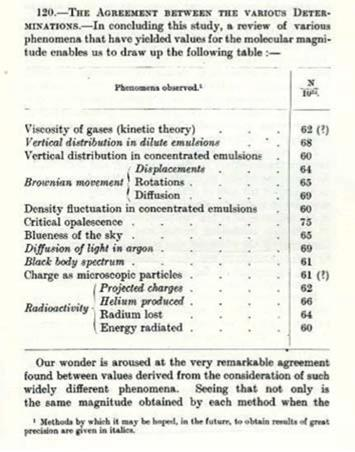

프랑스의 물리학자 장 페랭(Jean Perrin)은 저서 《원자(Les Atomes)》에서 '원자의 크기'를 결정하는 다양한 독립적 방법들을 제시하며, 서로 다른 접근 방식으로부터 일관된 물리적 상(像)이 도출된 것에 대해 정당한 자부심을 드러냈습니다.

우리의 비전은 학창 시절 물리·화학 상수를 한눈에 파악할 수 있도록 도왔던 요약표처럼, 생물학을 위한 일종의 '치트 시트(핵심 요약표)'를 만드는 것입니다. 공학과 물리학에서 널리 활용되는 정밀 과학 편람의 축약본이자 확장된 요약표 역할을 하기를 바랍니다. 하버드 대학교 시스템생물학과 학과장을 지낸 마크 커슈너(Marc Kirschner)는 숫자를 모른 채 생물학을 연구하는 것을 "지리를 모른 채 역사를 배우는 것"에 비유했습니다. 독자들이 이 책을 중요한 생물학적 수치와 맥락을 짚어주는 비네트가 결합된 유용한 지도책(atlas)으로 활용하기를 기대합니다.

우리가 선정한 주제들이 저자들의 관심사를 반영한 주관적인 선택이라는 점은 분명합니다. 공통 관심사에 부합하는 사례 연구 중 최신 연구 동향을 정량화하여 명확히 설명할 수 있는 주제들을 엄선해 비네트로 구성했습니다.

전체 내용은 생물학적 분류보다는 대략 다섯 가지의 물리적 축을 기반으로 전개됩니다. 제1장에서는 책 전반을 관통하는 사고방식과 방법론을 소개합니다. 왜 숫자에 관심을 가져야 하는지, 어림셈(back-of-the-envelope estimate)을 수행하는 요령, 그리고 유효숫자를 다루는 실질적인 규칙을 다룹니다. 이어 세포생물학에서 사물의 크기와 기하학을 살펴보며 본격적인 정량 탐구를 시작합니다. 제2장에서는 다양한 세포 구조물과 분자가 몇 개나 존재하는지 집계하는 생물학적 인구조사(census taking)를 다룹니다. 제3장은 힘과 에너지 척도에 집중하며, 제4장에서는 생물학적 과정의 속도와 시간을 살펴봅니다. 제5장에서는 세포의 정보 관리와 오류율을 다루고, 마지막 제6장은 특정 범주에 넣기 어렵지만 흥미로운 주제들을 모은 '정량적 잡록(miscellany)'으로 구성했습니다.

프로젝트를 진행하며 명확해진 사실 중 하나는, 우리가 다루는 수치들에 '정확도의 위계(hierarchy of accuracy)'가 존재한다는 점입니다. 예를 들어 제1장의 세포 구성 요소 크기는 발전된 현대 현미경 및 구조생물학 기술 덕분에 비교적 정확하게 확립되어 있습니다. 반면 제2장의 분자 수 조사는 최신 문헌에 의존하며, 형광 기법과 항체 기반 기법 등 측정 방식에 따라 결과가 완벽히 일치하지 않기도 합니다. 제3장의 에너지 척도는 물리량 자체의 정의에 따른 모호성이 더해집니다. 우리는 문헌에서 수집한 값의 불확실성을 표현하는 방식에 많은 공을 들였습니다. 유효숫자 사용 지침은 서론에 요약해 두었으며, 이러한 '정량적 위생(quantitative hygiene)' 관행이 생물학 연구자들 사이에 널리 정착되기를 기대합니다.

숫자를 가지고 노는 유희적 접근법은 여러 선행 연구에서 영감을 얻었습니다. 로렌스 와인스타인(Lawrence Weinstein)과 존 아담(John Adam)의 《게스티메이션(Guesstimation)》, 존 하트(John Harte)의 《구형 소를 생각해보자(Consider a Spherical Cow)》와 《원통형 소를 생각해보자(Consider a Cylindrical Cow)》, 리처드 버튼(Richard Burton)의 《숫자로 보는 생물학(Biology by Numbers)》, 폴 콜린보(Paul Colinvaux)의 《왜 크고 사나운 동물은 드문가(Why Big Fierce Animals Are Rare)》, 그리고 산조이 마하잔(Sanjoy Mahajan)의 《스트리트 파이팅 수학(Street Fighting Mathematics)》 등이 대표적입니다. 또한 피터 골드라이히(Peter Goldreich), 데이브 스티븐슨(Dave Stevenson), 스털 피니(Stirl Phinney)의 '자릿수 물리학(Order of Magnitude Physics)' 강의에서도 큰 영향을 받았습니다. 이 책들이 공통적으로 전하는 숫자를 다루는 즐거움과 통찰을 우리 비네트에서도 고스란히 느낄 수 있기를 바랍니다.

## 생물학적 수리 감각으로 가는 길

> "...그 후 몇 년 동안 나는 수학의 위대한 주요 원리를 조금이라도 이해할 수 있을 만큼 깊이 공부하지 못한 것을 깊이 후회했다. 그런 자질을 갖춘 사람들은 남다른 육감(extra sense)을 지닌 것처럼 보이기 때문이다."
> — 찰스 다윈, 《자서전》

### 생명의 사실들 - 왜 숫자에 관심을 가져야 하는가

이 장은 앞으로 펼쳐질 내용의 든든한 디딤돌 역할을 합니다. 당장 특정 수치를 찾아보고 싶다면 곧바로 개별 비네트로 건너뛰어도 좋지만, 생물학적 수리 감각을 기르는 기본 논리와 도구를 익히기 위해 언제든 이 장으로 돌아오기를 권합니다. 수록된 약 100여 편의 비네트는 각각 독립적인 질문에 대한 답으로 완결성을 지닙니다.

생물학적 수리 감각, 즉 "숫자로 보는 세포생물학" 관점을 취함으로써 얻을 수 있는 이점은 크게 세 가지입니다.

첫째, 역사적으로 정량적 분석은 생물학의 난제를 해결하는 결정적 열쇠가 되어 왔습니다. 스터티번트(Sturtevant)의 초파리 유전자 지도 작성, 신경 충격 동역학을 규명한 호지킨(Hodgkin)과 헉슬리(Huxley)의 연구, 박테리아 주화성(chemotaxis)과 배아 발생 과정의 정보 전달 한계 규명, 열역학적 한계를 뛰어넘어 유전 정보 복제 충실도를 극대화하는 생물학적 교정(proofreading) 메커니즘의 규명 등이 모두 정량적 질문에서 출발했습니다.

둘째, 생물학적 현상을 정량적으로 공식화하면 명확하고 반증 가능한 가설을 세울 수 있습니다. 오늘날의 첨단 측정 기술은 이론적 예측값과 실측값 사이의 미세한 불일치까지 포착할 수 있을 만큼 정밀해졌습니다. 다윈이 언급한 '남다른 육감'처럼, 정량적 감각은 제시된 가설이 물리적으로 타당한지 직관적으로 가늠할 수 있게 해줍니다. 천문학에서 튀코 브라헤의 정밀 관측이 케플러의 타원 궤도 법칙과 뉴턴의 만유인력 법칙으로 이어졌듯이, 생물학 역시 정량적 데이터가 충분히 축적되어 보편적인 수학적 원리를 도출할 수 있는 성숙 단계에 도달했습니다.

셋째, 정량 데이터는 세포의 구조와 기능을 바라보는 새로운 직관을 길러줍니다. 외계인이 지구 사회를 이해하고자 할 때 가장 유용한 자료가 인구 분포, 소득, 교육 수준 등을 집계한 통계청 보고서인 것처럼, 이 책은 세포를 위한 일종의 '통계청 보고서' 역할을 합니다. 예컨대 단백질 합성의 설계도인 mRNA와 그 결과물인 단백질 중 어느 쪽이 더 클까요? 우리의 일상적 직관은 거대한 빌딩의 청사진처럼 설계도가 완성품보다 훨씬 작으리라 짐작하지만, 실제로는 mRNA 분자가 자신이 암호화하는 단백질보다 물리적으로 훨씬 큽니다. 이러한 사실은 세포 내에서 설계도를 운반하는 비용과 완성된 분자 기계를 운반하는 비용을 비교하는 데 중요한 시사점을 제공합니다.

마지막으로, 수치적 변칙성은 새로운 발견의 가장 강력한 원동력입니다. 대기 중 이산화탄소 농도의 주기적 변동을 입증한 킬링(Keeling)의 연구나, 이론적 음속 계산과 실측값 사이의 20% 오차를 단열 과정으로 해결한 라플라스(Laplace)의 사례처럼, 정밀한 측정에서 포착된 불일치는 위대한 과학적 발견으로 이어집니다. 대장균 세포 하나에 든 단백질 수가 연구마다 100배씩 차이 나는 상태에서는 무엇이 정상이고 무엇이 변칙인지조차 판단할 수 없습니다. 세포의 특성을 재현성 있게 정량화할 때, 우리는 아직 발견되지 않은 수많은 생물학적 효과들을 포착할 수 있습니다.

## 바이오넘버스

특정 생물학적 수치를 찾는 일이 얼마나 어려운지는 간단한 검색만으로도 체감할 수 있습니다. 예를 들어 인간 세포 하나에는 리보솜이 몇 개나 있을까요? 특정 전사 인자가 DNA에 결합하는 친화도는 얼마일까요? 세포막 표면의 수용체는 몇 개나 존재할까요? 이런 수치를 찾으려 교과서나 인터넷을 뒤적이다 보면 모호한 설명에 실망하거나 수많은 시간을 허비하기 일쑤입니다.

이러한 문제를 해결하기 위해 이 책에 제시된 거의 모든 수치는 하버드 대학교가 운영하는 데이터베이스인 바이오넘버스(BioNumbers, http://bionumbers.hms.harvard.edu/)에 기반을 두고 있습니다. 바이오넘버스는 방대한 생물학 문헌에 흩어져 있는 정량 데이터를 체계적으로 수집·큐레이션하여 원본 논문 출처와 측정 방법론을 함께 제공하는 신뢰성 높은 출발점입니다.

::: {.callout-note}
### 바이오넘버스 식별 번호(BNID) 활용 팁
책에서 특정 수치를 인용할 때마다 고유 식별자인 BNID(BioNumbers ID)를 함께 병기합니다. 의학 논문의 PMID처럼, BNID는 정량 생물학 데이터의 고유 주민등록번호 역할을 합니다. 

예를 들어 BNID 103023은 효모 세포당 mRNA 수 측정치로 연결됩니다. 바이오넘버스 웹사이트 검색창에 이 번호를 입력하면 측정 방법, 배양 조건, 원저 문헌 등의 상세 정보를 즉시 확인할 수 있습니다.
:::

## 어림셈하는 방법

책에 수록된 수치들은 단순한 참고 데이터를 넘어, 관심 있는 다른 물리량을 유도하고 검증하기 위한 기준점(anchor point) 역할을 합니다. 예를 들어 박테리아의 게놈 크기와 세포 분열 주기를 알고 있다면 DNA 복제 속도의 최솟값을 순수한 사고만으로 어림잡아 볼 수 있습니다. 비록 대략적인 추산(예: 2배 이내의 오차)일지라도, 측정값의 타당성을 검토하기 위한 자릿수(order of magnitude)를 가늠하기에는 충분합니다.

미지의 물리량을 어림할 때 유용한 기법 중 하나는 상한과 하한을 설정한 뒤 기하평균(geometric mean)을 취하는 방식입니다. 구하려는 물리량이 하한 $x_L$보다 크고 상한 $x_U$보다 작다고 확신할 수 있다면, 가장 합리적인 1차 추정치는 다음과 같습니다.

$$x_{\text{estimate}} = \sqrt{x_L \cdot x_U}$$

예를 들어 대형 여객기의 날개 길이를 추정해 봅시다. "1 m보다 큰가? (그렇다)", "5 m보다 큰가? (그렇다)", "10 m보다 큰가? (확실치 않음)". 따라서 하한 $x_L = 5\text{ m}$로 잡습니다. 반대로 "50 m보다 작은가? (그렇다)", "25 m보다 작은가? (확실치 않음)". 따라서 상한 $x_U = 50\text{ m}$로 설정합니다. 기하평균을 계산하면 다음과 같습니다.

$$\sqrt{5\text{ m} \times 50\text{ m}} = \sqrt{250\text{ m}^2} \approx 16\text{ m}$$

실제 보잉 747 등의 날개 길이는 수십 미터 수준이므로, 이 추정치는 실제 값과 2배 이내로 일치합니다.

더 극단적인 예로 인체 내의 총 원자 수를 어림해 봅시다. 하한으로 아보가드로 수 근처인 $10^{20}$개, 상한으로 우주 전체의 원자 수보다 작은 $10^{40}$개를 잡는다면 기하평균은 다음과 같습니다.

$$\sqrt{10^{20} \times 10^{40}} = 10^{30}\text{개}$$

실제 인체 원자 수($\approx 7 \times 10^{27}$개)와 비교할 때, 막연한 추측만으로도 2자릿수 이내의 정확도에 도달할 수 있습니다. 만약 일반 산술평균을 썼다면 상한인 $10^{40}$에 완전히 압도되어 터무니없는 과대평가가 일어났을 것입니다. 기하평균은 로그 공간(10의 지수 척도)에서 산술평균을 취하는 것과 같기 때문에 자릿수 추정에 가장 적합한 도구입니다.

어림셈을 처음 접하는 연구자들은 '틀린 답'을 낼까 두려워합니다. 그러나 산조이 마하잔이 지적했듯, 과도한 수학적 엄밀함(rigor)에 집착하면 직관이 굳어버리는 '사후 강직(rigor mortis)'에 빠질 수 있습니다. 어림셈은 한 번에 정답을 맞히는 시험이 아니라, 지식을 하나씩 더해가며 답을 좁혀가는 '연속적 근사(successive approximation)' 과정입니다.

## 자릿수 생물학 툴킷

생물학적 현상을 빠르고 직관적으로 가늠할 수 있도록 돕는 유용한 수치 규칙들을 정리했습니다.

### 유용한 산술 근사치

- $2^{10} \approx 1000 = 10^3$
- $2^{20} = 4^{10} \approx 10^6$
- $e^7 \approx 10^3$
- $10^{0.1} \approx 1.3$
- $\sqrt{2} \approx 1.4$
- $\sqrt{0.5} \approx 0.7$
- $\ln(10) \approx 2.3$
- $\ln(2) \approx 0.7$
- $\log_{10}(2) \approx 0.3$
- $\log_{10}(3) \approx 0.5$
- $\log_2(10) \approx 3.3$

> 수학적 표기법 안내: 기호 $\approx$는 '대략 2배 이내의 정확도'를, $\sim$은 '자릿수(10배 이내의 오차)'를 의미합니다. 생물학 데이터 보고 시 기본 규칙은 측정값은 유효숫자 2개, 불확실성은 유효숫자 1자리로 표기하는 것입니다.

### 기억해 두면 유용한 큰 수들

- 1년의 초 수 $\approx \pi \times 10^7\text{ s}$ (약 $3.15 \times 10^7$초로, $\pi$를 떠올리면 기억하기 쉽습니다)
- 1일의 초 수 $\approx 10^5\text{ s}$ ($86,400\text{ s}$)
- 1년의 시간 수 $\approx 10^4\text{ h}$ ($8,760\text{ h}$)
- 아보가드로 상수 $\approx 6 \times 10^{23}\text{ mol}^{-1}$
- 인체의 총 세포 수 $\approx 4 \times 10^{13}$개

## 경험 법칙

- $1\text{ Da} = 1\text{ g/mol} \approx 1.7 \times 10^{-24}\text{ g}$
- $1\text{ nM}$의 농도는 박테리아(대장균) 세포 부피당 약 1개 분자, 효모 세포당 $10\sim 100$개 분자, 포유류(HeLa) 세포 부피당 $1,000\sim 10,000$개 분자에 해당합니다. ($1\ \mu\text{M}$은 이 값의 1,000배, $1\text{ mM}$은 100만 배)
- $1\text{ M}$은 약 $1\text{ nm}^3$당 분자 1개 수준입니다.
- 세포 부피 $1\ \mu\text{m}^3$당 단백질 수는 약 200만~400만 개입니다.
- 세포 프로테옴의 $1\text{ ppm}$(백만분율) 농도는 $\approx 5\text{ nM}$입니다.
- $1\text{ kb}$ 길이의 DNA 단편 $1\ \mu\text{g}$은 $\approx 1\text{ pmol}$ 또는 $\approx 10^{12}$개 분자입니다.
- 표준 조건에서 $1\text{ M}$ 용액 속 용질 분자 간 평균 거리는 $\approx 1\text{ nm}$입니다.
- 전형적인 아미노산 1개의 평균 분자량 $\approx 110\text{ Da}$ (보통 계산 편의상 $\approx 100\text{ Da}$로 간주)
- 단백질 분자량 [Da] $\approx 100 \times \text{아미노산 잔기 수}$
- 공기의 밀도 $\approx 1\text{ kg/m}^3$
- 물의 밀도 $\approx 55\text{ M} \approx 1000\text{ kg/m}^3$ (공기 밀도의 약 1,000배)
- $50\text{ mM}$ 삼투물질 농도차 $\approx 1\text{ atm}$ 삼투압
- 물 분자 1개의 부피 $\approx 0.03\text{ nm}^3 \approx (0.3\text{ nm})^3$
- DNA 염기쌍 1개의 부피 $\approx 1\text{ nm}^3$, 질량 $\approx 600\text{ Da}$ (또는 660 Da)
- 인지질 분자 1개의 질량 $\approx 500\sim 1,000\text{ Da}$
- $1\ k_B T \approx 2.5\text{ kJ/mol} \approx 0.6\text{ kcal/mol} \approx 25\text{ meV} \approx 4.1\text{ pN}\cdot\text{nm} \approx 4 \times 10^{-21}\text{ J}$
- 10배(한 자릿수) 농도차를 유지하는 데 필요한 자유에너지 $\approx 6\text{ kJ/mol} \approx 1.4\text{ kcal/mol}$ ($= RT \ln 10$)
- 막전위에 의해 전하 1개가 막을 가로지를 때 출입하는 에너지 $\approx 10\sim 20\text{ kJ/mol}$
- 생리적 조건에서 ATP 1분자의 가수분해 방출 에너지 $\approx 20\ k_B T \approx 50\text{ kJ/mol} \approx 12\text{ kcal/mol} \approx 10^{-19}\text{ J}$
- 호흡 과정에서 산소 1 L 소비당 방출 에너지 $\approx 20\text{ kJ}$
- 저분자 대사물질은 세포질에서 $\sim 1\text{ ns}$ 만에 약 $1\text{ nm}$를 확산합니다.
- $1\text{ OD}_{600} \approx \text{배양액 1 L당 약 } 0.5\text{ g의 세포 건조 중량(cell dry weight)}$
- 세포 부피 $1\ \mu\text{m}^3$당 탄소 원자 수는 $\approx 10^{10}$개입니다.

### 어림셈을 위한 엄밀한 규칙과 유효숫자

"이 책에 나오는 수치들이 실제로 정확한가?"라는 의문은 지극히 타당합니다. 세포 내 현상은 세포 종류와 생리적 상태에 따라 큰 변동성을 보이며, 유전적으로 동일한 클론 세포들 사이에서도 상당한 개체 간 차이가 존재합니다.

단 하나의 고정된 수치를 제시하는 것은 단순화의 위험이 따르지만, 구체적인 기준점을 제공함으로써 독자가 관련 문헌을 탐색하고 직관을 다지는 출발점이 됩니다. 문헌에 따라 2~3배의 차이가 나는 것은 생물학에서 결코 예외가 아니라 일반적인 현상입니다. 따라서 수치를 접할 때는 항상 내재적 변동성과 실험 조건을 감안해야 합니다.

::: {.callout-important}
### 유효숫자 표기의 황금률
생물학 수치를 보고할 때는 유효숫자 2개를 기본으로 사용합니다.

계산기나 통계 프로그램이 보여주는 무수한 자릿수(예: $26.6667$)를 그대로 표기하는 것은 '거짓된 정밀도(spurious precision)'라는 착각을 줍니다. 생물학적 계측의 고유 오차를 감안할 때 유효숫자 2개만으로도 물리적 의미와 자릿수를 온전히 전달할 수 있습니다.
:::

측정값의 불확실성(표준오차 등)은 대개 유효숫자 1자리로 반올림해 표기합니다. 예를 들어 평균값이 26.666이고 오차가 4.055라면, 오차를 $4$로 반올림하고 평균도 이에 맞추어 $26 \pm 4$로 보고하는 것이 바람직합니다.

오차가 명시되지 않은 값의 경우, 일반적인 세포생물학 측정의 불확실성은 대략 다음과 같이 해석할 수 있습니다.
1. 유효숫자 2개 표기 (예: $3,200\ \mu\text{m}^3$): 오차가 약 10~30% 이내로 잘 제어된 경우
2. 유효숫자 1개 표기 (예: $3,000\ \mu\text{m}^3$): 약 2배 정도의 불확실성이 있는 경우
3. 자릿수(지수) 표기 (예: $10^3\ \mu\text{m}^3$): 3배 이상, 5~10배에 이르는 큰 변동성이 예상되는 경우

일련의 계산을 수행할 때는 중간 계산 과정에서 유효숫자를 넉넉히 유지하고, 최종 결과 단계에서만 반올림해야 누적 오차를 줄일 수 있습니다.

## 세포의 지리학

세포라는 방대한 도시를 탐험하기 위해, 우리는 세 가지 핵심 표준 모델 세포를 길잡이로 삼습니다.
1. 전형적인 박테리아: 대장균(*Escherichia coli*)
2. 단세포 진핵생물: 출아효모(*Saccharomyces cerevisiae*)
3. 포유류 배양세포: 헬라 세포(*HeLa cell*)

지구본이 대륙과 대양의 상대적 크기에 대한 직관을 주듯, 이 세 표준 세포에 대한 감각은 더 특화된 세포(예: 광수용체, 신경세포 등)를 탐구할 때 훌륭한 나침반이 됩니다.

전형적인 박테리아 세포 1개에는 수백만 개의 단백질 분자가 존재하며, 이들은 수천 종의 유전자로부터 발현됩니다. 따라서 단순 평균을 내면 '평균적인 단백질'은 세포당 약 $10^3$개 정도 존재할 것으로 짐작할 수 있습니다. 대장균 세포 부피당 분자 1개가 $\approx 1\text{ nM}$라는 어림 규칙을 적용하면, 평균 농도는 약 $1\ \mu\text{M}$이 됩니다. 그러나 실제로는 전사 인자처럼 세포당 수십~수백 개에 불과한 희소 단백질부터, 리보솜 단백질처럼 수만 개씩 존재하는 풍부한 단백질까지 분포 스펙트럼이 매우 넓습니다.

박테리아보다 부피가 약 1,000배 큰 포유류 세포를 생각해 봅시다. 단순한 비례(영가설 모델, null model)를 가정하면 분자 수는 1,000배 늘어나고 농도는 비슷하게 유지될 것입니다. 가령 HeLa 세포 내의 전사 인자 p53의 복제수를 어림셈해 봅시다.
- 포유류 세포 부피: $\approx 3,000\ \mu\text{m}^3$
- 세포 부피 $1\ \mu\text{m}^3$당 단백질 수: $\approx 3 \times 10^6$개
- 전체 단백질 수: $3 \times 10^6 \times 3,000 \approx 10^{10}$개

전사 인자는 전체 단백질 중 극소량(대략 1,000분의 1 이하)을 차지하므로 다음과 같이 추산할 수 있습니다.

$$\text{추정 복제수} \approx \frac{10^{10}}{1,000} \approx 10^7\text{개}$$

실제 전사 인자 수는 종류에 따라 $10^5\sim 10^6$개 수준으로 이 상한 추정치보다 다소 낮지만, 아무런 단서도 없는 상태에서 물리적 상한을 설정하는 데 매우 훌륭한 1차 길잡이가 됩니다. 이처럼 간단한 규칙들로 무장하고 생명 현상을 분석하는 방식을 우리는 '스트리트 파이팅 세포생물학(Street-Fighting Cell Biology)'이라 부릅니다.

# 제1장: 크기와 기하학

이 장의 모든 비네트는 "얼마나 큰가?"라는 단순하면서도 심오한 질문을 중심으로 전개됩니다. 유전학자이자 진화생물학자인 J. B. S. 홀데인(J. B. S. Haldane)은 1926년 발표한 유명한 에세이 《적절한 크기에 관하여(On Being the Right Size)》에서, 크기가 동물의 생리적·기능적 제약을 이해하는 데 얼마나 결정적인지 논의했습니다. 예컨대 사람이 물 밖으로 나올 때는 표면장력으로 인해 약 0.5 kg 남짓의 물이 묻을 뿐이지만, 곤충은 자기 체중에 맞먹는 치명적인 무게의 물방울을 뒤집어쓰게 됩니다. 거시 세계에서 홀데인이 통찰했던 물리적 함의와 마찬가지로, 우리는 분자 및 세포생물학에 등장하는 다양한 구조들의 크기를 정량적으로 규명하고 그 생물학적 의미를 추론하고자 합니다.

생물학적 구조는 생명체를 이루는 개별 거대분자의 나노미터($\text{nm}$) 수준부터 인공위성에서도 관측되는 바다의 거대한 남세균 대번식(cyanobacterial bloom, 수천 $\text{km}$)에 이르기까지 15자리(order of magnitude) 이상의 광범위한 척도에 걸쳐 있습니다. 이 책에서는 주로 개별 유기체 내부의 미시적 길이 척도에 집중합니다.

형태가 기능을 규정한다는 '구조-기능 패러다임(structure-function paradigm)'은 현대 구조생물학의 핵심입니다. 생물학적 구조의 크기를 아는 것만으로도 놀라운 기능적 추론이 가능합니다. 예컨대 감염된 숙주세포 하나가 방출하는 바이러스 수(방출량, burst size)를 결정하는 요인은 무엇일까요? 박테리아 파지와 포유류 바이러스의 크기는 지름 수십~수백 나노미터로 서로 비슷하지만, 숙주세포의 부피는 박테리아보다 포유류 세포가 약 1,000배 더 큽니다. 그 결과 박테리아의 파지 방출량은 세포당 약 100개 수준인 반면, 포유류 세포의 바이러스 방출량은 $\approx 100,000$개에 달합니다. 크기와 부피의 관계만으로도 이러한 생물학적 차이를 명쾌하게 설명할 수 있습니다.

## 바이러스는 얼마나 큰가?

개체 수 기준으로 바이러스는 지구상에서 가장 풍부한 생물학적 존재입니다. 현재의 최선 추정치에 따르면 지구 생물권에는 무려 $10^{31}$개에 달하는 바이러스 입자가 존재합니다. 이는 지구상 인류 한 사람당 아보가드로 수($\sim 10^{23}$)에 맞먹는 바이러스가 배정되는 셈이며, 인체 세포 하나당 약 $10^8$개의 바이러스가 존재하는 규모입니다. 지구상 원핵생물의 총 개체 수($4\sim 6 \times 10^{30}$개, BNID 104960)와 비교해도 바이러스가 수적으로 약 10배 우세합니다(토양이나 해수 샘플에서 박테리아 대비 바이러스 비율 $\approx 10:1$, BNID 104962). 그러나 바이러스는 워낙 작기 때문에 총질량은 원핵생물 생물량(biomass)의 약 5%에 불과합니다.

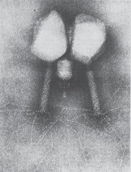

바이러스는 식물, 곤충, 포유류, 고세균 등 생명의 모든 영역을 감염시킵니다. 그중에서도 해양과 토양에 막대한 수로 존재하는 박테리아를 공격하는 바이러스, 즉 박테리오파지(bacteriophage, '세균을 먹는 자')가 가장 큰 비중을 차지합니다. 매일 해양 박테리아 생물량의 최대 20%가 바이러스 감염으로 용해되며(BNID 106625), 이는 지구 규모의 탄소 및 영양분 순환에 지대한 영향을 미칩니다.

바이러스의 발견 자체가 세균 여과기를 통과하는 극도의 작음에서 비롯되었습니다. 바이러스는 자연계에서 가장 대칭적이고 아름다운 구조물 중 하나입니다. 많은 바이러스가 2회, 3회, 5회 회전 대칭성을 갖춘 정이십면체(icosahedron) 구조를 취합니다. 캡시드(capsid)라 불리는 외부 단백질 껍질은 동일한 단백질 단위체가 반복 조립된 구조이며, 내부에 DNA 또는 RNA 유전체($10^3\sim 10^6$ 염기, BNID 103246, 104073)를 품고 있습니다.

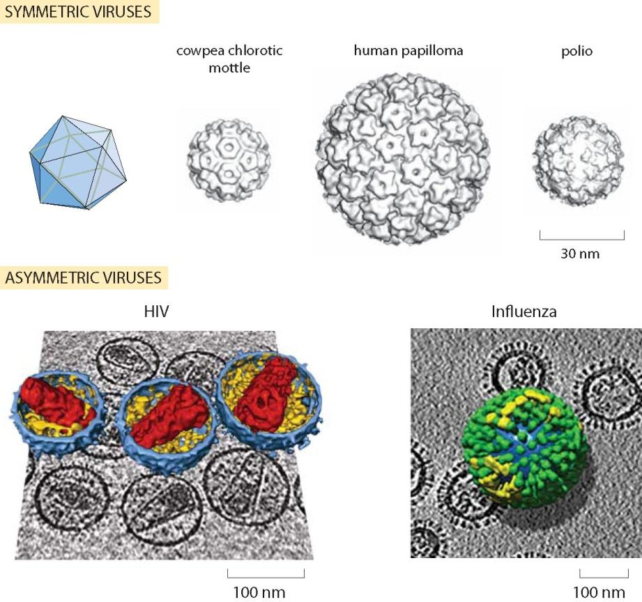

일반적인 바이러스의 크기는 대부분 수십에서 수백 나노미터 범위에 들어옵니다. HIV나 인플루엔자처럼 숙주 세포막에서 유래한 지질 외피(envelope)를 두른 바이러스도 있습니다. 람다 파지의 경우 캡시드 부피의 약 40%가 단단히 압축된 DNA로 채워져 있어 결정에 가까운 충전율(packing ratio)을 보이는 반면, HIV는 이보다 훨씬 느슨하게 채워져 있습니다.

바이러스의 크기는 어떻게 결정될까요? 일부 파지에서는 특정 길이의 단백질 이합체가 일종의 '분자 줄자(molecular tape measure)' 역할을 하여 캡시드의 모서리 길이를 정밀하게 규정합니다(예: 박테리오파지 PRD1의 P30 단백질).

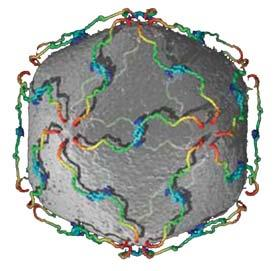

최근 발견된 미미바이러스(mimivirus)나 판도라바이러스(pandoravirus)와 같은 거대 바이러스는 지름이 수백 나노미터에서 1 $\mu\text{m}$에 달하고 2 Mbp가 넘는 유전체를 보유하여 작은 박테리아나 진핵세포 크기에 필적합니다(BNID 109554, 111143).

## 대장균 세포의 크기와 질량은 얼마인가?

대장균(*Escherichia coli*)은 미시 세계의 척도를 재는 가장 표준적인 기준점 역할을 합니다. 무수한 광학 및 전자현미경 측정에서 얻은 대장균의 대표적인 치수는 다음과 같습니다.
- 직경: $\approx 1\ \mu\text{m}$
- 길이: $\approx 2\ \mu\text{m}$
- 부피: $\approx 1\ \mu\text{m}^3 = 1\ \text{fL}$ (구원통형 계산 시 약 $1.3\ \mu\text{m}^3$, BNID 101788)
- 습윤 질량(wet mass): $\approx 1\ \text{pg}$ ($10^{-12}\text{ g}$, 물 밀도 $1\text{ g/cm}^3$ 기준)
- 건조 질량(dry weight): 습윤 질량의 약 30%인 $\approx 0.3\text{ pg} = 300\text{ fg}$ (BNID 100044)

세포의 크기와 질량은 고정된 상수가 아니라 성장 조건과 속도에 따라 변합니다. 영양 상태가 좋아 분열 속도가 빠를수록 대장균의 평균 부피와 질량은 지수적으로 증가합니다.

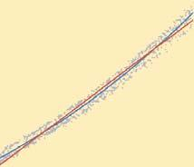

미세 가공된 진동 캔틸레버(cantilever) 내부로 단일 세포를 흘려보내 공진 주파수 변화를 측정하는 혁신적 기법을 통해, 단일 세포 질량을 펨토그램(fg) 정밀도로 실시간 측정한 결과 세포의 성장은 선형이 아니라 지수적으로 일어남이 명확히 입증되었습니다.

## 출아효모 세포의 크기는 얼마나 될까?

출아효모(*Saccharomyces cerevisiae*)는 진핵생물을 대표하는 최고의 모델 유기체입니다. 효모는 반수체(haploid, 1n)와 이배체(diploid, 2n)의 두 가지 생활사를 모두 지녀 유전학 연구에 이상적입니다.

- 반수체(1n): 직경 $\approx 4\ \mu\text{m}$, 부피 $\approx 40\ \mu\text{m}^3$ (BNID 101796, 100427)
- 이배체(2n): 직경 $\approx 6\ \mu\text{m}$, 부피 $\approx 80\ \mu\text{m}^3$ (BNID 100490)

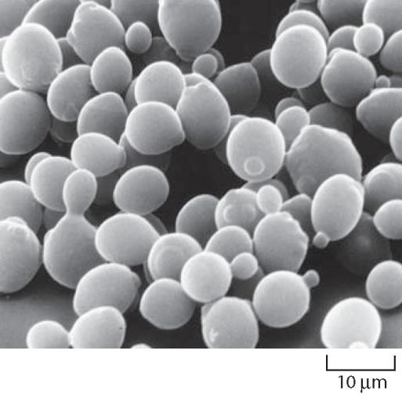

대장균이 사람 크기라면, 효모는 대략 코끼리 크기($\sim 40$배 부피)에 해당합니다. 주요 소기관 중 세포핵은 전체 부피의 약 10%를 차지하며, 세포벽은 건조 중량의 10~25%를 차지합니다.

DNA 함량이 2배인 이배체 세포의 부피가 반수체보다 정확히 2배 크다는 사실은, 진핵세포에서 배수성(ploidy)과 세포 크기 사이에 밀접한 비례 관계가 성립함을 보여줍니다. 또한 대장균과 마찬가지로 효모 역시 풍부한 배지에서 빠르게 증식할수록 평균 크기가 커집니다.

## 인간 세포의 크기는 얼마나 될까?

성인 인체는 약 $3.7 \times 10^{13}$개(약 37조 개)의 인간 세포와 그에 필적하는 수의 공생 미생물로 이루어져 있습니다(BNID 109716). 이들은 200여 종 이상의 특화된 세포 유형으로 나뉩니다.

세포의 형태와 부피는 기능에 따라 극단적인 차이를 보입니다.
- 적혈구(erythrocyte): 직경 $7\sim 8\ \mu\text{m}$, 부피 $\approx 100\ \mu\text{m}^3$ (핵이 없는 양오목 원반형으로 모세혈관 통과에 최적화, BNID 100509)
- 정자 세포: 부피 $\approx 20\sim 40\ \mu\text{m}^3$
- 성숙한 난자(oocyte): 직경 $\approx 120\ \mu\text{m}$, 부피 $\approx 10^6\ \mu\text{m}^3$ (인체 세포 중 가장 큰 축에 속함)
- 신경세포(뉴런): 세포체는 수십 $\mu\text{m}$이지만, 척수에서 발끝까지 이어지는 축삭은 길이가 1 m 이상에 달함
- HeLa 세포 (표준 배양세포): 부피 $\approx 2,000\sim 3,000\ \mu\text{m}^3$ (부착 상태에서 직경 $20\sim 40\ \mu\text{m}$, BNID 100434)

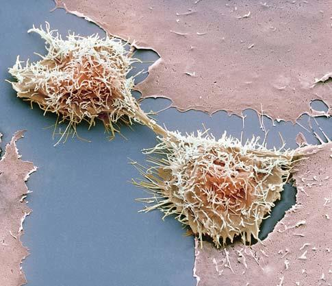

배양 접시에서 자라는 포유류 세포의 전형적인 부피 기준값으로 $2,000\sim 3,000\ \mu\text{m}^3$을 기억해 두면 다양한 계산에 매우 유용합니다. 대장균($\approx 1\ \mu\text{m}^3$)과 비교하면 포유류 세포는 약 2,000~3,000배 더 큽니다.

## 광수용체의 크기는 얼마나 될까?

찰스 다윈은 《종의 기원》에서 빛의 양과 거리를 조절하고 색수차를 보정하는 눈의 정교함에 대해 "자연선택으로 형성될 수 있었다고 생각하는 것은 극도로 터무니없어 보인다"며 '극도로 완벽한 기관'이라 표현했습니다.

인간의 망막(두께 $100\sim 300\ \mu\text{m}$)에는 명암을 감지하는 간상세포(막대세포, rod)와 색각을 담당하는 추상세포(원뿔세포, cone)라는 두 종류의 광수용체가 존재합니다.

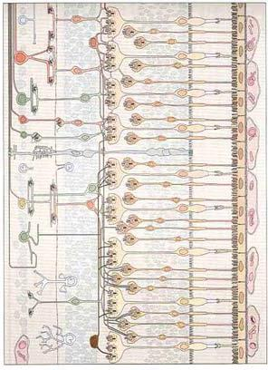

- 간상세포 직경: $\approx 2\ \mu\text{m}$ (단면적 $\approx 4\ \mu\text{m}^2$)
- 망막 중심와(fovea) 밀도: 최대 $200,000\sim 250,000\ \text{cells/mm}^2$
- 한쪽 눈의 총 광수용체 수: 약 1억 개~1억 3천만 개 (간상세포 $\sim 1.2 \times 10^8$개, 추상세포 $\sim 6 \times 10^6$개)

스마트폰 카메라 센서의 1,200만~1억 화소와 비교할 때, 우리 눈은 1억 개 이상의 독립적인 광센서를 갖춘 셈입니다.

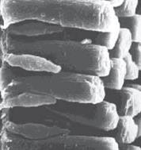

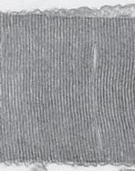

간상세포의 외절(outer segment, 길이 $\approx 25\ \mu\text{m}$)에는 두께 10 nm의 지질 막 원반이 약 25 nm 간격으로 1,000여 층 쌓여 있습니다. 각 간상세포에는 약 $10^8$개의 로돕신(rhodopsin) 분자가 빽빽이 들어차 있어, 단 하나의 광자(photon)가 들어와도 이를 포획하여 신경 신호로 변환할 수 있는 경이로운 감도를 달성합니다.

## 세포의 크기와 형태의 범위는 어떻게 될까?

생물계에는 교과서적 '표준 세포'의 틀을 깨는 놀라운 형태와 크기의 변이가 존재합니다.

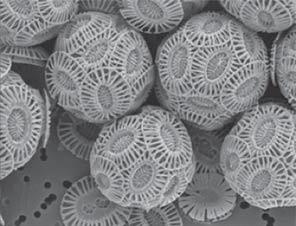

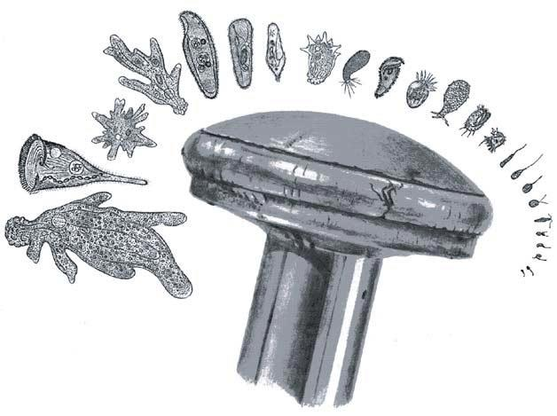

- 가장 작은 박테리아인 마이코플라스마(*Mycoplasma*)는 직경이 $\approx 0.2\ \mu\text{m}$, 부피 $0.005\ \mu\text{m}^3$에 불과합니다.
- 반면 나미비아 해저에 서식하는 거대 황박테리아 티오마르가리타(*Thiomargarita namibiensis*)는 직경이 최대 $750\ \mu\text{m}(0.75\ \text{mm})$로 육안으로도 뚜렷이 보입니다.
- 다윗의 별 모양을 한 스텔라(*Stella*) 박테리아, 아름다운 탄산칼슘 껍질을 지닌 원석조류(*Emiliania huxleyi*), 길이가 1 m를 넘는 동물의 신경세포에 이르기까지 세포는 길이 척도로만 7자리($10^7$배) 이상의 다양성을 펼쳐 보입니다.

## 세포핵의 크기는 얼마나 될까?

진핵세포의 세포핵은 유전체 DNA를 품고 있는 가장 핵심적인 세포 소기관입니다. 전형적인 세포핵의 직경은 $2\sim 10\ \mu\text{m}$입니다.

- 효모 세포핵: 부피 $\approx 3\sim 4\ \mu\text{m}^3$ (전체 세포 부피의 약 8~10%, BNID 104709)
- 인간 세포핵: 부피 $\approx 500\sim 1,000\ \mu\text{m}^3$ (HeLa 세포 기준 세포 부피의 약 10%, 직경 $\approx 10\ \mu\text{m}$)

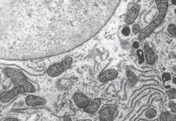

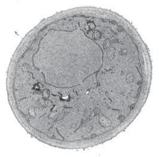

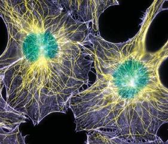

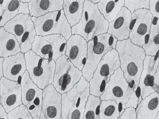

효모 유전체(12 Mbp)의 DNA 염기쌍들이 차지하는 순수 부피는 약 $0.01\ \mu\text{m}^3$로 핵 부피의 0.3%에 불과합니다. 그러나 DNA는 히스톤 단백질 8량체 주위를 감싸 뉴클레오솜을 이루고, 이것이 30 nm 섬유와 고차 염색질 구조로 응축되면서 단백질과 함께 핵 공간의 실질적인 부피를 차지합니다.

다양한 식물 및 동물 세포에서 관찰된 놀라운 규칙성 중 하나는 핵 부피와 세포 전체 부피 사이에 일정한 비례 관계($V_{\text{nuc}} / V_{\text{cell}} \approx 0.1\sim 0.2$)가 유지된다는 점입니다. 세포가 커지면 핵도 함께 비례하여 커지는 이 스케일링 메커니즘은 현대 세포생물학의 흥미로운 연구 주제입니다.

## 세포의 소포체 크기는 얼마나 될까?

소포체(endoplasmic reticulum, ER)는 세포 내에서 가장 거대한 막 시스템으로, 전체 세포 단백질의 약 20~30%가 소포체를 통해 가공·분비됩니다.

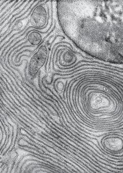

소포체의 특징적인 치수는 다음과 같습니다.
- 막 면적: 복잡하게 주름진 판상 구조(cisternae)와 관형 구조(tubules, 직경 $30\sim 100\ \text{nm}$) 덕분에, 소포체의 막 표면적은 세포막(plasma membrane) 표면적의 10~20배에 달하며 세포 내 전체 생체막 면적의 50~60%를 차지합니다.
- 부피: 전체 세포 부피의 약 10% 이상을 차지합니다.
- 분비 기능이 활발한 B세포나 췌장 세포의 경우, 매일 자기 무게에 맞먹는 단백질을 분비하기 위해 소포체가 세포질 전체를 가득 채웁니다.

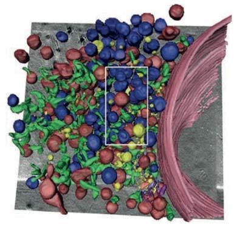

소포체는 정적인 구조가 아니며, 세포 분열기에는 해체되었다가 딸세포에서 신속하게 재조립됩니다. 또한 미토콘드리아, 액포, 세포막 등과 막 접촉 부위(MCS)를 형성하여 지질과 칼슘 신호를 활발히 교환합니다.

## 미토콘드리아의 크기는 얼마나 될까?

미토콘드리아는 세포의 주 에너지원인 ATP를 생산하는 발전소입니다. 약 15억 년 전 호기성 세균이 고대 진핵 숙주에 흡수된 내부공생(endosymbiosis)에서 기원했습니다.

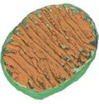

- 전형적인 크기: 직경 $\approx 0.5\sim 1\ \mu\text{m}$, 길이 $\approx 1\sim 2\ \mu\text{m}$ (대장균 세포 크기와 거의 동일)
- 세포당 개수: 효모는 수 개~수십 개, 활발한 간세포나 심근세포는 $1,000\sim 2,000$개
- 세포 부피 분율: 간세포 부피의 약 20~25%를 차지함

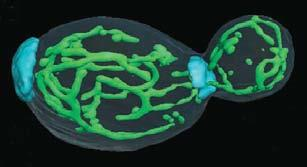

교과서에는 낱개의 핫도그 모양으로 묘사되지만, 실제 살아있는 세포 속의 미토콘드리아는 끊임없이 융합(fusion)과 분열(fission)을 반복하며 수십 마이크로미터에 이르는 역동적인 그물망(reticular network)을 형성합니다.

## 엽록체의 크기는 얼마나 될까?

엽록체는 태양 에너지를 포획하여 이산화탄소를 탄수화물로 전환하는 광합성의 장소입니다. 남세균의 내부공생에서 기원했습니다.

- 크기: 직경 $\approx 4\sim 6\ \mu\text{m}$, 두께 $\approx 1\sim 3\ \mu\text{m}$, 부피 $\approx 20\sim 30\ \mu\text{m}^3$ (미토콘드리아나 대장균보다 10~20배 큼)
- 세포당 개수: 단세포 조류인 클라미도모나스는 1개, 고등식물 잎의 엽육세포는 $50\sim 100$개
- 유전체: 약 100~150 kbp 크기의 원형 DNA를 엽록체당 수십~수백 카피 보유 (BNID 105918)

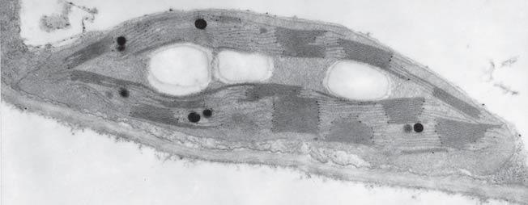

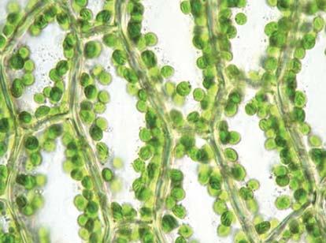

엽록체 내부의 틸라코이드 막은 그라나(grana)라 불리는 디스크 더미를 형성하며 광합성 단백질 복합체로 가득 차 있습니다. 기질(스트로마)의 대부분은 지구상에서 가장 풍부한 효소이자 탄소 고정을 촉매하는 루비스코(Rubisco) 단백질이 차지합니다.

## 시냅스의 크기는 얼마나 될까?

시냅스(synapse)는 신경세포 간, 또는 신경과 근육 간 신호 전달의 핵심 접점입니다.

- 시냅스 말단 크기: 직경 $\approx 0.5\sim 1\ \mu\text{m}$ (부피 $\approx 0.1\sim 1\ \mu\text{m}^3$, 대장균 1개 크기)
- 시냅스 틈(synaptic cleft) 너비: $\approx 20\sim 40\ \text{nm}$
- 인간 뇌의 총 시냅스 수: 약 $10^{14}\sim 10^{15}$개 (대뇌 피질 $1\ \text{mm}^3$당 약 10억 개, BNID 106138)

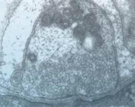

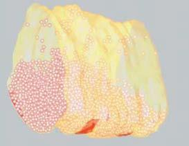

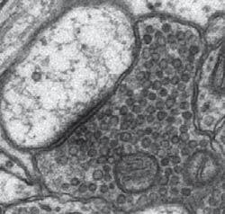

신호가 도달하면 시냅스 소포(직경 $\approx 40\ \text{nm}$)가 세포막과 융합하여 소포당 $1,000\sim 5,000$개의 신경전달물질(글루탐산, 아세틸콜린 등)을 방출합니다. 시냅스 틈이 20~40 nm로 극히 좁기 때문에 신경전달물질 분자는 확산을 통해 0.1 ms(100 $\mu\text{s}$) 이내에 반대편 수용체에 도달하여 신속한 신경 전도를 가능하게 합니다.

## 생화학적 기초 부품의 크기는 얼마나 될까?

생화학 교과서는 흔히 핵산과 단백질 위주로 서술되지만, 이들 거대분자만으로는 세포가 작동할 수 없습니다. 물 분자와 효소 반응을 돕는 필수 무기 이온, 거대분자의 기본 벽돌인 뉴클레오타이드와 아미노산, 세포막을 형성하는 지질, 그리고 모든 대사에 에너지를 공급하는 당과 ATP 같은 소분자들이 함께 어우러져야 비로소 생명이 유지됩니다.

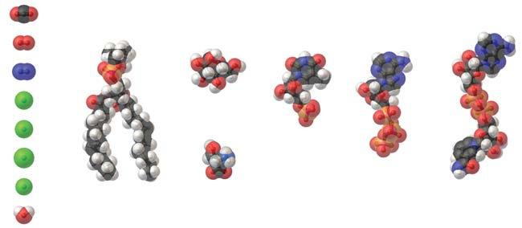

이들 중 가장 결정적인 기초 부품은 물($\text{H}_2\text{O}$)입니다. 물 분자의 산소-수소 결합 길이는 약 $0.1\text{ nm}$입니다. 물 1 L(약 55.5 mol)의 밀도를 바탕으로 계산하면 물 분자 1개의 유효 부피는 $\approx 0.03\ \text{nm}^3$이며, 분자 간 평균 중심 거리는 약 $0.3\text{ nm}$입니다. 물의 분자량은 $18\text{ Da}$입니다.

세포 내부는 바다에서 비롯된 기원의 흔적을 간직하고 있습니다. 해수에는 약 $1\text{ M}$의 염이 녹아 있어 물 분자 약 55개당 1개의 이온이 존재합니다. 세포 내부에도 해수의 약 4분의 1 농도에 달하는 다양한 이온($\text{K}^+$, $\text{Na}^+$, $\text{Mg}^{2+}$, $\text{Cl}^-$ 등)이 존재합니다. 벌거벗은 이온 반지름은 $\text{Na}^+ = 0.09\text{ nm}$, $\text{K}^+ = 0.13\text{ nm}$, $\text{Cl}^- = 0.18\text{ nm}$ 수준이지만, 실제 생체 내에서는 물 분자들을 끌어당겨 수화된 이온 반지름($0.3\sim 0.4\text{ nm}$)으로 활동합니다.

- 뉴클레오타이드: 분자량 $\approx 330\text{ Da}$, DNA 이중나선의 반경 $\approx 1\text{ nm}$, 염기쌍 간 수직 거리 $\approx 0.34\text{ nm}$ ($1/3\text{ nm}$)
- 아미노산: 가장 작은 글리신($75\text{ Da}$)부터 가장 큰 트립토판($204\text{ Da}$)까지 다양하며, 평균 분자량은 $\approx 110\text{ Da}$ (계산 시 대략 $100\text{ Da}$ 적용)
- 지질 분자: 인지질은 단면적 $\approx 0.5\ \text{nm}^2$, 길이 $\approx 2\text{ nm}$, 분자량 $700\sim 1,000\text{ Da}$
- 포도당: 화학식 $\text{C}_6\text{H}_{12}\text{O}_6$, 분자량 $180\text{ Da}$, 분자 직경 $\approx 1\text{ nm}$
- ATP: 분자량 $\approx 507\text{ Da}$, 유효 확산 직경 $\approx 1.4\text{ nm}$

> 경험 법칙: 아미노산, 뉴클레오타이드, 당, ATP 등 세포 내 기본 소분자들의 크기를 어림잡을 때는 $\approx 1\text{ nm}$를 기억하면 매우 편리합니다.

## mRNA와 그것이 암호화하는 단백질 중 어느 쪽이 더 클까?

mRNA는 세포의 일꾼인 단백질을 합성하기 위한 '설계도(전령)'입니다. 일상적 직관으로는 거대한 건축물의 청사진처럼 설계도가 완성된 분자 기계보다 훨씬 작을 것이라 짐작하기 쉽습니다. 그러나 미시 세계의 현실은 정반대입니다.

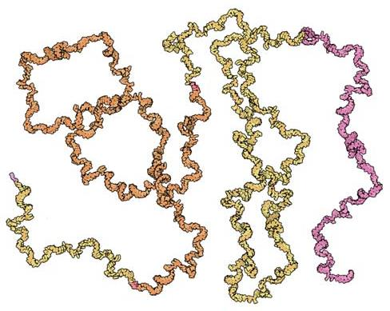

질량과 크기를 비교해 봅시다.
1. 단량체의 질량 차이: RNA 뉴클레오타이드 1개의 질량은 $\approx 330\text{ Da}$인 반면, 아미노산 1개의 평균 질량은 $\approx 110\text{ Da}$로 뉴클레오타이드가 약 3배 더 무겁습니다.
2. 트리플렛 코돈: 아미노산 1개를 지정하기 위해 3개의 뉴클레오타이드가 필요하므로, 코돈 1개($3 \times 330 \approx 1,000\text{ Da}$)는 아미노산 1개($110\text{ Da}$)보다 약 9배 더 무겁습니다.
3. 비번역 부위(UTR) 및 꼬리: mRNA에는 5' 캡, 5' UTR, 3' UTR, 폴리A 꼬리가 붙어 있어 실제 mRNA 전사체는 자신이 암호화하는 단백질보다 질량 기준으로 10배 이상 무겁습니다.

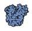

공간적 크기에서도 마찬가지입니다. 단백질은 물을 피해 빽빽하게 뭉친 구상 단백질(직경 $\approx 3\sim 6\text{ nm}$)을 형성합니다. 반면 단일 가닥 mRNA는 스템-루프 등의 2차 구조를 형성하면서도 용액 속에서 훨씬 느슨하고 길게 퍼진 형태를 취합니다. 1,000개 염기 길이의 전형적인 mRNA의 회전 반지름($R_g$)은 약 $20\text{ nm}$로, 유효 직경이 $\approx 40\text{ nm}$에 달합니다. 

즉, mRNA는 자신이 만들어내는 단백질 기계보다 질량도 10배 무겁고, 공간적 크기도 거의 10배 더 큽니다.

## 단백질의 크기는 얼마나 될까?

단백질은 세포 내 거의 모든 화학 반응과 구조 지지를 담당하는 분자 기계입니다.

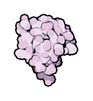

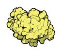

- 루비스코(Rubisco): 대기 중의 $\text{CO}_2$를 고정하는 지구상에서 가장 풍부한 효소로, 8개의 대단위체(각 55 kDa)와 8개의 소단위체(각 13 kDa)가 모여 총 질량 약 $550\text{ kDa}$의 거대한 복합체를 이룹니다.
- ATP 합성효소: 미토콘드리아 내막의 회전 모터로, 총 질량 $\approx 550\sim 600\text{ kDa}$입니다.
- 전형적인 단백질 크기: 구상 단백질의 평균 직경은 $3\sim 6\text{ nm}$입니다.

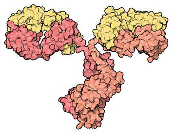

유전체 서열과 프로테옴 조사를 통해 밝혀진 전형적인 단백질의 크기 규칙은 다음과 같습니다.
- 박테리아(원핵생물): 평균 길이 $\approx 300\text{ aa}$ (질량 $\approx 30\text{ kDa}$)
- 진핵생물: 평균 길이 $\approx 400\text{ aa}$ (질량 $\approx 40\text{ kDa}$)
- 거대 단백질의 예외: 인간 근육에 탄성을 부여하는 타이틴(titin)은 무려 $33,423\text{ aa}$(분자량 약 $3.8\text{ MDa}$)로 평균 단백질의 100배에 달합니다.

실험에서 널리 쓰이는 녹색형광단백질(GFP, 238 aa, $\approx 27\text{ kDa}$)을 표적 단백질에 태깅할 때, 평균 크기($30\sim 40\text{ kDa}$)의 단백질에 GFP를 붙이면 단백질 복합체의 크기가 원래보다 거의 2배로 커져 생리적 기능에 영향을 줄 수 있음을 염두에 두어야 합니다.

## 센트럴 도그마의 분자 기계들은 얼마나 클까?

프랜시스 크릭이 1958년 정립한 센트럴 도그마(central dogma)는 DNA의 유전 정보가 RNA를 거쳐 단백질로 전달되는 흐름을 기술합니다. 이 과정은 세 가지 거대한 분자 기계에 의해 매개됩니다.

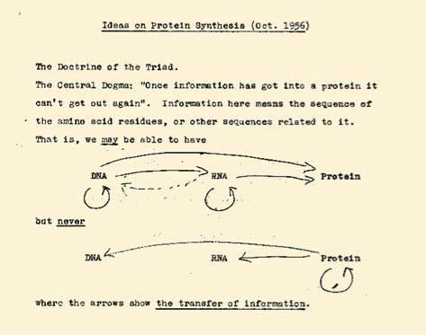

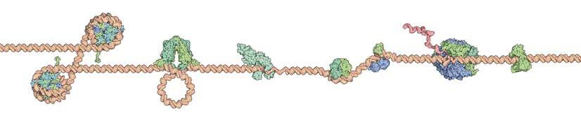

1. 복제복합체(Replisome): DNA를 복제하는 복합체로 헬리카아제, 프라이마아제, DNA 중합효소 등으로 구성되며 총 질량은 약 $1\text{ MDa}$에 달합니다. DNA의 지름(2 nm)을 사람 크기(1 m)로 확대하면 복제복합체는 택배 트럭 크기이며, 시속 약 600 km로 고속도로를 질주하면서 수백 킬로미터마다 단 1회의 배송 오류만 일으키는 경이로운 정확도를 자랑합니다.
2. RNA 중합효소(RNA Polymerase): 전사를 담당하며 대장균 전구효소 기준 질량 $\approx 400\text{ kDa}$, 직경 $\approx 5\text{ nm}$입니다.

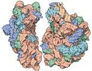

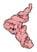

3. 리보솜(Ribosome): 번역을 담당하는 범용 단백질 공장입니다.
   - 박테리아(70S): 질량 $\approx 2.5\text{ MDa}$, 직경 $\approx 20\text{ nm}$ (RNA 3가닥 + 단백질 56개)
   - 효모(80S): 질량 $\approx 3.3\text{ MDa}$
   - 포유류(80S): 질량 $\approx 4.2\text{ MDa}$

리보솜 질량의 약 3분의 2는 RNA이고 단백질은 3분의 1에 불과합니다. 촉매 중심 부위가 단백질이 아닌 rRNA로 구성되어 있다는 점에서, 리보솜은 고대 RNA 세계의 유산인 거대한 리보자임(ribozyme)입니다.

## 세포막의 두께는 얼마인가?

세포막(원형질막)은 세포의 안과 밖을 가르는 얇고도 강력한 물리적 장벽입니다.

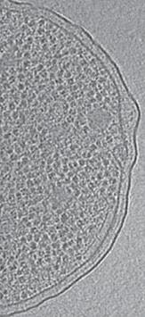

- 지질 이중층의 두께: $\approx 4\text{ nm}$ (소수성 탄화수소 중심부 약 $3\text{ nm}$ + 양쪽 친수성 머리 각 $0.5\text{ nm}$)
- 세포 직경 대비 비율: 직경 $2\ \mu\text{m}$ 세포에서 4 nm 막 두께는 약 1:500입니다. 이는 직경 5 m인 보잉 747 여객기의 알루미늄 외피 두께(약 1 cm) 비율과 정확히 일치합니다.

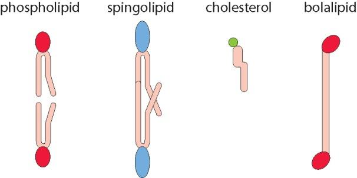

지질 단분자층의 두께는 역사적으로 벤자민 프랭클린의 실험에서 처음 어림셈되었습니다. 프랭클린은 런던 근처 연못에 기름 1 티스푼($\approx 5\text{ cm}^3$)을 떨어뜨려 무려 반 에이커($\approx 2,000\text{ m}^2$)의 수면이 잔잔해지는 것을 관찰했습니다. 이 수치를 나누면 유막의 두께는 다음과 같이 유도됩니다.

$$\text{두께} \approx \frac{5\text{ cm}^3}{2,000\text{ m}^2} = \frac{5 \times 10^{-6}\text{ m}^3}{2 \times 10^3\text{ m}^2} \approx 2.5\text{ nm}$$

이처럼 찻숟가락 하나의 기름으로 분자 1개 층의 나노미터 두께를 유추할 수 있었습니다.

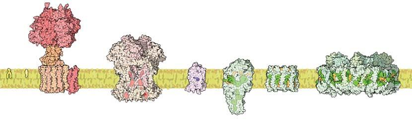

실제 생체막은 단순한 지질 바다가 아닙니다. 세포막 면적의 약 50%는 막단백질(수용체, 이온 통로, 수송체 등)로 채워져 있으며, 질량비로도 단백질 대 지질 비가 1:1 이상입니다. 막관통 단백질의 $\alpha$-나선 길이는 막 두께와 완벽히 일치하는 약 4 nm(약 20~25개 소수성 아미노산)입니다.

## 세포 필라멘트의 크기는 얼마인가?

세포골격(cytoskeleton)은 세포의 형태를 유지하고, 물질을 수송하며, 세포 분열 시 염색체를 분리하고 세포 운동을 가능하게 하는 분자 골격망입니다.

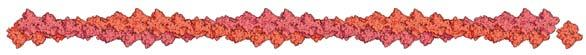

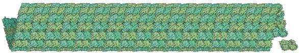

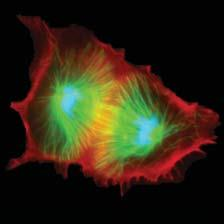

세포골격의 두 핵심 주역인 액틴과 미세소관의 물리적 치수는 다음과 같습니다.

| 특성 | 액틴 필라멘트 (F-액틴) | 미세소관 (Microtubule) |
|---|---|---|
| 기본 단위체 | G-액틴 (단량체, 42 kDa, 직경 $\approx 5\text{ nm}$) | $\alpha/\beta$-튜불린 (이합체, 100 kDa, $8\text{ nm}$) |
| 필라멘트 직경 | $\approx 6\sim 7\text{ nm}$ | $\approx 25\text{ nm}$ (속이 빈 13개 원시섬유 원통) |
| 지속 길이(Persistence length) | $\approx 10\sim 15\ \mu\text{m}$ (유연한 줄 형태) | $\approx 1\sim 5\text{ mm}$ (매우 뻣뻣한 강철 파이프 형태) |

지속 길이(persistence length)는 열 요동 속에서 필라멘트가 휘어지지 않고 곧게 뻗을 수 있는 척도입니다. 직경 25 nm인 미세소관의 지속 길이가 수 밀리미터에 달한다는 것은, 미세소관이 세포 크기($10\sim 20\ \mu\text{m}$) 내에서는 전혀 휘어지지 않는 완벽한 직선 막대처럼 거동한다는 뜻입니다.

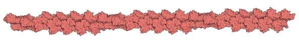

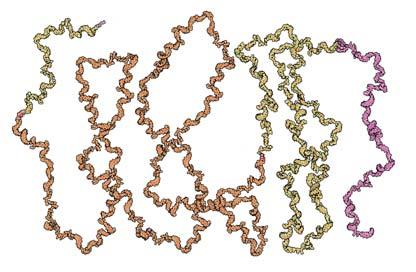

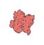

세포 분열기에는 수백 개의 미세소관이 방추사(mitotic spindle)를 형성해 양극으로 염색체를 끌어당깁니다. 기어가는 세포(예: 각질세포)의 선단부에서는 액틴 필라멘트 말단에 초당 약 100개의 단량체가 중합되면서 세포막을 밀어내어 초당 약 $0.25\ \mu\text{m}$의 속도로 전진합니다. 최근에는 박테리아에서도 액틴 상동체인 MreB와 튜불린 상동체인 FtsZ가 발견되어, 세포골격이 모든 생명 영역의 보편적 기구임이 밝혀졌습니다.

# 제2장: 농도와 절대 수치

이 장의 모든 비네트는 "얼마나 많은가(how many)?"라는 단순하면서도 핵심적인 질문을 중심으로 전개됩니다. 상대적인 양이 아니라 세포당 절대적인 복제 수(copy number)와 몰 농도($\text{M}$) 단위로 세포 내 분자들의 존재량을 파악합니다. 세포의 분자 목록에서 중심 원리를 이루는 핵산과 단백질뿐만 아니라 이온, 대사물질, 신호전달 분자, 세포골격 단백질의 농도를 정량적으로 아는 것은 세포 기능에 대한 예측 모델을 세우기 위한 필수 전제 조건입니다.

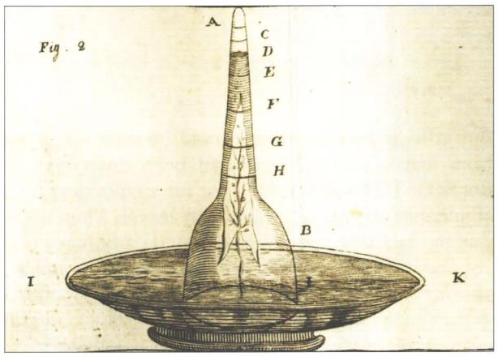

화학의 본질은 원자와 분자 사이의 상호작용입니다. 노벨생리의학상 수상자인 파울 에를리히(Paul Ehrlich)는 *"Corpora non agunt nisi ligata"*(물질은 결합하지 않으면 작용하지 않는다)라고 갈파했습니다. 분자 간 결합은 결합 상대들의 농도와 친화도에 결정적으로 좌우됩니다. 산소와 헤모글로빈의 결합, DNA와 전사인자의 결합, 막 수용체와 리간드의 결합 모두가 농도의 함수입니다.

예를 들어 젖당 오페론의 억제 단백질인 LacI는 대장균 세포 하나당 단 10개의 사량체(tetramer) 수준에 불과합니다. 이처럼 극도로 적은 분자 수는 분자 간 요동(stochastic noise)과 세포 간 변이(cell-to-cell variability)를 이해하는 데 핵심적인 질문을 던집니다.

배양 튜브 속 5 mL 배지에 대장균 1개를 넣으면 하룻밤 사이에 $10^9$개 이상의 세포로 증식합니다. 이 과정에서 배지 속 영양분은 어떻게 세포 구성 물질로 변환될까요?
- 세포 건조 질량의 약 30% 중 약 50%는 탄소입니다.
- 부피 $1\ \mu\text{m}^3$ 세포 하나는 약 $100\sim 200\text{ fg}$의 탄소를 포함합니다.
- 탄소 원자량(12 Da)과 아보가드로 수를 적용하면 세포당 약 $10^{10}$개의 탄소 원자가 존재함을 알 수 있습니다.

## 세포의 원소 조성은 어떠한가?

생명체는 주변 지각이나 대기와는 사뭇 다른 독특한 원소 비대칭성을 보입니다. 생체 화학은 탄소(C), 수소(H), 산소(O), 질소(N)라는 네 가지 핵심 원소를 중심으로 구성되며, 인(P)과 황(S)이 주요 거대분자의 연결고리를 이룹니다.

대장균의 건조 중량 실험식은 대략 다음과 같이 정리됩니다.
$$\text{C}_4 : \text{H}_7 : \text{O}_2 : \text{N}_1 \quad (\text{또는 } \text{C} : \text{H}_{1.77} : \text{O}_{0.49} : \text{N}_{0.24})$$

- 대장균 세포 하나에는 약 $10^{10}$개의 탄소 원자가 들어 있습니다(지구 총 인구 수와 비슷한 자릿수).
- 출아효모 역시 $\text{C} : \text{H}_{1.61} : \text{O}_{0.56} : \text{N}_{0.16}$으로 대장균과 거의 유사한 비율을 보입니다.
- 체중 약 70 kg의 성인 인체에는 약 $10^{27}\sim 10^{28}$개의 원자가 존재합니다.

흥미롭게도 생명의 핵심 원소인 탄소는 지각에서 17번째로 풍부한 원소에 불과하며, 대기 중 이산화탄소($\text{CO}_2$) 농도 역시 약 400 ppm($0.04\%$)에 불과합니다. 식물은 이 희박한 $\text{CO}_2$를 흡수하기 위해 잎의 기공을 열며, 이 과정에서 엄청난 양의 수분을 증산 작용으로 잃게 됩니다.

박테리아 건조 질량(단백질 55%, 핵산 20%, 지질 10%, 기타 15%)을 아미노산($\text{NC}_5\text{O}_2\text{H}_8$)과 뉴클레오타이드($\text{PN}_5\text{O}_7\text{C}_{10}\text{H}_{14}$)의 화학식과 혼합비(단백질:핵산 질량비 $\approx 3:1$)로 단순 가중합산하면 다음과 같은 추정식을 얻습니다.

$$10 \times (\text{NC}_5\text{O}_2\text{H}_8) + 1 \times (\text{PN}_5\text{O}_7\text{C}_{10}\text{H}_{14}) \rightarrow \text{C}_4 : \text{H}_{6.3} : \text{O}_{1.8} : \text{N}_1$$

이 순수한 이론적 추산은 실제 실험값($\text{C}_4 : \text{H}_7 : \text{O}_2 : \text{N}_1$)과 놀라울 정도로 잘 일치합니다.

## 세포의 밀도는 얼마인가?

세포와 세포소기관의 밀도는 원심분리 침강과 위상차 현미경의 명암 대비를 결정하는 기본 물리량입니다.

세포 구성 성분의 밀도:
- 물: $1.0\text{ g/mL}$
- 단백질: $\approx 1.3\sim 1.4\text{ g/mL}$
- 지질: $\approx 0.9\sim 1.0\text{ g/mL}$
- RNA / DNA: $\approx 1.7\sim 2.0\text{ g/mL}$
- 전분/글리코겐 과립: $\approx 1.5\text{ g/mL}$

세포의 약 70%는 물이고 나머지 30% 건조 중량의 대부분은 단백질이므로, 세포 전체의 유효 밀도는 $\approx 1.1\text{ g/mL}$($1,100\text{ kg/m}^3$)가 됩니다.

초원심분리기에서 물질이 가라앉는 속도는 스베드베리 단위($\text{S} = 10^{-13}\text{ s}$)로 나타냅니다. 리보솜 소단위체(23S, 16S, 5S 등)의 명칭이 바로 이 침강 속도 계수에서 유래했습니다. 구상 입자에서 침강 속도는 대략 분자량의 $2/3$ 제곱에 비례합니다.

## 환경 중 O2와 CO2 농도는 얼마인가?

대기 중에는 산소가 약 21%, 이산화탄소가 약 400 ppm($0.04\%$) 존재하지만, 생화학 반응이 일어나는 수용액 속에서의 농도는 기체의 용해도에 의해 결정됩니다.

- 물에 녹은 평형 $\text{O}_2$ 농도: $\approx 200\sim 300\ \mu\text{M}$ ($20^\circ\text{C}$ 담수 기준 약 $8\sim 9\text{ mg/L} \approx 9\text{ ppm}$)
- 물에 녹은 평형 $\text{CO}_2$ 농도: $\approx 10\sim 15\ \mu\text{M}$ ($\approx 0.5\text{ mg/L}$)

공기 중에서는 산소가 $\text{CO}_2$보다 500배 많지만, $\text{CO}_2$의 물에 대한 용해도가 산소보다 약 50배 더 높기 때문에 수용액 속 두 기체의 농도비는 약 10~20배 차이로 좁혀집니다.

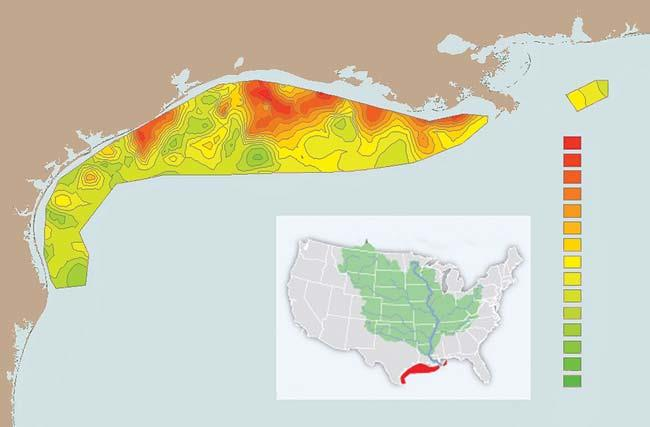

세균을 진탕 배양(shaking culture)할 때 산소 공급은 매우 중요합니다. 배지 1 L에서 대장균을 $\text{OD}_{600} \approx 1$($\approx 1\text{ g}$ 세포 건조 중량)까지 키우려면 호흡을 위해 약 $1\text{ g}$의 $\text{O}_2$($\approx 30\text{ mmol}$)가 필요합니다. 반면 배지 1 L에 녹아 있는 산소는 고작 $0.2\sim 0.3\text{ mmol}$에 불과하므로, 배양액 속 용존 산소 풀은 배양 시간 동안 100회 이상 지속적으로 환기·보충되어야 합니다. 이것이 배양 플라스크에서 액체 부피보다 5~10배 큰 상부 공간(headspace)을 비워두고 격렬하게 흔들어 주어야 하는 이유입니다.

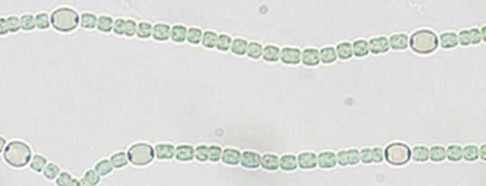

## 배양 배지에는 어느 정도 양의 영양분을 공급해야 하는가?

실험실에서 널리 쓰이는 LB 배지는 원래 루리아와 베르타니의 이름을 딴 것이 아니라, 파지의 용원성 주기를 연구하기 위해 개발된 '용원성 액체배지(Lysogeny Broth)'의 약자입니다. 효모 추출물과 트립톤을 기반으로 하는 LB는 조성이 배치마다 달라지는 복합 배지(complex medium)입니다.

정량적 연구에는 조성이 명확한 최소 배지(예: M9 배지)를 사용합니다.
- 포도당 공급량: 통상 2 g/L ($0.2\%$, $\approx 11\text{ mM}$)
- 생체량 수율: 호기성 조건에서 포도당 1 g당 건조 세포 약 0.5 g이 합성됩니다(나머지 절반은 호흡을 통해 $\text{CO}_2$로 배출).
- 따라서 포도당 2 g/L는 약 1 g/L의 건조 균체량을 만들며, 이는 $\text{OD}_{600} \approx 2$에 해당합니다.

## 포화 배양액에서 세균 세포의 농도는 얼마인가?

밤새 배양한 대장균 시험관은 더 이상 자라지 않는 정지기(stationary phase)에 도달합니다.
- 포화 배양액 세포 농도: $\approx 10^9\text{ cells/mL}$ ($\text{OD}_{600} \approx 1\sim 2$)
- 이 밀도에서 세균 세포 간 평균 거리는 약 $10\ \mu\text{m}$이며, 전체 배지 부피에서 세포가 차지하는 부피는 약 0.1%입니다.

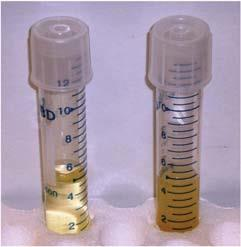

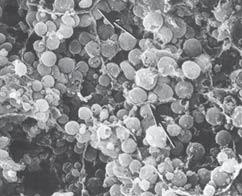

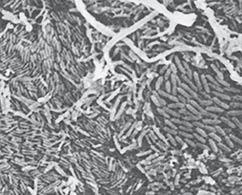

동물의 장 내부나 생물막(biofilm)에서는 세포 밀도가 이보다 10~100배 더 높아 세포들이 거의 빈틈없이 맞닿아 있습니다. 산업용 고밀도 발효조에서는 투석을 통해 독성 부산물을 제거함으로써 건조 중량 200 g/L($\text{OD} > 200$)에 달하는 극한의 세포 수율을 달성하기도 합니다.

## 세포의 pH는 얼마인가?

세포 내 수소 이온 농도는 효소 활성, 단백질 접힘, 그리고 ATP 합성을 이끄는 양성자 구동력(proton motive force)을 결정합니다.

- 대장균 세포질 pH: $\approx 7.2\sim 7.8$
- 출아효모 세포질 pH: 지수 성장기 $\approx 7.0$, 정지기 $\approx 5.5$ (액포 pH는 $5.5\sim 6.0$)
- 포유류 HeLa 세포: 세포질 및 핵 $\approx 7.3$, 미토콘드리아 기질 $\approx 8.0$, 소포체 $\approx 7.5$, 리소좀 $\approx 4.5\sim 5.0$

여기서 놀라운 계산을 해봅시다. 부피 $1\ \mu\text{m}^3$인 대장균 1개(pH 7.2) 내부에 자유롭게 떠다니는 유리 수소 이온($\text{H}^+$)은 몇 개일까요?
$$\text{농도 } [\text{H}^+] = 10^{-7.2}\text{ M} \approx 60\text{ nM}$$
세포 부피 $1\ \mu\text{m}^3$에서 $1\text{ nM}$이 약 1개 분자이므로, 세포 전체에 유리 수소 이온은 고작 60~100개뿐입니다!

세포 하나에 단백질이 수백만 개 존재하는데 어떻게 60~100개의 이온만으로 수많은 산-염기 반응이 원활히 일어날 수 있을까요?
1. 강력한 완충계: 글루탐산, 무기 인산염, 단백질 곁사슬이 pH 단위당 $10\sim 100\text{ mM}$의 완충능을 제공하여 양성자가 소모되는 즉시 보충됩니다.
2. 그로투스 메커니즘(Grotthuss mechanism): 물 분자망을 통해 수소 이온이 '호핑'하며 이동하는 유효 확산 계수는 무려 $7,000\ \mu\text{m}^2/\text{s}$에 달합니다. 100개의 수소 이온이 초당 수천 번씩 세포 전체의 모든 물 분자를 방문하므로 효소 활성 부위는 언제나 즉각적으로 양성자를 만날 수 있습니다.

## 세포 내 여러 이온의 농도는 얼마인가?

세포는 외부 환경과 완전히 다른 독특한 세포 내 이온 조성을 엄격하게 유지합니다.

| 이온 종류 | 포유류 세포 내부 (세포질) | 세포 외부 (혈장/조직간질액) | 대장균 내부 |
|---|---|---|---|
| 칼륨 ($\text{K}^+$) | $\approx 140\text{ mM}$ | $\approx 4\sim 5\text{ mM}$ | $\approx 200\text{ mM}$ |
| 나트륨 ($\text{Na}^+$) | $\approx 5\sim 15\text{ mM}$ | $\approx 145\text{ mM}$ | $\approx 10\text{ mM}$ |
| 염소 ($\text{Cl}^-$) | $\approx 5\sim 15\text{ mM}$ | $\approx 110\text{ mM}$ | $\approx 10\sim 50\text{ mM}$ |
| 유리 마그네슘 ($\text{Mg}^{2+}$)| $\approx 0.5\sim 1\text{ mM}$ (총량 $\approx 20\text{ mM}$) | $\approx 1\sim 2\text{ mM}$ | 유리 $\approx 1\sim 2\text{ mM}$ |
| 유리 칼슘 ($\text{Ca}^{2+}$) | $\approx 100\text{ nM}$ ($10^{-4}\text{ mM}$) | $\approx 1\sim 2\text{ mM}$ | $\approx 100\text{ nM}$ |

세포 안쪽은 고칼륨·저나트륨, 바깥쪽은 고나트륨·저칼륨 상태를 이룹니다. 특히 세포질의 유리 $\text{Ca}^{2+}$ 농도는 평상시 약 $100\text{ nM}$로 세포 밖($1\sim 2\text{ mM}$)보다 10,000배 이상 낮게 유지되며, 신호가 올 때 일시적으로 방출되어 핵심적인 2차 신호전달자로 작동합니다.

세포 내부에서 단순 음이온($\text{Cl}^-$ 등)의 농도가 양이온($\text{K}^+$)보다 훨씬 낮은 이유는, 대사물질(포도당-인산 등), 핵산(DNA/RNA 골격의 인산기), 그리고 산성 아미노산(글루탐산 등)이 방대한 음전하를 띠고 있어 세포 내 전기적 중성(electroneutrality)을 맞추기 때문입니다.

## 세포 내 대사물질 농도는 얼마인가?

분자량 1,000 Da 미만의 대사물질 풀(metabolite pool)은 세포 내 생화학적 반응의 기질이자 에너지원입니다.

대장균 내에서 가장 풍부한 대사물질 상위권:
1. 글루탐산(Glutamate): $\approx 100\text{ mM}$ (세포당 약 $10^8$개 분자로 압도적 1위)
2. 글루타티온(Glutathione): $\approx 15\sim 20\text{ mM}$ (산화환원 완충제)
3. 과당 1,6-이중인산(Fructose 1,6-bisphosphate): $\approx 15\text{ mM}$ (해당과정 핵심 중간체)
4. ATP: $\approx 5\sim 10\text{ mM}$ (세포당 약 $3\times 10^6\sim 6\times 10^6$개)

유리 대사물질의 총 몰농도는 약 $250\sim 300\text{ mM}$에 달합니다. 글루탐산 100 mM 하나만으로도 대장균 세포당 약 1억 개의 분자가 들어차 있으며, 이는 세포 내 모든 단백질을 이루는 아미노산 잔기 총수의 약 10%에 필적합니다.

## 생체막에서 가장 풍부한 지질은 무엇인가?

생체막은 수백 종의 다양한 지질 분자들로 구성된 역동적인 복합체입니다. 인지질 분자의 면적은 약 $0.5\ \text{nm}^2$, 길이는 약 $2\text{ nm}$, 분자량은 $700\sim 1,000\text{ Da}$입니다.

- 포유류 세포막: 인지질이 약 60%, 콜레스테롤(스테롤 지질)이 약 20~40%, 스핑고지질이 약 10%를 차지합니다.
- 가장 풍부한 인지질: 포스파티딜콜린(PC)과 포스파티딜에탄올아민(PE)이 전체 인지질의 절반 이상을 이룹니다.
- 막 비대칭성: 세포막 외층에는 PC와 스핑고미엘린이 많고, 세포질 내층에는 PE와 음전하를 띤 포스파티딜세린(PS)이 집중되어 있습니다. 세포가 사멸할 때 PS가 외층으로 노출되어 대식세포의 포식 신호("eat-me" signal)로 작용합니다.

지질의 포화도(이중결합 유무)는 막의 유동성을 좌우합니다. 포화지질은 버터처럼 단단하고, 불포화지질은 식물성 기름처럼 유동적입니다. 박테리아와 효모는 외부 온도가 내려가면 불포화지질의 비율을 늘려 막이 굳지 않도록 유동성을 정밀하게 조절합니다(호메오비커스 적응, homeoviscous adaptation).

## 세포 하나에는 몇 개의 단백질이 들어 있는가?

세포 내 총 단백질 분자 수를 계산해 봅시다.

단위 부피당 단백질 수($N/V$)는 세포 내 단백질 농도($c_p \approx 0.2\text{ g/mL}$), 평균 단백질 길이($l_{aa}$), 아미노산 평균 분자량($100\text{ Da}$)으로부터 다음과 같이 어림셈됩니다.

$$\frac{N}{V} = \frac{0.2\text{ g/mL} \times 6 \times 10^{23}\text{ Da/g} \times 10^{-12}\text{ mL}/\mu\text{m}^3}{l_{aa} \times 100\text{ Da/aa}}$$

- 박테리아 (평균 $300\text{ aa}$):
  $$\frac{N}{V} \approx \frac{1.2 \times 10^{11}}{30,000} \approx \mathbf{3\sim 4 \times 10^6\text{ proteins}/\mu\text{m}^3}$$
- 진핵세포 (평균 $400\text{ aa}$):
  $$\frac{N}{V} \approx \frac{1.2 \times 10^{11}}{40,000} \approx \mathbf{2\sim 3 \times 10^6\text{ proteins}/\mu\text{m}^3}$$

> 세포 부피에 따른 총 단백질 수의 황금률:
> - 대장균 (부피 $\approx 1\ \mu\text{m}^3$): 약 200만 ~ 400만 개 ($2\sim 4 \times 10^6$)
> - 출아효모 (부피 $\approx 40\ \mu\text{m}^3$): 약 5,000만 ~ 1억 개 ($5\times 10^7 \sim 10^8$)
> - 인간 HeLa 세포 (부피 $\approx 3,000\ \mu\text{m}^3$): 약 50억 ~ 100억 개 ($5\times 10^9 \sim 10^{10}$)

## 세포에서 가장 풍부한 단백질은 무엇인가?

세포 내 단백질 풍부도는 소수의 거대 집단과 수많은 희소 단백질로 구성된 심한 불균형 분포를 이룹니다.

식물 잎 세포에서는 대기 중 $\text{CO}_2$를 고정하는 효소인 루비스코(Rubisco)가 전체 수용성 단백질의 30~50%를 차지합니다. 루비스코의 촉매 반응 속도가 초당 1~3회로 극히 느리기 때문에 식물은 막대한 양의 루비스코를 합성해 이를 극복합니다.

- 대장균: 리보솜 단백질들과 번역 신장 인자 EF-Tu(TufB, 세포당 $\approx 90,000$개), 샤페론(GroEL/ES), 그리고 해당과정 효소(GapA)가 최상위를 차지합니다.
- 출아효모: 물질 흐름이 가장 큰 대사 경로인 해당과정(glycolysis) 효소들이 전체 프로테옴의 약 20~25%를 차지합니다.
- 인간 세포: 세포골격을 이루는 액틴(Actin)과 튜불린이 전체 단백질의 5~10%를 차지합니다.
- 지구 전체에서 가장 풍부한 단백질: 흔히 루비스코로 알려져 있으나, 동물과 가축의 결합 조직을 구성하는 콜라겐(Collagen) 역시 전체 가축 및 인체 단백질의 약 30%를 차지하여 지구상에서 가장 풍부한 단백질 타이틀을 다투는 유력한 후보입니다.

## 단백질 발현에는 세포 간 변이가 얼마나 존재할까?

세포 내에서 발현되는 단백질의 양을 논할 때, 단일한 절대 분자 수나 평균 농도로 표현하고 싶은 유혹을 느끼기 쉽습니다. 실제로 분광광도계를 사용한 형광 측정 등 많은 고전적 생화학 기법은 전체 세포 집단의 '평균값' 하나만을 제공합니다. 그러나 녹색 형광 단백질(GFP)과 단일 세포 정량 현미경 검사법(quantitative single-cell microscopy), 그리고 유세포분석법(flow cytometry)의 발전으로 세포 간 변이성(variability, 노이즈)이 생물학적 조절의 중심 무대로 떠올랐습니다.

유전적으로 동일한 클론 집단 내에서도 세포마다 단백질 농도가 다른 현상은 단순한 결함이 아니라, 환경 변화에 대응하는 '위험 분산(bet-hedging)' 전략으로 기능합니다. 집단의 특정 세포들이 스트레스나 항생제 같은 위험에 미리 대비할 수 있도록 다양성을 부여하는 것입니다.

단일 세포 현미경이나 유세포분석으로 수천 개 세포의 형광을 측정할 때, 데이터를 요약하는 첫 단계는 발현량 분포를 그리는 것입니다. 생물학적 양들은 로그 척도로 히스토그램을 그렸을 때 종 모양을 나타내는 로그 정규 분포(log-normal distribution)를 보이는 경우가 많습니다.

- 변이의 정량화 지표:
  - 변동계수(Coefficient of Variation, CV): 표준편차를 평균으로 나눈 값 ($\text{CV} = \sigma / \mu$). 집단의 상대적 변이 폭을 나타냅니다.
  - 파노 인자(Fano factor): 분산을 평균으로 나눈 값 ($F = \sigma^2 / \mu$). 순수한 확률적 포아송 과정(Poisson process)에서는 분산과 평균이 같아 $F = 1$이 되므로, 전사 버스트(bursting) 등에 의한 노이즈 증폭을 감지하는 기준선 역할을 합니다.

- 박테리아에서의 변이:
  - 대장균의 전형적인 단백질 발현 $\text{CV} \approx \mathbf{0.4}$입니다(BNID 107859). 세포 주기에 따른 크기 변화(2배)를 보정하더라도 유의미한 변이가 남습니다.
- 인간 세포에서의 변이:
  - 헬라 세포 등 인간 세포에서 측정된 단백질들의 CV는 대체로 $0.1\sim 0.3$ 범위입니다(BNID 107860).
  - 경험 법칙: $\text{CV} \approx 0.3$인 로그 정규 분포에서는 상위 10% 세포의 발현량이 하위 10% 세포보다 약 2배 높습니다.

정적인 스냅샷을 넘어, 한 세포가 특정 발현 상태를 얼마나 오랫동안 유지하는가 하는 기억 시간 척도(memory timescale, 섞임 시간 mixing time)도 중요합니다. 인간 세포에서 단백질 수준의 자기상관함수가 절반으로 감소하는 기억 시간은 대략 1~3세대(cell cycle)에 달합니다(BNID 108977, 107864). 이처럼 긴 기억 시간은 유전적 차이가 없는 암세포 집단이라도 특정 세포들이 항암 치료에 저항성을 보이는 후성유전적(epigenetic) 이질성의 원인이 됩니다.

## 세포골격 분자의 농도는 얼마인가?

단백질과 DNA 사이의 정보 흐름에 정교한 조절 기구가 작동하듯, 세포골격 단백질들이 언제 어디서 필라멘트 네트워크로 중합되고 해체될지를 제어하는 분자 복합체 역시 방대합니다. 세포 운동성(cell motility)의 최전선에 서 있는 주인공은 바로 액틴(Actin)입니다. 액틴은 약 $42\text{ kDa}$의 평범한 수용성 단량체(G-actin)이지만, 중합되어 약 $10\ \mu\text{m}$에 달하는 긴 지속 길이(persistence length)를 지닌 단단한 섬유 조립체(F-actin)를 형성합니다(BNID 106830).

각막세포(keratocyte)나 백혈구처럼 기질 위를 기어가는 세포의 앞전(leading edge)에서는 사상위족(filopodia)과 판상위족(lamellipodia) 같은 돌출부가 형성되며, 이는 조밀하고 가지친 액틴 네트워크로 가득 차 있습니다. 전형적인 액틴 단량체의 크기가 약 $5\text{ nm}$이고 필라멘트 길이가 마이크로미터 단위이므로, 단 하나의 필라멘트에도 수백~수천 개의 액틴 단량체가 결합되어 있습니다.

분열 효모(*Schizosaccharomyces pombe*)는 액틴 세포골격의 정량적 연구에 탁월한 모델 시스템입니다. 액틴의 세포 내 역할이 다음 세 가지 명확한 구조로 집약되어 있기 때문입니다:
1. 세포내이입 패치(actin patch): 막 함입을 위한 물리적 힘 생성
2. 세포 내 수송 케이블(actin cable): 미오신 모터를 통한 화물 운반 고속도로
3. 분열 수축환(contractile ring): 모세포를 두 딸세포로 분리하는 수축 고리

폴라드(Pollard) 연구팀은 모든 액틴 관련 단백질에 형광 단백질을 융합하고 면역블롯팅으로 신호를 절대 분자 수로 보정하여 전체 세포골격 인자의 분자적 인구조사를 완성했습니다(BNID 102266, 102267).

| 단백질 범주 | 대표 단백질 및 역할 | 세포당 분자 수 | 세포 내 농도 |
| :--- | :--- | :--- | :--- |
| 기본 구성 단위 | 액틴 단량체(Actin) | $\approx 1,000,000$개 이상 | $\approx 50\sim 60\ \mu\text{M}$ |
| 분지 복합체 | Arp2/3 복합체 (새 필라멘트 분지 형성) | $\approx 50,000$개 | $\approx 2.5\ \mu\text{M}$ |
| 핵형성 / 신장 인자 | 포민(Formin) (선형 필라멘트 신장) | $\approx 600\sim 1,000$개 | $\approx 30\sim 50\text{ nM}$ |
| 모터 단백질 | 미오신(Myosin-II, Myosin-V) | $\approx 2,000\sim 10,000$개 | $\approx 0.1\sim 0.5\ \mu\text{M}$ |
| 상류 조절 인자 | 신호전달 키나아제 및 포스파타아제 | $< 1,000$개 | $< 50\text{ nM}$ |

이처럼 세포골격 분자들의 농도는 역할의 화학량론(stoichiometry)에 완벽히 부합합니다:
- 필라멘트 자체를 이루는 기본 벽돌(액틴)은 백만 개 단위($\sim 10^6$)로 전체 프로테옴의 약 1%를 차지합니다.
- 필라멘트당 하나씩 부착되는 분지 단백질(Arp2/3)이나 캡핑 단백질은 수만 개 단위($\sim 10^4$)로 존재합니다.
- 전체 조립 과정을 켜고 끄는 마스터 조절 인자(포민, 조절 키나아제)는 수백~수천 개($10^2\sim 10^3$, 수십 nM)의 낮은 농도로 충분한 제어를 수행합니다.

## 세포 하나에는 얼마나 많은 mRNA가 들어 있을까?

세포의 즉각적인 유전자 발현 상태를 대변하는 mRNA의 총 분자 수는 세포의 크기, 성장 속도, 그리고 조절 상태를 이해하는 핵심 지표입니다.

단백질 합성을 통해 한 세포 주기 동안 단백질 수가 2배가 되어야 한다는 원리를 이용해 세포당 mRNA 수를 추정해 볼 수 있습니다:
- 박테리아(대장균, 부피 $\approx 1\ \mu\text{m}^3$):
  - 총 단백질 $\approx 3\times 10^6$개
  - 분열 시간 $\approx 30\text{분}(1,800\text{초})$, 리보솜 번역 속도 $\approx 20\text{ aa/s}$
  - 세포당 mRNA 총수: $\approx 10^3 \sim 10^4\text{개}$
- 포유류 세포(HeLa 등, 부피 $\approx 3,000\ \mu\text{m}^3$):
  - 총 단백질 $\approx 10^9 \sim 10^{10}$개
  - 분열 시간 $\approx 24\text{시간}$
  - 세포당 mRNA 총수: $\approx 10^5 \sim 10^6\text{개}$ (전형적으로 약 20만~30만 개, BNID 109916)

- 박테리아 전사체 조사의 놀라운 사실:
  - LB 풍부 배지에서 자란 대장균의 총 mRNA 수는 세포당 $\approx 8,000$개이며, 최소 배지에서는 $\approx 3,000$개입니다.
  - 대장균의 전체 유전자 수가 4,000개 이상임을 감안하면, 유전자 1개당 평균 mRNA 카피 수는 $1\sim 2$개 미만에 불과합니다.
  - 실제로 상당수 유전자는 특정 시점에 세포당 0개(미발현)이고, 소수의 세포에만 1~2개가 존재합니다. 단일 분자 형광 제자리 혼성화(smFISH) 실험은 이러한 극심한 확률론적(stochastic) 이산 분포를 직접 눈으로 확인해 줍니다.
- 효모(출아효모/분열효모): 지수 성장기 세포당 총 mRNA 수는 약 20,000 ~ 60,000개입니다(BNID 104312, 102988). 효모 역시 대부분의 유전자가 세포당 단 1~2개의 mRNA만을 지닙니다.

## 단백질 대 mRNA의 비율은 얼마인가?

mRNA는 일시적으로 생성되어 단백질을 합성한 뒤 신속하게 분해되는 '단명하는 전령'입니다. 그렇다면 세포 내에서 단백질 분자 수와 mRNA 분자 수 사이의 정상 상태 비율($p/m$)은 얼마일까요?

단백질 수 $p$의 변화는 mRNA $m$으로부터의 번역 속도($\beta$)와 단백질 분해 및 세포 분열 희석에 의한 유효 제거 속도($\alpha$) 사이의 균형으로 기술됩니다:

$$\frac{dp}{dt} = \beta m - \alpha p$$

정상 상태($dp/dt = 0$)에서는 다음 관계가 성립합니다:

$$\frac{p}{m} = \frac{\beta}{\alpha}$$

- 번역 개시 속도 $\beta$의 상한선:
  - 리보솜의 번역 신장 속도는 $\approx 20\text{ aa/s}$입니다.
  - mRNA 상에서 리보솜 하나의 물리적 점유 면적(footprint)은 약 $60\text{ nt} \approx 20\text{ aa}$입니다($\approx 20\text{ nm}$).
  - 따라서 리보솜들이 빽빽이 줄지어 지나갈 때 허용되는 최대 개시 빈도는 초당 약 1개 ($\beta_{\max} \approx 1\text{ s}^{-1}$)입니다.
- 유효 제거율 $\alpha$:
  - 대부분의 안정한 단백질은 세포 주기 시간($\tau$) 동안 분해되지 않고 세포 분열에 의해 농도가 절반으로 희석됩니다. 따라서 유효 제거 속도는 주로 희석율 $\alpha \approx 1/\tau$에 의해 결정됩니다.

- 결과적인 단백질 대 mRNA 비율 ($p/m$):
  - 대장균 ($\tau \approx 1,000\text{ s}$):
    $$\frac{p}{m} \approx \beta \tau \approx 1\text{ s}^{-1} \times 1,000\text{ s} \approx \mathbf{1,000}$$
    (실제 실험값: 단백질 약 300만 개 / mRNA 약 3,000개 $\approx 1,000$배로 완벽히 일치!)
  - 효모 ($\tau \approx 100\text{분} \approx 6,000\text{ s}$):
    $$\frac{p}{m} \approx \mathbf{4,000 \sim 10,000}$$
    (단백질 약 1억~2억 개 / mRNA 약 2만~6만 개, BNID 104185)
  - 포유류 세포: $p/m \approx \mathbf{10^4}$ 수준에 달합니다(BNID 110236).

- 버스트 크기 (mRNA 1개당 평생 생산하는 단백질 수):
  - 대장균에서 mRNA의 평균 수명은 약 3분($\approx 180\text{초}$)으로 매우 짧습니다.
  - 따라서 mRNA 1분자가 분해되기 전까지 생산하는 단백질의 수(burst size)는 $1\text{ s}^{-1} \times 180\text{ s} \times (\text{점유율}) \approx \mathbf{10\sim 100\text{개}}$ 수준입니다.
- 최신 연구 경향 (비선형적 증폭):
  - 출아효모 전사체와 단백체 데이터의 최근 분석(G. Csardi et al., *PLOS Genetics*, 2015)에 따르면, 발현량이 높은 mRNA일수록 번역 효율도 함께 높아져 로그-로그 그래프에서 기울기가 약 1.6인 비선형적 스케일링을 보입니다. 이는 단백질의 발현 범위가 mRNA보다 훨씬 넓은 이유를 설명해 줍니다.

## 세포의 거대분자 구성은 어떠한가?

분자생물학이 개별 단백질과 유전자의 작동 메커니즘을 밝혀낸다면, 세포 생리학과 시스템 생물학은 세포 전체의 거대분자 구성비를 파악하여 생명 활동의 전반적인 균형을 이해하고자 합니다.

지수 성장기(배가 시간 40분)의 대장균 세포 건조 질량(dry weight)에 대한 거대분자 구성비는 세균 생리학의 고전적 기준(Neidhardt et al., BNID 104954)으로 널리 인용됩니다:

- 단백질(Protein): $\approx 55\%$ (세포 건조 중량의 절반 이상을 차지하는 최대 구성 성분)
- RNA: $\approx 20\%$
  - rRNA: $\approx 85\%$ (리보솜 질량의 2/3 차지, 매우 안정하여 반감기가 수일)
  - tRNA: $\approx 10\%$
  - mRNA: $\approx 5\%$ (전체 건조 중량 기준으로는 단 1%에 불과! 그러나 반감기가 약 3~4분으로 짧아 지속적인 합성이 필요하므로 전체 RNA 합성 활성의 절반 가까이를 차지)
- 지질(Lipid): $\approx 10\%$
- DNA: $\approx 3\%$
- 리포다당류(LPS) 및 펩티도글리칸: $\approx 5\sim 8\%$
- 가용성 소분자 대사물질 및 무기 이온: $\approx 3\sim 4\%$

> 세포 종류별 거대분자 조성 비교:
> - 출아효모: 단백질 $40\sim 50\%$, RNA $\approx 10\%$, 지질 $\approx 10\%$ (BNID 111209).
> - 포유류 세포: 단백질 $\approx 60\%$, RNA $\approx 4\%$ (박테리아에 비해 RNA 비율이 현저히 낮음), 지질 $10\sim 15\%$ (광범위한 세포소기관 내막으로 인해 지질 비율 증가).

기하학적으로 대장균의 막 표면적($\approx 6\ \mu\text{m}^2$)과 지질 이중층 두께($4\text{ nm}$), 그리고 외막과 내막 2쌍의 지질 이중층을 계산하면 지질이 차지하는 부피 분율은 건조 질량의 약 $9\sim 10\%$로 도출되며, 이는 실제 생화학적 측정값($\approx 9\%$)과 정확히 일치합니다.

또한 단백질 농도가 $\approx 200\text{ mg/mL}$에 달하는 세포질은 극심한 분자 혼잡(macromolecular crowding) 상태입니다. 평균적으로 단백질과 인접 단백질 사이의 거리는 물 분자 불과 10개 층에 불과하며, 단백질 농도를 이보다 더 높이면 세포질 점도가 급격히 상승하여 분자 확산과 효소 반응 속도가 치명적으로 저하됩니다.

## 전사인자의 카피 수는 얼마나 되는가?

전사인자(Transcription Factor, TF)는 유전체 DNA의 특정 서열에 결합하여 유전자 발현을 켜거나 끄는 세포의 핵심 조절자입니다.

- 유기체별 전사인자 종류:
  - 대장균(*E. coli*): 약 $200\sim 300$종 (BNID 105088)
  - 동물/인간 세포: 약 $1,000\sim 1,500$종 (BNID 105072)
  - 극소 기생세균(*Mycoplasma*, *Buchnera*): 단 4종 (BNID 105075)

전사인자는 생물학 교과서의 주인공이지만, 놀랍게도 세포 내 절대 분자 수는 극히 적습니다.
- 농도 범위: 통상 나노몰($\text{nM}$) 범위에 머물며, 대장균에서는 세포당 $1\sim 1,000$개, 포유류 세포에서는 $10^3\sim 10^6$개 수준입니다.
- 패러다임 모델 LacI (젖당 억제자):
  - 대장균 세포당 단 10개의 사량체(tetramer), 즉 약 $10\text{ nM}$의 농도로만 존재합니다(BNID 100734).
  - 더구나 DNA에 대한 비특이적 결합 친화도로 인해 10개 중 약 90%는 유전체 곳곳에 비특이적으로 달라붙어 있고, 세포질에 유리 상태로 확산하는 분자는 1~2개에 불과합니다.
  - 이처럼 극소수의 분자로 작동하기 때문에 세포 분열 시 딸세포 간 확률적 분배 불균형(stochastic fluctuation)이 필연적으로 발생합니다.
- 전역 조절자(Global regulator):
  - 소수 유전자만 정밀 조절하는 특이적 전사인자(LacI 등)가 수십 개 미만인 반면, 수백 개 유전자를 통괄하는 CRP, Fis 등은 세포당 수천 개($\sim 10^3$)로 훨씬 풍부합니다.
- 전사인자의 이러한 생체 내 농도는 DNA 결합 친화도($K_d \sim 10^{-9}\text{ M} = 1\text{ nM}$)와 절묘하게 일치합니다.

## 신호전달 단백질의 절대적인 수는 얼마인가?

세포는 외부 환경의 화학 물질, 삼투압, 빛 등의 자극을 감지하여 내부 반응으로 연결하는 신호전달 연쇄 반응(signaling cascade)을 가동합니다.

- 세균의 이성분 신호전달계(Two-Component Systems):
  - 막 수용체이자 센서인 히스티딘 키나아제(Histidine Kinase): 세포당 $10^2 \sim 10^3$개 (상대적 저농도)
  - 신호를 전달받는 반응 조절자(Response Regulator): 세포당 $10^3 \sim 10^4$개 (키나아제보다 약 10배 풍부)
  - 대장균 주화성(chemotaxis) 시스템(CheA/CheY 등)에서도 배양 조건에 따라 절대 카피 수는 최대 10배 변하지만, 구성 단백질들 사이의 화학량론적 비율(stoichiometric ratio)은 일정하게 유지됩니다.
- 진핵세포의 MAPK 연쇄반응:
  - 출아효모 페로몬 경로: 비계 단백질(Ste5)은 세포당 약 500개($\approx 30\text{ nM}$)로 낮게 유지되며, 이는 신호의 동적 범위와 최대 반응 출력 간의 절충(tradeoff)을 조율합니다.
  - 포유류 세포(HeLa 등, 부피 $\approx 3,000\ \mu\text{m}^3$):
    - $\text{Ras} \approx 10^4 \sim 10^7$개 $\to$ $\text{Raf} \approx 10^4$개 $\to$ $\text{MEK} \approx 10^5 \sim 10^7$개 $\to$ $\text{ERK} \approx 10^6 \sim 10^7$개
- 경험 법칙 (포유류 세포의 신호전달 분자 수):
  - 포유류 세포($\approx 3,000\ \text{fL}$)에서 $1\ \mu\text{M}$ 농도는 약 $2\times 10^6$개에 해당합니다.
  - 주요 신호전달 단백질(ERK, 액틴 조절 인자 등)은 대체로 세포당 약 $10^6$개 ($\sim 1\ \mu\text{M}$) 내외의 농도를 형성합니다.

## 간상세포에는 얼마나 많은 로돕신 분자가 존재하는가?

눈의 망막에 위치한 간상 광수용체(rod photoreceptor)는 단 하나의 광자(single photon)까지 검출할 수 있는 극한의 감도를 자랑합니다. 이 놀라운 감도의 비밀은 외절(outer segment)에 빽빽하게 적층된 막 원반과 방대한 수의 로돕신(Rhodopsin) 분자에 있습니다.

- 외절의 기하학적 구조:
  - 외절 길이 $\approx 25\ \mu\text{m}$, 직경 $\approx 2\ \mu\text{m}$, 약 $25\text{ nm}$ 간격으로 층층이 쌓인 약 1,000개의 막 원반(membrane discs).
  - 원반 막의 총면적: $1,000 \times 6\ \mu\text{m}^2 \approx \mathbf{6,000\ \mu\text{m}^2}$.
- 로돕신의 패킹 밀도와 총 분자 수:
  - 로돕신의 분자 간 평균 간격은 $5\sim 10\text{ nm}$로, 막 면적 밀도는 $\sigma \approx 1/(25\sim 100)\text{ nm}^{-2}$입니다.
  - 원반당 약 $10^5$개의 로돕신이 채워져 있어, 간상세포 1개당 무려 약 1억 개($\mathbf{\approx 10^8\text{개}}$)의 로돕신이 존재합니다(BNID 108323)!
- 광학적 흡수 단면적:
  - 레티날의 유효 광자 흡수 단면적은 $\approx 1\ \text{Å}^2 = 10^{-2}\ \text{nm}^2$입니다(BNID 111337).
  - 총 흡수 단면적 $= 10^8 \times 10^{-2}\ \text{nm}^2 = 10^6\ \text{nm}^2 = 1\ \mu\text{m}^2$.
  - 이는 간상세포 자체의 기하학적 단면적($\approx 4\ \mu\text{m}^2$)에 육박하므로, 들어오는 가시광선 광자의 대부분을 놓치지 않고 포획할 수 있습니다.
- 자발적 열 이성화 노이즈의 극단적 억제:
  - 로돕신 1분자가 열에너지에 의해 스스로 활성화(자발적 이성화)될 확률은 약 100년에 1회에 불과합니다.
  - 덕분에 세포 내에 1억 개의 로돕신이 들어차 있음에도 불구하고, 암흑 속에서 자발적 오작동 스파이크는 전체 세포를 통틀어 30초당 1회 미만으로 유지되어 완벽한 흑백 야간 시각을 보장합니다.
- 신호 증폭 연쇄반응:
  - 단 1개의 광자를 흡수한 로돕신은 $100\text{ ms}$ 동안 약 $10^3$개의 트랜스듀신($\text{G}\alpha$)을 활성화하고, 이는 다시 포스포디에스테라아제(PDE6)를 가동하여 수만 개의 cGMP를 가수분해함으로써 단일 광자 검출을 가능하게 합니다.

## 세포에는 얼마나 많은 리보솜이 존재하는가?

단백질 합성을 전담하는 분자 공장인 리보솜(Ribosome)은 빠르게 분열하는 세포에서 세포 부피와 건조 중량의 상당 부분을 차지하는 거대 구성원입니다.

- 성장 속도와 리보솜 분율의 관계 (코펜하겐 학파의 성장 법칙):
  - 1958년 셰흐터(Schaechter), 말뢰(Maaløe), 켈고르(Kjeldgaard)는 영양 배지의 종류와 무관하게 세포의 성장 속도($\mu$)가 빨라질수록 리보솜 분율이 선형적으로 증가한다는 기본 법칙을 발견했습니다.
  - 대장균의 배가 시간에 따른 리보솜 수:
    - 빠른 성장 (배가 시간 24분): 세포당 약 72,000개 (세포 건조 중량의 30% 이상이 리보솜!)
    - 중간 성장 (배가 시간 40분): 세포당 약 27,000개
    - 느린 성장 (배가 시간 100분): 세포당 약 7,000개
- 단순 모델에 의한 연역적 추론:
  - 리보솜의 번역 신장 속도가 일정($\approx 20\text{ aa/s}$)하다면, 한 세포 주기 동안 동일 부피의 단백질을 3배 더 빨리 합성하기 위해서는 단위 부피당 리보솜의 농도가 3배 더 높아져야 합니다. 즉, 리보솜 분율은 성장 속도에 비례합니다.

- 리보솜의 직접 계수:
  - 최신 저온 전자단층촬영(Cryo-ET)을 이용해 대장균보다 10~100배 작은 초소형 세균 *Spiroplasma melliferum*의 3차원 구조를 복원한 결과, 세포당 평균 약 1,000개의 리보솜이 직접 확인되었습니다(BNID 108945).
  - 초고해상도 형광 단일 분자 현미경(Super-resolution microscopy)으로 측정한 대장균 내 리보솜 계수 결과도 고전적 생화학 측정값과 완벽하게 부합합니다.

# 제3장: 에너지와 힘

에너지와 힘은 물리학과 화학을 관통하는 보편적 원리이자, 생명 현상을 정량적으로 이해하기 위한 핵심 토대입니다. 이 장에서는 세포생물학에서 다루어지는 다양한 에너지와 힘의 스케일을 탐구합니다.

생명체 에너지 경제의 기본 단위는 열운동(thermal motion) 에너지 스케일인 $k_BT$입니다($k_B$: 볼츠만 상수, $T$: 절대온도). 세포 내 수많은 생화학 과정은 엔탈피(결합 에너지)와 엔트로피(상태의 다중도) 사이의 치열한 경쟁을 반영합니다($\Delta G = \Delta H - T\Delta S$).

세포는 세 가지 핵심 에너지 화폐를 운용합니다:
1. ATP 가수분해 에너지: 화학 반응과 분자 모터를 직접 구동
2. 생체막 전위차(Transmembrane potential): 양성자 구동력(pmf)을 통해 ATP 합성과 2차 수송 구동
3. 환원력(Reducing power, NADPH/NADH): 동화 생합성과 항산화 반응의 전자 공급원

이어지는 절에서는 광자 흡수, 당의 연소열, 산화환원 전위, 그리고 분자 모터와 세포골격이 발휘하는 피코뉴턴($\text{pN}$) 스케일의 힘을 정량적으로 살펴봅니다.

## 열에너지 스케일이란 무엇이며 생물학에 어떻게 적용되는가?

주변 물 분자들과의 쉼 없는 충돌로 인해 세포 내 모든 분자는 브라운 운동(무작위 열운동)을 겪습니다. 실온($T \approx 300\text{ K}$, $25^\circ\text{C}$)에서 분자 1개가 갖는 특성 열에너지 스케일은 다음과 같습니다:

$$k_BT \approx \mathbf{4.1\times 10^{-21}\text{ J}} \approx \mathbf{4.1\text{ pN}\cdot\text{nm}} \approx \mathbf{2.5\text{ kJ/mol}} \approx \mathbf{0.6\text{ kcal/mol}}$$

- 열에너지와 결정론적 에너지의 균형에서 도출되는 고유 길이 스케일:
  - 대기 밀도의 특성 높이 ($mgh \approx k_BT$):
    $$h = \frac{k_BT}{mg} \approx 10\text{ km}$$
    (해수면 대비 대기 밀도가 $1/e$로 감소하는 높이)
  - 고분자의 지속 길이(Persistence length, $L_p$): 열 변동에 의해 자발적으로 구부러지는 한계 길이.
    - 이중가닥 DNA(dsDNA): $L_p \approx 50\text{ nm}$ ($\approx 150\text{ bp}$)
    - 액틴 필라멘트(F-actin): $L_p \approx 15\ \mu\text{m}$
    - 미세소관(Microtubule): $L_p \approx \text{수 밀리미터(mm)}$ (세포 크기보다 훨씬 커서 직선 막대처럼 거동)
  - 비에룸 길이(Bjerrum length, $\lambda_B$): 물속에서 두 반대 전하의 정전기적 쿨롱 인력이 열운동 에너지 $k_BT$와 같아지는 거리.
    $$\lambda_B = \frac{e^2}{4\pi \varepsilon_r \varepsilon_0 k_BT} \approx \mathbf{0.7\text{ nm}}$$
    (이보다 가까우면 정전기적 결합이 유지되고, 멀어지면 열운동에 의해 쉽게 해리됨)

- $\text{p}K_a$와 열에너지:
  - 용액에서 입자가 희석되어 자유롭게 탐색할 수 있는 엔트로피 이득은 $\Delta S = -k_B \ln(c/1\text{ M})$입니다.
  - $\text{p}K_a$가 1단위 증가할 때마다 전하 분리에 필요한 결합 에너지는 $k_BT \ln(10) \approx \mathbf{5.7\text{ kJ/mol}} \approx \mathbf{1.4\text{ kcal/mol}}$만큼 증가합니다.
  - 물속에서 음전하와 양전하(양성자) 사이의 거리가 $0.3\text{ nm}$에서 $0.15\text{ nm}$로 $0.15\text{ nm}$ 가까워지는 것만으로도 $\text{p}K_a$는 약 1단위 상승합니다.

## 수소 결합의 에너지는 얼마인가?

수소 결합(Hydrogen bond)은 단백질의 2차 구조($\alpha$-나선, $\beta$-병풍)를 형성하고, DNA 이중 나선의 상보적 염기쌍(A-T 2개, G-C 3개)을 지탱하며, 효소의 기질 특이성을 결정하는 생체 분자 상호작용의 핵심 결합입니다.

- 수소 결합의 특성:
  - 결합 길이: 원자 간 거리 약 $0.3\text{ nm}$ (BNID 108091)
  - 에너지 크기: $6\sim 30\text{ kJ/mol}$ ($2\sim 12\ k_BT$) (BNID 105374, 103914)
  - 공유 결합($300\sim 400\text{ kJ/mol}$)보다는 훨씬 약하지만, 상온의 열에너지($k_BT \approx 2.5\text{ kJ/mol}$)보다는 확실히 강하여 생리적 조건에서 가역적 결합과 해리가 가능합니다.
  - 물속에서 수소 결합이 끊어지면 주변 물 분자들과 새로운 수소 결합을 형성하므로, 실질적인 자유에너지 변화는 용매 물 분자들의 재배치에 따른 엔트로피 변화가 크게 기여합니다.

- 볼츠만 분포를 통한 결합 특이성 평가:
  - 단 하나의 수소 결합 차이($\Delta E \approx -6\text{ kJ/mol} \approx -2.3\ k_BT$)만으로도 볼츠만 인자 $\exp(-\Delta E/k_BT)$에 의해 결합 확률에서 약 10배의 차이가 발생합니다.
  - 코돈-안티코돈 인식이나 효소-기질 결합의 실제 충실도(fidelity)가 수천~수만 배에 달하는 것은, 이러한 에너지 차이에 더해 GTP를 소모하는 동역학적 교정(Kinetic proofreading) 기전이 추가로 작동하기 때문입니다.
  - 또한 수소 결합은 거리와 결합 각도에 극도로 민감합니다. 인산염 수송체 단백질은 불과 수십 피코미터($\text{pm}$)의 결합 각도 왜곡만으로도 인산염과 비산염(arsenate)을 500배 높은 선택성으로 정밀하게 구분합니다.

## 소수성 효과와 관련된 에너지 스케일은 얼마인가?

물은 강한 극성 분자로서 상호 간에 촘촘한 사면체 수소 결합 네트워크를 형성합니다. 기름이나 탄화수소와 같은 비극성 분자가 물속에 들어가면, 물 분자들은 비극성 표면 주변에서 수소 결합을 잃지 않기 위해 얼음과 유사한 단단한 배좌(cage structure)를 형성합니다. 이로 인해 물 분자의 엔트로피가 크게 감소하며, 이를 극복하기 위해 비극성 분자끼리 스스로 뭉치는 소수성 효과(Hydrophobic effect)가 유도됩니다.

- 소수성 계면 에너지 스케일:
  - 비극성 표면적당 자유에너지 비용: $\approx 10\text{ kJ/mol/nm}^2 \approx 4\ k_BT/\text{nm}^2$ (BNID 101826)
- 메틸기($-\text{CH}_3$) 묻힘 효과 (효소 결합 친화도 증대):
  - 메틸기 1개의 표면적은 약 $1\text{ nm}^2$입니다.
  - 리간드의 메틸기가 단백질의 소수성 포켓에 묻히면 약 $10\text{ kJ/mol} \approx 4\ k_BT$의 자유에너지 이득이 발생하며, 이는 결합 친화도를 약 $e^4 \approx 50$배 향상시킵니다!
- 임계 미셀 농도(CMC)의 지수적 의존성:
  - 지질 이중층 형성이나 지질 미셀 형성에서 탄화수소 꼬리의 탄소 수 $n$이 1개 늘어날 때마다 소수성 면적 증가에 따라 임계 미셀 농도(CMC)는 지수함수적으로 감소합니다.

## 광합성에 사용되는 광자는 얼마만큼의 에너지를 지니는가?

지구 생태계의 모든 생명 활동을 구동하는 궁극적인 에너지원은 태양 광자(photon)입니다. 태양 표면($\approx 5500^\circ\text{C}$)에서 방출되는 흑체 복사 스펙트럼 중 엽록소(chlorophyll)가 흡수하는 가시광선 파장 대역($\approx 400\sim 700\text{ nm}$)이 광합성에 사용됩니다.

- 광자 에너지 계산 ($E = hc/\lambda$):
  $$E(\text{eV}) \approx \frac{1240}{\lambda(\text{nm})}$$
  - 적색광 ($\lambda = 700\text{ nm}$):
    $$E \approx \frac{1240}{700} \approx \mathbf{1.8\text{ eV}} \approx \mathbf{175\text{ kJ/mol photons}} \approx \mathbf{70\ k_BT}$$
  - 청색광 ($\lambda = 400\text{ nm}$):
    $$E \approx \mathbf{3.1\text{ eV}} \approx \mathbf{300\text{ kJ/mol photons}} \approx \mathbf{120\ k_BT}$$

광자 1개가 전달하는 에너지($\sim 70\ k_BT$)는 ATP 가수분해 에너지($\sim 20\ k_BT$)나 생체막을 가로지르는 양성자 1개의 이동 에너지($\sim 4\ k_BT$)보다 서너 배 이상 큰 거대한 분자 스케일 에너지입니다. 엽록소는 이 광자를 흡수하여 전하 분리(charge separation)를 일으키고, 물을 분해하여 양성자 구동력(ATP 합성)과 고에너지 전자(NADPH 환원력)를 생성합니다.

## 당의 연소 시 방출되는 자유에너지는 얼마인가?

세포 호흡(호기성 호흡)을 통해 포도당($\text{C}_6\text{H}_{12}\text{O}_6$) 1몰이 산소에 의해 완전히 산화될 때 방출되는 표준 자유에너지는 다음과 같습니다:

$$\Delta G^\circ \approx \mathbf{-2,880 \sim -3,000\text{ kJ/mol}} \approx \mathbf{-700\text{ kcal/mol}} \approx \mathbf{-1,200\ k_BT}$$

- ATP 생성 결합(Coupling):
  - 세포는 포도당 1분자의 완전 산화 과정을 통해 약 30~32개의 ATP를 합성합니다(해당과정, TCA 회로, 산화적 인산화).
  - 이는 당에 저장된 화학 에너지의 약 35~40%를 유용한 생체 에너지로 회수하는 높은 효율입니다.
- 인간의 일일 에너지 소비량과 당 환산:
  - 성인의 일일 권장 섭취 열량인 $2,000\text{ kcal}$($\approx 8.4\text{ MJ}$)를 순수한 포도당으로만 환산하면 약 3몰($\approx 500\text{ g}$), 즉 하루에 약 0.5 kg의 당에 해당합니다.
  - 체온 상승 어림셈: 만약 $70\text{ kg}$인 인간이 하루 동안 연소하는 $2,000\text{ kcal}$의 에너지를 외부로 방출(땀, 호흡, 복사)하지 않고 체내 수분($\approx 70\text{ kg}$)에 그대로 가둔다면, 체온은 하루 만에 약 $30^\circ\text{C}$나 폭등하게 됩니다($\Delta T = 2 \times 10^6\text{ cal} / (70 \times 10^3\text{ g} \times 1\text{ cal/g}^\circ\text{C}) \approx 28.5^\circ\text{C}$). 지속적인 열 방출이 생존의 절대적 조건임을 보여줍니다.

## 세포의 산화환원 전위는 얼마인가?

산화환원 전위(Redox potential)는 전자 전달을 수반하는 생화학 반응의 구동력과 진행 방향, 그리고 가용한 자유에너지를 결정하는 핵심 열역학 지표입니다.

화합물의 환원 전위($E$)는 전자를 받아 환원되려는 경향을 나타냅니다. 전자 공여체와 수용체 사이의 전위차($\Delta E$)는 다음 관계식을 통해 반응의 자유에너지 변화($\Delta G$)로 환산됩니다:

$$\Delta G^\circ = -n F \Delta E^\circ$$

여기서 $n$은 전달되는 전자의 수이고, $F$는 패러데이 상수($F \approx 96.5\text{ kJ/(V}\cdot\text{mol)}$)입니다.

- NADH 산화와 ATP 생성 상한선:
  - $\text{NADH} \to \text{NAD}^+ + \text{H}^+ + 2e^-$ : $E^\circ = -0.32\text{ V}$
  - $\frac{1}{2}\text{O}_2 + 2\text{H}^+ + 2e^- \to \text{H}_2\text{O}$ : $E^\circ = +0.82\text{ V}$
  - 두 반쪽 반응의 전위차: $\Delta E^\circ = 0.82 - (-0.32) = \mathbf{1.14\text{ V}}$
  - 방출되는 표준 자유에너지:
    $$\Delta G^\circ = -2 \times 96.5\text{ kJ/(V}\cdot\text{mol)} \times 1.14\text{ V} \approx \mathbf{-220\text{ kJ/mol}} \approx \mathbf{-90\ k_BT}$$
  - 생체 내 ATP 1몰 합성에는 약 $50\text{ kJ/mol}$이 소요되므로, 이론상 최대 $220 / 50 \approx 4.4$개의 ATP 합성이 가능합니다.
  - 실제 미토콘드리아 전자전달계는 비가역적 정방향 플럭스와 비평형 유지를 위해 에너지를 일부 분산시키며, NADH 1분자당 막 너머로 10개의 양성자를 펌핑하여 약 2.5개의 ATP를 합성합니다.

- 세포 전체의 '단일한 산화환원 전위'는 존재하지 않는다:
  - pH가 물이라는 단일 매질에 의해 세포 전체에서 균일하게 정의되는 것과 달리, 산화환원계는 구획별, 대사 경로별로 분리(kinetic isolation)되어 있습니다.
  - 이화작용 vs 동화작용 풀의 분리:
    - $\text{NAD}^+/\text{NADH}$: 영양소 분해(이화작용)에서 전자를 수용하기 위해 세포 내에서 산화형($\text{NAD}^+$)이 환원형($\text{NADH}$)보다 10~100배 높게 유지됩니다.
    - $\text{NADP}^+/\text{NADPH}$: 생합성(동화작용)에 전자를 공급하기 위해 환원형($\text{NADPH}$)이 산화형($\text{NADP}^+$)보다 10~100배 높게 유지됩니다.
  - 글루타티온(GSH/GSSG)과 구획별 산화환원 환경:
    - 글루타티온은 세포질에서 $\approx 10\text{ mM}$의 초고농도로 존재하며(글루탐산 다음으로 풍부한 대사물질), 단백질 시스테인 잔기의 산화 방지와 활성산소종(ROS) 제거를 담당합니다.
    - 세포질(Cytosol): 환원형 GSH가 압도적($\text{GSH}/\text{GSSG} > 100$)으로 환원 전위는 $\approx -300\text{ mV}$입니다.
    - 소포체(ER): 분비 단백질의 이황화 결합 형성을 촉진하기 위해 산화적 환경이 유지되어 환원 전위가 $\approx -170\text{ mV}$로 훨씬 높습니다.

## 생체막을 가로지르는 전위차는 얼마인가?

세포는 지질 이중층 생체막을 나노 스케일의 축전기(Capacitor)로 활용하여 전기화학적 위치 에너지를 막전위(Transmembrane potential) 형태로 저장합니다.

- 대표적 생체막의 전위차:
  - 미토콘드리아 내막: $\approx 160\text{ mV}$ (기질 음전하)
  - 대장균 세포막: $\approx 120\text{ mV}$ (세포질 음전하)
  - 동물 세포막 (휴지 전위): $\approx -70\text{ mV}$
  - 양성자 구동력(pmf): 막전위($\Delta \psi$)와 pH 농도차($\Delta \text{pH}$)의 합으로 정의되며, 상온에서 $\text{pmf} = \Delta \psi - (60\text{ mV}) \times \Delta \text{pH} \approx \mathbf{-150 \sim -200\text{ mV}}$에 달합니다.

- 미시적 스케일에서의 거대한 전기장:
  - 막 두께 $d \approx 4\text{ nm}$에 걸리는 전압이 $160\text{ mV}$라면, 막 내부의 전기장 세기는 다음과 같습니다:
    $$E = \frac{V}{d} = \frac{0.16\text{ V}}{4\times 10^{-9}\text{ m}} = \mathbf{40\text{ MV/m}} = \mathbf{40\text{ kV/mm}}$$
  - 이는 공기의 절연파괴가 일어나는 벼락 칠 때의 전기장보다 훨씬 강력합니다. 세포막에 인위적으로 구멍을 뚫는 전기천공법(electroporation)의 임계 전압이 $300\sim 400\text{ mV}$임을 감안하면, 세포는 물리적 파열 한계의 절반 수준에 달하는 극한의 전압을 일상적으로 견디고 있는 셈입니다.

- 막을 충전하는 데 필요한 양성자 수 어림셈:
  - 지질 이중층의 비정전용량 $C \approx 1\ \mu\text{F/cm}^2$, 대장균 표면적 $A \approx 5\ \mu\text{m}^2$일 때, $120\text{ mV}$ 전위를 형성하는 데 필요한 순 분리 전하량 $Q = C \cdot A \cdot V$는 약 $10^4$개의 양성자에 불과합니다.
  - 대장균의 총 ATP 소비 속도는 초당 $\sim 10^7\text{ ATP/s}$이며, ATP 1개당 4개의 양성자가 소비되므로 초당 $\sim 4\times 10^7$개의 양성자가 막을 통과합니다.
  - 따라서 호흡 사슬에 의한 지속적인 양성자 펌핑이 중단된다면, 막에 축적된 전위는 불과 $\approx 1\text{ ms}$ 만에 완전히 방전됩니다.
  - 반면 세포질 내 전체 이온 수($100\text{ mM} \approx 10^8$개 전하)와 비교하면 $10^4$개는 0.01%에 불과하므로, 세포는 엄밀한 거시적 전기적 중성(electroneutrality)을 유지합니다.

## 세포의 전력 소비량은 얼마인가?

생명체는 끊임없이 에너지를 소모하며 엔트로피를 외부로 방출하는 비평형 열린계입니다.

- 인간의 대사율:
  - 성인의 일일 섭취 열량인 $2,000\text{ kcal/day}$를 일률(W)로 환산하면:
    $$P = \frac{2,000 \times 4.184 \times 10^3\text{ J}}{86,400\text{ s}} \approx \mathbf{100\text{ W}}$$
  - 성인 한 명은 방 안에서 100W 백열전구 하나와 정확히 같은 열을 방출하고 있습니다.
  - 체중 $70\sim 100\text{ kg}$ 기준 비에너지 소비율은 $\approx 1\text{ W/kg} \approx 10^{-15}\text{ W}/\mu\text{m}^3$입니다.

- 박테리아(대장균)의 대사율:
  - 빠른 성장 조건에서 대장균의 산소 소비율은 건조 중량 1g당 시간당 약 $30\text{ mmol }\text{O}_2$입니다(BNID 109687).
  - 산소 1몰당 약 $500\text{ kJ}$의 반응열을 방출하므로, 세포 1개당 소비 전력은:
    $$P_{\text{cell}} \approx 10^{-12}\text{ W/cell} \approx \mathbf{1,000\text{ W/kg}}$$
  - 박테리아는 단위 질량당 인간 조직보다 1,000배나 더 많은 에너지를 태우는 초고속 엔진입니다.

- 세포의 ATP 회계(ATP Budget):
  - 대장균의 소비량: 초당 약 $\sim 10^7\text{ ATP/s}$, 40분 세포 주기 동안 세포당 $\sim 10^{10}\text{ ATP}$를 소모합니다.
  - 생체합성의 황금률: 새로운 세포를 만들 때 바이오매스로 편입되는 탄소 원자 1개당 약 1개의 ATP가 소모됩니다.
  - 단백질 합성이 최대 지출처: 펩타이드 결합 1개 형성에 약 4 ATP가 소모되며, 전체 ATP 예산의 절반 이상이 단백질 합성에 투입됩니다.
  - 세포 운동성은 놀라울 정도로 저렴하다: 각질세포가 판상위족으로 빠르게 기어가는 데 필요한 액틴 중합 에너지는 초당 약 $4\times 10^5\text{ ATP/s}$로, 세포 전체 에너지 예산의 $0.1\%$ 미만에 불과합니다.

## 대사율은 크기에 따라 어떻게 스케일링되는가?

생물체의 질량($M$)이 증가함에 따라 기초 대사율($B$)은 어떻게 변할까요?

- 표면적 법칙 ($2/3$ 거듭제곱):
  - 열 방출이 체표면적($A \sim M^{2/3}$)에 의해 제한된다면, 단위 질량당 대사율은 $B/M \propto M^{-1/3}$으로 감소해야 합니다.
- 클라이버의 법칙 (Kleiber's Law, $3/4$ 거듭제곱):
  - 막스 클라이버(Max Kleiber, 1932)는 마우스($20\text{ g}$)부터 코끼리($5\text{ t}$)에 이르기까지 광범위한 동물 데이터를 분석하여 대사율이 체질량의 $3/4$ 제곱에 비례함을 발견했습니다:
    $$B \propto M^{3/4} \implies \frac{B}{M} \propto M^{-1/4}$$
  - $100\text{ kg}$인 인간($1\text{ W/kg}$)에 비해 4자릿수 가벼운 $10\text{ g}$인 생쥐는 단위 질량당 대사율이 $(10^{-4})^{-1/4} = 10$배 높은 $10\text{ W/kg}$을 나타냅니다.
  - 웨스트-브라운-엔퀴스트(WBE) 모델은 이러한 $3/4$ 스케일링이 생명체 내부의 혈관망과 같은 프랙털 형태의 자원 공급 수송망의 최적화에서 비롯된다고 설명합니다.
- 현대적 재검토:
  - 마카리에바(Makarieva et al., 2008) 등의 최근 광범위한 3,000종 조사에 따르면, 휴지기 상태의 대다수 유기체는 박테리아부터 식물 잎, 포유류에 이르기까지 단위 습윤 질량당 전력 소비량이 $0.3\sim 9\text{ W/kg}$이라는 놀라울 정도로 좁은 범위에 수렴한다는 관점도 제시되어 활발한 학술적 논의가 이어지고 있습니다.

# 제4장: 속도와 지속 시간

이 장에서는 생물학의 또 다른 핵심적인 정량적 질문인 "과정들이 얼마나 빠르게 일어나는가"를 살펴봅니다. 생물학적 수치 감각은 주요 행위자들의 크기(거대분자, 소기관, 세포 및 유기체)와 이들의 농도뿐만 아니라, 생명체가 수행하는 수많은 동역학적 과정의 시간 척도에 익숙해질 때 비로소 완성됩니다. 본 장 전반에 걸쳐 제시되는 정밀한 데이터와 경험 법칙(rule of thumb)은 광범위한 생물학적 과정의 속도에 대한 직관을 형성하는 든든한 기초가 될 것입니다.

생명계의 가장 뚜렷한 특징 중 하나는 끊임없는 역동성입니다. 연못물 표본이나 흰개미의 장 내용물을 저배율 현미경으로 관찰하면 온갖 모양과 크기의 미생물들이 사방으로 분주히 활동하는 활기찬 세계를 보게 됩니다. 배율을 높여 세포 내부를 들여다보면, 세포질은 그 자체로 다양한 시간 척도에서 펼쳐지는 눈부신 반응들의 무대입니다. 이러한 역동적 흐름은 세포 내 "에테르" 역할을 하는 이온과 저분자 대사산물의 스케일에 이르기까지 한순간도 쉬지 않고 이어집니다. 그렇다면 이 서로 다른 과정들의 속도와 시간 척도를 결정하는 요인은 무엇일까요?

우리는 생명의 가장 보편적인 물리적 현상인 확산(diffusion)을 살펴보는 것으로 출발합니다. 확산은 관심 분자(또는 소기관)와 주변 매질 분자들 사이의 끊임없는 충돌로 인해 발생하는 불가피한 열운동입니다. 예를 들어 이온 통로가 열려 세포 안으로 이온이 유입될 때, 확산 운동은 유입된 이온이 통로 근처에 머물지 않고 세포 환경 전체로 퍼져나가도록 만듭니다. 즉, 고농도 영역에서 저농도 영역으로의 순 유속(net flux)을 형성하여 장기적으로 농도 불균형을 균질화합니다.

이어서 우리는 분자들이 화학적 정체성을 변환하는 과정인 대사 반응과 효소(enzyme)의 속도를 살펴봅니다. 세포는 효소를 통해 화학적 변환의 속도를 무려 10자릿수 이상 끌어올립니다. 본 장에서는 효소 작용의 특징적 시간 척도와 촉매 속도의 물리화학적 한계를 탐구합니다.

확산과 효소 동역학의 기초를 다진 후에는 센트럴 도그마(central dogma)의 핵심인 전사와 번역의 속도를 정량적으로 비교합니다. 이어 세포 분열 주기, 단백질 및 RNA의 분해율, 전기 신호 전파 속도, 분자 모터의 운동 속도, 세포골격의 조립 및 해체 동역학, 그리고 인체 세포의 재생률에 이르기까지 생명체의 다채로운 시간 척도를 체계적으로 검토합니다. 본 장의 일관된 질문은 "무엇이 속도의 상한을 결정하며, 왜 더 빨라지지 않았는가?"입니다. 속도가 빨라질수록 동일한 대사 플럭스를 달성하는 데 필요한 효소와 단백질 자원을 절약할 수 있으며, 확보된 자원은 성장률과 적응도(fitness)를 극대화하는 밑거름이 됩니다.

## 세포 내 확산의 시간 척도는 얼마인가?

세포 내 다른 모든 과정의 기준 시간 척도 역할을 하는 가장 보편적인 물리 과정은 확산(diffusion)입니다. 식물학자 로버트 브라운(Robert Brown)이 1827년 꽃가루 미립자의 불규칙한 운동을 관찰하여 보고한 이래, 이 현상은 브라운 운동(Brownian motion)으로 정립되었습니다. 확산은 주변 매질 분자들과의 무작위 충돌로 인해 미세 입자들이 겪는 무질서한 열운동입니다.

화학과 생물학 모두에서 확산은 거의 모든 생화학 반응의 속도론적 기초가 됩니다. 확산 방정식(diffusion equation)에 따르면, 차원이 $\text{길이}^2/\text{시간}$인 확산 계수(diffusion coefficient) $D$에 대해 입자가 거리 $x$를 이동하는 데 걸리는 평균 시간 척도 $\tau$는 다음과 같은 유명한 경험 법칙을 따릅니다:
$$\tau \approx \frac{x^2}{2dD}$$
(여기서 $d$는 차원 수로, 3차원 확산의 경우 $\tau \approx x^2/6D$). 즉, 확산 시간은 이동 거리의 제곱에 비례하여 증가합니다. 이 제곱 비례 관계는 세포 생물학에 심대한 물리적 제약을 부여합니다.

단량체 단백질(약 30 kDa) 크기 분자의 전형적인 확산 계수는 순수한 물속에서 $\approx 100\ \mu\text{m}^2/\text{s}$입니다. 그러나 분자 밀집(macromolecular crowding) 현상이 극심한 세포질 내부에서는 약 10배 감소하여 $D_{\text{cytosol}} \approx 10\ \mu\text{m}^2/\text{s}$ 수준으로 떨어집니다(더 거대한 단백질 복합체는 $\approx 1\ \mu\text{m}^2/\text{s}$까지 감소, BNID 107985).

이 경험 법칙을 적용해 거리에 따른 이동 시간을 계산해 보면 다음과 같습니다:
- 대장균 세포 ($x \approx 1\ \mu\text{m}$): 단백질이 박테리아 전체를 가로지르는 데 단 $\approx 0.01\text{초}$가 걸립니다 (BNID 103801).
- 포유류 HeLa 세포 ($x \approx 20\ \mu\text{m}$): 세포를 가로지르는 데 $\approx 10\text{초}$가 소요됩니다 (BNID 103788).
- 길이 1 cm의 신경 축삭(axon): 거리가 500배 늘어나면 확산 시간은 $500^2 \approx 250,000$배 증가하여 약 $10^6\text{초}$ (약 2주일)이 걸립니다!
- 길이 1 m의 인체 좌골신경(기린의 경우 5 m): 오직 확산에만 의존할 경우 분자 하나가 이동하는 데 수십 년에서 수세기가 걸리게 됩니다.

이처럼 거시적 거리에 도달할 때 확산 시간 척도가 기하급수적으로 폭증한다는 사실은, 진핵세포가 장거리 수송을 위해 확산 외에 미세소관 및 키네신/디네인 모터 기반의 능동 수송 체계($v \approx 1\ \mu\text{m/s}$, BNID 105241)를 반드시 진화시켜야만 했던 물리적 이유를 명쾌하게 설명해 줍니다. 모터를 이용하면 1 cm 거리를 단 2~3시간 만에 주파할 수 있습니다. 극단적으로 긴 뉴런의 경우 인접한 신경교세포(glia)가 말초 축삭으로 직접 소포와 물질을 전달하는 우회 수송 기작도 함께 활용됩니다.

그림 1: 물속에서 반지름이 $a$인 구형 분자의 확산 계수 스토크스-아인슈타인 어림 계산 ($D = k_B T / 6\pi\eta a$).

그림 2: 3차원 확산($\tau \approx x^2/6D$)을 통해 서로 다른 세포 크기를 가로지르는 데 걸리는 특성 시간 척도 비교.

그림 3: 분자량 및 크기 증가에 따른 수용액 대비 세포질 내 확산 계수의 감소 경향 (Kumar et al., 2010).

세포질에서 확산이 물속보다 크게 느려지는 원인은 다음과 같이 분류됩니다:
1. 세포질 점성: 순수한 물보다 약 2~3배 높은 유효 점도.
2. 분자 밀집(Molecular Crowding): 단백질, RNA, 세포골격 등이 부피의 20~30%를 차지하여 분자들이 구불구불한 경로를 우회해야 하는 장애물 효과.
3. 일시적 결합 및 충돌: 세포 내 소기관 및 고정 구조물과의 비특이적 결합에 따른 체류 지연.
4. 유체역학적 상호작용(Hydrodynamic interactions): 밀집된 유체 내에서 입자 간 후류(wake)로 인한 반발 및 항력 증가.

그림 4: 광퇴색 후 형광 회복(FRAP, Fluorescence Recovery After Photobleaching) 기술의 모식도. (A) 강한 레이저 펄스로 선택된 국소 영역의 형광 단백질을 광퇴색시킵니다. (B) 시간이 지남에 따라 탈색되지 않은 온전한 형광 단백질들이 주변에서 확산해 들어와 형광 강도가 회복되는 동역학을 측정하여 세포질 내 확산 계수 $D$를 도출합니다.

그림 5: FRAP 기법으로 측정한 대장균 세포질 내 단백질 분자량 대비 확산 계수 $D$의 감소 분포 (M. Kumar et al., 2010). FRAP 기술을 통해 살아있는 박테리아 세포질 내에서 분자 크기에 따른 단백질 확산 거동을 정밀하게 구별할 수 있습니다.

## 효소는 1초에 몇 번의 반응을 수행하는가?

세포를 거대한 생화학 공장으로 비유하면, 유입되는 비교적 단순한 당류 분자들을 단백질, 지질, 핵산 등의 복잡한 생체물질(biomass)로 변환하는 핵심 노동자는 촉매 단백질인 효소(enzyme)입니다. 효소는 거의 예외 없이 세포 전체 단백질체(proteome)에서 가장 큰 비율을 차지하며, 세포 건조 질량의 가장 큰 구성 요소이기도 합니다. 대장균은 약 1,000가지의 대사 반응 네트워크를 조율하여 포도당과 몇 가지 무기 미네랄만으로 작동 가능한 세포의 수많은 분자 구성 요소를 만들어 내며 증식합니다. 그렇다면 이러한 대사적 변환의 특징적인 시간 척도(비트 리듬이나 클록 레이트)는 얼마일까요?

촉매가 없는 상태에서 세포 내 생화학 반응은 비록 열역학적으로는 자발적이더라도 대부분 극도로 느립니다. 예를 들어 펩타이드 결합의 자발적 절단은 실온에서 약 400년이 걸리며, 에너지를 방출하기 위해 일상적으로 ATP를 분해하는 포스포모노에스터 결합의 가수분해는 반응을 매개하는 효소가 없을 경우 약 100만 년이 걸립니다 (BNID 107209). 다행히도 대사는 반응 속도를 무려 10자릿수 이상 증가시키는 효소들에 의해 빠르게 수행됩니다 (BNID 105084, 107178).

현상론적으로 효소의 최대 촉매 능력을 나타내는 특성 상수는 전환수(turnover number) $k_{\text{cat}}$입니다. 이는 기질이 충분히 포화되었을 때 효소 분자 1개가 단위 시간(초)당 생성물로 변환시키는 최대 반응 횟수를 뜻합니다. 효소 동역학은 흔히 표준적인 미카엘리스-멘텐(Michaelis-Menten) 모델로 기술되는데, 기질 농도에 따른 반응 속도 곡선은 다음과 같은 보편적 특성을 가집니다: 기질 농도가 매우 낮을 때는 반응 속도가 기질 농도에 선형으로 비례하고, 기질 농도가 매우 높을 때는 효소가 $k_{\text{cat}}$의 최대 속도로 생성물을 쏟아내며 포화됩니다.

반응 속도는 효소에 따라 엄청나게 다양합니다:
- 초고속 효소: $\text{CO}_2$를 중탄산염으로 변환하고 역변환하는 탄산무수화효소($\text{CO}_2 + \text{H}_2\text{O} \leftrightarrow \text{HCO}_3^- + \text{H}^+$)와 유해 초과산화물을 과산화수소로 바꾸는 초과산화물불균등화효소(SOD)($2\text{O}_2^- + 2\text{H}^+ \leftrightarrow \text{H}_2\text{O}_2 + \text{O}_2$)는 초당 무려 $10^6 \sim 10^7\text{ s}^{-1}$번의 반응을 수행합니다.
- 초저속 효소: 정반대 극단에서 DNA의 특정 서열을 절단하는 제한효소는 효소당 초당 $\approx 10^{-2} \sim 10^{-1}\text{ s}^{-1}$, 즉 효소당 1분에 약 1번의 반응만을 수행합니다 (BNID 101627, 101635).
- 전형적인 대사 효소: 광범위한 문헌 조사(BNID 111411)에 따르면 대사 효소 $k_{\text{cat}}$의 중앙값은 약 $10\text{ s}^{-1}$입니다. 이는 흔히 교과서에 소개되는 극단적 사례들보다 수 자릿수 낮은 수치이며, 세포의 대사 고속도로인 중심 탄소 대사 효소들은 평균적으로 3배 더 빨라 중앙값 약 $30\text{ s}^{-1}$을 나타냅니다.

반응 속도가 최대 속도 $k_{\text{cat}}$의 절반에 도달하는 기질 농도를 $K_M$ (미카엘리스 상수)이라 합니다. $K_M$은 농도가 세포 내에서 "낮은지" 또는 "높은지"를 가늠하는 자연스러운 기준이 됩니다. 기질 농도가 $[S] = K_M$일 때 반응은 최대 속도의 절반으로 진행됩니다. 실제 세포 내 효소의 전형적인 $K_M$ 중앙값은 약 0.1 mM ($100\ \mu\text{M}$) 범위에 있습니다. 대장균 1개 부피($1\ \mu\text{m}^3$)에서 1 nM이 약 1개 분자에 해당한다는 경험 법칙에 따르면, 0.1 mM은 박테리아 세포당 약 100,000개의 기질 분자에 해당합니다.

낮은 기질 농도($[S] \ll K_M$)에서 반응 속도는 초기 선형 영역에서의 기울기인 2차 속도 상수 $k_{\text{cat}}/K_M$에 비례합니다:
$$v \approx \frac{k_{\text{cat}}}{K_M} [E_T][S]$$

이 2차 속도 상수는 정전기적 인력 등이 작용하지 않는 한 효소와 기질의 확산 충돌 한계 속도(diffusion-limited rate)를 넘을 수 없습니다. 전형적인 구형 단백질 효소와 작은 기질 분자 사이의 확산 한계 속도 상수는 약 $10^9\ \text{M}^{-1}\text{s}^{-1}$입니다. 이 한계에 접근하는 효소(예: 해당과정의 트리오스 인산 이성화효소 TIM, BNID 103917)는 확산에 의해 마주치는 모든 기질을 완벽히 생성물로 변환하는 "촉매적 완벽성"을 지닙니다. 그러나 전형적인 효소의 $k_{\text{cat}}/K_M$ 중앙값은 약 $10^5\ \text{M}^{-1}\text{s}^{-1}$로 확산 한계보다 약 4자릿수 낮습니다. 이는 결합 시 기질의 입체적 배향, 전이 상태 유도, 그리고 비특이적 결합을 배제하고 올바른 기질만을 식별해야 하는 특이성(specificity) 유지에 따른 트레이드오프 때문입니다.

확산 한계 결합 속도 $k_{\text{on}} \approx 10^9\ \text{M}^{-1}\text{s}^{-1}$와 전형적인 친화도 $K_M \approx 10^{-4}\text{ M}$로부터 효소에 결합한 기질이 해리되는 속도 $k_{\text{off}} \approx k_{\text{on}} \times K_M \approx 10^5\text{ s}^{-1}$를 추정할 수 있습니다. 즉, 기질이 효소에 머무는 체류 시간(residence time)은 약 $10\ \mu\text{s}$에 불과합니다. 친화도가 $1\text{ nM} = 10^{-9}\text{ M}$ 정도로 매우 강한 기질의 경우에는 체류 시간이 약 1초까지 늘어납니다.

세포 내 미시적 상호작용의 빈도를 직관적으로 체감할 수 있는 훌륭한 사고실험(David Goodsell 제안)이 있습니다. 대장균 세포($1\ \mu\text{m}^3$)에 특정 시험 기질 분자 하나가 유입되었다고 가정해 봅시다. 이 분자 하나의 유효 농도는 약 1 nM($10^{-9}\text{ M}$)입니다. 확산 한계 충돌 속도 상수 $10^9\ \text{M}^{-1}\text{s}^{-1}$에 이 농도를 곱하면:
$$\text{충돌 속도} \approx 10^9\ \text{M}^{-1}\text{s}^{-1} \times 10^{-9}\text{ M} \approx 1\text{ s}^{-1}$$
즉, 단 하나의 기질 분자라 할지라도 세포 내에 존재하는 모든 특정 단백질 분자들과 평균적으로 초당 약 1회씩 충돌합니다. 세포 내로 수송된 당 분자는 1초라는 찰나의 시간 동안 세포질의 모든 서로 다른 단백질 분자들과 마주칠 기회를 갖는 것입니다. 이러한 엄청난 충돌 빈도는 세포의 미시 세계를 이해하는 데 핵심적인 심상입니다.

## 온도는 반응 속도와 친화도에 어떤 영향을 미치는가?

1900년대 초 천문학자 할로 섀플리(Harlow Shapley)는 윌슨산 관측소에서 은하 크기를 측정하지 않는 틈틈이 개미가 얼마나 빨리 달리는지, 그리고 그 주행 속도가 기온에 어떻게 의존하는지 측정했습니다. 그의 관찰에 따르면 기온이 15℃에서 25℃로 상승할 때 속도가 약 2배 빨라졌고, 25℃에서 35℃로 다시 10℃ 오를 때 또다시 2배 빨라졌습니다. 이는 온도가 $10^\circ\text{C}$ 상승할 때 효소의 촉매 속도가 2배가 된다는 효소학자들의 고전적 경험 법칙($Q_{10} \approx 2$)과 정확히 일맥상통합니다.

이 규칙의 이론적 토대는 아레니우스(Arrhenius) 관계와 볼츠만 분포(Boltzmann distribution)에 있습니다. 효소 촉매 반응이 진행되기 위해 넘어야 하는 자유에너지 장벽을 활성화 에너지 $E_a$라 하면, 반응 속도 $k$는 다음과 같이 스케일링됩니다:
$$k \propto \exp\left(-\frac{E_a}{k_B T}\right)$$

많은 생화학 반응의 활성화 에너지는 $E_a \approx 50\text{ kJ/mol} \approx 20\ k_B T$ 수준입니다 (BNID 107803). 실온($T \approx 300\text{ K}$) 부근에서 온도가 $\Delta T = 10\text{ K}$ 변할 때 속도의 변화 배수($Q_{10}$)를 계산하면:
$$\frac{k(T + 10)}{k(T)} \approx \exp\left(\frac{E_a \cdot 10}{k_B T^2}\right) \approx \exp\left(\frac{20 \cdot 10}{300}\right) = \exp(0.67) \approx 2$$
즉, 활성화 에너지가 약 $20\ k_B T$인 반응은 온도가 $10^\circ\text{C}$ 상승할 때 반응 속도가 거의 정확히 2배 빨라집니다. 온도가 상승하면 볼츠만 분포에서 활성화 에너지 장벽을 넘을 수 있는 고에너지 분자의 분율이 지수함수적으로 증가하기 때문입니다.

놀랍게도 단일 효소 반응뿐만 아니라 박테리아 전체의 세포 생장률 역시 유사한 함수 형태로 온도에 따라 스케일링됩니다 (BNID 100919). 생리학적 적정 온도 이하에서 대장균의 생장률은 17℃에서 27℃로 올라갈 때 약 2.5배 증가하고, 다시 27℃에서 37℃로 올라갈 때 또다시 약 2.5배 증가합니다. 생장률을 절대온도의 역수($1/T$)에 대해 플롯하면 유효 활성화 에너지 $E_{a,\text{eff}} \approx 60\text{ kJ/mol} \approx 25\ k_B T$를 얻습니다. 박테리아가 생장하고 분열하기 위해 완수해야 하는 수천 가지 복합적 과정들의 집합이 이 하나의 유효 활성화 에너지 값으로 아름답게 수렴하는 것입니다.

## 막 수송체의 수송 속도는 얼마인가?

세포는 원형질막(plasma membrane)을 통해 외부 환경의 무질서한 변화로부터 내부를 보호합니다. 소수성의 작은 무전하 분자를 제외하면 대부분의 영양소와 대사산물의 출입은 막에 박혀 있는 분자 문지기인 수송 단백질(transporter)들에 의해 엄격히 통제됩니다.

그림 1: 대장균(*E. coli*)이 30분마다 한 번씩 분열하는 데 필요한 당 수송체(포도당 수송체)가 점유해야 하는 막 면적 분율에 대한 어림 계산.

외부 기질로 포화된 포도당 수송체의 전형적인 수송 속도(전환수)는 $\approx 100\text{ s}^{-1}$ ($30\sim 300\text{ s}^{-1}$, BNID 102931, 103159, 101737-9) 수준입니다. 왜 이 전환수는 수천, 수만 번으로 훨씬 더 높지 않을까요?

많은 수송체는 세포막 안팎의 양성자 구동력(proton motive force)을 이용하는 양성자 결합형(proton-coupled) 수송체입니다. 수송체가 기질을 통과시키기 위해서는 먼저 구동력인 양성자가 결합해야 합니다. 중성 조건($\text{pH} = 7$)에서 양성자 농도는 $10^{-7}\text{ M}$이며 확산 제한 결합 속도는 약 $10^9\ \text{M}^{-1}\text{s}^{-1}$입니다. 따라서 양성자가 수송체에 도달하는 최대 결합 속도는:
$$k_{\text{on}} \approx 10^{-7}\text{ M} \times 10^9\ \text{M}^{-1}\text{s}^{-1} = 10^2\text{ s}^{-1} = 100\text{ s}^{-1}$$
이는 관찰된 전환수와 정확히 같은 자릿수입니다. 즉, 양성자 결합형 수송체는 에너지원인 양성자의 물리적 확산 도달 한계에 의해 거의 최대 속도로 작동하고 있음을 보여줍니다.

반면, 인체 적혈구의 캅노포린(capnophorin, 음이온 교환체 AE1)은 대사의 부산물인 $\text{CO}_2$를 폐로 운반하기 위해 중탄산염과 염화이온을 교환하는 수송체로, 전환수가 무려 $\approx 100,000\text{ s}^{-1}$에 달합니다 (BNID 111368). 두 기질의 농도가 모두 $\text{mM}$ 단위로 매우 높아 확산 도달 빈도가 양성자보다 1,000배 이상 높기 때문에 이러한 경이적인 수송 속도가 가능합니다.

측정된 수송체 속도는 세포막의 기하학적 면적 관리에 심대한 의미를 갖습니다. 포도당만을 탄소원으로 삼아 30분(약 2,000초)마다 분열하는 대장균을 분석해 봅시다:
- 대장균 막 표면적: $\approx 6\ \mu\text{m}^2$ (BNID 103339, 105026).
- 포도당 수송체의 막 단면적: 장축과 단축 크기 $6\text{ nm} \times 3\text{ nm}$로 면적 $\approx 15\text{ nm}^2$ (BNID 102929).
- 2,000초 동안 세포 바이오매스를 구성하는 데 필요한 당 분자 수: $\approx 2 \times 10^9$개 탄소 원자 상당 (포도당 $\approx 3 \times 10^8$ 분자).
- 필요한 수송체 수: $3 \times 10^8 / (100\text{ s}^{-1} \times 2,000\text{ s}) \approx 1,500$개.
- 이들이 차지하는 총 막 면적: $1,500 \times 15\text{ nm}^2 \approx 0.02\ \mu\text{m}^2$ (전체 막의 약 $0.3\sim 2\%$).

출아 효모(*S. cerevisiae*)의 경우 부피와 탄소 수요는 대장균의 50배에 달하지만 표면적은 10배에 불과하며, 빠른 배양 조건에서는 발효에 의해 당의 상당 부분을 에탄올로 배출(범람 대사)하므로 당 요구량이 훨씬 커집니다 (BNID 102324). 따라서 효모는 막 표면적의 최소 $4\%$ 이상을 당 수송체로 채워야 합니다. 호흡 연쇄 복합체와 다른 필수 막 단백질들의 공간까지 고려하면, 세포막 표면적의 포화(membrane crowding)가 세포의 최대 성장 속도를 제한하는 핵심 요인 중 하나로 작용함을 알 수 있습니다.

## 이온 통로를 통해 초당 몇 개의 이온이 통과하는가?

세포는 막 전위 유지, 신호 전달, 삼투압 균형을 위해 이온 농도를 정밀하게 조절합니다. 세포막에는 이온을 능동적으로 펌프질하는 수송체 외에도, 개폐(gating) 신호에 반응하여 막의 기공을 열어 이온을 수동 확산시키는 이온 통로(ion channel)가 존재합니다.

그림 1: 이온 통로 개폐의 세 가지 기본 방식. 막전위 변화에 반응하는 전압 개폐형(녹색), 특정 리간드 결합에 의한 입체 구조 변화로 열리는 리간드 개폐형(파란색), 세포막의 기계적 신장력에 반응하는 기계 개폐형(빨간색).

패치 클램프(patch clamp)와 같은 단일 분자 측정에서 개별 이온 통로를 통과하는 전형적인 단일 통로 전류는 $\approx 1\text{ pA}$ ($10^{-12}\text{ A}$) 단위로 측정됩니다.

전류 1 A는 매초 1 C의 전하 흐름이고, 1가 이온 1개의 전하량은 $e \approx 1.6 \times 10^{-19}\text{ C}$입니다. 따라서 1 pA 전류를 초당 통과하는 이온의 수로 환산하면:
$$\text{이온 통과율} = \frac{10^{-12}\text{ C/s}}{1.6 \times 10^{-19}\text{ C/이온}} \approx 6 \times 10^6 \approx 10^7\text{ ions/s}$$
즉, 단 하나의 이온 통로를 통해 매초 약 1,000만($10^7$) 개의 이온이 쏟아져 들어옵니다 (BNID 103163). 직경 1 nm 미만의 미세한 세공을 초당 천만 개의 이온이 줄지어 통과하는 이 속도는 앞서 살펴본 대사 효소($10\text{ s}^{-1}$)나 능동 수송체($100\text{ s}^{-1}$)보다 무려 $10^5\sim 10^6$배나 빠른 속도입니다. 수송체와 달리 이온 통로는 매 주기마다 큰 단백질 입체 구조 변화를 거치지 않고, 열린 기공을 통해 이온이 전기화학적 구배를 따라 순수 확산(electrodiffusion)하기 때문입니다.

반면, 박테리아의 편모 회전 모터를 구동하는 고정자 통로를 통한 양성자 수송 속도는 초당 $\approx 10^4\text{ H}^+/\text{s}$ 수준으로(BNID 109822), 일반 이온 통로보다 약 1,000배 느립니다. 이는 기계적 회전 단계와 단단히 결합(tight coupling)되어 제어되기 때문입니다.

## 대사산물의 전환 시간은 얼마인가?

빠른 세포 성장은 전구 대사산물의 높은 소모 플럭스(flux)를 요구합니다. 그러나 삼투압 불균형과 비특이적 부반응을 방지하기 위해 세포질 내 중간 대사산물의 농도는 대개 수 mM 이하로 낮게 유지되어야 합니다. 낮은 농도와 높은 플럭스가 공존하기 위해서는 대사산물 풀(pool)의 전환 시간(turnover time)이 극히 짧아야 합니다.

전환 시간은 생성 및 소모 플럭스에 의해 특정 대사산물 풀 전체가 완전히 교체되는 데 걸리는 평균 시간입니다. 실제로 중심 탄소 대사의 많은 핵심 대사산물의 경우, 모델 식물 애기장대(*Arabidopsis thaliana*)의 측정 결과 전환 시간이 1초 수준에 불과합니다 (BNID 107358). 대장균에서도 대부분의 아미노산 풀이 1분 미만에 완전히 전환됩니다 (BNID 101622). 애기장대의 1초 미만 전환 시간은 대사체학 실험에서 식물체를 액체 질소로 옮기는 도중 연구자의 손이 광원을 단 1초만 가려도 캘빈-벤슨 회로 대사산물 농도가 즉시 변해버릴 정도로 역동적입니다.

단백질 합성에 사용되는 tRNA 풀의 전환은 더욱 극적인 속도를 보여줍니다:
- 40분 배가 시간으로 자라는 대장균의 총 tRNA 수: 세포당 $\approx 200,000$개 (BNID 100066).
- 세포당 활성 리보솜 수: $\approx 30,000$개 (BNID 102015).
- 각 리보솜의 번역 신장 속도: $\approx 20\text{ aa/s}$ (BNID 100059).
- 전체 세포의 아미노산 소모 플럭스: $30,000 \times 20\text{ aa/s} = 600,000\text{ aa/s}$.
- tRNA 풀 전체의 평균 전환 시간:
  $$\tau_{\text{tRNA}} = \frac{200,000\text{ 개}}{600,000\text{ 개/s}} \approx \frac{1}{3}\text{초} \approx 0.3\text{초}$$

즉, 모든 tRNA는 초당 약 3회씩 아미노산이 충전되고 리보솜에 결합하여 펩타이드 결합을 형성한 후 다시 재충전되는 사이클을 돕니다. 방사성 펄스 표지 실험으로 검증된 실제 tRNA 전환 시간 역시 $0.1\sim 1\text{초}$ 범위와 정확히 일치합니다 (BNID 105275). 출아 효모의 경우에도 tRNA 약 200만 개(BNID 108197), 리보솜 약 20만 개(BNID 100267), 번역 속도 초당 $\approx 10\text{ aa}$(BNID 107785)로 전환 시간은 다시 약 1초로 산출됩니다.

이처럼 살아있는 세포 내부의 분자들은 말 그대로 눈 깜짝할 사이($0.1\sim 0.4\text{초}$, BNID 100706)에 서로 다른 화학적 상태 사이를 끊임없이 전환하며 맹렬하게 순환하고 있습니다.

표 1: 애기장대 로제트 잎에서 질량 분석법으로 측정한 대사산물 전환 시간 ($485\text{ ppm }\text{CO}_2$, 광 조사 조건, Arrivault et al., 2009; BNID 109701).

## 전사와 번역 중 어느 것이 더 빠른가?

DNA로부터 mRNA를 합성하는 전사(transcription)와 mRNA로부터 아미노산 사슬을 합성하는 번역(translation)은 분자생물학 중심 원리(central dogma)의 두 기둥입니다. 이 두 과정의 속도를 비교하면 어느 쪽이 더 빠를까요? 이 질문은 전자현미경을 통해 박테리아에서 관찰된 유명한 '크리스마스트리' 구조(동시 전사-번역 복합체)로 인해 오랜 시간 동안 과학자들의 깊은 호기심을 자극해 왔습니다.

그림 1: 박테리아 DNA 가닥에서 전사 중인 신생 mRNA 전사체들에 수많은 리보솜이 줄지어 결합해 번역을 동시에 수행하는 모습 (Miller et al., Science 169:392, 1970).

대장균(*E. coli*)에서 RNA 중합효소에 의한 전사 신장 속도는 $40\sim 80\text{ nt/s}$입니다 (BNID 101440, 104900, 108488). 한편, 리보솜에 의한 단백질 번역 속도는 $\approx 20\text{ aa/s}$입니다 (BNID 101441, 100059, 108490).

흥미롭게도 1개의 아미노산은 3개의 뉴클레오타이드(코돈)로 암호화되므로, 리보솜이 읽어 나가는 mRNA 염기 서열 속도는:
$$\text{번역 속도(염기 기준)} = 20\text{ aa/s} \times 3\text{ nt/aa} = 60\text{ nt/s}$$
입니다. 즉, 대장균에서 전사 속도($40\sim 80\text{ nt/s}$)와 번역 속도($60\text{ nt/s}$)는 경이로울 정도로 거의 완벽하게 일치합니다!

그림 2: 3개의 뉴클레오타이드당 1개의 아미노산이 번역되므로, 대장균에서 전사 신장 속도($\approx 60\text{ nt/s}$)와 번역 신장 속도($\approx 20\text{ aa/s} = 60\text{ nt/s}$)가 완벽한 동기화를 이룸을 보여주는 어림 계산.

만약 번역이 전사보다 훨씬 빠르다면 핵막이 없는 원핵생물에서 신생 mRNA를 따라 질주하던 리보솜이 앞서가는 RNA 중합효소의 뒤통수를 들이받는 충돌이 불가피했을 것입니다. 반대로 전사가 너무 빠르면 노출된 나출 mRNA가 분해 효소에 노출되기 쉽습니다. 최근 연구(Proshkin et al., Science 328:504, 2010)는 뒤따르는 리보솜이 RNA 중합효소의 역행(backtracking)이나 일시 정지를 물리적으로 방지해 주는 역결합(reverse coupling) 역할을 수행함을 밝혔습니다.

1 kb(1,000 nt, 약 330 aa 단백질) 길이의 일반적인 박테리아 유전자의 경우, 최대 신장 속도에서 전사에 약 $1000\text{ nt} / (80\text{ nt/s}) \approx 12$초, 번역에 약 $330\text{ aa} / (20\text{ aa/s}) \approx 16$초가 소요됩니다. 전체 단백질 합성 시간은 개시(initiation) 지연을 포함하여 수십 초 수준입니다. 최근 연구에 따르면 코돈 최적화를 통해 번역 속도를 인위적으로 지나치게 높이면 신생 단백질 도메인이 제대로 접힐(folding) 시간을 갖지 못해 구조적 오류가 폭증한다는 사실이 밝혀졌습니다(Spencer et al., 2012). 즉, 번역 속도는 단백질의 올바른 자기조립 시간에 의해 상한이 제한되는 진화적 트레이드오프의 산물입니다.

그림 3: 대장균 rRNA 오페론의 전자현미경 사진. (A) 리팜핀 처리 전, (B) 처리 40초 후, (C) 처리 70초 후. 새로운 전사 개시는 차단되지만 이미 시작된 RNA 중합효소들은 신장을 지속하므로 빈 DNA 구간의 길이가 시간에 따라 확장됩니다. 이를 통해 전사 신장 속도를 정밀하게 측정할 수 있었습니다 (L. S. Gotta et al., J. Bacteriol. 173:6647, 1991).

전사 속도의 고전적 측정은 신규 전사 개시만을 특이적으로 억제하는 항생제 리팜핀(rifampin)을 분자 스톱워치로 활용하여 이루어졌습니다. 번역 속도 측정 역시 방사성 표지 아미노산을 이용한 정교한 펄스-체이스(pulse-chase) 실험(Young & Bremer, 1976)을 통해 규명되었습니다.

진핵생물의 경우는 어떠할까요?
- 진핵세포 전사 신장 속도: 포유류 HeLa 세포의 전사 신장 속도는 $30\sim 100\text{ nt/s}$ (중앙값 $\approx 60\text{ nt/s}$, BNID 111027, 105566)로 대장균과 매우 유사합니다. 다만 진핵생물은 전사와 번역이 핵막에 의해 공간적으로 분리되어 있으며, 전사 후 인트론을 제거하는 스플라이싱(splicing) 과정에 약 $5\sim 10$분이 추가로 소요됩니다 (BNID 105568).
- 진핵세포 번역 속도: 출아 효모의 번역 속도는 약 $3\sim 10\text{ aa/s}$ (BNID 107871)이고, 포유류 배아줄기세포의 번역 속도는 리보솜 프로파일링 측정 결과 단백질 전반에 걸쳐 초당 약 $6\text{ aa/s}$로 매우 균일합니다 (BNID 107952). 진핵생물의 번역 속도가 박테리아보다 2~3배 느린 것은 배양 온도(효모 $30^\circ\text{C}$ vs 대장균 $37^\circ\text{C}$)에 따른 $Q_{10}$ 효과 및 더 복잡한 번역 개시/신장 인자 조절에 기인합니다.

## 형광 단백질의 성숙 시간은 얼마인가?

녹색 형광 단백질(GFP)과 그 유도체들은 살아있는 세포 내 단백질의 위치와 동역학을 추적하는 현대 세포생물학의 필수 혁신 도구입니다.

그림 1: (A) 다양한 여기 및 방출 파장을 지닌 형광 단백질 팔레트. (B) 8가지 서로 다른 형광 단백질을 발현하는 박테리아로 페트리 접시에 그린 해변 풍경 (R. Y. Tsien, Nobel lecture, 2008).

그러나 형광 단백질을 동역학 리포터로 사용할 때는 결정적인 물리적 한계가 존재합니다. 리보솜에서 폴리펩타이드가 합성된 직후에는 형광을 발하지 못하며, 기능을 갖추기까지 성숙(maturation)이라는 일련의 화학적 단계를 거쳐야 합니다.

그림 2: EGFP 발색단 성숙의 화학 반응 단계: (A) 선형 펩타이드 서열(Thr65-Tyr66-Gly67) 접힘 (1분 미만 소요), (B, C) 아미노산의 비틀림 재배열 및 고리화(cyclization), (D) 분자 산소($\text{O}_2$)에 의한 티로신 고리의 산화 탈수소화로 공액 이중 결합 시스템 완성 (최종 속도 제한 단계).

발색단 성숙의 핵심 단계는 다음과 같습니다:
1. 단백질 접힘(Folding): 1분 미만 소요 (비교적 신속).
2. 비틀림 및 고리화(Cyclization): 수 분 소요.
3. 산소 분자에 의한 산화(Oxidation): 최종 율속(rate-limiting) 단계. 분자상 $\text{O}_2$가 전자를 수용해야 하므로 혐기성 조건에서는 성숙이 완전히 중단됩니다.

형광 단백질의 성숙 시간은 단백질 종류와 생물체, 온도에 따라 크게 다릅니다:
- 초고속 성숙 단백질 (superfolder GFP, Venus YFP): 대장균에서 약 5~10분 (BNID 103780).
- 표준 단백질 (EGFP, CFP): 효모 및 포유류 세포에서 약 30~60분 (BNID 102974).
- 적색 형광 단백질 (mCherry, DsRed): 성숙에 수십 분에서 1시간 이상 소요.

이러한 수십 분의 성숙 지연 시간은 수 분 단위로 일어나는 빠른 신호전달이나 유전자 발현 개시를 모니터링할 때 측정 오차를 유발하는 내재적 지연(built-in delay)이 됩니다.

그러나 과학자들은 이 성숙 시간 차이를 역발상으로 활용하여 단백질 타이머(fluorescent timer) 기법을 개발했습니다(Khmelinskii et al., Nat. Biotech., 2012). 빠르게 성숙하는 녹색 단백질(sfGFP, 수 분)과 느리게 성숙하는 적색 단백질(mCherry, 1시간 이상)을 동일 단백질에 함께 융합하면, 녹색 대비 적색 형광의 비율($\text{Red}/\text{Green}$)을 측정하는 것만으로 그 단백질이 만들어진 지 얼마나 오래되었는지를 시각적으로 직접 판독할 수 있습니다.

## 프로테아솜은 단백질을 얼마나 빨리 분해하는가?

세포 내 단백질 농도 조절의 절반은 합성이지만, 나머지 절반은 통제된 단백질 분해(degradation)입니다. 진핵세포에서 단백질 분해를 전담하는 거대 분자 복합체는 프로테아솜(proteasome, 26S 복합체)입니다. 이는 분자 질량이 $\approx 2.4 \times 10^6\text{ Da}$ (약 20,000개 아미노산)에 달하는 거대한 원통형 기계입니다.

그림 1: 유비퀴틴화된 표적 단백질을 포획하여 챔버 내부에서 2~30개 아미노산 크기의 펩타이드 조각으로 연속 가수분해하는 프로테아솜 복합체.

프로테아솜은 세포 내에 얼마나 존재할까요? HeLa 세포의 경우 전체 단백질 질량의 약 1%가 프로테아솜으로 구성되어 있습니다 (BNID 108028, 108717). 프로테아솜 자체의 반감기는 약 5일입니다 (BNID 108031).

시험관 내(*in vitro*) 및 생체 내 측정에 따르면 단일 프로테아솜의 분해 속도는 분당 약 5개 단백질 ($\approx 0.1\text{ proteins/s}$) 수준입니다 (BNID 108032, 109854). 단백질 1개의 평균 길이가 400 아미노산이라면 이는 초당 약 $40\text{ aa/s}$의 아미노산을 분해하는 속도에 해당합니다. 흥미롭게도 이 분해 속도는 리보솜의 번역 중합 속도($10\sim 20\text{ aa/s}$)와 같은 자릿수입니다.

그림 2: 프로테아솜의 수와 분해 속도로부터 세포 전체 단백질체의 턴오버 시간이 약 하루(1일)에 수렴함을 보여주는 어림 계산.

이 수치들이 생리학적으로 타당한지 상식 점검(sanity check)을 수행해 봅시다:
- 세포 내 총 단백질 아미노산 수를 $N_{\text{aa}}$라 하면, 프로테아솜(전체의 1%)에 할당된 아미노산 수는 $0.01 N_{\text{aa}}$입니다.
- 프로테아솜 1개 복합체의 크기가 약 $20,000\text{ aa}$이므로, 세포 내 프로테아솜 복합체 수는 $(0.01 N_{\text{aa}}) / 20,000 \approx 0.5 \times 10^{-6} N_{\text{aa}}$개입니다.
- 각 프로테아솜이 초당 $40\text{ aa/s}$를 분해하므로 세포 전체의 총 분해 속도는:
  $$\text{총 분해 속도} = 40\text{ s}^{-1} \times (0.5 \times 10^{-6} N_{\text{aa}}) = 20 \times 10^{-6} N_{\text{aa}}\text{ aa/s}$$
- 따라서 전체 단백질체가 완전히 교체되는 턴오버 시간 $\tau$는:
  $$\tau = \frac{N_{\text{aa}}}{20 \times 10^{-6} N_{\text{aa}}\text{ s}^{-1}} = 0.5 \times 10^5\text{초} \approx 14\text{시간} \approx 1\text{일}$$

놀랍게도 전체 아미노산 수 $N_{\text{aa}}$는 분모와 분자에서 서로 상쇄되며, 도출된 턴오버 시간 약 1일(24시간)은 활발히 분열하는 포유류 세포의 전형적인 세포 주기 시간과 거의 완벽하게 일치합니다!

## RNA와 단백질은 얼마나 빨리 분해되는가?

세포 내 거대분자의 정상 상태(steady-state) 농도는 생성 속도와 분해 속도의 균형에 의해 결정됩니다. 가장 단순한 1차 동역학 모델에서 농도 $c$의 변화율은 다음과 같습니다:
$$\frac{dc}{dt} = r - \alpha c$$
여기서 정상 상태 농도는 $c_{\text{ss}} = r / \alpha$가 됩니다.

mRNA의 수명:
mRNA의 반감기는 세포 분열 시간에 비해 대단히 짧습니다:
- 대장균(*E. coli*): 대다수 mRNA의 반감기는 $3\sim 8\text{분}$ (중앙값 $\approx 5\text{분}$)에 불과합니다.
- 출아 효모(*S. cerevisiae*): 평균 반감기는 $\approx 20\text{분}$입니다.
- 포유류 세포: 평균 반감기는 $\approx 600\text{분}$ (약 10시간)입니다 (BNID 106869).

그림 1: 각 생물체별 지수 성장 상태에서의 mRNA 반감기 분포. 대장균($\approx 5\text{분}$), 효모($\approx 20\text{분}$), 포유류 세포($\approx 600\text{분}$)의 반감기는 각 생물의 세포 주기 시간($30\text{분}, 90\text{분}, 3000\text{분}$)의 약 $1/5$이라는 놀라운 스케일링 관계를 따릅니다.

단백질의 수명과 희석(dilution) 효과:
단백질의 반감기는 mRNA보다 훨씬 깁니다. 빠르게 자라는 박테리아에서 대다수 단백질의 반감기는 수 시간 이상으로 세포 분열 시간(20~30분)보다 훨씬 깁니다. 따라서 박테리아에서 단백질 농도의 감소는 능동적 분해보다는 세포 부피 증가와 분열에 따른 희석(dilution)에 의해 주로 지배됩니다. 전체 단백질 제거율 $\alpha$는 다음과 같이 쓸 수 있습니다:
$$\alpha = \alpha_{\text{active}} + \alpha_{\text{dilution}}$$
빠르게 성장하는 대장균에서는 단백질체의 2~7%만이 능동적으로 분해되며, 나머지 95% 이상은 분열에 의한 희석으로 조절됩니다 (BNID 108404).

포유류 세포에서는 단백질 N-말단 아미노산에 따라 분해 속도가 결정되는 N-말단 규칙(N-end rule)이 작용하여, 아르기닌이나 글루탐산 잔기는 1시간 이내의 빠른 분해를 유도하는 반면 발린, 글리신 등은 수십 시간 이상 안정합니다. 특히 히스톤 단백질의 반감기는 $\approx 200\text{일}$에 달하며, 핵공 복합체(nuclear pore complex)의 중심 골격 단백질은 세포 분열을 하지 않는 신경세포에서 1년 이상 교체되지 않고 보존됩니다.

## 세포 내에서 전기 신호는 얼마나 빨리 전파되는가?

신경세포(뉴런)는 최대 1미터가 넘는 긴 축삭을 통해 신체의 먼 부위와 전기적으로 소통하는 독보적인 세포입니다. 18세기 루이지 갈바니(Luigi Galvani)의 개구리 다리 동물 전기 실험 이후, 신경 충격이 전달되는 물리적 속도를 최초로 정밀 측정한 인물은 헤르만 폰 헬름홀츠(Hermann von Helmholtz, 1850)였습니다.

그림 1: 판 레이우엔훅(1719)이 관찰한 신경 다발의 미세 관 구조 소묘.

그림 2: 루이지 갈바니의 저서 *De Viribus Electricitatis in Motu Musculari* (1792)에 실린 개구리 신경 자극 실험.

헬름홀츠는 길이 50~60 mm의 개구리 좌골신경에 순간 자극을 가한 후 비복근이 수축하기까지 걸리는 시간(1.4~2.0 ms)을 측정하여 신경 전파 속도가 약 $30\text{ m/s}$임을 밝혀냈습니다. 이는 빛이나 전선의 전류($3 \times 10^8\text{ m/s}$)처럼 즉각적인 것이 아니라 유한한 생체 물리적 속도로 전파됨을 증명한 역사적 발견이었습니다.

그림 3: (A) 헬름홀츠가 신경 전파 속도를 측정한 검류계 및 추 기반 실험 장치. (B) 축삭을 따라 전파되는 활동 전위의 모식도.

신경 충격의 전파 속도는 축삭의 직경과 말이집(myelin sheath, 수초)의 유무에 의해 결정됩니다:
- 민말이집 신경섬유 (C-fiber 등): 전파 속도는 직경의 제곱근($\sqrt{d}$)에 비례하며, 통각/온도 감각을 전달하는 가는 섬유는 $0.5\sim 2\text{ m/s}$로 매우 느립니다.
- 말이집 신경섬유 (A-fiber 등): 슈반세포나 희소돌기아교세포가 막을 절연체로 감싸고 랑비에 결절(node of Ranvier) 사이를 도약하는 도약 전도(saltatory conduction)를 수행합니다. 전파 속도는 직경에 선형으로 비례하여($v \propto d$), 두꺼운 운동 신경($13\sim 20\ \mu\text{m}$)의 전파 속도는 $80\sim 120\text{ m/s}$에 달합니다 (BNID 110594).

그림 4: 축삭을 따라 주기적으로 배열된 랑비에 결절(R1~R5)과 도약 전도 (Huxley & Stampfli, 1949).

그림 5: 유전적으로 암호화된 전압 형광 센서를 사용하여 뉴런 돌기를 따라 진행하는 활동 전위의 전파 속도를 실시간 형광으로 측정한 결과 (D. Hochbaum & A. Cohen).

인간의 전도 속도($10\sim 100\text{ m/s}$)는 육상 경기 반응 시간의 생리학적 한계를 규정합니다. 100m 달리기에서 출발 총성을 귀로 듣고 뇌에서 처리한 뒤 척수를 거쳐 발 근육까지 $1\text{ m}$의 신경을 전파하는 데만 최소 $10\sim 100\text{ ms}$가 소요됩니다. 실제 올림픽 단거리 정상급 선수들의 반응 시간은 $\approx 120\text{ ms}$이며 (BNID 111450), 국제육상경기연맹(IAAF) 규정에서 총성 후 $100\text{ ms}$ 미만의 출발을 인체 반응의 물리적 한계를 넘어선 부정출발로 규정하는 생물물리학적 근거가 바로 여기에 있습니다.

## 회전 분자 모터의 회전 빈도는 얼마인가?

자연계에는 인공 기계의 전유물로 여겨졌던 정교한 "바퀴" 회전 기구가 존재합니다. 대표적인 사례가 박테리아를 헤엄치게 만드는 편모 모터(bacterial flagellar motor)와 모든 생물의 에너지 통화를 합성하는 ATP 합성효소(ATP synthase)입니다.

그림 1: (A) 형광 표지된 대장균의 편모 다발. (B) 막에 박혀 있는 편모 회전 모터 복합체. (C) 기저부 회전 모터의 저온 전자현미경 단면 (Berg, 2000).

대장균 편모 모터의 전형적인 회전 속도는 $\approx 100\text{ Hz}$ (초당 100회전)이며, 최대 $\approx 300\text{ Hz}$에 도달합니다 (BNID 103813, 109337). 이는 분당 18,000회전(RPM)으로 고성능 제트 엔진 터빈을 능가하는 속도입니다.

편모 모터는 막횡단 양성자 구동력(proton motive force)으로 구동됩니다:
- 1회전당 필요한 양성자 수: 약 1,200개 $\text{H}^+/\text{회전}$ (BNID 109759).
- 4개의 편모가 $100\text{ Hz}$로 회전할 때 양성자 소모율: $4 \times 100 \times 1200 \approx 5 \times 10^5\text{ H}^+/\text{s}$.
- 양성자 1개 통과당 방출 자유에너지 $\approx 0.15\text{ eV} \approx 2 \times 10^{-20}\text{ J}$를 곱하면 투입 전력은 $\approx 10^{-14}\text{ W}$입니다.

그림 2: 대장균이 점성 유체 속을 헤엄칠 때 유체역학적 항력을 극복하는 데 필요한 일률($10^{-17}\text{ W}$)과 양성자 소모 일률($10^{-14}\text{ W}$)의 비교 어림 계산.

점성 유체 내에서 $1\ \mu\text{m}$ 구체가 $30\ \mu\text{m/s}$로 이동할 때 아인슈타인-스토크스 항력에 대항해 수행해야 하는 유체역학적 일률은 이론적으로 약 $10^{-17}\text{ W}$입니다. 따라서 모터의 유체역학적 에너지 변환 효율은 약:
$$\text{효율} \approx \frac{10^{-17}\text{ W}}{10^{-14}\text{ W}} \approx 0.1\%$$
수준입니다. 물리학자 에드워드 퍼셀(Edward Purcell)이 "낮은 레이놀즈 수에서의 삶"에서 밝혔듯, 미시 세계의 점성 지배 환경에서 나선형 편모 추진 효율은 이론적으로도 1%를 넘기 어렵습니다. 그러나 빠르게 자라는 대장균의 총 대사 전력 소모량($\approx 10^{-12}\text{ W}$)에 비추어 볼 때 운동에 쓰이는 $10^{-14}\text{ W}$는 전체 에너지 예산의 약 1%에 불과하므로 세포에게 큰 부담이 되지 않습니다.

그림 3: 세포벽 내부의 주변세포질 편모를 회전시켜 코르크따개 모양으로 헤엄치는 스피로헤타(*Treponema primitia*)의 극저온 전자현미경 구조 (G. E. Murphy et al., 2006).

그림 4: 유리 표면에 고정된 ATP 합성효소 $\text{F}_1$ 모터의 $\gamma$ 회전축에 형광 액틴 필라멘트를 연결하여 실시간 회전을 측정한 역사적 단일 분자 실험 (Noji et al., Nature 1997; Yasuda et al., Cell 1998). ATP 1분자 가수분해당 정확히 $120^\circ$씩 단계적으로 도약 회전함을 명확히 보여줍니다.

미토콘드리아와 세포막에 존재하는 ATP 합성효소($\text{F}_0\text{F}_1$-ATPase) 역시 초당 약 300회전 ($37^\circ\text{C}$, BNID 104890)으로 회전하는 경이로운 분자 모터입니다. 1회전당 3개의 ATP를 합성하거나, 역으로 ATP를 소모하면서 회전하여 막 안팎으로 양성자를 역펌프질하는 가역적 이중 목적 로터로 작동합니다.

## 세포골격의 조립 및 해체 속도는 얼마인가?

우리가 일상에서 쓰는 비닐봉지나 플라스틱 용기의 합성 중합체와 세포골격 중합체(액틴, 미세소관)를 근본적으로 구별 짓는 것은 동적 비평형 역학(dynamic non-equilibrium dynamics)입니다. 분열하는 세포의 방추체(mitotic spindle) 내 미세소관은 끊임없이 자라고 줄어드는 춤을 추며, 아메바나 백혈구의 선도단(leading edge)에서는 액틴이 핵형성, 가지치기, 신장, 탈중합을 쉼 없이 반복합니다.

그림 1: 시험관 내(*in vitro*)에서 재구성한 미세소관의 동역학 타임랩스 (간격 6초). 개별 미세소관이 1분 안팎의 특성 수명을 가지며 자라나고 줄어듦을 보여줍니다 (R. Tournebize et al., EMBO J., 1997).

그림 2: 시간에 따른 미세소관의 길이 궤적. 지속적으로 완만하게 성장하다가 갑작스러운 파국(catastrophe)을 맞아 급격히 붕괴하는 동적 불안정성(dynamic instability)을 보여줍니다 (Fygenson et al., 1994).

시험관 내(*in vitro*) 미세소관의 전형적인 중합 신장 속도는 $\approx 2\ \mu\text{m/min} \approx 30\text{ nm/s}$입니다:
- 튜불린 이합체(dimer) 1개의 크기는 약 $8\text{ nm}$입니다.
- 미세소관은 13개의 원섬유(protofilament)로 이루어진 속이 빈 원통형 튜브입니다.
- 따라서 $30\text{ nm/s}$의 신장 속도는 미세소관 말단 전체에서 초당 약 $50\sim 100$개의 튜불린 이합체가 순수하게 추가됨을 의미합니다.

그림 3: (A) 펄스 레이저로 방추체 미세소관을 절단하는 실험 모식도. 새로 노출된 플러스 말단(+ end)은 즉시 급격한 탈중합을 겪습니다. (B, C) 레이저 절단 후 형광 소실을 추적하여 생체 내 탈중합 속도를 정량화한 결과 (J. Brugués et al., Cell 149:554, 2012).

살아있는 세포 내 유사분열 방추체에서 레이저 절단 기법으로 측정한 미세소관의 탈중합(shrinkage) 속도는 $35 \pm 2\ \mu\text{m/min} \approx 500\text{ nm/s}$에 달합니다. 이는 원섬유당 초당 약 100개, 즉 미세소관 1개 전체에서 초당 약 1,000개의 튜불린 이합체가 붕괴하며 떨어져 나가는 경이로운 속도입니다. 성장 속도보다 탈중합 속도가 15배 이상 빠른 이 비대칭성 덕분에 방추체는 염색체 동원체(kinetochore)를 신속하게 포획하고 정렬시킬 수 있습니다.

그림 4: (A) 전자현미경으로 관찰한 액틴 섬유. (B, C) 액틴 농도에 따른 바브 말단(barbed end, +)과 포인티드 말단(pointed end, -)의 중합 및 탈리 속도 상수. ATP-액틴과 ADP-액틴 사이의 속도 비대칭성에 주목할 필요가 있습니다 (T. D. Pollard, J. Cell Biol., 1986).

액틴(actin) 섬유 역시 말단 비대칭성을 기반으로 극적인 역동성을 보입니다:
- 바브 말단(Barbed end, +말단): ATP-액틴의 결합 속도 상수 $k_{\text{on}} \approx 10\ \mu\text{M}^{-1}\text{s}^{-1}$로 매우 빠릅니다.
- 포인티드 말단(Pointed end, -말단): 결합 속도 상수가 바브 말단보다 약 10배 느립니다.

이 속도 차이로 인해 한쪽 말단에서는 자라고 반대쪽 말단에서는 줄어드는 트레드밀링(treadmilling) 현상이 발생합니다.

그림 5: 인간 혈관 내피세포의 선도 가장자리(leading edge)와 후행 영역에서 형광 스페클 현미경으로 측정한 액틴 섬유의 생체 내 신장 속도 (Applegate et al., 2011).

운동성 세포의 선도단에서 액틴 섬유망의 중합 속도는 수십 $\mu\text{m/min}$에 달하며, 이는 시험관 내 측정값과 놀라울 정도로 잘 일치합니다.

그림 6: 박테리아 R1 플라스미드를 딸세포 양극으로 밀어내는 액틴 유사 단백질 ParM 필라멘트의 동역학적 신장과 붕괴 (E. C. Garner et al., Science 306:1021, 2004).

원핵생물에서도 액틴 유사체인 ParM이 미세소관과 같은 동적 불안정성을 나타내며 플라스미드를 양극으로 분리하는 기계적 추진력을 제공합니다.

## 분자 모터는 세포골격 섬유 위에서 얼마나 빨리 움직이는가?

세포 내에서 수십 마이크로미터 이상의 장거리 화물 수송은 확산만으로는 불가능하며, ATP 가수분해 에너지를 기계적 운동으로 변환하는 선형 분자 모터(linear motor)에 의해 수행됩니다.

그림 1: (A) 액틴 섬유 위를 이동하는 미오신 V(Myosin V). (B) 미세소관 위를 플러스 말단 방향으로 이동하는 키네신-1(Kinesin-1). (C) 미세소관 위를 마이너스 말단 방향으로 이동하는 역방향 모터 디네인(Dynein) (R. D. Vale, Cell 112:467, 2003).

그림 2: (A) 광학 트랩(optical tweezers)으로 포획한 비드에 연결된 단일 키네신 모터의 이동 측정 (Block et al., Nature 1990). (B, C) 생체 내에서 GFP로 표지된 키네신의 카이모그래프와 이동 속도 히스토그램 (Tanenbaum et al., Cell 2014).

미세소관 모터인 키네신(Kinesin-1)의 특성은 다음과 같습니다:
- 이동 속도: 시험관 내 속도는 $\approx 800\text{ nm/s}$ (BNID 101506), 생체 내 소포 수송 속도는 $\approx 1\sim 2\ \mu\text{m/s}$ ($1000\sim 2000\text{ nm/s}$)입니다.
- 걸음 크기(Step size): 튜불린 이합체 1개의 간격과 정확히 일치하는 $8\text{ nm}$ (BNID 101857).
- 걸음 빈도: 초당 약 $100\sim 200\text{ 걸음/s}$.
- 진행성(Processivity): 모터는 한 번 미세소관에 결합하면 떨어지지 않고 연속으로 약 100걸음($\approx 1\ \mu\text{m}$)을 걸어갑니다 (BNID 103552).
- 실속 힘(Stall force): 모터가 멈출 때까지 버틸 수 있는 최대 견인력은 $\approx 5\sim 7\text{ pN}$입니다 (BNID 103008).

ATP 1분자가 방출하는 자유에너지($\approx 20\ k_B T \approx 80\text{ pN}\cdot\text{nm}$) 중 5 pN의 힘으로 8 nm를 전진하는 데 필요한 기계적 일은 $5\text{ pN} \times 8\text{ nm} = 40\text{ pN}\cdot\text{nm}$이므로, 분자 모터의 에너지 변환 효율은 $\approx 50\%$에 달합니다.

점성 유체 내에서 반지름 $R$인 소포가 속도 $v = 1\ \mu\text{m/s}$로 이동할 때 받는 스토크스 항력은 $F = 6\pi\eta R v$입니다. 세포질 점도($\approx 3\text{ mPa}\cdot\text{s}$)를 대입하면, 단 1개의 키네신 모터가 내는 5 pN의 힘으로도 반지름 수 마이크로미터($R \approx 2\ \mu\text{m}$)에 달하는 거대한 소기관을 점성 저항을 뚫고 넉넉히 끌고 갈 수 있음을 알 수 있습니다.

표 1: 선형 분자 모터의 동역학적 특성 요약 (BNID 101506 기반).

분자 모터 연구의 가장 경이로운 통찰은 나노미터 스케일의 화학 반응이 거시적 운동으로 증폭되는 메커니즘입니다. 미오신 헤드에서 일어나는 $0.1\text{ nm}$ 미만의 ATP 인산 결합 가수분해가 36 nm의 분자 걸음으로 변환되고, 근육 세포 내 $10^5$개의 근절(sarcomere)이 직렬로 수축하면서 밀리미터 단위로 증폭되며, 마지막으로 뼈와 관절의 지레 작용을 거쳐 수십 센티미터에 달하는 인간 팔다리의 역동적인 움직임으로 나타납니다.

## 세포는 얼마나 빨리 이동하는가?

세포의 자율적 이동(motility)은 현미경 관찰 역사상 가장 경이로운 장면 중 하나입니다. 1683년 안토니 판 레이우엔훅은 자신의 치태 속 미생물들이 "물속을 가르는 강준치처럼 힘차게 헤엄치는 모습"을 보며 큰 충격을 받았습니다.

서로 다른 크기의 세포들이 보이는 이동 속도를 비교하는 가장 공정한 방법은 단위 시간당 자신의 몸길이의 몇 배를 이동하는가(body lengths/s)를 평가하는 것입니다:
- 올림픽 수영 챔피언 마이클 펠프스: 100m를 약 50초에 주파 $\to$ 초당 몸길이의 약 1배.
- 해양 최속 돛새치: 시속 110 km $\to$ 초당 몸길이의 약 15배.
- 헤엄치는 대장균(*E. coli*): 유영 속도 $\approx 30\ \mu\text{m/s}$ (몸길이 $2\ \mu\text{m}$) $\to$ 초당 몸길이의 약 15배!
- 기어가는 아메바/호중구(Neutrophil): 이동 속도 $\approx 10\ \mu\text{m/min}$ $\to$ 분당 몸길이의 약 1배 (초당 $0.02$배).

그림 1: 전 세계 실험실의 다양한 세포주들이 폭 $350\ \mu\text{m}$의 미세 가공 주로에서 질주하며 경쟁하는 '세계 세포 경주(World Cell Race)' 결승 장면 (Mathieu Piel 제공).

그림 2: 주로를 따라 이동하는 세포들의 타임랩스 중첩 이미지 (시간 간격 약 1시간).

기어가는 세포들의 올림픽인 '세계 세포 경주(World Cell Race)'에서 우승한 가장 빠른 세포는 인간 배아 중간엽 줄기세포로, $5.2\ \mu\text{m/min}$의 기록을 세웠습니다. 기어가는 운동(crawling)은 액틴 중합과 초점 부착 복합체의 해체에 의존하므로, 편모 회전으로 물속을 질주하는 미생물 수영($\approx 1,800\ \mu\text{m/min}$)보다 수백 배 느릴 수밖에 없습니다.

생물계 최고 기록을 보유한 초고속 수영 박테리아는 오보박터 프로펠렌스(*Ovobacter propellens*)입니다. 길이 $5\ \mu\text{m}$의 세포에 약 400개의 편모를 갖추고 초당 무려 $1\text{ mm/s}$ ($1,000\ \mu\text{m/s}$)라는 경이적인 속도로 질주합니다 (BNID 111233, 111232). 이는 초당 몸길이의 200배에 달하는 속도입니다.

표 1: 다양한 생물 및 세포의 이동 속도 비교 (절대 속도 및 체장 대비 속도).

## 세포가 게놈을 복제하는 데 얼마나 걸리는가?

세포 분열의 절대적 전제 조건은 자신의 유전체(게놈) 전체를 단 하나의 오차도 없이 완벽하게 복제하는 것입니다.

그림 1: (A) 단일 분자 테더링 비드 실험에서 선도 가닥 합성에 따른 이중 가닥 DNA의 단일 가닥 변환. (B) 단일 가닥 DNA의 높은 엔트로피 용수철 탄성을 이용해 비드의 위치 변화를 추적하여 DNA 중합효소의 실시간 복제 속도를 측정 (Lee et al., Nature 439:621, 2006).

T7 박테리오파지의 복제 복합체 단일 분자 실험에서 측정한 DNA 중합효소의 시험관 내 합성 속도는 $220 \pm 80\text{ bp/s}$입니다 (BNID 103995).

대장균(*E. coli*)의 게놈 크기는 약 $4.6 \times 10^6\text{ bp}$ (약 5 Mbp)입니다 (BNID 100269). 대장균의 생체 내 복제 분기점 속도는 $\approx 600\sim 1,000\text{ bp/s}$에 달합니다 (BNID 104120, 109251). 단일 복제 기점(oriC)에서 출발하여 양방향으로 2개의 복제 분기점(replication fork)이 진행하므로, 게놈 복제를 완료하는 데 걸리는 최소 시간은:
$$t_{\text{rep}} \approx \frac{4.6 \times 10^6\text{ bp}}{2 \times 1,000\text{ bp/s}} \approx 2,300\text{초} \approx 40\text{분}$$
입니다.

여기서 유명한 생물학적 역설이 등장합니다: "게놈을 복제하는 데 최소 40분이 걸리는데, 대장균은 어떻게 풍부한 영양 배지에서 20분마다 한 번씩 분열할 수 있는가?"

그림 2: 빠르게 분열하는 대장균 세포 내 중첩 복제 분기점(nested replication forks). 딸세포가 분열하기 전에 이미 손녀 세대를 위한 새로운 라운드의 복제가 시작되어 공존합니다.

이 역설의 해답은 중첩 복제 분기점(nested replication forks)에 있습니다. 이상적인 생장 조건의 대장균은 1차 복제가 채 끝나기도 전에 이미 복제된 두 오리진에서 손녀 및 증손녀 세포를 위한 2차, 3차 복제를 미리 개시합니다. 결과적으로 빠르게 분열하는 단일 대장균 세포 내부에는 6개 이상의 복제 기점과 10개 이상의 복제 분기점이 동시에 작동합니다 (BNID 102356).

진핵생물의 복제 전략:
진핵생물의 유전체는 수십 Mbp에서 수 Gbp로 박테리아보다 수천 배 거대합니다. 더욱이 진핵생물 DNA 중합효소의 이동 속도는 염색질(히스톤) 구조로 인해 $\approx 20\sim 40\text{ bp/s}$ (약 $1\sim 2\text{ kb/min}$)로 박테리아보다 20배 이상 느립니다 (BNID 104930).
만약 염색체당 복제 기점이 하나뿐이라면 인간 염색체 1개를 복제하는 데만 수개월이 걸릴 것입니다. 따라서 진핵생물은 수많은 다중 복제 기점(multiple origins of replication)을 동시에 활성화합니다:
- 초파리: 유전체 전체에 약 10,000개의 복제 기점.
- 인간/포유류: 30,000~100,000개의 복제 기점을 분산 배치하여 S기 전체를 $6\sim 8\text{시간}$ 내에 완료합니다.
- 특히 초기 초파리 배아는 1억 2천만 bp의 게놈을 복제 기점 사이 간격을 극도로 좁혀 단 8분 만에 복제해 내는 경이로운 속도를 달성합니다 (BNID 101971).

## 세포주기의 각 단계는 얼마나 걸리는가?

세포주기는 크게 물질을 합성하고 염색체를 복제하는 간기(Interphase: G1, S, G2)와 염색체를 물리적으로 분리하는 유사분열기(M Phase)로 나뉩니다.

- 크레센투스 카울로박터(*C. crescentus*): 비대칭 분열을 하는 모델 박테리아로, 전체 세포 주기 약 150분 중 G1기 $\approx 30\text{분}$, S기 $\approx 80\text{분}$, G2/M기 $\approx 40\text{분}$의 뚜렷한 단계를 거칩니다 (BNID 104921-4).
- 인간 HeLa 배양 세포 (전체 주기 약 20시간):
  - G1기 (성장 및 체크포인트): 약 $9\sim 10\text{시간}$ (BNID 108483). 세포 주기 중 환경 변화에 따라 길이가 가장 가변적인 단계입니다.
  - S기 (DNA 복제기): 약 $7\sim 8\text{시간}$ (BNID 108485).
  - G2기 (분열 준비기): 약 $3\sim 4\text{시간}$ (BNID 109225).
  - M기 (유사분열 및 세포질 분열): 약 $1\text{시간}$ (BNID 109226). 염색체 정렬(중기)과 분리(후기)는 수십 분 내에 신속히 완료됩니다.

놀랍게도 포유류의 다양한 조직(결장 상피, 혀, 골수 등)과 종(인간, 쥐, 생쥐, 햄스터)을 비교해 보면 전체 세포 주기 시간(수십 시간에서 수개월)의 극심한 차이에도 불구하고 S기의 지속 시간은 $6\sim 8\text{시간}$으로 거의 일정하게 보존되어 있습니다 (BNID 107373, 107375). 특정 조직 스냅샷에서 S기에 있는 세포의 비율($f_S$)을 측정하면 전체 조직 세포 주기 시간 $T \approx T_S / f_S$를 정확히 역산할 수 있습니다.

배아 발생 초기(초파리 배아 10~13주기)에는 G1기와 G2기가 생략되고 DNA 복제와 핵분열만을 반복하여 주기당 8분이라는 극한의 동기화된 분열 속도를 나타냅니다.

## 우리 몸의 다양한 세포들은 얼마나 빠르게 교체되는가?

우리 몸은 정적인 건축물이 아니라 끊임없이 허물어지고 새로 지어지는 역동적인 대사 공동체입니다.

성인 인체는 약 $3 \times 10^{13}$개의 세포로 구성되어 있으며, 그중 80% 이상이 적혈구(RBC)입니다:
- 적혈구의 수명은 약 120일(4개월)입니다 (BNID 107875).
- 체내에 순환하는 $2.5 \times 10^{13}$개의 적혈구가 120일 동안 교체되므로, 우리 골수에서는 매초 약 200만~300만 개, 즉 매분 약 1억 개 이상의 새로운 적혈구가 끊임없이 쏟아져 나옵니다!
- 소장 및 대장 상피세포의 수명은 불과 $3\sim 5\text{일}$에 불과하며 지속적으로 탈락하고 재생됩니다.

그렇다면 수년에서 수십 년이 걸리는 느린 조직의 세포 재생률은 어떻게 측정할 수 있을까요?

과학자들은 냉전 시대(1955~1963년) 지상 핵실험으로 인해 전 지구 대기 중 방사성 탄소 동위원소($\text{}^{14}\text{C}$) 농도가 일시적으로 2배 급증했다가 점진적으로 지수 감쇠한 역사적 사실을 전 지구적 펄스-체이스 실험으로 활용했습니다(Jonas Frisén 연구팀). 생체 분자 중 DNA는 세포 분열 시에만 합성되고 이후 교체되지 않으므로, 세포핵 DNA의 $\text{}^{14}\text{C}$ 농도를 정밀 질량 분석하면 그 세포가 태어난 연도를 정확히 측정할 수 있습니다:
- 지방 세포(Adipocyte): 매년 체내 지방 세포의 약 $8\%$가 교체되어, 약 8.2년마다 절반이 완전히 바뀝니다 (BNID 103455).
- 심근 세포(Cardiomyocyte): 평생 전혀 재생되지 않는다는 오랜 의학계의 정설을 뒤엎고, 젊은 성인에서 연간 약 1%, 고령에서 연간 약 0.5%의 속도로 일생 동안 약 40%의 심근세포가 서서히 교체됨이 밝혀졌습니다 (BNID 107076).
- 영구 보존 세포: 뇌 대뇌피질의 대다수 뉴런과 안구 수정체의 섬유 세포는 출생 후 평생 교체되지 않고 개인과 함께 수명을 다합니다.

표 1: 인체 주요 조직 및 세포 유형별 턴오버 시간과 교체율 요약 (머리카락 성장 속도 $\approx 1\text{ cm/월}$, 손톱 성장 속도 $\approx 0.3\text{ cm/월}$는 대서양 대륙 이동 속도 $\approx 2.5\text{ cm/년}$와 거의 같은 자릿수입니다).

# 제5장: 정보와 오류

생명체(living matter)를 무생물과 근본적으로 구별 짓는 가장 핵심적인 특징은 무엇일까요? 한마디로 요약하자면, 생명체는 그 내부에 스스로를 구축하고 유지하기 위한 청사진(blueprint)을 품고 있다는 점입니다. 유전체(genome)의 염기서열과 단백질의 번역 후 변형(post-translational modification)에 새겨진 방대한 정보 저장고는, 놀라운 충실도(fidelity)로 생명 정보를 한 세대에서 다음 세대로 온전히 전달합니다. 유전체는 세포 내 분자들이 더 이상 반응할 잠재력이 고갈된 무질서한 화학물질 수프로 전락하지 않도록, 이들의 합성·유지·분해 과정을 정밀하게 총괄합니다. 수십억 년에 걸친 진화적 시간 척도에서 이 유전 정보가 환경 적응과 유전적 부동(genetic drift)을 통해 끊임없이 다듬어져 왔다는 점을 고려하면, 생명 정보 기구의 정밀함은 경이로울 따름입니다.

이 장의 글들은 세포 내에서 유전 정보가 어떻게 보관·복제·발현되며, 그 과정에서 필연적으로 발생하는 오류를 어떻게 관리하는지 정량적으로 탐구합니다. 생물학적 정보 저장 밀도는 현대 인류의 어떤 첨단 인공 저장 장치와 비교해도 압도적입니다. 예를 들어, 인플루엔자 바이러스의 유전 정보 패키징 밀도를 일반적인 휴대용 USB 메모리 크기로 환산하면 무려 수 엑사바이트($10^{18}\text{ bytes}$)에 달하며, 이는 전 세계 인터넷 트래픽의 수일 치 데이터와 맞먹는 엄청난 밀도입니다.

우리는 먼저 유전체 자체의 규모를 살피는 것에서 출발합니다. 유전체는 물리적으로 얼마나 크며, 얼마나 많은 유전자를 품고 있을까요? 생명계 전반에서 유전체 크기는 무려 8자릿수($10^8$배) 이상의 극단적인 변동을 보이지만, 실제 단백질 코딩 유전자 수는 5자릿수 미만의 훨씬 좁은 범위에 머뭅니다. 

이어지는 글들은 생물학적 충실도(fidelity)의 물리적 한계를 파헤칩니다. 중세 수도원의 필경사들이 양피지에 성서를 한 자 한 자 필사할 때 피할 수 없이 오기가 발생했던 것처럼, 생체 분자 복제 기계 역시 실수를 저지릅니다. 
- DNA 복제 과정에서 $10^9$ 염기당 몇 개의 오류가 발생하는가?
- 전사(transcription)와 번역(translation) 과정에서 신장 중인 RNA와 단백질 사슬에 잘못된 뉴클레오타이드나 아미노산이 삽입될 확률은 얼마인가?
- 인산화효소(kinase)와 같은 효소들은 세포 내 수천 종의 단백질 가운데 어떻게 자신의 정확한 기질을 인식하고 오작동을 방지하는가?

정보의 보존과 변이는 진화의 원동력이자 질병의 근원입니다. 이제 이 매혹적인 생명 정보의 정량적 세계를 하나씩 살펴보겠습니다.

## 유전체는 얼마나 큰가?

오늘날 차세대 염기서열 분석(NGS) 기술의 비약적 발전 덕분에 유전체 분석은 일상적인 실험이 되었습니다. 이제 과학자들은 단순히 유전체를 해독하는 단계를 넘어, 유전체 크기의 차이가 생명의 진화 역사에 대해 무엇을 말해주는지, 그리고 인간 개체 간의 미세한 유전적 변이가 당뇨병이나 암과 같은 질병 감수성에 어떤 영향을 미치는지(전장 유전체 연관성 분석, GWAS) 정밀하게 밝혀내고 있습니다.

유전체의 정보량을 가늠하기 위해 던질 수 있는 가장 직관적인 질문은 "유전체는 물리적으로 얼마나 큰가?"입니다. 과거 과학자들은 생명체의 복잡도가 증가할수록 유전체 크기와 유전자 수도 비례하여 증가할 것이라 순진하게 믿었습니다. 그러나 실제 밝혀진 생명계의 유전체 크기는 이러한 기대를 완전히 뒤엎었습니다(C-값의 역설, C-value paradox). 

예를 들어 선충류인 예쁜꼬마선충(*Caenorhabditis elegans*)은 인간보다 유전체 크기가 30배나 작지만($100\text{ Mbp}$ 대 $3\text{ Gbp}$), 단백질 코딩 유전자 수는 인간과 거의 동일한 약 20,000개를 지니고 있습니다. 생명계 전체를 통틀어 유전체 크기의 스펙트럼은 무려 백만 배 이상의 극단적인 차이를 보입니다:
- 최소 유전체: 진딧물 세포 내 공생 박테리아인 칸디다투스 카르소넬라 루디(*Candidatus Carsonella ruddii*)의 유전체는 불과 $0.16\text{ Mbp}$ ($160\text{ kb}$)로, 지금까지 알려진 세포성 생물 중 가장 작습니다.
- 최대 유전체: 백합과 식물인 키누가사소우(*Paris japonica*)의 유전체는 무려 $\approx 150\text{ Gbp}$ (BNID 110278)에 달하여 인간 유전체의 50배에 이릅니다.
- *(참고: 단세포 아메바 폴리카오스 두비움(Polychaos dubium)의 유전체가 670 Gbp에 달한다는 오랜 기록은 단일 세포핵이 아닌 세포 전체의 DNA를 측정한 1960년대 조잡한 분석법의 오류로, 미토콘드리아 DNA와 포식 잔여물이 혼합된 결과로 간주됩니다, BNID 104470).*
- 바이러스 유전체: 독립 증식이 불가능한 RNA 바이러스의 유전체는 대체로 $10\text{ kb}$ 미만으로 극도로 작고 콤팩트합니다.

그렇다면 염기쌍 단위로 측정된 DNA의 실제 물리적 길이는 얼마나 될까요? B형 DNA 이중 나선에서 인접한 염기쌍 사이의 축 방향 거리는 약 $0.34\text{ nm}$ ($0.3\text{ nm}$, BNID 100667)입니다. 
- 반수체 유전체가 약 $3\text{ Gbp}$인 인간 세포의 경우, 이배체(diploid) 세포핵 하나에는 $6\times 10^9\text{ bp}$의 DNA가 들어 있습니다. 이를 일직선으로 펼치면:
  $$L = 6 \times 10^9\text{ bp} \times 0.34 \times 10^{-9}\text{ m/bp} \approx 2\text{ m}$$
- 직경이 불과 $5\sim 10\ \mu\text{m}$에 불과한 미세한 세포핵 안에 무려 2미터 길이의 거대 분자를 구겨짐이나 엉킴 없이 정교하게 압축해 넣어야 하는 것입니다. 이는 히스톤 단백질을 통한 뉴클레오솜 응축과 고차 염색질 폴딩 기구 덕분에 가능합니다.
- 대장균(*E. coli*)에서도 약 $4.6\text{ Mbp}$의 원형 DNA를 펼치면 길이가 약 $1.5\text{ mm}$에 달해, 길이 $2\ \mu\text{m}$인 박테리아 세포보다 750배나 깁니다. 대장균의 단일 젖당 오페론(*lac* operon) 하나만 펼쳐도 박테리아 세포 전체 길이를 가로지르는 수준입니다.

표 1: 생명계 주요 생물들의 유전체 크기, 단백질 코딩 유전자 수 및 염색체 수 비교.

## 서로 다른 생물에는 얼마나 많은 염색체가 존재하는가?

생명체의 DNA는 교과서 삽화에 등장하는 상징적인 X자 형태의 염색체(chromosome)로 패키징되어 분열을 준비합니다. 그렇다면 유전체를 몇 개의 독립된 염색체 조각으로 나누어 담는지는 생물마다 어떻게 다를까요?

바이러스의 세계에서조차 유전체가 여러 분자로 나뉘는 분절(segmentation) 현상이 관찰됩니다:
- 인플루엔자 바이러스: 약 $14\text{ kb}$ 길이의 음의 가닥(-sense) RNA 유전체가 8개의 독립된 RNA 분절로 나뉘어 있습니다 (BNID 106760, 110337). 이 분절 구조 덕분에 이종 바이러스 간 유전자 재편성(antigenic shift)이 쉽게 일어나 치명적인 신종 플루 변종이 탄생합니다.
- 동부동백모자이크바이러스(CCMV): 약 $8\text{ kb}$의 유전체가 3개의 별개 RNA 분자로 나뉘어 있으며, 이 3개 분자가 각각 서로 다른 바이러스 캡시드에 따로 포장됩니다 (BNID 106457). 따라서 식물 세포가 감염되어 증식하려면 서로 다른 3종류의 바이러스 입자가 동시에 한 세포에 감염되어야만 합니다.

원핵생물의 경우 '1개의 원형 염색체'라는 고전적 통념과 달리 다양한 예외가 존재합니다:
- 대장균(*E. coli*)은 1개의 원형 염색체를 갖지만, 콜레라균(*Vibrio cholerae*)은 각각 $2.9\text{ Mbp}$와 $1.1\text{ Mbp}$ 크기의 2개의 원형 염색체를 지니고 있습니다.
- 라임병을 일으키는 보렐리아(*Borrelia burgdorferi*)는 긴 선형 염색체 1개 외에도 무려 11개의 독립된 플라스미드를 필수 유전 요소로 보유하고 있습니다 (BNID 111258).

진핵생물로 눈을 돌리면 염색체 수의 다양성은 더욱 극적으로 벌어집니다:
- 효모 균류 중 출아효모(*S. cerevisiae*)는 16개의 염색체를 갖는 반면, 분열효모(*S. pombe*)는 유전체 크기가 비슷함에도 불과 3개의 염색체만을 가지고 있습니다.
- 초파리(*D. melanogaster*)는 인간 유전체의 1/20 크기이지만 염색체는 4쌍(8개)뿐이며, 선충(*C. elegans*)은 6쌍, 생쥐(*M. musculus*)는 20쌍입니다.
- 포유류 중 가장 많은 염색체를 가진 동물은 남미의 붉은비스카차쥐(*Tympanoctomys barrerae*)로 무려 102개(51쌍)의 염색체를 지니고 있습니다 (BNID 110010). 이 설치류는 포유류에서는 극히 드문 4배체(tetraploid) 진화의 산물입니다.

인간은 23쌍(총 46개)의 염색체를 가지고 있습니다. 반수체 $3\text{ Gbp}$를 기준으로 각 염색체는 평균 약 $130\text{ Mbp}$의 DNA를 포함하며, 가장 작은 21번 염색체는 약 $50\text{ Mbp}$, 가장 큰 1번 염색체는 약 $250\text{ Mbp}$입니다. 다운 증후군(21번 삼염색체증, trisomy 21)처럼 염색체 복제수의 이상은 심각한 발생 장애나 치사로 이어집니다.

인간 진화사에서 가장 매혹적인 발견 중 하나는 인간 2번 염색체의 기원입니다. 우리와 가장 가까운 영장류인 침팬지, 고릴라, 오랑우탄은 모두 24쌍(총 48개)의 염색체를 가지고 있습니다. 1982년 전중기(late prophase) 염색체 밴딩 패턴 분석(Yunis & Prakash, *Science*)을 통해, 침팬지의 두 별개 염색체(2p와 2q)가 선조 인류 단계에서 머리-머리 융합(head-to-head fusion)되어 인간의 단일한 거대 2번 염색체가 형성되었음이 밝혀졌습니다. 이후 정밀 DNA 시퀀싱을 통해 인간 2번 염색체의 중간 부위(2q13)에서 융합 흔적인 말단소립(vestigial telomere) 서열과 비활성화된 동원체(cryptic centromere) 서열이 명확하게 발견되면서 공통 조상 진화의 결정적 분자 증거로 확립되었습니다.

최근 세포생물학의 또 다른 혁명적 발전은 간기(interphase) 세포핵 내에서 염색체들의 3차원 공간적 배치인 염색체 영역(Chromosome Territory)의 발견입니다. 24색 3D FISH 및 염색체 구조 포획(Hi-C) 기술을 통해, 각 염색체는 핵 내에서 무질서하게 엉킨 실타래가 아니라 고유한 배타적 영역을 차지하며 접힌 '프랙탈 소구체(crumpled/fractal globule)' 구조를 형성함이 밝혀졌습니다. 이러한 3차원 핵 구조의 이상은 조로증(progeria)과 같은 희귀 질환(라민 A 돌연변이로 인한 비활성 유전자의 비정상적 탈억제)을 초래하기도 합니다.

## 유전체에는 얼마나 많은 유전자가 있는가?

유전체의 크기가 생물마다 수억 배씩 차이 난다면, 실제로 생명 활동을 수행하는 단백질을 암호화하는 유전자의 수는 얼마나 될까요?

생명계 전반에서 유전체 크기는 8자릿수($<2\text{ kb}\sim >100\text{ Gbp}$)에 걸쳐 요동치지만, 유전자 수는 불과 5자릿수 미만으로 상대적으로 매우 좁은 범위에 머뭅니다:
- 최소 유전자 바이러스: MS2 및 Q$\beta$ 박테리오파지는 단 4개의 유전자만으로 자가 복제와 외피 형성을 완수합니다.
- 박테리아: 수천 개의 유전자를 지니며, 대장균은 약 4,225개의 유전자를 갖습니다.
- 인간: 약 20,000개의 단백질 코딩 유전자를 갖습니다.
- 식물 (밀): 다배수체화로 인해 약 100,000개의 유전자를 지닙니다.

유전체 크기로부터 유전자 수를 예측하는 가장 단순하고 소박한 어림셈을 시도해 볼 수 있습니다:
1. 유전체 전체가 단백질을 암호화한다고 가정합니다.
2. 평균적인 단백질 하나의 길이가 약 300개의 아미노산으로 이루어져 있다고 가정합니다.
3. 아미노산 1개를 지정하는 데 3개의 염기쌍이 필요하므로, 단백질 하나를 코딩하는 데 필요한 DNA 길이는 대략 $300 \times 3 \approx 1,000\text{ bp}$ ($1\text{ kb}$)입니다.
4. 따라서 예측되는 유전자 수는 단순히 '유전체 크기(bp) / 1,000'이 됩니다.

놀랍게도 이 초보적인 계산은 박테리아와 고균에서는 경이로울 정도로 정확하게 들어맞습니다:
- 대장균 K-12 ($4.6\times 10^6\text{ bp}$): 단순 예측치 $4,600\text{개}$ vs 실제 유전자 수 $4,225\text{개}$ (오차 $10\%$ 이내!).
- 대부분의 원핵생물에서 유전체 크기를 1,000으로 나눈 값은 실제 유전자 수와 $10\sim 20\%$ 오차 내에서 일치합니다. 원핵생물 유전체는 유전자 간 간격이 극도로 좁고 비코딩 영역이 전체의 $10\sim 12\%$에 불과한 고도로 압축된(compact) 구조이기 때문입니다 (BNID 105750).

그러나 이 공식을 인간 유전체($3\times 10^9\text{ bp}$)에 대입하면 처참하게 빗나갑니다:
$$\text{예측 유전자 수} = \frac{3 \times 10^9\text{ bp}}{1,000\text{ bp/유전자}} = 3,000,000\text{개}$$
실제 인간 유전자 수가 약 20,000개이므로, 단순 예측치는 실제보다 150배나 터무니없이 과대평가된 것입니다! 2000년대 초 인간 유전체 프로젝트 완료 직전 전 세계 과학자들이 유전자 수를 두고 베팅했던 '진스윕(GeneSweep)' 풀에서 대다수 연구자가 수십만 개를 점쳤던 이유도 바로 이 때문이었습니다.

진핵생물, 특히 고등 다세포 생물에서 이 단순 예측이 완전히 붕괴한 원인은 무엇일까요?
1. 비코딩 DNA의 압도적 비율: 인간 유전체의 $98\%$ 이상은 단백질을 암호화하지 않습니다 (BNID 103748). 단백질을 코딩하는 엑손(exon) 영역은 전체 유전체의 불과 $1.2\sim 1.5\%$에 지나지 않습니다.
2. 복합 조절 영역(Regulatory Genome): 다세포 생물의 정교한 세포 분화와 발생을 지배하는 프로모터, 인핸서, 침묵자(silencer) 등 조합 조절 서열이 거대한 유전체 공간을 차지합니다.
3. 인트론(Intron): 유전자 내부에서 단백질로 번역되지 않고 스플라이싱되어 제거되는 인트론의 길이가 실제 단백질을 코딩하는 엑손보다 수십~수백 배 더 깁니다.
4. 반복 서열과 트랜스포존(Transposon): 과거 레트로바이러스 감염의 흔적인 내인성 레트로바이러스(ERV)와 자가 복제 전이인자(LINE, SINE, Alu 등)가 인간 유전체의 무려 $50\%$ 이상을 뒤덮고 있습니다.

결론적으로 생명계의 유전체는 크게 두 가지 부류로 나뉩니다:
- 조밀한(Compact) 유전체: 바이러스, 박테리아, 고균, 일부 단세포 진핵생물. 유전체 크기 $\le 10\text{ Mbp}$, 비코딩 영역 $\le 10\%$, 유전체 크기와 유전자 수가 엄격한 선형 비례 관계를 유지함.
- 확장된(Expansive) 유전체: 동식물을 비롯한 다세포 진핵생물. 대부분이 비코딩 서열 및 반복 요소로 구성되어 있으며, 유전체 크기와 유전자 수 사이의 상관관계가 완전히 분리됨.

## 무작위로 선택된 두 사람은 유전적으로 얼마나 유사한가?

인간 개체 간의 유전적 차이는 질병 감수성, 약물 반응성, 신체적 특징의 다양성을 낳는 근원입니다. 거리에서 무작위로 마주친 두 사람은 유전적으로 얼마나 같고 얼마나 다를까요?

'1000 유전체 프로젝트(1000 Genomes Project)'를 비롯한 대규모 인구 시퀀싱 연구를 통해 확립된 확고한 경험 법칙은, 무작위로 추출한 두 사람의 유전체 사이에는 약 1,000개 염기당 1개(0.1%)의 단일염기다형성(SNP)이 존재한다는 사실입니다. 다시 말해, 인류 구성원은 누구나 유전적으로 $99.9\%$ 동일합니다.

우리가 서로를 완전히 다른 개체로 인식하는 이유는 인간의 뇌가 코, 입, 두 눈과 같은 공통 형질은 무의식적으로 생략하고 미세한 외모와 표정의 차이점만을 극대화하여 인식하도록 진화했기 때문입니다. 외계인의 눈에 우리는 털 색깔이 같은 두 마리의 생쥐를 구별하기 어려운 것처럼 완전히 똑같은 복제 인간들로 보일 것입니다.

이 수치를 정량적으로 분석해 보겠습니다:
- 전체 유전체 수준: 인간 반수체 유전체 크기가 $3\times 10^9\text{ bp}$이므로, 무작위 두 사람 사이에는 약 $300만\text{ 개}(3\times 10^6)$의 SNP가 존재합니다 (BNID 110117).
- 단백질 코딩 영역 수준: 인간에게는 약 20,000개의 유전자가 있고, 단백질을 코딩하는 엑손의 평균 길이는 유전자당 약 $1.5\text{ kb}$이므로 총 코딩 서열 길이는 약 $30\text{ Mbp}$ ($3\times 10^7\text{ bp}$, 전체 유전체의 약 $1\%$)입니다. 
  - 만약 SNP가 유전체 전반에 완전히 무작위로 균일하게 흩어져 있다면, 코딩 영역에는 $300만 \times 1\% = 30,000\text{개}$의 SNP가 존재해야 합니다(유전자당 1.5개).
  - 그러나 실제 측정된 코딩 영역의 SNP 수는 약 $20,000\text{개}$로 무작위 기대치보다 1/3가량 적습니다. 이는 단백질 기능을 파괴하는 치명적인 돌연변이가 자연선택을 통해 집단 내에서 꾸준히 걸러지는 정화 선택(purifying selection)의 뚜렷한 증거입니다.

코딩 영역의 SNP들은 단백질 서열에 어떤 영향을 미칠까요?
- 동의(Synonymous) 대 비동의(Non-synonymous) 치환: 코돈 표의 구조상 무작위 염기 치환이 일어날 때 아미노산을 바꾸지 않는 동의 돌연변이는 전체 가능한 치환의 약 $20\sim 25\%$에 불과합니다 (BNID 111167). 따라서 자연선택이 없다면 비동의 돌연변이가 동의 돌연변이보다 약 4배 더 많아야 합니다. 그러나 실제 인체 코딩 영역에서는 두 유형의 돌연변이가 각각 약 10,000개씩 $1:1$의 비율로 발견됩니다 (BNID 110117). 아미노산을 바꾸는 치환의 상당수가 해로운 영향을 미치므로 자연선택에 의해 제거되었음을 의미합니다.
- 넌센스(Nonsense) 돌연변이: 64개 코돈 중 종결 코돈은 3개이므로, 순진하게 계산하면 비동의 치환 중 $20,000 \times (3/64) \approx 1,000\text{개}$의 조기 종결 코돈 돌연변이를 예상할 수 있습니다. 그러나 실제 인간 유전체에서는 개인당 약 $100\text{개}$의 넌센스 돌연변이만이 발견됩니다. 극심한 정화 선택의 결과입니다. 그럼에도 불구하고 모든 정상적인 인간은 누구나 약 100종류의 유전자가 온전한 단백질을 만들지 못하고 조기 절단된 상태를 안고 살아갑니다. 이배체 게놈 덕분에 다른 한쪽 상동 염색체의 정상 대립유전자(이형접합성, heterozygosity)가 결함을 완충해 주기 때문에 건강을 유지할 수 있습니다.

SNP 외의 구조적 변이는 어떠할까요?
- 인델(Indels, 삽입/결손): $1\sim 100\text{ bp}$ 크기의 인델은 개인당 약 100만 개 수준으로 존재하며, 이 중 약 3,000개가 코딩 영역에 위치합니다.
- 복제수 변이(CNV) 및 대규모 구조 변이: 수 킬로베이스에서 수 메가베이스에 이르는 유전자 중복 및 결손은 수만 개 수준이지만, 영향을 받는 총 염기쌍 수는 수천만 염기에 달해 단일 염기 SNP의 총량을 능가하기도 합니다.
- 크레이그 벤터(Craig Venter) 박사의 개인 유전체와 표준 인간 참조 유전체를 전장 비교했을 때: SNP 차이 $0.1\%$, 인델 및 CNV 차이 $1.2\%$, 역위(inversion) 차이 $0.3\%$로 총 $1.6\%$의 염기쌍 차이가 확인되었습니다 (BNID 110248).

## 유전체 복제 중 돌연변이율은 얼마인가?

돌연변이는 자연선택이 새로운 생명 형태를 깎아내는 진화의 끌(chisel)입니다. 유전체가 한 번 복제될 때 오류는 얼마나 자주 발생할까요?

대장균(*E. coli*)의 DNA 복제 오류율은 복제당 염기쌍당 약 $10^{-10}$ 수준입니다.
- 대장균 유전체 크기가 약 $5\times 10^6\text{ bp}$이므로, 유전체 전체로 환산하면 세포 분열 1,000번당 약 1회의 돌연변이가 발생함을 의미합니다.
- 한편, 실험실 시험관에 밤새 배양한 $1\text{ mL}$의 박테리아 배양액에는 약 $10^9$개의 대장균 세포가 들어 있습니다. 단 $1\text{ mL}$의 배양 튜브 안에 이미 $5\times 10^6\text{ bp}$ 유전체의 모든 단일 염기 치환 가능한 변종들이 수백 개체 이상씩 실시간으로 존재하고 있는 것입니다!

인간의 경우는 어떨까요? 부모와 자녀로 이루어진 가계의 고심도 전장 유전체 시퀀싱(trio sequencing)을 통해 측정된 인간 생식세포의 돌연변이율은 세대당 염기쌍당 약 $10^{-8}$입니다 (BNID 105813).
- 인간 반수체 유전체($3\times 10^9\text{ bp}$)에 이를 곱하면, 한 아기가 태어날 때 부모로부터 물려받는 새로운 자발적 돌연변이(*de novo* mutation)의 수는 세대당 개인당 약 $30\sim 60\text{개}$ (문헌에 따라 $10\sim 100\text{개}$)에 달합니다 (BNID 110293).
- 이 돌연변이율은 단 한 번의 세포 분열 결과가 아니라, 수정란에서 다음 세대 생식세포가 형성되기까지 거치는 수십~수백 회의 세포 분열 과정에서 누적된 총합입니다.
- 난자는 출생 전에 약 $20\sim 30$회의 분열을 마치고 정지하는 반면 (BNID 105585), 정자는 사춘기 이후 끊임없이 분열을 거듭하여 20세에는 약 150회, 50세에는 800회 이상의 분열을 거칩니다 (BNID 105574).
- 따라서 신생아에게 전달되는 새로운 점 돌연변이의 약 $80\%$는 아버지로부터 유래하며, 아버지의 나이가 한 살 많아질 때마다 자녀에게 전달되는 돌연변이 수는 매년 약 2개씩 선형적으로 증가합니다 (BNID 110291).
- 인간 생식 계통의 한 세대당 평균 복제 횟수를 약 100회로 잡으면, 세포 분열 1회당 복제 오류율은:
  $$\frac{10^{-8}\text{ mutations/bp/generation}}{100\text{ divisions}} \approx 10^{-10}\text{ mutations/bp/division}$$
  놀랍게도 단세포 박테리아인 대장균의 복제 오류율($10^{-10}$)과 정확히 동일한 물리화학적 정확도 한계에 도달합니다! (드레이크의 법칙, Drake's rule: 유전체당 돌연변이율은 미생물에서 $\sim 0.003\text{/genome/replication}$ 수준으로 일정하게 유지됨).

표 1: 생명계 주요 생물들의 DNA/RNA 복제 돌연변이율 비교. 교정(proofreading) 기작이 결여된 RNA 바이러스의 돌연변이율은 $10^{-4}\sim 10^{-6}\text{ /bp}$로 극도로 높습니다. 미토콘드리아 DNA 돌연변이율 역시 핵 DNA보다 약 10배 높습니다 (BNID 109959).

모델 식물인 애기장대(*Arabidopsis thaliana*)를 30세대 동안 1립 계통 전파(single-seed descent)하며 시퀀싱한 연구에서도 자발적 돌연변이율은 세대당 bp당 약 $7\times 10^{-9}$개 (복제당 약 $2\times 10^{-10}$)로 나타났습니다. 특히 돌연변이의 종류를 분석하면, 사이토신(C)의 탈아미노화로 인한 $\text{G:C} \to \text{A:T}$ 전이(transition) 돌연변이가 화학적 취약성 때문에 전체 변이의 절반 이상을 차지합니다.

가능한 돌연변이 공간은 집단 내에서 얼마나 철저하게 탐색될까요? (레빈탈 역설의 유전학적 대응):
- 현재 지구 인구는 약 80억 명($8\times 10^9$)입니다. 한 세대마다 1인당 약 30개의 새로운 돌연변이가 발생하므로, 한 세대 동안 전 인류 집단에 유입되는 새로운 돌연변이의 총합은:
  $$8 \times 10^9\text{명} \times 30\text{ mutations} \approx 2.4 \times 10^{11}\text{ mutations/generation}$$
- 인간 유전체 크기는 $3\times 10^9\text{ bp}$이므로, 단순 계산으로도 $2.4\times 10^{11} / (3\times 10^9) \approx 80$입니다.
- 즉, 인간 유전체의 그 어떤 단일 염기 위치를 콕 집더라도, 현재 지구상에 살아 숨 쉬는 인류 중 수십 명은 바로 그 자리에 돌연변이를 가지고 있습니다! 다시 말해, 인류 집단 전체 수준에서는 모든 단일 염기 치환 공간이 매 세대마다 100% 완전히 탐색됩니다.
- 그러나 특정 2개 염기쌍이 동시에 바뀌는 이중 돌연변이를 자연 무작위 변이로 달성하려면 약 $10^7$세대(수억 년)가 필요합니다.

## 전사와 번역 과정에서의 오류율은 얼마인가?

분자생물학의 중심 원리(Central Dogma)는 유전 정보가 DNA $\to$ mRNA (전사) $\to$ 단백질 (번역)으로 질서정연하게 흘러감을 규명합니다. 교과서의 도식과 달리, 이 분자 기계들의 정보 해독 과정은 미세한 오류들로 가득 차 있습니다.

### 1. 전사(Transcription) 오류율: $\approx 10^{-4} \sim 10^{-5}\text{ /base}$
- 전통적인 측정법은 *lacZ* 유전자에 조기 종결 코돈(nonsense mutation)을 삽입한 대장균 변이주를 사용했습니다. 전사 중 RNA 중합효소가 실수를 저질러 종결 코돈 위치에 엉뚱한 뉴클레오타이드를 끼워 넣을 때만 드물게 온전한 LacZ 단백질이 살아나 효소 활성을 나타냅니다. 이 잔여 활성을 정밀 측정한 결과, 전사 오류율은 염기당 약 $10^{-4}$ (BNID 103453)로 산출되었습니다.
- 이후 정밀 생화학 분석(Ninio, 1991) 및 최신 RNA-Seq을 통해 정제된 전사 오류율은 $10^{-5}$ 수준임이 밝혀졌습니다 (BNID 105212). 
- 효모의 RNA 중합효소 III (tRNA 전사)의 경우 총 충실도가 $10^{-7}$에 달하는데, 이는 초기 염기 선택성($10^{-4}$)에 더해 뒤이어 작동하는 RNA 중합효소 자체의 속도론적 교정(Kinetic Proofreading, Hopfield-Ninio 기작)에 의한 1,000배 개선($10^{-3}$)이 곱해진 결과입니다 (BNID 105213, 105214).
- 비유하자면, $10^{-4}$의 오류율은 책을 읽을 때 몇 페이지마다 오타가 하나씩 나오는 수준이며, $10^{-7}$은 1,000페이지 분량의 두꺼운 교과서 전체에서 단 하나의 오타가 발생하는 경이로운 정확도입니다.

### 2. 번역(Translation) 오류율: $\approx 10^{-3} \sim 10^{-4}\text{ /codon}$
- 리보솜이 mRNA 코돈을 읽어 아미노산을 연결하는 번역 오류율은 전사보다 한 자릿수 더 높아 아미노산 잔기당 $10^{-3} \sim 10^{-4}$에 달합니다 (BNID 103454).
- 시스테인(Cys) 잔기가 전혀 없는 단백질을 발현시키면서 방사성 동위원소 $^{35}\text{S}$-시스테인을 투여하여 단백질에 오통합되는 방사능을 측정한 결과, 대장균의 번역 오류율은 잔기당 $1\sim 4\times 10^{-3}$이었습니다.
- 이것이 세포 전체 단백질에 의미하는 바는 무엇일까요?
  - 평균적인 $1,000\text{ bp}$ ($300\text{ aa}$) 크기의 단백질을 합성할 때:
  - 전사 오류율이 $10^{-4}$이면, 합성된 mRNA 전사체 30개 중 1개 꼴로 염기 오류가 포함됩니다.
  - 번역 오류율이 $10^{-3}$이면, 합성된 단백질 분자 10개 중 1개 꼴로 잘못된 아미노산이 삽입됩니다!
  - 즉, 세포 내에서 활동하는 단백질 중 상당수는 청사진과 조금씩 다른 미세한 결함을 지닌 채 작동하고 있습니다.

왜 세포는 전사보다 번역에서 더 높은 오류율을 허용할까요?
진화생물학적 트레이드오프의 관점에서 명쾌하게 설명됩니다:
1. 오류의 파급력 차이: 단일 mRNA 분자 하나는 수백 번 번역되어 수백 개의 단백질을 만듭니다. 따라서 전사에서의 오류는 수백 개의 결함 단백질 군단으로 증폭되지만, 번역에서의 오류는 단 하나의 불량 단백질 분자만 생성하고 끝나므로 세포 전체에 미치는 유해요소가 훨씬 작습니다.
2. tRNA 충전의 높은 정확도: 리보솜 자체의 코돈-안티코돈 결합 오류($10^{-3}$)와 달리, 아미노아실-tRNA 합성효소가 올바른 아미노산을 tRNA에 결합시키는 '충전(charging)' 단계의 오류율은 효소의 이중 선별 및 가수분해 교정 포켓 덕분에 $10^{-6}$ 수준으로 극도로 낮게 통제됩니다.

## 재조합률은 얼마인가?

찰스 다윈은 자서전에서 젊은 시절 수학을 더 깊이 공부하지 못한 것을 후회하며, "수학의 위대한 기본 원리를 터득한 사람들은 남들이 갖지 못한 일종의 '여분의 감각(sixth sense)'을 지닌 것 같다"고 술회했습니다. 이러한 정량적 감각이 유전학의 역사를 바꾼 대표적 현장이 바로 멘델의 유전 법칙과 모건 연구실의 '초파리 방(fly room)'이었습니다.

토머스 헌트 모건의 연구실에서 학부생이던 앨프리드 스터티번트(Alfred Sturtevant)는 학과 과제를 제쳐두고 밤을 새워가며 초파리의 형질 연관(linkage) 데이터를 분석했습니다. 그는 두 형질이 자손에게 함께 유전되지 않고 분리되는 빈도(교차율)가 염색체 상에서 두 유전자 사이의 물리적 거리에 선형적으로 비례한다는 사실을 깨달았고, 그날 밤 세계 최초의 유전자 연관 지도(genetic map)를 완성했습니다.

감수분열 시 상동 염색체 쌍이 결합하여 DNA 단편을 교환하는 상동 재조합(homologous recombination)에서, 세대당 $1\%$의 교차 확률을 갖는 유전적 거리를 1 센티모건(1 centimorgan, cM)으로 정의합니다.

- 인간 유전체의 평균 재조합률: 약 $1\text{ cM / Mbp}$ (BNID 107023). 즉, 100만 염기쌍($1\text{ Mb}$)마다 세대당 약 $1\%$의 확률로 교차가 일어납니다.
- 인간 반수체 유전체($3\times 10^9\text{ bp}$) 전체의 유전자 지도 길이는 약 $3,000\text{ cM}$ (약 30 모건)에 해당합니다.
- 포유류 전반의 보편적 경험 법칙: 포유류와 유대류를 비교하면, 염색체의 크기나 수에 관계없이 감수분열당 염색체 하나당 평균 $1\sim 2회$의 교차 사건($\approx 100\text{ cM/chromosome}$)이 보존되는 경향을 보입니다 (표 1). 교차가 최소 1회 이상 일어나야 상동 염색체 쌍이 감수 제1분열 중기에 안정적으로 정렬하고 정상적으로 비분리 없이 분리될 수 있기 때문입니다.
- 성별에 따른 현저한 차이: 인간 여성의 총 재조합 지도 길이는 남성보다 약 $50\%$ 더 깁니다 (감수분열당 평균 교차 수: 여성 42회 대 남성 28회, BNID 109268). 앞서 보았듯이 단일 염기 점 돌연변이는 주로 아버지로부터 물려받지만, 염색체 재조합 교차는 주로 어머니 덕분에 일어납니다!

표 1: 다양한 포유류 및 유대류의 유전자 지도 총 길이(cM) 및 염색체당 재조합 사건 수 비교. 염색체당 재조합 사건 수가 종을 불문하고 $\approx 1$에 가깝게 수렴함을 보여줍니다 (BNID 107023).

최근 미세유체 칩 기반 단일 정자 세포 시퀀싱(Wang et al., 2012)을 통해 남성의 단일 정자 하나당 평균 23회의 재조합 교차 사건이 직접 계측되었습니다 (BNID 108035). 또한 교차 과정에서 수백 bp 구간의 대립유전자가 한쪽으로 치환되는 유전자 전환(gene conversion) 현상도 확인되었습니다. 20~30대 건강한 성인 부부에서도 한 월경 주기당 임신 성공률(fecundity rate)이 약 $25\%$에 불과한 이유(BNID 108080) 중 상당 부분은, 이러한 감수분열 교차 과정에서의 오류로 인한 초기 배아의 이수성(aneuploidy) 및 자연 유산에 기인합니다.

오늘날 상동 재조합은 생명과학자들에게 필수적인 맞춤형 유전체 편집 기술(리컴비니어링, Recombineering)의 기반입니다. 외래 DNA 단편의 양 끝에 표적 서열과 일치하는 상동성 서열(homology arm)을 달아주어 유전체 내 원하는 부위에 정확히 유전자를 삽입합니다:
- 출아효모: 불과 $30\sim 50\text{ bp}$의 짧은 상동성 서열만으로도 매우 효율적인 상동 재조합이 일어납니다 (BNID 101986).
- 포유류(생쥐): 상동 재조합 효율이 극히 낮아 통상 $3\sim 5\text{ kb}$ 이상의 긴 상동성 서열이 필요했습니다 (BNID 101987). 오늘날에는 표적 부위 DNA 이중 나선을 직접 절단하여 재조합 효율을 수천 배 끌어올리는 CRISPR/Cas9 유전체 편집 기술이 이를 대체하고 있습니다.

# 제6장: 정량적 잡록

책의 서두에서 우리는 외계인 방문자에게 우리 인간 사회와 일상생활의 진면목을 알려주기 위해 단 한 권의 책을 건네야 한다면, 소득 분배부터 결혼 연령, 평균 수명까지 인간 삶의 모든 통계를 집대성한 국가 통계청의 '통계 연보(statistical abstract)'를 추천할 것이라는 이야기를 나눈 바 있습니다. 지난 5개 장에 걸쳐 우리는 '세포 통계청'의 핵심 내용이라 할 수 있는 근본적인 질문들(얼마나 큰가, 얼마나 많은가, 얼마나 힘이 센가, 얼마나 빠른가, 오류는 얼마나 드문가?)을 체계적으로 탐구해 왔습니다.

그러나 인간 사회의 통계 중에는 단순한 범주로 분류하기 어렵지만 매우 경각심을 주는 흥미로운 숫자들도 많습니다. 예를 들어 계단이나 빙판길에서 미끄러져 발생하는 낙상 사망자 수는 비행기 추락, 뱀 물림, 식중독으로 인한 사망자를 모두 합친 것보다 훨씬 많습니다. 마찬가지로 세포의 세계에서도 이전 장들의 명확한 주제 범주(크기, 농도, 힘, 속도, 정보)에 깔끔하게 들어가지는 않지만, 생명 현상을 깊이 있게 이해하는 데 반드시 짚고 넘어가야 할 매혹적인 정량적 수치들이 존재합니다. 이것이 바로 생물학적 수치들의 판테온(pantheon)을 완성하는 이 마지막 '정량적 잡록(A Quantitative Miscellany)' 장의 목적입니다.

여기서 우리는 생체막의 물질 투과율부터 세포를 감염시킨 바이러스가 한 번에 터져 나오는 방출량(burst size), 그리고 남세균 한 마리를 합성하는 데 필요한 햇빛 광자의 총수에 이르기까지 다채롭고 독창적인 주제들을 다룹니다.

본격적인 탐구에 앞서, BioNumbers 웹사이트(bionumbers.hms.harvard.edu)의 실제 검색 통계를 살펴보는 것도 흥미롭습니다. 전 세계 수천 명의 과학자가 매일 이 데이터베이스를 방문하여 생명계의 다양한 물리량들을 검색합니다. 
- 담배모자이크바이러스(TMV)의 질량은 얼마인가?
- 인간 세포의 DNA 복제 속도는 얼마인가?
- 흡광도(OD600) 값을 박테리아 세포 수로 어떻게 변환하는가?
- 인간 염색체 복제 기점(ori) 사이의 평균 거리는 얼마인가?
- 하나의 단일 박테리아 군집(colony)에는 몇 개의 세포가 들어 있는가?
- 인간의 머리카락 개수와 눈을 한 번 깜빡이는 시간은 얼마인가?

이러한 검색 기록은 생명 세계를 숫자로 파악하고자 하는 갈증이 얼마나 보편적인지를 여실히 보여줍니다. 이제 이 책의 대미를 장식할 마지막 정량적 이야기들 속으로 들어가 보겠습니다.

## 생물체에는 얼마나 많은 세포가 존재하는가?

모든 생명체가 세포라는 기본 단위로 이루어져 있다는 '세포설(cell theory)'은 현대 생물학의 가장 위대한 기둥입니다. 그렇다면 서로 다른 생물체 하나를 구성하는 데는 몇 개의 세포가 필요할까요? 그리고 몸집이 거대한 고래는 쥐에 비해 세포 자체가 더 큰 것일까요, 아니면 세포의 수가 훨씬 더 많은 것일까요?

표 1: 생명계 주요 생물체들의 총 세포 수 비교.

### 1. 정해진 수의 세포로 살아가는 생물: 세포수 불변 생물(Eutelic Organisms)
세포 수라는 질문에 가장 경이로운 답을 제시하는 모델은 예쁜꼬마선충(*C. elegans*)입니다:
- 자웅동체(자가수정이 가능한 암수 한몸) 성체는 개체마다 정확히 959개의 체세포를 가집니다 (BNID 100581).
- 수컷 성체는 정확히 1,031개의 체세포를 지닙니다 (BNID 100582).
- 신경계(선충의 '뇌' 포함)는 모든 개체에서 정확히 302개의 뉴런으로 구성되며, 시냅스 연결망(커넥톰, connectome) 전체가 분자 수준에서 완벽하게 규명되었습니다.
- 배아 발생 과정에서 프로그램된 세포 사멸(apoptosis)을 통해 정확히 131개의 세포가 사멸하는 과정(BNID 101367) 또한 결정론적으로 추적할 수 있습니다.

이처럼 성체를 구성하는 세포의 수가 종 차원에서 엄격하게 고정되어 있는 생물을 세포수 불변 생물(Eutelic organisms)이라고 부릅니다. 선충류 외에도 완보동물(일명 물곰, tardigrade)과 윤형동물(rotifer)이 여기에 속합니다. 이들은 체세포 수가 약 1,000개 안팎으로 적고 발생 속도가 매우 빠른 동물들이 공유하는 진화적 특징입니다.

### 2. 인체에는 몇 개의 세포가 있는가?
몸집이 큰 고등 동물에서는 세포 수를 세기가 훨씬 까다롭습니다. 순진한 부피 기반 어림셈으로 시작해 보겠습니다:
- 체중 $70\sim 100\text{ kg}$인 성인의 체적은 대략 $V \approx 0.07\sim 0.1\text{ m}^3$입니다.
- 전형적인 포유류 체세포의 부피가 $1,000\sim 10,000\ \mu\text{m}^3 = 10^{-15}\sim 10^{-14}\text{ m}^3$이므로, 단순 나눗셈을 하면 세포 수는 약 $10^{13}\sim 10^{14}$개라는 고전적 추정치에 도달합니다 (BNID 102390).

그러나 이 단순 추정은 결정적인 함정을 지니고 있습니다. 바로 적혈구(RBC)의 존재입니다:
- 성인의 혈액 $1\ \mu\text{L}$에는 약 $400만\sim 600만$ 개의 적혈구가 들어 있습니다.
- 성인의 총 혈액량이 약 $5\text{ L}$이므로, 혈액 속을 순환하는 적혈구의 수만 계산해도:
  $$N_{\text{RBC}} \approx 5 \times 10^6\text{ cells/}\mu\text{L} \times 5\text{ L} \approx 2.5\sim 3 \times 10^{13}\text{개}$$
- 즉, 적혈구 단 하나의 세포 유형만으로도 앞서 추정한 인체 전체 세포 수의 최솟값($10^{13}$)을 채우고 남습니다!
- 이러한 불일치가 발생하는 이유는 적혈구가 핵과 세포 소기관을 버리고 납작한 원반 모양을 취해 부피가 $\approx 100\ \mu\text{m}^3$로 일반 체세포보다 10~100배나 작기 때문입니다.

최근 인체 각 조직의 세포 수와 질량을 정밀 집계한 종합 연구(Sender et al., 2016)에 따르면, 70 kg 표준 성인 남성의 총 세포 수는 $3.7 \pm 0.8 \times 10^{13}$개로 확립되었습니다 (BNID 109716). 
- 순수 세포 개수 기준으로는 적혈구가 전체의 무려 $84\%$를 차지하여 절대적인 다수파입니다.
- 반면 질량 기준으로는 근육 세포와 지방 세포가 인체 세포 질량의 $75\%$를 차지합니다.
- *(참고: 체내 공생 장내 미생물의 수는 과거 10:1로 인간 세포보다 10배 많다고 알려졌으나, 정밀 재측정 결과 약 $3.8 \times 10^{13}$개로 인간 세포 수와 거의 $1:1$의 대등한 비율을 이룹니다).*

### 3. 세포 크기 대 세포 수: 쥐와 고래, 왜소 품종
그렇다면 거대한 동물이나 식물의 크기 차이는 어디서 오는 것일까요?
- 고래 대 쥐: 사람은 쥐보다 1,000배 무겁고 대왕고래는 인간보다 수천 배 무겁지만, 이들의 적혈구나 간세포 크기는 거의 동일합니다 (BNID 109091, 109094). 즉, 동물의 체구 차이는 압도적으로 '세포 수의 차이'에 기인합니다.
- 애기장대 잎: 모델 식물 애기장대에서 잎 면적이 $30\text{ mm}^2$에서 $200\text{ mm}^2$로 7배 커질 때, 개별 표피세포의 면적은 $\approx 1,600\ \mu\text{m}^2$로 일정하게 유지되고 세포 수가 20,000개에서 130,000개로 정비례하여 증가합니다 (BNID 107043, 107044).
- 녹색 혁명의 예외 (세포 크기 감소): 1960년대 노먼 볼로그 박사가 이끈 녹색 혁명에서 밀과 벼의 수확량을 3배 폭증시킨 왜소 품종(dwarf varieties)은 지베렐린 호르몬 신호 전달 돌연변이를 통해 육종되었습니다. 이 왜소 품종들은 줄기 세포 수가 줄어든 것이 아니라, '세포 크기의 신장'을 억제하여 키를 작고 단단하게 만들어 이삭의 무게를 버티게 한 것입니다.
- 배수성(Ploidy)의 효과: 4배체 도롱뇽은 2배체 도롱뇽에 비해 세포 부피가 정확히 2배 크지만, 동물의 전체 기관 크기는 동일합니다. 세포 수가 정확히 절반으로 줄어들기 때문입니다 (BNID 111481).
- 마른 사람 대 비만인 사람: 체중이 100 kg 더 나가는 고도 비만 환자의 경우, 지방세포의 개수 증가는 $10^{11}$개 미만(체내 총 세포 수의 1% 미만)에 불과합니다. 체중 차이의 대부분은 기존 지방 세포의 개별 부피가 수 배씩 커지는 비대(hypertrophy)에 의해 발생합니다.

## 한 세대당 몇 번의 염색체 복제가 일어나는가?

우리의 몸을 구성하는 세포는 크게 자손으로 이어지는 생식세포 계열(germ line)과 당대에서 수명을 다하는 체세포 계열(somatic line)로 나뉩니다. 한 인간이 태어나서 일생을 마칠 때까지 신체 내부에서는 총 몇 번의 세포 분열이 일어날까요?

성인 인체는 약 $3.7 \times 10^{13}$개의 세포로 구성되어 있지만, 세포들은 끊임없이 죽고 새로 태어납니다. 
- 수명이 100~120일인 적혈구는 100년의 수명 동안 약 300번 완전히 교체됩니다.
- 따라서 평생 동안 일어나는 적혈구 생산만 계산해도:
  $$N_{\text{divisions}} \approx 2.5 \times 10^{13}\text{ cells} \times 300\text{ cycles} \approx 10^{16}\text{ cell divisions}$$
- 즉, 인간 한 사람이 평생 동안 겪는 총 세포 분열 횟수는 무려 $10^{16}$번(1경 번)에 달합니다 (BNID 100379)!

그렇다면 단일 수정란에서 출발하여 다음 세대로 유전자를 전달하기까지, DNA 복제는 몇 번이나 일어날까요? 두 가지 극단적인 단순화 모델을 비교해 볼 수 있습니다:
1. 이진 대칭 분기 트리 모델(Binary Tree Model):
   - 모든 세포가 대칭적으로 2분열한다고 가정합니다.
   - $n$번의 분열을 거치면 세포 수는 $2^n$개가 됩니다.
   - 인체 전체 세포인 $10^{13}$개에 도달하는 데 필요한 복제 횟수는 불과:
     $$n = \log_2(10^{13}) \approx 43\text{회}$$
   - 평생 분열 횟수인 $10^{16}$개에 도달하는 데 필요한 복제 횟수도 불과:
     $$n = \log_2(10^{16}) \approx 53\text{회}$$
   - 이 모델에서는 단 50여 회의 복제만으로 평생 필요한 모든 세포를 생산할 수 있습니다.
2. 단일 줄기세포 선형 모델(Single Stem Cell Model):
   - 신체의 모든 세포가 단 하나의 마스터 줄기세포로부터 직렬로 하나씩 생성된다고 가정합니다.
   - 이 경우 줄기세포는 일생 동안 무려 $10^{16}$번의 연속적인 복제를 거쳐야 합니다. 복제 오류율($10^{-10}$)을 고려하면 줄기세포의 게놈은 수많은 돌연변이로 만신창이가 되어 생명 유지가 불가능해집니다.

실제 다세포 생물은 이 두 모델의 장점을 결합한 계층적 줄기세포 시스템(Hierarchical Stem Cell System)을 채택하고 있습니다:
- 장의 음와(crypt)나 식물의 정단 분열조직(SAM)에서는, 극소수의 줄기세포가 휴면 중심(quiescent center)에서 매우 천천히 분열하여 돌연변이 축적을 원천 차단합니다.
- 여기서 파생된 중간 전구세포(transit-amplifying cells)가 빠른 속도로 수 회 분열하여 대량의 체세포를 공급한 뒤 최종 분화하여 탈락합니다.

생식세포 계열(Germline)의 세대당 복제 횟수는 암수의 생식 전략에 따라 극적인 차이를 보입니다:
- 여성 난자 계열: 배아 발생 초기에 난모세포가 형성되어 출생 전에 감수분열 전기에 정지합니다. 따라서 난자에서 난자로 이어지는 염색체 복제 횟수는 평생 단 23~30회에 불과하며, 어머니의 연령에 따라 변하지 않습니다 (BNID 105585).
- 남성 정자 계열: 사춘기 이후 정원줄기세포가 매 16일마다 끊임없이 분열을 지속합니다. 20세 남성의 정자는 약 150회, 40세에는 약 610회, 50세에는 800회 이상의 복제를 거칩니다 (BNID 105574).
- 부계 연령 효과(Paternal Age Effect): 복제 횟수가 많을수록 복제 오류가 누적되므로, 신생아에게 발생하는 새로운 자발적 돌연변이의 대부분은 아버지로부터 유래합니다. 어머니는 나이에 상관없이 약 15개의 돌연변이를 전달하지만, 아버지는 20세에 약 25개, 40세에 약 65개를 전달하여 아버지의 나이가 한 살 많아질 때마다 자녀에게 전달되는 돌연변이가 매년 2개씩 선형 증가합니다 (BNID 110291, 110295).
- 암 발생과의 상관관계: 토마세티와 보겔스타인(Tomasetti & Vogelstein, *Science* 2015)은 31개 인체 조직의 평생 줄기세포 분열 총 횟수와 해당 조직의 암 발생 평생 위험도 사이에 무려 $r \approx 0.8$에 달하는 극히 높은 상관관계가 존재함을 밝혔습니다. 세포 분열 시 발생하는 무작위 복제 오류 자체가 암 발생의 가장 핵심적인 기저 요인임을 정량적으로 입증한 것입니다.

표 1: 생명계 주요 생물들의 수컷 및 암컷 생식세포 형성 과정에서의 세대당 염색체 복제 횟수 비교.

## 유전체 내에는 몇 개의 리보솜 RNA 유전자 복사본이 존재하는가?

리보솜 RNA(rRNA)는 단백질을 합성하는 나노 공장인 리보솜 질량의 $2/3$를 차지하는 핵심 촉매 성분입니다 (BNID 100119). 급격히 성장하는 세포는 막대한 양의 리보솜을 필요로 합니다. 

출아효모(*S. cerevisiae*)를 예로 들어보겠습니다:
- 최적 조건에서 지수 성장하는 효모 세포는 약 200,000개의 리보솜을 보유합니다 (BNID 100267).
- 세포 분열 주기가 약 100분이므로, 다음 세대 딸세포를 위해 세포는 100분 동안 200,000개의 새 리보솜을 만들어야 합니다.
- 이는 세포가 초당 $\approx 30\text{개}$ 이상의 새로운 rRNA 분자를 쉼 없이 생산해야 함을 뜻합니다:
  $$\text{생산 속도} = \frac{200,000\text{ rRNA}}{6,000\text{ s}} \approx 33\text{ rRNA/s}$$

과연 효모 세포가 단 1개의 rRNA 유전자 복사본만으로 이 생산량을 감당할 수 있을까요?
- 효모에서 RNA 중합효소 I의 전사 신장 속도는 $10\sim 20\text{ bp/s}$입니다 (BNID 103012, 103657).
- DNA 상에서 RNA 중합효소 단백질 하나가 차지하는 물리적 크기(footprint)는 약 $40\text{ bp}$입니다 (BNID 107873).
- 유전자 전체에 마치 출퇴근길 고속도로의 극심한 교통 체증처럼 RNA 중합효소들이 40 bp 간격으로 빈틈없이 빽빽하게 범퍼-투-범퍼로 늘어서서 최대 속도로 전진한다고 가정해 봅시다:
  $$\text{최대 전사율} = \frac{15\text{ bp/s}}{40\text{ bp/중합효소}} \approx 0.4\text{ 전사체/s}$$
- 즉, 물리적으로 가능한 가장 극단적인 포화 전사를 가동하더라도, 단일 유전자 복사본으로는 초당 0.4개의 rRNA밖에 만들지 못합니다! 세포가 요구하는 초당 33개의 생산 속도에 턱없이 못 미치는 80배 이상의 공급 부족이 발생합니다.

따라서 빠른 성장을 감당하기 위해서는 수십~수백 개의 동일한 rRNA 유전자 복사본이 유전체 내에 나란히 배열되어 있어야만 합니다:
- 출아효모: 유전체 내에 약 150개의 *rrn* 유전자 복사본이 직렬 반복체(tandem repeats)로 존재합니다 (BNID 101733, 100243).
- 대장균(*E. coli*): 대부분의 유전자가 1카피뿐인 대장균 유전체에서도 7개의 *rrn* 오페론이 존재합니다 (BNID 102219). 실험을 통해 *rrn* 복사본을 6개 이하로 줄이면 박테리아의 최대 성장 속도가 현저히 떨어집니다.
- 인간 게놈: 5개의 서로 다른 염색체(13, 14, 15, 21, 22번의 단완)에 위치한 인형성부위(NOR)에 총 약 200개의 *rrn* 유전자 복사본이 분산 배치되어 있습니다 (BNID 107865). 간기 세포핵에서 이 200여 개 유전자가 맹렬히 전사되는 물리적 장소가 바로 현미경으로 관찰되는 짙은 핵소체, 즉 인(nucleolus)입니다.

왜 단백질 코딩 유전자(예: 해당과정 효소 등)는 1카피만으로 충분한데 rRNA는 수백 카피나 필요할까요?
- 번역에 의한 2차 증폭의 부재: 단백질 코딩 유전자는 단 1개의 mRNA 전사체로부터 리보솜이 결합하여 수백~수천 개의 단백질 분자를 찍어내는 번역 단계의 거대한 2차 증폭(translational amplification)을 누릴 수 있습니다.
- 반면 rRNA는 그 자체가 비암호화 RNA이자 최종 기능성 산물입니다. 번역에 의한 증폭 단계가 전혀 없기 때문에, 요구되는 분자 수만큼 오로지 전사 수준에서 물리적으로 찍어내야 하므로 다중 유전자 복사본이 절대적으로 요구되는 것입니다.

또한 대장균의 7개 *rrn* 오페론은 모두 복제 기점(*oriC*) 근처에 밀집되어 있습니다. 급속 성장 시에는 중첩 복제 분기점(nested replication forks) 덕분에 기점 근처의 DNA 카피 수가 최대 4~8배 증가하여, 세포당 실제 *rrn* 유전자 수는 최대 36개까지 급증합니다 (BNID 102359). 나아가 모든 *rrn* 오페론은 복제 포크의 진행 방향과 일치하는 선도 가닥(leading strand)에 암호화되어 있어, 복제 기구와 전사 복합체 간의 치명적인 정면충돌(head-on collision)을 방지하도록 진화했습니다(충돌 회피 모델, Collision Avoidance Model).

## 세포막의 투과율은 얼마인가?

모든 살아있는 세포는 외부 환경과 철저히 차단된 독자적인 화학적 조성을 유지합니다. 생체막 내부와 외부 구획 사이의 이온 및 대사산물 농도 차이는 종종 수만 배에 달합니다:
- 수소 이온($\text{H}^+$) 농도 차: 미토콘드리아 기질은 $\text{pH } 8$인 반면 리소좀 내부는 $\text{pH } 4$로, 무려 $10,000배(10^4)$의 농도 차이를 유지합니다 (BNID 107521, 106074).
- 칼슘 이온($\text{Ca}^{2+}$) 농도 차: 세포외액($\approx 1\sim 2\text{ mM}$)과 세포질($\approx 100\text{ nM}$) 사이에는 무려 $10,000\sim 20,000배$의 농도 경사가 상시 형성되어 있습니다 (BNID 104083).

열역학 제2법칙에 따르면 모든 농도 기울기는 자발적으로 소산되어 균일한 평형 상태로 향해야 합니다. 세포가 이러한 극단적인 비평형 상태를 유지할 수 있는 비결은 지질 이중층 막이 분자들의 자발적 누출을 막는 경이로운 물리적 장벽으로 작용하기 때문입니다.

### 1. 막 투과 법칙과 물질별 투과율 스펙트럼
농도 차이에 의해 구동되는 중성 용질의 막 통과 플럭스(flux, 단위 면적당 단위 시간당 통과 분자 수)는 선형 수송 법칙으로 기술됩니다:
$$j = -p \cdot (c_{in} - c_{out})$$
여기서 $p$는 투과율(permeability)이며, 속도의 차원($\text{length/time}$, 예: $\text{cm/s}$ 또는 $\text{nm/s}$)을 갖습니다.

지질 이중층의 물질별 투과율은 분자의 물리화학적 특성에 따라 무려 $10^{10}$배(100억 배) 이상의 극단적인 동적 범위를 갖습니다:
1. 오버턴의 법칙(Overton's rule): 막 투과율은 물질의 소수성(hydrophobicity, 비극성 용매와 물 사이의 분배 계수 $K$)에 정비례합니다 ($p = K \cdot D / l$).
2. 기체 분자 ($\text{O}_2, \text{CO}_2$): 전하가 없고 비극성인 소수성 소분자들은 지질층을 물처럼 통과하여 투과율이 $0.01\sim 10\text{ cm/s}$에 달합니다 (BNID 110004, 110617). 이 수치는 세포막 자체보다 세포 표면을 감싸고 있는 얇은 물 층(교반되지 않는 수층, unstirred water layer)의 확산 저항이 오히려 더 클 정도입니다. 따라서 세포 내외의 $\text{CO}_2$ 수송에는 전용 수송 단백질이 사실상 불필요합니다.
3. 물 ($\text{H}_2\text{O}$): 크기가 매우 작아 지질 사이의 일시적 틈새를 통해 비교적 빠르게 통과합니다 ($p \approx 10^{-3}\sim 10^{-2}\text{ cm/s}$).
4. 글리세롤 및 작은 비전하 극성 분자: $p \approx 10\sim 100\text{ nm/s}$ ($10^{-6}\sim 10^{-5}\text{ cm/s}$, BNID 110824).
5. 이온 및 하전된 대사산물 ($\text{Na}^+, \text{K}^+, \text{Cl}^-, \text{ATP}$, 포도당-6-인산): 전하를 띤 분자가 소수성 지질 코어를 통과할 때 엄청난 정전기적 보른 에너지(Born energy) 장벽이 형성되므로, 투과율은 $p \le 10^{-12}\text{ cm/s}$ ($10^{-5}\text{ nm/s}$) 이하로 극도로 낮아 사실상 완벽하게 차단됩니다.

### 2. 글리세롤의 누출 시간과 세포의 인산화 포획 전략
이 투과율이 세포 대사에 갖는 의미를 체감하기 위해 글리세롤 분자의 세포 밖 누출 시간 척도를 계산해 보겠습니다:
- 반지름 $r \approx 1\ \mu\text{m}$인 구형 박테리아 세포를 가정합니다.
- 세포막의 글리세롤 투과율은 $p \approx 30\text{ nm/s}$입니다.
- 외부 배지에 글리세롤이 없을 때($c_{out} = 0$), 세포 내부에 존재하는 글리세롤의 총량 $V \cdot c_{in}$이 막을 통해 빠져나가는 특징적 고갈 시간 $t$는:
  $$t \approx \frac{V \cdot c_{in}}{p \cdot A \cdot c_{in}} = \frac{\frac{4}{3}\pi r^3}{p \cdot 4\pi r^2} = \frac{r}{3p} = \frac{10^{-6}\text{ m}}{3 \times 30 \times 10^{-9}\text{ m/s}} \approx 11\text{초}$$
- 단 10여 초 만에 세포 내 글리세롤의 절반 이상이 막 밖으로 줄줄 새어나가 버립니다!

이 정량적 결과는 생화학의 핵심 미스터리 하나를 명쾌하게 풀어줍니다:
- 포도당, 글리세롤, 글리세르알데하이드와 같은 소형 영양소가 세포 내로 들어오자마자 왜 세포는 ATP를 소모해가며 헥소키나아제나 글리세롤 키나아제를 통해 인산기($-\text{PO}_4^{2-}$)를 붙여 인산화시킬까요?
- 인산기를 결합시키는 순간 분자는 강한 음전하를 띠게 되며, 막 투과율 $p$는 즉시 $10^6\sim 10^8$배 급감합니다.
- 10초 만에 새어나가던 분자가 이제 수개월 동안 막 내부에 안전하게 갇히게 되는 것입니다(인산화 포획 기작, Phosphorylation Trapping).

## 남세균 한 마리를 만드는 데 몇 개의 광자가 필요한가?

지구상의 모든 생명 활동을 지탱하는 유기물의 1차 생산자는 햇빛을 받아 무기 탄소($\text{CO}_2$)를 유기물($(\text{CH}_2\text{O})_n$)로 전환하는 광독립영양생물(Photoautotrophs)입니다. 특히 해양 생태계에서 육안으로 보이지 않는 미세한 식물 플랑크톤과 남세균(Cyanobacteria)은 매년 무려 $\approx 50\text{ 기가톤}(5\times 10^{13}\text{ kg})$의 탄소를 고정하며, 이는 지구 전체 연간 1차 생산량의 절반을 차지합니다 (BNID 102936, 102937).

그렇다면 부피가 약 $1\ \mu\text{m}^3$인 단 하나의 남세균 세포를 무에서 유로 합성해 내려면 햇빛으로부터 몇 개의 광자(photons)를 흡수해야 할까요?

### 1. 탄소 고정의 광자 비용
광합성 명반응과 암반응(캘빈 회로)의 화학양론에 따르면:
- 물을 분해하여 전자를 얻고 1분자의 $\text{CO}_2$를 탄수화물로 환원 고정하는 데는 약 10개의 광자가 소모됩니다.
- 고정된 탄수화물의 화학 결합 에너지와 10개 광자의 에너지를 비교하면, 생물학적 광합성의 이론적 에너지 변환 효율은 약 $10\%$에 달하며, 이는 상용 실리콘 태양전지의 효율에 필적합니다.

### 2. 남세균 1개체 합성을 위한 총 광자 수 계산
- 부피가 $1\ \mu\text{m}^3$인 표준 박테리아/남세균 1세포의 탄소 원자 수는 약 $10^{10}\text{개}$입니다 (BNID 100010).
- 독립영양생물인 남세균은 세포를 구성하는 모든 유기 탄소를 공기나 물속의 $\text{CO}_2$를 직접 환원시켜 조달해야 합니다.
- 따라서 탄소 원자 $10^{10}$개를 고정하는 데 필요한 총 광자 수는:
  $$N_{\text{photons}} = 10^{10}\text{ C atoms} \times 10\text{ photons/C atom} \approx \mathbf{10^{11}\text{개의 광자}}$$
- 즉, 단 한 마리의 새로운 남세균을 복제하기 위해 약 1,000억 개의 광자가 흡수되어야 합니다!

이 막대한 탄소 고정 작업은 세포 내에 위치한 카르복시솜(Carboxysome)이라는 20면체 단백질 미세 구획 내부에서 일어납니다. 카르복시솜 하나에는 약 250개의 루비스코 8량체가 고농도로 응집되어 있으며, 세포당 5~10개의 카르복시솜이 존재하여 총 $\approx 10^4$개의 루비스코 단량체가 풀가동됩니다.

이 탄소 고정 광자 비용($10^{11}\text{ photons}$)을 세포의 다른 에너지 소비와 비교해 보면 더욱 흥미롭습니다:
- 박테리아가 세포 내 모든 단백질을 중합하고, 막 전위를 유지하며 세포를 유지하는 데 필요한 총 ATP 소비량은 약 $10^{10}\text{ ATP}$ 규모입니다.
- 광자 1개가 대략 1개 이상의 ATP 당량을 생산할 수 있으므로, 남세균에게는 이산화탄소를 환원하여 유기물을 만드는 탄소 고정 작업이 세포 합성의 다른 모든 생합성 비용을 압도하는 절대적인 에너지 투자처임을 알 수 있습니다.

## 단일 바이러스 감염으로 몇 개의 비리온이 생성되는가?

바이러스는 숙주 세포의 복제 기구와 번역 공장을 강탈하여 증식한 뒤 숙주를 파괴하고 밖으로 쏟아져 나옵니다. 단 하나의 감염된 세포로부터 새로 생성되어 방출되는 자손 바이러스의 수를 방출량(Burst Size)이라고 부릅니다.

표 1: 숙주 세포 유형별 대표 바이러스들의 방출 크기(Burst Size) 비교.

방출량의 절대적인 수치는 숙주 세포의 크기에 따라 수천 배씩 극단적인 차이를 보입니다:
- 박테리오파지 (T4, T7, $\lambda$ 파지): 체적이 $\approx 1\ \mu\text{m}^3$인 대장균 숙주에서 방출량은 $100\sim 300\text{개}$ 수준입니다 (BNID 105025, 105870).
- 남세균 바이러스(Cyanophage): 방출량은 약 $40\sim 80\text{개}$입니다 (BNID 103247).
- 원숭이 면역결핍 바이러스(SIV / HIV): 체적이 대장균보다 1,000배 큰 인간 T세포(직경 $\approx 10\ \mu\text{m}$)에서 방출량은 무려 약 50,000개에 달합니다 (BNID 102377).

바이러스 감염이 숙주 세포의 물질대사를 얼마나 극단적으로 착취하는지 체감하는 가장 좋은 방법은, 방출되는 모든 자손 바이러스가 차지하는 총 부피를 숙주 세포의 부피와 비교해 보는 것입니다:
- T-파지와 대장균:
  - 캡시드 직경이 약 $50\text{ nm}$인 파지의 부피는 $\approx 6.5 \times 10^{-5}\ \mu\text{m}^3$입니다.
  - 200개의 파지가 방출된다면 총 바이러스 부피는 $200 \times (6.5 \times 10^{-5}) \approx 0.013\ \mu\text{m}^3$입니다.
  - 이는 대장균 세포 부피($\approx 1\ \mu\text{m}^3$)의 약 $1.5\sim 2\%$에 해당합니다.
- SIV와 포유류 T세포:
  - 직경 $100\text{ nm}$인 SIV 비리온의 부피는 $\approx 5 \times 10^{-4}\ \mu\text{m}^3$입니다.
  - 50,000개의 비리온이 방출되면 총 바이러스 부피는 $50,000 \times (5 \times 10^{-4}) \approx 25\ \mu\text{m}^3$입니다.
  - 직경 $10\ \mu\text{m}$인 T세포의 부피($\approx 500\ \mu\text{m}^3$)와 비교하면, 이 역시 숙주 세포 부피의 약 $5\%$에 해당합니다!

절대적인 바이러스 방출 개수는 100개에서 50,000개로 수백 배나 차이 나지만, 방출되는 바이러스의 총 생물량 부피 분율은 숙주 세포 체적의 $2\sim 5\%$라는 매우 좁은 범위로 수렴합니다. 이는 바이러스가 숙주 세포를 너무 일찍 터뜨리지 않으면서 세포 내 자원을 한계치까지 착취하여 자손을 생산할 수 있는 보편적인 생물물리학적 임계치를 반영합니다.

인(phosphorus)이 만성적으로 고갈되어 있는 해양 환경에서는, 숙주 박테리아 게놈에 존재하는 한정된 핵산을 얼마나 효율적으로 재활용하여 바이러스 DNA를 합성할 수 있는지가 방출량을 결정짓는 핵심 제한 요인으로 작용합니다.

### 에필로그

이 책을 구성하는 100여 편의 비네트를 집필하는 동안, 우리의 작업을 이끈 핵심 철학은 '생물학적 수치 감각(biological numeracy)'이었습니다. 숫자를 통해 생명을 바라보는 훈련은 현대 생물학의 기존 관찰 도구들을 보완하는 강력한 '육감(sixth sense)'을 우리에게 선물합니다. 

단순히 수치적 값을 암기하는 것을 넘어, 페르미 어림셈과 자릿수 사고(order-of-magnitude thinking)를 통해 그 숫자가 생명 현상에 갖는 물리적 의미와 한계를 입체적으로 조명할 수 있을 때 생물학은 비로소 정밀과학의 품격을 갖추게 됩니다.

우리는 향후 생물학 문헌들이 세포 구성 요소의 절대적 분자 수나 농도를 보고할 때, 반드시 세포의 비성장 속도(growth rate)와 물리적 세포 크기(cell size)를 함께 명시하는 것이 학계의 보편적 표준으로 정착되기를 희망합니다. 세포의 생리적 상태에 대한 명확한 맥락 없이는 정량적 수치가 온전한 의미를 가질 수 없기 때문입니다.

마지막으로, 본문에서 미처 다 다루지 못했지만 여전히 생물학자들의 호기심을 강렬하게 자극하는 20가지의 미해결 정량적 질문들을 독자 여러분께 남기며 책을 마무리하고자 합니다:

1. 흙, 바닷물, 그리고 인간 분변 1그램에는 얼마나 많은 서로 다른 유전자가 들어 있는가?
2. 식물 세포 액포(vacuole)의 최대 크기와 팽압은 얼마인가?
3. 대왕고래의 좌골신경 축삭(axon)의 길이는 몇 미터에 달하는가?
4. 인체 면역계의 이론적 및 실제적 항체 다양성은 어느 정도인가?
5. 핵공 복합체(nuclear pore)의 개구부 크기와 통과 차단 분자량 한계는 얼마인가?
6. 세포 내 비암호화 조절 RNA(lncRNA, miRNA)의 절대 농도는 얼마인가?
7. 세포 하나당 미토콘드리아와 소포체 등 각 세포 소기관은 몇 개씩 존재하는가?
8. 엔도시토시스와 엑소시토시스 등 막 재배열에 수반되는 기계적 에너지 비용은 얼마인가?
9. 세포 하나를 합성하고 분열시키는 데 총 몇 개의 포도당 분자가 소모되는가?
10. 질소 고정과 탄소 동화에 투자되는 환원력의 총에너지는 얼마인가?
11. 단일 분자 모터가 발휘할 수 있는 최대 정지력(stall force)은 얼마인가?
12. 생체 고분자의 세포 내 거대분자 크라우딩(macromolecular crowding) 압력은 얼마인가?
13. 샤페론 단백질의 보조를 받는 단백질 접힘(folding)의 생체 내 시간 척도는 얼마인가?
14. 센트럴 도그마 분자 기계들의 단위 질량당 생체 고분자 중합 속도는 얼마인가?
15. 당화(glycosylation) 및 인산화 등 단백질 번역 후 변형의 체내 턴오버 시간은 얼마인가?
16. 세포막 수용체로부터 핵 내부 전사인자 활성화까지 신호가 전달되는 최소 시간은 얼마인가?
17. 지구상 생명체가 달성할 수 있는 절대적인 최대 비성장 속도(doubling time)의 한계는 얼마인가?
18. 세포가 아포토시스 신호를 받고 최종 사멸하기까지 걸리는 시간 척도는 얼마인가?
19. 세포 내 일주기 생체 시계(circadian clock) 분자 진동자의 정밀도는 얼마인가?
20. mRNA 전사체의 단일 버스트(burst)당 평균 몇 개의 단백질 분자가 번역되는가?

우리는 독자 여러분이 이 질문들, 그리고 여러분 자신의 연구실 현장에서 마주치는 수많은 의문들 속에서 영감을 얻어, 생명을 지배하는 아름다운 숫자의 세계로 자신만의 탐험을 떠나기를 기대합니다.
