# 머리말

> — 윌리엄 톰슨(켈빈 경), 1883

물리학과 화학의 발전사에서 보듯, 체계적으로 수집된 정량 데이터는 학문의 사실적·개념적 토대를 이룹니다. '어떤 숫자가 왜 그러한 값을 갖는가'를 설명하려는 시도 자체가 발견의 원동력입니다. 이제 세포생물학 역시 핵심 물리량에 대한 명확한 정량적 기준을 세워야 할 때입니다.

이 책은 생명체를 기술하는 크기, 농도, 에너지, 반응 속도, 정보량의 핵심 수치를 탐구하는 입문서입니다. 각 비네트(vignette)는 수치를 체계적으로 정리함과 동시에, 엔리코 페르미(Enrico Fermi)의 문제 해결 방식에서 착안한 '페르미식 자릿수 생물학(order-of-magnitude biology)'을 통해 숫자를 추론하는 논리를 다룹니다.

20세기 초 다양한 독립적 실험들이 아보가드로 수라는 일관된 물리 상수에 도달했듯이, 생물학 역시 데이터의 일관성과 재현성을 확립해야 규칙성과 변칙성(anomaly)을 식별하고 새로운 발견으로 나아갈 수 있습니다.

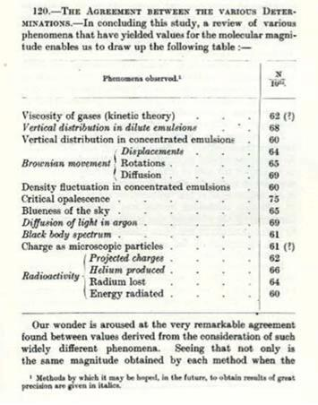

이 책은 생물학을 위한 정량적 '지도책(atlas)'을 지향합니다. 전체 내용은 크기와 기하학, 분자 수의 인구조사, 힘과 에너지, 반응 속도와 시간, 정보 관리와 오류율이라는 다섯 가지 물리적 축을 중심으로 전개됩니다.

생물학적 수리 감각으로 가는 길

> — 찰스 다윈, 《자서전》

생명의 사실들 - 왜 숫자에 관심을 가져야 하는가

세포생물학에서 정량적 관점을 취할 때 얻는 네 가지 핵심 이점은 다음과 같습니다.

1. **역사적 돌파구**: 초파리 유전자 지도 작성, 신경 활동전위 동역학(호지킨-헉슬리), 박테리아 주화성, 유전 정보 복제의 키네틱 교정(proofreading) 메커니즘 등 생물학의 기념비적 발견들은 모두 정량적 질문에서 시작되었습니다.
2. **반증 가능한 가설 검증**: 정량화는 물리적으로 실현 가능한 명확한 가설을 세우고, 정밀 측정을 통해 이론과 실측 사이의 불일치를 검증하게 돕습니다.
3. **새로운 직관의 확립**: 일상 직관과 달리, 유전 정보를 담은 mRNA 분자는 자신이 암호화하는 완성된 단백질 기계보다 물리적으로 훨씬 큽니다. 정량 데이터는 세포 내 수송과 조립의 물리적 비용을 재평가하게 합니다.
4. **수치적 변칙성을 통한 발견**: 대장균 한 세포의 단백질 수가 연구마다 100배씩 차이 난다면 정상과 변칙을 구분할 수 없습니다. 재현 가능한 정량 기준이 확립될 때 비로소 미지의 생물학적 현상을 포착할 수 있습니다.

## 바이오넘버스

생물학 문헌 전반에 흩어진 정량 데이터를 체계적으로 큐레이션한 데이터베이스가 하버드 대학교의 바이오넘버스(BioNumbers, http://bionumbers.hms.harvard.edu/)입니다.

::: {.callout-note}
### 바이오넘버스 식별 번호(BNID) 활용 팁
본문에 수록된 주요 수치에는 고유 식별자인 BNID(BioNumbers ID)가 병기되어 있습니다(예: BNID 103023은 효모 세포당 mRNA 수). 웹사이트 검색창에 입력하면 측정 방법, 배양 조건, 원저 문헌을 즉시 확인할 수 있습니다.
:::

어림셈하는 방법

미지의 물리량을 어림할 때 유용한 기본 도구는 상한($x_U$)과 하한($x_L$)을 정한 후 기하평균(geometric mean)을 취하는 것입니다.

$$x_{\text{estimate}} = \sqrt{x_L \cdot x_U}$$

- **보잉 747 날개 길이**: 하한 $5\text{ m}$, 상한 $50\text{ m}$ 설정 시 $\sqrt{5 \times 50} \approx 16\text{ m}$ (실제 수십 m로 2배 이내 일치).
- **인체 내 총 원자 수**: 하한 $10^{20}$개, 상한 $10^{40}$개 설정 시 $\sqrt{10^{20} \times 10^{40}} = 10^{30}$개 (실측치 $\approx 7 \times 10^{27}$개와 근접).

기하평균은 로그 스케일의 산술평균이므로 극단적 과대평가를 방지합니다. 과도한 수학적 엄밀함에 얽매여 직관이 굳는 '사후 강직(rigor mortis)'을 피하고, 연속적 근사(successive approximation)로 범위를 좁혀가는 훈련이 핵심입니다.

## 자릿수 생물학 툴킷

### 유용한 산술 근사치

- $2^{10} \approx 10^3$, $2^{20} \approx 10^6$, $e^7 \approx 10^3$
- $10^{0.1} \approx 1.3$, $\sqrt{2} \approx 1.4$, $\sqrt{0.5} \approx 0.7$
- $\ln(10) \approx 2.3$, $\ln(2) \approx 0.7$, $\log_{10}(2) \approx 0.3$, $\log_2(10) \approx 3.3$

> 수학적 표기: $\approx$는 약 2배 이내 정확도, $\sim$은 10배 이내(한 자릿수) 오차를 의미합니다.

### 기억해 두면 유용한 큰 수들

- 1년의 초 수 $\approx \pi \times 10^7\text{ s}$ ($3.15 \times 10^7\text{ s}$), 1일의 초 수 $\approx 10^5\text{ s}$ ($86,400\text{ s}$)
- 1년의 시간 수 $\approx 10^4\text{ h}$ ($8,760\text{ h}$)
- 아보가드로 상수 $\approx 6 \times 10^{23}\text{ mol}^{-1}$
- 인체의 총 세포 수 $\approx 4 \times 10^{13}$개

## 경험 법칙

- $1\text{ Da} \approx 1.7 \times 10^{-24}\text{ g}$
- **농도와 분자 수**: $1\text{ nM}$은 대장균 부피당 $\approx 1$개, 효모당 $10\sim 100$개, HeLa 세포당 $1,000\sim 10,000$개 분자에 해당합니다.
- 세포 부피 $1\ \mu\text{m}^3$당 단백질 수는 $\approx 200만\sim 400만$개, 프로테옴 $1\text{ ppm} \approx 5\text{ nM}$.
- 아미노산 1개 평균 질량 $\approx 110\text{ Da}$ (어림 시 $\approx 100\text{ Da}$), 단백질 분자량[Da] $\approx 100 \times \text{잔기 수}$.
- 물 분자 부피 $\approx 0.03\text{ nm}^3$, 분자 간 평균 거리 $\approx 0.3\text{ nm}$, 밀도 $\approx 55\text{ M} \approx 1,000\text{ kg/m}^3$.
- DNA 1 염기쌍: 부피 $\approx 1\text{ nm}^3$, 질량 $\approx 600\sim 660\text{ Da}$. 인지질 $\approx 500\sim 1,000\text{ Da}$.
- 열에너지 $1\ k_B T \approx 2.5\text{ kJ/mol} \approx 0.6\text{ kcal/mol} \approx 4.1\text{ pN}\cdot\text{nm} \approx 4 \times 10^{-21}\text{ J}$.
- 10배 농도 구배 유지 자유에너지 $\approx 6\text{ kJ/mol}$ ($= RT \ln 10$).
- 생리 조건 ATP 1분자 가수분해 에너지 $\approx 20\ k_B T \approx 50\text{ kJ/mol} \approx 12\text{ kcal/mol}$.
- 저분자 대사물질은 세포질에서 $\sim 1\text{ ns}$ 만에 약 $1\text{ nm}$ 확산.
- 세포 부피 $1\ \mu\text{m}^3$당 탄소 원자 수 $\approx 10^{10}$개.

어림셈을 위한 엄밀한 규칙과 유효숫자

생물학적 계측에는 2~3배 수준의 고유 변동성이 일반적입니다.

::: {.callout-important}
### 유효숫자 표기의 황금률
생물학 수치 보고는 **유효숫자 2개**를 기본으로 합니다. 과도한 자릿수 표기는 '거짓된 정밀도(spurious precision)'를 조장합니다. 오차는 유효숫자 1자리로 보고합니다(예: $26 \pm 4$).
:::

- **유효숫자 2개** (예: $3,200\ \mu\text{m}^3$): 오차 10~30% 이내로 잘 제어된 값.
- **유효숫자 1개** (예: $3,000\ \mu\text{m}^3$): 약 2배의 불확실성 내포.
- **자릿수 표기** (예: $10^3\ \mu\text{m}^3$): 3~10배 수준의 큰 변동성 예상.

## 세포의 지리학

세포 세계를 항해하는 세 가지 표준 모델:
1. **대장균(*E. coli*)**: 전형적 세균, 부피 $\approx 1\ \mu\text{m}^3$, 총 단백질 수 $\sim 10^6$개. 평균 단백질 농도 $\approx 1\ \mu\text{M}$ (세포당 $\sim 10^3$개).
2. **출아효모(*S. cerevisiae*)**: 단세포 진핵생물, 부피 $\approx 40\ \mu\text{m}^3$.
3. **HeLa 세포**: 인간 배양세포, 부피 $\approx 3,000\ \mu\text{m}^3$.

### [페르미 추정 사례] HeLa 세포 내 전사 인자 p53의 복제수 추정
- 세포 전체 단백질 수: $3,000\ \mu\text{m}^3 \times (3 \times 10^6\text{개}/\mu\text{m}^3) \approx 10^{10}$개
- 조절 단백질 분율을 전체의 약 1/1,000로 가정:
$$\text{추정 복제수} \approx \frac{10^{10}}{1,000} \approx 10^7\text{개}$$
실제 전사 인자 복제수($10^5\sim 10^6$개)와 비교할 때 유용한 상한 기준을 제공합니다. 이처럼 최소한의 가정과 수치 규칙으로 가설의 물리적 타당성을 검증하는 방식을 '스트리트 파이팅 세포생물학'이라 부릅니다.
## 제1장: 크기와 기하학

생물학적 구조의 크기는 나노미터($\text{nm}$) 규모의 거대분자부터 수천 킬로미터에 이르는 대양의 남세균 번식에 이르기까지 광범위합니다. 형태가 기능을 결정한다는 현대 생물학의 원리처럼, 크기를 아는 것만으로도 수많은 기능적 추론이 가능합니다. 

J. B. S. 홀데인이 《적절한 크기에 관하여》에서 통찰했듯 물리적 스케일은 생명체의 작동 방식을 지배합니다. 예를 들어 박테리오파지와 포유류 바이러스의 크기는 수십~수백 nm로 비슷하지만, 숙주세포의 부피는 박테리아보다 포유류 세포가 약 1,000배 큽니다. 그 결과 박테리아의 파지 방출량(burst size)은 세포당 약 100개 수준인 반면, 포유류 세포의 바이러스 방출량은 $\approx 100,000$개에 달합니다. 크기와 부피의 단순한 기하학적 관계가 중요한 생물학적 차이를 명쾌하게 설명해 줍니다.

## 바이러스는 얼마나 큰가?

바이러스는 개체 수 기준으로 지구상에서 가장 풍부한 생명체입니다. 총 개체 수는 약 $10^{31}$개로, 인류 1인당 아보가드로 수($\sim 10^{23}$개), 인체 세포 하나당 $10^8$개에 해당합니다. 원핵생물 총수($4\sim 6 \times 10^{30}$개, BNID 104960)보다 10배 많지만, 극도로 작은 크기 탓에 총질량은 원핵생물 생물량의 5% 미만입니다. 매일 해양 박테리아의 최대 20%가 바이러스 감염으로 용해되며(BNID 106625), 지구적 탄소 순환을 추동합니다.

바이러스 캡시드(단백질 껍질)는 대개 정이십면체(icosahedron) 회전 대칭성을 띠며 내부에 $10^3\sim 10^6$ 염기 크기의 유전체를 압축합니다(BNID 103246). 일반적 바이러스의 직경은 수십~수백 nm입니다. 람다 파지는 캡시드 부피의 약 40%가 고밀도 DNA로 충전되어 있으며, PRD1 파지 등은 특정 단백질(P30)이 '분자 줄자' 역할을 하여 외피 크기를 결정합니다. 한편 최근 발견된 미미바이러스나 판도라바이러스 같은 거대 바이러스는 직경이 수백 nm~$1\ \mu\text{m}$, 유전체 크기가 2 Mbp에 달해 작은 진핵세포 크기에 필적합니다(BNID 109554).

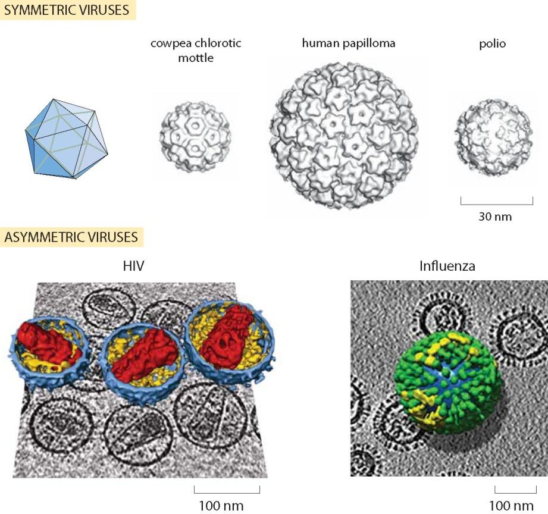

## 대장균 세포의 크기와 질량은 얼마인가?

## 대장균(*E. coli*)은 미시 세계의 대표적인 표준 척도입니다.
- **외형 치수**: 직경 $\approx 1\ \mu\text{m}$, 길이 $\approx 2\ \mu\text{m}$, 부피 $\approx 1\ \mu\text{m}^3 = 1\ \text{fL}$ (구원통형 계산 시 $\approx 1.3\ \mu\text{m}^3$, BNID 101788).
- **질량**: 습윤 질량 $\approx 1\ \text{pg}$ ($10^{-12}\text{ g}$), 건조 질량(30%) $\approx 0.3\text{ pg} = 300\text{ fg}$ (BNID 100044).

세포의 크기와 질량은 고정 상수가 아니며, 영양 상태가 양호하여 배가 시간이 짧을수록 평균 부피와 질량은 지수적으로 증가합니다.

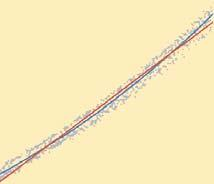

출아효모 세포의 크기는 얼마나 될까?

단세포 진핵생물인 출아효모(*S. cerevisiae*)는 유전학적 배수성에 따라 명확한 크기 차이를 보입니다.
- **반수체(1n)**: 직경 $\approx 4\ \mu\text{m}$, 부피 $\approx 40\ \mu\text{m}^3$ (BNID 101796)
- **이배체(2n)**: 직경 $\approx 6\ \mu\text{m}$, 부피 $\approx 80\ \mu\text{m}^3$ (BNID 100490)

대장균($1\ \mu\text{m}^3$)이 사람 크기라면 효모는 코끼리($\approx 40$배 부피)에 해당합니다. 핵은 세포 부피의 약 10%를 차지하며, DNA 함량이 2배인 이배체의 부피가 반수체의 정확히 2배라는 점은 진핵세포에서 배수성(ploidy)과 세포 크기의 비례 법칙을 잘 보여줍니다.

인간 세포의 크기는 얼마나 될까?

성인 인체는 약 $3.7 \times 10^{13}$개(37조 개)의 인간 세포와 유사한 수의 공생 미생물로 구성됩니다(BNID 109716). 200여 종의 인체 세포는 기능에 따라 극적인 부피 편차를 보입니다.
- **적혈구**: 직경 $7\sim 8\ \mu\text{m}$, 부피 $\approx 100\ \mu\text{m}^3$ (무핵 원반형, BNID 100509)
- **정자 세포**: $\approx 20\sim 40\ \mu\text{m}^3$
- **성숙 난자**: 직경 $\approx 120\ \mu\text{m}$, 부피 $\approx 10^6\ \mu\text{m}^3$ (체내 최대 세포 중 하나)
- **운동 신경세포**: 축삭 길이가 1 m 이상에 달함
- **HeLa 배양세포**: 부피 $\approx 2,000\sim 3,000\ \mu\text{m}^3$ (부착 시 직경 $20\sim 40\ \mu\text{m}$, BNID 100434)

표준 배양세포의 기준값($2,000\sim 3,000\ \mu\text{m}^3$)은 대장균($1\ \mu\text{m}^3$)보다 약 2,000~3,000배 큰 규모입니다.

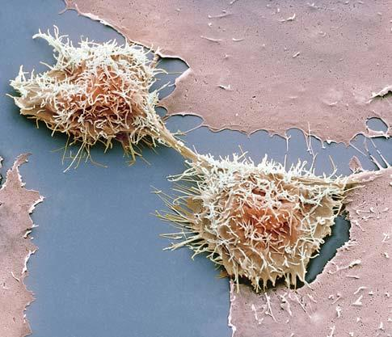

광수용체의 크기는 얼마나 될까?

인간 망막(두께 $100\sim 300\ \mu\text{m}$)에는 명암을 감지하는 간상세포(rod, $\sim 1.2 \times 10^8$개)와 색각을 감지하는 추상세포(cone, $\sim 6 \times 10^6$개)가 있어 한쪽 눈에만 총 1억 개 이상의 광센서를 갖추고 있습니다.
- **간상세포 치수**: 직경 $\approx 2\ \mu\text{m}$, 단면적 $\approx 4\ \mu\text{m}^2$. 망막 중심와 밀도는 최대 $20만\sim 25만\text{ cells/mm}^2$.
- **외절 미세구조**: 외절(길이 $\approx 25\ \mu\text{m}$)에는 두께 10 nm 막 원반이 25 nm 간격으로 1,000여 층 적층되어 있습니다. 간상세포 1개당 약 $10^8$개의 로돕신 분자가 빽빽이 배열되어 단 하나의 광자(single photon)까지 포획할 수 있습니다.

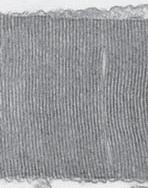

세포의 크기와 형태의 범위는 어떻게 될까?

세포의 크기는 길이 척도로만 $10^7$배(7자리) 이상의 스펙트럼을 보입니다.
- **극소형**: 마이코플라스마(*Mycoplasma*)는 직경 $\approx 0.2\ \mu\text{m}$, 부피 $0.005\ \mu\text{m}^3$에 불과합니다.
- **거대형**: 해저 황박테리아 티오마르가리타(*Thiomargarita namibiensis*)는 직경이 최대 $750\ \mu\text{m}(0.75\text{ mm})$에 달해 육안으로 확인 가능합니다.
- 별 모양의 스텔라 박테리아, 탄산칼슘 외골격을 갖춘 원석조류, 1 m가 넘는 신경세포 축삭 등 자연계는 단일 세포만으로도 놀라운 형태학적 다양성을 발현합니다.

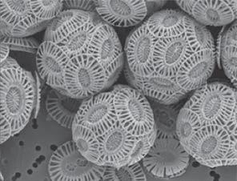

세포핵의 크기는 얼마나 될까?

세포핵의 직경은 보통 $2\sim 10\ \mu\text{m}$입니다.
- **효모 핵**: 부피 $\approx 3\sim 4\ \mu\text{m}^3$ (세포 부피의 약 8~10%, BNID 104709)
- **HeLa 핵**: 부피 $\approx 500\sim 1,000\ \mu\text{m}^3$ (세포 부피의 약 10%, 직경 $\approx 10\ \mu\text{m}$)

효모 유전체(12 Mbp) DNA 염기쌍의 순수 부피($0.01\ \mu\text{m}^3$)는 핵 부피의 0.3%에 불과하지만, 히스톤 8량체 뉴클레오솜과 고차 염색질 섬유로 응축되어 핵 공간의 실질 부피를 형성합니다. 식물과 동물 세포 전반에서 핵 부피는 전체 세포 부피의 약 10~20%($V_{\text{nuc}} / V_{\text{cell}} \approx 0.1\sim 0.2$)를 일정하게 유지하는 정밀한 스케일링 법칙을 따릅니다.

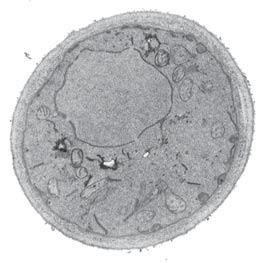

세포의 소포체 크기는 얼마나 될까?

소포체(ER)는 전체 단백질의 20~30%가 가공·분비되는 최대의 막 시스템입니다.
- **막 면적**: 주름진 판상 시스터나와 관(tubule, 직경 $30\sim 100\text{ nm}$) 구조 덕분에 소포체 표면적은 원형질막의 10~20배에 달하며, 세포 내 전체 막 면적의 50~60%를 차지합니다.
- **부피 분율**: 전체 세포 부피의 10% 이상을 차지하며, 분비가 활발한 형질세포(B세포)나 췌장세포에서는 세포질 전체를 메웁니다.
- 소포체는 세포 분열기 신속히 해체·재조립되며, 막 접촉 부위(MCS)를 통해 미토콘드리아 및 세포막과 지질·칼슘 신호를 직접 교환합니다.

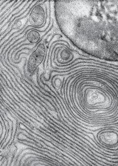

미토콘드리아의 크기는 얼마나 될까?

ATP를 생산하는 미토콘드리아는 호기성 세균의 내부공생에서 기원했습니다.
- **크기**: 직경 $\approx 0.5\sim 1\ \mu\text{m}$, 길이 $\approx 1\sim 2\ \mu\text{m}$ (대장균 세포와 거의 동일).
- **세포당 수 및 부피**: 효모는 수 개~수십 개, 간세포와 심근세포는 $1,000\sim 2,000$개를 보유하며 간세포 부피의 약 20~25%를 차지합니다.
- 살아있는 세포 속 미토콘드리아는 독립된 타원체가 아니라, 끊임없이 융합과 분열을 반복하며 수십 $\mu\text{m}$ 길이의 역동적 그물망(reticular network)을 형성합니다.

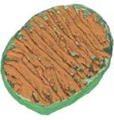

엽록체의 크기는 얼마나 될까?

광합성을 수행하는 엽록체는 남세균의 내부공생에서 기원했습니다.
- **크기**: 직경 $\approx 4\sim 6\ \mu\text{m}$, 두께 $\approx 1\sim 3\ \mu\text{m}$, 부피 $\approx 20\sim 30\ \mu\text{m}^3$ (미토콘드리아나 대장균보다 10~20배 큼).
- **개수 및 유전체**: 조류 클라미도모나스는 1개, 식물 엽육세포는 $50\sim 100$개를 지니며, 원형 DNA($100\sim 150\text{ kbp}$)를 수십~수백 카피 보유합니다(BNID 105918).
- 내부는 그라나 틸라코이드 막으로 채워져 있으며, 기질(스트로마)의 대부분은 대기 중 $\text{CO}_2$를 고정하는 핵심 효소인 루비스코(Rubisco)가 차지합니다.

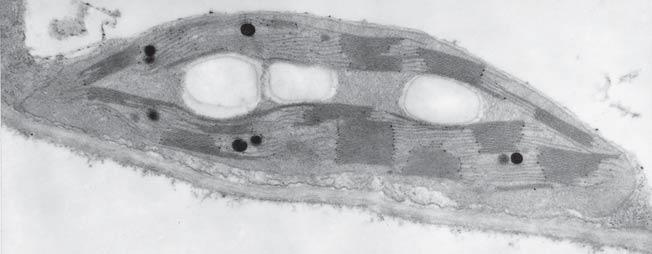

시냅스의 크기는 얼마나 될까?

시냅스는 신경세포 간 정밀 신호 전달 접점입니다.
- **크기**: 시냅스 말단 직경 $\approx 0.5\sim 1\ \mu\text{m}$ (부피 $\approx 0.1\sim 1\ \mu\text{m}^3$, 대장균 1개 크기), 시냅스 틈(synaptic cleft) 너비 $\approx 20\sim 40\text{ nm}$.
- **총 개수**: 인간 뇌 전체에 약 $10^{14}\sim 10^{15}$개 존재 (대뇌 피질 $1\text{ mm}^3$당 약 10억 개, BNID 106138).
- 활동전위가 도달하면 소포(직경 $\approx 40\text{ nm}$) 하나당 $1,000\sim 5,000$개의 신경전달물질이 방출되며, 틈이 20~40 nm로 극히 좁아 확산 전달은 0.1 ms(100 $\mu\text{s}$) 이내에 신속히 완료됩니다.

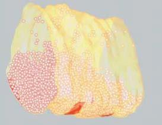

생화학적 기초 부품의 크기는 얼마나 될까?

세포 작동에 필수적인 소분자 기본 치수는 다음과 같습니다.
- **물($\text{H}_2\text{O}$)**: 결합 길이 $0.1\text{ nm}$, 분자 부피 $\approx 0.03\ \text{nm}^3$, 분자 간 평균 중심 거리 $\approx 0.3\text{ nm}$, 분자량 $18\text{ Da}$.
- **무기 이온**: 수화된 상태의 유효 반지름은 약 $0.3\sim 0.4\text{ nm}$.
- **뉴클레오타이드**: 분자량 $\approx 330\text{ Da}$, DNA 이중나선 반경 $\approx 1\text{ nm}$, 염기쌍 간 거리 $\approx 0.34\text{ nm}$.
- **아미노산**: 평균 질량 $\approx 110\text{ Da}$ (계산용 기준값 $\approx 100\text{ Da}$).
- **인지질**: 단면적 $\approx 0.5\ \text{nm}^2$, 길이 $\approx 2\text{ nm}$, 질량 $700\sim 1,000\text{ Da}$.
- **포도당**: 분자량 $180\text{ Da}$, 분자 직경 $\approx 1\text{ nm}$.
- **ATP**: 분자량 $\approx 507\text{ Da}$, 확산 직경 $\approx 1.4\text{ nm}$.

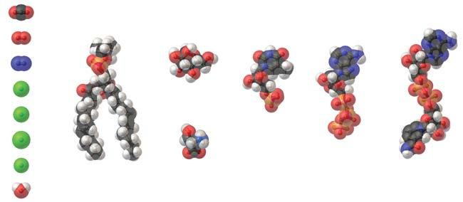

mRNA와 그것이 암호화하는 단백질 중 어느 쪽이 더 클까?

설계도(mRNA)는 완성된 분자 기계(단백질)보다 훨씬 작을 것이라는 통념과 달리 미시 세계에서는 정반대입니다.

1. **단량체 질량**: RNA 뉴클레오타이드($\approx 330\text{ Da}$)는 아미노산($\approx 110\text{ Da}$)보다 약 3배 무겁습니다.
2. **트리플렛 코돈**: 아미노산 1개를 위해 3개 뉴클레오타이드($\approx 1,000\text{ Da}$)가 필요하므로 코돈은 아미노산보다 약 9배 무겁습니다.
3. **UTR 및 꼬리**: 5' 캡, UTR, 폴리A 꼬리를 감안하면 실제 성숙한 mRNA 전사체는 암호화 단백질보다 질량 기준으로 **10배 이상** 무겁습니다.
4. **공간적 부피**: 구상 단백질은 단단히 접혀 직경이 $3\sim 6\text{ nm}$에 불과하지만, 1,000 nt 길이의 mRNA는 느슨하게 뻗어 회전반지름 $R_g \approx 20\text{ nm}$ (유효 직경 $\approx 40\text{ nm}$)를 차지합니다.

따라서 mRNA는 자신이 생산하는 단백질보다 질량과 공간 크기 모두 **약 10배 더 큽니다**.

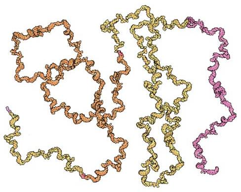

단백질의 크기는 얼마나 될까?

단백질은 직경 $3\sim 6\text{ nm}$의 구상 구조를 주로 취합니다.
- **평균 사슬 길이**: 원핵생물 $\approx 300\text{ aa}$ ($\approx 30\text{ kDa}$), 진핵생물 $\approx 400\text{ aa}$ ($\approx 40\text{ kDa}$).
- **대표 복합체**: 루비스코(Rubisco, $8\times 55\text{ kDa} + 8\times 13\text{ kDa} \approx 550\text{ kDa}$), ATP 합성효소($\approx 550\sim 600\text{ kDa}$).
- **극단적 거대 단백질**: 근육 탄성 단백질 타이틴(titin)은 $33,423\text{ aa}$ ($\approx 3.8\text{ MDa}$)로 평균 단백질의 약 100배에 이릅니다.

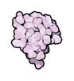

센트럴 도그마의 분자 기계들은 얼마나 클까?

유전 정보 흐름을 주도하는 세 가지 핵심 분자 기계의 물리적 스케일은 다음과 같습니다.
1. **복제복합체(Replisome)**: 질량 $\approx 1\text{ MDa}$. 헬리카아제, 중합효소 등으로 이루어지며, DNA(직경 2 nm)를 인간 키(1 m)로 확대하면 시속 600 km로 달리는 대형 트럭 수준의 크기와 속도로 작동합니다.
2. **RNA 중합효소(RNAP)**: 대장균 기준 질량 $\approx 400\text{ kDa}$, 직경 $\approx 5\text{ nm}$.
3. **리보솜(Ribosome)**: 박테리아 70S($\approx 2.5\text{ MDa}$, 직경 $\approx 20\text{ nm}$), 효모 80S($\approx 3.3\text{ MDa}$), 포유류 80S($\approx 4.2\text{ MDa}$). 질량의 2/3가 rRNA로 이루어진 거대한 촉매성 리보자임(ribozyme)입니다.

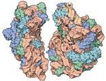

세포막의 두께는 얼마인가?

세포막은 나노미터 규모의 초박막 장벽입니다.
- **지질 이중층 두께**: $\approx 4\text{ nm}$ (소수성 중심부 $3\text{ nm}$ + 친수성 머리 양쪽 각 $0.5\text{ nm}$).
- **기하학적 비율**: 직경 $2\ \mu\text{m}$ 세균 세포에서 4 nm 막 두께의 비율(1:500)은 직경 5 m인 보잉 747 여객기 동체와 1 cm 두께의 알루미늄 외피 비율과 정확히 일치합니다.
- **프랭클린의 어림셈**: 벤자민 프랭클린이 기름 1 티스푼($\approx 5\text{ cm}^3$)으로 $2,000\text{ m}^2$ 연못 수면을 덮은 실험에서, 기름층 두께 $\approx 5 \times 10^{-6}\text{ m}^3 / 2 \times 10^3\text{ m}^2 \approx 2.5\text{ nm}$라는 분자층 두께가 유도되었습니다.
- **단백질 밀집도**: 생체막 표면적의 약 50%는 막단백질이 점유하며 질량비는 단백질과 지질이 1:1 이상입니다. 막관통 $\alpha$-나선 길이는 막 두께와 일치하는 약 4 nm(20~25개 아미노산)입니다.

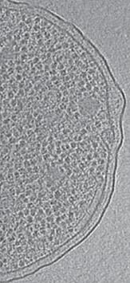

세포 필라멘트의 크기는 얼마인가?

세포골격을 구성하는 주요 섬유들의 물리적 특성은 다음과 같습니다.

| 특성 | 액틴 필라멘트 (F-액틴) | 미세소관 (Microtubule) |
|---|---|---|
| 기본 단위체 | G-액틴 (42 kDa, 직경 $\approx 5\text{ nm}$) | $\alpha/\beta$-튜불린 (100 kDa, $8\text{ nm}$) |
| 필라멘트 직경 | $\approx 6\sim 7\text{ nm}$ | $\approx 25\text{ nm}$ (속 빈 13개 원시섬유 원통) |
| 지속 길이($L_p$) | $\approx 10\sim 15\ \mu\text{m}$ (유연한 밧줄) | $\approx 1\sim 5\text{ mm}$ (완벽히 뻣뻣한 강철 파이프) |

지속 길이(persistence length)는 열 요동 속에서 필라멘트가 직선을 유지하는 길이입니다. 직경 25 nm인 미세소관의 지속 길이가 수 mm에 달한다는 것은, 세포 크기($10\sim 20\ \mu\text{m}$) 안에서는 전혀 휘어지지 않는 완벽한 구조용 강철 보강재로 작동함을 뜻합니다. 

세포 분열 시에는 미세소관이 방추사(mitotic spindle)를 이뤄 염색체를 견인하며, 세포 선단부에서는 액틴 단량체가 초당 약 100개씩 중합되어 막을 밀어내며 초당 약 $0.25\ \mu\text{m}$ 속도로 이동을 유도합니다. 박테리아에도 액틴 상동체(MreB)와 튜불린 상동체(FtsZ)가 존재하여 세포골격은 전 생명체의 보편적 원리임이 확인되었습니다.

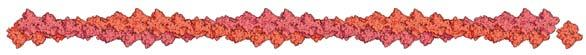
## 제2장: 농도와 절대 수치

이 장은 "얼마나 많은가(how many)?"라는 질문을 중심으로 전개됩니다. 상대적 비율이 아닌 세포당 절대 복제 수(copy number)와 몰 농도($\text{M}$) 단위로 분자의 존재량을 파악하는 것은 생명 기능의 정량적 예측 모델을 세우기 위한 필수 전제입니다.

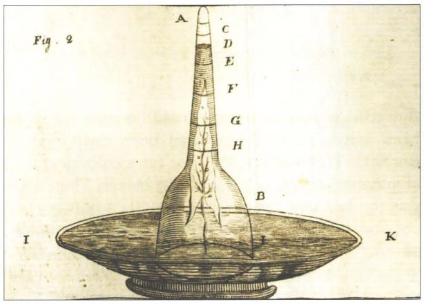

파울 에를리히(Paul Ehrlich)의 격언 *"Corpora non agunt nisi ligata"*(물질은 결합하지 않으면 작용하지 않는다)처럼 분자 간 상호작용은 농도와 친화도의 함수입니다. 예컨대 대장균의 젖당 억제자(LacI)는 세포당 단 10개의 사량체 수준에 불과하여, 극소수 분자가 유발하는 확률론적 요동(stochastic noise)이 세포 기능의 핵심 변수가 됩니다. 부피 $1\ \mu\text{m}^3$ 대장균 한 세포는 약 $100\sim 200\text{ fg}$의 탄소를 포함하며, 이는 세포당 약 $10^{10}$개의 탄소 원자에 해당합니다.

## 세포의 원소 조성은 어떠한가?

생명체는 주변 지각이나 대기와 전혀 다른 독특한 원소 비대칭성을 가집니다. 생체 화학은 C, H, O, N을 주축으로 P와 S가 골격을 연결합니다. 대장균의 건조 중량 실험식은 대략 다음과 같습니다:
$$\text{C}_4 : \text{H}_7 : \text{O}_2 : \text{N}_1 \quad (\text{또는 } \text{C} : \text{H}_{1.77} : \text{O}_{0.49} : \text{N}_{0.24})$$

- 대장균 세포 하나에는 약 $10^{10}$개의 탄소 원자가 들어 있으며, 출아효모 역시 거의 동일한 비율을 보입니다.
- 성인 인체(70 kg)에는 약 $10^{27}\sim 10^{28}$개의 원자가 존재합니다.
- 대장균 건조 질량(단백질 55%, 핵산 20%, 지질 10%)을 아미노산($\text{NC}_5\text{O}_2\text{H}_8$)과 뉴클레오타이드($\text{PN}_5\text{O}_7\text{C}_{10}\text{H}_{14}$)의 $3:1$ 질량비로 가중합산하면 이론식 $10 \times (\text{NC}_5\text{O}_2\text{H}_8) + 1 \times (\text{PN}_5\text{O}_7\text{C}_{10}\text{H}_{14}) \to \text{C}_4 : \text{H}_{6.3} : \text{O}_{1.8} : \text{N}_1$이 도출되어 실제 실험값과 놀랍도록 일치합니다.

세포의 밀도는 얼마인가?

세포 구성 성분의 밀도는 물 $1.0\text{ g/mL}$, 단백질 $1.3\sim 1.4\text{ g/mL}$, 지질 $0.9\sim 1.0\text{ g/mL}$, 핵산(RNA/DNA) $1.7\sim 2.0\text{ g/mL}$입니다. 
세포의 약 70%가 물이고 나머지 30% 건조 중량의 대부분이 단백질이므로, 세포 전체의 유효 밀도는 약 $\mathbf{1.1\text{ g/mL}}$($1,100\text{ kg/m}^3$)가 됩니다. 초원심분리에서 침강 속도 계수를 나타내는 스베드베리 단위($\text{S} = 10^{-13}\text{ s}$)는 리보솜 소단위체(23S, 16S 등) 명칭의 기원이며, 구상 입자 침강 속도는 대략 분자량의 $2/3$ 제곱에 비례합니다.

환경 중 O2와 CO2 농도는 얼마인가?

수용액 속 기체 농도는 용해도에 의해 결정됩니다. 실온 담수 기준 평형 용존 산소는 $\approx 200\sim 300\ \mu\text{M}$($8\sim 9\text{ mg/L}$), 이산화탄소는 $\approx 10\sim 15\ \mu\text{M}$($0.5\text{ mg/L}$)입니다. 공기 중 산소가 $\text{CO}_2$보다 500배 많지만, $\text{CO}_2$의 물 용해도가 50배 높아 액체 속 농도비는 10~20배로 좁혀집니다.

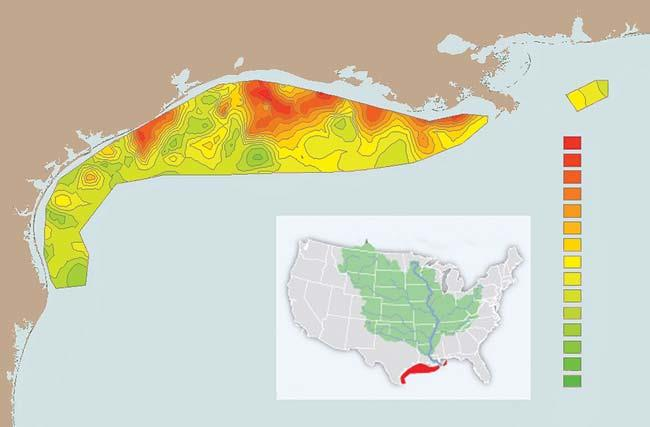

배지 1 L에서 대장균을 $\text{OD}_{600} \approx 1$(건조 균체 1 g)까지 키우려면 호흡에 약 30 mmol($\approx 1\text{ g}$)의 $\text{O}_2$가 소비됩니다. 그러나 배지 1 L에 녹아 있는 산소는 불과 $0.2\sim 0.3\text{ mmol}$이므로, 배양 시간 동안 용존 산소 풀은 100회 이상 지속적으로 환기되어야 합니다. 이것이 배양 플라스크에 큰 상부 공간을 두고 격렬히 진탕하는 이유입니다.

## 배양 배지에는 어느 정도 양의 영양분을 공급해야 하는가?

성분 조성이 명확한 M9 최소 배지에서 포도당은 통상 2 g/L ($0.2\%$, $\approx 11\text{ mM}$) 공급됩니다. 호기 조건에서 생체량 수율은 포도당 1 g당 건조 세포 약 0.5 g(나머지 절반은 호흡을 통해 $\text{CO}_2$ 배출)이므로, 포도당 2 g/L는 약 1 g/L의 건조 균체량($\text{OD}_{600} \approx 2$)을 형성합니다.

포화 배양액에서 세균 세포의 농도는 얼마인가?

밤새 배양한 대장균 포화 배양액의 농도는 약 $\mathbf{10^9\text{ cells/mL}}$($\text{OD}_{600} \approx 1\sim 2$)입니다. 이 상태에서 세포 간 평균 거리는 약 $10\ \mu\text{m}$이며, 전체 배양액 부피 중 세포가 차지하는 부피는 약 0.1%에 불과합니다. 반면 동물의 장 내부나 바이오필름에서는 세포들이 10~100배 더 조밀하게 밀착되어 있습니다.

세포의 pH는 얼마인가?

대장균 세포질 pH는 $\approx 7.2\sim 7.8$, 효모는 $\approx 7.0$(액포 $5.5\sim 6.0$), 인간 세포질은 $\approx 7.3$(미토콘드리아 기질 8.0, 리소좀 $4.5\sim 5.0$)입니다.
부피 $1\ \mu\text{m}^3$ 대장균(pH 7.2) 내 유리 수소 이온($\text{H}^+$) 농도는 $10^{-7.2}\text{ M} \approx 60\text{ nM}$로, **세포 전체에 유리 수소 이온은 단 60~100개**에 불과합니다. 그럼에도 수백만 개 단백질의 산-염기 반응이 원활한 이유는:
1. 글루탐산과 인산염 완충계가 pH 단위당 $10\sim 100\text{ mM}$의 완충능을 제공하고,
2. 그로투스 메커니즘(Grotthuss mechanism)을 통해 수소 이온이 물 분자망을 $7,000\ \mu\text{m}^2/\text{s}$의 초고속으로 확산 이동하기 때문입니다.

세포 내 여러 이온의 농도는 얼마인가?

세포는 세포막 펌프를 통해 세포외액과 뚜렷이 구별되는 이온 환경을 유지합니다:
- 칼륨($\text{K}^+$): 세포질 내부 $\approx 140\sim 200\text{ mM}$ vs 외부 $4\sim 5\text{ mM}$
- 나트륨($\text{Na}^+$): 세포질 내부 $\approx 5\sim 15\text{ mM}$ vs 외부 $145\text{ mM}$
- 유리 칼슘($\text{Ca}^{2+}$): 평상시 세포질 내부 $\approx \mathbf{100\text{ nM}}$로 외부($1\sim 2\text{ mM}$)보다 10,000배 낮아 2차 신호전달자로 작동
세포 내 음이온 중 $\text{Cl}^-$ 농도($5\sim 15\text{ mM}$)가 $\text{K}^+$보다 현저히 낮은 이유는 핵산 인산기, 인산화 대사물질, 산성 단백질이 방대한 음전하를 띠어 전기적 중성을 만족시키기 때문입니다.

세포 내 대사물질 농도는 얼마인가?

대장균 내 유리 대사물질의 총 몰농도는 $\approx 250\sim 300\text{ mM}$입니다.
1. 글루탐산(Glutamate): $\approx 100\text{ mM}$ (세포당 약 $10^8$개 분자로 압도적 1위, 단백질 아미노산 잔기 총수의 10%에 필적)
2. 글루타티온(Glutathione): $\approx 15\sim 20\text{ mM}$ (산화환원 완충)
3. 과당 1,6-이중인산(FBP): $\approx 15\text{ mM}$
4. ATP: $\approx 5\sim 10\text{ mM}$ (세포당 $3\times 10^6 \sim 6\times 10^6$개)

생체막에서 가장 풍부한 지질은 무엇인가?

포유류 세포막은 인지질 $\approx 60\%$, 콜레스테롤 $\approx 20\sim 40\%$, 스핑고지질 $\approx 10\%$로 구성됩니다. 인지질 중에서는 포스파티딜콜린(PC)과 포스파티딜에탄올아민(PE)이 절반 이상을 차지합니다. 외층에는 PC와 스핑고미엘린이, 내층에는 PE와 음전하인 포스파티딜세린(PS)이 배치되며, 세포 사멸 시 PS의 외층 노출은 대식세포의 포식 작용("eat-me")을 유도합니다. 박테리아와 효모는 온도 저하 시 불포화지질 비율을 높여 유동성을 유지합니다(호메오비커스 적응).

## 세포 하나에는 몇 개의 단백질이 들어 있는가?

단백질 농도($c_p \approx 0.2\text{ g/mL}$), 평균 길이($300\sim 400\text{ aa}$), 아미노산 질량($100\text{ Da}$)으로부터 단위 부피당 단백질 수를 추산하면:
$$\frac{N}{V} \approx \mathbf{2\sim 4 \times 10^6\text{ proteins}/\mu\text{m}^3}$$
- 대장균 ($1\ \mu\text{m}^3$): 약 $2\sim 4 \times 10^6$개 (200만~400만 개)
- 출아효모 ($40\ \mu\text{m}^3$): 약 $5\times 10^7 \sim 10^8$개 (5,000만~1억 개)
- 인간 HeLa 세포 ($3,000\ \mu\text{m}^3$): 약 $5\times 10^9 \sim 10^{10}$개 (50억~100억 개)

세포에서 가장 풍부한 단백질은 무엇인가?

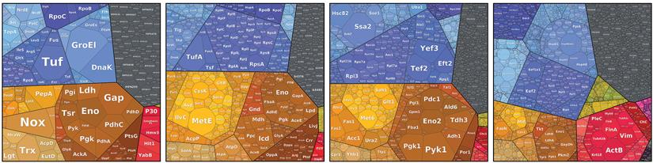

- 식물: $\text{CO}_2$ 고정 효소인 루비스코(Rubisco)가 잎 수용성 단백질의 30~50%를 점유합니다(촉매 속도가 초당 1~3회로 느려 다량 합성으로 보상).
- 대장균: 번역 신장 인자 EF-Tu(세포당 $\approx 90,000$개)와 리보솜 단백질이 최상위입니다.
- 효모: 물질 흐름이 큰 해당과정 효소들이 프로테옴의 20~25%를 차지합니다.
- 인간/동물: 액틴·튜불린이 5~10%를 차지하며, 결합조직의 콜라겐은 루비스코와 함께 지구상에서 가장 풍부한 단백질로 꼽힙니다.

단백질 발현에는 세포 간 변이가 얼마나 존재할까?

동일 유전자를 가진 세포라도 단백질 농도 변이(노이즈)를 보이며, 이는 환경 변화에 대비한 위험 분산(bet-hedging) 전략입니다. 변동계수($\text{CV} = \sigma / \mu$) 기준으로 대장균은 $\text{CV} \approx \mathbf{0.4}$, 인간 세포는 $\text{CV} \approx \mathbf{0.1\sim 0.3}$을 보입니다($\text{CV} \approx 0.3$ 로그 정규 분포에서 상위 10% 발현량은 하위 10%의 2배).

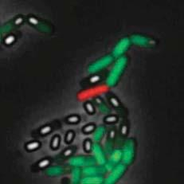

세포의 발현 기억 시간(memory timescale)은 인간 세포에서 대략 1~3세대에 달하여, 유전적 차이가 없는 암세포 집단에서도 치료제 저항성의 후성유전적 이질성을 낳습니다.

세포골격 분자의 농도는 얼마인가?

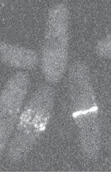

분열 효모 모델에서 세포골격 분자의 농도는 구조적 역할에 따른 화학량론적 계층을 정밀하게 반영합니다:
- 기본 단위체(액틴): 세포당 $10^6$개 이상 ($\approx 50\sim 60\ \mu\text{M}$, 프로테옴의 1% 이상)
- 분지 복합체(Arp2/3): 세포당 $\approx 50,000$개 ($\approx 2.5\ \mu\text{M}$)
- 모터 및 신장 인자(미오신, 포민): 세포당 $10^3\sim 10^4$개 ($\approx 0.1\sim 0.5\ \mu\text{M}$)
- 상류 마스터 조절 키나아제: 세포당 $< 1,000$개 ($< 50\text{ nM}$)

세포 하나에는 얼마나 많은 mRNA가 들어 있을까?

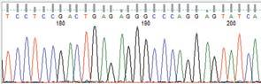

- 대장균: 세포당 mRNA 총수는 $\approx \mathbf{3,000\sim 8,000\text{개}}$입니다. 4,000여 유전자 수를 감안하면 유전자당 평균 mRNA 수는 **$1\sim 2$개 미만**에 불과하며, 대다수 유전자는 상당수 세포에서 0개로 존재하는 이산적 확률 분포를 보입니다(smFISH로 입증).
- 포유류 세포(HeLa): 총 mRNA 수는 $\approx \mathbf{20만\sim 30만\text{개}}$(총 단백질 약 $10^{10}$개), 효모는 $\approx 2만\sim 6만\text{개}$입니다.

단백질 대 mRNA의 비율은 얼마인가?

정상 상태에서 단백질 대 mRNA 비율($p/m$)은 번역 속도($\beta$)와 세포 분열 희석율($\alpha \approx 1/\tau$)의 비로 결정됩니다:
$$\frac{p}{m} \approx \beta \tau$$
리보솜의 물리적 크기($\approx 20\text{ nm}$)로 인한 최대 개시 빈도 $\beta_{\max} \approx 1\text{ s}^{-1}$를 적용하면:
- 대장균 ($\tau \approx 1,000\text{ s}$): $p/m \approx 1\text{ s}^{-1} \times 1,000\text{ s} \approx \mathbf{1,000}$ (실제 측정치: 단백질 300만 개 / mRNA 3,000개)
- 효모: $p/m \approx \mathbf{4,000\sim 10,000}$, 포유류: $p/m \approx \mathbf{10^4}$

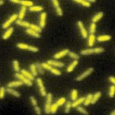

대장균 mRNA의 반감기는 약 3분($\approx 180\text{초}$)이므로, mRNA 1분자가 평생 생산하는 단백질 수(버스트 크기)는 약 **10~100개**입니다.

## 세포의 거대분자 구성은 어떠한가?

## 대장균 세포 건조 질량의 구성비(Neidhardt et al.):
- 단백질: $\approx 55\%$
- RNA: $\approx 20\%$ (rRNA 85%, tRNA 10%, mRNA 5% - mRNA는 전체 중량의 1%에 불과하나 짧은 수명 탓에 합성 활성의 절반 차지)
- 지질: $\approx 10\%$ (막 면적 $6\ \mu\text{m}^2 \times 4\text{ nm} \times 2$쌍 계산값 $\approx 9\%$와 일치)
- DNA: $\approx 3\%$
- 포유류 세포는 지질 비율이 $10\sim 15\%$로 증가하고 RNA 비율은 $\approx 4\%$로 감소합니다. 세포질 내 단백질 농도는 $\approx 200\text{ mg/mL}$에 달해 단백질 간 거리가 물 분자 10개 층에 불과한 극심한 분자 혼잡(macromolecular crowding) 상태를 이룹니다.

## 전사인자의 카피 수는 얼마나 되는가?

전사인자 종류는 대장균 약 200~300종, 인간 1,000~1,500종입니다. 전사인자의 세포 내 농도는 나노몰($\text{nM}$) 수준에 머뭅니다:
- 패러다임 모델 LacI: 대장균 세포당 단 **10개의 사량체**($\approx 10\text{ nM}$)뿐이며, 90%는 DNA에 비특이적으로 결합해 세포질 유리 분자는 1~2개에 불과합니다. 이 극소성으로 인해 분열 시 불가피한 확률적 불균등 분배가 발생합니다.
- CRP 같은 전역 조절자는 수천 개 존재하며, 전사인자 농도는 DNA 결합 친화도($K_d \sim 1\text{ nM}$)와 절묘하게 일치합니다.

신호전달 단백질의 절대적인 수는 얼마인가?

- 세균 이성분 신호전달계: 막 센서 키나아제($10^2\sim 10^3$개) 대비 하류 반응 조절자($10^3\sim 10^4$개)가 약 10배 풍부한 화학량론적 비율을 보존합니다.
- 포유류 MAPK 연쇄반응: $\text{Ras}(10^4\sim 10^7) \to \text{Raf}(10^4) \to \text{MEK}(10^5\sim 10^7) \to \text{ERK}(10^6\sim 10^7)$ 순으로 신호 증폭을 수행합니다. 포유류 세포($3,000\ \mu\text{m}^3$)에서 $1\ \mu\text{M}$ 농도는 약 $2\times 10^6$개 분자에 해당합니다.

## 간상세포에는 얼마나 많은 로돕신 분자가 존재하는가?

망막 간상세포는 단일 광자(single photon)를 검출합니다. 외절(길이 $25\ \mu\text{m}$) 내 1,000개의 막 원반(총면적 $\approx 6,000\ \mu\text{m}^2$)에 로돕신이 조밀하게 채워져, 간상세포 1개당 무려 **약 1억 개($\mathbf{\approx 10^8\text{개}}$)**의 로돕신이 존재합니다.
- 총 광자 흡수 단면적은 $\approx 1\ \mu\text{m}^2$로 세포 기하학적 단면적($4\ \mu\text{m}^2$)에 육박합니다.
- 로돕신 1분자의 열에 의한 자발적 오작동 확률은 약 100년에 1회에 불과하여, 1억 개가 밀집해도 세포 전체의 암흑 잡음은 30초당 1회 미만으로 억제됩니다. 1광자 흡수 시 트랜스듀신 $10^3$개 활성화 및 수만 개 cGMP 가수분해로 단일 광자 신호를 완성합니다.

## 세포에는 얼마나 많은 리보솜이 존재하는가?

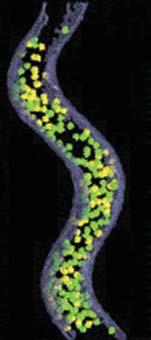

코펜하겐 학파의 성장 법칙에 따르면, 세포 성장 속도($\mu$)가 증가할수록 리보솜 분율은 선형적으로 증가합니다:
- 빠른 성장 (배가 24분): 세포당 $\approx 72,000$개 (건조 중량의 30% 이상이 리보솜)
- 중간 성장 (배가 40분): 세포당 $\approx 27,000$개
- 느린 성장 (배가 100분): 세포당 $\approx 7,000$개
리보솜의 번역 신장 속도가 $\approx 20\text{ aa/s}$로 고정되어 있으므로, 3배 빠르게 증식하려면 단위 부피당 리보솜 농도 또한 정확히 3배가 되어야 합니다. Cryo-ET 단층촬영으로 미세 세균(*S. melliferum*) 내부의 1,000여 개 리보솜이 직접 가시화·계수되어 이러한 정량 모델을 확증했습니다.
## 제3장: 에너지와 힘

에너지와 힘은 생명 현상을 정량적으로 이해하는 핵심 토대입니다. 생체 에너지 경제의 기준 단위는 열운동 에너지 스케일인 $k_BT$($k_B$: 볼츠만 상수, $T$: 절대온도)이며, 세포 내 반응은 엔탈피(결합)와 엔트로피(다중도)의 경합($\Delta G = \Delta H - T\Delta S$)으로 결정됩니다.

세포는 세 가지 핵심 에너지 화폐를 운용합니다:
1. ATP 가수분해: 화학 반응과 모터 단백질 직접 구동
2. 생체막 전위차(pmf): ATP 합성과 막 수송 구동
3. 환원력(NADPH/NADH): 동화 생합성과 항산화 반응의 전자 공급원

## 열에너지 스케일이란 무엇이며 생물학에 어떻게 적용되는가?

물 분자 충돌로 인한 상온($T \approx 300\text{ K}$)에서의 특성 열에너지 스케일은 다음과 같습니다:
$$k_BT \approx \mathbf{4.1\times 10^{-21}\text{ J}} \approx \mathbf{4.1\text{ pN}\cdot\text{nm}} \approx \mathbf{2.5\text{ kJ/mol}} \approx \mathbf{0.6\text{ kcal/mol}}$$

열에너지와 결정론적 에너지의 균형은 고유 길이 스케일을 정의합니다:
- 대기 특성 높이 ($mgh \approx k_BT$): $h = k_BT/mg \approx 10\text{ km}$ ($1/e$ 감소 높이)
- 고분자 지속 길이(Persistence length): dsDNA $\approx 50\text{ nm}$($\approx 150\text{ bp}$), F-액틴 $\approx 15\ \mu\text{m}$, 미세소관 $\approx \text{수 mm}$(세포 스케일에서 직선 막대 거동)
- 비에룸 길이(Bjerrum length): 물속 정전기 쿨롱 인력이 $k_BT$와 같아지는 거리 $\lambda_B \approx \mathbf{0.7\text{ nm}}$

용액에서 입자 희석에 따른 엔트로피 이득 $\Delta S = -k_B \ln(c/1\text{ M})$으로 인해, $\text{p}K_a$가 1단위 변할 때 결합 에너지는 $k_BT \ln(10) \approx \mathbf{5.7\text{ kJ/mol}}$($1.4\text{ kcal/mol}$) 변화합니다. 물속에서 전하 간격이 불과 $0.15\text{ nm}$ 가까워지는 것만으로 $\text{p}K_a$는 1단위 상승합니다.

수소 결합의 에너지는 얼마인가?

수소 결합은 결합 길이 약 $0.3\text{ nm}$, 결합 에너지 **$6\sim 30\text{ kJ/mol}$($2\sim 12\ k_BT$)**를 갖습니다. 공유 결합($300\sim 400\text{ kJ/mol}$)보다 약하나 상온 열에너지($2.5\text{ kJ/mol}$)보다 강해 생리적 조건에서 가역적 결합과 해리를 가능하게 합니다.

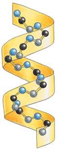

볼츠만 인자 $\exp(-\Delta E/k_BT)$에 의해 단 하나의 수소 결합 차이($\Delta E \approx -2.3\ k_BT$)로도 결합 확률에 약 10배 차이가 생깁니다. 인산염 결합 단백질은 불과 수십 피코미터의 각도 왜곡을 감지하여 인산염과 비산염(arsenate)을 500배 선택도로 구분합니다. 여기에 GTP 소모 동역학적 교정(proofreading)이 더해져 수만 배의 번역 충실도를 달성합니다.

소수성 효과와 관련된 에너지 스케일은 얼마인가?

비극성 분자가 물에 노출되면 물 분자들이 주변에 단단한 배좌를 형성하여 엔트로피가 크게 감소합니다. 이를 회피하기 위해 비극성 물질끼리 자발적으로 뭉치는 소수성 효과(Hydrophobic effect)가 유도됩니다:
- 비극성 표면적당 자유에너지 비용: $\approx \mathbf{10\text{ kJ/mol/nm}^2} \approx \mathbf{4\ k_BT/\text{nm}^2}$
- 메틸기($-\text{CH}_3$, 약 $1\text{ nm}^2$) 하나가 단백질 소수성 포켓에 묻히면 약 $4\ k_BT$의 자유에너지 이득이 생기며, 결합 친화도는 $e^4 \approx \mathbf{50\text{배}}$ 향상됩니다.
- 지질 탄화수소 사슬의 탄소 수가 1개 증가할 때마다 임계 미셀 농도(CMC)는 지수적으로 감소합니다.

## 광합성에 사용되는 광자는 얼마만큼의 에너지를 지니는가?

광합성에 흡수되는 가시광선 파장($400\sim 700\text{ nm}$) 광자 에너지($E \approx 1240/\lambda(\text{nm})$):
- 적색광 ($700\text{ nm}$): $\mathbf{1.8\text{ eV}} \approx 175\text{ kJ/mol} \approx \mathbf{70\ k_BT}$
- 청색광 ($400\text{ nm}$): $\mathbf{3.1\text{ eV}} \approx 300\text{ kJ/mol} \approx \mathbf{120\ k_BT}$

광자 1개의 에너지($\sim 70\ k_BT$)는 ATP 가수분해($\sim 20\ k_BT$)나 양성자 이동($\sim 4\ k_BT$)보다 서너 배 큰 거대 에너지입니다. 엽록소는 이를 이용해 전하 분리와 물 분해를 일으키며 양성자 구동력과 NADPH 환원력을 생산합니다.

당의 연소 시 방출되는 자유에너지는 얼마인가?

포도당 1몰이 산소에 의해 완전 산화될 때 방출되는 표준 자유에너지는 다음과 같습니다:
$$\Delta G^\circ \approx \mathbf{-2,880 \sim -3,000\text{ kJ/mol}} \approx \mathbf{-1,200\ k_BT}$$

- 세포는 포도당 1분자당 30~32개의 ATP를 합성하여 화학 에너지의 약 35~40%를 회수합니다.
- 성인의 일일 소비 에너지 $2,000\text{ kcal}$($\approx 8.4\text{ MJ}$)는 순수 포도당 약 0.5 kg에 해당합니다. 만약 70 kg 인체가 하루 $2,000\text{ kcal}$의 연소열을 방출하지 못하고 체내에 축적한다면 하루 만에 체온이 약 **$29^\circ\text{C}$ 폭등**하므로, 지속적인 열 방출이 생존의 절대 조건입니다.

세포의 산화환원 전위는 얼마인가?

산화환원 전위차($\Delta E^\circ$)와 표준 자유에너지 변화($\Delta G^\circ$)의 관계:
$$\Delta G^\circ = -n F \Delta E^\circ \quad (F \approx 96.5\text{ kJ/(V}\cdot\text{mol)})$$

- $\text{NADH} \to \text{O}_2$ 전자 전달의 전위차 $\Delta E^\circ = 0.82 - (-0.32) = \mathbf{1.14\text{ V}}$에서 방출되는 에너지는 $\Delta G^\circ \approx \mathbf{-220\text{ kJ/mol}} \approx \mathbf{-90\ k_BT}$입니다. 이론상 최대 4.4개의 ATP가 합성 가능하며, 미토콘드리아는 10개 양성자를 펌핑하여 비평형 플럭스를 유지하며 약 2.5개의 ATP를 생산합니다.

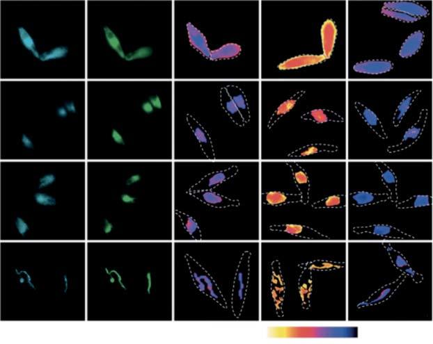

세포 전체의 '단일한 산화환원 전위'는 존재하지 않으며 구획별로 독립 유지됩니다:
- $\text{NAD}^+/\text{NADH}$: 이화작용 전자 수용을 위해 산화형($\text{NAD}^+$)이 10~100배 우세
- $\text{NADP}^+/\text{NADPH}$: 동화작용 전자 공급을 위해 환원형($\text{NADPH}$)이 10~100배 우세
- 글루타티온 환원 전위: 세포질 $\approx -300\text{ mV}$(강한 환원 환경) vs 소포체 $\approx -170\text{ mV}$(단백질 이황화 결합 형성을 위한 산화 환경)

생체막을 가로지르는 전위차는 얼마인가?

미토콘드리아 내막은 $\approx 160\text{ mV}$, 대장균 세포막은 $\approx 120\text{ mV}$, 동물 세포막은 $\approx -70\text{ mV}$의 전위차를 유지하며, 양성자 구동력($\text{pmf} = \Delta \psi - 60\Delta\text{pH}$)은 **$-150 \sim -200\text{ mV}$**에 달합니다.

두께 $4\text{ nm}$ 막에 $160\text{ mV}$가 걸릴 때 막 내부 전기장 세기는 **$40\text{ MV/m}$**로, 벼락 발생 시의 대기 전기장보다 강력합니다(세포 파열 전압 $300\sim 400\text{ mV}$의 절반 수준을 상시 유지).

지질 이중층 비정전용량($1\ \mu\text{F/cm}^2$) 기준 $120\text{ mV}$ 전위 충전에 필요한 양성자는 세포당 단 **$10^4$개**에 불과합니다. 대장균의 초당 양성자 통과량이 $\sim 4\times 10^7$개/s이므로 양성자 펌핑이 멈추면 **$1\text{ ms}$ 만에 완전 방전**됩니다. 그러나 $10^4$개는 세포 내 전체 이온($10^8$개)의 0.01%에 불과하여 거시적 전기적 중성은 완벽히 유지됩니다.

세포의 전력 소비량은 얼마인가?

- 인간 대사율: 성인 $2,000\text{ kcal/day} \approx \mathbf{100\text{ W}}$ (100W 백열전구와 동일). 체중 대비 비에너지 소비율은 $\approx \mathbf{1\text{ W/kg}}$.
- 대장균 대사율: 산소 소비율로부터 환산한 세포당 소비 전력은 $P_{\text{cell}} \approx 10^{-12}\text{ W}$로, 비에너지 소비율은 $\approx \mathbf{1,000\text{ W/kg}}$에 달합니다(단위 질량당 인간의 1,000배 고출력 엔진).
- 대장균의 ATP 회계: 40분 주기 동안 $\sim 10^{10}\text{ ATP}$를 소모하며(초당 $\sim 10^7\text{ ATP/s}$), 바이오매스 편입 탄소 1개당 약 1개의 ATP가 투입됩니다. 단백질 합성이 전체 예산의 절반 이상을 소모하는 반면, 액틴 중합을 통한 세포 운동성은 전체의 0.1% 미만에 불과합니다.

## 대사율은 크기에 따라 어떻게 스케일링되는가?

생물체 질량($M$)에 따른 기초 대사율($B$)의 변화:
- 클라이버의 법칙(Kleiber's Law): 마우스부터 코끼리까지 대사율은 체질량의 $3/4$ 제곱에 비례합니다:
  $$B \propto M^{3/4} \implies \frac{B}{M} \propto M^{-1/4}$$
  $10\text{ g}$ 생쥐는 $100\text{ kg}$ 인간 대비 단위 질량당 대사율이 10배 높습니다($10\text{ W/kg}$ vs $1\text{ W/kg}$). WBE 모델은 이를 프랙털 분지 혈관망의 에너지 수송 최적화로 설명합니다.
- 최근 마카리에바(Makarieva et al.) 등의 대규모 조사에 따르면, 휴지기 상태의 생명체는 박테리아부터 포유류까지 단위 습윤 질량당 소비 전력이 **$0.3\sim 9\text{ W/kg}$**이라는 좁은 범위에 수렴한다는 대안적 관점도 활발히 논의되고 있습니다.
## 제4장: 속도와 지속 시간

생명계의 본질은 끊임없는 역동성에 있습니다. 세포질은 다양한 시간 척도에서 펼쳐지는 생화학 반응의 무대이며, 이온과 저분자 대사산물부터 거대 단백질 복합체까지 쉼 없이 상호작용합니다. 분자 크기와 농도에 이어 "생물학적 과정은 얼마나 빠르게 일어나는가?"라는 질문은 세포의 작동 원리를 이해하는 핵심 축입니다.

본 장에서는 확산(diffusion)의 물리적 한계에서 출발하여 효소 촉매 속도, 센트럴 도그마(전사와 번역)의 동기화, 분자 모터와 세포골격의 동역학, 세포 분열 및 인체 세포 턴오버에 이르는 다채로운 시간 척도를 탐구합니다. 핵심 질문은 "무엇이 속도의 상한을 결정하며, 왜 더 빨라지지 않았는가?"입니다. 속도가 빨라질수록 동일한 대사 플럭스를 달성하는 데 필요한 단백질 자원을 절약할 수 있으며, 이는 세포의 성장률과 적응도를 극대화하는 밑거름이 됩니다.

세포 내 확산의 시간 척도는 얼마인가?

확산은 주변 매질 분자와의 무작위 충돌로 인해 발생하는 열운동으로, 세포 내 거의 모든 생화학 반응의 속도론적 기초입니다. 3차원 확산에서 입자가 거리 $x$를 이동하는 데 걸리는 평균 시간 척도 $\tau$는 다음과 같은 경험 법칙을 따릅니다:
$$\tau \approx \frac{x^2}{6D}$$
확산 시간은 이동 거리의 제곱에 비례하므로 거리가 멀어질수록 소요 시간이 기하급수적으로 폭증합니다.

단량체 단백질(약 30 kDa)의 확산 계수는 물속에서 $\approx 100\ \mu\text{m}^2/\text{s}$이지만, 분자 밀집(macromolecular crowding)이 극심한 세포질에서는 약 10배 감소하여 $D_{\text{cytosol}} \approx 10\ \mu\text{m}^2/\text{s}$ 수준으로 떨어집니다 (대형 복합체는 $\approx 1\ \mu\text{m}^2/\text{s}$, BNID 107985).
- 대장균 ($x \approx 1\ \mu\text{m}$): 세포 전체를 가로지르는 시간 $\approx 0.01\text{초}$ (BNID 103801).
- HeLa 세포 ($x \approx 20\ \mu\text{m}$): 세포를 가로지르는 시간 $\approx 10\text{초}$ (BNID 103788).
- 길이 1 cm 신경 축삭: 확산 시간은 약 $10^6\text{초}$ (약 2주).
- 길이 1 m 좌골신경: 오직 확산에만 의존할 경우 수십 년 이상 소요.

거시적 거리에서 확산 시간의 폭증은 진핵세포가 미세소관과 모터 기반 능동 수송($v \approx 1\ \mu\text{m/s}$, BNID 105241)을 진화시켜야만 했던 물리적 이유입니다. 모터를 이용하면 1 cm 거리를 2~3시간 만에 주파할 수 있습니다. 세포질 내 확산이 물보다 느린 이유는 세포질 점성(2~3배), 분자 밀집(부피의 20~30% 점유), 세포 구조물과의 일시적 비특이적 결합, 유체역학적 항력 때문입니다.

## 효소는 1초에 몇 번의 반응을 수행하는가?

촉매가 없을 때 생화학 반응은 극도로 느립니다. 실온에서 펩타이드 결합의 자발적 절단은 약 400년, ATP 포스포모노에스터 결합의 가수분해는 약 100만 년이 걸립니다 (BNID 107209). 효소는 반응 속도를 10자릿수 이상 끌어올립니다 (BNID 105084).

효소의 최대 촉매 능력을 나타내는 전환수(turnover number) $k_{\text{cat}}$은 기질이 포화되었을 때 효소 1개가 초당 변환하는 최대 반응 횟수입니다:
- 초고속 효소: 탄산무수화효소와 초과산화물불균등화효소(SOD)는 초당 $10^6 \sim 10^7\text{ s}^{-1}$번의 반응을 수행합니다.
- 초저속 효소: DNA 제한효소는 효소당 초당 $\approx 10^{-2} \sim 10^{-1}\text{ s}^{-1}$ (1분에 1회 미만, BNID 101627).
- 전형적인 대사 효소: $k_{\text{cat}}$ 중앙값은 약 $10\text{ s}^{-1}$이며, 중심 탄소 대사 효소는 약 3배 빠른 중앙값 $30\text{ s}^{-1}$을 나타냅니다 (BNID 111411).

미카엘리스 상수 $K_M$의 전형적 중앙값은 약 0.1 mM ($100\ \mu\text{M}$)로, 대장균 부피($1\ \mu\text{m}^3$)에서 세포당 약 100,000개 기질 분자에 해당합니다. 낮은 기질 농도에서의 2차 속도 상수 $k_{\text{cat}}/K_M$의 이론적 상한은 확산 충돌 한계($\approx 10^9\ \text{M}^{-1}\text{s}^{-1}$)이지만, 전형적 효소 중앙값은 특이성 유지와 입체 배향 트레이드오프로 인해 약 $10^5\ \text{M}^{-1}\text{s}^{-1}$ 수준입니다.

대장균 세포($1\ \mu\text{m}^3$)에 유입된 기질 1개(유효 농도 $\approx 1\text{ nM}$)는 확산 한계 충돌 속도($10^9\ \text{M}^{-1}\text{s}^{-1} \times 10^{-9}\text{ M} \approx 1\text{ s}^{-1}$)에 따라 세포 내 모든 특정 단백질 분자와 평균 초당 1회씩 충돌합니다.

## 온도는 반응 속도와 친화도에 어떤 영향을 미치는가?

온도가 $10^\circ\text{C}$ 상승할 때 반응 속도가 약 2배 빨라진다는 경험 법칙($Q_{10} \approx 2$)은 아레니우스 식에 기초합니다:
$$k \propto \exp\left(-\frac{E_a}{k_B T}\right)$$
생화학 반응의 전형적 활성화 에너지 $E_a \approx 50\text{ kJ/mol} \approx 20\ k_B T$에서, $T \approx 300\text{ K}$ 부근의 $\Delta T = 10\text{ K}$ 변화에 따른 속도 증가비는:
$$\frac{k(T + 10)}{k(T)} \approx \exp\left(\frac{20 \cdot 10}{300}\right) = \exp(0.67) \approx 2$$

단일 효소뿐만 아니라 대장균의 전체 생장률도 17℃에서 37℃까지 $10^\circ\text{C}$ 상승마다 약 2.5배씩 증가하여 유효 활성화 에너지 $E_{a,\text{eff}} \approx 60\text{ kJ/mol} \approx 25\ k_B T$로 아름답게 수렴합니다 (BNID 100919).

막 수송체의 수송 속도는 얼마인가?

외부 기질로 포화된 포도당 수송체의 수송 속도(전환수)는 $\approx 100\text{ s}^{-1}$ ($30\sim 300\text{ s}^{-1}$, BNID 102931)입니다. 중성 조건($\text{pH } 7$)에서 양성자 농도($10^{-7}\text{ M}$)와 확산 제한 결합 속도($10^9\ \text{M}^{-1}\text{s}^{-1}$)를 곱한 양성자 도달 속도는 $10^{-7} \times 10^9 = 100\text{ s}^{-1}$로, 관찰된 전환수와 정확히 일치합니다. 이는 양성자 결합형 수송체가 물리적 확산 한계에 근접해 작동함을 시사합니다. (반면 기질 농도가 mM 단위인 적혈구 음이온 교환체 AE1은 전환수가 $\approx 100,000\text{ s}^{-1}$에 달합니다).

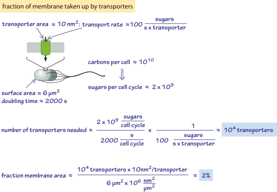

30분(2,000초)마다 분열하는 대장균을 분석해 보면:
- 바이오매스 합성에 필요한 당: $\approx 3 \times 10^8$ 분자.
- 필요한 수송체 수: $3 \times 10^8 / (100\text{ s}^{-1} \times 2,000\text{ s}) \approx 1,500$개.
- 점유 막 면적: $1,500 \times 15\text{ nm}^2 \approx 0.02\ \mu\text{m}^2$ (총 막 면적의 약 $0.3\sim 2\%$).
반면 효모는 표면적 대비 부피 비율이 낮고 발효에 따른 범람 대사로 인해 막 면적의 4% 이상을 당 수송체에 할당해야 하므로 막 면적 포화(membrane crowding)가 성장 속도를 제한합니다.

## 이온 통로를 통해 초당 몇 개의 이온이 통과하는가?

패치 클램프 측정에서 개별 이온 통로의 단일 통로 전류는 $\approx 1\text{ pA}$ ($10^{-12}\text{ A}$)입니다. 1가 이온의 기본 전하량($1.6 \times 10^{-19}\text{ C}$)으로 나누면:
$$\text{이온 통과율} = \frac{10^{-12}\text{ C/s}}{1.6 \times 10^{-19}\text{ C}} \approx 6 \times 10^6 \approx 10^7\text{ ions/s}$$
초당 약 1,000만 개의 이온이 통과하며, 이는 대사 효소($10\text{ s}^{-1}$)나 능동 수송체($100\text{ s}^{-1}$)보다 $10^5\sim 10^6$배 빠릅니다 (BNID 103163). 이온 통로는 대규모 단백질 입체 구조 변화 없이 개방된 세공을 통한 순수 전기확산(electrodiffusion)으로 작동하기 때문입니다.

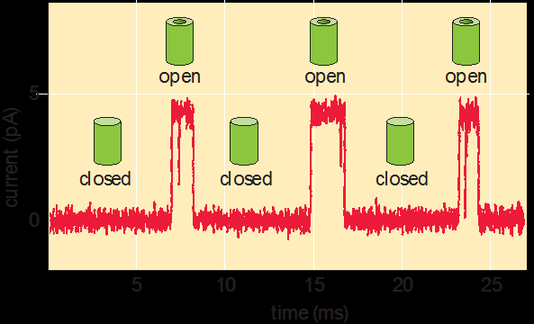

반면 박테리아 편모 모터 고정자 양성자 통로는 기계적 회전과 단단히 결합되어 있어 초당 $\approx 10^4\text{ H}^+/\text{s}$ 수준으로 제어됩니다 (BNID 109822).

대사산물의 전환 시간은 얼마인가?

전환 시간(turnover time)은 풀(pool)의 총량을 소모 플럭스로 나눈 값입니다. 세포 내 대사산물 농도는 삼투압과 부반응 방지를 위해 낮게 유지되어야 하므로 전환 시간은 극히 짧습니다.
- 애기장대 캘빈 회로 핵심 대사산물: 전환 시간 1초 미만 (BNID 107358).
- 대장균 아미노산 풀: 1분 미만에 완전 교체 (BNID 101622).

단백질 합성에 쓰이는 tRNA 풀의 전환은 더욱 빠릅니다. 대장균(40분 분열)은 세포당 약 200,000개 tRNA와 약 30,000개 활성 리보솜(번역 속도 $20\text{ aa/s}$)을 갖습니다.
$$\tau_{\text{tRNA}} = \frac{200,000\text{ 개}}{30,000 \times 20\text{ aa/s}} \approx \frac{200,000}{600,000\text{ s}^{-1}} \approx 0.33\text{초}$$
모든 tRNA는 초당 약 3회씩 아미노산 충전-리보솜 결합-펩타이드 결합-방출 사이클을 순환합니다 (BNID 105275).

## 전사와 번역 중 어느 것이 더 빠른가?

## 대장균에서 RNA 중합효소의 전사 신장 속도는 $40\sim 80\text{ nt/s}$ (BNID 101440), 리보솜의 번역 속도는 $\approx 20\text{ aa/s}$ (BNID 100059)입니다. 1 아미노산이 3 뉴클레오타이드로 암호화되므로 번역의 염기 진행 속도는:
$$20\text{ aa/s} \times 3\text{ nt/aa} = 60\text{ nt/s}$$
원핵생물에서 전사 속도($40\sim 80\text{ nt/s}$)와 번역 속도($60\text{ nt/s}$)는 놀랍도록 정밀하게 일치합니다.

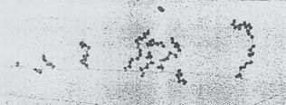

이 속도 일치는 전사체 뒤를 쫓는 리보솜이 RNA 중합효소의 백트래킹을 방지하고 나출 mRNA를 보호하는 역결합(reverse coupling)을 가능하게 합니다. 1 kb 박테리아 유전자의 전사는 약 12초, 번역은 약 16초가 걸리며 총 수십 초 내에 단백질이 합성됩니다.

진핵세포(HeLa)의 전사 속도는 $30\sim 100\text{ nt/s}$로 박테리아와 유사하나 스플라이싱에 5~10분이 추가됩니다. 포유류 번역 속도는 $\approx 6\text{ aa/s}$로 박테리아보다 2~3배 느린데, 이는 복잡한 번역 조절과 $Q_{10}$ 효과에 기인합니다.

형광 단백질의 성숙 시간은 얼마인가?

단백질 번역 후 발색단이 형광을 발하기까지 성숙(maturation) 과정이 필요합니다:
1. 폴딩: 1분 미만 소요.
2. 고리화(cyclization): 수 분 소요.
3. 산소($\text{O}_2$)에 의한 산화: 최종 율속 단계로, 혐기성 환경에서는 형광이 발생하지 않습니다.

성숙 시간은 sfGFP(5~10분), EGFP(30~60분), mCherry(1시간 이상) 등 다양합니다. 이 지연 시간 차이를 응용해 빠르게 성숙하는 녹색 형광과 느리게 성숙하는 적색 형광을 융합한 '형광 타이머(fluorescent timer)'를 만들면, 적색/녹색 형광 비율로 단백질의 나이를 정량 판독할 수 있습니다.

## 프로테아솜은 단백질을 얼마나 빨리 분해하는가?

26S 프로테아솜(분자량 $\approx 2.4\text{ MDa}$, 약 20,000 aa)은 HeLa 세포 전체 단백질의 약 1%를 차지합니다 (반감기 5일, BNID 108028).

단일 프로테아솜의 분해 속도는 초당 약 0.1개 단백질($\approx 40\text{ aa/s}$)로, 리보솜의 번역 중합 속도($10\sim 20\text{ aa/s}$)와 대등합니다. 세포 전체 단백질 턴오버 시간을 상식 점검해 보면:
- 프로테아솜 수: $0.01 N_{\text{aa}} / 20,000 \approx 0.5 \times 10^{-6} N_{\text{aa}}$개.
- 총 분해율: $40\text{ s}^{-1} \times 0.5 \times 10^{-6} N_{\text{aa}} = 20 \times 10^{-6} N_{\text{aa}}\text{ aa/s}$.
- 전체 단백질 턴오버 시간 $\tau$:
$$\tau = \frac{N_{\text{aa}}}{20 \times 10^{-6} N_{\text{aa}}\text{ s}^{-1}} = 50,000\text{초} \approx 14\text{시간} \approx 1\text{일}$$
이 값은 포유류 세포 분열 주기(약 24시간)와 거의 정확히 일치합니다.

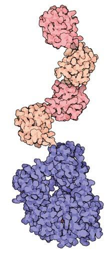

## RNA와 단백질은 얼마나 빨리 분해되는가?

1차 동역학($dc/dt = r - \alpha c$)에서 거대분자 농도는 생성률과 분해율의 균형($c_{\text{ss}} = r/\alpha$)으로 결정됩니다:
- mRNA 반감기: 대장균 약 5분, 효모 약 20분, 포유류 약 10시간으로, 각 생물의 세포 분열 시간의 약 1/5이라는 스케일링을 따릅니다.
- 단백질 수명과 희석: 대장균 단백질 대다수는 반감기가 수 시간 이상이어서, 농도 감소의 95% 이상은 능동 분해가 아닌 분열에 따른 희석($\alpha_{\text{dilution}}$)에 의해 일어납니다 (BNID 108404).

포유류에서는 N-말단 규칙에 따라 수명이 조절되며, 히스톤(반감기 $\approx 200$일)이나 신경세포 핵공 복합체(1년 이상)처럼 세포 수명 내내 안정하게 유지되는 단백질도 존재합니다.

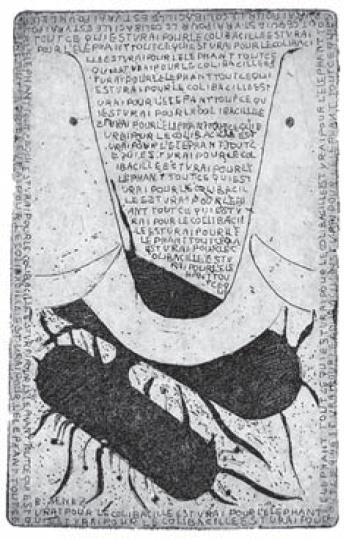

## 세포 내에서 전기 신호는 얼마나 빨리 전파되는가?

헤르만 폰 헬름홀츠(1850)는 개구리 좌골신경 전파 속도가 약 $30\text{ m/s}$임을 최초로 정밀 측정하여 신경 신호가 빛이나 전류와 달리 유한한 생체물리학적 속도로 전파됨을 입증했습니다.
- 민말이집 섬유: 전파 속도는 직경의 제곱근($\sqrt{d}$)에 비례하며 $0.5\sim 2\text{ m/s}$로 느립니다.
- 말이집 섬유: 랑비에 결절 간 도약 전도(saltatory conduction)를 통해 속도가 직경에 선형 비례($v \propto d$)하여 두꺼운 운동 신경은 $80\sim 120\text{ m/s}$에 달합니다 (BNID 110594).

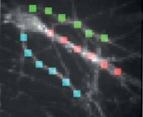

감각 수용, 척수 전파, 시냅스 전달에 걸리는 시간 때문에 인간의 최소 반응 시간은 $\approx 120\text{ ms}$이며 (BNID 111450), 육상 경기 규정에서 총성 후 100 ms 미만의 출발을 물리적 한계를 넘어선 부정출발로 규정하는 과학적 근거가 됩니다.

회전 분자 모터의 회전 빈도는 얼마인가?

대장균 편모 모터의 전형적 회전 속도는 $\approx 100\text{ Hz}$ (최대 300 Hz, 18,000 RPM)입니다 (BNID 103813). 양성자 구동력으로 구동되며(1회전당 약 $1,200\text{ H}^+$), 편모 4개가 회전할 때 양성자 소모율은 $\approx 5 \times 10^5\text{ H}^+/\text{s}$ (일률 $\approx 10^{-14}\text{ W}$)입니다. 점성 유체 내 유체역학적 일률($\approx 10^{-17}\text{ W}$) 대비 모터의 기계적 효율은 약 0.1%이지만, 대장균 전체 대사 전력($10^{-12}\text{ W}$)의 1% 미만이므로 세포에게 큰 부담이 되지 않습니다.

미토콘드리아의 ATP 합성효소($\text{F}_0\text{F}_1$-ATPase) 역시 $37^\circ\text{C}$에서 초당 약 300회전하며, 1회전당 3개의 ATP를 합성하거나 반대로 가수분해하며 $120^\circ$씩 단계적으로 도약 회전합니다.

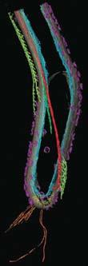

세포골격의 조립 및 해체 속도는 얼마인가?

미세소관의 신장 속도는 $\approx 2\ \mu\text{m/min} \approx 30\text{ nm/s}$ (초당 $50\sim 100$개 튜불린 이합체 추가)입니다. 반면 유사분열 방추체에서 레이저 절단 후 측정한 탈중합 속도는 $35\ \mu\text{m/min} \approx 500\text{ nm/s}$ (초당 $\approx 1,000$개 탈리)에 달합니다. 탈중합이 신장보다 15배 이상 빠른 이 동적 불안정성(dynamic instability) 덕분에 방추체는 염색체 동원체를 신속히 포획할 수 있습니다.

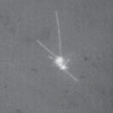

액틴 섬유 역시 빠른 바브 말단(+말단, $k_{\text{on}} \approx 10\ \mu\text{M}^{-1}\text{s}^{-1}$)과 10배 느린 포인티드 말단(-말단)의 비대칭성으로 인해 한쪽은 자라고 한쪽은 분해되는 트레드밀링(treadmilling)을 수행하며, 운동 세포 선도단에서 수십 $\mu\text{m/min}$ 속도로 신장합니다.

## 분자 모터는 세포골격 섬유 위에서 얼마나 빨리 움직이는가?

키네신-1(Kinesin-1) 모터의 생체 내 소포 수송 속도는 $\approx 1\sim 2\ \mu\text{m/s}$입니다. 걸음 크기는 튜불린 이합체 간격과 같은 8 nm이며, 초당 $100\sim 200$걸음을 걸어 약 100걸음($1\ \mu\text{m}$)을 연속 전진합니다. 정지력(stall force)은 $5\sim 7\text{ pN}$으로, 8 nm 전진 시 기계적 일($40\text{ pN}\cdot\text{nm}$)은 ATP 가수분해 에너지($80\text{ pN}\cdot\text{nm}$)의 약 50%에 달합니다. 5 pN의 힘은 점성 저항을 뚫고 직경 수 $\mu\text{m}$의 소포를 견인하기에 충분합니다.

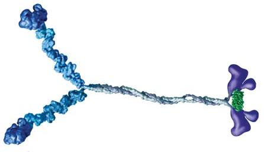

미오신 헤드에서 0.1 nm 미만의 화학 반응이 36 nm 분자 걸음으로, 근절 수축(mm)을 거쳐 뼈와 관절의 거시적 사지 운동(cm)으로 스케일 증폭됩니다.

## 세포는 얼마나 빨리 이동하는가?

세포 크기 대비 이동 속도(초당 몸길이 배수):
- 대장균 유영: $30\ \mu\text{m/s}$ (몸길이 15배/s)
- 기어가는 호중구/아메바: $10\ \mu\text{m/min}$ (몸길이 0.02배/s)
- 세계 최고속 수영 박테리아 오보박터(*Ovobacter propellens*): $1\text{ mm/s}$ ($1,000\ \mu\text{m/s}$, 몸길이 200배/s!)

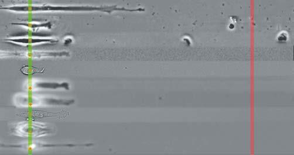

미세수로를 기어가는 '세계 세포 경주' 우승 세포(인간 중간엽 줄기세포)의 속도는 $5.2\ \mu\text{m/min}$였습니다. 기어가는 운동은 액틴 중합과 접착 복합체 탈착에 의존하므로 편모 유영보다 수백 배 느립니다.

## 세포가 게놈을 복제하는 데 얼마나 걸리는가?

## 대장균($4.6\text{ Mbp}$)의 생체 내 복제 분기점 속도는 $\approx 1,000\text{ bp/s}$입니다. 2개의 분기점이 양방향 진행하므로 복제 완료 최소 시간은:
$$t_{\text{rep}} \approx \frac{4.6 \times 10^6\text{ bp}}{2 \times 1,000\text{ bp/s}} \approx 2,300\text{초} \approx 40\text{분}$$

대장균이 20분마다 분열할 수 있는 비결은 중첩 복제 분기점(nested replication forks)에 있습니다. 1차 복제가 끝나기 전에 손녀 세포를 위한 복제를 미리 개시하여 단일 세포 내에 6개 이상 기점과 10개 이상 분기점이 동시에 가동됩니다.

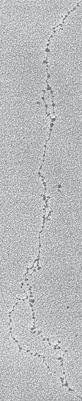

진핵세포 DNA 중합효소는 염색질 구조로 인해 속도가 $\approx 20\sim 40\text{ bp/s}$로 느리지만, 유전체 전반에 분산된 수만 개의 다중 복제 기점(인간 3만~10만 개)을 동시 가동하여 6~8시간 내에 S기를 완료합니다.

## 세포주기의 각 단계는 얼마나 걸리는가?

인간 HeLa 배양 세포(전체 주기 약 20시간)의 단계별 소요 시간:
- G1기 (생장 및 검문): 약 9~10시간 (가장 가변적).
- S기 (DNA 복제): 약 7~8시간.
- G2기 (분열 준비): 약 3~4시간.
- M기 (유사분열): 약 1시간.

다양한 포유류 조직과 종에서 전체 세포 주기 차이에도 불구하고 S기의 지속 시간은 $6\sim 8\text{시간}$으로 거의 일정하게 보존됩니다. 조직 표본에서 S기 세포 비율($f_S$)을 측정하면 전체 주기 시간 $T \approx T_S / f_S$를 역산할 수 있습니다.

## 우리 몸의 다양한 세포들은 얼마나 빠르게 교체되는가?

성인 인체($3 \times 10^{13}$개 세포)의 80%는 적혈구이며, 수명은 120일입니다. 따라서 골수에서는 매초 약 200만~300만 개의 적혈구가 끊임없이 새로 생산됩니다. 장 상피세포 수명은 3~5일입니다.

냉전기 지상 핵실험으로 급증했던 대기 중 $^{14}\text{C}$를 추적한 펄스-체이스 연대 측정(Frisén 연구팀)에 따르면:
- 지방세포: 매년 8%가 교체되어 반감기는 약 8.2년입니다.
- 심근세포: 평생 전혀 재생되지 않는다는 정설과 달리, 연간 0.5~1%씩 교체되어 평생 동안 약 40%가 재생됩니다.
- 뇌 대뇌피질 뉴런과 수정체 섬유세포는 출생 후 평생 교체되지 않고 보존됩니다.
## 제5장: 정보와 오류

생명체는 내부에 스스로를 구축하고 유지하기 위한 청사진(blueprint)을 품고 있습니다. 유전체(genome)의 염기서열과 번역 후 변형에 새겨진 정보는 경이로운 충실도(fidelity)로 다음 세대에 전달됩니다. 생물학적 정보 저장 밀도는 첨단 인공 장치를 압도하여, 인플루엔자 바이러스의 패키징 밀도를 USB 메모리 크기로 환산하면 수 엑사바이트($10^{18}\text{ bytes}$)에 달합니다.

본 장에서는 유전체의 크기와 유전자 수, 무작위 두 사람 간의 유전적 유사성, DNA 복제 및 센트럴 도그마(전사·번역) 과정의 오류율과 상동 재조합의 빈도를 정량적으로 탐구합니다.

## 유전체는 얼마나 큰가?

생명계 전반에서 유전체 크기는 $10^8$배에 달하는 극단적 스펙트럼을 보입니다. 최소 유전체인 진딧물 공생균 칸디다투스 카르소넬라 루디는 불과 $0.16\text{ Mbp}$ ($160\text{ kb}$)인 반면, 백합과 식물 키누가사소우(*Paris japonica*)는 $\approx 150\text{ Gbp}$ (BNID 110278)로 인간의 50배에 이릅니다. 유전체 크기와 생물학적 복잡도가 비례하지 않는다는 사실은 'C-값의 역설(C-value paradox)'로 알려져 있습니다. 예쁜꼬마선충($100\text{ Mbp}$)은 인간($3\text{ Gbp}$)보다 30배 작지만 단백질 코딩 유전자 수는 약 20,000개로 대등합니다.

B형 DNA의 염기쌍 간격은 약 $0.34\text{ nm}$입니다. 인간 이배체 세포핵($6\times 10^9\text{ bp}$)의 DNA를 일직선으로 펼치면:
$$L = 6 \times 10^9\text{ bp} \times 0.34 \times 10^{-9}\text{ m/bp} \approx 2\text{ m}$$
직경 $5\sim 10\ \mu\text{m}$의 세포핵에 2미터의 거대 분자가 뉴클레오솜 응축과 프랙탈 염색질 폴딩을 통해 수납되어 있습니다. 대장균($4.6\text{ Mbp}$) 역시 펼친 길이가 약 $1.5\text{ mm}$로 박테리아 세포 길이($2\ \mu\text{m}$)보다 750배 깁니다.

## 서로 다른 생물에는 얼마나 많은 염색체가 존재하는가?

유전체를 담는 염색체 조각의 수는 종마다 천차만별입니다:
- 바이러스 분절: 인플루엔자 바이러스는 8개의 음의 가닥 RNA 분절을 가져 이종 간 항원 대변이(antigenic shift)를 촉발합니다. 동부동백모자이크바이러스는 3개의 분절이 서로 다른 바이러스 입자에 나뉘어 포장되므로 3종류가 동시에 감염되어야 증식합니다.
- 원핵생물: 대장균은 1개의 원형 염색체를 갖지만, 콜레라균은 2개의 원형 염색체($2.9\text{ Mbp}, 1.1\text{ Mbp}$), 라임병 보렐리아는 1개 선형 염색체와 11개 필수 플라스미드를 보유합니다.
- 진핵생물: 출아효모 16개, 분열효모 3개, 초파리 4쌍, 선충 6쌍, 생쥐 20쌍, 인간 23쌍이며, 4배체 진화물인 남미 붉은비스카차쥐는 102개(51쌍)에 달합니다.

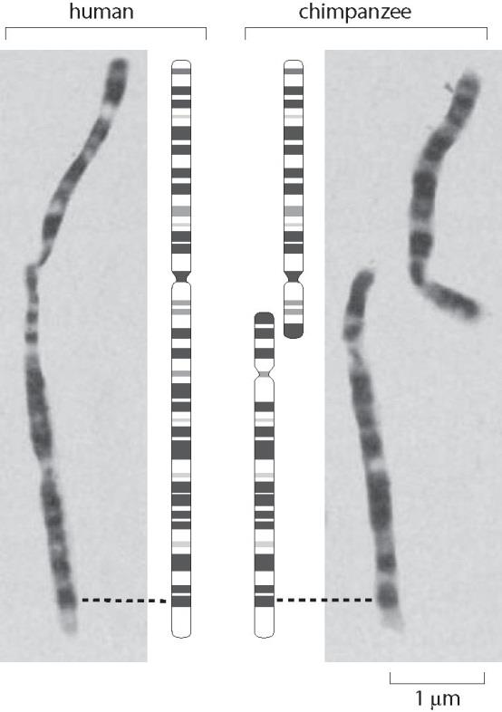

인간 2번 염색체의 기원은 진화의 가장 뚜렷한 분자 증거입니다. 유인원(침팬지, 고릴라, 오랑우탄)은 24쌍(48개)을 갖지만 인간은 23쌍(46개)입니다. 고해상도 염색체 밴딩 및 염기서열 분석 결과, 침팬지의 2p와 2q 염색체가 선조 인류 단계에서 머리-머리 융합(head-to-head fusion)되어 인간 2번 염색체가 형성되었음이 밝혀졌으며, 융합 부위(2q13)에 퇴화된 말단소립과 불활성화된 동원체 서열이 보존되어 있습니다.

## 유전체에는 얼마나 많은 유전자가 있는가?

유전체 크기는 8자릿수에 걸쳐 변하지만, 단백질 코딩 유전자 수는 수천~수만 개(박테리아 수천 개, 인간 약 2만 개, 다배수체 밀 약 10만 개)로 훨씬 좁은 범위에 머뭅니다.

단백질 1개의 평균 길이를 300 아미노산($\approx 1,000\text{ bp}$)으로 가정하면, '예측 유전자 수 $\approx$ 유전체 크기 / 1,000'이라는 단순 어림셈이 가능합니다:
- 대장균($4.6\text{ Mbp}$): 예측 4,600개 vs 실제 4,225개 (오차 10% 이내!). 비코딩 영역이 10~12%에 불과한 고도로 조밀한(compact) 원핵생물 유전체에서는 이 공식이 잘 들어맞습니다.
- 인간($3\text{ Gbp}$): 예측 300만 개 vs 실제 약 20,000개 (150배 과대평가!).

고등 다세포 생물에서 예측이 빗나가는 이유는 유전체의 98% 이상이 단백질을 코딩하지 않는 비코딩 영역이기 때문입니다. 단백질 코딩 엑손은 전체의 $1.2\sim 1.5\%$에 불과하며, 거대한 인트론, 프로모터·인핸서 등 복합 조절 서열, 레트로바이러스 및 전이인자(LINE, SINE, Alu 등 반복 서열이 유전체의 50% 이상)가 유전체 대부분을 차지합니다.

## 무작위로 선택된 두 사람은 유전적으로 얼마나 유사한가?

대규모 인구 시퀀싱(1000 Genomes Project)에 따르면, 무작위로 추출한 두 사람 사이에는 약 1,000개 염기당 1개(0.1%)의 단일염기다형성(SNP)이 존재합니다. 즉, 모든 인류는 유전적으로 $99.9\%$ 동일합니다.
- 전체 유전체($3\text{ Gbp}$): 개인 간 약 300만($3 \times 10^6$) 개의 SNP가 존재합니다.
- 단백질 코딩 영역($30\text{ Mbp}$, 전체의 1%): 균일 무작위 분포 시 30,000개의 SNP가 예상되지만, 실제로는 약 20,000개만 발견됩니다. 이는 치명적 돌연변이가 자연선택에 의해 걸러진 정화 선택(purifying selection)의 증거입니다.
- 동의 대 비동의 치환: 중립 기대치는 비동의 치환이 4배 많아야 하지만, 실제 인체 코딩 영역에서는 $1:1$ (각각 약 10,000개)로 관찰됩니다.
- 넌센스 돌연변이: 조기 종결 돌연변이는 기대치(약 1,000개)보다 훨씬 적은 약 100개만 발견됩니다. 정상인 누구나 약 100개의 유전자가 결손되어 있으나, 상동 염색체의 정상 대립유전자(이형접합성) 덕분에 건강을 유지합니다.

인델(100만 개)과 복제수 변이(CNV)를 포함하여 크레이그 벤터의 개인 유전체를 참조 서열과 비교했을 때 전체 염기 차이는 총 $1.6\%$였습니다.

유전체 복제 중 돌연변이율은 얼마인가?

대장균의 DNA 복제 오류율은 복제당 염기쌍당 약 $10^{-10}$입니다. 게놈 크기($5\times 10^6\text{ bp}$)를 고려하면 분열 1,000번당 1회의 돌연변이가 발생합니다. 단 1 mL 배양액($10^9$ 마리) 안에 게놈의 모든 단일 염기 변종이 실시간으로 존재합니다.

인간의 생식세포 돌연변이율은 세대당 염기쌍당 약 $10^{-8}$로, 신생아는 부모로부터 약 $30\sim 60$개의 새로운 자발적 돌연변이(*de novo* mutation)를 물려받습니다 (BNID 110293).
- 난자는 출생 전 $20\sim 30$회 분열 후 감수분열 전기에 정지합니다.
- 정자는 사춘기 이후 16일마다 분열하여 20세에 150회, 50세에는 800회 이상의 분열을 거칩니다.
- 따라서 신규 점 돌연변이의 약 80%는 아버지로부터 유래하며, 부계 연령이 1세 증가할 때마다 자녀에게 전달되는 돌연변이는 매년 약 2개씩 선형 증가합니다.
- 인간 생식 계통의 세대당 평균 100회 분열을 고려하면 분열 1회당 오류율은:
$$\frac{10^{-8}\text{ mutations/bp/generation}}{100\text{ divisions}} \approx 10^{-10}\text{ mutations/bp/division}$$
단세포 대장균의 복제 오류율($10^{-10}$)과 정확히 동일한 물리화학적 충실도 한계에 도달합니다 (드레이크의 법칙).

현재 인류(80억 명)에서 매 세대 발생하는 신규 돌연변이 총합은 $8 \times 10^9 \times 30 \approx 2.4 \times 10^{11}$개로, 유전체 크기($3\times 10^9\text{ bp}$)의 80배에 달합니다. 인류 전체 집단 수준에서는 매 세대 유전체의 모든 단일 염기 치환 공간이 100% 완전하게 탐색되고 있습니다.

전사와 번역 과정에서의 오류율은 얼마인가?

1. 전사(Transcription) 오류율: $\approx 10^{-4} \sim 10^{-5}\text{ /base}$
대장균 *lacZ* 조기 종결 변이주 및 RNA-Seq 측정 결과, 전사 오류율은 염기당 $10^{-4} \sim 10^{-5}$ 수준입니다. 효모 RNA 중합효소 III의 경우 속도론적 교정(Kinetic Proofreading) 기작이 결합되어 $10^{-7}$의 초고정밀도에 도달합니다.

2. 번역(Translation) 오류율: $\approx 10^{-3} \sim 10^{-4}\text{ /codon}$
리보솜이 아미노산을 연결하는 번역 오류율은 코돈당 $10^{-3} \sim 10^{-4}$로 전사보다 한 자릿수 높습니다. 평균 크기 단백질($1,000\text{ bp}, 300\text{ aa}$)을 합성할 때, mRNA 30개 중 1개 꼴로 전사 오류가, 단백질 분자 10개 중 1개 꼴로 아미노산 오삽입이 발생합니다.

세포가 번역에서 더 높은 오류율을 허용하는 이유는 오류의 파급력 차이 때문입니다. mRNA 1개는 수백 번 번역되므로 전사 오류는 수백 개의 결함 단백질로 증폭되지만, 번역 오류는 단 1개의 불량 단백질 분자 생성으로 끝납니다. 또한 tRNA에 올바른 아미노산을 충전하는 아미노아실-tRNA 합성효소의 충전 단계는 이중 선별·가수분해 교정을 통해 $10^{-6}$ 수준으로 극히 정밀하게 유지됩니다.

재조합률은 얼마인가?

감수분열 시 상동 염색체 쌍이 DNA 단편을 교환하는 상동 재조합에서, 세대당 1% 교차 확률을 갖는 유전적 거리를 1 센티모건(1 cM)으로 정의합니다. 인간 유전체의 평균 재조합률은 약 $1\text{ cM / Mbp}$이며, 반수체 유전체($3\text{ Gbp}$)의 총 유전자 지도 길이는 약 $3,000\text{ cM}$입니다.

포유류 전반에서 염색체 크기나 수에 관계없이 감수분열당 염색체 하나당 평균 $1\sim 2$회의 교차 사건($\approx 100\text{ cM/chromosome}$)이 보존됩니다. 교차가 최소 1회 이상 일어나야 상동 염색체 쌍이 감수 1분열 중기에 안정적으로 정렬하고 정상적으로 비분리 없이 분리될 수 있기 때문입니다. 특히 여성의 총 지도 길이는 남성보다 약 50% 더 깁니다 (감수분열당 교차 수: 여성 42회 vs 남성 28회). 점 돌연변이는 주로 아버지로부터, 재조합 교차는 주로 어머니로부터 물려받는 셈입니다.

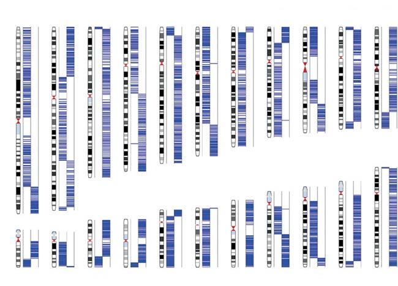

상동 재조합은 유전체 편집(CRISPR/Cas9, 리컴비니어링)의 토대이며, 효모는 $30\sim 50\text{ bp}$, 포유류는 과거 $3\sim 5\text{ kb}$의 상동성 서열(homology arm)을 필요로 했습니다.
## 제6장: 정량적 잡록

세포 생물학의 수치 감각은 크기, 농도, 힘, 속도, 정보와 같은 명확한 범주 외에도, 생명 현상을 입체적으로 조명하는 매혹적인 정량적 수치들을 통해 완성됩니다. 생체막의 물질 투과율, 감염 세포에서 터져 나오는 바이러스 방출량, 남세균 한 마리를 합성하는 데 필요한 햇빛 광자의 총수에 이르기까지, 생물학적 판테온을 마무리하는 다채로운 정량적 질문들을 다룹니다.

## 생물체에는 얼마나 많은 세포가 존재하는가?

모든 생명체는 세포로 이루어져 있습니다. 생물체를 구성하는 세포의 수와 크기는 어떻게 결정될까요?

1. 정해진 수의 세포로 살아가는 생물: 세포수 불변 생물(Eutelic Organisms)
예쁜꼬마선충(*C. elegans*)은 성체를 구성하는 세포 수가 유전적으로 엄격히 고정되어 있습니다. 자웅동체 성체는 정확히 959개의 체세포(수컷은 1,031개)를 가지며, 신경계는 정확히 302개의 뉴런으로 구성됩니다 (BNID 100581). 발생 과정에서 일어나는 프로그램된 세포 사멸(131개 세포 사멸) 또한 결정론적으로 추적됩니다. 완보동물(물곰)과 윤형동물 역시 약 1,000개 안팎의 고정된 체세포를 지닌 세포수 불변 생물입니다.

### 2. 인체에는 몇 개의 세포가 있는가?
체중 70 kg 성인의 체적($\approx 0.07\text{ m}^3$)을 일반 세포 부피($1,000\ \mu\text{m}^3$)로 나눈 단순 어림셈은 $10^{13}\sim 10^{14}$개에 도달합니다. 그러나 혈액 5 L 속 순환 적혈구(RBC, $\mu\text{L}$당 500만 개)만 계산해도 이미 $2.5\sim 3 \times 10^{13}$개에 달합니다. 적혈구는 핵과 소기관이 없어 부피가 약 $100\ \mu\text{m}^3$로 일반 세포보다 10~100배 작기 때문입니다.

최근 정밀 집계(Sender et al., 2016)에 따르면 표준 성인 남성의 총 세포 수는 $3.7 \pm 0.8 \times 10^{13}$개입니다 (BNID 109716).
- 세포 개수 기준: 적혈구가 전체의 무려 $84\%$를 차지하여 압도적 다수파입니다.
- 질량 기준: 근육과 지방 세포가 세포 질량의 $75\%$를 차지합니다.
- (참고: 장내 미생물 수는 약 $3.8 \times 10^{13}$개로 인간 세포 수와 거의 $1:1$의 대등한 비율을 이룹니다).

### 3. 세포 크기 대 세포 수: 쥐와 고래, 왜소 품종
인간은 쥐보다 1,000배 무겁고 대왕고래는 인간보다 수천 배 무겁지만, 개별 간세포나 적혈구의 크기는 거의 같습니다. 체구의 차이는 압도적으로 '세포 수의 차이'에서 옵니다. 애기장대 잎 면적이 7배 커질 때도 표피세포 면적은 불변이며 세포 수가 7배 증가합니다.
- 예외: 녹색 혁명의 왜소 밀/벼 품종은 지베렐린 신호 돌연변이를 통해 '세포 신장'을 억제한 사례이며, 4배체 도롱뇽은 세포 부피가 2배 크지만 세포 수가 절반으로 줄어 전체 신체 크기가 동일합니다. 비만 환자의 체중 증가는 세포 수 증가(1% 미만)보다 기존 지방세포의 개별 부피 비대(hypertrophy)에 의해 일어납니다.

## 한 세대당 몇 번의 염색체 복제가 일어나는가?

성인 인체는 $3.7 \times 10^{13}$개의 세포로 이루어져 있고, 적혈구(수명 120일)는 100년 동안 약 300번 교체됩니다. 따라서 인간이 평생 겪는 총 세포 분열 횟수는 무려 $10^{16}$번(1경 번)에 달합니다 (BNID 100379).

이 막대한 분열을 지탱하는 복제 전략에는 두 가지 극단적 모델이 있습니다:
1. 대칭 이진 트리 모델: 모든 세포가 2분열하면 $10^{13}$개 세포는 $\log_2(10^{13}) \approx 43$회, $10^{16}$개 세포도 불과 53회의 복제로 충분합니다.
2. 단일 줄기세포 선형 모델: 마스터 줄기세포 1개가 직렬로 분열하면 $10^{16}$번의 복제를 거쳐 돌연변이 축적으로 파국을 맞습니다.

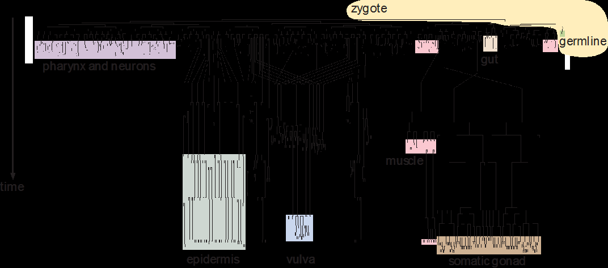

실제 생체 조직은 계층적 줄기세포 시스템을 채택합니다. 휴면 중심의 극소수 줄기세포가 매우 천천히 분열하여 게놈 무결성을 지키고, 중간 전구세포가 빠른 속도로 대량 증폭한 뒤 분화합니다.

생식세포 계열의 복제 횟수는 암수 간에 극적인 차이를 보입니다:
- 여성 난자: 출생 전에 $23\sim 30$회의 복제를 마치고 정지하므로 연령에 영향을 받지 않습니다.
- 남성 정자: 사춘기 이후 16일마다 지속 분열하여 20세에 약 150회, 50세에는 800회 이상의 복제를 거칩니다. 부계 연령이 1세 증가할 때마다 자녀에게 전달되는 돌연변이가 매년 2개씩 선형 증가하는 이유입니다.
- 평생 줄기세포 분열 횟수와 조직별 암 발생 위험도 사이에는 $r \approx 0.8$의 높은 상관관계가 존재하여(Tomasetti & Vogelstein, 2015), 세포 분열 시 복제 오류 자체가 암 발생의 핵심 요인임을 보여줍니다.

## 유전체 내에는 몇 개의 리보솜 RNA 유전자 복사본이 존재하는가?

출아효모(*S. cerevisiae*)는 최적 성장 시 약 200,000개의 리보솜을 지니며, 분열 주기 100분 동안 초당 약 33개의 새 rRNA를 합성해야 합니다 ($200,000 / 6,000\text{ s}$).

단일 rRNA 유전자 복사본으로 이를 감당할 수 있을까요?
- RNA 중합효소 I의 전사 속도: $10\sim 20\text{ bp/s}$.
- 중합효소의 물리적 크기(footprint): 약 $40\text{ bp}$.
- 고속도로 정체처럼 중합효소가 빈틈없이 밀집하여 최대 속도로 주행할 때의 이론적 최대 전사율은:
$$\frac{15\text{ bp/s}}{40\text{ bp/중합효소}} \approx 0.4\text{ 전사체/s}$$
물리적 상한선(초당 0.4개)은 세포의 요구량(초당 33개)에 80배 이상 미달합니다!

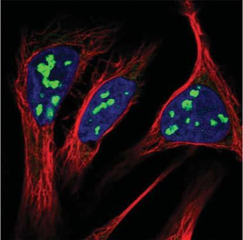

따라서 유전체 내에 다중 복사본이 필수적입니다. 효모는 약 150개, 대장균은 7개, 인간 게놈은 5개 염색체 인형성부위(NOR)에 약 200개의 *rrn* 유전자를 보유합니다(이 전사 장소가 바로 핵소체, 즉 '인'입니다). 단백질 유전자는 mRNA 1개당 수백 개의 단백질을 찍어내는 번역 증폭이 가능하지만, rRNA는 번역 증폭이 없는 최종 산물이므로 전사 단계에서 유전자 복사본 수를 늘려야만 합니다. 또한 대장균의 *rrn* 오페론은 모두 복제 기점(*oriC*) 근처의 선도 가닥에 위치하여 복제-전사 간 정면충돌을 원천 회피합니다.

세포막의 투과율은 얼마인가?

생체막은 극단적인 농도 경사를 유지합니다. 미토콘드리아 기질(pH 8)과 리소좀(pH 4) 사이에는 10,000배의 $\text{H}^+$ 차이가, 세포외액(1~2 mM)과 세포질(100 nM) 사이에는 10,000배 이상의 $\text{Ca}^{2+}$ 경사가 존재합니다.

### 1. 막 투과 법칙과 물질별 투과율 스펙트럼
중성 용질의 투과 플럭스는 $j = -p \cdot (c_{in} - c_{out})$로 주어지며, 투과율 $p$는 속도 차원($\text{cm/s}$)을 갖습니다:
- 기체 분자 ($\text{O}_2, \text{CO}_2$): 지질층을 물처럼 통과하여 $p \approx 0.01\sim 10\text{ cm/s}$로 수송 단백질이 불필요합니다.
- 물: $p \approx 10^{-3}\sim 10^{-2}\text{ cm/s}$.
- 글리세롤: $p \approx 10\sim 100\text{ nm/s}$ ($10^{-6}\sim 10^{-5}\text{ cm/s}$).
- 하전된 이온 및 대사산물: 정전기적 보른 에너지 장벽으로 인해 $p \le 10^{-12}\text{ cm/s}$ 이하로 사실상 완전 차단됩니다.

### 2. 글리세롤의 누출 시간과 세포의 인산화 포획 전략
반지름 $1\ \mu\text{m}$인 박테리아 세포에서 글리세롤($p \approx 30\text{ nm/s}$)이 외부로 새어나가는 고갈 시간은:
$$t \approx \frac{r}{3p} = \frac{10^{-6}\text{ m}}{3 \times 30 \times 10^{-9}\text{ m/s}} \approx 11\text{초}$$
불과 10여 초 만에 비하전 글리세롤은 막 밖으로 유출됩니다. 세포가 포도당이나 글리세롤이 유입되자마자 ATP를 써서 인산기($-\text{PO}_4^{2-}$)를 붙이는 이유가 바로 여기에 있습니다. 강한 전하를 띠게 되면 막 투과율이 $10^6\sim 10^8$배 급감하여 분자가 수개월 동안 세포 내에 안전하게 갇히게 됩니다(인산화 포획 기작, Phosphorylation Trapping).

## 남세균 한 마리를 만드는 데 몇 개의 광자가 필요한가?

해양 미세 식물 플랑크톤과 남세균은 매년 $\approx 50\text{ 기가톤}$의 탄소를 고정하여 지구 전체 1차 생산량의 절반을 담당합니다.

### 1. 탄소 고정의 광자 비용
광합성 명반응과 캘빈 회로에서 1분자의 $\text{CO}_2$를 탄수화물로 환원 고정하는 데 약 10개의 광자가 소모되며, 이론적 에너지 변환 효율은 약 10%입니다.

### 2. 남세균 1개체 합성을 위한 총 광자 수 계산
부피 $1\ \mu\text{m}^3$인 표준 박테리아/남세균 1세포의 유기 탄소 원자 수는 약 $10^{10}$개입니다 (BNID 100010). 모든 탄소를 $\text{CO}_2$ 환원으로 조달해야 하므로 필요한 총 광자 수는:
$$N_{\text{photons}} = 10^{10}\text{ C atoms} \times 10\text{ photons/C atom} \approx \mathbf{10^{11}\text{개의 광자}}$$
남세균 1개체를 복제하려면 약 1,000억 개의 광자가 흡수되어야 합니다!

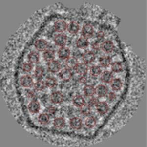

이 탄소 고정은 루비스코 효소가 밀집된 카르복시솜(Carboxysome)에서 수행됩니다. 박테리아의 모든 단백질 중합과 막 전위 유지에 필요한 총에너지가 $\approx 10^{10}\text{ ATP}$ 규모임을 고려할 때, 남세균에게 탄소 고정($10^{11}$ 광자)은 다른 모든 유지 비용을 압도하는 절대적인 에너지 투자처입니다.

## 단일 바이러스 감염으로 몇 개의 비리온이 생성되는가?

감염 세포 하나에서 터져 나오는 자손 바이러스의 수를 방출량(Burst Size)이라 합니다:
- 대장균 박테리오파지 (T4, $\lambda$): $100\sim 300$개 (BNID 105025).
- 남세균 바이러스: $40\sim 80$개.
- 포유류 T세포 감염 바이러스 (SIV/HIV): 약 50,000개 (BNID 102377).

방출되는 바이러스의 총 부피를 숙주 세포 부피와 비교해 보면:
- T-파지 200개($50\text{ nm}$): 총 바이러스 부피 $\approx 0.013\ \mu\text{m}^3$ $\to$ 대장균 부피($1\ \mu\text{m}^3$)의 약 $1.5\sim 2\%$.
- SIV 50,000개($100\text{ nm}$): 총 바이러스 부피 $\approx 25\ \mu\text{m}^3$ $\to$ T세포 부피($500\ \mu\text{m}^3$)의 약 $5\%$.

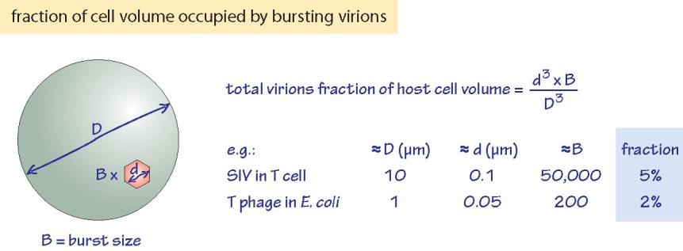

절대적 방출 개수는 100개에서 5만 개로 500배 차이나지만, 방출 바이러스의 총 생물량 부피는 숙주 세포 체적의 $\mathbf{2\sim 5\%}$라는 일정한 범위로 수렴합니다. 이는 바이러스가 숙주를 너무 일찍 파괴하지 않으면서 자원을 한계치까지 착취하는 보편적 생체물리학적 임계치입니다.

### 에필로그

생물학적 수치 감각(biological numeracy)은 관찰을 넘어 생명 현상의 물리적 한계와 원리를 꿰뚫어 보는 강력한 육감(sixth sense)을 제공합니다. 페르미 어림셈과 자릿수 사고를 통해 숫자의 생물물리학적 의미를 조명할 때 생물학은 비로소 정밀과학의 깊이를 얻습니다.

생물학자들의 호기심을 자극하는 대표적 미해결 정량 질문들은 다음과 같습니다:
1. 토양과 해수 1g당 존재하는 고유 유전자의 다양성
2. 식물 액포의 최대 크기와 팽압
3. 대왕고래 축삭의 물리적 길이 한계
4. 인체 면역계의 이론적·실제적 항체 다양성
5. 핵공 복합체의 분자량 차단 한계
6. 비암호화 조절 RNA의 절대 농도와 단일 분자 표적비
7. 세포 하나를 복제하는 데 소모되는 총 포도당 및 ATP 분자 수
8. 막 엔도시토시스 및 소포 수송의 기계적 에너지 비용
9. 단백질 샤페론 보조 폴딩의 생체 내 시간 척도
10. 지구상 세포가 도달할 수 있는 최대 성장 속도(doubling time)의 절대적 한계
11. 일주기 생체 시계 분자 진동자의 정밀도 한계

이 질문들과 함께 독자 여러분이 생명을 지배하는 아름다운 숫자의 세계로 탐험을 이어가기를 기대합니다.
