## 십계명 (The Ten Commandments)

### 첫째 계명

- 원자들의 리스트 `lat`을 재귀할 때는 그것에 대해 두 가지 질문을 한다: `(null? lat)`과 `else`.
- 수 `n`을 재귀할 때는 그것에 대해 두 가지 질문을 한다: `(zero? n)`과 `else`.
- S-표현식들의 리스트 `l`을 재귀할 때는 그것에 대해 세 가지 질문을 한다: `(null? l)`, `(atom? (car l))`, `else`.

### 둘째 계명

리스트를 만들 때는 `cons`를 사용한다.

### 셋째 계명

리스트를 만들 때는 첫 번째 전형적인 원소를 서술한 다음, 그것을 자연 재귀 위에 `cons`한다.

### 넷째 계명

재귀할 때는 적어도 하나의 인자를 바꾼다. 원자들의 리스트 `lat`을 재귀할 때는 `(cdr lat)`을 쓴다. 수 `n`을 재귀할 때는 `(subl n)`을 쓴다. 그리고 S-표현식들의 리스트 `l`을 재귀할 때는, `(null? l)`도 `(atom? (car l))`도 참이 아니라면 `(car l)`과 `(cdr l)`을 쓴다.

그 인자는 종료에 더 가까워지도록 바뀌어야 한다. 바뀌는 인자는 종료 조건에서 검사되어야 한다. `cdr`을 쓸 때는 `null?`로 종료를 검사하고, `subl`을 쓸 때는 `zero?`로 종료를 검사한다.

### 다섯째 계명

`+`로 값을 만들 때는 종료 줄의 값으로 언제나 `0`을 쓴다. `0`을 더해도 덧셈의 값은 바뀌지 않기 때문이다.

`×`로 값을 만들 때는 종료 줄의 값으로 언제나 `1`을 쓴다. `1`을 곱해도 곱셈의 값은 바뀌지 않기 때문이다.

`cons`로 값을 만들 때는 종료 줄의 값으로 언제나 `()`를 고려한다.

### 여섯째 계명

함수가 올바르게 동작한 뒤에만 단순화한다.

### 일곱째 계명

같은 성질을 지닌 부분들로 재귀한다.

- 리스트의 하위 리스트들로.
- 산술식의 하위 표현식들로.

### 여덟째 계명

표현으로부터 추상화하기 위해 도움 함수를 사용한다.

### 아홉째 계명

공통된 패턴을 새로운 함수로 추상화한다.

### 열째 계명

한 번에 둘 이상의 값을 모으는 함수를 만든다.

# 1장 · 장난감 (Toys)

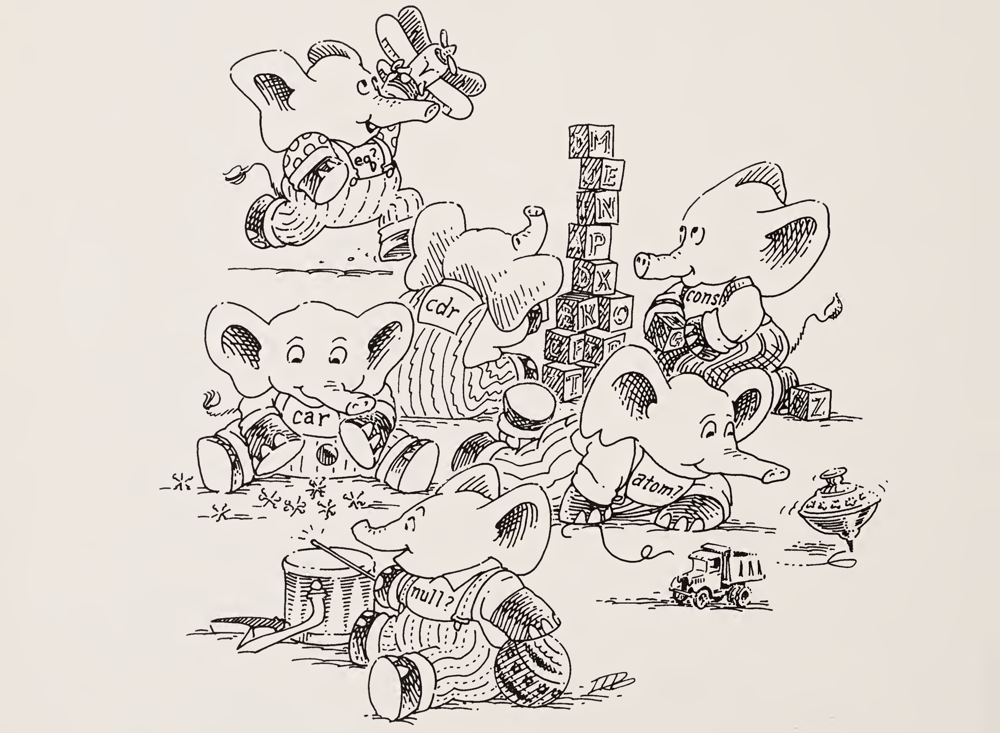

| 질문 | 답변 |
|:-----|:-----|
| 이것은 원자인가?<br>`atom` | 네, `atom`은 문자 `a`로 시작하는 문자열이기 때문입니다. |
| 이것은 원자인가?<br>`turkey` | 네, `turkey`는 글자로 시작하는 문자열이기 때문입니다. |
| 이것은 원자인가?<br>`1492` | 네, `1492`는 숫자들로 이루어진 문자열이기 때문입니다. |
| 이것은 원자인가?<br>`u` | 네, `u`는 글자인 한 문자로 이루어진 문자열이기 때문입니다. |
| 이것은 원자인가?<br>`*abc$` | 네, `*abc$`는 왼쪽 괄호 `(`나 오른쪽 괄호 `)`가 아닌 글자 또는 특수 문자로 시작하는 문자열이기 때문입니다. |
| 이것은 리스트인가?<br>`(atom)` | 네, `(atom)`은 괄호로 둘러싸인 원자이기 때문입니다. |
| 이것은 리스트인가?<br>`(atom turkey or)` | 네, 괄호로 둘러싸인 원자들의 모음이기 때문입니다. |

> **참고.** `(quote atom)` 또는 `'atom`으로도 같은 뜻이 됩니다. `L:`과 `S:` 표기는 서문에서 설명합니다.

| 질문 | 답변 |
|:-----|:-----|
| 이것은 리스트인가?<br>`(atom turkey) or` | 아니요. 이것은 실제로는 괄호로 둘러싸이지 않은 두 개의 S-표현식입니다. 첫 번째는 두 원자를 담은 리스트이고, 두 번째는 원자입니다. |
| 이것은 리스트인가?<br>`((atom turkey) or)` | 네, 두 S-표현식이 이제 괄호로 둘러싸여 있기 때문입니다. |
| 이것은 S-표현식인가?<br>`xyz` | 네, 모든 원자는 S-표현식이기 때문입니다. |
| 이것은 S-표현식인가?<br>`(x y z)` | 네, 리스트이기 때문입니다. |
| 이것은 S-표현식인가?<br>`((x y) z)` | 네, 모든 리스트는 S-표현식이기 때문입니다. |
| 이것은 리스트인가?<br>`(how are you doing so far)` | 네, 괄호로 둘러싸인 S-표현식들의 모음이기 때문입니다. |
| 리스트 `(how are you doing so far)`에는 S-표현식이 몇 개 있고, 그것들은 무엇인가? | 여섯 개입니다. `how`, `are`, `you`, `doing`, `so`, `far`입니다. |
| 이것은 리스트인가?<br>`(((how) are) ((you) (doing so)) far)` | 네, 괄호로 둘러싸인 S-표현식들의 모음이기 때문입니다. |
| 리스트 `(((how) are) ((you) (doing so)) far)`에는 S-표현식이 몇 개 있고, 그것들은 무엇인가? | 세 개입니다. `((how) are)`, `((you) (doing so))`, `far`입니다. |

| 질문 | 답변 |
|:-----|:-----|
| 이것은 리스트인가?<br>`()` | 네, 괄호로 둘러싸인 S-표현식이 하나도 없기 때문입니다. 이 특별한 S-표현식을 널(null) 리스트 또는 빈 리스트라고 부릅니다. |
| 이것은 원자인가?<br>`()` | 아니요, `()`는 그저 리스트이기 때문입니다. |
| 이것은 리스트인가?<br>`(0 0 0 0)` | 네, 괄호로 둘러싸인 S-표현식들의 모음이기 때문입니다. |
| `l`의 `car`는 무엇인가?<br>`l`은 `(a b c)` | `a`입니다. `a`가 이 리스트의 첫 번째 원자이기 때문입니다. |
| `l`의 `car`는 무엇인가?<br>`l`은 `((a b c) x y z)` | `(a b c)`입니다. `(a b c)`가 이 비어 있지 않은 리스트의 첫 번째 S-표현식이기 때문입니다. |
| `l`의 `car`는 무엇인가?<br>`l`은 `hotdog` | 답이 없습니다. 원자의 `car`를 물을 수는 없습니다. |
| `l`의 `car`는 무엇인가?<br>`l`은 `()` | 답이 없습니다. 빈 리스트의 `car`를 물을 수는 없습니다. |

> **car의 법칙**<br>원시 함수 `car`는 비어 있지 않은 리스트에 대해서만 정의된다.

| 질문 | 답변 |
|:-----|:-----|
| `l`의 `car`는 무엇인가?<br>`l`은 `(((hotdogs)) (and) (pickle) relish)` | `((hotdogs))`입니다. "`hotdogs`의 리스트의 리스트"라고 읽습니다. |
| `(car l)`은 무엇인가?<br>`l`은 `(((hotdogs)) (and) (pickle) relish)` | `((hotdogs))`입니다. 이것이 `l`의 첫 번째 S-표현식입니다. |
| `(car (car l))`은 무엇인가?<br>`l`은 `(((hotdogs)) (and))` | `(hotdogs)`입니다. `(car l)`이 `(hotdogs)`이기 때문입니다. |
| `l`의 `cdr`은 무엇인가?<br>`l`은 `(a b c)` | `(b c)`입니다. `(b c)`는 `(car l)`을 뺀 리스트 `l`이기 때문입니다. (참고: "cdr"은 "could-er"라고 발음합니다.) |
| `l`의 `cdr`은 무엇인가?<br>`l`은 `((a b c) x y z)` | `(x y z)`입니다. |
| `l`의 `cdr`은 무엇인가?<br>`l`은 `(hamburger)` | `()`입니다. |
| `(cdr l)`은 무엇인가?<br>`l`은 `((x) t r)` | `(t r)`입니다. `(cdr l)`은 "리스트 `l`의 `cdr`"을 묻는 또 다른 방법이기 때문입니다. |
| `(cdr a)`는 무엇인가?<br>`a`는 `hotdogs` | 답이 없습니다. 원자의 `cdr`을 물을 수는 없습니다. |

| 질문 | 답변 |
|:-----|:-----|
| `(cdr l)`은 무엇인가?<br>`l`은 `()` | 답이 없습니다. 널 리스트의 `cdr`을 물을 수는 없습니다. |
| `(car (cdr l))`은 무엇인가?<br>`l`은 `((b) (x y) ((c)))` | `(x y)`입니다. `((x y) ((c)))`가 `(cdr l)`이고, `(x y)`가 `(cdr l)`의 `car`이기 때문입니다. |
| `(cdr (cdr l))`은 무엇인가?<br>`l`은 `((b) (x y) ((c)))` | `(((c)))`입니다. `((x y) ((c)))`가 `(cdr l)`이고, `(((c)))`가 `(cdr l)`의 `cdr`이기 때문입니다. |
| `(cdr (car l))`은 무엇인가?<br>`l`은 `(a (b (c)) d)` | 답이 없습니다. `(car l)`이 원자이고, `cdr`은 원자를 인자로 받지 않기 때문입니다. **cdr의 법칙**을 보세요. |
| `car`는 무엇을 인자로 받는가? | 비어 있지 않은 모든 리스트를 받습니다. |
| `cdr`은 무엇을 인자로 받는가? | 비어 있지 않은 모든 리스트를 받습니다. |
| 원자 `a`와 리스트 `l`의 cons는 무엇인가?<br>`a`는 `peanut`, `l`은 `(butter and jelly)` | `(peanut butter and jelly)`입니다. `cons`는 원자를 리스트의 앞에 붙이기 때문입니다. |


| 질문 | 답변 |
|:-----|:-----|
| `s`와 `l`의 cons는 무엇인가?<br>`s`는 `(banana and)`, `l`은 `(peanut butter and jelly)` | `((banana and) peanut butter and jelly)`입니다. `cons`는 어떤 S-표현식이든 리스트의 앞에 붙이기 때문입니다. |
| `(cons s l)`은 무엇인가?<br>`s`는 `((help) this)`, `l`은 `(is very ((hard) to learn))` | `(((help) this) is very ((hard) to learn))`입니다. |
| `cons`는 무엇을 인자로 받는가? | `cons`는 두 인자를 받습니다. 첫 번째는 임의의 S-표현식이고, 두 번째는 임의의 리스트입니다. |
| `(cons s l)`은 무엇인가?<br>`s`는 `(a b (c))`, `l`은 `()` | `((a b (c)))`입니다. `()`도 리스트이기 때문입니다. |
| `(cons s l)`은 무엇인가?<br>`s`는 `a`, `l`은 `()` | `(a)`입니다. |
| `(cons s l)`은 무엇인가?<br>`s`는 `((a b c))`, `l`은 `b` | 답이 없습니다. 두 번째 인자 `l`이 리스트여야 하기 때문입니다. |
| `(cons s l)`은 무엇인가?<br>`s`는 `a`, `l`은 `b` | 답이 없습니다. 왜일까요? |


> **cons의 법칙**<br>원시 함수 `cons`는 두 인자를 받는다. `cons`의 두 번째 인자는 리스트여야 한다. 결과는 리스트이다.

| 질문 | 답변 |
|:-----|:-----|
| `(cons s (car l))`은 무엇인가?<br>`s`는 `a`, `l`은 `((b) c d)` | `(a b)`입니다. 왜일까요? |
| `(cons s (cdr l))`은 무엇인가?<br>`s`는 `a`, `l`은 `((b) c d)` | `(a c d)`입니다. 왜일까요? |
| 리스트 `l`은 널 리스트인가?<br>`l`은 `()` | 네, S-표현식이 하나도 없는 리스트이기 때문입니다. 이 질문은 `(null? l)`로도 쓸 수 있습니다. |
| `(null? (quote ()))`은 무엇인가? | 참입니다. `(quote ())`는 널 리스트를 나타내는 표기이기 때문입니다. |
| `(null? l)`은 참인가 거짓인가?<br>`l`은 `(a b c)` | 거짓입니다. `l`이 비어 있지 않은 리스트이기 때문입니다. |

> **null?의 법칙**<br>원시 함수 `null?`은 리스트에 대해서만 정의된다.

| 질문 | 답변 |
|:-----|:-----|
| `(null? a)`는 참인가 거짓인가?<br>`a`는 `spaghetti` | 답이 없습니다. 원자에 대해서는 `null?`을 물을 수 없기 때문입니다. |
| `s`는 원자인가?<br>`s`는 `Harry` | 참입니다. `Harry`는 글자로 시작하는 문자열이기 때문입니다. |
| `(atom? s)`는 참인가 거짓인가?<br>`s`는 `Harry` | 참입니다. `(atom? s)`는 "`s`는 원자인가?"를 묻는 또 다른 방법이기 때문입니다. |
| `(atom? s)`는 참인가 거짓인가?<br>`s`는 `(Harry had a heap of apples)` | 거짓입니다. `s`가 리스트이기 때문입니다. |
| `atom?`은 인자를 몇 개 받고, 그것들은 무엇인가? | 인자를 하나 받습니다. 그 인자는 임의의 S-표현식일 수 있습니다. |


| 질문 | 답변 |
|:-----|:-----|
| `(atom? (car l))`은 참인가 거짓인가?<br>`l`은 `(Harry had a heap of apples)` | 참입니다. `(car l)`이 `Harry`이고, `Harry`가 원자이기 때문입니다. |
| `(atom? (cdr l))`은 참인가 거짓인가?<br>`l`은 `(Harry had a heap of apples)` | 거짓입니다. |
| `(atom? (cdr l))`은 참인가 거짓인가?<br>`l`은 `(Harry)` | 거짓입니다. 리스트 `()`가 원자가 아니기 때문입니다. |
| `(atom? (car (cdr l)))`은 참인가 거짓인가?<br>`l`은 `(swing low sweet cherry oat)` | 참입니다. `(cdr l)`이 `(low sweet cherry oat)`이고, `(car (cdr l))`이 원자인 `low`이기 때문입니다. |
| `(atom? (car (cdr l)))`은 참인가 거짓인가?<br>`l`은 `(swing (low sweet) cherry oat)` | 거짓입니다. `(cdr l)`이 `((low sweet) cherry oat)`이고, `(car (cdr l))`이 리스트인 `(low sweet)`이기 때문입니다. |
| `a1`과 `a2`는 같은 원자인가?<br>`a1`은 `Harry`, `a2`는 `Harry` | 참입니다. `a1`은 원자 `Harry`이고 `a2`도 원자 `Harry`이기 때문입니다. |
| `(eq? a1 a2)`는 참인가 거짓인가?<br>`a1`은 `Harry`, `a2`는 `Harry` | 참입니다. `(eq? a1 a2)`는 "`a1`과 `a2`는 같은 비숫자 원자인가?"를 묻는 또 다른 방법이기 때문입니다. |
| `(eq? a1 a2)`는 참인가 거짓인가?<br>`a1`은 `margarine`, `a2`는 `butter` | 거짓입니다. `a1`과 `a2`가 서로 다른 원자이기 때문입니다. |

| 질문 | 답변 |
|:-----|:-----|
| `eq?`는 인자를 몇 개 받고, 그것들은 무엇인가? | 두 인자를 받습니다. 둘 다 비숫자 원자여야 합니다. |
| `(eq? l1 l2)`는 참인가 거짓인가?<br>`l1`은 `()`, `l2`는 `(strawberry)` | 답이 없습니다. `()`와 `(strawberry)`는 리스트입니다. |
| `(eq? n1 n2)`는 참인가 거짓인가?<br>`n1`은 `6`, `n2`는 `7` | 답이 없습니다. `6`과 `7`은 숫자입니다. |
| `(eq? (car l) a)`는 참인가 거짓인가?<br>`l`은 `(Mary had a little lamb chop)`, `a`는 `Mary` | 참입니다. `(car l)`이 원자 `Mary`이고, 인자 `a`도 원자 `Mary`이기 때문입니다. |
| `(eq? (cdr l) a)`는 참인가 거짓인가?<br>`l`은 `(soured milk)`, `a`는 `milk` | 답이 없습니다. **eq?의 법칙**과 **cdr의 법칙**을 보세요. |


> **eq?의 법칙**<br>원시 함수 `eq?`는 두 인자를 받는다. 각 인자는 비숫자 원자여야 한다.

| 질문 | 답변 |
|:-----|:-----|
| `(eq? (car l) (car (cdr l)))`은 참인가 거짓인가?<br>`l`은 `(beans beans we need jelly beans)` | 참입니다. 리스트의 첫 번째 원자와 두 번째 원자를 비교하기 때문입니다. |

이제 가서 땅콩버터 젤리 샌드위치를 하나 만들어 먹으세요.

> 이 자리는 **젤리 얼룩**을 위해 비워 둡니다!


# 2장 · 다시, 또 다시, 또 다시… (Do It, Do It Again, and Again, and Again …)

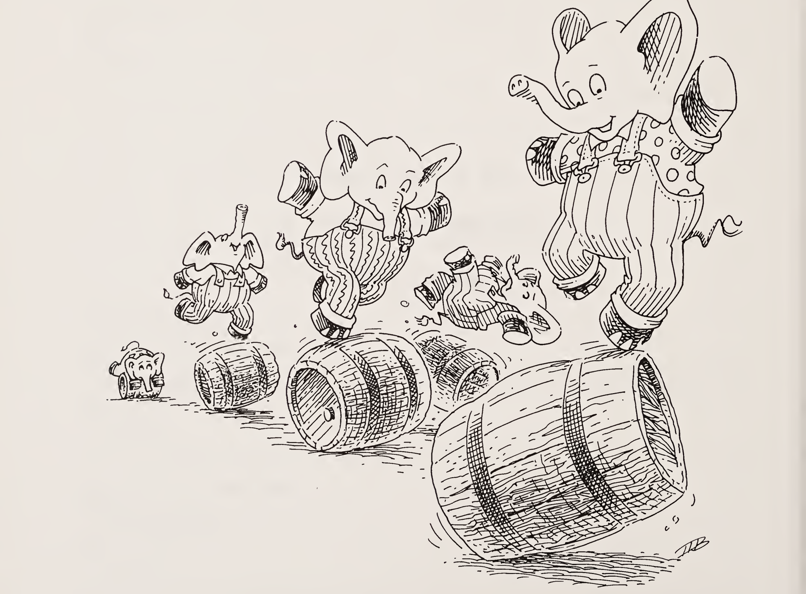

| 질문 | 답변 |
|:-----|:-----|
| 참인가 거짓인가?<br>`(lat? l)`<br>`l`은 `(Jack Sprat could eat no chicken fat)` | 참입니다. `l`의 모든 S-표현식이 원자이기 때문입니다. |
| 참인가 거짓인가?<br>`(lat? l)`<br>`l`은 `((Jack) Sprat could eat no chicken fat)` | 거짓입니다. `(car l)`이 리스트이기 때문입니다. |
| 참인가 거짓인가?<br>`(lat? l)`<br>`l`은 `(Jack (Sprat could) eat no chicken fat)` | 거짓입니다. `l`의 S-표현식 가운데 하나가 리스트이기 때문입니다. |
| 참인가 거짓인가?<br>`(lat? l)`<br>`l`은 `()` | 참입니다. 리스트를 하나도 담고 있지 않기 때문입니다. |
| 참인가 거짓인가?<br>`lat`은 원자들의 리스트인가? | 참입니다! 모든 `lat`은 원자들의 리스트입니다! |
| 다음 함수 가운데 일부만(전부일 필요는 없습니다) 써서 `lat?` 함수를 작성해 보세요.<br>`car` `cdr` `cons` `null?` `atom?` `and` `eq?` | 아직은 할 수 없을 것입니다. 재료가 몇 가지 빠져 있기 때문입니다. 다음 질문으로 넘어가세요. 행운을 빕니다. |

다음은 `lat?`의 정의입니다.

```scheme
(define lat?
  (lambda (l)
    (cond
      ((null? l) #t)
      ((atom? (car l)) (lat? (cdr l)))
      (else #f))))
```

| 질문 | 답변 |
|:-----|:-----|
| `(lat? l)`의 값은?<br>`l`은 `(bacon and eggs)` | `#t`, 곧 참입니다. `l`이 `lat`이기 때문입니다. `l`이 `(bacon and eggs)`일 때 응용 `(lat? l)`의 값은 `#t`입니다. |
| `(lat? l)` 응용이 `#t`라는 답을 어떻게 알 수 있나요? | 이 질문도 알 필요는 없었습니다. 답은 `lat?`이 던지는 질문들에 답하면서 정해집니다. 힌트: `lat?` 함수의 정의를 적어 두고, 다음 질문 묶음을 볼 때 그것을 참고하세요. |
| `(lat? l)`이 처음 던지는 질문은 무엇인가요? | `(null? l)`입니다. 참고: `(cond ...)`는 질문을 던지고, `(lambda ...)`는 함수를 만들며, `(define ...)`은 그 함수에 이름을 줍니다. |
| `((null? l) #t)` 줄의 뜻은?<br>`l`은 `(bacon and eggs)` | `(null? l)`은 인자 `l`이 널 리스트인지 묻습니다. 그렇다면 응용의 값은 참입니다. 그렇지 않다면 다음 질문을 던집니다. 여기서 `l`은 널 리스트가 아니므로 다음 질문을 던집니다. |
| 다음 질문은? | `(atom? (car l))`입니다. |


| 질문 | 답변 |
|:-----|:-----|
| `((atom? (car l)) (lat? (cdr l)))` 줄의 뜻은?<br>`l`은 `(bacon and eggs)` | `(atom? (car l))`은 리스트 `l`의 첫 S-표현식이 원자인지 묻습니다. `(car l)`이 원자라면 `l`의 나머지도 원자로만 이루어졌는지 알고 싶습니다. `(car l)`이 원자가 아니면 다음 질문을 던집니다. 여기서는 `(car l)`이 원자이므로, 함수의 값은 `(lat? (cdr l))`의 값입니다. |
| `(lat? (cdr l))`의 뜻은? | `(lat? (cdr l))`은 새 인자로 함수를 다시 부름으로써 리스트 `l`의 나머지가 원자로만 이루어졌는지 알아봅니다. |
| 이제 `lat?`의 인자 `l`은 무엇인가요? | 이제 인자 `l`은 `(cdr l)`이고, 그것은 `(and eggs)`입니다. |
| 다음 질문은? | `(null? l)`입니다. |
| `((null? l) #t)` 줄의 뜻은?<br>`l`은 이제 `(and eggs)` | `(null? l)`은 인자 `l`이 널 리스트인지 묻습니다. 그렇다면 응용의 값은 `#t`입니다. 그렇지 않다면 다음 질문을 던집니다. 여기서 `l`은 널 리스트가 아니므로 다음 질문을 던집니다. |
| 다음 질문은? | `(atom? (car l))`입니다. |
| `((atom? (car l)) (lat? (cdr l)))` 줄의 뜻은?<br>`l`은 `(and eggs)` | `(atom? (car l))`은 `(car l)`이 원자인지 묻습니다. 원자라면 응용의 값은 `(lat? (cdr l))`입니다. 아니라면 다음 질문을 던집니다. 여기서는 `(car l)`이 원자이므로, 리스트 `l`의 나머지가 원자로만 이루어졌는지 알아내려 합니다. |
| `(lat? (cdr l))`의 뜻은? | `(lat? (cdr l))`은 `lat?` 함수를 다시 부르되 이번에는 인자 `(cdr l)`로 불러서, 리스트 `l`의 나머지가 원자로만 이루어졌는지 알아냅니다. 그 `(cdr l)`은 `(eggs)`입니다. |

| 질문 | 답변 |
|:-----|:-----|
| 다음 질문은? | `(null? l)`입니다. |
| `((null? l) #t)` 줄의 뜻은?<br>`l`은 이제 `(eggs)` | `(null? l)`은 인자 `l`이 널 리스트인지 묻습니다. 그렇다면 응용의 값은 `#t`, 곧 참입니다. 그렇지 않다면 다음 질문으로 넘어갑니다. 여기서 `l`은 널이 아니므로 다음 질문을 던집니다. |
| 다음 질문은? | `(atom? (car l))`입니다. |
| `((atom? (car l)) (lat? (cdr l)))` 줄의 뜻은?<br>`l`은 이제 `(eggs)` | `(atom? (car l))`은 `(car l)`이 원자인지 묻습니다. 원자라면 응용의 값은 `(lat? (cdr l))`입니다. `(car l)`이 원자가 아니라면 다음 질문을 던집니다. 여기서는 `(car l)`이 원자이므로 다시 한 번 `(lat? (cdr l))`을 봅니다. |
| `(lat? (cdr l))`의 뜻은? | `(lat? (cdr l))`은 `l`이 `(cdr l)`의 값이 되어 `lat?` 함수를 부름으로써, 리스트 `l`의 나머지가 원자로만 이루어졌는지 알아냅니다. |
| 이제 `lat?`의 인자는 무엇인가요? | `()`입니다. `(cdr l)`의 값이기 때문입니다. |
| `((null? l) #t)` 줄의 뜻은?<br>`l`은 이제 `()` | `(null? l)`은 인자 `l`이 널 리스트인지 묻습니다. 그렇다면 응용의 값은 `#t`의 값입니다. 그렇지 않다면 다음 질문을 던집니다. 여기서 `()`는 널 리스트이므로, `l`이 `(bacon and eggs)`일 때 응용 `(lat? l)`의 값은 `#t`, 곧 참입니다. |
| `(lat? l)`에 대한 질문이 기억나나요? | 아마 아닐 것입니다. `l`이 원자들의 리스트일 때 응용 `(lat? l)`의 값은 `#t`입니다. 여기서 `l`은 `(bacon and eggs)`입니다. |

`lat?` 함수를 다시 적으면 이렇습니다.

```scheme
(define lat?
  (lambda (l)
    (cond
      ((null? l) #t)
      ((atom? (car l)) (lat? (cdr l)))
      (else #f))))
```

| 질문 | 답변 |
|:-----|:-----|
| `lat?` 함수가 하는 일을 자기 말로 설명할 수 있나요? | 우리 말로 하면 이렇습니다. "`lat?`은 리스트의 각 S-표현식을 차례로 보면서, S-표현식이 다 떨어질 때까지 그것이 원자인지 묻습니다. 리스트를 만나지 않고 끝까지 가면 값은 `#t`입니다. 리스트를 만나면 값은 `#f`, 곧 거짓입니다." "거짓"이라는 값에 어떻게 이르는지 보려면 다음 몇 질문을 보세요. |
| `(lat? l)`의 값은?<br>`l`은 이제 `(bacon (and eggs))` | `#f`입니다. 리스트 `l`이 리스트인 S-표현식을 담고 있기 때문입니다. |
| 첫 질문은? | `(null? l)`입니다. |
| `((null? l) #t)` 줄의 뜻은?<br>`l`은 `(bacon (and eggs))` | `(null? l)`은 `l`이 널 리스트인지 묻습니다. 널이라면 값은 `#t`입니다. `l`이 널이 아니라면 다음 질문으로 넘어갑니다. 여기서는 널이 아니므로 다음 질문을 던집니다. |
| 다음 질문은? | `(atom? (car l))`입니다. |
| `((atom? (car l)) (lat? (cdr l)))` 줄의 뜻은?<br>`l`은 `(bacon (and eggs))` | `(atom? (car l))`은 `(car l)`이 원자인지 묻습니다. 원자라면 값은 `(lat? (cdr l))`입니다. 아니라면 다음 질문을 던집니다. 여기서 `(car l)`은 원자이므로, 리스트 `l`의 나머지가 원자로만 이루어졌는지 확인하려 합니다. |

| 질문 | 답변 |
|:-----|:-----|
| `(lat? (cdr l))`의 뜻은? | `(lat? (cdr l))`은 `l` 자리에 `(cdr l)`을 넣어 `lat?`을 부름으로써, 리스트 `l`의 나머지가 원자로만 이루어졌는지 확인합니다. |
| `((null? l) #t)` 줄의 뜻은?<br>`l`은 이제 `((and eggs))` | `(null? l)`은 `l`이 널 리스트인지 묻습니다. 널이라면 값은 `#t`입니다. 널이 아니라면 다음 질문을 던집니다. 여기서 `l`은 널이 아니므로 다음 질문으로 넘어갑니다. |
| 다음 질문은? | `(atom? (car l))`입니다. |
| `((atom? (car l)) (lat? (cdr l)))` 줄의 뜻은?<br>`l`은 이제 `((and eggs))` | `(atom? (car l))`은 `(car l)`이 원자인지 묻습니다. 원자라면 값은 `(lat? (cdr l))`입니다. 아니라면 다음 질문으로 넘어갑니다. 여기서는 `(car l)`이 원자가 아니므로 다음 질문을 던집니다. |
| 다음 질문은? | `else`입니다. |
| `else`라는 질문의 뜻은? | `else`는 `else`가 참인지 묻습니다. |
| `else`는 참인가요? | 네, `else`라는 질문은 언제나 참이기 때문입니다. 물론입니다. |
| `else`는 왜 마지막 질문인가요? | 더 이상 질문을 던질 필요가 없기 때문입니다. |
| 왜 더 이상 질문을 던질 필요가 없나요? | 리스트는 비어 있을 수도 있고, 첫 자리에 원자가 올 수도 있고, 첫 자리에 리스트가 올 수도 있기 때문입니다. |
| `(else #f)` 줄의 뜻은? | `else`는 `else`가 참인지 묻습니다. `else`가 참이라면(언제나 그렇습니다) 답은 `#f`, 곧 거짓입니다. |

| 질문 | 답변 |
|:-----|:-----|
| `)))`는 무엇인가요? | 함수 정의의 처음에 나오는 `(cond ...`, `(lambda ...`, `(define ...`의 닫는 괄호, 곧 서로 짝이 맞는 괄호입니다. |
| `(lat? l)`에서 값 `#f`를 어떻게 정했는지 설명할 수 있나요?<br>`l`은 `(bacon (and eggs))` | 한 가지로 말하면 이렇습니다. "`(lat? l)`은 인자의 각 항목을 보면서 그것이 원자인지 확인합니다. 리스트를 만나기 전에 항목이 다 떨어지면 `(lat? l)`의 값은 `#t`입니다. `(bacon (and eggs))` 예에서처럼 리스트를 만나면 `(lat? l)`의 값은 `#f`입니다." |
| 참인가 거짓인가?<br>`(or (null? l1) (atom? l2))`<br>`l1`은 `()`, `l2`는 `(d e f g)` | 참입니다. `l1`이 `()`일 때 `(null? l1)`이 참이기 때문입니다. |
| 참인가 거짓인가?<br>`(or (null? l1) (null? l2))`<br>`l1`은 `(a b c)`, `l2`는 `()` | 참입니다. `l2`가 `()`일 때 `(null? l2)`가 참이기 때문입니다. |
| 참인가 거짓인가?<br>`(or (null? l1) (null? l2))`<br>`l1`은 `(a b c)`, `l2`는 `(atom)` | 거짓입니다. `l1`이 `(a b c)`이고 `l2`가 `(atom)`일 때 `(null? l1)`도 `(null? l2)`도 참이 아니기 때문입니다. |
| `(or ...)`는 무엇을 하나요? | `(or ...)`는 두 질문을 한 번에 하나씩 던집니다. 첫 번째 질문이 참이면 거기서 멈추고 참이라고 답합니다. 그렇지 않으면 두 번째 질문을 던지고, 두 번째 질문이 답하는 대로 답합니다. |

다음은 `member?`의 정의입니다.

```scheme
(define member?
  (lambda (a lat)
    (cond
      ((null? lat) #f)
      (else (or (eq? (car lat) a)
                (member? a (cdr lat)))))))
```

| 질문 | 답변 |
|:-----|:-----|
| `a`가 `lat`의 원소라는 것이 참인가 거짓인가?<br>`a`는 `tea`, `lat`은 `(coffee tea or milk)` | 참입니다. `lat`인 `(coffee tea or milk)`의 원자 가운데 하나가 원자 `a`, 곧 `tea`와 같기 때문입니다. |
| `(member? a lat)`은 참인가 거짓인가?<br>`a`는 `poached`, `lat`은 `(fried eggs and scrambled eggs)` | 거짓입니다. `a`가 `lat`의 원자 가운데 하나가 아니기 때문입니다. |
| `(member? a lat)`의 값은?<br>`a`는 `meat`, `lat`은 `(mashed potatoes and meat gravy)` | `#t`입니다. 원자 `meat`이 `lat`인 `(mashed potatoes and meat gravy)`의 원자 가운데 하나이기 때문입니다. |
| 위 응용의 값 `#t`를 어떻게 알 수 있나요? | `(member? a lat)`에 대한 질문들에 답하면서 값이 정해집니다. 힌트: `member?` 함수의 정의를 적어 두고, 다음 질문 묶음을 푸는 동안 그것을 참고하세요. |
| `(member? a lat)`이 처음 던지는 질문은? | `(null? lat)`입니다. 이것은 `lat?`이 처음 던지는 질문이기도 합니다. |

### 첫째 계명

함수를 표현할 때는 언제나 `null?`을 첫 번째 질문으로 던진다.

| 질문 | 답변 |
|:-----|:-----|
| `((null? lat) #f)` 줄의 뜻은?<br>`lat`은 `(mashed potatoes and meat gravy)` | `(null? lat)`은 `lat`이 널 리스트인지 묻습니다. 그렇다면 값은 `#f`입니다. 원자 `meat`이 `lat`에서 발견되지 않았기 때문입니다. 그렇지 않다면 다음 질문을 던집니다. 여기서는 널이 아니므로 다음 질문을 던집니다. |
| 다음 질문은? | `else`입니다. |
| `else`가 다음 질문인 이유는? | 더 이상 질문을 던질 필요가 없기 때문입니다. |
| `else`도 정말 질문인가요? | 네, `else`는 값이 언제나 참인 질문입니다. |
| `(else (or (eq? (car lat) a) (member? a (cdr lat))))` 줄의 뜻은? | 이제 `lat`이 널이 아니라는 것을 알았으니, `lat`의 `car`가 `a`와 같은 원자인지, 아니면 `a`가 `lat`의 나머지 어딘가에 있는지 알아내야 합니다. `(or (eq? (car lat) a) (member? a (cdr lat)))`가 그 일을 합니다. |
| 참인가 거짓인가?<br>`(or (eq? (car lat) a) (member? a (cdr lat)))`<br>`a`는 `meat`, `lat`은 `(mashed potatoes and meat gravy)` | 각 질문을 차례로 보면서 알아내겠습니다. |

| 질문 | 답변 |
|:-----|:-----|
| `(eq? (car lat) a)`는 참인가 거짓인가?<br>`a`는 `meat`, `lat`은 `(mashed potatoes and meat gravy)` | 거짓입니다. `meat`이 `(mashed potatoes and meat gravy)`의 `car`인 `mashed`와 `eq?`하지 않기 때문입니다. |
| `(or ...)`의 두 번째 질문은? | `(member? a (cdr lat))`입니다. 이것은 인자 `lat`을 `(cdr lat)`으로 바꾸어 함수를 부르는 것입니다. |
| 이제 `member?`의 인자들은 무엇인가요? | `a`는 `meat`이고, `lat`은 이제 `(cdr lat)`, 구체적으로는 `(potatoes and meat gravy)`입니다. |
| 다음 질문은? | `(null? lat)`입니다. 첫째 계명을 기억하세요. |
| `(null? lat)`은 참인가 거짓인가?<br>`lat`은 `(potatoes and meat gravy)` | `#f`, 곧 거짓입니다. |
| 이제 무엇을 하나요? | 다음 질문을 던집니다. |
| 다음 질문은? | `else`입니다. |
| `(or (eq? (car lat) a) (member? a (cdr lat)))`의 뜻은? | `(or ...)`는 함수를 다시 부름으로써 `a`가 `lat`의 `car`와 `eq?`한지, 또는 `a`가 `lat`의 `cdr`의 원소인지 알아냅니다. |
| `a`는 `lat`의 `car`와 `eq?`한가요? | 아니요, `a`는 `meat`이고 `lat`의 `car`는 `potatoes`이기 때문입니다. |

| 질문 | 답변 |
|:-----|:-----|
| 그래서 다음에는 무엇을 하나요? | `(member? a (cdr lat))`을 던집니다. |
| 이제 `member?`의 인자들은 무엇인가요? | `a`는 `meat`이고, `lat`은 `(and meat gravy)`입니다. |
| 다음 질문은? | `(null? lat)`입니다. |
| 이제 무엇을 하나요? | `(null? lat)`이 거짓이므로 다음 질문을 던집니다. |
| 다음 질문은? | `else`입니다. |
| `(or (eq? (car lat) a) (member? a (cdr lat)))`의 값은? | `(member? a (cdr lat))`의 값입니다. |
| 왜인가요? | `(eq? (car lat) a)`가 거짓이기 때문입니다. |
| 이제 무엇을 하나요? | 재귀합니다. 새 인자로 함수를 다시 부릅니다. |
| 새 인자들은 무엇인가요? | `a`는 `meat`이고, `lat`은 `(meat gravy)`입니다. |
| 다음 질문은? | `(null? lat)`입니다. |
| 이제 무엇을 하나요? | `(null? lat)`이 거짓이므로 다음 질문을 던집니다. |
| 다음 질문은? | `else`입니다. |

| 질문 | 답변 |
|:-----|:-----|
| `(or (eq? (car lat) a) (member? a (cdr lat)))`의 값은? | `#t`입니다. `(car lat)`인 `meat`와 `a`인 `meat`가 같은 원자이기 때문입니다. 그래서 `(or ...)`는 `#t`로 답합니다. |
| `(member? a lat)`의 값은?<br>`a`는 `meat`, `lat`은 `(meat gravy)` | `#t`입니다. `meat`이 `(meat gravy)`의 원소임을 찾았기 때문입니다. |
| `(member? a lat)`의 값은?<br>`a`는 `meat`, `lat`은 `(and meat gravy)` | `#t`입니다. `meat`이 `(and meat gravy)`라는 `lat`의 원소이기도 하기 때문입니다. |
| `(member? a lat)`의 값은?<br>`a`는 `meat`, `lat`은 `(potatoes and meat gravy)` | `#t`입니다. `meat`이 `(potatoes and meat gravy)`라는 `lat`의 원소이기도 하기 때문입니다. |
| `(member? a lat)`의 값은?<br>`a`는 `meat`, `lat`은 `(mashed potatoes and meat gravy)` | `#t`입니다. `meat`이 `(mashed potatoes and meat gravy)`라는 `lat`의 원소이기도 하기 때문입니다. 물론 이것이 우리의 원래 `lat`입니다. |
| 확실히 하기 위해 다시 한 번 훑어봅시다. `(member? a lat)`의 값은?<br>`a`는 `meat`, `lat`은 `(mashed potatoes and meat gravy)` | `#t`입니다. |
| `(null? lat)`의 값은? | 아니요. |

> **참고.** `member?` 함수의 정의와 그 인자들을 적어 두고, 다음 질문 묶음을 지나가면서 그것들을 참고하세요.

이제 `member?`의 계산 과정을 함수의 줄 단위로 따라가 봅시다. 왼쪽은 살펴보는 줄, 오른쪽은 그 줄에서 일어나는 일입니다.

| 질문 | 답변 |
|:-----|:-----|
| `else` | 네. |
| `(or (eq? (car lat) a) (member? a (cdr lat)))` | 아마도요. |
| `(eq? (car lat) a)` | 아니요. 다음 질문을 던집니다. |
| 다음은? | `a`와 `(cdr lat)`으로 재귀합니다. `a`는 `meat`이고 `(cdr lat)`은 `(potatoes and meat gravy)`입니다. |
| `(null? lat)` | 아니요. 다음 줄로 넘어갑니다. |
| `else` | 네. 하지만 `(eq? (car lat) a)`가 거짓입니다. `a`와 `(cdr lat)`으로 재귀합니다. `a`는 `meat`이고 `(cdr lat)`은 `(and meat gravy)`입니다. |
| `(null? lat)` | 아니요. 다음 줄로 넘어갑니다. |
| `else` | 네. 하지만 `(eq? (car lat) a)`가 거짓입니다. `a`와 `(cdr lat)`으로 재귀합니다. `a`는 `meat`이고 `(cdr lat)`은 `(meat gravy)`입니다. |
| `(null? lat)` | 아니요. 다음 줄로 넘어갑니다. |
| `(eq? (car lat) a)` | 네, 값은 `#t`입니다. |

| 질문 | 답변 |
|:-----|:-----|
| `(member? a lat)`의 값은?<br>`a`는 `meat`, `lat`은 `(meat gravy)` | `#t`입니다. |
| `(member? a lat)`의 값은?<br>`a`는 `meat`, `lat`은 `(and meat gravy)` | `#t`입니다. |
| `(member? a lat)`의 값은?<br>`a`는 `meat`, `lat`은 `(potatoes and meat gravy)` | `#t`입니다. |
| `(member? a lat)`의 값은?<br>`a`는 `meat`, `lat`은 `(mashed potatoes and meat gravy)` | `#t`입니다. |
| `(member? a lat)`의 값은?<br>`a`는 `liver`, `lat`은 `(bagels and lox)` | `#f`입니다. |
| 왜 `#f`인지 풀어 봅시다. `member?`가 처음 던지는 질문은 무엇인가요? | `(null? lat)`입니다. |
| `(null? lat)`의 값은?<br>`lat`은 `(bagels and lox)` | 아니요. 다음 줄로 넘어갑니다. |

| 질문 | 답변 |
|:-----|:-----|
| `else` | 네. 하지만 `(eq? (car lat) a)`가 거짓입니다. `a`와 `(cdr lat)`으로 재귀합니다. `a`는 `liver`이고 `(cdr lat)`은 `(and lox)`입니다. |
| `(null? lat)` | 아니요. 다음 줄로 넘어갑니다. |
| `else` | 네. 하지만 `(eq? (car lat) a)`가 거짓입니다. `a`와 `(cdr lat)`으로 재귀합니다. `a`는 `liver`이고 `(cdr lat)`은 `(lox)`입니다. |
| `(null? lat)` | 아니요. 다음 줄로 넘어갑니다. |
| `else` | 네. 하지만 `(eq? (car lat) a)`는 여전히 거짓입니다. `a`와 `(cdr lat)`으로 재귀합니다. `a`는 `liver`이고 `(cdr lat)`은 `()`입니다. |
| `(null? lat)` | 네. |
| `(member? a lat)`의 값은?<br>`a`는 `liver`, `lat`은 `()` | `#f`입니다. |
| `(or (eq? (car lat) a) (member? a (cdr lat)))`의 값은?<br>`a`는 `liver`, `lat`은 `(lox)` | `#f`입니다. |

| 질문 | 답변 |
|:-----|:-----|
| `(member? a lat)`의 값은?<br>`a`는 `liver`, `lat`은 `(lox)` | `#f`입니다. |
| `(or (eq? (car lat) a) (member? a (cdr lat)))`의 값은?<br>`a`는 `liver`, `lat`은 `(and lox)` | `#f`입니다. |
| `(member? a lat)`의 값은?<br>`a`는 `liver`, `lat`은 `(and lox)` | `#f`입니다. |
| `(or (eq? (car lat) a) (member? a (cdr lat)))`의 값은?<br>`a`는 `liver`, `lat`은 `(bagels and lox)` | `#f`입니다. |
| `(member? a lat)`의 값은?<br>`a`는 `liver`, `lat`은 `(bagels and lox)` | `#f`입니다. |

이 모든 것을 믿겠습니까? 그렇다면 이제 쉬어도 좋습니다!

> 이 자리는 **낙서**를 위해 비워 둡니다!


# 3장 · 위대한 cons (Cons the Magnificent)

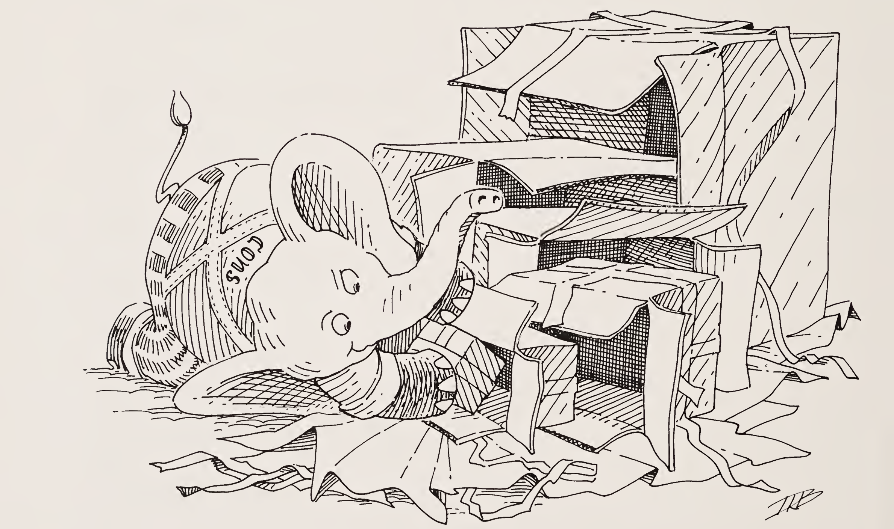

| 질문 | 답변 |
|:-----|:-----|
| `(rember a lat)`은 무엇인가?<br>`a`는 `mint`, `lat`은 `(lamb chops and mint jelly)` | `(lamb chops and jelly)`입니다. |
| `(rember a lat)`은 무엇인가?<br>`a`는 `mint`, `lat`은 `(lamb chops and mint flavored mint jelly)` | `(lamb chops and flavored mint jelly)`입니다. |
| `(rember a lat)`은 무엇인가?<br>`a`는 `toast`, `lat`은 `(bacon lettuce and tomato)` | `(bacon lettuce and tomato)`입니다. |
| `(rember a lat)`은 무엇인가?<br>`a`는 `cup`, `lat`은 `(coffee cup tea cup and hick cup)` | `(coffee tea cup and hick cup)`입니다. |
| `(rember a lat)`은 무엇을 하는가? | 원자 하나와 `lat` 하나를 인자로 받아, 옛 `lat`에서 그 원자가 처음 나타난 것 하나만 제거한 새 `lat`을 만듭니다. |
| 이 일을 하려면 어떤 단계를 밟아야 하는가? | 먼저 `(null? lat)`을 검사합니다. 첫째 계명입니다. |
| 그러면 `(null? lat)`이 참이면? | `()`를 반환합니다. |
| `(null? lat)`이 참이 아니면 무엇을 알 수 있는가? | `lat`에 적어도 원자가 하나는 있다는 것을 압니다. |
| `lat`에 대해 물어볼 다른 질문이 있는가? | 없습니다. `lat`은 비어 있거나, 적어도 원자를 하나 담고 있습니다. |

> **참고.** "Rember"는 remove a member, 곧 "원소 하나를 제거한다"의 줄임말입니다.

| 질문 | 답변 |
|:-----|:-----|
| `lat`에 원자가 적어도 하나 있다는 것을 알면 무엇을 하는가? | `a`가 `(car lat)`과 같은지 물어봅니다. |
| 어떻게 질문하는가? | `(cond ...)`를 씁니다. |
| `a`가 `(car lat)`과 같은지 어떻게 묻는가? | `(eq? (car lat) a)`로 묻습니다. |
| `a`가 `(car lat)`과 같다면 `(rember a lat)`의 값은 무엇인가? | `(cdr lat)`입니다. |
| `a`가 `(car lat)`과 같지 않다면 무엇을 하는가? | `(car lat)`은 남겨 두되, `a`가 나머지 `lat` 어딘가에 있는지도 알아내야 합니다. |
| 나머지 `lat`에서 `a`가 처음 나타나는 것을 어떻게 제거하는가? | `(rember a (cdr lat))`로 제거합니다. |
| 물어볼 다른 질문이 있는가? | 없습니다. |
| 이제 지금까지 해 온 것을 적어 봅시다. | 정의는 다음과 같습니다. |

```scheme
(define rember
  (lambda (a lat)
    (cond
      ((null? lat) (quote ()))
      (else (cond
              ((eq? (car lat) a) (cdr lat))
              (else (rember a
                            (cdr lat))))))))
```

| 질문 | 답변 |
|:-----|:-----|
| `(rember a lat)`의 값은 무엇인가?<br>`a`는 `bacon`, `lat`은 `(bacon lettuce and tomato)` | `(lettuce and tomato)`입니다. |

> **참고.** `rember` 함수와 그 인자를 적어 두고, 다음 질문들을 따라가면서 계속 참고해 보세요.

| 질문 | 답변 |
|:-----|:-----|
| 이 함수가 동작하는지 봅시다. 이 함수가 던지는 첫 번째 질문은 무엇인가? | `(null? lat)`입니다. |
| 이제 무엇을 하는가? | 다음 줄로 넘어가서 다음 질문을 합니다. |
| `else` | 네. |
| 그다음은? | 다음 질문을 합니다. |
| `(eq? (car lat) a)` | 네, 그래서 값은 `(cdr lat)`입니다. 이 경우에는 리스트 `(lettuce and tomato)`입니다. |
| 이것이 올바른 값인가? | 네, 원래 리스트에서 원자 `bacon`만 뺀 리스트이기 때문입니다. |
| 그런데 정말 좋은 예를 쓴 것일까? | 글쎄요. 하지만 푸딩의 증명은 먹어 보는 데 있는 법이니, 다른 예를 하나 더 해 봅시다. |
| `rember`는 무엇을 하는가? | 원자 하나와 `lat` 하나를 인자로 받아, 옛 `lat`에서 그 원자가 처음 나타난 것 하나만 제거한 새 `lat`을 만듭니다. |
| 이제 무엇을 하는가? | `lat`의 원자들을 하나씩 원자 `a`와 비교하고, 비교에 실패하면 방금 비교한 원자로 시작하는 리스트를 만듭니다. |
| `(rember a lat)`의 값은 무엇인가?<br>`a`는 `and`, `lat`은 `(bacon lettuce and tomato)` | `(bacon lettuce tomato)`입니다. |

| 질문 | 답변 |
|:-----|:-----|
| `rember` 함수가 동작하는지 봅시다. `rember`가 던지는 첫 번째 질문은 무엇인가? | `(null? lat)`입니다. |
| 이제 무엇을 하는가? | 다음 줄로 넘어가서 다음 질문을 합니다. |
| `else` | 좋습니다, 그럼 다음 질문을 합니다. |
| `(eq? (car lat) a)` | 아니요, 그러니 다음 줄로 넘어갑니다. |
| `(else (rember a (cdr lat)))`의 뜻은 무엇인가? | `else`는 "`else`가 참인가?"를 묻습니다. 언제나 참이지요. 그리고 그 줄의 나머지 부분은 `a`와 `(cdr lat)`으로 재귀하라고 말합니다. 여기서 `a`는 `and`이고 `(cdr lat)`은 `(lettuce and tomato)`입니다. |
| `(null? lat)` | 아니요, 그러니 다음 줄로 넘어갑니다. |
| `else` | 물론입니다. |
| `(eq? (car lat) a)` | 아니요, 그러니 다음 줄로 넘어갑니다. |
| `(rember a (cdr lat))`의 뜻은 무엇인가? | 재귀합니다. 여기서 `a`는 `and`이고 `(cdr lat)`은 `(and tomato)`입니다. |
| `(null? lat)` | 아니요, 그러니 다음 줄로 넘어가서 다음 질문을 합니다. |
| `else` | 당연합니다. |

| 질문 | 답변 |
|:-----|:-----|
| `(eq? (car lat) a)` | 네. |
| 그러면 결과는 무엇인가? | `(cdr lat)`, 곧 `(tomato)`입니다. |
| 이것이 올바른가? | 아닙니다. `(tomato)`는 `(bacon lettuce and tomato)`에서 `and`만 뺀 리스트가 아니기 때문입니다. |
| 우리가 무엇을 잘못했는가? | `and`를 버렸지만, `and` 앞에 있던 원자들도 모두 잃어버렸습니다. |
| `bacon`과 `lettuce`라는 원자를 잃지 않으려면 어떻게 해야 하는가? | 위대한 `cons`를 씁니다. 1장의 `cons`를 기억하나요? |
| `cons`를 쓰면 어떻게 되는지 봅시다. | 정의는 다음과 같습니다. |

> **둘째 계명**<br>리스트를 만들 때는 `cons`를 사용한다.

```scheme
(define rember
  (lambda (a lat)
    (cond
      ((null? lat) (quote ()))
      (else (cond
              ((eq? (car lat) a) (cdr lat))
              (else (cons (car lat)
                          (rember a
                                  (cdr lat)))))))))
```

| 질문 | 답변 |
|:-----|:-----|
| `(rember a lat)`의 값은 무엇인가?<br>`a`는 `and`, `lat`은 `(bacon lettuce and tomato)` | `(bacon lettuce tomato)`입니다. |

> **참고.** `cons`와 인자 `a`, `lat`을 써서 이 함수를 그대로 한 번 베껴 두고, 다음 질문들에서 계속 참고해 보세요.

| 질문 | 답변 |
|:-----|:-----|
| 첫 번째 질문은 무엇인가? | `(null? lat)`입니다. |
| 이제 무엇을 하는가? | 다음 질문을 합니다. |
| `else` | 네, 물론입니다. |
| `(eq? (car lat) a)` | 아니요, 그러니 다음 줄로 넘어갑니다. |
| `(cons (car lat) (rember a (cdr lat)))`의 뜻은 무엇인가?<br>`a`는 `and`, `lat`은 `(bacon lettuce and tomato)` | `lat`의 `car`인 `bacon`을 `(rember a (cdr lat))`의 값 위에 cons하라고 말합니다. 그런데 `(rember a (cdr lat))`의 값을 아직 모르므로, `(car lat)`을 그 위에 cons하려면 먼저 그 값을 구해야 합니다. |
| `(rember a (cdr lat))`의 뜻은 무엇인가? | `lat`이 `(cdr lat)`, 곧 `(lettuce and tomato)`로 바뀐 함수를 가리킵니다. |
| `(null? lat)` | 아니요, 그러니 다음 줄로 넘어갑니다. |
| `else` | 네, 다음 질문을 합니다. |
| `(eq? (car lat) a)` | 아니요, 그러니 다음 줄로 넘어갑니다. |
| `(cons (car lat) (rember a (cdr lat)))`의 뜻은 무엇인가? | `lat`의 `car`인 `lettuce`를 `(rember a (cdr lat))`의 값 위에 cons하라고 말합니다. 그런데 `(rember a (cdr lat))`의 값을 아직 모르므로, `(car lat)`을 그 위에 cons하려면 먼저 그 값을 구해야 합니다. |

| 질문 | 답변 |
|:-----|:-----|
| `(rember a (cdr lat))`의 뜻은 무엇인가? | `lat`이 `(cdr lat)`, 곧 `(and tomato)`로 바뀐 함수를 가리킵니다. |
| `(null? lat)` | 아니요, 그러니 다음 질문을 합니다. |
| `else` | 여전히 그렇습니다. |
| `(eq? (car lat) a)` | 네. |
| `((eq? (car lat) a) (cdr lat))` 줄의 값은 무엇인가? | `(cdr lat)`, 곧 `(tomato)`입니다. |
| 다 끝났는가? | 절대 아닙니다! `lat`이 `(and tomato)`일 때 `(rember a lat)`이 무엇인지는 알지만, `lat`이 `(lettuce and tomato)`이거나 `(bacon lettuce and tomato)`일 때 무엇인지는 아직 모릅니다. |
| 이제 `(rember a (cdr lat))`의 값을 얻었습니다.<br>`a`는 `and`, `(cdr lat)`은 `(and tomato)`<br>이 값은 `(tomato)`입니다. | `lettuce`를 `(rember a (cdr lat))`의 값 위에 cons하려 했던 것을 기억합시다. 그때 `a`는 `and`였고 `(cdr lat)`은 `(and tomato)`였습니다. |
| 이제 무엇을 하는가? | 이제 `(tomato)`라는 값을 얻었으니, 그 위에 `lettuce`를 cons할 수 있습니다. |
| `lettuce`를 `(tomato)` 위에 cons하면 결과는 무엇인가? | `(lettuce tomato)`입니다. |
| `(lettuce tomato)`는 무엇을 나타내는가? | `lat`이 `(lettuce and tomato)`이고 `(rember a (cdr lat))`가 `(tomato)`일 때, `(cons (car lat) (rember a (cdr lat)))`의 값을 나타냅니다. |

> **참고.** 점심은 어떠신가요?

| 질문 | 답변 |
|:-----|:-----|
| 다 끝났는가? | 아직 아닙니다. 지금까지는 `lat`이 `(lettuce and tomato)`일 때 `(rember a lat)`이 무엇인지 알 뿐이고, `lat`이 `(bacon lettuce and tomato)`일 때 무엇인지는 아직 모릅니다. |
| 이제 `(rember a (cdr lat))`의 값을 얻었습니다.<br>`a`는 `and`, `(cdr lat)`은 `(lettuce and tomato)`<br>이 값은 `(lettuce tomato)`입니다. | 한때 우리는 `(rember a (cdr lat))`의 값 위에 `bacon`을 cons하려 했습니다. 그때 `a`는 `and`였고 `(cdr lat)`은 `(lettuce and tomato)`였습니다. 이제 `(lettuce tomato)`라는 값을 얻었으니, 그 위에 `bacon`을 cons할 수 있습니다. |
| 이것이 마지막 값이 아니니, 다시 무엇을 해야 하는가? | `(lettuce tomato)` 위에 `bacon`을 cons합니다. |
| `bacon`을 `(lettuce tomato)` 위에 cons하면 결과는 무엇인가? | `(bacon lettuce tomato)`입니다. |
| `(bacon lettuce tomato)`는 무엇을 나타내는가? | `lat`이 `(bacon lettuce and tomato)`이고 `(rember a (cdr lat))`가 `(lettuce tomato)`일 때, `(cons (car lat) (rember a (cdr lat)))`의 값을 나타냅니다. |
| 다 끝났는가? | 네. |
| 우리가 `(bacon lettuce tomato)`라는 마지막 값을 어떻게 구했는지 자기 말로 설명할 수 있는가? | 우리 말로 하면 이렇습니다. "`rember` 함수는 `lat`의 원자들을 하나씩 검사해서 원자 `and`와 같은지 보았습니다. `car`가 그 원자와 같지 않으면, 나중에 마지막 값 위에 cons하려고 그 원자를 저장해 두었습니다. `rember`가 원자 `and`를 찾으면 그것을 버리고, 앞서 저장해 둔 원자들을 나머지 `lat` 위에 다시 cons했습니다." |

| 질문 | 답변 |
|:-----|:-----|
| 위 설명을 반영하도록 `rember`를 다시 쓸 수 있는가? | 네, 단순화할 수 있습니다. 정의는 다음과 같습니다. |

```scheme
(define rember
  (lambda (a lat)
    (cond
      ((null? lat) (quote ()))
      ((eq? (car lat) a) (cdr lat))
      (else (cons (car lat)
                  (rember a (cdr lat)))))))
```

| 질문 | 답변 |
|:-----|:-----|
| 이쪽이 더 단순하다고 생각하는가? | `rember` 같은 함수는 언제나 이런 식으로 단순화할 수 있습니다. |
| 그런데 왜 처음부터 단순화하지 않는가? | 그러면 함수의 구조가 인자의 구조와 일치하지 않게 되기 때문입니다. |
| 새 `rember`가 옛 `rember`와 같은지 봅시다. 다음 적용의 값은 무엇인가?<br>`(rember a lat)`<br>`a`는 `and`, `lat`은 `(bacon lettuce and tomato)` | `(bacon lettuce tomato)`입니다. |
| `(null? lat)` | 아니요. |
| `(eq? (car lat) a)` | 아니요. |
| `else` | 네, 그래서 값은 `(cons (car lat) (rember a (cdr lat)))`입니다. |
| `(cons (car lat) (rember a (cdr lat)))`의 뜻은 무엇인가? | `rember` 함수를 가리키되 인자 `lat`이 `(cdr lat)`으로 바뀐 것을 가리키고, `(rember a (cdr lat))`의 값을 구한 뒤에는 그 위에 `(car lat)`, 곧 `bacon`을 cons해야 한다는 뜻입니다. |

> **참고.** `rember` 함수와 그 인자를 적어 두고, 다음 질문들을 따라가면서 계속 참고해 보세요.

| 질문 | 답변 |
|:-----|:-----|
| `(null? lat)` | 아니요. |
| `(eq? (car lat) a)` | 아니요. |
| `else` | 네, 그래서 값은 `(cons (car lat) (rember a (cdr lat)))`입니다. |
| `(cons (car lat) (rember a (cdr lat)))`의 뜻은 무엇인가? | `rember` 함수로 재귀하되 인자 `lat`을 `(cdr lat)`으로 바꾸고, `(rember a (cdr lat))`의 값을 구한 뒤에는 그 위에 `(car lat)`, 곧 `lettuce`를 cons해야 한다는 뜻입니다. |
| `(null? lat)` | 아니요. |
| `(eq? (car lat) a)` | 네. |
| `((eq? (car lat) a) (cdr lat))` 줄의 값은 무엇인가? | `(cdr lat)`, 곧 `(tomato)`입니다. |
| 이제 무엇을 하는가? | 이제 `(car lat)`, 곧 `lettuce`를 `(tomato)` 위에 cons합니다. |
| 이제 무엇을 하는가? | 이제 `(car lat)`, 곧 `bacon`을 `(lettuce tomato)` 위에 cons합니다. |
| `rember`를 완성했으니 이 예를 해 봅시다.<br>`(rember a lat)`<br>`a`는 `sauce`, `lat`은 `(soy sauce and tomato sauce)` | `(rember a lat)`은 `(soy and tomato sauce)`입니다. |

| 질문 | 답변 |
|:-----|:-----|
| `(firsts l)`은 무엇인가?<br>`l`은 `((apple peach pumpkin) (plum pear cherry) (grape raisin pea) (bean carrot eggplant))` | `(apple plum grape bean)`입니다. |
| `(firsts l)`은 무엇인가?<br>`l`은 `((a b) (c d) (e f))` | `(a c e)`입니다. |
| `(firsts l)`은 무엇인가?<br>`l`은 `()` | `()`입니다. |
| `(firsts l)`은 무엇인가?<br>`l`은 `((five plums) (four) (eleven green oranges))` | `(five four eleven)`입니다. |
| `(firsts l)`은 무엇인가?<br>`l`은 `(((five plums) four) (eleven green oranges) ((no) more))` | `((five plums) eleven (no))`입니다. |
| `(firsts l)`은 무엇을 하는지 자기 말로 말해 보라. | 우리는 이렇게 표현해 보았습니다. "`firsts` 함수는 인자 하나를 받습니다. 그 인자는 리스트이고, 널 리스트이거나 비어 있지 않은 리스트들만 담고 있습니다. 이 함수는 안쪽 리스트 각각의 첫 번째 S-표현식으로 이루어진 또 다른 리스트를 만듭니다." |

| 질문 | 답변 |
|:-----|:-----|
| `firsts` 함수를 작성할 수 있겠는가? 계명들을 기억하라! | 이 정도는 쉽습니다. 뼈대는 `(define firsts (lambda (l) (cond ((null? l) ...) (else (cons ... (firsts (cdr l)))))))`입니다. |
| 왜 `(define firsts (lambda (l) ...))`인가? | 함수 이름과 `lambda`, 그리고 함수의 인자를 언제나 밝히기 때문입니다. |
| 왜 `(cond ...)`인가? | 실제 인자에 대해 질문을 던져야 하기 때문입니다. |
| 왜 `((null? l) ...)`인가? | 첫째 계명입니다. |
| 왜 `(else`인가? | 리스트 `l`에 대해 물어볼 질문이 둘뿐이기 때문입니다. 널 리스트이거나, 비어 있지 않은 리스트를 적어도 하나 담고 있거나. |
| 왜 `(else`인가? (마지막 질문) | 위에서 말한 대로입니다. 그리고 마지막 질문은 언제나 `else`이기 때문입니다. |
| 왜 `(cons`인가? | 리스트를 만들고 있기 때문입니다. 둘째 계명입니다. |
| 왜 `(firsts (cdr l))`인가? | 한 번에 S-표현식 하나만 볼 수 있기 때문입니다. 나머지를 보려면 재귀해야 합니다. |
| 왜 `)))`인가? | `(cond`, `(lambda`, `(define`에 각각 짝이 맞는 닫는 괄호이고, 이것들은 언제나 함수 정의의 끝에 나오기 때문입니다. |

| 질문 | 답변 |
|:-----|:-----|
| `(firsts l)`의 정의를 염두에 두고, `l`이 `((a b) (c d) (e f))`일 때 `(firsts l)`의 값에서 전형적인 원소는 무엇인가? | `a`입니다. |
| 또 다른 전형적인 원소는 무엇인가? | `c`, 아니면 `e`일 수도 있습니다. |
| `seconds` 함수를 생각해 봅시다. `l`이 `((a b) (c d) (e f))`일 때 `(seconds l)`의 값에서 전형적인 원소는 무엇인가? | `b`, `d`, 또는 `f`입니다. |
| `(firsts l)`의 전형적인 원소는 어떻게 서술하는가? | `l`의 원소의 `car`로 서술합니다. 곧 `(car (car l))`입니다. 1장을 보세요. |
| `(firsts l)`의 전형적인 원소를 찾았으면 그것으로 무엇을 하는가? | 재귀 위에 cons합니다. 곧 `(firsts (cdr l))` 위에 cons합니다. |
| 셋째 계명이 있으니 이제 `firsts` 함수를 더 채워 넣을 수 있습니다. 이제 마지막 줄은 어떻게 되는가? | `(else (cons (car (car l)) (firsts (cdr l))))`입니다. |

> **셋째 계명**<br>리스트를 만들 때는 첫 번째 전형적인 원소를 서술한 다음, 그것을 자연 재귀 위에 `cons`한다.

이렇게 해서 `firsts`는 다음과 같이 되었습니다. 아직 `l`이 널 리스트일 때의 값이 비어 있습니다.

```scheme
(define firsts
  (lambda (l)
    (cond
      ((null? l) ...)
      (else (cons (car (car l))
                  (firsts (cdr l)))))))
```

| 질문 | 답변 |
|:-----|:-----|
| `(firsts l)`은 무엇을 하는가? (`l`은 `((a b) (c d) (e f))`) | 아직 아무것도 아닙니다. 우리 요리법에는 아직 중요한 재료가 하나 빠져 있습니다. 첫 줄 `((null? l) ...)`에는 `l`이 널 리스트인 경우에 쓸 값이 필요합니다. 하지만 지금은 그것 없이도 진행할 수 있습니다. |
| `(null? l)` (여기서 `l`은 `((a b) (c d) (e f))`) | 아니요, 그러니 다음 줄로 넘어갑니다. |
| `(cons (car (car l)) (firsts (cdr l)))`의 뜻은 무엇인가? | `(car (car l))`을 저장해 두었다가 `(firsts (cdr l))` 위에 cons합니다. `(firsts (cdr l))`을 구하려면 새 인자 `(cdr l)`로 함수를 가리킵니다. |
| `(null? l)` (여기서 `l`은 `((c d) (e f))`) | 아니요, 그러니 다음 줄로 넘어갑니다. |
| `(cons (car (car l)) (firsts (cdr l)))`의 뜻은 무엇인가? | `(car (car l))`을 저장하고 `(firsts (cdr l))`로 재귀합니다. |
| `(null? l)` (여기서 `l`은 `((e f))`) | 아니요, 그러니 다음 줄로 넘어갑니다. |
| `(cons (car (car l)) (firsts (cdr l)))`의 뜻은 무엇인가? | `(car (car l))`을 저장하고 `(firsts (cdr l))`로 재귀합니다. |
| `(null? l)` | 네. |
| 이제 `((null? l) ...)` 줄의 값은 무엇인가? | 값이 없습니다. 뭔가 빠져 있습니다. |

| 질문 | 답변 |
|:-----|:-----|
| 원자들을 무엇 위에 cons해야 하는가? | 리스트 위에 합니다. `cons`의 법칙을 기억하세요. |
| cons하기 위해 `(null? l)`이 참일 때 어떤 값을 줄 수 있는가? | 마지막 값이 리스트여야 하므로 `#t`나 `#f`는 쓸 수 없습니다. `(quote ())`를 써 봅시다. |
| `()`를 값으로 두면 이제 되짚어 올라가며 집어 올릴 cons 단계가 세 개 있습니다. 우리는 다음 중 하나를 해야 합니다.<br>I. 1. `e`를 `()` 위에 cons한다<br>2. `c`를 1의 값 위에 cons한다<br>3. `a`를 2의 값 위에 cons한다<br>II. 1. `a`를 2의 값 위에 cons한다<br>2. `c`를 3의 값 위에 cons한다<br>3. `e`를 `()` 위에 cons한다<br>III. `a`를, `c`를 `e` 위에 cons한 것 위에 cons한다.<br>어쨌든 `(firsts l)`의 값은 무엇인가? | `(a c e)`입니다. |
| 세 가지 방법 중 어느 것이 가장 편한가? | 맞습니다! 이제 그것을 쓰면 됩니다. |
| `(insertR new old lat)`은 무엇인가?<br>`new`는 `topping`, `old`는 `fudge`, `lat`은 `(ice cream with fudge for dessert)` | `(ice cream with fudge topping for dessert)`입니다. |
| `(insertR new old lat)`은 무엇인가?<br>`new`는 `jalapeno`, `old`는 `and`, `lat`은 `(tacos tamales and salsa)` | `(tacos tamales and jalapeno salsa)`입니다. |

| 질문 | 답변 |
|:-----|:-----|
| `(insertR new old lat)`은 무엇인가?<br>`new`는 `e`, `old`는 `d`, `lat`은 `(a b c d f g d h)` | `(a b c d e f g d h)`입니다. |
| `(insertR new old lat)`은 무엇을 하는지 자기 말로 말해 보라. | 우리 말로 하면 이렇습니다. "인자를 셋 받습니다. 원자 `new`와 `old`, 그리고 `lat`입니다. `insertR` 함수는 `old`가 처음 나타난 곳의 오른쪽에 `new`를 끼워 넣은 `lat`을 만듭니다." |
| `insertR` 함수의 처음 세 줄을 작성할 수 있겠는가? | `(define insertR (lambda (new old lat) (cond ...)))`입니다. |
| `insertR`로 재귀할 때 어느 인자가 바뀌는가? | `lat`입니다. 한 번에 그 원자 하나만 볼 수 있기 때문입니다. |
| `lat`에 대해 질문을 몇 개 할 수 있는가? | 두 개입니다. |
| 어떤 질문을 하는가? | `lat`은 널 리스트이거나, 원자들로 이루어진 비어 있지 않은 리스트입니다. 먼저 `(null? lat)`을 묻고, 다음으로 `else`를 묻습니다. `else`는 언제나 마지막 질문이기 때문입니다. |
| `(null? lat)`이 참이 아니면 무엇을 아는가? | `lat`에 원소가 적어도 하나 있다는 것을 압니다. |
| 첫 원소에 대해서는 어떤 질문을 하는가? | 먼저 `(eq? (car lat) old)`를 묻습니다. 그다음 `else`를 묻습니다. 관심 있는 다른 경우가 없기 때문입니다. |

| 질문 | 답변 |
|:-----|:-----|
| 이제 `insertR` 함수 전체를 작성할 수 있겠는가? | 다음이 우리의 첫 시도입니다. |

```scheme
(define insertR
  (lambda (new old lat)
    (cond
      ((null? lat) (quote ()))
      (else
        (cond
          ((eq? (car lat) old) (cdr lat))
          (else (cons (car lat)
                      (insertR new old
                               (cdr lat)))))))))
```

| 질문 | 답변 |
|:-----|:-----|
| 방금 구한 적용의 값은 무엇인가?<br>`(insertR new old lat)`<br>`new`는 `topping`, `old`는 `fudge`, `lat`은 `(ice cream with fudge for dessert)` | `(ice cream with for dessert)`입니다. |
| 지금까지는 `rember`와 같습니다. `(eq? (car lat) old)`가 참일 때 `insertR`에서는 무엇을 하는가? | `(car lat)`이 `old`와 같으면 `new`를 오른쪽에 끼워 넣고 싶습니다. |
| 이것을 어떻게 하는가? | `new`를 `(cdr lat)` 위에 cons해 봅시다. |
| 이제 다음과 같습니다. | 네. |

```scheme
(define insertR
  (lambda (new old lat)
    (cond
      ((null? lat) (quote ()))
      (else (cond
              ((eq? (car lat) old)
               (cons new (cdr lat)))
              (else (cons (car lat)
                          (insertR new old
                                   (cdr lat)))))))))
```

| 질문 | 답변 |
|:-----|:-----|
| 그러면 이제 `(insertR new old lat)`은 무엇인가?<br>`new`는 `topping`, `old`는 `fudge`, `lat`은 `(ice cream with fudge for dessert)` | `(ice cream with topping for dessert)`입니다. |
| 이것이 우리가 원한 리스트인가? | 아닙니다. `fudge`를 `topping`으로 바꿔 버렸을 뿐입니다. |
| 아직 무엇을 해야 하는가? | 어떻게든 `old`와 같은 원자를 `new` 앞에 넣어야 합니다. |
| `old`를 `new` 앞에 어떻게 넣을 수 있는가? | `old`를 `(cons new (cdr lat))` 위에 cons해 보세요. |
| 이제 함수의 나머지를 작성해 봅시다. | 정의는 다음과 같습니다. |

```scheme
(define insertR
  (lambda (new old lat)
    (cond
      ((null? lat) (quote ()))
      (else (cond
              ((eq? (car lat) old)
               (cons old
                     (cons new (cdr lat))))
              (else (cons (car lat)
                          (insertR new old
                                   (cdr lat)))))))))
```

`new`가 `topping`, `old`가 `fudge`, `lat`이 `(ice cream with fudge for dessert)`일 때 적용 `(insertR new old lat)`의 값은 `(ice cream with fudge topping for dessert)`입니다. 이걸 제대로 맞혔다면 한 잔 하세요.

| 질문 | 답변 |
|:-----|:-----|
| 이제 `insertL`을 시도해 봅시다.<br>힌트: `insertL`은 `lat`에서 원자 `old`가 처음 나타난 곳의 왼쪽에 원자 `new`를 끼워 넣습니다. | 이 정도는 쉽습니다, 그죠? |

```scheme
(define insertL
  (lambda (new old lat)
    (cond
      ((null? lat) (quote ()))
      (else (cond
              ((eq? (car lat) old)
               (cons new
                     (cons old (cdr lat))))
              (else (cons (car lat)
                          (insertL new old
                                   (cdr lat)))))))))
```

| 질문 | 답변 |
|:-----|:-----|
| 다른 방법을 생각했는가? | 예를 들어 `((eq? (car lat) old) (cons new (cons old (cdr lat))))`는 `((eq? (car lat) old) (cons new lat))`로 쓸 수 있습니다. `old`가 `(car lat)`과 `eq?`일 때 `(cons old (cdr lat))`는 `lat`과 같기 때문입니다. |
| 이제 `subst`를 시도해 봅시다.<br>힌트: `(subst new old lat)`은 `lat`에서 `old`가 처음 나타난 것을 `new`로 바꿉니다.<br>예를 들어<br>`new`는 `topping`<br>`old`는 `fudge`<br>`lat`은 `(ice cream with fudge for dessert)`<br>이면 값은<br>`(ice cream with topping for dessert)`입니다. | 당연히, 정의는 다음과 같습니다. |

```scheme
(define subst
  (lambda (new old lat)
    (cond
      ((null? lat) (quote ()))
      (else (cond
              ((eq? (car lat) old)
               (cons new (cdr lat)))
              (else (cons (car lat)
                          (subst new old
                                 (cdr lat)))))))))
```

이제 감을 잡았군요. 이것은 `insertR`에서 우리가 했던 잘못된 시도 중 하나와 같습니다.

입에 케이크 한 조각을 `cons`해 넣으세요.

| 질문 | 답변 |
|:-----|:-----|
| 이제 `subst2`를 시도해 봅시다.<br>힌트: `(subst2 new o1 o2 lat)`은 `o1`이 처음 나타난 것 또는 `o2`가 처음 나타난 것 중 하나를 `new`로 바꿉니다.<br>예를 들어<br>`new`는 `vanilla`<br>`o1`은 `chocolate`<br>`o2`는 `banana`<br>`lat`은 `(banana ice cream with chocolate topping)`<br>이면 값은<br>`(vanilla ice cream with chocolate topping)`입니다. | 정의는 다음과 같습니다. |

```scheme
(define subst2
  (lambda (new o1 o2 lat)
    (cond
      ((null? lat) (quote ()))
      (else (cond
              ((eq? (car lat) o1)
               (cons new (cdr lat)))
              ((eq? (car lat) o2)
               (cons new (cdr lat)))
              (else (cons (car lat)
                          (subst2 new o1 o2
                                  (cdr lat)))))))))
```

| 질문 | 답변 |
|:-----|:-----|
| 더 나은 방법을 생각했는가? | `(car lat)`에 관한 두 `eq?` 줄을 `((or (eq? (car lat) o1) (eq? (car lat) o2)) (cons new (cdr lat)))`로 바꾸면 됩니다. |
| `rember`가 무엇을 하는지 기억하는가? | `rember` 함수는 `lat`의 원자들을 하나씩 보면서 원자 `a`와 같은지 확인합니다. 같지 않으면 그 원자를 저장해 두고 계속 나아갑니다. `a`가 처음 나타난 것을 찾으면 멈추고 `(cdr lat)`, 곧 `lat`의 나머지를 값으로 내놓습니다. 그래서 돌려받는 값은 `a`가 나타난 그 하나만 빠진 원래의 `lat`입니다. |

방금 그 함수를 제대로 만들었다면, 가서 케이크 cons하기를 다시 하세요.

| 질문 | 답변 |
|:-----|:-----|
| `a`가 나타난 것을 모두 제거한 `lat`을 마지막 값으로 내놓는 `multirember` 함수를 작성해 보라. | 정의는 다음과 같습니다. |

```scheme
(define multirember
  (lambda (a lat)
    (cond
      ((null? lat) (quote ()))
      (else
        (cond
          ((eq? (car lat) a)
           (multirember a (cdr lat)))
          (else (cons (car lat)
                      (multirember a
                                   (cdr lat)))))))))
```

| 질문 | 답변 |
|:-----|:-----|
| 힌트: `(eq? (car lat) a)`가 참일 때 무엇을 값으로 원하는가? | `a`가 처음 나타난 뒤부터는 `(multirember a (cdr lat))`으로 재귀해서 나머지 나타난 것들도 제거합니다. |
| `a`가 `cup`이고 `lat`이 `(coffee cup tea cup and hick cup)`인 예를 생각해 보라. | 적용의 값은 `(coffee tea and hick)`입니다. |
| `multirember`가 어떻게 동작하는지 알겠는가? | 아마 아닐 것입니다. 그러니 `(coffee tea and hick)`이라는 값에 이르는 데 필요한 단계들을 하나씩 밟아 봅시다. |
| `(null? lat)` | 아니요, 그러니 다음 줄로 넘어갑니다. |
| `else` | 네. |
| `(eq? (car lat) a)` | 아니요, 그러니 다음 줄로 넘어갑니다. |
| `(cons (car lat) (multirember a (cdr lat)))`의 뜻은 무엇인가? | `(car lat)`, 곧 `coffee`를 나중에 `(multirember a (cdr lat))`의 값 위에 cons하려고 저장해 둡니다. 이제 `(multirember a (cdr lat))`을 구합니다. |
| `(null? lat)` | 아니요, 그러니 다음 줄로 넘어갑니다. |

| 질문 | 답변 |
|:-----|:-----|
| `else` | 당연합니다. |
| `(eq? (car lat) a)` | 네, 그러니 `(car lat)`은 잊어버리고 `(multirember a (cdr lat))`을 구합니다. |
| `(null? lat)` | 아니요, 그러니 다음 줄로 넘어갑니다. |
| `else` | 그렇습니다! |
| `(eq? (car lat) a)` | 아니요, 그러니 다음 줄로 넘어갑니다. |
| `(cons (car lat) (multirember a (cdr lat)))`의 뜻은 무엇인가? | `(car lat)`, 곧 `tea`를 나중에 `(multirember a (cdr lat))`의 값 위에 cons하려고 저장해 둡니다. 이제 `(multirember a (cdr lat))`을 구합니다. |
| `(null? lat)` | 아니요, 그러니 다음 줄로 넘어갑니다. |
| `else` | 좋습니다, 계속 갑니다. |
| `(eq? (car lat) a)` | 네, 그러니 `(car lat)`은 잊어버리고 `(multirember a (cdr lat))`을 구합니다. |
| `(null? lat)` | 아니요, 그러니 다음 줄로 넘어갑니다. |
| `(eq? (car lat) a)` | 아니요, 그러니 다음 줄로 넘어갑니다. |
| `(cons (car lat) (multirember a (cdr lat)))`의 뜻은 무엇인가? | `(car lat)`, 곧 `and`를 나중에 `(multirember a (cdr lat))`의 값 위에 cons하려고 저장해 둡니다. 이제 `(multirember a (cdr lat))`을 구합니다. |

| 질문 | 답변 |
|:-----|:-----|
| `(null? lat)` | 아니요, 그러니 다음 줄로 넘어갑니다. |
| `(eq? (car lat) a)` | 아니요, 그러니 다음 줄로 넘어갑니다. |
| `(cons (car lat) (multirember a (cdr lat)))`의 뜻은 무엇인가? | `(car lat)`, 곧 `hick`을 나중에 `(multirember a (cdr lat))`의 값 위에 cons하려고 저장해 둡니다. 이제 `(multirember a (cdr lat))`을 구합니다. |
| `(null? lat)` | 아니요, 그러니 다음 줄로 넘어갑니다. |
| `(eq? (car lat) a)` | 네, 그러니 `(car lat)`은 잊어버리고 `(multirember a (cdr lat))`을 구합니다. |
| `(null? lat)` | 네, 그래서 값은 `()`입니다. |
| 다 끝났는가? | 아닙니다. 아직 집어 올릴 cons가 여러 개 남았습니다. |
| 이제 무엇을 하는가? | 가장 최근에 저장한 `(car lat)`, 곧 `hick`을 `()` 위에 cons합니다. |
| 이제 무엇을 하는가? | `and`를 `(hick)` 위에 cons합니다. |
| 이제 무엇을 하는가? | `tea`를 `(and hick)` 위에 cons합니다. |
| 이제 무엇을 하는가? | `coffee`를 `(tea and hick)` 위에 cons합니다. |
| 이제 다 끝났는가? | 네. |

| 질문 | 답변 |
|:-----|:-----|
| 이제 `multiinsertR` 함수를 작성해 보라. | 정의는 다음과 같습니다. |

```scheme
(define multiinsertR
  (lambda (new old lat)
    (cond
      ((null? lat) (quote ()))
      (else
        (cond
          ((eq? (car lat) old)
           (cons (car lat)
                 (cons new
                       (multiinsertR new old
                                     (cdr lat)))))
          (else (cons (car lat)
                      (multiinsertR new old
                                    (cdr lat)))))))))
```

`(eq? (car lat) old)`가 참이라는 것을 아니까, `(car lat)` 대신 `old`를 써도 역시 올바릅니다.

다음 함수를 봅시다.

```scheme
(define multiinsertL
  (lambda (new old lat)
    (cond
      ((null? lat) (quote ()))
      (else
        (cond
          ((eq? (car lat) old)
           (cons new
                 (cons old
                       (multiinsertL new old
                                     lat))))
          (else (cons (car lat)
                      (multiinsertL new old
                                    (cdr lat)))))))))
```

| 질문 | 답변 |
|:-----|:-----|
| 이 함수는 올바르게 정의되었는가? | 꼭 그렇지는 않습니다. 왜 그런지 알려면 `new`가 `fried`, `old`가 `fish`, `lat`이 `(chips and fish or fish and fried)`일 때 `(multiinsertL new old lat)`을 따라가 보세요. |
| 종료 조건에 도달하기는 했는가? | 아닙니다. `old`가 처음 나타난 곳을 결코 지나가지 못하기 때문입니다. |

| 질문 | 답변 |
|:-----|:-----|
| 이제 `multiinsertL` 함수를 다시 작성해 보라. | 정의는 다음과 같습니다. |

```scheme
(define multiinsertL
  (lambda (new old lat)
    (cond
      ((null? lat) (quote ()))
      (else
        (cond
          ((eq? (car lat) old)
           (cons new
                 (cons old
                       (multiinsertL new old
                                     (cdr lat)))))
          (else (cons (car lat)
                      (multiinsertL new old
                                    (cdr lat)))))))))
```


| 질문 | 답변 |
|:-----|:-----|
| 이제 `multisubst` 함수를 작성해 보라. | 정의는 다음과 같습니다. |

```scheme
(define multisubst
  (lambda (new old lat)
    (cond
      ((null? lat) (quote ()))
      (else (cond
              ((eq? (car lat) old)
               (cons new
                     (multisubst new old
                                 (cdr lat))))
              (else (cons (car lat)
                          (multisubst new old
                                      (cdr lat)))))))))
```


# 4장 · 숫자 놀이 (Numbers Games)

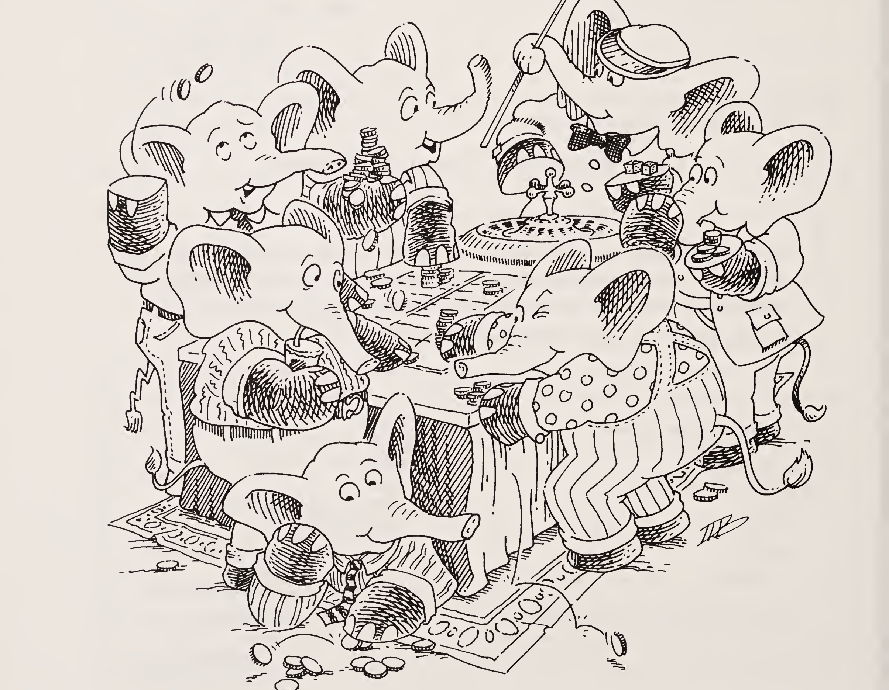

| 질문 | 답변 |
|:-----|:-----|
| `14`는 원자인가? | 네, 모든 수는 원자이기 때문입니다. |
| `(atom? n)`은 참인가 거짓인가?<br>`n`은 `14` | 참입니다. `14`가 원자이기 때문입니다. |
| `-3`은 수인가? | 네. 하지만 우리는 음수를 다루지 않습니다. |
| `3.14159`는 수인가? | 네. 하지만 우리는 정수만 다룹니다. |
| `-3`과 `3.14159`는 수인가? | 네. 하지만 우리가 쓰는 수는 음이 아닌 정수뿐입니다(즉 `0`, `1`, `2`, `3`, `4`, ...). |
| `(add1 n)`은 무엇인가?<br>`n`은 `67` | `68`입니다. |
| `(add1 67)`은 무엇인가? | 역시 `68`입니다. 인자가 수일 때는 "`n`은 `67`"이라고 말할 필요가 없기 때문입니다. |
| `(sub1 n)`은 무엇인가?<br>`n`은 `5` | `4`입니다. |

> **참고.** `add1`은 L에서 `1+`, S에서 `(define add1 (lambda (n) (+ n 1)))`로 정의됩니다.

> **참고.** `sub1`은 L에서 `1-`, S에서 `(define sub1 (lambda (n) (- n 1)))`로 정의됩니다.

| 질문 | 답변 |
|:-----|:-----|
| `(sub1 0)`은 무엇인가? | 답이 없습니다. |
| `(zero? 0)`은 참인가 거짓인가? | 참입니다. |
| `(zero? 1492)`은 참인가 거짓인가? | 거짓입니다. |
| `(+ 46 12)`는 무엇인가? | `58`입니다. |
| `+` 함수를 작성해 보세요. 힌트: `zero?`, `add1`, `sub1`을 사용합니다. | `(define +`<br>`  (lambda (n m)`<br>`    (cond`<br>`      ((zero? m) n)`<br>`      (else (add1 (+ n (sub1 m)))))))`<br>어렵지 않죠? |
| 하지만 방금 첫째 계명을 어긴 것 아닌가요? | 네. 하지만 `zero?`를 `null?`처럼 다룰 수 있습니다. `zero?`는 수가 비었는지 묻고, `null?`은 리스트가 비었는지 묻기 때문입니다. |
| `zero?`가 `null?`과 같다면, `add1`도 `cons`와 같은가? | 네! `cons`는 리스트를 만들고 `add1`은 수를 만듭니다. |


| 질문 | 답변 |
|:-----|:-----|
| `(- 14 3)`은 무엇인가? | `11`입니다. |
| `(- 17 9)`는 무엇인가? | `8`입니다. |
| `(- 18 25)`은 무엇인가? | 답이 없습니다. 음수가 없기 때문입니다. |
| `-` 함수를 작성해 보세요. 힌트: `sub1`을 사용합니다. | `(define -`<br>`  (lambda (n m)`<br>`    (cond`<br>`      ((zero? m) n)`<br>`      (else (sub1 (- n (sub1 m)))))))` |
| `(- n m)`은 어떻게 동작하는지 설명해 보세요. | 두 수를 인자로 받아, 두 번째 수가 `0`이 될 때까지 줄입니다. 두 번째 수를 `0`이 되게 만든 횟수만큼 결과에서 1을 뺍니다. |
| 이것은 tup인가?<br>`(2 11 3 79 47 6)` | 네. tup은 tuple의 줄임말입니다. |
| 이것은 tup인가?<br>`(8 55 5 555)` | 네, 물론입니다. 이것은 수들의 리스트이기도 합니다. |
| 이것은 tup인가?<br>`(12 8 apple 4 3)` | 아니요, 그저 원자들의 리스트일 뿐입니다. |
| 이것은 tup인가?<br>`(3 (7 4) 13 9)` | 아니요, 수들의 리스트가 아니기 때문입니다. `(7 4)`는 수가 아닙니다. |

> **참고.** `-`는 L과 S에서 이미 쓰이는 이름과 겹치므로, 원서는 이 함수를 `o-`라고 쓰라고 안내합니다(서문 참고).

| 질문 | 답변 |
|:-----|:-----|
| 이것은 tup인가?<br>`0` | 네, 수가 하나도 없는 리스트입니다. 이 특별한 경우를 빈 tup이라고 합니다. |
| `(addtup tup)`은 무엇인가?<br>`tup`은 `(3 5 2 8)` | `18`입니다. |
| `(addtup tup)`은 무엇인가?<br>`tup`은 `(15 6 7 12 3)` | `43`입니다. |
| `addtup`은 무엇을 하는가? | 인자에 들어 있는 모든 수를 더해서 하나의 수를 만듭니다. |
| 리스트로부터 수를 만드는 자연스러운 방법은 무엇인가? | `cons` 대신 `+`를 사용합니다. `+`는 `cons`가 리스트를 만드는 것과 같은 방식으로 수를 만듭니다. |
| `cons`로 리스트를 만들 때 종료 조건의 값은 `()`입니다. `+`로 수를 만들 때 종료 조건의 값은 무엇이어야 하는가? | `0`입니다. |
| 리스트의 자연스러운 종료 조건은 무엇인가? | `(null? l)`입니다. |
| tup의 자연스러운 종료 조건은 무엇인가? | `(null? tup)`입니다. |
| 수들의 리스트로부터 수를 만들 때, 종료 조건 줄은 어떻게 생겨야 하는가? | `((null? tup) 0)`입니다. 마치 리스트에서 `((null? l) (quote ()))`가 종료 조건 줄로 자주 쓰이는 것과 같습니다. |
| `addtup`의 종료 조건 줄은 무엇인가? | `((null? tup) 0)`입니다. |

| 질문 | 답변 |
|:-----|:-----|
| `lat`은 어떻게 정의되는가? | 빈 리스트이거나, 원자 `(car lat)`과 다시 `lat`인 나머지 `(cdr lat)`을 담고 있습니다. |
| tup은 어떻게 정의되는가? | 빈 리스트이거나, 수 하나와 다시 tup인 나머지를 담고 있습니다. |
| 리스트의 자연 재귀에서는 무엇이 사용되는가? | `(cdr lat)`입니다. |
| tup의 자연 재귀에서는 무엇이 사용되는가? | `(cdr tup)`입니다. |
| 왜인가? | 비어 있지 않은 리스트의 나머지는 리스트이고, 비어 있지 않은 tup의 나머지는 tup이기 때문입니다. |
| 리스트에 대해 몇 가지 질문을 해야 하는가? | 두 가지입니다. |
| tup에 대해 몇 가지 질문을 해야 하는가? | 두 가지입니다. 비어 있거나, 수 하나와 다시 tup인 나머지로 이루어지기 때문입니다. |
| 수는 어떻게 정의되는가? | `0`이거나, 다시 수인 나머지에 1을 더한 것입니다. |
| 수의 자연스러운 종료 조건은 무엇인가? | `(zero? n)`입니다. |
| 수에 대한 자연 재귀는 무엇인가? | `(sub1 n)`입니다. |
| 수에 대해 몇 가지 질문을 해야 하는가? | 두 가지입니다. |

### 첫째 계명 (첫 번째 개정)

- 원자들의 리스트 `lat`을 재귀할 때는 그것에 대해 두 가지 질문을 한다: `(null? lat)`과 `else`.
- 수 `n`을 재귀할 때는 그것에 대해 두 가지 질문을 한다: `(zero? n)`과 `else`.

| 질문 | 답변 |
|:-----|:-----|
| `cons`는 무엇을 하는가? | 리스트를 만듭니다. |
| `addtup`은 무엇을 하는가? | tup에 들어 있는 모든 수를 더해서 하나의 수를 만듭니다. |
| `addtup`의 종료 조건 줄은 무엇인가? | `((null? tup) 0)`입니다. |
| `addtup`의 자연 재귀는 무엇인가? | `(addtup (cdr tup))`입니다. |
| `addtup`은 무엇을 사용해 수를 만드는가? | `+`를 사용합니다. `+`도 수를 만들기 때문입니다! |
| 다음 정의의 점선을 채워 보세요.<br>`(define addtup`<br>`  (lambda (tup)`<br>`    (cond`<br>`      ((null? tup) 0)`<br>`      (else ...))))` | 채운 결과는 이렇습니다.<br>`(+ (car tup) (addtup (cdr tup)))`<br>이 줄이 `rember`의 마지막 줄과 비슷하다는 점에 주목하세요.<br>`(cons (car lat) (rember a (cdr lat)))` |
| `(* 5 3)`은 무엇인가? | `15`입니다. |
| `(* 13 4)`는 무엇인가? | `52`입니다. |

| 질문 | 답변 |
|:-----|:-----|
| `(* n m)`은 무엇을 하는가? | `n`을 `m`번 더해서 수를 만듭니다. |
| `*`의 종료 조건 줄은 무엇인가? | `((zero? m) 0)`입니다. `n × 0 = 0`이기 때문입니다. |
| `(zero? m)`이 종료 조건이므로 `m`은 결국 `0`까지 줄어들어야 합니다. 어떤 함수가 그 일을 하는가? | `sub1`입니다. |

### 넷째 계명 (첫 번째 개정)


| 질문 | 답변 |
|:-----|:-----|
| 이 경우 `(* n (sub1 m))`의 또 다른 이름은 무엇인가? | `*`의 자연 재귀입니다. |
| `*` 함수를 작성해 보세요. | `(define *`<br>`  (lambda (n m)`<br>`    (cond`<br>`      ((zero? m) 0)`<br>`      (else (+ n (* n (sub1 m)))))))` |

> **참고.** `*`는 L과 S에서 이미 쓰이는 이름과 겹치므로, 원서는 이 함수를 `o*`라고 쓰라고 안내합니다(서문 참고).

| 질문 | 답변 |
|:-----|:-----|
| `(* 12 3)`은 무엇인가? | `36`입니다. 하지만 이 값이 어떻게 나오는지 함수를 한 번 따라가 보겠습니다. |
| `(zero? 3)` | 아니요. |
| `(+ n (* n (sub1 3)))`의 뜻은 무엇인가? | `n`(여기서 `n`은 `12`)을 자연 재귀에 더합니다. `*`가 올바르다면 `(* 12 (sub1 3))`은 `24`여야 합니다. |
| `(* n 3)`의 새로운 인자는 무엇인가? | `n`은 `12`이고, `m`은 `2`입니다. |
| `(zero? 2)` | 아니요. |
| `(+ n (* n (sub1 2)))`의 뜻은 무엇인가? | `n`(여기서 `n`은 `12`)을 `(* n (sub1 2))`에 더합니다. |
| `(* n 2)`의 새로운 인자는 무엇인가? | `n`은 `12`이고, `m`은 `1`입니다. |
| `(zero? 1)` | 아니요. |
| `(+ n (* n (sub1 1)))`의 뜻은 무엇인가? | `n`(여기서 `n`은 `12`)을 `(* n (sub1 1))`에 더합니다. |
| `((zero? 1) 0)` 줄의 값은 무엇인가? | `0`입니다. 이제 `(zero? m)`이 참이기 때문입니다. |
| 다 끝났나요? | 아니요. |

| 질문 | 답변 |
|:-----|:-----|
| 왜 아닌가요? | 아직 더할 `+`가 세 번 남아 있기 때문입니다. |
| 원래 적용식의 값은 무엇인가? | `12`에 `12`를 더하고, 또 `12`를 더하고, `0`을 더하면 `36`입니다. `n`이 `m`번 더해졌다는 점에 주목하세요. |
| 등식을 사용해 `*`가 음이 아닌 정수의 보통 곱셈임을 논증해 보세요. 여기서 `n`은 `12`, `m`은 `3`입니다. | `(* 12 3) = 12 + (* 12 2)`<br>`= 12 + 12 + (* 12 1)`<br>`= 12 + 12 + 12 + (* 12 0)`<br>`= 12 + 12 + 12 + 0`<br>우리가 기대한 대로입니다. 이 기법은 수를 쓰는 함수뿐 아니라 모든 재귀 함수에 통합니다. 이 방법으로 함수를 작성할 수도 있고, 함수의 정확성을 논증할 수도 있습니다. |
| 다시 말해, `*`의 종료 줄 값이 `0`인 이유는 무엇인가? | `0`은 `+`에 영향을 주지 않기 때문입니다. 즉 `n + 0 = n`입니다. |

### 다섯째 계명


| 질문 | 답변 |
|:-----|:-----|
| `(tup+ tup1 tup2)`는 무엇인가?<br>`tup1`은 `(3 6 9 11 4)`<br>`tup2`는 `(8 5 2 0 7)` | `(11 11 11 11 11)`입니다. |

| 질문 | 답변 |
|:-----|:-----|
| `(tup+ tup1 tup2)`는 무엇인가?<br>`tup1`은 `(2 3)`<br>`tup2`는 `(4 6)` | `(6 9)`입니다. |
| `(tup+ tup1 tup2)`는 무엇을 하는가? | `tup1`의 첫 번째 수를 `tup2`의 첫 번째 수에 더하고, 다음에는 `tup1`의 두 번째 수를 `tup2`의 두 번째 수에 더하는 식으로 하여, 같은 길이의 tup들에 대해 답들을 모은 tup을 만듭니다. |
| `tup+`의 특이한 점은 무엇인가? | 두 tup의 각 원소를 동시에 봅니다. 다시 말해 두 tup에 대해 재귀합니다. |
| tup 하나에 재귀한다면 몇 가지 질문을 해야 하는가? | 두 가지입니다. `(null? tup)`과 `else`입니다. |
| 두 tup에 재귀할 때는 tup들에 대해 몇 가지 질문을 해야 하는가? | 네 가지입니다. 첫 번째 tup이 비었는지 아닌지, 그리고 두 번째 tup이 비었는지 아닌지입니다. |
| 그 질문들이<br>`(and (null? tup1) (null? tup2))`<br>`(null? tup1)`<br>`(null? tup2)`<br>`else`<br>라는 뜻인가요? | 네. |
| 첫 번째 tup이 `()`인 동시에 두 번째 tup이 `()`가 아닐 수 있나요? | 아니요, tup들은 길이가 같아야 하기 때문입니다. |
| 그렇다면 `(and (null? tup1) (null? tup2))`와 `else`만 물으면 되는 건가요? | 네, `(null? tup1)`이 참인 정확히 그때 `(null? tup2)`도 참이기 때문입니다. |

| 질문 | 답변 |
|:-----|:-----|
| `tup+` 함수를 작성해 보세요. | `(define tup+`<br>`  (lambda (tup1 tup2)`<br>`    (cond`<br>`      ((and (null? tup1) (null? tup2))`<br>`       (quote ()))`<br>`      (else`<br>`        (cons (+ (car tup1) (car tup2))`<br>`              (tup+ (cdr tup1) (cdr tup2)))))))` |
| 마지막 줄에서 `+`의 인자는 무엇인가? | `(car tup1)`과 `(car tup2)`입니다. |
| 마지막 줄에서 `cons`의 인자는 무엇인가? | `(+ (car tup1) (car tup2))`와 `(tup+ (cdr tup1) (cdr tup2))`입니다. |
| `(tup+ tup1 tup2)`는 무엇인가?<br>`tup1`은 `(3 7)`<br>`tup2`는 `(4 6)` | `(7 13)`입니다. 어떻게 그렇게 되는지 보겠습니다. |
| `(null? tup1)` | 아니요. |
| `(cons (+ (car tup1) (car tup2)) (tup+ (cdr tup1) (cdr tup2)))` | `7`을 자연 재귀 위에 cons합니다.<br>`(tup+ (cdr tup1) (cdr tup2))` |
| 자연 재귀에 두 인자의 `cdr`이 모두 들어가는 이유는 무엇인가? | 최종 값의 전형적인 원소가 두 tup의 `car`를 모두 사용하므로, 이제 두 tup의 나머지를 고려할 준비가 되었기 때문입니다. |
| `(null? tup1)`<br>`tup1`은 이제 `(7)`<br>`tup2`는 이제 `(6)` | 아니요. |

| 질문 | 답변 |
|:-----|:-----|
| `(cons (+ (car tup1) (car tup2)) (tup+ (cdr tup1) (cdr tup2)))` | `13`을 자연 재귀 위에 cons합니다. |
| `(null? tup1)`<br>`tup1`은 이제 `(7)` | 네. |
| 그렇다면 그 값은 무엇이어야 하는가? | `()`입니다. `(null? tup2)`가 참이어야 하기 때문입니다. |
| 적용식의 값은 무엇인가? | `(7 13)`입니다. 즉 `7`을, `13`을 `()`에 cons한 것 위에 cons한 것입니다. |
| `(tup+ tup1 tup2)`를 원할 때 어떤 문제가 생기는가?<br>`tup1`은 `(3 7)`<br>`tup2`는 `(4 6 8 1)` | 답이 없습니다. `tup1`이 `tup2`보다 먼저 널이 되기 때문입니다. |
| tup들의 길이가 같지 않아도 `tup+`를 쓸 수 있나요? | 첫째 계명을 보세요. 필요한 질문을 모두 하지 않았습니다! |
| 올바른 최종 값을 얻으려면 어떤 새로운 종료 조건 줄을 추가할 수 있는가? | 최종 값이 `(7 13 8 1)`이기를 바랍니다. 네! 이 줄을 추가합니다.<br>`((null? tup1) tup2)` |
| `(tup+ tup1 tup2)`는 무엇인가?<br>`tup1`은 `(3 7 8 1)`<br>`tup2`는 `(4 6)` | 답이 없습니다. `tup2`가 `tup1`보다 먼저 널이 되기 때문입니다. 첫째 계명을 보세요. 필요한 질문을 모두 하지 않았습니다! |
| 우리 함수에 무엇을 더 넣어야 하는가? | 질문을 두 개 더 해야 합니다. `(null? tup1)`과 `(null? tup2)`입니다. |
| 두 번째 새 줄은 어떻게 생겼는가? | `((null? tup2) tup1)`입니다. |

| 질문 | 답변 |
|:-----|:-----|
| 여기 어떤 두 tup에 대해서도 동작하는 `tup+`의 정의가 있습니다.<br>`(define tup+`<br>`  (lambda (tup1 tup2)`<br>`    (cond`<br>`      ((and (null? tup1) (null? tup2))`<br>`       (quote ()))`<br>`      ((null? tup1) tup2)`<br>`      ((null? tup2) tup1)`<br>`      (else`<br>`        (cons (+ (car tup1) (car tup2))`<br>`              (tup+ (cdr tup1) (cdr tup2)))))))`<br>이것을 단순화할 수 있나요? | `(define tup+`<br>`  (lambda (tup1 tup2)`<br>`    (cond`<br>`      ((null? tup1) tup2)`<br>`      ((null? tup2) tup1)`<br>`      (else`<br>`        (cons (+ (car tup1) (car tup2))`<br>`              (tup+ (cdr tup1) (cdr tup2)))))))` |
| 두 종료 조건의 순서가 중요한가? | 아니요. |
| `else`가 마지막 질문인가? | 네. 둘 중 하나라도 수를 하나도 담고 있지 않다면 `(null? tup1)`이나 `(null? tup2)` 중 하나가 참이기 때문입니다. |
| `(> 12 133)`은 무엇인가? | `#f`—거짓입니다. |
| `(> 120 11)`은 무엇인가? | `#t`—참입니다. |
| 몇 개의 수에 재귀해야 하는가? | 두 개입니다. `n`과 `m`입니다. |
| 어떻게 재귀하는가? | `(sub1 n)`과 `(sub1 m)`으로 재귀합니다. |
| 언제 재귀하는가? | 두 수 모두 `0`이 아니라는 것을 알 때입니다. |
| `n`과 `m`에 대해 몇 가지 질문을 해야 하는가? | 세 가지입니다. `(zero? n)`, `(zero? m)`, `else`입니다. |

| 질문 | 답변 |
|:-----|:-----|
| 이제 `zero?`와 `sub1`을 사용해 `>` 함수를 작성할 수 있나요? | 이렇게 하면 됩니다.<br>`(define >`<br>`  (lambda (n m)`<br>`    (cond`<br>`      ((zero? m) #t)`<br>`      ((zero? n) #f)`<br>`      (else (> (sub1 n) (sub1 m))))))` |
| 우리가 `(> n m)`을 쓴 방식은 올바른가? | 아니요, `n`과 `m`이 같은 수인 경우를 시험해 보세요. `n`과 `m`을 `3`이라고 합시다. |
| `(zero? 3)` | 아니요, 다음 질문으로 넘어갑니다. |
| `(> (sub1 n) (sub1 m))`의 뜻은 무엇인가? | 재귀하되, 두 인자를 모두 1씩 줄여서 합니다. |
| `(zero? 2)` | 아니요, 다음 질문으로 넘어갑니다. |
| `(> (sub1 n) (sub1 m))`의 뜻은 무엇인가? | 재귀하되, 두 인자를 모두 `0`에 한 걸음 더 가깝게 합니다. |
| `(zero? 1)` | 아니요, 다음 질문으로 넘어갑니다. |
| `(> (sub1 n) (sub1 m))`의 뜻은 무엇인가? | 재귀하되, 두 인자를 모두 1씩 줄여서 합니다. |

| 질문 | 답변 |
|:-----|:-----|
| `(zero? 0)` | 네. 그래서 `(> n m)`의 값이 `#t`입니다. |
| 이것이 올바른가? | 아니요, `3`은 `3`보다 크지 않기 때문입니다. |
| 두 종료 조건의 순서가 중요한가? | 생각해 보세요. |
| 두 종료 조건의 순서가 중요한가? | 한번 해 보세요! |
| 앞의 두 답의 순서가 중요한가? | 네. 먼저 생각하고, 그다음에 해 보세요. |
| 이 미묘한 문제를 해결하려면 `>` 함수를 어떻게 바꿔야 하는가? | `zero?` 줄들의 순서를 바꿉니다.<br>`(define >`<br>`  (lambda (n m)`<br>`    (cond`<br>`      ((zero? n) #f)`<br>`      ((zero? m) #t)`<br>`      (else (> (sub1 n) (sub1 m))))))` |
| `(< 4 6)`은 무엇인가? | `#t`입니다. |
| `(< 8 3)` | `#f`입니다. |
| `(< 6 6)` | `#f`입니다. |
| 이제 `<`를 작성해 보세요. | `(define <`<br>`  (lambda (n m)`<br>`    (cond`<br>`      ((zero? m) #f)`<br>`      ((zero? n) #t)`<br>`      (else (< (sub1 n) (sub1 m))))))` |

| 질문 | 답변 |
|:-----|:-----|
| `=`의 정의는 이렇습니다.<br>`(define =`<br>`  (lambda (n m)`<br>`    (cond`<br>`      ((zero? m) (zero? n))`<br>`      ((zero? n) #f)`<br>`      (else (= (sub1 n) (sub1 m))))))`<br>`<`와 `>`를 사용해 `=`를 다시 써 보세요. | `(define =`<br>`  (lambda (n m)`<br>`    (cond`<br>`      ((> n m) #f)`<br>`      ((< n m) #f)`<br>`      (else #t))))` |
| 이것은 원자의 동등성을 검사하는 함수가 두 개라는 뜻인가? | 네. 수인 원자에는 `=`, 그 밖의 원자에는 `eq?`입니다. |
| `(expt 1 1)` | `1`입니다. |
| `(expt 2 3)` | `8`입니다. |
| `(expt 5 3)` | `125`입니다. |
| 이제 `expt` 함수를 작성해 보세요. 힌트: 첫째 계명과 다섯째 계명을 보세요. | `(define expt`<br>`  (lambda (n m)`<br>`    (cond`<br>`      ((zero? m) 1)`<br>`      (else (* n (expt n (sub1 m)))))))` |
| 이 함수에 좋은 이름은 무엇인가?<br>`(define ???`<br>`  (lambda (n m)`<br>`    (cond`<br>`      ((< n m) 0)`<br>`      (else (add1 (??? (- n m) m))))))` | `quotient`(나눗셈)입니다. 이런 종류의 정의는 처음 봅니다. 자연 재귀 또한 이상해 보입니다. |

> **참고.** L, S: 이것은 `expt`와 같습니다.

| 질문 | 답변 |
|:-----|:-----|
| 첫 번째 질문은 무엇을 검사하는가? | 첫 번째 인자가 두 번째 인자보다 작은지 검사합니다. |
| 그러면 두 번째 줄에서는 무슨 일이 일어나는가? | 첫 번째 인자에서 두 번째 인자를 뺀 값으로 재귀합니다. 함수가 돌아오면 결과에 1을 더합니다. |
| 그렇다면 이 함수는 무엇을 하는가? | 두 번째 인자가 첫 번째 인자에 몇 번 들어가는지 셉니다. |
| 이것을 무엇이라고 부르는가? | 나눗셈입니다. |
| 이 함수를 `quotient`라는 이름으로 정의하면 어떻게 되는가? | `(define quotient`<br>`  (lambda (n m)`<br>`    (cond`<br>`      ((< n m) 0)`<br>`      (else (add1 (quotient (- n m) m))))))` |
| `(quotient 15 4)`는 무엇인가? | 쉽습니다. `3`입니다. |
| 어떻게 그 값이 나오는가? | 이것도 쉽습니다.<br>`(quotient 15 4) = 1 + (quotient 11 4)`<br>`= 1 + (1 + (quotient 7 4))`<br>`= 1 + (1 + (1 + (quotient 3 4)))`<br>`= 1 + (1 + (1 + 0))` |
| 지금 `(ham and cheese on rye)`가 먹고 싶지 않나요? | 겨자도 잊지 마세요! |


| 질문 | 답변 |
|:-----|:-----|
| `(length lat)`의 값은 무엇인가?<br>`lat`은 `(hotdogs with mustard sauerkraut and pickles)` | `6`입니다. |
| `(length lat)`은 무엇인가?<br>`lat`은 `(ham and cheese on rye)` | `5`입니다. |
| 이제 `length` 함수를 작성해 보세요. | `(define length`<br>`  (lambda (lat)`<br>`    (cond`<br>`      ((null? lat) 0)`<br>`      (else (add1 (length (cdr lat)))))))` |
| `(pick n lat)`은 무엇인가?<br>`n`은 `4`<br>`lat`은 `(lasagna spaghetti ravioli macaroni meatball)` | `macaroni`입니다. |
| `(pick 0 lat)`은 무엇인가?<br>`lat`은 `(a)` | 답이 없습니다. |
| `pick` 함수를 작성해 보세요. | `(define pick`<br>`  (lambda (n lat)`<br>`    (cond`<br>`      ((zero? (sub1 n)) (car lat))`<br>`      (else (pick (sub1 n) (cdr lat))))))` |
| `(rempick n lat)`은 무엇인가?<br>`n`은 `3`<br>`lat`은 `(hotdogs with hot mustard)` | `(hotdogs with mustard)`입니다. |

| 질문 | 답변 |
|:-----|:-----|
| 이제 `rempick`을 작성해 보세요. | `(define rempick`<br>`  (lambda (n lat)`<br>`    (cond`<br>`      ((zero? (sub1 n)) (cdr lat))`<br>`      (else (cons (car lat)`<br>`                  (rempick (sub1 n)`<br>`                           (cdr lat)))))))` |
| `(number? a)`는 참인가 거짓인가?<br>`a`는 `tomato` | 거짓입니다. |
| `(number? 76)`은 참인가 거짓인가? | 참입니다. |
| 인자가 수인 원자이면 참이고 그 밖의 것이면 거짓인 `number?`를 작성할 수 있나요? | 아니요. `number?`는 `add1`, `sub1`, `zero?`, `car`, `cdr`, `cons`, `null?`, `eq?`, `atom?`처럼 원시 함수입니다. |
| 이제 `number?`를 사용해 `no-nums`를 작성해 보세요. `no-nums`는 `lat`에서 모든 수를 없애서 얻은 `lat`을 최종 값으로 돌려줍니다. 예를 들어 `lat`이 `(5 pears 6 prunes 9 dates)`일 때 `(no-nums lat)`의 값은 `(pears prunes dates)`입니다. | `(define no-nums`<br>`  (lambda (lat)`<br>`    (cond`<br>`      ((null? lat) (quote ()))`<br>`      (else (cond`<br>`              ((number? (car lat))`<br>`               (no-nums (cdr lat)))`<br>`              (else (cons (car lat)`<br>`                          (no-nums (cdr lat)))))))))` |

> **참고.** `number?`는 L에서 `numberp`입니다.

| 질문 | 답변 |
|:-----|:-----|
| 이제 `lat`에서 모든 수를 뽑아 tup을 만드는 `all-nums`를 작성해 보세요. | `(define all-nums`<br>`  (lambda (lat)`<br>`    (cond`<br>`      ((null? lat) (quote ()))`<br>`      (else`<br>`        (cond`<br>`          ((number? (car lat))`<br>`           (cons (car lat)`<br>`                 (all-nums (cdr lat))))`<br>`          (else (all-nums (cdr lat))))))))` |
| 두 인자(`a1`과 `a2`)가 같은 원자이면 참인 `eqan?` 함수를 작성해 보세요. 수에는 `=`를, 그 밖의 모든 원자에는 `eq?`를 사용하는 것을 잊지 마세요. | `(define eqan?`<br>`  (lambda (a1 a2)`<br>`    (cond`<br>`      ((and (number? a1) (number? a2))`<br>`       (= a1 a2))`<br>`      ((or (number? a1) (number? a2))`<br>`       #f)`<br>`      (else (eq? a1 a2)))))` |
| `eq?`를 사용해 작성한 모든 함수는 `eq?`를 `eqan?`으로 바꾸어 일반화할 수 있다고 가정해도 되나요? | 네, 물론 `eqan?` 자신은 예외입니다. |
| 이제 원자 `a`가 `lat`에 나타나는 횟수를 세는 `occur` 함수를 작성해 보세요. | `(define occur`<br>`  (lambda (a lat)`<br>`    (cond`<br>`      ((null? lat) 0)`<br>`      (else`<br>`        (cond`<br>`          ((eq? (car lat) a)`<br>`           (add1 (occur a (cdr lat))))`<br>`          (else (occur a (cdr lat))))))))` |

| 질문 | 답변 |
|:-----|:-----|
| `(one? n)`이 `n`이 `1`이면 `#t`이고 그 밖의 경우에는 `#f`(즉 거짓)인 `one?` 함수를 작성해 보세요. | `(define one?`<br>`  (lambda (n)`<br>`    (cond`<br>`      ((zero? n) #f)`<br>`      (else (zero? (sub1 n))))))`<br>또는<br>`(define one?`<br>`  (lambda (n)`<br>`    (cond`<br>`      (else (= n 1)))))` |
| 이 함수를 더 단순화해서 한 줄짜리로 만들 수 있을지 짐작해 보세요. | `(cond ...)` 절을 없애면 됩니다.<br>`(define one?`<br>`  (lambda (n)`<br>`    (= n 1)))` |
| 이제 `lat`에서 n번째 원자를 없애는 `rempick` 함수를 다시 작성해 보세요. 예를 들어 `n`이 `3`이고 `lat`이 `(lemon meringue salty pie)`일 때 `(rempick n lat)`의 값은 `(lemon meringue pie)`입니다. 답에 `one?` 함수를 사용하세요. | `(define rempick`<br>`  (lambda (n lat)`<br>`    (cond`<br>`      ((one? n) (cdr lat))`<br>`      (else (cons (car lat)`<br>`                  (rempick (sub1 n)`<br>`                           (cdr lat)))))))` |


# 5장 · 맙소사, 별이 가득하잖아 (*Oh My Gawd*: It's Full of Stars)

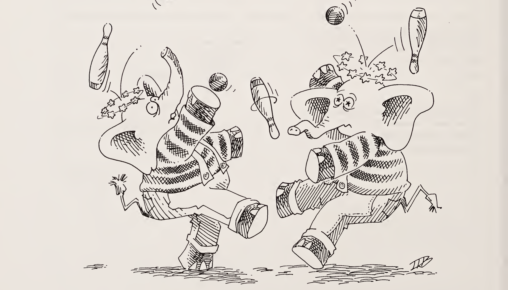

| 질문 | 답변 |
|:-----|:-----|
| `(rember* a l)`은 무엇인가?<br>`a`는 `cup`, `l`은 `((coffee) cup ((tea) cup) (and (hick)) cup)` | `((coffee) ((tea)) (and (hick)))`입니다. |
| `(rember* a l)`은 무엇인가?<br>`a`는 `sauce`, `l`은 `(((tomato sauce)) ((bean) sauce) (and ((flying)) sauce))` | `(((tomato)) ((bean)) (and ((flying))))`입니다. |
| 이제 `rember*`를 작성하세요.<br>뼈대는 이렇습니다:<br>`(define rember*`<br>`  (lambda (a l)`<br>`    (cond`<br>`      (                )`<br>`      (                )`<br>`      (                ))))` | `(define rember*`<br>`  (lambda (a l)`<br>`    (cond`<br>`      ((null? l) (quote ()))`<br>`      ((atom? (car l))`<br>`       (cond`<br>`         ((eq? (car l) a)`<br>`          (rember* a (cdr l)))`<br>`         (else (cons (car l)`<br>`                     (rember* a (cdr l))))))`<br>`      (else (cons (rember* a (car l))`<br>`                  (rember* a (cdr l)))))))` |
| `(lat? l)`은 참인가 거짓인가?<br>`l`은 `(((tomato sauce)) ((bean) sauce) (and ((flying)) sauce))` | `#f`입니다. |

> **참고.** `rember*`는 "rember-star"라고 읽습니다. 별표 `*`는 "맙소사(oh my gawd)"를 떠올리게 합니다.


| 질문 | 답변 |
|:-----|:-----|
| `(car l)`은 원자인가?<br>`l`은 `(((tomato sauce)) ((bean) sauce) (and ((flying)) sauce))` | 아니요. |
| `(insertR* new old l)`은 무엇인가?<br>`new`는 `roast`, `old`는 `chuck`, `l`은 `((how much (wood)) could ((a (wood) chuck)) (((chuck))) (if (a) ((wood chuck))) could chuck wood)` | `((how much (wood)) could ((a (wood) chuck roast)) (((chuck roast))) (if (a) ((wood chuck roast))) could chuck roast wood)`입니다. |
| 이제 `old`가 어디에 있든 그 오른쪽에 원자 `new`를 삽입하는 함수 `insertR*`를 작성하세요.<br>뼈대는 이렇습니다:<br>`(define insertR*`<br>`  (lambda (new old l)`<br>`    (cond`<br>`      (                  )`<br>`      (                  )`<br>`      (                  ))))` | `(define insertR*`<br>`  (lambda (new old l)`<br>`    (cond`<br>`      ((null? l) (quote ()))`<br>`      ((atom? (car l))`<br>`       (cond`<br>`         ((eq? (car l) old)`<br>`          (cons old`<br>`                (cons new`<br>`                      (insertR* new old (cdr l)))))`<br>`         (else (cons (car l)`<br>`                     (insertR* new old (cdr l))))))`<br>`      (else (cons (insertR* new old (car l))`<br>`                  (insertR* new old (cdr l)))))))` |
| `insertR*`와 `rember*`는 어떻게 비슷한가? | 두 함수 모두 세 개의 질문을 합니다. |

### 첫째 계명 (최종판)

- 원자들의 리스트 `lat`을 재귀할 때는 그것에 대해 두 가지 질문을 한다: `(null? lat)`과 `else`.
- 수 `n`을 재귀할 때는 그것에 대해 두 가지 질문을 한다: `(zero? n)`과 `else`.
- S-표현식들의 리스트 `l`을 재귀할 때는 그것에 대해 세 가지 질문을 한다: `(null? l)`, `(atom? (car l))`, `else`.

| 질문 | 답변 |
|:-----|:-----|
| `insertR*`와 `rember*`는 어떻게 비슷한가? | 두 함수 모두, 인자의 `car`가 리스트임을 알게 되면 그 인자의 `car`로 재귀합니다. |
| `rember*`와 `multirember`는 어떻게 다른가? | `multirember`는 `car`로 재귀하지 않습니다. `rember*`는 `cdr`로 재귀할 뿐 아니라 `car`로도 재귀합니다. `car`가 리스트임을 알게 되면 `car`로 재귀합니다. |
| `insertR*`와 `rember*`는 어떻게 비슷한가? | 둘 다 `car`가 리스트일 때는 언제나 `cdr`로 재귀하는 것과 마찬가지로 `car`로도 재귀합니다. |
| 모든 `*`-함수들은 어떻게 비슷한가? | 모두 세 개의 질문을 하고, `car`가 리스트일 때는 언제나 `cdr`로 재귀하는 것과 마찬가지로 `car`로도 재귀합니다. |
| 왜 그런가? | 모든 `*`-함수는 다음 중 하나인 리스트를 다루기 때문입니다.<br>— 비어 있는 리스트,<br>— 리스트 위에 원자를 cons한 것, 또는<br>— 리스트 위에 리스트를 cons한 것. |

### 넷째 계명 (최종판)

재귀할 때는 적어도 하나의 인자를 바꾼다. 원자들의 리스트 `lat`을 재귀할 때는 `(cdr lat)`을 쓴다. 수 `n`을 재귀할 때는 `(subl n)`을 쓴다. 그리고 S-표현식들의 리스트 `l`을 재귀할 때는, `(null? l)`도 `(atom? (car l))`도 참이 아니라면 `(car l)`과 `(cdr l)`을 쓴다.

그 인자는 종료에 더 가까워지도록 바뀌어야 한다. 바뀌는 인자는 종료 조건에서 검사되어야 한다. `cdr`을 쓸 때는 `null?`로 종료를 검사하고, `subl`을 쓸 때는 `zero?`로 종료를 검사한다.

| 질문 | 답변 |
|:-----|:-----|
| `(occur* a l)`은 무엇인가?<br>`a`는 `banana`, `l`은 `((banana) (split ((((banana ice))) (cream (banana)) sherbet)) (banana) (bread) (banana brandy))` | `5`입니다. |
| `occur something`에 더 좋은 이름은 무엇인가? | `occur*`입니다. |

| 질문 | 답변 |
|:-----|:-----|
| `occur*`를 작성하세요.<br>`(define occur*`<br>`  (lambda (a l)`<br>`    (cond`<br>`      (                                     )`<br>`      (                                     )`<br>`      (                                     ))))` | `(define occur*`<br>`  (lambda (a l)`<br>`    (cond`<br>`      ((null? l) 0)`<br>`      ((atom? (car l))`<br>`       (cond`<br>`         ((eq? (car l) a)`<br>`          (add1 (occur* a (cdr l))))`<br>`         (else (occur* a (cdr l)))))`<br>`      (else (+ (occur* a (car l))`<br>`               (occur* a (cdr l)))))))` |
| `(subst* new old l)`은 무엇인가?<br>`new`는 `orange`, `old`는 `banana`, `l`은 `((banana) (split ((((banana ice))) (cream (banana)) sherbet)) (banana) (bread) (banana brandy))` | `((orange) (split ((((orange ice))) (cream (orange)) sherbet)) (orange) (bread) (orange brandy))`입니다. |
| `subst*`를 작성하세요.<br>`(define subst*`<br>`  (lambda (new old l)`<br>`    (cond`<br>`      (                        )`<br>`      (                        )`<br>`      (                        ))))` | `(define subst*`<br>`  (lambda (new old l)`<br>`    (cond`<br>`      ((null? l) (quote ()))`<br>`      ((atom? (car l))`<br>`       (cond`<br>`         ((eq? (car l) old)`<br>`          (cons new (subst* new old (cdr l))))`<br>`         (else (cons (car l)`<br>`                     (subst* new old (cdr l))))))`<br>`      (else (cons (subst* new old (car l))`<br>`                  (subst* new old (cdr l)))))))` |

| 질문 | 답변 |
|:-----|:-----|
| `(insertL* new old l)`은 무엇인가?<br>`new`는 `pecker`, `old`는 `chuck`, `l`은 `((how much (wood)) could ((a (wood) chuck)) (((chuck))) (if (a) ((wood chuck))) could chuck wood)` | `((how much (wood)) could ((a (wood) pecker chuck)) (((pecker chuck))) (if (a) ((wood pecker chuck))) could pecker chuck wood)`입니다. |
| `insertL*`를 작성하세요.<br>`(define insertL*`<br>`  (lambda (new old l)`<br>`    (cond`<br>`      (                         )`<br>`      (                         )`<br>`      (                         ))))` | `(define insertL*`<br>`  (lambda (new old l)`<br>`    (cond`<br>`      ((null? l) (quote ()))`<br>`      ((atom? (car l))`<br>`       (cond`<br>`         ((eq? (car l) old)`<br>`          (cons new`<br>`                (cons old`<br>`                      (insertL* new old (cdr l)))))`<br>`         (else (cons (car l)`<br>`                     (insertL* new old (cdr l))))))`<br>`      (else (cons (insertL* new old (car l))`<br>`                  (insertL* new old (cdr l)))))))` |
| `(member* a l)`은 무엇인가?<br>`a`는 `chips`, `l`은 `((potato) (chips ((with) fish) (chips)))` | `#t`입니다. 원자 `chips`가 리스트 `l`에 들어 있기 때문입니다. |

| 질문 | 답변 |
|:-----|:-----|
| `member*`를 작성하세요.<br>`(define member*`<br>`  (lambda (a l)`<br>`    (cond`<br>`      (                         )`<br>`      (                         )`<br>`      (                         ))))` | `(define member*`<br>`  (lambda (a l)`<br>`    (cond`<br>`      ((null? l) #f)`<br>`      ((atom? (car l))`<br>`       (or (eq? (car l) a)`<br>`           (member* a (cdr l))))`<br>`      (else (or (member* a (car l))`<br>`                (member* a (cdr l)))))))` |
| `(member* a l)`은 무엇인가?<br>`a`는 `chips`, `l`은 `((potato) (chips ((with) fish) (chips)))` | `#t`입니다. |
| 어느 `chips`를 찾았나? | `((potato) (chips ((with) fish) (chips)))`입니다. |
| `(leftmost l)`은 무엇인가?<br>`l`은 `((potato) (chips ((with) fish) (chips)))` | `potato`입니다. |
| `(leftmost l)`은 무엇인가?<br>`l`은 `(((hot) (tuna (and))) cheese)` | `hot`입니다. |
| `(leftmost l)`은 무엇인가?<br>`l`은 `(((() four)) 17 (seventeen))` | 답이 없습니다. |
| `(leftmost (quote ()))`은 무엇인가? | 답이 없습니다. |
| `leftmost`가 무엇을 하는지 설명할 수 있나? | 저희 설명은 이렇습니다.<br>"`leftmost`는 빈 리스트를 포함하지 않는, 비어 있지 않은 S-표현식들의 리스트에서 가장 왼쪽에 있는 원자를 찾는 함수입니다." |

| 질문 | 답변 |
|:-----|:-----|
| `leftmost`는 `*`-함수인가? | S-표현식들의 리스트를 다루기는 하지만, `car`로만 재귀합니다. |
| `leftmost`는 세 가지 가능한 경우 모두에 대해 질문할 필요가 있나? | 아니요, 두 가지 질문만 하면 됩니다. `leftmost`는 빈 리스트를 포함하지 않는 비어 있지 않은 리스트를 다룬다고 우리는 합의했습니다. |
| 이제 함수 `leftmost`를 작성할 수 있는지 보세요.<br>`(define leftmost`<br>`  (lambda (l)`<br>`    (cond`<br>`      (                      )`<br>`      (                      ))))` | `(define leftmost`<br>`  (lambda (l)`<br>`    (cond`<br>`      ((atom? (car l)) (car l))`<br>`      (else (leftmost (car l))))))` |
| `(or ...)`가 무엇을 하는지 기억하나? | `(or ...)`는 참인 것을 찾을 때까지 한 번에 하나씩 질문합니다. 그러면 `(or ...)`는 멈추고, 그 값을 참으로 만듭니다. 참인 인자를 찾지 못하면 `(or ...)`의 값은 거짓입니다. |
| 다음은 무엇인가?<br>`(and (atom? (car l))`<br>`     (eq? (car l) x))`<br>`x`는 `pizza`, `l`은 `(mozzarella pizza)` | `#f`입니다. |
| 왜 거짓인가? | `(and ...)`가 `(atom? (car l))`를 물으면 참이고, 이어서 `(eq? (car l) x)`를 물으면 거짓입니다. 따라서 `#f`입니다. |

| 질문 | 답변 |
|:-----|:-----|
| 다음은 무엇인가?<br>`(and (atom? (car l))`<br>`     (eq? (car l) x))`<br>`x`는 `pizza`, `l`은 `((mozzarella mushroom) pizza)` | `#f`입니다. |
| 왜 거짓인가? | `(and ...)`가 `(atom? (car l))`를 묻는데, `(car l)`이 원자가 아니기 때문입니다. 그래서 `#f`입니다. |
| `(and (atom? (car l))`<br>`     (eq? (car l) x))`<br>가 참이 되는 `x`와 `l`의 예를 하나 드세요. | `x`는 `pizza`, `l`은 `(pizza (tastes good))`입니다. |
| `(and ...)`가 하는 일을 자기 말로 설명해 보세요. | 저희 말로는 이렇습니다.<br>"`(and ...)`는 값이 거짓인 것을 찾을 때까지 한 번에 하나씩 질문합니다. 그러면 `(and ...)`는 거짓으로 멈춥니다. 거짓인 표현식이 하나도 없으면 `(and ...)`는 참입니다." |
| 참인가 거짓인가? `(and ...)`와 `(or ...)`의 인자 중 하나가 고려되지 않을 수 있다. | 참입니다. `(and ...)`는 첫 번째 인자의 값이 `#f`이면 멈추고, `(or ...)`는 첫 번째 인자의 값이 `#t`이면 멈추기 때문입니다. |
| `(eqlist? l1 l2)`는 무엇인가?<br>`l1`은 `(strawberry ice cream)`, `l2`는 `(strawberry ice cream)` | `#t`입니다. |


| 질문 | 답변 |
|:-----|:-----|
| `(eqlist? l1 l2)`는 무엇인가?<br>`l1`은 `(strawberry ice cream)`, `l2`는 `(strawberry cream ice)` | `#f`입니다. |
| `(eqlist? l1 l2)`는 무엇인가?<br>`l1`은 `(banana ((split)))`, `l2`는 `((banana) (split))` | `#f`입니다. |
| `(eqlist? l1 l2)`는 무엇인가?<br>`l1`은 `(beef ((sausage)) (and (soda)))`, `l2`는 `(beef ((salami)) (and (soda)))` | `#f`이지만 거의 `#t`입니다. |
| `(eqlist? l1 l2)`는 무엇인가?<br>`l1`은 `(beef ((sausage)) (and (soda)))`, `l2`는 `(beef ((sausage)) (and (soda)))` | `#t`입니다. 이게 더 낫군요. |
| `eqlist?`는 무엇인가? | 두 리스트가 같은지 판단하는 함수입니다. |
| `eqlist?`는 인자들에 대해 몇 개의 질문을 해야 하나? | 아홉 개입니다. |
| 왜 질문이 아홉 개인지 설명할 수 있나? | 저희 설명은 이렇습니다.<br>"각 인자는 다음 중 하나일 수 있습니다.<br>— 비어 있음,<br>— 리스트 위에 원자를 cons한 것, 또는<br>— 리스트 위에 리스트를 cons한 것.<br>예를 들어 첫 번째 인자가 빈 리스트인 것과 동시에, 두 번째 인자는 빈 리스트일 수도 있고 `car` 자리에 원자나 리스트를 가질 수도 있습니다." |

| 질문 | 답변 |
|:-----|:-----|
| `eqan?`을 사용해 `eqlist?`를 작성하세요. | `(define eqlist?`<br>`  (lambda (l1 l2)`<br>`    (cond`<br>`      ((and (null? l1) (null? l2)) #t)`<br>`      ((and (null? l1) (atom? (car l2))) #f)`<br>`      ((null? l1) #f)`<br>`      ((and (atom? (car l1)) (null? l2)) #f)`<br>`      ((and (atom? (car l1)) (atom? (car l2)))`<br>`       (and (eqan? (car l1) (car l2))`<br>`            (eqlist? (cdr l1) (cdr l2))))`<br>`      ((atom? (car l1)) #f)`<br>`      ((null? l2) #f)`<br>`      ((atom? (car l2)) #f)`<br>`      (else (and (eqlist? (car l1) (car l2))`<br>`                 (eqlist? (cdr l1) (cdr l2)))))))` |
| 두 번째 질문에서 `(atom? (car l2))`를 물어도 괜찮은가? | 네, 두 번째 리스트가 비어 있을 수 없다는 것을 알고 있기 때문입니다. 그렇지 않았다면 첫 번째 질문이 참이었을 테니까요. |
| 그리고 왜 세 번째 질문이 `(null? l1)`인가? | 그 시점에 우리는 첫 번째 인자가 비어 있을 때 두 번째 인자가 빈 리스트도 아니고 첫 원소가 원자인 리스트도 아니라는 것을 압니다. 지금 `(null? l1)`이 참이라면, 두 번째 인자는 첫 원소가 리스트인 리스트여야 합니다. |
| 참인가 거짓인가? 첫 번째 인자가 `()`일 때 `eqlist?`가 `#t`로 답하는 경우는 한 가지뿐이다. | 참입니다. `(eqlist? (quote ()) l2)`가 참이려면 `l2`도 빈 리스트여야 합니다. |

| 질문 | 답변 |
|:-----|:-----|
| 그렇다면 질문<br>`(and (null? l1) (null? l2))`<br>와<br>`(or (null? l1) (null? l2))`<br>만으로 처음 세 경우의 답을 정하기에 충분한가? | 네. 첫 번째 질문이 참이면 `eqlist?`는 `#t`로 답하고, 그렇지 않으면 답은 `#f`입니다. |
| `eqlist?`를 다시 작성하세요. | `(define eqlist?`<br>`  (lambda (l1 l2)`<br>`    (cond`<br>`      ((and (null? l1) (null? l2)) #t)`<br>`      ((or (null? l1) (null? l2)) #f)`<br>`      ((and (atom? (car l1)) (atom? (car l2)))`<br>`       (and (eqan? (car l1) (car l2))`<br>`            (eqlist? (cdr l1) (cdr l2))))`<br>`      ((or (atom? (car l1)) (atom? (car l2))) #f)`<br>`      (else (and (eqlist? (car l1) (car l2))`<br>`                 (eqlist? (cdr l1) (cdr l2)))))))` |
| S-표현식이란 무엇인가? | S-표현식은 원자이거나, (비어 있을 수도 있는) S-표현식들의 리스트입니다. |
| `equal?`은 두 S-표현식이 같은지 판단하기 위해 몇 개의 질문을 하나? | 네 개입니다. 첫 번째 인자가 원자이거나 S-표현식들의 리스트인 것과 동시에, 두 번째 인자도 원자이거나 S-표현식들의 리스트일 수 있습니다. |
| `equal?`을 작성하세요. | `(define equal?`<br>`  (lambda (s1 s2)`<br>`    (cond`<br>`      ((and (atom? s1) (atom? s2))`<br>`       (eqan? s1 s2))`<br>`      ((atom? s1) #f)`<br>`      ((atom? s2) #f)`<br>`      (else (eqlist? s1 s2)))))` |

| 질문 | 답변 |
|:-----|:-----|
| 왜 두 번째 질문이 `(atom? s1)`인가? | 그것이 참이면 첫 번째 인자는 원자이고 두 번째 인자는 리스트임을 알기 때문입니다. |
| 그리고 왜 세 번째 질문이 `(atom? s2)`인가? | 세 번째 질문을 할 때쯤이면 첫 번째 인자가 원자가 아니라는 것을 압니다. 따라서 남은 두 경우를 구별하기 위해 알아야 할 것은 두 번째 인자가 원자인지 아닌지뿐입니다. 첫 번째 인자는 리스트임이 틀림없습니다. |
| 두 번째 질문과 세 번째 질문을<br>`(or (atom? s1) (atom? s2))`<br>로 요약할 수 있나? | 네, 그럴 수 있습니다! |
| `equal?`을 단순화하세요. | `(define equal?`<br>`  (lambda (s1 s2)`<br>`    (cond`<br>`      ((and (atom? s1) (atom? s2))`<br>`       (eqan? s1 s2))`<br>`      ((or (atom? s1) (atom? s2)) #f)`<br>`      (else (eqlist? s1 s2)))))` |
| `equal?`은 충분히 질문하나? | 네. 그 질문들이 네 가지 가능한 경우를 모두 덮습니다. |
| 이제 `equal?`을 사용해 `eqlist?`를 다시 작성하세요. | `(define eqlist?`<br>`  (lambda (l1 l2)`<br>`    (cond`<br>`      ((and (null? l1) (null? l2)) #t)`<br>`      ((or (null? l1) (null? l2)) #f)`<br>`      (else (and (equal? (car l1) (car l2))`<br>`                 (eqlist? (cdr l1) (cdr l2)))))))` |

### 여섯째 계명

함수가 올바르게 동작한 뒤에만 단순화한다.

| 질문 | 답변 |
|:-----|:-----|
| `lat`을 S-표현식들의 리스트 `l`로, `a`를 임의의 S-표현식으로 바꾼 `rember`입니다. 뼈대를 채우세요.<br>`(define rember`<br>`  (lambda (s l)`<br>`    (cond`<br>`      ((null? l) (quote ()))`<br>`      ((atom? (car l))`<br>`       (cond`<br>`         ((equal? (car l) s) (cdr l))`<br>`         (else (cons (car l)`<br>`                     (rember s (cdr l))))))`<br>`      (else (cond`<br>`              ((equal? (car l) s) (cdr l))`<br>`              (else (cons (car l)`<br>`                          (rember s (cdr l))))))))` | 당연하죠!<br>`(define rember`<br>`  (lambda (s l)`<br>`    (cond`<br>`      ((null? l) (quote ()))`<br>`      (else (cond`<br>`              ((equal? (car l) s) (cdr l))`<br>`              (else (cons (car l)`<br>`                          (rember s (cdr l)))))))))` |
| 그것을 단순화할 수 있나?<br>그리고 그것은 어떻게 다른가? | `rember`는 이제 `lat`에서 처음 일치하는 원자 `a` 대신, `l`에서 처음 일치하는 S-표현식 `s`를 제거합니다. |
| `rember`는 이제 "별" 함수인가? | 아니요. |
| 왜 아닌가? | `rember`는 `l`의 `cdr`로만 재귀하기 때문입니다. |
| `rember`를 더 단순화할 수 있나? | 네, 안쪽 `(cond ...)`가 바깥쪽 `(cond ...)`가 물을 수 있는 질문을 묻고 있습니다! |

| 질문 | 답변 |
|:-----|:-----|
| 해 보세요! | `(define rember`<br>`  (lambda (s l)`<br>`    (cond`<br>`      ((null? l) (quote ()))`<br>`      ((equal? (car l) s) (cdr l))`<br>`      (else (cons (car l)`<br>`                  (rember s (cdr l)))))))` |
| 이 새로운 정의가 더 단순해 보이나? | 네, 그렇습니다! |
| 그리고 똑같이 잘 동작하나? | 네, 단순화하기 전에 모든 경우와 모든 재귀가 옳다는 것을 알고 있었기 때문입니다. |
| `insertL*`을 단순화하세요. | 그럴 수 없습니다. `(eq? (car l) old)`를 묻기 전에 `(car l)`이 원자임을 알아야 합니다. 그리고 그것이 이번에는 우리가 틀리지 않도록 구해 주었습니다. |

함수가 올바르고 잘 설계되어 있으면, 우리는 그 함수에 대해 쉽게 생각할 수 있습니다.

| 질문 | 답변 |
|:-----|:-----|
| `eq?`와 `=`를 쓰는 모든 함수는 `eq?`와 `=`를 `equal?` 함수로 바꾸어 일반화할 수 있나? | 꼭 그렇지는 않습니다. `eqan?`에는 통하지 않지만, 다른 모든 함수에는 통합니다. 사실 `eqan?`이라는 자명한 예를 제외하면, 바로 그것이 우리가 가정하게 될 내용입니다. |


# 6장 · 그림자 (Shadows)

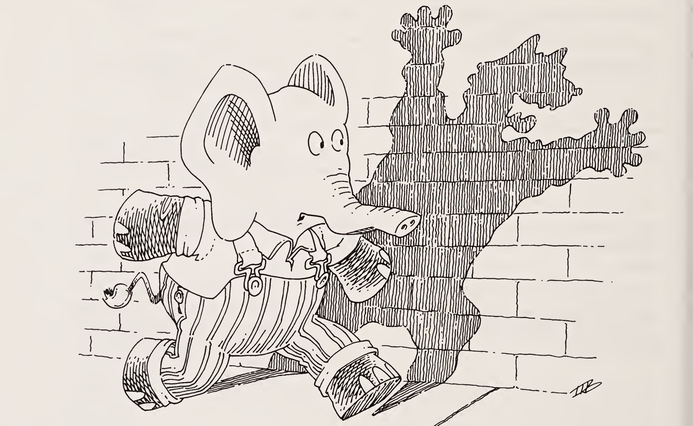

| 질문 | 답변 |
|:-----|:-----|
| `1`은 산술식인가? | 네. |
| `3`은 산술식인가? | 네, 물론입니다. |
| `1 + 3`은 산술식인가? | 네! |
| `1 + 3 * 4`는 산술식인가? | 당연합니다. |
| `cookie`는 산술식인가? | 네. 하나 만들어 먹을 준비는 거의 되셨나요? |
| 그리고 `3 expt y + 5`는 어떤가? | 네. |
| 산술식을 당신의 말로 정의하면 무엇인가? | 저희 정의는 이렇습니다.<br>"이 장에서 산술식은 원자(숫자를 포함합니다)이거나, 두 산술식을 `+`, `*`, `expt`로 결합한 것입니다." |
| `(quote a)`는 무엇인가? | `a`입니다. |
| `(quote +)`는 무엇인가? | `+`라는 원자입니다. 덧셈 연산이 아니라 `+`라는 원자입니다. |
| `(quote x)`는 무엇을 뜻하는가? | `x`라는 원자입니다. 곱셈 연산이 아니라 `x`라는 원자입니다. |
| `(eq? (quote a) y)`는 참인가 거짓인가?<br>`y`는 `a` | 참입니다. |
| `(eq? x y)`는 참인가 거짓인가?<br>`x`는 `a`, `y`는 `a` | 또 같은 질문이네요. 답도 여전히 참입니다. |

| 질문 | 답변 |
|:-----|:-----|
| `(n + 3)`은 산술식인가? | 꼭 그렇지는 않습니다. `n + 3` 둘레에 괄호가 있기 때문입니다. 우리의 산술식 정의는 괄호를 언급하지 않습니다. |
| `(n + 3)`을 산술식으로 생각할 수 있을까? | 네, 괄호가 사실은 거기 없다고 마음에 새긴다면 그렇습니다. |
| `(n + 3)`을 무엇이라고 부르겠는가? | `n + 3`의 표현(representation)이라고 부릅니다. |
| 왜 `(n + 3)`이 좋은 표현인가? | 왜냐하면<br>1. `(n + 3)`은 S-표현식입니다. 그러므로 함수의 인자로 쓸 수 있습니다.<br>2. 구조가 `n + 3`을 닮았습니다. |
| 참인가 거짓인가: `(numbered? x)`<br>`x`는 `1` | 참입니다. |
| `3 + 4 * 5`는 어떻게 표현하는가? | `(3 + (4 * 5))`입니다. |
| 참인가 거짓인가: `(numbered? y)`<br>`y`는 `(3 + (4 expt 5))` | 참입니다. |
| 참인가 거짓인가: `(numbered? z)`<br>`z`는 `(2 * sausage)` | 거짓입니다. `sausage`가 수가 아니기 때문입니다. |
| `numbered?`는 무엇인가? | 산술식의 표현이 `+`, `*`, `expt` 말고는 수만 담고 있는지 판단하는 함수입니다. |

| 질문 | 답변 |
|:-----|:-----|
| 이제 `numbered?`의 뼈대를 쓸 수 있겠는가? | `(define numbered?`<br>`  (lambda (aexp)`<br>`    (cond`<br>`      (                )`<br>`      (                )`<br>`      (                )`<br>`      (                ))))`<br>정도면 좋은 추측입니다. |
| 첫 번째 질문은 무엇인가? | `(atom? aexp)`입니다. |
| `(eq? (car (cdr aexp)) (quote +))`는 무엇인가? | 두 번째 질문입니다. |
| 세 번째 질문은 짐작할 수 있겠는가? | `(eq? (car (cdr aexp)) (quote *))`가 딱입니다. |
| 그리고 네 번째 질문은 반드시 알아야 합니다. | 물론 `(eq? (car (cdr aexp)) (quote expt))`입니다. |
| `aexp`에 대해 다른 질문을 하나 더 물어야 할까? | 아니요! 그래서 앞의 질문을 `else`로 바꿀 수 있습니다. |
| 왜 산술식에 대해 두 개가 아니라 네 개의 질문을 하는가? 결국 `(1 + 3)` 같은 산술식도 `lat`인데. | 우리는 `(1 + 3)`을 리스트 자체가 아니라 리스트 형태로 된 산술식의 표현으로 보기 때문입니다. 그리고 산술식은 수이거나, 두 산술식을 `+`, `*`, `expt`로 결합한 것입니다. |

| 질문 | 답변 |
|:-----|:-----|
| 이제 `numbered?`를 거의 쓸 수 있다. | 저희 제안은 이렇습니다.<br>`(define numbered?`<br>`  (lambda (aexp)`<br>`    (cond`<br>`      ((atom? aexp) (number? aexp))`<br>`      ((eq? (car (cdr aexp)) (quote +))`<br>`       ...)`<br>`      ((eq? (car (cdr aexp)) (quote *))`<br>`       ...)`<br>`      ((eq? (car (cdr aexp)) (quote expt))`<br>`       ...))))` |
| `aexp`가 원자임을 아는데 왜 `(number? aexp)`를 묻는가? | 원자인 산술식이 모두 수인지 알고 싶기 때문입니다. |
| `aexp`가 `+`로 결합된 두 산술식으로 이루어져 있다면 무엇을 알아야 하는가? | 그 두 하위 표현식이 numbered인지 알아내야 합니다. |
| 첫 번째 하위 표현식은 어느 위치에 있는가? | `aexp`의 `car`입니다. |
| 두 번째 하위 표현식은 어느 위치에 있는가? | `aexp`의 `cdr`의 `cdr`의 `car`입니다. |
| 그러면 무엇을 물어야 하는가? | `(numbered? (car aexp))` 그리고<br>`(numbered? (car (cdr (cdr aexp))))`입니다.<br>둘 다 참이어야 합니다. |
| 답의 두 번째 부분은 무엇인가? | `(and (numbered? (car aexp))`<br>`     (numbered? (car (cdr (cdr aexp)))))`입니다. |

| 질문 | 답변 |
|:-----|:-----|
| `numbered?`를 다시 해 보세요. | `(define numbered?`<br>`  (lambda (aexp)`<br>`    (cond`<br>`      ((atom? aexp) (number? aexp))`<br>`      ((eq? (car (cdr aexp)) (quote +))`<br>`       (and (numbered? (car aexp))`<br>`            (numbered? (car (cdr (cdr aexp))))))`<br>`      ((eq? (car (cdr aexp)) (quote *))`<br>`       (and (numbered? (car aexp))`<br>`            (numbered? (car (cdr (cdr aexp))))))`<br>`      ((eq? (car (cdr aexp)) (quote expt))`<br>`       (and (numbered? (car aexp))`<br>`            (numbered? (car (cdr (cdr aexp)))))))))` |
| `aexp`가 이미 산술식임을 알고 있었으니, `numbered?`를 더 간단하게 쓸 수 있었을까? | 네.<br>`(define numbered?`<br>`  (lambda (aexp)`<br>`    (cond`<br>`      ((atom? aexp) (number? aexp))`<br>`      (else`<br>`       (and (numbered? (car aexp))`<br>`            (numbered? (car (cdr (cdr aexp)))))))))` |
| 왜 간단하게 할 수 있는가? | 함수를 제대로 만들었다는 것을 알기 때문입니다. |
| `(value u)`는 무엇인가?<br>`u`는 `13` | `13`입니다. |
| `(value x)`는 무엇인가?<br>`x`는 `(1 + 3)` | `4`입니다. |

| 질문 | 답변 |
|:-----|:-----|
| `(value y)`는 무엇인가?<br>`y`는 `(1 + (3 expt 4))` | `82`입니다. |
| `(value z)`는 무엇인가?<br>`z`는 `cookie` | 답이 없습니다. |
| `(value nexp)`는 numbered 산술식의 자연스러운 값을 돌려준다. | 그랬으면 좋겠습니다. |
| `value`는 `nexp`에 대해 몇 개의 질문을 하는가? | 네 개입니다. |
| 이제 `value`를 써 봅시다. | `(define value`<br>`  (lambda (nexp)`<br>`    (cond`<br>`      ((atom? nexp) ...)`<br>`      ((eq? (car (cdr nexp)) (quote +))`<br>`       ...)`<br>`      ((eq? (car (cdr nexp)) (quote *))`<br>`       ...)`<br>`      (else ...))))` |
| 수인 산술식의 자연스러운 값은 무엇인가? | 바로 그 수입니다. |
| `+`로 결합된 두 산술식으로 이루어진 산술식의 자연스러운 값은 무엇인가? | 두 하위 표현식의 자연스러운 값을 안다면, 그 두 값을 그냥 더하면 됩니다. |
| `(1 + (3 * 4))`에서 두 하위 표현식의 값을 얻는 방법을 생각할 수 있겠는가? | 물론 `value`를 `1`에 적용하고, `value`를 `(3 * 4)`에 적용하면 됩니다. |

| 질문 | 답변 |
|:-----|:-----|
| 그럼 일반적으로는? | 하위 표현식들에 `value`로 재귀하면 됩니다. |

### 일곱째 계명

> 같은 성질을 지닌 부분들로 재귀한다.
>
> - 리스트의 하위 리스트들로.
> - 산술식의 하위 표현식들로.

| 질문 | 답변 |
|:-----|:-----|
| `value`를 한 번 더 써 보세요. | `(define value`<br>`  (lambda (nexp)`<br>`    (cond`<br>`      ((atom? nexp) nexp)`<br>`      ((eq? (car (cdr nexp)) (quote +))`<br>`       (+ (value (car nexp))`<br>`          (value (car (cdr (cdr nexp))))))`<br>`      ((eq? (car (cdr nexp)) (quote *))`<br>`       (* (value (car nexp))`<br>`          (value (car (cdr (cdr nexp))))))`<br>`      (else`<br>`       (expt (value (car nexp))`<br>`             (value (car (cdr (cdr nexp)))))))))` |
| 산술식의 다른 표현을 생각할 수 있겠는가? | 여러 가지가 있습니다. |
| `(3 4 +)`가 `3 + 4`를 나타낼 수 있는가? | 네. |
| `(+ 3 4)`는? | 네. |
| 아니면 `(plus 3 4)`? | 네. |

| 질문 | 답변 |
|:-----|:-----|
| `(+ (* 3 6) (expt 8 2))`는 산술식의 표현인가? | 네. |
| 다음 중 하나인 새로운 종류의 산술식에 대한 `value` 함수를 작성해 보세요.<br>— 수<br>— 원자 `+` 뒤에 두 산술식이 오는 리스트<br>— 원자 `*` 뒤에 두 산술식이 오는 리스트, 또는<br>— 원자 `expt` 뒤에 두 산술식이 오는 리스트 | 이건 어떨까요.<br>`(define value`<br>`  (lambda (nexp)`<br>`    (cond`<br>`      ((atom? nexp) nexp)`<br>`      ((eq? (car nexp) (quote +))`<br>`       (+ (value (cdr nexp))`<br>`          (value (cdr (cdr nexp)))))`<br>`      ((eq? (car nexp) (quote *))`<br>`       (* (value (cdr nexp))`<br>`          (value (cdr (cdr nexp)))))`<br>`      (else`<br>`       (expt (value (cdr nexp))`<br>`             (value (cdr (cdr nexp))))))))` |
| 짐작하셨군요. | 틀렸습니다. |
| 예를 하나 해 봅시다. | `(+ 1 3)`입니다. |
| `(atom? nexp)`는 무엇인가?<br>`nexp`는 `(+ 1 3)` | 아니요. |
| `(eq? (car nexp) (quote +))`는 무엇인가?<br>`nexp`는 `(+ 1 3)` | 네. |
| 이제 재귀하세요. | 네. |
| `(cdr nexp)`는 무엇인가?<br>`nexp`는 `(+ 1 3)` | `(1 3)`입니다. |

| 질문 | 답변 |
|:-----|:-----|
| `(1 3)`은 우리 산술식의 표현이 아닙니다. | 아니요, 우리는 일곱째 계명을 어겼습니다. `(1 3)`은 산술식의 표현인 하위 부분이 아닙니다! 우리는 분명히 리스트로 재귀했습니다. 하지만 모든 리스트가 산술식의 표현은 아니라는 것을 기억하세요. 하위 표현식으로 재귀해야 합니다. |
| 산술식의 표현에서 첫 번째 하위 표현식을 얻으려면 어떻게 해야 하는가? | `cdr`의 `car`를 취하면 됩니다. |
| `(cdr (cdr nexp))`는 산술식인가?<br>`nexp`는 `(+ 1 3)` | 아니요, `cdr`의 `cdr`은 `(3)`이고 `(3)`은 산술식이 아닙니다. |
| 또다시 우리는 산술식의 표현이 아니라 리스트 `(+ 1 3)`을 생각하고 있었습니다. | `cdr`의 `cdr`의 `car`를 취하면 다시 올바른 길로 돌아옵니다. |
| `nexp`의 `cdr`의 `car`라고 하면 무엇을 뜻하는가? | 산술식의 표현에서 첫 번째 하위 표현식입니다. |
| 산술식용 함수 `lst-sub-exp`를 작성해 봅시다. | `(define lst-sub-exp`<br>`  (lambda (aexp)`<br>`    (cond`<br>`      (else (car (cdr aexp))))))` |
| 왜 `else`를 묻는가? | 첫 번째 질문이 마지막 질문이기도 하기 때문입니다. |
| 질문할 필요가 없다면 `(cond ...)` 없이도 해낼 수 있는가? | 네, 4장의 한 줄짜리 함수들을 기억하세요.<br>`(define lst-sub-exp`<br>`  (lambda (aexp)`<br>`    (car (cdr aexp))))` |

| 질문 | 답변 |
|:-----|:-----|
| 산술식용 `2nd-sub-exp`를 작성하세요. | `(define 2nd-sub-exp`<br>`  (lambda (aexp)`<br>`    (car (cdr (cdr aexp)))))` |
| 마지막으로 `(car nexp)`를 `(operator nexp)`로 바꿉시다. | `(define operator`<br>`  (lambda (aexp)`<br>`    (car aexp)))` |
| 이제 `value`를 다시 작성하세요. | `(define value`<br>`  (lambda (nexp)`<br>`    (cond`<br>`      ((atom? nexp) nexp)`<br>`      ((eq? (operator nexp) (quote +))`<br>`       (+ (value (lst-sub-exp nexp))`<br>`          (value (2nd-sub-exp nexp))))`<br>`      ((eq? (operator nexp) (quote *))`<br>`       (* (value (lst-sub-exp nexp))`<br>`          (value (2nd-sub-exp nexp))))`<br>`      (else`<br>`       (expt (value (lst-sub-exp nexp))`<br>`             (value (2nd-sub-exp nexp)))))))` |
| 이 `value` 함수를 이 장의 첫 번째 산술식 표현에 쓸 수 있는가? | 네, `lst-sub-exp`와 `operator`를 바꾸면 됩니다. |
| 해 보세요! | `(define lst-sub-exp`<br>`  (lambda (aexp)`<br>`    (car aexp)))`<br><br>`(define operator`<br>`  (lambda (aexp)`<br>`    (car (cdr aexp))))` |

| 질문 | 답변 |
|:-----|:-----|
| 어렵지 않았나? | 네, 표현을 감추기 위해 도움 함수를 썼기 때문입니다. |

### 여덟째 계명

> 표현으로부터 추상화하기 위해 도움 함수를 사용한다.

| 질문 | 답변 |
|:-----|:-----|
| 전에도 표현을 본 적이 있는가? | 네, 다만 그것이 표현이라고 말하지 않았을 뿐입니다. |
| 어떤 대상에 표현을 썼는가? | 참·거짓 값! 수! |
| 수가 표현인가? | 네. 예를 들어 `4`는 "넷"이라는 개념을 나타냅니다. 우리가 그 기호를 고른 것은 아라비아 숫자 표현에 익숙하기 때문입니다. |
| 다른 무엇을 쓸 수 있었나? | `(0 0 0 0)`도 충분히 잘 해냈을 것입니다. `((((()))))`는 어떻고요? `(1 1)`은 어떻고요? |
| 수에 원시 함수가 몇 개 필요한지 기억하는가? | 네 개입니다. `number?`, `zero?`, `add1`, `sub1`입니다. |
| 수에 대한 또 다른 표현을 시도해 봅시다. 이제 0은 어떻게 나타낼까? | `()`가 우리의 선택입니다. |
| 1은 어떻게 나타내는가? | `(())`입니다. |
| 2는 어떻게 나타내는가? | `(() ())`입니다. |

| 질문 | 답변 |
|:-----|:-----|
| 알겠는가? 3은? | 3은 `(() () ())`입니다. |
| 0을 검사하는 함수를 작성하세요. | `(define sero?`<br>`  (lambda (n)`<br>`    (null? n)))` |
| `add1` 같은 함수를 작성할 수 있겠는가? | `(define eddl`<br>`  (lambda (n)`<br>`    (cons (quote ()) n)))` |
| `sub1`은? | `(define zubl`<br>`  (lambda (n)`<br>`    (cdr n)))` |
| 이게 맞는가? | 어디 봅시다. |
| `(zubl n)`은 무엇인가?<br>`n`은 `()` | 답이 없습니다. 그래도 괜찮습니다. `cdr`의 법칙을 떠올리세요. |
| 이 표현으로 `+`를 다시 쓰세요. | `(define +`<br>`  (lambda (n m)`<br>`    (cond`<br>`      ((sero? m) n)`<br>`      (else (eddl (+ n (zubl m)))))))` |
| `+`의 정의가 바뀌었나? | 네, 그리고 아니오. 바뀌었지만 아주 조금입니다. |

| 질문 | 답변 |
|:-----|:-----|
| `lat?`를 떠올려 보세요. | 쉽습니다.<br>`(define lat?`<br>`  (lambda (l)`<br>`    (cond`<br>`      ((null? l) #t)`<br>`      ((atom? (car l)) (lat? (cdr l)))`<br>`      (else #f))))` |
| `(lat? ls)`의 값이 무엇인지 기억하는가?<br>`ls`는 `(1 2 3)` | `#t`입니다. 그런데 왜 물어보셨나요? |
| `(1 2 3)`은 우리의 새 수로 무엇인가? | `((()) (()()) (()()()))`입니다. |
| `(lat? ls)`는 무엇인가?<br>`ls`는 `((()) (()()) (()()()))` | 아주 거짓입니다. |
| 그게 나쁜가? | 그림자를 조심해야 합니다. |


# 7장 · 친구와 관계 (Friends and Relations)

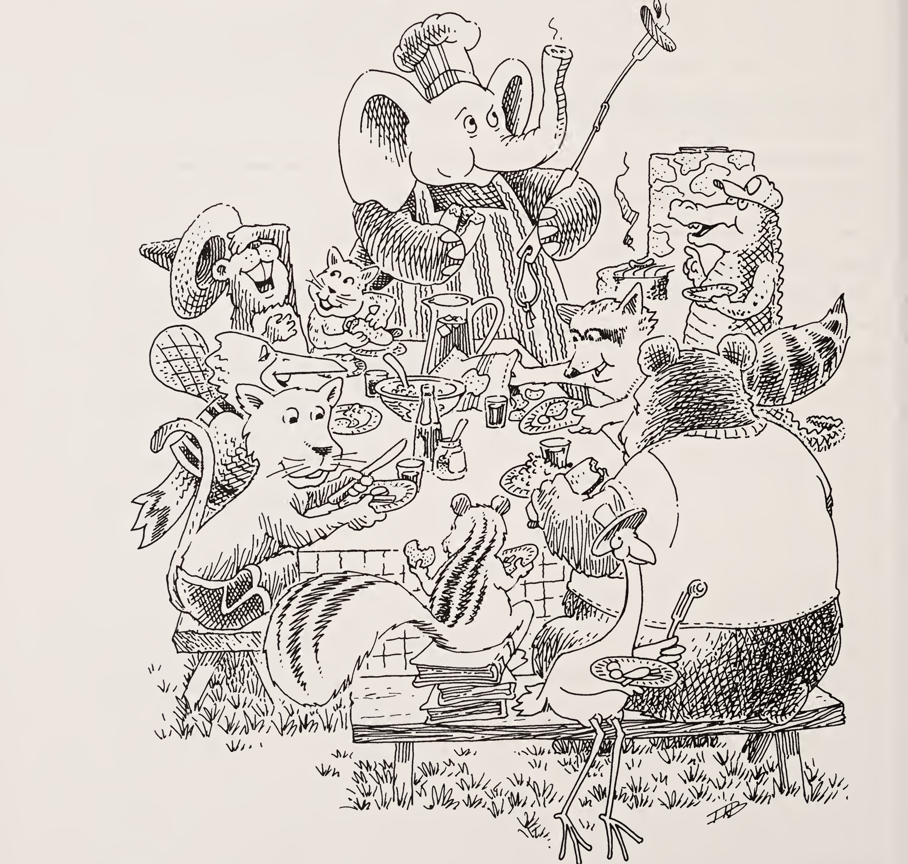

| 질문 | 답변 |
|:-----|:-----|
| 이것은 집합인가?<br>`(apple peaches apple plum)` | 아니요, `apple`이 두 번 이상 나오기 때문입니다. |
| 참인가 거짓인가?<br>`(set? lat)`<br>`lat`은 `(apples peaches pears plums)` | 참입니다. 어떤 원자도 두 번 이상 나오지 않기 때문입니다. |
| `(set? lat)`은 어떠한가?<br>`lat`은 `()` | 참입니다. 어떤 원자도 두 번 이상 나오지 않기 때문입니다. |
| `set?`을 작성해 보세요. | `(define set?`<br>`  (lambda (lat)`<br>`    (cond`<br>`      ((null? lat) #t)`<br>`      (else`<br>`        (cond`<br>`          ((member? (car lat) (cdr lat)) #f)`<br>`          (else (set? (cdr lat))))))))` |
| `set?`을 단순화해 보세요. | `(define set?`<br>`  (lambda (lat)`<br>`    (cond`<br>`      ((null? lat) #t)`<br>`      ((member? (car lat) (cdr lat)) #f)`<br>`      (else (set? (cdr lat))))))` |
| 이 예에서도 동작하나요?<br>`(apple 3 pear 4 9 apple 3 4)` | 네, `member?`가 이제 `eq?` 대신 `equal?`로 작성되었기 때문입니다. |
| `set?`의 정의에 `member?`가 나타나는 것을 보고 놀랐나요? | 놀랄 일이 아닙니다. 우리는 이미 `member?`를 작성해 두었고, 이제 필요할 때마다 그것을 쓸 수 있기 때문입니다. |

| 질문 | 답변 |
|:-----|:-----|
| `(makeset lat)`은 무엇인가?<br>`lat`은 `(apple peach pear peach plum apple lemon peach)` | `(apple peach pear plum lemon)`입니다. |
| `member?`를 사용해 `makeset`을 작성해 보세요. | `(define makeset`<br>`  (lambda (lat)`<br>`    (cond`<br>`      ((null? lat) (quote ()))`<br>`      ((member? (car lat) (cdr lat))`<br>`        (makeset (cdr lat)))`<br>`      (else (cons (car lat)`<br>`                  (makeset (cdr lat)))))))` |
| 이렇게 짧다는 것이 놀라운가요? | 그러길 바랍니다. 하지만 두려워하지 마세요. 맞는 정의입니다. |
| 앞의 정의를 사용할 때 `(makeset lat)`의 결과는 무엇인가?<br>`lat`은 `(apple peach pear peach plum apple lemon peach)` | `(pear plum apple lemon peach)`입니다. |
| `multirember`를 사용해 `makeset`을 작성해 보세요. | `(define makeset`<br>`  (lambda (lat)`<br>`    (cond`<br>`      ((null? lat) (quote ()))`<br>`      (else (cons (car lat)`<br>`                  (makeset`<br>`                    (multirember (car lat)`<br>`                                 (cdr lat))))))))` |
| 이 두 번째 정의로 `(makeset lat)`의 결과는 무엇인가?<br>`lat`은 `(apple peach pear peach plum apple lemon peach)` | `(apple peach pear plum lemon)`입니다. |

| 질문 | 답변 |
|:-----|:-----|
| 두 번째 `makeset` 정의가 어떻게 동작하는지 자기 말로 설명해 보세요. | 우리말로는 이렇습니다. "`makeset`은 `lat`의 나머지 부분에서 첫 번째 원자의 모든 출현을 제거한 다음, 그 첫 번째 원자를 자연 재귀의 결과 위에 `cons`하는 것을 기억합니다." |
| 두 번째 `makeset`이 이 예에서 동작하나요?<br>`(apple 3 pear 4 9 apple 3 4)` | 네, `multirember`가 이제 `eq?` 대신 `equal?`로 작성되었기 때문입니다. |
| `(subset? setl set2)`는 무엇인가?<br>`setl`은 `(5 chicken wings)`<br>`set2`는 `(5 hamburgers 2 pieces fried chicken and light duckling wings)` | 참입니다. `setl`의 모든 원자가 `set2`에도 있기 때문입니다. |
| `(subset? setl set2)`는 무엇인가?<br>`setl`은 `(4 pounds of horseradish)`<br>`set2`는 `(four pounds chicken and 5 ounces horseradish)` | 거짓입니다. |
| `subset?`을 작성해 보세요. | `(define subset?`<br>`  (lambda (setl set2)`<br>`    (cond`<br>`      ((null? setl) #t)`<br>`      (else (cond`<br>`              ((member? (car setl) set2)`<br>`                (subset? (cdr setl) set2))`<br>`              (else #f))))))` |

| 질문 | 답변 |
|:-----|:-----|
| `subset?`을 더 짧은 버전으로 쓸 수 있나요? | `(define subset?`<br>`  (lambda (setl set2)`<br>`    (cond`<br>`      ((null? setl) #t)`<br>`      ((member? (car setl) set2)`<br>`        (subset? (cdr setl) set2))`<br>`      (else #f))))` |
| `(and ...)`를 사용해 `subset?`을 작성해 보세요. | `(define subset?`<br>`  (lambda (setl set2)`<br>`    (cond`<br>`      ((null? setl) #t)`<br>`      (else`<br>`        (and (member? (car setl) set2)`<br>`             (subset? (cdr setl) set2))))))` |
| `(eqset? setl set2)`는 무엇인가?<br>`setl`은 `(6 large chickens with wings)`<br>`set2`는 `(6 chickens with large wings)` | 참입니다. |
| `eqset?`을 작성해 보세요. | `(define eqset?`<br>`  (lambda (setl set2)`<br>`    (cond`<br>`      ((subset? setl set2)`<br>`        (subset? set2 setl))`<br>`      (else #f))))` |
| `cond` 줄을 하나만 사용해 `eqset?`을 쓸 수 있나요? | `(define eqset?`<br>`  (lambda (setl set2)`<br>`    (cond`<br>`      (else (and (subset? setl set2)`<br>`                 (subset? set2 setl))))))` |

| 질문 | 답변 |
|:-----|:-----|
| 한 줄짜리로 작성해 보세요. | `(define eqset?`<br>`  (lambda (setl set2)`<br>`    (and (subset? setl set2)`<br>`         (subset? set2 setl))))` |
| `(intersect? setl set2)`는 무엇인가?<br>`setl`은 `(stewed tomatoes and macaroni)`<br>`set2`는 `(macaroni and cheese)` | 참입니다. `setl`의 적어도 하나의 원자가 `set2`에 있기 때문입니다. |
| `intersect?` 함수를 정의해 보세요. | `(define intersect?`<br>`  (lambda (setl set2)`<br>`    (cond`<br>`      ((null? setl) #f)`<br>`      (else`<br>`        (cond`<br>`          ((member? (car setl) set2) #t)`<br>`          (else (intersect? (cdr setl) set2)))))))` |
| 더 짧은 버전을 작성해 보세요. | `(define intersect?`<br>`  (lambda (setl set2)`<br>`    (cond`<br>`      ((null? setl) #f)`<br>`      ((member? (car setl) set2) #t)`<br>`      (else (intersect? (cdr setl) set2)))))` |
| `(or ...)`로 `intersect?`를 작성해 보세요. | `(define intersect?`<br>`  (lambda (setl set2)`<br>`    (cond`<br>`      ((null? setl) #f)`<br>`      (else (or (member? (car setl) set2)`<br>`                (intersect? (cdr setl) set2))))))` |
| `subset?`와 `intersect?`를 비교해 보세요. | — |

| 질문 | 답변 |
|:-----|:-----|
| `(intersect setl set2)`는 무엇인가?<br>`setl`은 `(stewed tomatoes and macaroni)`<br>`set2`는 `(macaroni and cheese)` | `(and macaroni)`입니다. |
| 이제 `intersect`의 짧은 버전을 작성할 수 있습니다. | `(define intersect`<br>`  (lambda (setl set2)`<br>`    (cond`<br>`      ((null? setl) (quote ()))`<br>`      ((member? (car setl) set2)`<br>`        (cons (car setl)`<br>`              (intersect (cdr setl) set2)))`<br>`      (else (intersect (cdr setl) set2)))))` |
| `(union setl set2)`는 무엇인가?<br>`setl`은 `(stewed tomatoes and macaroni casserole)`<br>`set2`는 `(macaroni and cheese)` | `(stewed tomatoes casserole macaroni and cheese)`입니다. |
| `union`을 작성해 보세요. | `(define union`<br>`  (lambda (setl set2)`<br>`    (cond`<br>`      ((null? setl) set2)`<br>`      ((member? (car setl) set2)`<br>`        (union (cdr setl) set2))`<br>`      (else (cons (car setl)`<br>`                  (union (cdr setl) set2))))))` |

| 질문 | 답변 |
|:-----|:-----|
| 이 함수는 무엇인가?<br>`(define xxx`<br>`  (lambda (setl set2)`<br>`    (cond`<br>`      ((null? setl) (quote ()))`<br>`      ((member? (car setl) set2)`<br>`        (xxx (cdr setl) set2))`<br>`      (else (cons (car setl)`<br>`                  (xxx (cdr setl) set2))))))` | 우리말로 하면 이렇습니다. "`setl`에는 있지만 `set2`에는 없는 모든 원자를 반환하는 함수입니다." 즉 `xxx`는 (집합의) 차집합 함수입니다. |
| `(intersectall l-set)`은 무엇인가?<br>`l-set`은 `((a b c) (c a d e) (e f g h a b))` | `(a)`입니다. |
| `(intersectall l-set)`은 무엇인가?<br>`l-set`은 `((6 pears and) (3 peaches and 6 peppers) (8 pears and 6 plums) (and 6 prunes with some apples))` | `(6 and)`입니다. |
| 이제 어떤 도움 함수가 필요하든 사용해서, 집합들의 리스트가 비어 있지 않다고 가정하고 `intersectall`을 작성해 보세요. | `(define intersectall`<br>`  (lambda (l-set)`<br>`    (cond`<br>`      ((null? (cdr l-set)) (car l-set))`<br>`      (else (intersect (car l-set)`<br>`                       (intersectall (cdr l-set)))))))` |
| 이것은 쌍인가?<br>`(pear pear)` | 네, 원자 두 개만 담은 리스트이기 때문입니다. |

> **참고.** Scheme(또는 Lisp)에서의 쌍(pair)은 서로 다르지만 관련이 있는 객체입니다.

| 질문 | 답변 |
|:-----|:-----|
| 이것은 쌍인가?<br>`(3 7)` | 네. |
| 이것은 쌍인가?<br>`((2) (pair))` | 네, S-표현식 두 개만 담은 리스트이기 때문입니다. |
| `(a-pair? l)`은 무엇인가?<br>`l`은 `(full (house))` | `#t`입니다. S-표현식 두 개만 담은 리스트이기 때문입니다. |
| `a-pair?`를 정의해 보세요. | `(define a-pair?`<br>`  (lambda (x)`<br>`    (cond`<br>`      ((atom? x) #f)`<br>`      ((null? x) #f)`<br>`      ((null? (cdr x)) #f)`<br>`      ((null? (cdr (cdr x))) #t)`<br>`      (else #f))))` |
| 쌍의 첫 번째 S-표현식을 어떻게 가리킬 수 있나요? | 쌍의 `car`를 취하면 됩니다. |
| 쌍의 두 번째 S-표현식을 어떻게 가리킬 수 있나요? | 쌍의 `cdr`의 `car`를 취하면 됩니다. |
| 원자 두 개로 쌍을 어떻게 만들 수 있나요? | 첫 번째 원자를 두 번째 원자와 `()`의 `cons` 위에 `cons`합니다. 즉 `(cons x1 (cons x2 (quote ())))`입니다. |
| S-표현식 두 개로 쌍을 어떻게 만들 수 있나요? | 첫 번째 S-표현식을 두 번째 S-표현식과 `()`의 `cons` 위에 `cons`합니다. 즉 `(cons x1 (cons x2 (quote ())))`입니다. |
| 마지막 두 답의 차이를 눈치챘나요? | 아니요, 아무 차이도 없습니다. |

```scheme
(define first
  (lambda (p)
    (cond
      (else (car p)))))

(define second
  (lambda (p)
    (cond
      (else (car (cdr p))))))

(define build
  (lambda (s1 s2)
    (cond
      (else (cons s1
                  (cons s2 (quote ())))))))
```

| 질문 | 답변 |
|:-----|:-----|
| 위의 `first`, `second`, `build`는 무엇을 하나요? | 쌍의 표현을 만들고, 그 표현의 일부를 꺼내는 데 쓰입니다. 6장을 보세요. |
| 이 세 함수는 어떤 용도로 쓰일까요? | 가독성을 높이는 데 쓰일 것입니다. 곧 보게 됩니다. |
| `first`, `second`, `build`를 한 줄짜리로 다시 정의해 보세요. | `(define first (lambda (p) (car p)))`<br>`(define second (lambda (p) (car (cdr p))))`<br>`(define build (lambda (s1 s2) (cons s1 (cons s2 (quote ())))))` |
| `third`를 한 줄짜리로 쓸 수 있나요? | `(define third`<br>`  (lambda (l)`<br>`    (car (cdr (cdr l)))))` |
| `l`은 관계(rel)인가?<br>`l`은 `(apples peaches pumpkin pie)` | 아니요, `l`이 쌍들의 리스트가 아니기 때문입니다. 우리는 관계를 뜻할 때 `rel`을 씁니다. |
| `l`은 관계(rel)인가?<br>`l`은 `((apples peaches) (pumpkin pie) (apples peaches))` | 아니요, `l`이 쌍들의 집합이 아니기 때문입니다. |
| `l`은 관계(rel)인가?<br>`l`은 `((apples peaches) (pumpkin pie))` | 네. |
| `l`은 관계(rel)인가?<br>`l`은 `((4 3) (4 2) (7 6) (6 2) (3 4))` | 네. |

| 질문 | 답변 |
|:-----|:-----|
| `rel`은 함수(fun)인가?<br>`rel`은 `((4 3) (4 2) (7 6) (6 2) (3 4))` | 아닙니다. 우리는 함수를 뜻할 때 `fun`을 씁니다. |
| `(fun? rel)`은 무엇인가?<br>`rel`은 `((8 3) (4 2) (7 6) (6 2) (3 4))` | 참입니다. `(firsts rel)`이 집합이기 때문입니다. 3장을 보세요. |
| `(fun? rel)`은 무엇인가?<br>`rel`은 `((d 4) (b 0) (b 9) (e 5) (g 4))` | 거짓입니다. `b`가 반복되기 때문입니다. |
| `set?`과 `firsts`로 `fun?`을 작성해 보세요. | `(define fun?`<br>`  (lambda (rel)`<br>`    (set? (firsts rel))))` |
| `fun?`은 간단한 한 줄짜리인가요? | 그야말로 그렇습니다. |
| 유한 함수는 어떻게 표현하나요? | 우리에게 유한 함수는 쌍들의 리스트이며, 어떤 쌍의 첫 번째 원소도 다른 쌍의 첫 번째 원소와 같지 않습니다. |
| `(revrel rel)`은 무엇인가?<br>`rel`은 `((8 a) (pumpkin pie) (got sick))` | `((a 8) (pie pumpkin) (sick got))`입니다. |
| 이제 `revrel`을 작성할 수 있습니다. | `(define revrel`<br>`  (lambda (rel)`<br>`    (cond`<br>`      ((null? rel) (quote ()))`<br>`      (else (cons (build`<br>`                    (second (car rel))`<br>`                    (first (car rel)))`<br>`                  (revrel (cdr rel)))))))` |

| 질문 | 답변 |
|:-----|:-----|
| 다음도 올바른가요?<br>`(define revrel`<br>`  (lambda (rel)`<br>`    (cond`<br>`      ((null? rel) (quote ()))`<br>`      (else (cons (cons`<br>`                    (car (cdr (car rel)))`<br>`                    (cons (car (car rel))`<br>`                          (quote ())))`<br>`                  (revrel (cdr rel)))))))` | 네, 그런데 이제 표현이 가독성을 어떻게 돕는지 알겠나요? |
| 한 쌍의 두 구성 요소를 뒤집는 `revpair`라는 함수가 있다고 합시다.<br>`(define revpair`<br>`  (lambda (pair)`<br>`    (build (second pair) (first pair))))`<br>이 도움 함수를 사용해 `revrel`을 어떻게 다시 작성하겠습니까? | 문제없습니다. 게다가 읽기도 더 쉽습니다.<br>`(define revrel`<br>`  (lambda (rel)`<br>`    (cond`<br>`      ((null? rel) (quote ()))`<br>`      (else (cons (revpair (car rel))`<br>`                  (revrel (cdr rel)))))))` |
| `fun`이 `fullfun`이 아닌 이유를 짐작할 수 있나요?<br>`fun`은 `((8 3) (4 2) (7 6) (6 2) (3 4))` | `fun`은 `fullfun`이 아닙니다. `2`가 쌍의 두 번째 항목으로 두 번 이상 나오기 때문입니다. |
| `(fullfun? fun)`의 값이 참인 이유는 무엇인가?<br>`fun`은 `((8 3) (4 8) (7 6) (6 2) (3 4))` | `(3 8 6 2 4)`가 집합이기 때문입니다. |
| `(fullfun? fun)`은 무엇인가?<br>`fun`은 `((grape raisin) (plum prune) (stewed prune))` | 거짓입니다. |

| 질문 | 답변 |
|:-----|:-----|
| `(fullfun? fun)`은 무엇인가?<br>`fun`은 `((grape raisin) (plum prune) (stewed grape))` | 참입니다. `(raisin prune grape)`가 집합이기 때문입니다. |
| `fullfun?`을 정의해 보세요. | `(define fullfun?`<br>`  (lambda (fun)`<br>`    (set? (seconds fun))))` |
| `seconds`를 정의할 수 있나요? | `firsts`와 꼭 같습니다. |
| `fullfun`의 또 다른 이름은 무엇인가? | `one-to-one?`입니다. |
| `one-to-one?`을 작성하는 두 번째 방법을 생각할 수 있나요? | `(define one-to-one?`<br>`  (lambda (fun)`<br>`    (fun? (revrel fun))))` |
| `((chocolate chip) (doughy cookie))`는 일대일 함수인가? | 네, 그리고 이제 하나 받을 자격이 있습니다!<br>가서 하나 받으세요! |

| 질문 | 답변 |
|:-----|:-----|
| 아니면 더 나아가 직접 만들어 보세요. | 아래 `cookies` 요리법을 보세요. |

```scheme
(define cookies
  (lambda ()
    (bake
      (quote (350 degrees))
      (quote (12 minutes))
      (mix
        (quote (walnuts 1 cup))
        (quote (chocolate-chips 16 ounces))
        (mix
          (mix
            (quote (flour 2 cups))
            (quote (oatmeal 2 cups))
            (quote (salt .5 teaspoon))
            (quote (baking-powder 1 teaspoon))
            (quote (baking-soda 1 teaspoon)))
          (mix
            (quote (eggs 2 large))
            (quote (vanilla 1 teaspoon))
            (cream
              (quote (butter 1 cup))
              (quote (sugar 2 cups)))))))))
```


# 8장 · 궁극의 람다 (Lambda the Ultimate)

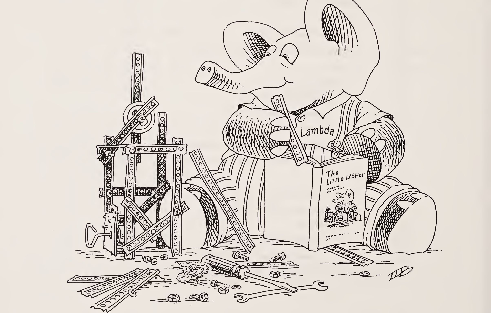

| 질문 | 답변 |
|:-----|:-----|
| 5장 끝에서 `rember`와 `insertL`에 대해 했던 일을 기억하나요? | `eq?`를 `equal?`로 바꿨습니다. |
| `eq?`와 `equal?` 중 어느 것이든 쓰는 함수 `rember-f`를 쓸 수 있나요? | 아니요, 아직 그 방법을 알려 주지 않았기 때문입니다. |
| `rember`가 `(b c a)`에서 첫 번째 `a`를 지우게 하려면 어떻게 하나요? | `a`와 `(b c a)`를 `rember`의 인자로 넘깁니다. |
| `rember`가 `(b c a)`에서 첫 번째 `c`를 지우게 하려면 어떻게 하나요? | `c`와 `(b c a)`를 `rember`의 인자로 넘깁니다. |
| `rember-f`가 `eq?` 대신 `equal?`을 쓰게 하려면 어떻게 하나요? | `equal?`을 `rember-f`의 인자로 넘깁니다. |
| `(rember-f test? a l)`은 무엇인가요?<br>`test?`는 `=`, `a`는 `5`, `l`은 `(6 2 5 3)` | `(6 2 3)`입니다. |
| `(rember-f test? a l)`은 무엇인가요?<br>`test?`는 `eq?`, `a`는 `jelly`, `l`은 `(jelly beans are good)` | `(beans are good)`입니다. |
| 그리고 `(rember-f test? a l)`은 무엇인가요?<br>`test?`는 `equal?`, `a`는 `(pop corn)`, `l`은 `(lemonade (pop corn) and (cake))` | `(lemonade and (cake))`입니다. |

| 질문 | 답변 |
|:-----|:-----|
| `rember-f`를 써 보세요. | 다음과 같이 정의하면 됩니다. |

```scheme
(define rember-f
  (lambda (test? a l)
    (cond
      ((null? l) (quote ()))
      (else (cond
              ((test? (car l) a) (cdr l))
              (else (cons (car l)
                          (rember-f test? a
                                    (cdr l)))))))))
```

훌륭합니다!


| 질문 | 답변 |
|:-----|:-----|
| 짧은 버전은 어떨까요? | 이렇게 쓸 수 있습니다. |

```scheme
(define rember-f
  (lambda (test? a l)
    (cond
      ((null? l) (quote ()))
      ((test? (car l) a) (cdr l))
      (else (cons (car l)
                  (rember-f test? a
                            (cdr l)))))))
```

| 질문 | 답변 |
|:-----|:-----|
| `(rember-f test? a l)`은 어떻게 동작하나요?<br>`test?`는 `eq?` | `test?`가 `eq?`일 때 `(rember-f test? a l)`은 `rember`처럼 동작합니다. |
| `test?`가 `equal?`일 때 `(rember-f test? a l)`은 어떻게 되나요? | `eq?`가 `equal?`로 바뀐 `rember`일 뿐입니다. |
| 이제 거의 같은 일을 하는 함수가 네 개나 됩니다. | 네:<br>`=`를 쓰는 `rember`<br>`equal?`을 쓰는 `rember`<br>`eq?`를 쓰는 `rember`<br>그리고 `rember-f`입니다. |

| 질문 | 답변 |
|:-----|:-----|
| `rember-f`는 다른 모든 것처럼 동작할 수 있습니다. | `rember-f`로 모든 버전을 만들어 낼 수 있습니다. |
| 함수는 어떤 종류의 값을 돌려줄 수 있나요? | 리스트와 원자입니다. |
| 함수 자체는요? | 네, 하지만 아마 아직은 그 사실을 몰랐을 겁니다. |
| `(lambda (a l) ...)`이 무엇인지 말할 수 있나요? | `(lambda (a l) ...)`은 두 인자 `a`와 `l`을 받는 함수입니다. |
| 그러면 `(lambda (a) (lambda (x) (eq? x a)))`은 무엇인가요? | 인자 `a`를 받으면 `(lambda (x) (eq? x a))`라는 함수를 돌려주는 함수입니다. 여기서 `a`는 바로 그 인자입니다. |
| 이것을 "커링(Curry-ing)"이라고 하나요? | 감사합니다, Haskell B. Curry(1900–1982). |
| "숀핑클링(Schonfinkel-ing)"이라고 하지는 않습니다. | 감사합니다, Moses Schönfinkel(1889–1942). |
| `(define ...)`을 써서 앞의 함수에 이름을 붙이세요. | 이것이 우리의 선택입니다. |

```scheme
(define eq?-c
  (lambda (a)
    (lambda (x)
      (eq? x a))))
```

| 질문 | 답변 |
|:-----|:-----|
| `(eq?-c k)`는 무엇인가요?<br>`k`는 `salad` | `x`를 인자로 받아 그것이 `salad`와 `eq?`인지 검사하는 함수입니다. |

> **참고.** `L:`에서는 `(defun eq?-c (a) (function (lambda (x) (eq x a))))`로 정의합니다.

| 질문 | 답변 |
|:-----|:-----|
| `(define ...)`으로 이름을 붙여 봅시다. | 좋습니다. `(define eq?-salad (eq?-c k))`, 여기서 `k`는 `salad`입니다. |
| `(eq?-salad y)`는 무엇인가요?<br>`y`는 `salad` | `#t`입니다. |
| `(eq?-salad y)`는 무엇인가요?<br>`y`는 `tuna` | `#f`입니다. |
| `eq?-salad`에 이름을 꼭 붙여야 하나요? | 아니요, 그냥 `((eq?-c x) y)`를 물어도 됩니다. `x`는 `salad`, `y`는 `tuna`일 때요. |


| 질문 | 답변 |
|:-----|:-----|
| `rember-f`를, 인자 `test?` 하나를 받아 `eq?`가 `test?`로 바뀐 `rember` 같은 함수를 돌려주는 함수로 다시 쓰세요. | 좋은 출발입니다. |

```scheme
(define rember-f
  (lambda (test?)
    (lambda (a l)
      (cond
        ((null? l) (quote ()))
        ((test? (car l) a) (cdr l))
        (else (cons (car l) ...))))))
```

| 질문 | 답변 |
|:-----|:-----|
| `(rember-f test?)`의 결과를 자기 말로 설명해 보세요.<br>`test?`는 `eq?` | `a`와 `l`, 두 인자를 받는 함수입니다. 리스트의 원소들을 `a`와 비교해서, `a`와 `eq?`인 첫 번째 원소를 지웁니다. |
| `(rember-f test?)`가 돌려주는 함수에 이름을 붙이세요.<br>`test?`는 `eq?` | `(define rember-eq? (rember-f test?))`, 여기서 `test?`는 `eq?`입니다. |
| `(rember-eq? a l)`은 무엇인가요?<br>`a`는 `tuna`, `l`은 `(tuna salad is good)` | `(salad is good)`입니다. |
| `(rember-f test?)`가 돌려주는 함수에 `rember-eq?`라는 이름을 꼭 붙여야 했나요?<br>`test?`는 `eq?` | 아니요, `((rember-f test?) a l)`이라고 써도 됩니다. `test?`는 `eq?`, `a`는 `tuna`, `l`은 `(tuna salad is good)`일 때요. |
| 이제 `rember-f` 안의 `(cons (car l) ...)`를 완성해서 `rember-f`가 동작하게 하세요. | 이렇게 하면 됩니다. |

```scheme
(define rember-f
  (lambda (test?)
    (lambda (a l)
      (cond
        ((null? l) (quote ()))
        ((test? (car l) a) (cdr l))
        (else (cons (car l)
                    ((rember-f test?) a
                     (cdr l))))))))
```

| 질문 | 답변 |
|:-----|:-----|
| `((rember-f eq?) a l)`은 무엇인가요?<br>`a`는 `tuna`, `l`은 `(shrimp salad and tuna salad)` | `(shrimp salad and salad)`입니다. |
| `((rember-f eq?) a l)`은 무엇인가요?<br>`a`는 `eq?`, `l`은 `(equal? eq? eqan? eqlist? eqpair?)` | `(equal? eqan? eqlist? eqpair?)`입니다. |


| 질문 | 답변 |
|:-----|:-----|
| 이제 `insertL`을, `rember`를 `rember-f`로 바꾼 것과 같은 방식으로 `insertL-f`로 바꾸세요. | 이렇게 하면 됩니다. |

```scheme
(define insertL-f
  (lambda (test?)
    (lambda (new old l)
      (cond
        ((null? l) (quote ()))
        ((test? (car l) old)
         (cons new (cons old (cdr l))))
        (else (cons (car l)
                    ((insertL-f test?) new old
                     (cdr l))))))))
```

| 질문 | 답변 |
|:-----|:-----|
| 그리고 연습 삼아 `insertR`도 그렇게 해 보세요. | 이렇게 됩니다. |

```scheme
(define insertR-f
  (lambda (test?)
    (lambda (new old l)
      (cond
        ((null? l) (quote ()))
        ((test? (car l) old)
         (cons old (cons new (cdr l))))
        (else (cons (car l)
                    ((insertR-f test?) new old
                     (cdr l))))))))
```

| 질문 | 답변 |
|:-----|:-----|
| `insertR`과 `insertL`은 비슷한가요? | 가운데 부분만 조금 다릅니다. |
| 왼쪽에 삽입하거나 오른쪽에 삽입하는 함수 `insert-g`를 쓸 수 있나요? | 할 수 있다면 커피케이크를 좀 먹고 쉬세요! 못 하겠다면 포기하지 마세요. 곧 알게 됩니다. |

| 질문 | 답변 |
|:-----|:-----|
| 어느 부분이 다른가요? | 두 번째 줄이 서로 다릅니다. `insertL`에서는 `((eq? (car l) old) (cons new (cons old (cdr l))))`이고, `insertR`에서는 `((eq? (car l) old) (cons old (cons new (cdr l))))`입니다. |
| 그 차이를 말로 표현해 보세요! | `old`와 `new`를 리스트의 `cdr` 위에 서로 다른 순서로 cons한다고 말합니다. |
| 그러면 그 차이를 어떻게 없앨 수 있을까요? | 짐작하셨겠지만, 알맞은 cons 방식을 표현하는 함수를 인자로 넘기면 됩니다. |
| `seqL`을 정의하세요.<br>1. 인자 세 개를 받고,<br>2. 첫 번째 인자를, 두 번째 인자를 세 번째 인자 위에 cons한 결과 위에 cons합니다. | 이렇게 정의합니다. |

```scheme
(define seqL
  (lambda (new old l)
    (cons new (cons old l))))
```

| 질문 | 답변 |
|:-----|:-----|
| 다음은 무엇인가요?<br>`(define seqR (lambda (new old l) (cons old (cons new l))))` | 1. 인자 세 개를 받고, 2. 두 번째 인자를, 첫 번째 인자를 세 번째 인자 위에 cons한 결과 위에 cons하는 함수입니다. |
| 우리가 왜 이 함수들을 썼는지 아나요? | `insertL`과 `insertR`에서 서로 다르던 두 줄이 표현하는 것을 이 함수들이 그대로 표현하기 때문입니다. |

| 질문 | 답변 |
|:-----|:-----|
| 인자 `seq` 하나를 받아, `seq`가 `seqL`이면 `insertL`을 돌려주고 `seq`가 `seqR`이면 `insertR`을 돌려주는 `insert-g`를 써 보세요. | 이렇게 씁니다. |

```scheme
(define insert-g
  (lambda (seq)
    (lambda (new old l)
      (cond
        ((null? l) (quote ()))
        ((eq? (car l) old)
         (seq new old (cdr l)))
        (else (cons (car l)
                    ((insert-g seq) new old
                     (cdr l))))))))
```

| 질문 | 답변 |
|:-----|:-----|
| 이제 `insert-g`로 `insertL`을 정의하세요. | `(define insertL (insert-g seqL))` |
| 그리고 `insertR`은요. | `(define insertR (insert-g seqR))` |
| 이 두 정의에서 뭔가 특이한 점이 있나요? | 네. 예전이라면 아마 `(define insertL (insert-g seq))`에서 `seq`는 `seqL`이라고, `(define insertR (insert-g seq))`에서 `seq`는 `seqR`이라고 썼을 겁니다. 하지만 함수를 인자로 넘길 때는 "where"를 쓸 필요가 없습니다. |
| `seqL`과 `seqR`에 이름을 붙여야 하나요? | 꼭 그럴 필요는 없습니다. 그 정의를 대신 넘기면 됩니다. |
| `insert-g`로 `insertL`을 다시 정의하세요. 이번에는 `seqL`을 넘기지 마세요. | 이렇게 하면 됩니다. |

```scheme
(define insertL
  (insert-g
    (lambda (new old l)
      (cons new (cons old l)))))
```

| 질문 | 답변 |
|:-----|:-----|
| 이게 더 좋은가요? | 네, 기억해야 할 이름이 그만큼 줄어들기 때문입니다. `(rember func-name "your-mind")`라고 하면 됩니다. `func-name`은 `seqL`일 때요. |
| `subst`의 정의를 기억하나요? | 여기 하나 있습니다. |

```scheme
(define subst
  (lambda (new old l)
    (cond
      ((null? l) (quote ()))
      ((eq? (car l) old)
       (cons new (cdr l)))
      (else (cons (car l)
                  (subst new old (cdr l)))))))
```

| 질문 | 답변 |
|:-----|:-----|
| 익숙해 보이나요? | 네, `insertL`이나 `insertR`을 닮았습니다. 두 번째 `cond` 줄의 답만 다릅니다. |
| `subst`를 위해 `seqL`이나 `seqR` 같은 함수를 정의하세요. | 이건 어떨까요? |

```scheme
(define seqS
  (lambda (new old l)
    (cons new l)))
```

| 질문 | 답변 |
|:-----|:-----|
| 이제 `insert-g`로 `subst`를 정의하세요. | `(define subst (insert-g seqS))` |
| 그러면 `yyy`는 무엇일까요?<br>`(define yyy (lambda (a l) ((insert-g seqrem) #f a l)))`<br>`(define seqrem (lambda (new old l) #f))` | 깜짝 놀라실 겁니다! 우리의 옛 친구 `rember`입니다. |


### 아홉째 계명

공통된 패턴을 새로운 함수로 추상화한다.

| 질문 | 답변 |
|:-----|:-----|
| 방금 본 것이 추상화의 힘입니다. 비슷한 함수를 전에 본 적 있나요? | 네, 비슷한 줄을 가진 함수를 이미 봤습니다. |
| 6장의 `value`를 기억하나요? | 물론입니다. |

```scheme
(define value
  (lambda (nexp)
    (cond
      ((atom? nexp) nexp)
      ((eq? (operator nexp)
            (quote +))
       (+ (value (1st-sub-exp nexp))
          (value (2nd-sub-exp nexp))))
      ((eq? (operator nexp)
            (quote *))
       (* (value (1st-sub-exp nexp))
          (value (2nd-sub-exp nexp))))
      (else
        (expt (value (1st-sub-exp nexp))
              (value (2nd-sub-exp nexp)))))))
```

| 질문 | 답변 |
|:-----|:-----|
| 유사점이 보이나요? | 마지막 세 답은 `+`, `*`, `expt`만 빼고 모두 같습니다. |
| 다음 일을 하는 함수 `atom-to-function`을 쓸 수 있나요?<br>1. 인자 `x` 하나를 받고,<br>2. `(eq? x (quote +))`이면 함수 `+`를, `(eq? x (quote *))`이면 함수 `*`를 돌려주고, 그 밖의 경우에는 함수 `expt`를 돌려줍니다. | 이렇게 씁니다. |

```scheme
(define atom-to-function
  (lambda (x)
    (cond
      ((eq? x (quote +)) +)
      ((eq? x (quote *)) *)
      (else expt))))
```

| 질문 | 답변 |
|:-----|:-----|
| `(atom-to-function (operator nexp))`는 무엇인가요?<br>`nexp`는 `(+ 5 3)` | 원자 `+`가 아니라 함수 `+`입니다. |
| `atom-to-function`을 써서 `value`를 `cond` 두 줄만으로 다시 쓸 수 있나요? | 물론입니다. |

```scheme
(define value
  (lambda (nexp)
    (cond
      ((atom? nexp) nexp)
      (else
        ((atom-to-function
            (operator nexp))
         (value (1st-sub-exp nexp))
         (value (2nd-sub-exp nexp)))))))
```

| 질문 | 답변 |
|:-----|:-----|
| 첫 버전보다 꽤 짧아졌나요? | 네, 하지만 괜찮습니다. 의미는 바뀌지 않았습니다. |
| 사과 먹을 시간인가요? | 하루에 하나면 의사가 필요 없습니다. |
| `multirember`가 여기 다시 있습니다. `multirember-f`를 쓰세요. | 문제없습니다. |

```scheme
(define multirember
  (lambda (a lat)
    (cond
      ((null? lat) (quote ()))
      ((eq? (car lat) a)
       (multirember a (cdr lat)))
      (else (cons (car lat)
                  (multirember a
                    (cdr lat)))))))

(define multirember-f
  (lambda (test?)
    (lambda (a lat)
      (cond
        ((null? lat) (quote ()))
        ((test? a (car lat))
         ((multirember-f test?) a
           (cdr lat)))
        (else (cons (car lat)
                    ((multirember-f test?) a
                     (cdr lat))))))))
```

| 질문 | 답변 |
|:-----|:-----|
| `((multirember-f test?) a lat)`은 무엇인가요?<br>`test?`는 `eq?`, `a`는 `tuna`, `lat`은 `(shrimp salad tuna salad and tuna)` | `(shrimp salad salad and)`입니다. |
| 그렇게 쉬웠나요? | 네. |
| `multirember-f`로 `multirember-eq?`를 정의하세요. | `(define multirember-eq? (multirember-f test?))`, 여기서 `test?`는 `eq?`입니다. |
| `multirember-f`에게 `tuna`에 대해 알려 줄 필요가 정말 있나요? | `multirember-f`가 `lat`의 모든 원소를 방문할 때, 그것은 언제나 `tuna`를 찾습니다. |
| `multirember-f`가 `lat`을 지나가는 동안 `test?`가 바뀌나요? | 아니요, `a`가 언제나 `tuna`를 뜻하듯이 `test?`는 언제나 `eq?`를 뜻합니다. |
| `a`와 `test?`를 합칠 수 있을까요? | 음, `test?`가 인자 하나만 받는 함수가 되어 그 인자를 `tuna`와 비교할 수 있습니다. |
| 그렇게 하려면 어떻게 하나요? | 새 `test?`는 인자 하나를 받아 그것을 `tuna`와 비교합니다. |
| 이 함수를 쓰는 한 가지 방법이 여기 있습니다.<br>`(define eq?-tuna (eq?-c k))`<br>`k`는 `tuna`입니다.<br>다르게 쓸 방법이 있나요? | 네, 이렇게 쓸 수도 있습니다.<br>`(define eq?-tuna (eq?-c (quote tuna)))` |
| 정의 안에 원자가 들어 있는 것을 본 적 있나요? | 네, `0`, `(quote *)`, `(quote +)` 등 많이 있습니다. |

| 질문 | 답변 |
|:-----|:-----|
| 이제 `multirember-f`와 비슷한 `multiremberT`를 씁시다. `test?`를 받아 함수를 돌려주는 대신, `multiremberT`는 `eq?-tuna` 같은 함수와 `lat`을 받아 일을 합니다. | 그리 어렵지 않습니다. |

```scheme
(define multiremberT
  (lambda (test? lat)
    (cond
      ((null? lat) (quote ()))
      ((test? (car lat))
       (multiremberT test? (cdr lat)))
      (else (cons (car lat)
                  (multiremberT test?
                    (cdr lat)))))))
```

| 질문 | 답변 |
|:-----|:-----|
| `(multiremberT test? lat)`은 무엇인가요?<br>`test?`는 `eq?-tuna`, `lat`은 `(shrimp salad tuna salad and tuna)` | `(shrimp salad salad and)`입니다. |
| 쉬운가요? | 나쁘지 않습니다. |
| 이건 어떤가요? | 정말 복잡해 보입니다! |

```scheme
(define multirember&co
  (lambda (a lat col)
    (cond
      ((null? lat)
       (col (quote ()) (quote ())))
      ((eq? (car lat) a)
       (multirember&co a
          (cdr lat)
          (lambda (newlat seen)
            (col newlat
               (cons (car lat) seen)))))
      (else
         (multirember&co a
           (cdr lat)
           (lambda (newlat seen)
              (col (cons (car lat) newlat)
                seen)))))))
```

| 질문 | 답변 |
|:-----|:-----|
| 더 단순한 것이 여기 있습니다.<br>`(define a-friend (lambda (x y) (null? y)))` | 네, 더 단순합니다. 인자 두 개를 받아 두 번째 인자가 빈 리스트인지 묻는 함수입니다. 첫 번째 인자는 무시합니다. |
| `(multirember&co a lat col)`의 값은 무엇인가요?<br>`a`는 `tuna`, `lat`은 `(strawberries tuna and swordfish)`, `col`은 `a-friend` | 간단하지 않습니다. |
| 좀 더 친절한 예를 들어 봅시다. `(multirember&co a lat col)`의 값은 무엇인가요?<br>`a`는 `tuna`, `lat`은 `()`, `col`은 `a-friend` | `#t`입니다. `a-friend`가 빈 리스트 두 개에 대해 첫 답으로 즉시 사용되고, `a-friend`는 두 번째 인자가 비어 있는지 확인하기 때문입니다. |
| 그리고 `(multirember&co a lat col)`은 무엇인가요?<br>`a`는 `tuna`, `lat`은 `(tuna)`, `col`은 `a-friend` | `multirember&co`는 `lat`이 `(tuna)`일 때 `(eq? (car lat) (quote tuna))`를 묻습니다. 그다음 `()`에 대해 재귀합니다. |
| `multirember&co`가 자연 재귀에 사용하는 다른 인자들은 무엇인가요? | 첫 번째는 분명히 `tuna`입니다. 세 번째 인자는 새 함수입니다. |
| 세 번째 인자의 이름은 무엇인가요? | `col`입니다. |
| `col`이 무엇의 줄임말인지 아나요? | `col`은 "collector(수집기)"의 줄임말입니다. 콜렉터를 "continuation(계속)"이라고 부르기도 합니다. |

| 질문 | 답변 |
|:-----|:-----|
| 새 콜렉터가 여기 있습니다.<br>`(define new-friend (lambda (newlat seen) (col newlat (cons (car lat) seen))))`<br>`(car lat)`는 `tuna`, `col`은 `a-friend` | `tuna`를 정의 안에 넣는 새 방식을 말씀하시는 건가요? |

```scheme
(define new-friend
  (lambda (newlat seen)
    (col newlat
      (cons (quote tuna) seen))))
```

`col`은 `a-friend`입니다.

| 질문 | 답변 |
|:-----|:-----|
| 이 정의를 다르게 쓸 수 있나요?<br>`col`은 `a-friend`에 대해 `(car lat)`이 `tuna`에 대해 갖는 것과 같은 관계이므로, 이런 정의에서 `col`도 `a-friend`로 바꿀 수 있나요? | 네, 이렇게 쓸 수 있습니다. |

```scheme
(define new-friend
  (lambda (newlat seen)
    (a-friend newlat
      (cons (quote tuna) seen))))
```

| 질문 | 답변 |
|:-----|:-----|
| 그러면 어떻게 되나요? | `multirember&co`는 `(null? lat)`이 참임을 알아내고, 빈 리스트 두 개에 콜렉터를 사용합니다. |
| 이 콜렉터는 무엇인가요? | `new-friend`입니다. |
| `a-friend`는 `new-friend`와 어떻게 다른가요? | `new-friend`는 빈 리스트와 `(cons (quote tuna) (quote ()))`의 값에 `a-friend`를 사용합니다. |
| 그러면 옛 콜렉터는 그런 인자로 무엇을 하나요? | 두 번째 인자가 빈 리스트가 아닌 `(tuna)`이므로 `#f`를 답합니다. |
| `(multirember&co a lat a-friend)`의 값은 무엇인가요?<br>`a`는 `tuna`, `lat`은 `(and tuna)` | 이번에는 `multirember&co`가 또 다른 친구와 함께 재귀합니다. |

```scheme
(define latest-friend
  (lambda (newlat seen)
    (a-friend (cons (quote and) newlat)
      seen)))
```

| 질문 | 답변 |
|:-----|:-----|
| 이 재귀적 사용의 값은 무엇인가요? | `#f`입니다. `(a-friend ls1 ls2)`에서 `ls1`은 `(and)`, `ls2`는 `(tuna)`이고 그 값이 `#f`이기 때문입니다. |
| `(multirember&co a lat f)`는 무엇을 하나요? | `lat`의 모든 원자를 보면서 그것이 `a`와 `eq?`인지 확인합니다. 그렇지 않은 원자들은 한 리스트 `ls1`에 모으고, 답이 참인 것들은 두 번째 리스트 `ls2`에 모읍니다. 마지막으로 `(f ls1 ls2)`의 값을 정합니다. |
| 마지막 질문입니다. `(multirember&co (quote tuna) ls col)`의 값은 무엇인가요?<br>`ls`는 `(strawberries tuna and swordfish)`이고, `col`은 `last-friend`입니다. | `3`입니다. `ls`에는 `tuna`가 아닌 것이 세 개 있고, 따라서 `last-friend`가 `(strawberries and swordfish)`와 `(tuna)`에 사용되기 때문입니다. |

```scheme
(define last-friend
  (lambda (x y)
    (length x)))
```

이상한 식사지만, 낯선 음식은 전에도 먹어 봤습니다.

### 열째 계명

한 번에 둘 이상의 값을 모으는 함수를 만든다.

| 질문 | 답변 |
|:-----|:-----|
| 오랜 친구가 여기 있습니다. `multiinsertL`을 기억하나요? | 문제없습니다. `multiinsertR`도 기억합니다. |

```scheme
(define multiinsertL
  (lambda (new old lat)
    (cond
      ((null? lat) (quote ()))
      ((eq? (car lat) old)
       (cons new
         (cons old
            (multiinsertL new old
              (cdr lat)))))
      (else (cons (car lat)
               (multiinsertL new old
                 (cdr lat)))))))

(define multiinsertR
  (lambda (new old lat)
    (cond
      ((null? lat) (quote ()))
      ((eq? (car lat) old)
       (cons old
         (cons new
            (multiinsertR new old
              (cdr lat)))))
      (else (cons (car lat)
               (multiinsertR new old
                 (cdr lat)))))))
```

| 질문 | 답변 |
|:-----|:-----|
| 이제 `multiinsertLR`를 써 보세요.<br>힌트: `multiinsertLR`은 `oldL`과 `oldR`이 다를 때 `lat`에서 `oldL`의 왼쪽과 `oldR`의 오른쪽에 `new`를 삽입합니다. | 두 함수를 합치는 방법입니다. |

```scheme
(define multiinsertLR
  (lambda (new oldL oldR lat)
    (cond
      ((null? lat) (quote ()))
      ((eq? (car lat) oldL)
       (cons new
         (cons oldL
            (multiinsertLR new oldL oldR
              (cdr lat)))))
      ((eq? (car lat) oldR)
       (cons oldR
         (cons new
            (multiinsertLR new oldL oldR
              (cdr lat)))))
      (else
        (cons (car lat)
           (multiinsertLR new oldL oldR
             (cdr lat)))))))
```

| 질문 | 답변 |
|:-----|:-----|
| `multiinsertLR&co`는 `multiinsertLR`에 대해 `multirember&co`가 `multirember`에 대해 갖는 관계입니다. | 그러면 `multiinsertLR&co`가 `multiinsertLR`보다 인자를 하나 더 받는다는 뜻인가요? |
| 네, 그 인자는 어떤 종류인가요? | 콜렉터 함수입니다. |

| 질문 | 답변 |
|:-----|:-----|
| `multiinsertLR&co`는 일이 끝나면 새 `lat`, 왼쪽 삽입 횟수, 오른쪽 삽입 횟수에 `col`을 사용합니다. `multiinsertLR&co`의 개요를 쓸 수 있나요? | 물론입니다. `multiinsertLR`과 비슷합니다. |

```scheme
(define multiinsertLR&co
  (lambda (new oldL oldR lat col)
    (cond
      ((null? lat)
       (col (quote ()) 0 0))
      ((eq? (car lat) oldL)
       (multiinsertLR&co new oldL oldR
         (cdr lat)
         (lambda (newlat L R)
            •••)))
      ((eq? (car lat) oldR)
       (multiinsertLR&co new oldL oldR
         (cdr lat)
         (lambda (newlat L R)
           •••)))
      (else
        (multiinsertLR&co new oldL oldR
           (cdr lat)
           (lambda (newlat L R)
             •••))))))
```

| 질문 | 답변 |
|:-----|:-----|
| `(null? lat)`이 참일 때 왜 `col`을 `(quote ())`과 `0`, `0`에 사용하나요? | 빈 `lat`에는 `oldL`도 `oldR`도 없습니다. 그래서 `oldL`이 0번, `oldR`이 0번 발견되었다는 뜻이고, `multiinsertLR`도 `lat`이 비어 있으면 `()`를 돌려준다는 뜻입니다. |
| 그러면 `(multiinsertLR&co (quote cranberries) (quote fish) (quote chips) (quote ()) col)`의 값은 무엇인가요? | `(col (quote ()) 0 0)`의 값입니다. `col`이 무엇인지 모르므로 알 수 없습니다. |
| `(car lat)`이 `oldL`도 `oldR`도 아닐 때 `multiinsertLR&co`가 새 콜렉터를 세 인자에 사용한다는 것이 사실인가요? | 네, 첫 번째는 `multiinsertLR`이 `(cdr lat)`, `oldL`, `oldR`에 대해 만들었을 `lat`입니다. 두 번째와 세 번째는 각각 `oldL`과 `oldR`의 왼쪽과 오른쪽에서 일어난 삽입 횟수입니다. |

| 질문 | 답변 |
|:-----|:-----|
| 그렇다면 `multiinsertLR&co`가 `(cons (car lat) newlat)`에 `col`을 사용한다는 것도 사실인가요? 왜냐하면 `oldL`이나 `oldR`이 나타나지 않는 한 리스트를 그대로 복사하기 때문입니다. | 네, 사실입니다. 그래서 마지막 경우의 새 콜렉터를 알 수 있습니다: `(lambda (newlat L R) (col (cons (car lat) newlat) L R))`. |
| `col`의 두 번째와 세 번째 인자가 그냥 `L`과 `R`인 이유는 무엇인가요? | `(car lat)`이 `oldL`도 `oldR`도 아니면 새 원소를 삽입할 필요가 없습니다. 그래서 `L`과 `R`이 `(cdr lat)`과 `lat` 전체 모두에 대해 올바른 결과입니다. |
| 지금까지 온 것이 여기 있습니다. 게다가 콜렉터를 하나 더 넣었습니다. | 미완성 콜렉터는 추가된 콜렉터와 비슷합니다. `L`에 1을 더하는 대신 `R`에 1을 더하고, `new`를 `newlat`에 cons한 것 위에 `oldL`을 cons하는 대신 `oldR`을, `new`를 `newlat`에 cons한 결과 위에 cons합니다. |

```scheme
(define multiinsertLR&co
  (lambda (new oldL oldR lat col)
    (cond
      ((null? lat)
       (col (quote ()) 0 0))
      ((eq? (car lat) oldL)
       (multiinsertLR&co new oldL oldR
         (cdr lat)
         (lambda (newlat L R)
            (col (cons new
                   (cons oldL newlat))
                (add1 L) R))))
      ((eq? (car lat) oldR)
       (multiinsertLR&co new oldL oldR
         (cdr lat)
         (lambda (newlat L R)
           •••)))
      (else
        (multiinsertLR&co new oldL oldR
           (cdr lat)
           (lambda (newlat L R)
             (col (cons (car lat) newlat)
                  L R)))))))
```

| 질문 | 답변 |
|:-----|:-----|
| 점을 채울 수 있나요? 그러면 점을 채울 수 있나요? | 네, 마지막 콜렉터는 `(lambda (newlat L R) (col (cons oldR (cons new newlat)) L (add1 R)))`입니다. |

| 질문 | 답변 |
|:-----|:-----|
| `(multiinsertLR&co new oldL oldR lat col)`의 값은 무엇인가요?<br>`new`는 `salty`, `oldL`은 `fish`, `oldR`은 `chips`, `lat`은 `(chips and fish or fish and chips)` | `(col newlat 2 2)`의 값입니다. `newlat`은 `(chips salty and salty fish or salty fish and chips salty)`입니다. |
| 이건 건강에 좋은가요? | 소금이 아주 많아 보입니다. 아마 디저트가 더 달콤하겠지요. |
| `*`-함수가 무엇인지 기억하나요? | 네, 모든 `*`-함수는 다음 중 하나인 리스트에 동작합니다.<br>— 비어 있거나,<br>— 원자가 리스트 위에 cons되어 있거나,<br>— 리스트가 리스트 위에 cons되어 있습니다. |
| 이제 중첩 리스트에서 모든 홀수를 제거하는 `evens-only*`를 쓰세요. `even?`은 다음과 같습니다.<br>`(define even? (lambda (n) (= (* (/ n 2) 2) n)))` | 이런 식으로 함수를 쓰는 연습을 이미 했으니, `evens-only*`는 그저 연습 문제입니다. |

```scheme
(define evens-only*
  (lambda (l)
    (cond
      ((null? l) (quote ()))
      ((atom? (car l))
       (cond
         ((even? (car l))
          (cons (car l)
             (evens-only* (cdr l))))
         (else (evens-only* (cdr l)))))
      (else (cons (evens-only* (car l))
                  (evens-only* (cdr l)))))))
```

| 질문 | 답변 |
|:-----|:-----|
| `(evens-only* l)`의 값은 무엇인가요?<br>`l`은 `((9 1 2 8) 3 10 ((9 9) 7 6) 2)` | `((2 8) 10 (() 6) 2)`입니다. |
| `l`에서 홀수의 합은 무엇인가요?<br>`l`은 `((9 1 2 8) 3 10 ((9 9) 7 6) 2)` | 9 + 1 + 3 + 9 + 9 + 7 = 38입니다. |
| `l`에서 짝수의 곱은 무엇인가요?<br>`l`은 `((9 1 2 8) 3 10 ((9 9) 7 6) 2)` | 2 × 8 × 10 × 6 × 2 = 1920입니다. |
| `evens-only*&co`를 쓸 수 있나요?<br>이 함수는 인자에서 홀수를 제거해 짝수들로 이루어진 중첩 리스트를 만들고, 동시에 인자에 나오는 짝수들의 곱과 홀수들의 합을 구합니다. | 별이 가득하군요! |

```scheme
(define evens-only*&co
  (lambda (l col)
    (cond
      ((null? l)
       (col (quote ()) 1 0))
      ((atom? (car l))
       (cond
         ((even? (car l))
          (evens-only*&co (cdr l)
             (lambda (newl p s)
               (col (cons (car l) newl)
                 (* (car l) p) s))))
         (else (evens-only*&co (cdr l)
                  (lambda (newl p s)
                     (col newl
                       p (+ (car l) s)))))))
      (else (evens-only*&co (car l)
                ...)))))
```

| 질문 | 답변 |
|:-----|:-----|
| 여기 개요가 있습니다. `(evens-only*&co (car l) ...)`이 무엇을 해내는지 설명할 수 있나요? | `l`의 `car`에 있는 모든 수를 방문해서, 홀수가 없는 리스트와 짝수들의 곱, 홀수들의 합을 모읍니다. |
| `(car l)`의 모든 수를 방문한 뒤에 `evens-only*&co`는 무엇을 하나요? | 아직 정의하지 않은 콜렉터를 사용합니다. |

| 질문 | 답변 |
|:-----|:-----|
| 그러면 그 콜렉터는 무엇을 하나요? | `evens-only*&co`를 써서 `l`의 `cdr`을 방문하고, 물론 홀수가 빠진 `(cdr l)` 같은 리스트와, 짝수들의 곱, 홀수들의 합을 모읍니다. |
| 그렇다면 아직 모르는 콜렉터가 대략 이런 모양이라는 뜻인가요?<br>`(lambda (al ap as) (evens-only*&co (cdr l) •••))` | 네. |
| 그리고 `(evens-only*&co (cdr l) ...)`이 일을 마치면 그다음에는 어떻게 되나요? | 전과 마찬가지로, 아직 정해지지 않은 콜렉터가 사용됩니다. |
| `(evens-only*&co (cdr l) ...)`을 위한 콜렉터는 무엇을 하나요? | `car`와 `cdr`에 있는 리스트들의 결과를 cons로 합치고, 각각의 곱과 합을 곱하고 더합니다. 그런 다음 이 값들을 옛 콜렉터에 넘깁니다. |

```scheme
(lambda (al ap as)
  (evens-only*&co (cdr l)
    (lambda (dl dp ds)
      (col (cons al dl)
        (* ap dp)
        (+ as ds)))))
```

| 질문 | 답변 |
|:-----|:-----|
| 이제 모두 이해가 되나요? | 완벽합니다. |
| `(evens-only*&co l the-last-friend)`의 값은 무엇인가요?<br>`l`은 `((9 1 2 8) 3 10 ((9 9) 7 6) 2)`이고 `the-last-friend`는 다음과 같습니다.<br>`(define the-last-friend (lambda (newl product sum) (cons sum (cons product newl))))` | `(38 1920 (2 8) 10 (() 6) 2)`입니다. |

| 질문 | 답변 |
|:-----|:-----|
| 휴! 이제 머리가 한 바퀴 꼬였나요? | 프레첼을 하나 먹으세요. 겨자도 잊지 마시고요. |


# 9장 · ……그리고 또, 또, 또…… (... and Again, and Again, and Again, ...)

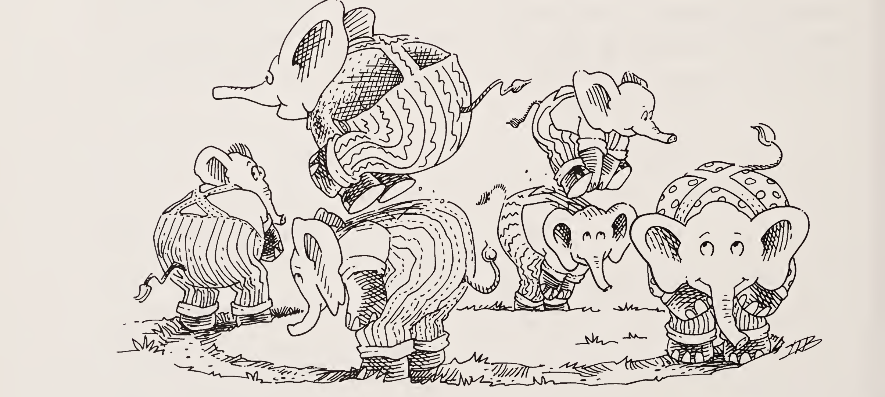

| 질문 | 답변 |
|:-----|:-----|
| 캐비어 생각이 나시나요? | 그렇다면 그것을 찾으러 떠나야겠지요. |
| `(looking a lat)`은 무엇인가요?<br>`a`는 `caviar`, `lat`은 `(6 2 4 caviar 5 7 3)` | `#t`입니다. `caviar`는 분명히 `lat` 안에 있습니다. |
| `(looking a lat)`은 무엇인가요?<br>`a`는 `caviar`, `lat`은 `(6 2 grits caviar 5 7 3)` | `#f`입니다. |
| 다른 걸 기대하셨나요? | 그렇습니다. 그래도 `caviar`는 여전히 `lat` 안에 있습니다. |
| 그렇다면 `lat`의 첫 번째 수는 무엇인가요? | `6`입니다. |
| `lat`의 여섯 번째 원소는 무엇인가요? | `7`입니다. |
| 일곱 번째 원소는요? | `3`입니다. |
| 그러니 `looking`은 분명히 `caviar`를 찾지 못하겠네요. | 그렇습니다. 세 번째 원소가 `grits`이고, 그것은 `caviar`와 닮지도 않았기 때문입니다. |

`looking`은 이렇게 정의합니다.

```scheme
(define looking
  (lambda (a lat)
    (keep-looking a (pick 1 lat) lat)))
```

| 질문 | 답변 |
|:-----|:-----|
| `keep-looking`을 작성해 보세요. | 이건 아실 거라고는 생각지 못했습니다. 정의는 다음과 같습니다. |

```scheme
(define keep-looking
  (lambda (a sorn lat)
    (cond
      ((number? sorn)
       (keep-looking a (pick sorn lat) lat))
      (else (eq? sorn a)))))
```

| 질문 | 답변 |
|:-----|:-----|
| `(looking a lat)`은 무엇인가요?<br>`a`는 `caviar`, `lat`은 `(6 2 4 caviar 5 7 3)` | `#t`입니다. `(keep-looking a 6 lat)`이 `(keep-looking a (pick 1 lat) lat)`과 같은 답을 내기 때문입니다. |

| 질문 | 답변 |
|:-----|:-----|
| `(pick 6 lat)`은 무엇인가요?<br>`lat`은 `(6 2 4 caviar 5 7 3)` | `7`입니다. |
| 그러면 어떻게 하지요? | `(keep-looking a 7 lat)`입니다. `a`는 `caviar`이고 `lat`은 `(6 2 4 caviar 5 7 3)`입니다. |
| `(pick 7 lat)`은 무엇인가요?<br>`lat`은 `(6 2 4 caviar 5 7 3)` | `3`입니다. |
| `(keep-looking a 3 lat)`은 무엇인가요?<br>`a`는 `caviar`, `lat`은 `(6 2 4 caviar 5 7 3)` | `(keep-looking a 4 lat)`과 같습니다. |
| 그것은 무엇인가요? | `#t`입니다. |
| `sorn`은 무엇의 약자일까요? | Symbol or number(기호 또는 수)입니다. |
| `keep-looking`에서 특이한 점은 무엇인가요? | `lat`의 일부에 대해 재귀하지 않습니다. |
| 우리는 이것을 "부자연스러운" 재귀라고 부릅니다. | 정말 부자연스럽습니다. |

| 질문 | 답변 |
|:-----|:-----|
| `keep-looking`은 목표에 가까워지는 것처럼 보이나요? | 지금까지의 증거로는 그렇습니다. |
| 언제나 목표에 가까워지나요? | 때로는 리스트에 `caviar`도 `grits`도 없을 수 있습니다. |
| 맞습니다. 리스트는 tup일 수도 있지요. | 그렇습니다. `(7 2 4 7 5 6 3)`에서 찾기 시작하면 영원히 멈추지 않습니다. |
| `(looking a lat)`은 무엇인가요?<br>`a`는 `caviar`, `lat`은 `(7 1 2 caviar 5 6 3)` | 이상한데요! |
| 네, 이상합니다. 무슨 일이 일어나나요? | 계속 찾고, 또 찾고, 또 찾습니다…… |
| `looking` 같은 함수를 부분 함수(partial function)라고 부릅니다. 지금까지 본 함수들은 뭐라고 부를까요? | 전체 함수(total)라고 부릅니다. |
| 어떤 인자들에 대해서는 목표에 도달하지 못하는, 더 짧은 함수를 정의할 수 있나요? | 다음과 같습니다. |

```scheme
(define eternity
  (lambda (x)
    (eternity x)))
```

| 질문 | 답변 |
|:-----|:-----|
| `eternity`는 몇 개의 인자에 대해 목표에 도달하나요? | 하나도 없습니다. 가능한 한 가장 부자연스러운 재귀입니다. |
| `eternity`는 부분 함수인가요? | 가장 부분적인 함수입니다. |
| `(shift x)`는 무엇인가요?<br>`x`는 `((a b) c)` | `(a (b c))`입니다. |

| 질문 | 답변 |
|:-----|:-----|
| `(shift x)`는 무엇인가요?<br>`x`는 `((a b) (c d))` | `(a (b (c d)))`입니다. |
| `shift`를 정의해 보세요. | 간단합니다. 재귀조차 아니니까요. |

```scheme
(define shift
  (lambda (pair)
    (build (first (first pair))
      (build (second (first pair))
        (second pair)))))
```

| 질문 | 답변 |
|:-----|:-----|
| `shift`가 하는 일을 설명해 보세요. | 이렇게 말하겠습니다: "`shift`는 첫 번째 성분이 쌍인 쌍을 받아, 첫 성분의 두 번째 부분을 두 번째 성분으로 옮겨서 새 쌍을 만드는 함수입니다." |
| 이제 이 함수를 보세요. `keep-looking`과 공통점이 무엇인가요? | 두 함수 모두 재귀 호출에서 인자를 바꾸지만, 어느 쪽도 그 변화가 목표에 더 가까워진다는 보장은 없습니다. |

```scheme
(define align
  (lambda (pora)
    (cond
      ((atom? pora) pora)
      ((a-pair? (first pora))
       (align (shift pora)))
      (else (build (first pora)
              (align (second pora)))))))
```

| 질문 | 답변 |
|:-----|:-----|
| `align`이 진전한다고 보장할 수 없는 이유는 무엇인가요? | 두 번째 `cond` 줄에서 `shift`가 `align`에게 원래 인자의 일부가 아닌 인자를 만들어 주기 때문입니다. |
| 그것은 몇 번째 계명을 어기나요? | 일곱째 계명입니다. |

| 질문 | 답변 |
|:-----|:-----|
| 새 인자는 적어도 원래 인자보다 작나요? | 그렇게 보이지 않습니다. |
| 왜 아닌가요? | `shift`는 받은 쌍을 재배열할 뿐입니다. |
| 그래서요? | `shift`의 결과와 인자는 원자의 개수가 같습니다. |
| `align`의 인자들에 들어 있는 원자의 개수를 세는 함수를 쓸 수 있나요? | 문제없습니다. |

```scheme
(define length*
  (lambda (pora)
    (cond
      ((atom? pora) 1)
      (else
        (+ (length* (first pora))
           (length* (second pora)))))))
```

| 질문 | 답변 |
|:-----|:-----|
| `align`은 부분 함수인가요? | 아직 모릅니다. 계속 정렬만 하는 인자가 있을 수 있습니다. |
| `align`의 인자와 그 재귀 호출의 인자에서 달라지는 것이 또 있나요? | 네. 쌍의 첫 번째 성분은 단순해지지만 두 번째 성분은 복잡해집니다. |
| 어떤 점에서 첫 번째 성분이 더 단순해지나요? | 원래 쌍의 첫 성분의 일부일 뿐입니다. |
| 그렇다면 `length*`는 인자의 길이를 재는 데 잘못된 함수라는 뜻인가요? 더 나은 함수를 찾을 수 있나요? | 더 나은 함수는 첫 번째 성분에 더 많은 주의를 기울여야 합니다. |
| 첫 번째 성분에 얼마나 더 주의를 기울여야 하나요? | 적어도 두 배는. |

| 질문 | 답변 |
|:-----|:-----|
| `weight*` 같은 것을 말씀하시는 건가요? | 맞는 것 같습니다. |

```scheme
(define weight*
  (lambda (pora)
    (cond
      ((atom? pora) 1)
      (else
        (+ (* (weight* (first pora)) 2)
           (weight* (second pora)))))))
```

| 질문 | 답변 |
|:-----|:-----|
| `(weight* x)`는 무엇인가요?<br>`x`는 `((a b) c)` | `7`입니다. |
| `(weight* x)`는 무엇인가요?<br>`x`는 `(a (b c))` | `5`입니다. |
| 그러면 인자가 단순해진다는 뜻인가요? | 네, `align`의 인자들의 `weight*` 값이 차례로 작아집니다. |
| `align`은 부분 함수인가요? | 아니요, 모든 인자에 대해 값을 냅니다. |
| 다음은 `shuffle`입니다. `align`과 비슷하지만 `shift` 대신 7장의 `revpair`를 씁니다. | `shuffle`과 `revpair`는 첫 성분이 쌍일 때 쌍의 성분들을 맞바꿉니다. |

```scheme
(define shuffle
  (lambda (pora)
    (cond
      ((atom? pora) pora)
      ((a-pair? (first pora))
       (shuffle (revpair pora)))
      (else (build (first pora)
              (shuffle (second pora)))))))
```

| 질문 | 답변 |
|:-----|:-----|
| 그러면 `shuffle`은 전체 함수인가요? | 모릅니다. |

| 질문 | 답변 |
|:-----|:-----|
| 해 봅시다. `(shuffle x)`의 값은 무엇인가요?<br>`x`는 `(a (b c))` | `(a (b c))`입니다. |
| `(shuffle x)`는 무엇인가요?<br>`x`는 `(a b)` | `(a b)`입니다. |
| 자, 이제 재미있는 것을 해 봅시다. `(shuffle x)`의 값은 무엇인가요?<br>`x`는 `((a b) (c d))` | 이 값을 알려면 `(shuffle (revpair pora))`가 무엇인지 알아내야 합니다. 여기서 `pora`는 `((a b) (c d))`입니다. |
| 그건 어떻게 하나요? | `(shuffle pora)`의 값을 구할 겁니다. 여기서 `pora`는 `((c d) (a b))`입니다. |
| 그러면 `(shuffle (revpair pora))`의 값을 알아야 한다는 뜻인가요?<br>`(revpair pora)`는 `((a b) (c d))` | 네, 그렇습니다. |
| 그래서요? | `shuffle`은 전체 함수가 아닙니다. 이제 쌍의 성분을 다시 맞바꾸므로 처음부터 다시 시작하게 됩니다. |
| 이 함수는 전체 함수인가요? | `0`에 대해서는 값을 내지 않습니다. 그 외에는 아무도 모릅니다. 고맙습니다, Lothar Collatz(1910-1990). |

```scheme
(define C
  (lambda (n)
    (cond
      ((one? n) 1)
      (else
        (cond
          ((even? n) (C (/ n 2)))
          (else (C (add1 (* 3 n)))))))))
```

| 질문 | 답변 |
|:-----|:-----|
| `(A 1 0)`의 값은 무엇인가요? | `2`입니다. |
| `(A 1 1)` | `3`입니다. |
| `(A 2 2)` | `7`입니다. |
| 다음은 `A`의 정의입니다. | 고맙습니다, Wilhelm Ackermann(1853-1946). |

```scheme
(define A
  (lambda (n m)
    (cond
      ((zero? n) (add1 m))
      ((zero? m) (A (sub1 n) 1))
      (else (A (sub1 n)
               (A n (sub1 m)))))))
```

| 질문 | 답변 |
|:-----|:-----|
| `A`는 `shuffle`, `looking`과 무엇이 공통인가요? | `A`의 인자도 `shuffle`, `looking`의 인자처럼 재귀할 때 반드시 줄어들지는 않습니다. |
| 예를 하나 들어 볼까요? | 쉽습니다. `(A 1 2)`는 `(A 0 (A 1 1))`의 값을 필요로 합니다. 그리고 그것은 `(A 0 3)`의 값을 필요로 합니다. |
| `A`는 언제나 답을 주나요? | 네, 전체 함수입니다. |
| 그러면 `(A 4 3)`은 무엇인가요? | 실질적으로 답이 없습니다. `(A 4 3)`의 값을 계산하기도 전에 지금 읽고 계신 이 페이지가 먼저 삭아 버릴 것입니다. |
| 그게 무슨 뜻인가요? | "그러나 답은 오지 않았다— / 그리고 그것은 조금도 이상하지 않았다, / 그들이 모두 먹어 치웠기 때문이다." |

> **참고.** 위 인용은 루이스 캐럴(Lewis Carroll)의 「The Walrus and The Carpenter」에서 가져왔습니다.

| 질문 | 답변 |
|:-----|:-----|
| 어떤 함수가 모든 인자에 대해 값을 돌려주는지 알려 주는 함수를 쓸 수 있다면 얼마나 좋을까요? | 정말 그렇겠지요. 값을 영영 돌려주지 않거나, 돌려주더라도 너무 늦는 함수들을 보았으니 이런 도구쯤은 있어야 합니다. |
| 좋아요, 만들어 봅시다. | 복잡하게 들립니다. 함수는 아주 여러 가지 인자에 대해 동작할 수 있으니까요. |
| 그럼 더 단순하게 만들어 봅시다. 준비 운동으로, 어떤 함수가 가장 단순한 인자인 빈 리스트에 대해서만 멈추는지 검사하는 함수에 집중해 봅시다. | 그러면 훨씬 단순해지겠군요. |
| 이 함수의 시작은 이렇습니다. | 이 함수는 무엇을 하나요? |

```scheme
(define will-stop?
  (lambda (f)
    ...))
```

| 질문 | 답변 |
|:-----|:-----|
| 점들 자리에 무엇을 채우면 될까요? | 그게 쉬운 부분입니다. 인자를 `()`에 적용했을 때 멈추는지에 따라 `#t`나 `#f`를 돌려준다고 했습니다. |
| `will-stop?`은 모든 인자에 대해 값을 돌려주나요? | 네, 그렇습니다. |
| 그러면 `will-stop?`은 전체 함수인가요? | 그렇습니다. 언제나 `#t`나 `#f`를 돌려주니까요. |
| 이제 예를 몇 개 만들어 봅시다. 첫 번째 예입니다. `(will-stop? f)`의 값은 무엇인가요?<br>`f`는 `length` | `l`이 `()`일 때 `(length l)`이 `0`임을 압니다. 그러니 `(will-stop? length)`의 값은 `#t`여야 합니다. |
| 그래서요? | `#t`입니다. |

| 질문 | 답변 |
|:-----|:-----|
| 그럼요. 다른 예도 하나 볼까요? `(will-stop? eternity)`의 값은 무엇인가요? | `(eternity (quote ()))`은 값을 돌려주지 않습니다. |
| 그러면 `(will-stop? eternity)`의 값이 `#f`라는 뜻인가요? | 방금 그것을 보았습니다. |
| 예가 더 필요할까요? | 예를 하나 더 해 보는 편이 좋겠습니다. |
| 좋습니다. `will-stop?`에 흥미로운 인자가 될 만한 함수가 있습니다. | 이 함수는 무엇을 하나요? |

```scheme
(define last-try
  (lambda (x)
    (and (will-stop? last-try)
      (eternity x))))
```

| 질문 | 답변 |
|:-----|:-----|
| `(will-stop? last-try)`는 무엇인가요? | `(last-try (quote ()))`의 값을 알려면 `(and (will-stop? last-try) (eternity (quote ())))`의 값을 알아내야 합니다. |
| `()`에 대해서 시험해 봐야겠네요. | 그것은 `(will-stop? last-try)`의 값에 달려 있습니다. |
| `(and (will-stop? last-try) (eternity (quote ())))`의 값은 무엇인가요? | `(will-stop? last-try)`가 `#f`라면 `(and #f (eternity (quote ())))`이므로 `#f`입니다. `(and #f ...)`는 언제나 `#f`이기 때문입니다. |
| 가능성은 둘뿐입니다. `(will-stop? last-try)`가 `#f`라고 해 봅시다. | 그러면 `last-try`는 멈춘 것이 됩니다. |
| 그러면 `(last-try (quote ()))`는 멈춘 거네요? | 네, 멈췄습니다. |
| 그런데 `will-stop?`은 정반대를 예측하지 않았나요? | 네, 그랬습니다. `(will-stop? last-try)`의 값이 `#f`라고 했으니, 그것은 `last-try`가 멈추지 않는다는 뜻이었습니다. |

| 질문 | 답변 |
|:-----|:-----|
| 그러니 `(will-stop? last-try)`에 대해 우리가 틀렸음이 분명합니다. | 맞습니다. `#t`를 돌려줄 수밖에 없습니다. `will-stop?`은 언제나 답을 내니까요. 전체 함수라고 했습니다. |
| 좋습니다. `(will-stop? last-try)`가 `#t`라면 `(last-try (quote ()))`의 값은 무엇인가요? | 이제 `(and #t (eternity (quote ())))`의 값을 구하면 되고, 그것은 `(eternity (quote ()))`의 값과 같습니다. |
| `(eternity (quote ()))`의 값은 무엇인가요? | 값이 없습니다. 그것이 멈추지 않는다는 것을 압니다. |
| 그러면 우리는 또 틀린 거네요! | 그렇습니다. 이번에는 `(will-stop? last-try)`가 `#t`라고 했으니까요. |
| 이것이 무엇을 뜻한다고 생각하나요? | 우리의 생각은 이렇습니다: "두 가지 가능한 경우를 아주 자세히 살펴보았습니다. 만약 `will-stop?`을 정의할 수 있다면 `(will-stop? last-try)`는 반드시 `#t`나 `#f`를 내야 합니다. 그러나 그럴 수 없습니다. `will-stop?`이 하기로 되어 있는 일의 정의 자체가 그것을 막습니다. 이것은 `will-stop?`을 정의할 수 없다는 뜻입니다." |
| 이것은 유일한가요? | 그렇습니다. 우리 언어에서 정확히 서술할 수는 있지만 정의할 수는 없는 첫 번째 함수가 `will-stop?`입니다. |
| 이 문제를 피해 갈 방법이 있나요? | 없습니다. 고맙습니다, Alan M. Turing(1912-1954)과 Kurt Gödel(1906-1978). |
| `(define ...)`은 무엇인가요? | 흥미로운 질문입니다. 방금 `(define ...)`이 `will-stop?`에 대해서는 통하지 않는다는 것을 보았습니다. |

| 질문 | 답변 |
|:-----|:-----|
| 그러면 재귀적 정의란 무엇인가요? | 꽉 붙잡으세요. 깊게 숨을 들이쉬고, 준비가 되면 뛰어드세요. |
| 이것이 `length` 함수인가요? | 그야 물론입니다. |

```scheme
(define length
  (lambda (l)
    (cond
      ((null? l) 0)
      (else (add1 (length (cdr l)))))))
```

| 질문 | 답변 |
|:-----|:-----|
| 이제 `(define ...)`이 없다면요? 그래도 `length`를 정의할 수 있을까요? | `(define ...)`이 없으면 아무것도, 특히 `length`의 몸통은 `length`를 가리킬 수 없습니다. |
| 이 함수는 무엇을 하나요? | 빈 리스트의 길이를 구할 뿐, 그 밖에는 아무것도 하지 않습니다. |

```scheme
(lambda (l)
  (cond
    ((null? l) 0)
    (else (add1 (eternity (cdr l))))))
```

| 질문 | 답변 |
|:-----|:-----|
| 비어 있지 않은 리스트에 사용하면 어떻게 되나요? | 답이 없습니다. `eternity`에 인자를 주면 답을 내지 않기 때문입니다. |
| `length`처럼 보이는 이 함수에게 그것은 무슨 뜻인가요? | 비어 있지 않은 리스트에 대해서는 그냥 아무 답도 내지 않습니다. |
| 이 새 함수에 이름을 붙일 수 있다고 합시다. 좋은 이름은 무엇일까요? | `length0`입니다. 이 함수는 빈 리스트의 길이밖에 구할 수 없기 때문입니다. |
| 원소가 하나 이하인 리스트의 길이를 구하는 함수는 어떻게 쓰시겠어요? | 글쎄요, 이렇게 해 볼 수 있겠습니다. |

```scheme
(lambda (l)
  (cond
    ((null? l) 0)
    (else (add1 (length0 (cdr l))))))
```

| 질문 | 답변 |
|:-----|:-----|
| 거의 다 왔습니다. 하지만 `(define ...)`은 `length1`에는 통하지 않습니다. | 그렇다면 `length1`을 그 정의로 바꿔 넣으세요. |

```scheme
(lambda (l)
  (cond
    ((null? l) 0)
    (else
      (add1
        ((lambda (l)
           (cond
             ((null? l) 0)
             (else (add1
                     (eternity (cdr l))))))
          (cdr l))))))
```

| 질문 | 답변 |
|:-----|:-----|
| 이 함수에 붙일 좋은 이름은 무엇인가요? | 쉽습니다. `length1`입니다. |
| 원소가 둘 이하인 리스트의 길이를 구하는 함수인가요? | 네, 이것이 `length2`입니다. `eternity`를 다음 버전의 `length`로 바꿔 넣었을 뿐입니다. |

```scheme
(lambda (l)
  (cond
    ((null? l) 0)
    (else
      (add1
        ((lambda (l)
           (cond
             ((null? l) 0)
             (else
               (add1
                 ((lambda (l)
                    (cond
                      ((null? l) 0)
                      (else
                        (add1
                          (eternity
                            (cdr l))))))
                  (cdr l))))))
         (cdr l))))))
```

| 질문 | 답변 |
|:-----|:-----|
| 자, 재귀란 무엇이라고 생각하나요? | 무슨 말씀이세요? |

| 질문 | 답변 |
|:-----|:-----|
| 자, 우리는 원소가 하나도 없는 리스트, 하나 이하인 리스트, 둘 이하인 리스트…… 의 길이를 구하는 방법을 보았습니다. 어떻게 하면 `length` 함수를 되찾을 수 있을까요? | `length1`, `length2`, ……의 방식으로 무한한 함수를 쓸 수 있다면 `length`를 쓸 수 있고, 그러면 우리가 만들 수 있는 모든 리스트의 길이를 구할 수 있습니다. |
| 우리가 만들 수 있는 리스트는 얼마나 길까요? | 리스트는 비어 있거나, 원소가 하나거나, 둘이거나, 셋, 넷, ……, 1001개, ……입니다. |
| 하지만 무한한 함수를 쓸 수는 없습니다. | 아니요, 쓸 수 없습니다. |
| 그리고 이 함수들에는 아직도 반복과 패턴이 잔뜩 있습니다. | 그렇습니다. |
| 이 패턴들은 어떻게 생겼나요? | 이 프로그램들은 모두 `length`처럼 생긴 함수를 담고 있습니다. 어쩌면 이 함수를 뽑아내야 할지도 모릅니다. 아홉째 계명을 보세요. |
| 해 봅시다! | `length`와 똑같이 생겼지만 `(lambda (length) ...)`로 시작하는 함수가 필요합니다. |
| 이걸 말씀하시는 건가요? | 네, 괜찮습니다. 그것이 `length1`을 만듭니다. |

```scheme
((lambda (length)
   (lambda (l)
     (cond
       ((null? l) 0)
       (else (add1 (length (cdr l)))))))
 eternity)
```

| 질문 | 답변 |
|:-----|:-----|
| `length2`를 같은 방식으로 다시 써 보세요. | 다음과 같습니다. |

```scheme
((lambda (length)
   (lambda (l)
     (cond
       ((null? l) 0)
       (else (add1 (length (cdr l)))))))
 ((lambda (g)
    (lambda (l)
      (cond
        ((null? l) 0)
        (else (add1 (g (cdr l)))))))
  eternity))
```

| 질문 | 답변 |
|:-----|:-----|
| 인자의 이름으로 꼭 `length`를 써야 하나요? | 아니요, 방금은 `l`과 `g`를 썼습니다. 일관되게만 쓰면 다 괜찮습니다. |
| `length3`은 어떨까요? | 다음과 같습니다. |

```scheme
((lambda (length)
   (lambda (l)
     (cond
       ((null? l) 0)
       (else (add1 (length (cdr l)))))))
 ((lambda (length)
    (lambda (l)
      (cond
        ((null? l) 0)
        (else (add1 (length (cdr l)))))))
  ((lambda (length)
     (lambda (l)
       (cond
         ((null? l) 0)
         (else (add1 (length (cdr l)))))))
   eternity)))
```

| 질문 | 답변 |
|:-----|:-----|
| 가깝습니다. 하지만 아직도 반복이 있습니다. | 맞습니다. 없애 봅시다. |
| 어디서부터 시작할까요? | `length`를 인자로 받아서 `length`처럼 생긴 함수를 돌려주는 함수에 이름을 붙입니다. |

| 질문 | 답변 |
|:-----|:-----|
| 이 함수에 좋은 이름은 무엇일까요? | "make length"라는 뜻으로 `mk-length`는 어떨까요? |
| 좋습니다. 이것을 `length0`에 적용해 보세요. | 문제없습니다. |

```scheme
((lambda (mk-length)
   (mk-length eternity))
 (lambda (length)
   (lambda (l)
     (cond
       ((null? l) 0)
       (else (add1 (length (cdr l))))))))
```

| 질문 | 답변 |
|:-----|:-----|
| 이것이 `length1`인가요? | 그럼요. 그리고 이것이 `length2`입니다. |

```scheme
((lambda (mk-length)
   (mk-length
     (mk-length eternity)))
 (lambda (length)
   (lambda (l)
     (cond
       ((null? l) 0)
       (else (add1 (length (cdr l))))))))
```

```scheme
((lambda (mk-length)
   (mk-length
     (mk-length
       (mk-length eternity))))
 (lambda (length)
   (lambda (l)
     (cond
       ((null? l) 0)
       (else (add1 (length (cdr l))))))))
```

| 질문 | 답변 |
|:-----|:-----|
| 이 방식으로 `length3`을 쓸 수 있나요? | 물론입니다. 여기 있습니다. |

```scheme
((lambda (mk-length)
   (mk-length
     (mk-length
       (mk-length
         (mk-length eternity)))))
 (lambda (length)
   (lambda (l)
     (cond
       ((null? l) 0)
       (else (add1 (length (cdr l))))))))
```

| 질문 | 답변 |
|:-----|:-----|
| 재귀는 무엇과 비슷한가요? | `mk-length`를 임의의 함수에 무한히 쌓아 올린 탑과 비슷합니다. |

| 질문 | 답변 |
|:-----|:-----|
| 정말 무한한 탑이 필요한가요? | 물론 아닙니다. `length`를 쓸 때마다 유한한 개수만 있으면 되지만, 그 개수가 몇 개인지는 결코 알 수 없습니다. |
| 필요한 개수를 짐작할 수 있을까요? | 물론입니다. 다만 충분히 큰 수를 짐작하지 못할 수도 있습니다. |
| 짐작한 수가 충분히 크지 않았다는 것은 언제 알게 되나요? | 가장 안쪽 `mk-length`에 전달된 `eternity` 함수를 적용할 때입니다. |
| 이 시점에서 `mk-length`를 `eternity`에 한 번 더 적용할 수 있다면 어떨까요? | 그것은 문제를 하나만 미룰 뿐이고, 게다가 어떻게 그럴 수 있겠습니까? |
| 음, `mk-length`에 어떤 함수를 넘기든 아무도 신경 쓰지 않으니, 처음부터 `mk-length` 자신을 넘겨도 되겠네요. | 좋은 생각입니다. 그리고 나서 `mk-length`를 `eternity`에, 그 결과를 `cdr`에 적용하면 탑이 한 층 더 쌓입니다. |
| 그러면 이것도 여전히 `length2`인가요? | 네, `length` 대신 `mk-length`를 써도 됩니다. |

```scheme
((lambda (mk-length)
   (mk-length mk-length))
 (lambda (length)
   (lambda (l)
     (cond
       ((null? l) 0)
       (else (add1
               (length (cdr l))))))))
```

```scheme
((lambda (mk-length)
   (mk-length mk-length))
 (lambda (mk-length)
   (lambda (l)
     (cond
       ((null? l) 0)
       (else (add1
               (mk-length (cdr l))))))))
```

| 질문 | 답변 |
|:-----|:-----|
| 왜 그렇게 하고 싶으시죠? | 모든 이름은 평등합니다. 그러나 어떤 이름은 다른 이름보다 더 평등합니다. |

> **참고.** 조지 오웰(George Orwell, 1903-1950)에게 사과드립니다.

| 질문 | 답변 |
|:-----|:-----|
| 맞습니다. 이름을 일관되게만 쓰면 우리는 아무 문제가 없습니다. | 그리고 `mk-length`는 `length`보다 훨씬 더 평등한 이름입니다. `mk-length` 같은 이름을 쓰면, `mk-length`의 첫 번째 인자가 `mk-length`라는 것을 늘 상기시켜 줍니다. |
| 이제 `mk-length`가 `mk-length`에게 전달되었으니, 그 인자를 써서 재귀 호출을 하나 더 만들 수 있을까요? | 네, `mk-length`를 한 번 적용하면 `length1`을 얻습니다. |

```scheme
((lambda (mk-length)
   (mk-length mk-length))
 (lambda (mk-length)
   (lambda (l)
     (cond
       ((null? l) 0)
       (else (add1
               ((mk-length eternity)
                (cdr l))))))))
```

| 질문 | 답변 |
|:-----|:-----|
| 다음 식의 값은 무엇인가요?<br>`l`은 `(apples)` | 좋은 연습 문제입니다. 종이와 연필로 풀어 보세요. |

```scheme
(((lambda (mk-length)
    (mk-length mk-length))
  (lambda (mk-length)
    (lambda (l)
      (cond
        ((null? l) 0)
        (else (add1
                ((mk-length eternity)
                 (cdr l))))))))
 l)
```

| 질문 | 답변 |
|:-----|:-----|
| 이걸 한 번 이상 할 수 있나요? | 네, `mk-length`를 자기 자신에게 계속 넘기면 필요한 만큼 얼마든지 할 수 있습니다! |

| 질문 | 답변 |
|:-----|:-----|
| 이 함수를 뭐라고 부르시겠어요? | 물론 `length`입니다. |

```scheme
((lambda (mk-length)
   (mk-length mk-length))
 (lambda (mk-length)
   (lambda (l)
     (cond
       ((null? l) 0)
       (else (add1
               ((mk-length mk-length)
                (cdr l))))))))
```

| 질문 | 답변 |
|:-----|:-----|
| 어떻게 동작하나요? | 자기 자신이 곧 사라지려는 순간에 `mk-length`를 자기 자신에게 넘겨서 재귀 호출을 계속 덧붙입니다. |
| 문제가 하나 남았습니다. 더 이상 `length`처럼 생긴 함수를 담고 있지 않습니다. | `mk-length`를 자기 자신에게 적용한 이 새로운 식을 뽑아내어 `length`라고 부르면 됩니다. |

```scheme
((lambda (mk-length)
   (mk-length mk-length))
 (lambda (mk-length)
   (lambda (l)
     (cond
       ((null? l) 0)
       (else (add1
               ((mk-length mk-length)
                (cdr l))))))))
```

| 질문 | 답변 |
|:-----|:-----|
| 그것을 고칠 수 있나요? | 네, `mk-length`의 자기 적용을 뽑아내면 됩니다. |
| 왜 그렇게 하나요? | 그것이 정말로 함수 `length`가 되기 때문입니다. |

| 질문 | 답변 |
|:-----|:-----|
| 이렇게 하면 어떨까요? | 네, 아주 좋아 보입니다. |

```scheme
((lambda (mk-length)
   (mk-length mk-length))
 (lambda (mk-length)
   ((lambda (length)
      (lambda (l)
        (cond
          ((null? l) 0)
          (else (add1 (length (cdr l)))))))
    (mk-length mk-length))))
```

| 질문 | 답변 |
|:-----|:-----|
| 잘 동작하는지 봅시다. | 좋습니다. |
| 다음 식의 값은 무엇인가요?<br>`l`은 `(apples)` | `1`이어야 합니다. |

```scheme
(((lambda (mk-length)
    (mk-length mk-length))
  (lambda (mk-length)
    ((lambda (length)
       (lambda (l)
         (cond
           ((null? l) 0)
           (else (add1 (length (cdr l)))))))
     (mk-length mk-length))))
 l)
```

| 질문 | 답변 |
|:-----|:-----|
| 먼저 다음 식의 값을 구해야 합니다. | 맞습니다. 이 식의 값이 바로 `l`에 적용해야 하는 함수이고, 여기서 `l`은 `(apples)`입니다. |

```scheme
((lambda (mk-length)
   (mk-length mk-length))
 (lambda (mk-length)
   ((lambda (length)
      (lambda (l)
        (cond
          ((null? l) 0)
          (else (add1 (length (cdr l)))))))
    (mk-length mk-length))))
```

| 질문 | 답변 |
|:-----|:-----|
| 그러면 정말로 다음 식의 값이 필요합니다. | 그렇습니다. |

```scheme
((lambda (mk-length)
   ((lambda (length)
      (lambda (l)
        (cond
          ((null? l) 0)
          (else (add1 (length (cdr l)))))))
    (mk-length mk-length)))
 (lambda (mk-length)
   ((lambda (length)
      (lambda (l)
        (cond
          ((null? l) 0)
          (else (add1 (length (cdr l)))))))
    (mk-length mk-length))))
```

| 질문 | 답변 |
|:-----|:-----|
| 하지만 그러면 다음 식의 값도 정말로 알아야 합니다. | 네, 그것도 맞습니다. 그런데 어디가 끝인가요? 다음 식의 값도 알아야 하지 않나요? |

```scheme
((lambda (length)
   (lambda (l)
     (cond
       ((null? l) 0)
       (else (add1 (length (cdr l)))))))
 ((lambda (mk-length)
    ((lambda (length)
       (lambda (l)
         (cond
           ((null? l) 0)
           (else (add1 (length (cdr l)))))))
     (mk-length mk-length)))
  (lambda (mk-length)
    ((lambda (length)
       (lambda (l)
         (cond
           ((null? l) 0)
           (else (add1 (length (cdr l)))))))
     (mk-length mk-length)))))
```

```scheme
((lambda (length)
   (lambda (l)
     (cond
       ((null? l) 0)
       (else (add1 (length (cdr l)))))))
 ((lambda (length)
    (lambda (l)
      (cond
        ((null? l) 0)
        (else (add1 (length (cdr l)))))))
  ((lambda (mk-length)
     ((lambda (length)
        (lambda (l)
          (cond
            ((null? l) 0)
            (else (add1 (length (cdr l)))))))
      (mk-length mk-length)))
   (lambda (mk-length)
     ((lambda (length)
        (lambda (l)
          (cond
            ((null? l) 0)
            (else (add1 (length (cdr l)))))))
      (mk-length mk-length))))))
```

| 질문 | 답변 |
|:-----|:-----|
| 네, 끝이 없습니다. 왜죠? | `mk-length`를 자기 자신에게 계속, 또 계속, 또 계속 적용하기 때문입니다…… |
| 이상한가요? | 그렇습니다. 예전에는 `mk-length`에 인자를 적용하면 함수가 돌아왔기 때문입니다. 정말로 무엇을 적용하든 상관이 없었습니다. |
| 하지만 이제 `length`를 만드는 함수에서 `(mk-length mk-length)`를 뽑아내 버렸으니, 그것은 더 이상 함수를 돌려주지 않습니다. | 그렇습니다. 그러면 어떻게 하죠? |
| 우리가 마지막으로 올바르게 만든 `length`에서 `mk-length`의 자기 적용을 함수로 바꿔 보세요. | 어떻게요? |

```scheme
((lambda (mk-length)
   (mk-length mk-length))
 (lambda (mk-length)
   (lambda (l)
     (cond
       ((null? l) 0)
       (else (add1
               ((mk-length mk-length)
                (cdr l))))))))
```

| 질문 | 답변 |
|:-----|:-----|
| 다른 방법이 있습니다. `f`가 한 인자의 함수라면 `(lambda (x) (f x))`도 한 인자의 함수인가요? | 네, 그렇습니다. |
| `(mk-length mk-length)`가 한 인자의 함수를 돌려준다면, `(lambda (x) ((mk-length mk-length) x))`도 한 인자의 함수를 돌려주나요? | 그렇습니다. `(lambda (x) ((mk-length mk-length) x))`는 함수입니다! |

| 질문 | 답변 |
|:-----|:-----|
| 좋습니다. `mk-length`의 자기 적용에 이것을 해 봅시다. | 다음과 같습니다. |

```scheme
((lambda (mk-length)
   (mk-length mk-length))
 (lambda (mk-length)
   (lambda (l)
     (cond
       ((null? l) 0)
       (else
         (add1
           ((lambda (x)
              ((mk-length mk-length) x))
            (cdr l))))))))
```

| 질문 | 답변 |
|:-----|:-----|
| 새 함수를 밖으로 옮겨서 `length`를 되찾아 봅시다. | 다음과 같습니다. |

```scheme
((lambda (mk-length)
   (mk-length mk-length))
 (lambda (mk-length)
   ((lambda (length)
      (lambda (l)
        (cond
          ((null? l) 0)
          (else
            (add1 (length (cdr l)))))))
    (lambda (x)
      ((mk-length mk-length) x)))))
```

| 질문 | 답변 |
|:-----|:-----|
| 함수를 밖으로 옮겨도 괜찮나요? | 네, 우리는 늘 이름을 그 값으로 바꿔 넣는 반대의 일을 해 왔습니다. 여기서는 값을 뽑아내어 이름을 붙인 것입니다. |
| `length`처럼 생긴 상자 안의 함수를 뽑아내어 이름을 붙일 수 있나요? | 네, 그것은 `mk-length`에 전혀 의존하지 않습니다! |

| 질문 | 답변 |
|:-----|:-----|
| 이것이 올바른 함수인가요? | 네. |

```scheme
((lambda (le)
   ((lambda (mk-length)
      (mk-length mk-length))
    (lambda (mk-length)
      (le (lambda (x)
            ((mk-length mk-length) x))))))
 (lambda (length)
   (lambda (l)
     (cond
       ((null? l) 0)
       (else (add1 (length (cdr l))))))))
```

| 질문 | 답변 |
|:-----|:-----|
| 우리가 실제로 되찾은 것은 무엇인가요? | 원래의 함수 `mk-length`를 뽑아냈습니다. |
| `length`를 만드는 함수와 `length`처럼 생긴 함수를 분리해 봅시다. | 쉽습니다. |

```scheme
(lambda (le)
  ((lambda (mk-length)
     (mk-length mk-length))
   (lambda (mk-length)
     (le (lambda (x)
           ((mk-length mk-length) x))))))
```

| 질문 | 답변 |
|:-----|:-----|
| 이 함수에도 이름이 있나요? | 네, 적용 순서 Y 결합자(applicative-order Y combinator)라고 합니다. |

```scheme
(define Y
  (lambda (le)
    ((lambda (f) (f f))
     (lambda (f)
       (le (lambda (x) ((f f) x)))))))
```

| 질문 | 답변 |
|:-----|:-----|
| `(define ...)`이 다시 동작하나요? | 그럼요. 이제 재귀가 무엇인지 알았으니까요. |
| 이제 `Y`가 왜 동작하는지 아시겠나요? | 이 장을 딱 한 번만 더 읽어 보세요. 그러면 알게 될 겁니다. |

| 질문 | 답변 |
|:-----|:-----|
| `(Y Y)`는 무엇인가요? | 누가 알겠습니까. 다만 아주 열심히 일할 것입니다. |
| 모자 아직 맞으세요? | 이런 정신적 스트레칭을 겪고 나면 아마 아닐 겁니다. |

> "Stop the World—I Want to Get Off."<br>— Leslie Bricusse and Anthony Newley


# 10장 · 이 모든 것의 가치는 무엇인가? (What Is the Value of All of This?)

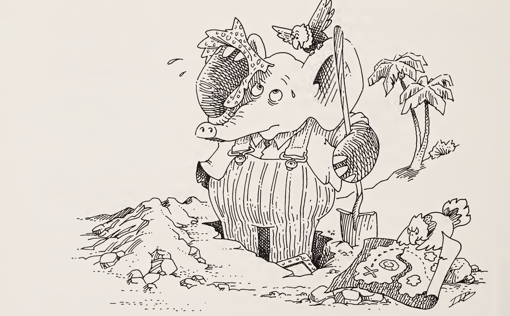

| 질문 | 답변 |
|:-----|:-----|
| 엔트리(entry)는 두 리스트의 쌍입니다. 첫 번째 리스트는 집합이고, 두 리스트의 길이는 같아야 합니다. 엔트리의 예를 몇 개 만들어 보세요. | 예는 다음과 같습니다.<br>`((appetizer entree beverage) (pate boeuf vin))`<br>그리고<br>`((appetizer entree beverage) (beer beer beer))`<br>그리고<br>`((beverage dessert) ((food is) (number one with us)))` |
| 이름들의 집합과 값들의 리스트로 어떻게 엔트리를 만들 수 있나요? | `(define new-entry build)`<br>이 함수로 우리의 예시들을 만들어 보세요. |
| `(lookup-in-entry name entry)`의 값은 무엇인가요?<br>`name`은 `entree`이고<br>`entry`는 `((appetizer entree beverage) (food tastes good))` | `tastes`입니다. |
| `name`이 `dessert`라면요? | 이 경우에는 `lookup-in-entry`의 사용자에게 무엇을 할지 결정을 맡기고 싶습니다. |
| 그것을 어떻게 할 수 있나요? | `lookup-in-entry`는 인자를 하나 더 받는데, 그 인자는 `name`이 엔트리의 첫 리스트에서 발견되지 않았을 때 호출됩니다. |
| 이 추가 함수는 인자를 몇 개 받아야 한다고 생각하나요? | 하나, `name`을 받아야 한다고 생각합니다. 왜일까요? |

| 질문 | 답변 |
|:-----|:-----|
| 다음은 `lookup-in-entry`의 정의입니다. 이어서 `lookup-in-entry-help`를 완성하세요. | `lookup-in-entry-help`의 정의는 아래와 같습니다. |

**`lookup-in-entry`**

```scheme
(define lookup-in-entry
  (lambda (name entry entry-f)
    (lookup-in-entry-help name
      (first entry)
      (second entry)
      entry-f)))
```

**`lookup-in-entry-help`**

```scheme
(define lookup-in-entry-help
  (lambda (name names values entry-f)
    (cond
      ((null? names) (entry-f name))
      ((eq? (car names) name)
       (car values))
      (else (lookup-in-entry-help name
              (cdr names)
              (cdr values)
              entry-f)))))
```

| 질문 | 답변 |
|:-----|:-----|
| 표(table)는 엔트리들의 리스트입니다. 환경(environment)이라고도 합니다. 여기 한 가지 예가 있습니다. 빈 표는 `()`로 나타냅니다. 다른 예를 몇 개 만들어 보세요. | 또 하나의 예입니다.<br>`(((appetizer entree beverage) (pate boeuf vin)) ((beverage dessert) ((food is) (number one with us))))` |
| 엔트리와 표(빈 표일 수도 있습니다)를 받아, 새 엔트리를 옛 표 앞에 붙여 새 표를 만드는 함수 `extend-table`을 정의하세요. | `(define extend-table cons)` |
| `(lookup-in-table name table table-f)`의 값은 무엇인가요?<br>`name`은 `entree`이고<br>`table`은 `(((entree dessert) (spaghetti spumoni)) ((appetizer entree beverage) (food tastes good)))`이며<br>`table-f`는 `(lambda (name) ...)` | `spaghetti`일 수도 있고 `tastes`일 수도 있지만, `lookup-in-table`은 엔트리들의 리스트를 순서대로 찾습니다. 그래서 `spaghetti`입니다. |

| 질문 | 답변 |
|:-----|:-----|
| `lookup-in-table`을 작성하세요.<br>힌트: 도움 함수를 잊지 마세요. | 정의는 아래와 같습니다. |
| 다음 함수가 무엇을 나타내는지 설명할 수 있나요?<br>`(lambda (name) (lookup-in-table name (cdr table) table-f))` | 이 함수는 이름이 첫 엔트리에서 발견되지 않았을 때 취할 액션입니다. |
| 서문에서 원자를 나타낼 때 산세리프 활자를 쓴다고 말했습니다. 지금까지는 그다지 중요하지 않았습니다. 이제부터는 원자가 산세리프인지 아닌지 주의해야 합니다. | 원자가 산세리프인지 아닌지 늘 의식하기 바랍니다. |
| "sans serif"가 산세리프로 되어 있지 않다는 것을 알아챘나요? | 그러길 바랍니다. 이것이 산세리프로 쓴 "sans serif"입니다. |
| 표현식에 좋은 표현(representation)을 골랐나요? | 네. 모두 S-표현식이므로 함수의 데이터가 될 수 있습니다. |
| 어떤 종류의 함수 말인가요? | 예를 들어 `value`입니다. |
| 6장의 `value`를 기억하나요? | `value`는 표현식의 자연스러운 값을 돌려주는 함수였습니다. |
| `(car (quote (a b c)))`의 값은 무엇인가요? | 우리는 `(quote (a b c))`가 무엇인지조차 모릅니다. |

**`lookup-in-table`**

```scheme
(define lookup-in-table
  (lambda (name table table-f)
    (cond
      ((null? table) (table-f name))
      (else (lookup-in-entry name
              (car table)
              (lambda (name)
                (lookup-in-table name
                  (cdr table)
                  table-f)))))))
```


| 질문 | 답변 |
|:-----|:-----|
| 다음의 값은 무엇인가요?<br>`(cons rep-a (cons rep-b (cons rep-c (quote ()))))`<br>`rep-a`는 `a`, `rep-b`는 `b`, `rep-c`는 `c` | `(a b c)`와 같습니다. |
| 좋습니다. 그럼 다음의 값은 무엇인가요?<br>`(cons rep-car (cons (cons rep-quote (cons (cons rep-a (cons rep-b (cons rep-c (quote ())))) (quote ()))) (quote ())))`<br>`rep-car`는 `car`, `rep-quote`는 `quote`, `rep-a`는 `a`, `rep-b`는 `b`, `rep-c`는 `c` | `(car (quote (a b c)))`라는 표현식의 표현입니다. |
| `(car (quote (a b c)))`의 값은 무엇인가요? | `a`입니다. |
| `(value e)`는 무엇인가요?<br>`e`는 `(car (quote (a b c)))` | `a`입니다. |
| `(value e)`는 무엇인가요?<br>`e`는 `(quote (car (quote (a b c))))` | `(car (quote (a b c)))`입니다. |

| 질문 | 답변 |
|:-----|:-----|
| `(value e)`는 무엇인가요?<br>`e`는 `(addl 6)` | `7`입니다. |
| `(value e)`는 무엇인가요?<br>`e`는 `6` | `6`입니다. 숫자는 상수이기 때문입니다. |
| `(value e)`는 무엇인가요?<br>`e`는 `(quote nothing)` | `nothing`입니다. |
| `(value e)`는 무엇인가요?<br>`e`는 `nothing` | `nothing`에는 값이 없습니다. |
| `(value e)`는 무엇인가요?<br>`e`는 `((lambda (nothing) (cons nothing (quote ()))) (quote (from nothing comes something)))` | `((from nothing comes something))`입니다. |
| `(value e)`는 무엇인가요?<br>`e`는 `((lambda (nothing) (cond (nothing (quote something)) (else (quote nothing)))) #t)` | `something`입니다. |
| `e`의 타입은 무엇인가요?<br>`e`는 `6` | `*const`입니다. |
| `e`의 타입은 무엇인가요?<br>`e`는 `#f` | `*const`입니다. |

| 질문 | 답변 |
|:-----|:-----|
| `(value e)`는 무엇인가요?<br>`e`는 `#f` | `#f`입니다. |
| `e`의 타입은 무엇인가요?<br>`e`는 `cons` | `*const`입니다. |
| `(value e)`는 무엇인가요?<br>`e`는 `car` | `(primitive car)`입니다. |
| `e`의 타입은 무엇인가요?<br>`e`는 `(quote nothing)` | `*quote`입니다. |
| `e`의 타입은 무엇인가요?<br>`e`는 `nothing` | `*identifier`입니다. |
| `e`의 타입은 무엇인가요?<br>`e`는 `(lambda (x y) (cons x y))` | `*lambda`입니다. |
| `e`의 타입은 무엇인가요?<br>`e`는 `((lambda (nothing) (cond (nothing (quote something)) (else (quote nothing)))) #t)` | `*application`입니다. |
| `e`의 타입은 무엇인가요?<br>`e`는 `(cond (nothing (quote something)) (else (quote nothing)))` | `*cond`입니다. |

| 질문 | 답변 |
|:-----|:-----|
| 타입은 몇 가지라고 생각하나요? | 여섯 가지를 찾았습니다.<br>`*const`<br>`*quote`<br>`*identifier`<br>`*lambda`<br>`*cond`<br>그리고<br>`*application` |
| 타입은 어떻게 표현하면 좋을까요? | 함수로 표현합니다. 이 함수들을 "액션(action)"이라고 부릅니다. |
| 액션이 적절한 타입의 표현식에 적용되었을 때 "옳은 일"을 하는 함수라면, `value`는 무엇을 해야 할까요? | 짐작했겠지만, 넘겨받은 표현식의 타입을 먼저 알아낸 뒤 그에 맞는 액션을 사용해야 합니다. |
| 8장의 `atom-to-function`을 기억하나요? | 숫자 표현식을 위해 `value`를 다시 썼을 때 `atom-to-function`이 유용했습니다. |
| 아래는 가능한 모든 S-표현식에 대해 올바른 액션(또는 함수)을 만들어 주는 함수입니다. `atom-to-action`을 정의하세요. | 정의는 아래와 같습니다. |

**`expression-to-action`**

```scheme
(define expression-to-action
  (lambda (e)
    (cond
      ((atom? e) (atom-to-action e))
      (else (list-to-action e)))))
```

**`atom-to-action`**

```scheme
(define atom-to-action
  (lambda (e)
    (cond
      ((number? e) *const)
      ((eq? e #t) *const)
      ((eq? e #f) *const)
      ((eq? e (quote cons)) *const)
      ((eq? e (quote car)) *const)
      ((eq? e (quote cdr)) *const)
      ((eq? e (quote null?)) *const)
      ((eq? e (quote eq?)) *const)
      ((eq? e (quote atom?)) *const)
      ((eq? e (quote zero?)) *const)
      ((eq? e (quote addl)) *const)
      ((eq? e (quote subl)) *const)
      ((eq? e (quote number?)) *const)
      (else *identifier))))
```


| 질문 | 답변 |
|:-----|:-----|
| 이제 도움 함수 `list-to-action`을 정의하세요. | 정의는 아래와 같습니다. |
| `expression-to-action`이 동작한다고 가정하고, 그것으로 `value`와 `meaning`을 정의하세요. | 정의는 아래와 같습니다. |
| `value`의 정의에서 `(quote ())`는 무엇인가요? | 빈 표입니다. 함수 `value`는 그것이 사용하는 모든 함수와 함께 인터프리터(interpreter)라고 불립니다. |
| 위 정의에 따르면 액션은 인자를 몇 개 받아야 하나요? | 두 개입니다. 표현식 `e`와 표입니다. |

**`list-to-action`**

```scheme
(define list-to-action
  (lambda (e)
    (cond
      ((atom? (car e))
       (cond
         ((eq? (car e) (quote quote))
          *quote)
         ((eq? (car e) (quote lambda))
          *lambda)
         ((eq? (car e) (quote cond))
          *cond)
         (else *application)))
      (else *application))))
```

**`value`**와 **`meaning`**

```scheme
(define value
  (lambda (e)
    (meaning e (quote ()))))

(define meaning
  (lambda (e table)
    ((expression-to-action e) e table)))
```


| 질문 | 답변 |
|:-----|:-----|
| 다음은 상수에 대한 액션입니다. 올바른가요? | 네. 숫자에 대해서는 표현식을 그대로 돌려주며, `0`, `1`, `2`, ... 에 대해 할 일은 그게 전부입니다.<br>`#t`에 대해서는 참을 돌려줍니다.<br>`#f`에 대해서는 거짓을 돌려줍니다.<br>그리고 상수 타입의 나머지 원자들은 모두 원시 함수를 나타냅니다. |
| 다음은 `*quote`에 대한 액션입니다. 도움 함수 `text-of`를 정의하세요. | `(define text-of second)` |
| 표를 벌써 사용했나요? | 아니요, 하지만 곧 사용합니다. |
| 왜 표가 필요한가요? | 식별자의 값을 기억하기 위해서입니다. |
| 표가 식별자의 값을 담고 있다고 할 때, `*identifier` 액션을 작성하세요. | 정의는 아래와 같습니다. |
| 다음은 `initial-table`입니다. 언제 사용되나요? | 절대 사용되지 않기를 바랍니다. 왜일까요? |
| `(lambda (x) x)`의 값은 무엇인가요? | 아직 모릅니다. 다만 그것이 비원시(non-primitive) 함수의 표현이어야 한다는 것은 압니다. |

**`*const`**

```scheme
(define *const
  (lambda (e table)
    (cond
      ((number? e) e)
      ((eq? e #t) #t)
      ((eq? e #f) #f)
      (else (build (quote primitive) e)))))
```

**`*quote`**

```scheme
(define *quote
  (lambda (e table)
    (text-of e)))
```

**`*identifier`**

```scheme
(define *identifier
  (lambda (e table)
    (lookup-in-table e table initial-table)))
```

**`initial-table`**

```scheme
(define initial-table
  (lambda (name)
    (car (quote ()))))
```

| 질문 | 답변 |
|:-----|:-----|
| 비원시 함수는 원시 함수와 어떻게 다른가요? | 원시 함수가 무엇을 하는지는 압니다. 비원시 함수는 그 인자들과 함수 본문으로 정의됩니다. |
| 그래서 비원시 함수를 사용하려면 그 형식 인자들과 함수 본문을 기억해야 합니다. | 최소한 그렇습니다. 다행히 그것은 `lambda` 표현식의 `cdr`입니다. |
| 그리고 또 무엇을 기억해야 하나요? | 나중에 필요할지 모르니 표도 함께 넣습니다. |
| 이것을 어떻게 표현하나요? | 물론 리스트로 표현합니다. |
| 다음은 `*lambda` 액션입니다. | 정의는 아래와 같습니다. |
| `(meaning e table)`은 무엇인가요?<br>`e`는 `(lambda (x) (cons x y))`이고<br>`table`은 `(((y z) ((8) 9)))` | `(non-primitive ((((y z) ((8) 9))) (x) (cons x y)))`입니다.<br>세 부분은 각각 표(table), 형식 인자(formals), 본문(body)입니다. |
| 이 세 원소짜리 리스트(표, 형식 인자, 본문)에서 각 부분을 꺼내는 도움 함수를 정의하는 것이 좋겠습니다. `table-of`, `formals-of`, `body-of`를 작성하세요. | `(define table-of first)`<br>`(define formals-of second)`<br>`(define body-of third)` |
| `(cond ...)`를 자기 말로 설명해 보세요. | 임의의 개수의 `cond` 줄을 받는 특별한 형식입니다. 각 줄을 차례로 봅니다. 왼쪽의 질문 부분이 거짓이면 나머지 줄을 봅니다. 그렇지 않으면 오른쪽의 답 부분으로 넘어갑니다. `else` 줄을 만나면 그 `cond` 줄의 질문 부분이 참인 것처럼 다룹니다. |

**`*lambda`**

```scheme
(define *lambda
  (lambda (e table)
    (build (quote non-primitive)
      (cons table (cdr e)))))
```

| 질문 | 답변 |
|:-----|:-----|
| 방금 말로 설명한 것을 그대로 하는 함수 `evcon`입니다. | 아래와 같습니다. |
| `else?`와 도움 함수 `question-of`, `answer-of`를 작성하세요. | 정의는 아래와 같습니다. |
| 우리는 첫째 계명을 어기지 않았나요? | 네. `(null? lines)`를 묻지 않으므로, 모든 `cond`의 질문 중 하나는 반드시 참이어야 합니다. |
| 이제 `evcon`을 사용해 `*cond` 액션을 작성하세요. | 정의는 아래와 같습니다. |
| 이 도움 함수들은 쓸모가 있나요? | 네, 훨씬 읽기 좋게 만들어 줍니다. 하지만 이미 알고 있었겠지요. |
| 이제 `*cond`를 이해했나요? | 아마 아닐 것입니다. |
| 어떻게 하면 익숙해질 수 있나요? | 예를 하나 시도해 보는 것이 최선입니다. 좋은 예는 다음과 같습니다.<br>`(*cond e table)`<br>`e`는 `(cond (coffee klatsch) (else party))`이고<br>`table`은 `(((coffee) (#t)) ((klatsch party) (5 (6))))` |

**`evcon`**

```scheme
(define evcon
  (lambda (lines table)
    (cond
      ((else? (question-of (car lines)))
       (meaning (answer-of (car lines))
         table))
      ((meaning (question-of (car lines))
         table)
       (meaning (answer-of (car lines))
         table))
      (else (evcon (cdr lines) table)))))
```

**`else?`, `question-of`, `answer-of`**

```scheme
(define else?
  (lambda (x)
    (cond
      ((atom? x) (eq? x (quote else)))
      (else #f))))

(define question-of first)

(define answer-of second)
```

**`*cond`**

```scheme
(define *cond
  (lambda (e table)
    (evcon (cond-lines-of e) table)))

(define cond-lines-of cdr)
```

| 질문 | 답변 |
|:-----|:-----|
| 표가 어떻게 사용되는지 보았나요? | 네, `*lambda`와 `*identifier`가 표를 사용합니다. |
| 하지만 식별자들은 어떻게 표에 들어가나요? | 아직 정의하지 않은 유일한 액션인 `*application`에서 들어갑니다. |
| 적용(application)은 어떻게 표현되나요? | 적용은 표현식들의 리스트인데, 그 `car` 자리에 값이 함수인 표현식이 들어 있는 것입니다. |
| 적용은 `(and ...)`, `(or ...)`, `(cond ...)` 같은 특별한 형식과 어떻게 다른가요? | 적용은 언제나 모든 인자의 의미를 구해야 합니다. |
| 함수를 적용하기 전에 모든 인자의 의미를 구해야 하나요? | 네. |
| 인자들의 표현 리스트와 표를 받아, 각 인자의 의미로 이루어진 리스트를 돌려주는 함수 `evlis`를 작성하세요. | 정의는 아래와 같습니다. |
| 적용의 의미를 구하려면 또 무엇이 필요한가요? | 그 적용의 `function-of`가 무엇을 의미하는지 알아내야 합니다. |
| 그러고 나서는요? | 함수의 의미를 인자들의 의미에 적용합니다. |
| 다음은 `*application`입니다. 올바른가요? | 물론입니다. `apply`, `function-of`, `arguments-of`를 올바르게 정의하기만 하면 됩니다. |

**`evlis`**

```scheme
(define evlis
  (lambda (args table)
    (cond
      ((null? args) (quote ()))
      (else
        (cons (meaning (car args) table)
          (evlis (cdr args) table))))))
```

**`*application`**

```scheme
(define *application
  (lambda (e table)
    (apply
      (meaning (function-of e) table)
      (evlis (arguments-of e) table))))
```

| 질문 | 답변 |
|:-----|:-----|
| `function-of`와 `arguments-of`를 작성하세요. | `(define function-of car)`<br>`(define arguments-of cdr)` |
| 함수는 몇 가지 종류가 있나요? | 두 가지입니다. 원시 함수와 비원시 함수입니다. |
| 함수의 표현은 두 가지로 어떻게 되나요? | `(primitive primitive-name)`과 `(non-primitive (table formals body))`입니다.<br>리스트 `(table formals body)`를 클로저 레코드(closure record)라고 부릅니다. |
| `primitive?`와 `non-primitive?`를 작성하세요. | 정의는 아래와 같습니다. |
| 이제 함수 `apply`를 작성할 수 있습니다. | 정의는 아래와 같습니다. |

**`primitive?`, `non-primitive?`**

```scheme
(define primitive?
  (lambda (l)
    (eq? (first l) (quote primitive))))

(define non-primitive?
  (lambda (l)
    (eq? (first l) (quote non-primitive))))
```

**`apply`**

```scheme
(define apply
  (lambda (fun vals)
    (cond
      ((primitive? fun)
       (apply-primitive
         (second fun) vals))
      ((non-primitive? fun)
       (apply-closure
         (second fun) vals)))))
```


| 질문 | 답변 |
|:-----|:-----|
| 다음은 `apply-primitive`의 정의입니다. 빈칸을 채우세요. | 빈칸의 답은 다음과 같습니다.<br>1. `(quote cons)`<br>2. `cdr`<br>3. `eq?`<br>4. `(second vals)`<br>5. `:atom?` |
| `apply-closure`만 남았나요? | 네, 그리고 `apply-closure`는 표를 확장해야 합니다. |
| `(f a b)`의 결과를 어떻게 찾을 수 있나요?<br>`f`는 `(lambda (x y) (cons x y))`이고<br>`a`는 `1`이며<br>`b`는 `(2)` | 까다롭습니다. 하지만 `(cons x y)`의 의미를 찾으려면 어떻게 해야 하는지는 압니다.<br>표는 `(((x y) (1 (2))))`입니다. |
| 왜 그렇게 할 수 있나요? | 여기서는 `apply-closure`가 필요 없습니다. |

**`apply-primitive`**

```scheme
(define apply-primitive
  (lambda (name vals)
    (cond
      ((eq? name (quote cons))
       (cons (first vals) (second vals)))
      ((eq? name (quote car))
       (car (first vals)))
      ((eq? name (quote cdr))
       (cdr (first vals)))
      ((eq? name (quote null?))
       (null? (first vals)))
      ((eq? name (quote eq?))
       (eq? (first vals) (second vals)))
      ((eq? name (quote atom?))
       (:atom? (first vals)))
      ((eq? name (quote zero?))
       (zero? (first vals)))
      ((eq? name (quote addl))
       (addl (first vals)))
      ((eq? name (quote subl))
       (subl (first vals)))
      ((eq? name (quote number?))
       (number? (first vals))))))
```

**`:atom?`**

```scheme
(define :atom?
  (lambda (x)
    (cond
      ((atom? x) #t)
      ((null? x) #f)
      ((eq? (car x) (quote primitive)) #t)
      ((eq? (car x) (quote non-primitive)) #t)
      (else #f))))
```


| 질문 | 답변 |
|:-----|:-----|
| 지난 두 단계를 일반화할 수 있나요? | 비원시 함수, 즉 클로저를 값들의 리스트에 적용하는 것은, 클로저의 표를<br>`(formals values)`<br>형태의 엔트리로 확장한 뒤 클로저의 본문의 의미를 구하는 것과 같습니다. 이 엔트리에서 `formals`는 클로저의 형식 인자이고, `values`는 `evlis`의 결과입니다. |
| 여기까지 다 따라왔나요? | 아니라면, `apply-closure`의 정의를 보세요. |
| 이것은 복잡한 함수이니 예를 하나 들어 볼 만합니다. | 다음에서 `closure`는 `((((u v w) (1 2 3)) ((x y z) (4 5 6))) (x y) (cons z x))`이고 `vals`는 `((a b c) (d e f))`입니다. |
| `meaning`의 새 인자들은 무엇이 될까요? | `meaning`의 새 `e`는 `(cons z x)`가 되고, 새 표는<br>`(((x y) ((a b c) (d e f))) ((u v w) (1 2 3)) ((x y z) (4 5 6)))`가 됩니다. |

**`apply-closure`**

```scheme
(define apply-closure
  (lambda (closure vals)
    (meaning (body-of closure)
      (extend-table
        (new-entry
          (formals-of closure)
          vals)
        (table-of closure)))))
```

| 질문 | 답변 |
|:-----|:-----|
| `(cons z x)`의 의미는 무엇인가요?<br>`z`는 `6`이고<br>`x`는 `(a b c)` | `(meaning e table)`과 같습니다.<br>`e`는 `(cons z x)`이고<br>표는 `(((x y) ((a b c) (d e f))) ((u v w) (1 2 3)) ((x y z) (4 5 6)))`입니다. |
| 모든 인자의 의미를 찾아봅시다. `(evlis args table)`은 무엇인가요?<br>`args`는 `(z x)`이고<br>표는 `(((x y) ((a b c) (d e f))) ((u v w) (1 2 3)) ((x y z) (4 5 6)))` | 그러기 위해서는 다음 둘을 모두 찾아야 합니다.<br>`(meaning e table)`에서 `e`는 `z`이고,<br>`(meaning e table)`에서 `e`는 `x`입니다. |
| `(meaning e table)`은 무엇인가요?<br>`e`는 `z` | `*identifier`를 사용하면 `6`입니다. |
| `(meaning e table)`은 무엇인가요?<br>`e`는 `x` | `*identifier`를 사용하면 `(a b c)`입니다. |
| 그러면 `evlis`의 결과는 무엇인가요? | `(6 (a b c))`입니다. `evlis`는 의미들의 리스트를 돌려주기 때문입니다. |
| `(meaning e table)`은 무엇인가요?<br>`e`는 `cons` | `*const`를 사용하면 `(primitive cons)`입니다. |

| 질문 | 답변 |
|:-----|:-----|
| 이제 다음을 할 준비가 되었습니다.<br>`(apply fun vals)`<br>`fun`은 `(primitive cons)`이고<br>`vals`는 `(6 (a b c))`<br>어느 경로를 가야 하나요? | `apply-primitive` 경로입니다. |
| `(apply-primitive name vals)`에서 어느 `cond` 줄이 선택되나요?<br>`name`은 `cons`이고<br>`vals`는 `(6 (a b c))` | 세 번째 줄입니다.<br>`((eq? name (quote cons)) (cons (first vals) (second vals)))` |
| 이제 다 끝났나요? | 네, 우리는 지쳤습니다. |
| 하지만 `(define ...)`은 어떻게 하나요? | 재귀는 Y 콤비네이터로 얻을 수 있으므로 필요하지 않습니다. |
| `(define ...)`이 정말로 필요 없나요? | 네, 하지만 《The Seasoned Schemer》를 보세요. |
| 그렇다면 Y 콤비네이터로 변환을 하면 인터프리터 위에서 인터프리터를 돌릴 수 있나요? | 네, 하지만 그럴 필요는 없습니다. |
| `value`를 특별하게 만드는 것은 무엇인가요? | 표현식의 표현을 본다는 점입니다. |
| `will-stop?`은 표현식의 표현을 보아야 하나요? | 그러면 많은 도움이 될 것입니다. |
| 도움이 되나요? | 아니요, 그럴 필요 없습니다. 같은 게임을 다시 할 수 있기 때문입니다. `last-try?` 같은 함수를 정의해서, 새로 개선한 `will-stop?`도 정의할 수 없음을 보일 수 있습니다. |
| 그 밖에 또 있나요? | 네, 잔치를 벌일 시간입니다. |


# 다섯 가지 규칙과 법칙들 (The Five Rules and the Laws)

> **car의 법칙**
>
> 원시 함수 `car`는 비어 있지 않은 리스트에 대해서만 정의된다.

> **cdr의 법칙**
>
> 원시 함수 `cdr`은 비어 있지 않은 리스트에 대해서만 정의된다. 비어 있지 않은 리스트의 `cdr`은 언제나 또 다른 리스트이다.

> **cons의 법칙**
>
> 원시 함수 `cons`는 두 인자를 받는다. `cons`의 두 번째 인자는 리스트여야 한다. 결과는 리스트이다.

> **null?의 법칙**
>
> 원시 함수 `null?`은 리스트에 대해서만 정의된다.

> **eq?의 법칙**
>
> 원시 함수 `eq?`는 두 인자를 받는다. 각 인자는 비숫자 원자여야 한다.

# 막간 (Intermission)

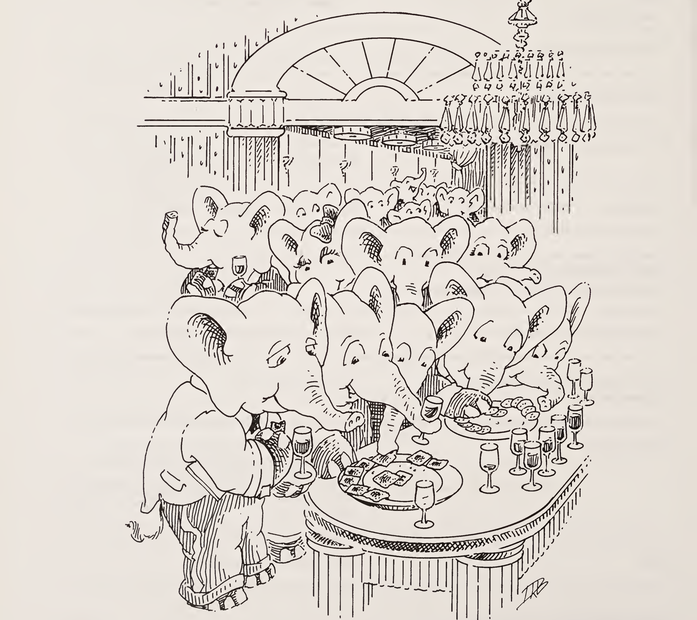

여기까지 오셨습니다. 막간입니다. 이제 무엇을 하시겠습니까? 서둘러 나가서 나머지 공연인 『The Seasoned Schemer』를 구해 읽어도 좋고, 아래에 소개하는 책들을 읽어도 좋습니다. 이 책들은 모두 고전이며, 어떤 것은 꽤 오래되었습니다. 그럼에도 시간의 시험을 견뎌 왔고, 모두 한번쯤 살펴볼 가치가 있습니다. 어떤 책은 수학이나 논리와 전혀 상관이 없고, 어떤 책은 흥미로운 이야기를 들려주는 방식으로만 수학과 관계되며, 또 어떤 책은 그저 발견할 가치가 있을 뿐입니다. 오해는 없으시길 바랍니다. 이 책들은 속편을 읽을 준비를 시키기 위한 것이 아니라, 순전히 여러분의 즐거움을 위한 것입니다. 『The Seasoned Schemer』의 끝부분에서 Scheme과 Common Lisp에 관한 참고 문헌 목록을 찾을 수 있습니다. 다음 책으로 서둘러 넘어가야 한다는 부담은 갖지 마세요. 잠시 쉬면서 이 책들 가운데 몇 권을 읽어 보십시오. 그러고 나서 조금 느긋해지고, 아마 우리가 억지로 먹인 칼로리도 좀 태워 버린 뒤에, 속편으로 뛰어드십시오. 즐기세요!


