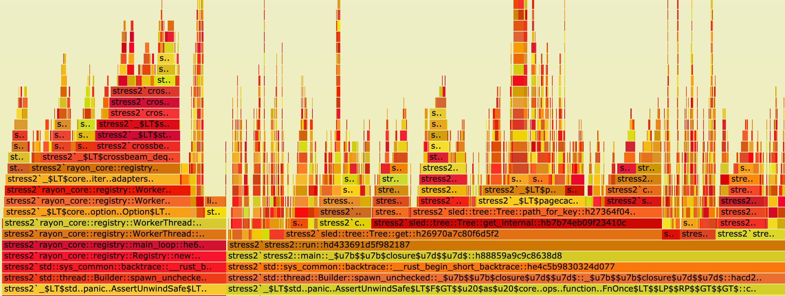

이 문서는 원본 [repo](https://github.com/apollographql/rust-best-practices) 전체를 하나의 Quarto 문서로 합친 합본으로 Rust 공식 API 가이드라인의 보완 자료이다:

- [Rust Official API Guidelines](https://rust-lang.github.io/api-guidelines/about.html)
- [Rust Analyzer Style Guide](https://rust-analyzer.github.io/book/contributing/style.html)

# Chapter 1 - 코딩 스타일과 관용구 {#sec-ch01}

## 1.1 복제보다 빌림 사용하기

Rust의 소유권 시스템은 복제(`T.clone()`)보다 빌림(`&T`)을 권장한다.

### ✅ `Clone`을 사용해도 좋은 경우:

* 객체를 변경하면서 원본도 그대로 보존해야 할 때 (불변 스냅샷).
* `Arc`나 `Rc` 포인터를 다룰 때.
* 데이터를 스레드 간에 공유할 때, 보통은 `Arc`로.
* 성능에 민감하지 않은 코드의 대규모 리팩터링을 피하고 싶을 때.
* 결과를 캐싱할 때 (아래 간단한 예시):

```rust
fn get_config(&self) -> Config {
  self.cached_config.clone()
}
```

* 기반 API가 소유 데이터(Owned Data)를 요구할 때.

### 🚨 피해야 할 `Clone` 함정:

* 루프 안에서 자동으로 복제하기 `.map(|x| x.clone)`, 이터레이터 끝에서 `.cloned()`나 `.copied()`를 호출하는 쪽을 선호하라.
* `Vec<T>`나 `HashMap<K, V>` 같은 큰 자료구조를 복제하기.
* 라이프타임을 조정하는 대신, 잘못 설계된 API 때문에 복제하기.
* `Vec<T>`나 `&Vec<T>` 대신 `&[T]`를 선호하라.
* `String` 대신 `&str`나 `&String`을 선호하라.
* `T` 대신 `&T`를 선호하라.
* 참조 인자를 복제하기, 소유권이 필요하다면 호출자가 알 수 있게 인자에서 명시하라. 예시:

```rust
fn take_a_borrow(thing: &Thing) {
  let thing_cloned = thing.clone(); // 호출자가 소유권을 넘기도록 바꿔야 한다
}
```

### ✅ 빌림을 선호하라:

```rust
fn process(name: &str) {
  println!(“Hello {name}”);
}

let user = String::from(“foo”);
process(&user);
```

### ❌ 불필요한 복제는 피하라:

```rust
fn process_string(name: String) {
  println!(“Hello {name}”);
}

let user = String::from(“foo”);
process(user.clone()); // Unnecessary clone
```

## 1.2 언제 값으로 전달해야 할까? (Copy 트레이트)

모든 타입을 참조(`&T`)로 넘겨야 하는 것은 아니다. 타입이 작고 복사 비용이 저렴하다면, 값으로 전달하는 편이 나은 경우가 많다. Rust에서는 이를 `Copy` 트레이트로 명시적으로 표현한다.

### ✅ 값으로 전달해도 좋은 경우, `Copy`:

* 타입이 `Copy`를 구현할 때 (`u32`, `bool`, `f32`, 작은 구조체).
* 값을 이동하는 비용이 무시할 만큼 작을 때.

```rust
fn increment(x: u32) -> u32 {
    x + 1
}

let num = 1;
let new_num = increment(num); // `num` still usable after this point
```

### ❓ 어떤 구조체에 `Copy`를 붙여야 할까?

* 직접 만든 타입에 `Copy`를 붙일지 고민될 때의 기준:
* 모든 필드가 그 자체로 `Copy`일 때.
* 구조체가 `작을` 때, 메모리상 최대 2워드(많아야 3워드) 또는 24바이트까지 (1워드는 64비트/8바이트).
* 구조체가 소유권을 끌어들이지 않는 “단순 데이터 객체”일 때 (힙 할당 없음. 예: `Vec`나 `String`이 없는 경우).
* ❗해당 타입이 `Iterator`를 함께 구현하지 않을 때. 모든 필드가 `Copy`라도 `Copy`와 `Iterator`를 같은 타입에 절대 함께 붙이지 마라 ([§1.5](#15-iterator-iter-vs-for) 참고).

❗Rust 배열은 스택에 할당된다. 즉 내부 타입이 `Copy`라면 복사될 수 있지만, 프로그램 스택에 할당되므로 스택 오버플로우가 쉽게 날 수 있다. 자세한 내용은 [Chapter 3 - Stack vs Heap](https://github.com/apollographql/rust-best-practices/blob/main/book/chapter_03.md#33-stack-vs-heap-be-size-smart)에서 다룬다.

참고로, 기본 타입별 바이트 크기는 다음과 같다:

#### 정수형:

| 타입        	| 크기     	|
|-------------	|----------	|
|    i8 u8    	|  1 바이트  	|
| i16 u16     	| 2 바이트  	|
| i32 u32     	| 4 바이트  	|
| i64 u64     	| 8 바이트  	|
| isize usize 	| Arch     	|
| i128 u128   	| 16 바이트 	|

#### 부동소수점:

| 타입     	| 크기     	|
|----------	|----------	|
| f32     	| 4 바이트  	|
| f64     	| 8 바이트  	|


#### 기타:

| 타입     	| 크기     	|
|----------	|----------	|
| bool     	| 1 바이트  	|
| char     	| 4 바이트  	|


### ✅ `Copy`를 붙이면 좋은 구조체:
```rust
#[derive(Debug, Copy, Clone)]
struct Point {
  x: f32,
  y: f32,
  z: f32
}
```

### ❌ `Copy`를 붙이면 안 되는 구조체:
```rust
#[derive(Debug, Clone)]
struct BadIdea {
  age: i32,
  name: String, // String is not `Copy`
}
```

### ❓어떤 열거형에 `Copy`를 붙여야 할까?

* 열거형이 태그나 원자값처럼 동작할 때.
* 열거형의 페이로드가 모두 `Copy`일 때.
* ❗열거형의 크기는 가장 큰 변형(variant) 기준으로 정해진다.

### ✅ derive를 붙이면 좋은 열거형
```rust
#[derive(Debug, Copy, Clone)]
enum Direction {
  North,
  South,
  East,
  West,
}
```

## 1.3 `Option<T>`와 `Result<T, E>` 다루기
Rust 1.65부터 `Option`과 `Result` 타입을 안전하게 꺼내는 더 좋은 방법이 생겼다. 기본 `return` 값이나 `continue`, `break`가 있는 경우 `let Some(x) = … else { … }` 또는 `let Ok(x) = … else { … }`를 쓰는 방식이다. 값이 없는 경우가 예외가 아니라 예상된 정상 흐름일 때 조기 반환하기에 좋다.

### ✅ `Option`과 `Result`에 패턴 매칭을 각각 써야 하는 경우

* 내부 타입 `T`와 `E`에 대해 패턴 매칭하고 싶을 때는 `match`를 사용하라
```rust
match self {
  Ok(Direction::South) => { … },
  Ok(Direction::North) => { … },
  Ok(Direction::East) => { … },
  Ok(Direction::West) => { … },
  Err(E::One) => { … },
  Err(E::Two) => { … },
}

match self {
  Some(3|5) => { … }
  Some(x) if x > 10  => { … }
  Some(x) => { … }
  None => { … }
}
```

* 타입을 더 복잡한 형태로 변환하고 싶을 때, 예를 들어 `Result<T, E>`를 `Result<Option<U>, E>`로 바꾸는 경우 `match`를 사용하라.
```rust
match self {
  Ok(t) => Ok(Some(t)),
  Err(E::Empty) => Ok(None),
  Err(err) => Err(err),
}
```

* 분기 코드가 매칭 실패에 대한 정보를 알 필요가 없거나 추가 연산이 필요 없을 때는 `let PATTERN = EXPRESSION else {  DIVERGING_CODE; }`를 사용하라:
```rust
let Some(&Direction::North) = self.direction.as_ref() else {
	return Err(DirectionNotAvailable(self.direction));
}
```

* 패턴 매칭 안에서 `break`나 `continue`를 하고 싶을 때는 `let PATTERN = EXPRESSION else {  DIVERGING_CODE; }`를 사용하라:
```rust
for x in self {
    let Some(x) = x else {
	continue;
    }
}
```

* `DIVERGING_CODE`에서 추가 연산이 필요할 때는 `if let PATTERN = EXPRESSION else {  DIVERGING_CODE; }`를 사용하라:
```rust
if let Some(x) = self.next() {
  // computation
} else {
  // computation when `None/Err` or not matched
}
```

❗`Err` 안의 값에 관심이 없다면 `?`를 써서 `Err`를 호출자에게 전파하라.

### ❌ 잘못된 Option/Result 패턴 매칭:

* `Result`와 `Option` 사이의 변환 (`.ok()`, `.ok_or()`, `ok_or_else()`를 선호하라)
```rust
match self {
  Ok(t) => Some(t),
  Err(_) => None
}
```

* 분기 코드가 기본값이거나 미리 계산된 값인데 `if let PATTERN = EXPRESSION else {  DIVERGING_CODE; }`를 쓰는 경우 (`let PATTERN = EXPRESSION else {  DIVERGING_CODE; }`를 선호하라):
```rust
if let Some(values) = self.next() {
  // computation
  (Some(..), values)
} else {
  (None, Vec::new())
}
```

* 테스트 바깥에서 `unwrap`이나 `expect` 사용하기:
```rust
let port = config.port.unwrap();
```

## 1.4 이른 할당 방지하기

`or`, `map_or`, `unwrap_or`, `ok_or` 같은 함수를 다룰 때는 주의가 필요하다. 새 문자열을 만들거나, 컬렉션을 생성하거나, 상태를 관리하는 함수를 호출하는 등 메모리 할당이 필요한 경우가 있기 때문이다. 이런 경우에는 `_else`가 붙은 대응 함수로 교체할 수 있다:

### ✅ 좋은 예

```rust
let x = None;
assert_eq!(x.ok_or(ParseError::ValueAbsent), Err(ParseError::ValueAbsent));

let x = None;
assert_eq!(x.ok_or_else(|| ParseError::ValueAbsent(format!("this is a value {x}"))), Err(ParseError::ValueAbsent));


let x: Result<_, &str> = Ok("foo");
assert_eq!(x.map_or(42, |v| v.len()), 3);


let x : Result<_, String> = Ok("foo");
assert_eq!(x.map_or_else(|e|format!("Error: {e}"), |v| v.len()), 3);

let x = "1,2,3,4";
assert_eq!(x.parse_to_option_vec.unwrap_or_else(Vec::new), Ok(vec![1, 2, 3, 4]));
```

### ❌ 나쁜 예

```rust
let x : Result<_, String> = Ok("foo");
assert_eq!(x.map_or(format!("Error with uninformed content"), |v| v.len()), 3);

let x = "1,2,3,4";
assert_eq!(x.parse_to_option_vec.unwrap_or(Vec::new()), Ok(vec![1, 2, 3, 4])); // could be replaced with `.unwrap_or_default`

let x = None;
assert_eq!(x.ok_or(ParseError::ValueAbsent(format!("this is a value {x}"))), Err(ParseError::ValueAbsent));
```

### Err 매핑하기

`Result::Err`를 다룰 때는 `Err`를 로그로 남기고 더 추상적인 에러나 더 자세한 에러로 변환해야 할 때가 있다. 이럴 때는 `inspect_err`와 `map_err`를 쓰면 된다:

```rust
let x = Err(ParseError::InvalidContent(...));

x
.inspect_err(|err| tracing::error!("function_name: {err}"))
.map_err(|err| GeneralError::from(("function_name", err)))?;
```

## 1.5 이터레이터, `.iter` 대 `for`

먼저 두 방식의 기본 루프를 이해해야 한다. 0부터 10까지 수 중에서 짝수에 1을 더한 값을 모두 합하는 문제를 생각해 보자:

* `for`:
```rust
let mut sum = 0;
for x in 0..=10 {
    if x % 2 == 0 {
        sum += x + 1;
    }
}
```

* `iter`:
```rust
let sum: i32 = (0..=10)
    .filter(|x| x % 2 == 0)
    .map(|x| x + 1)
    .sum();
```

> 두 버전 모두 같은 동작을 하고, 올바르고 관용적인 코드다. 다만 잘 어울리는 맥락이 서로 다르다.

### `for` 루프를 선호해야 할 때

* 조기 탈출(`break`, `continue`, `return`)이 필요할 때.
* 부수 효과(예: 로깅, IO)가 따르는 단순 반복일 때
    * 로깅은 `inspect`와 `inspect_err` 함수를 쓰면 `Iterator`에서도 올바르게 할 수 있다.
* 간결한 체이닝보다 가독성이 더 중요할 때.

#### 예시:
```rust
for value in &mut value {
    if *value == 0 {
        break;
    }
    *value += fancy_equation();
}
```

### 이터레이터 방식(`.iter()`와 `.into_iter()`)을 선호해야 할 때

* 컬렉션이나 `Option/Result`를 변환할 때.
* 여러 단계를 우아하게 이어 붙일 수 있을 때.
* 조기 탈출이 필요 없을 때.
* `.enumerate`로 인덱스가 있는 값이 필요할 때.
```rust
let values: Vec<_> = vec.into_iter()
    .enumerate()
    .filter(|(_index, value)| value % 2 == 0)
    .map(|(index, value)| value % index)
    .collect()
```

* `.windows`나 `chunks` 같은 컬렉션 함수를 써야 할 때.
* 여러 출처의 데이터를 합치면서 중간 컬렉션을 여러 개 할당하고 싶지 않을 때.
* 이터레이터는 `for` 루프와 함께 쓸 수 있다:
```rust
for value in vec.iter().enumerate()
    .filter(|(index, value)| value % index == 0) {
    // ...
}
    
```

> #### ❗기억하라: 이터레이터는 지연 평가된다
>
> * `.collect`, `.sum`, `.for_each` 같은 컨슈머를 호출하기 전까지는 `.iter`, `.map`, `.filter`가 아무 일도 하지 않는다.
> * 지연 평가 덕분에 이터레이터 체인은 컴파일 시점에 하나의 루프로 합쳐진다.

### 🚨 피해야 할 안티 패턴

* 포맷팅 없이 체이닝하지 마라. 체이닝된 함수는 각각 자기 줄에 올바른 들여쓰기로 쓰는 쪽을 선호하라 (`rustfmt`가 알아서 처리해 줄 것이다).
* 코드를 읽기 어렵게 만든다면 체이닝하지 마라.
* 나중에 버려질 컬렉션(예: 벡터)을 괜히 `collect`/할당하지 마라. 뒤따르는 더 큰 연산이나 또 다른 반복에서 버려질 거라면 특히 그렇다.
* 컬렉션의 소유권이 필요하지 않다면 `into_iter`보다 `iter`를 선호하라.
* 내부 타입이 `Copy`를 구현하는 컬렉션, 예컨대 `Vec<T: Copy>`에는 `into_iter`보다 `iter`를 선호하라.
* 같은 타입에 `Copy`와 `Iterator`를 함께 구현(또는 derive)하지 마라. 이터레이터를 복사한 뒤 한쪽만 전진시키면 다른 쪽은 그대로 남아, 조용히 잘못된 결과가 나온다. 악명 높은 함정이다. 표준 라이브러리도 정확히 이 문제를 겪었다. 그래서 `Range`가 historically `Copy`가 될 수 없었고, Rust 1.96에서 안정화된 새 `core::range` 타입들은 `Iterator` 대신 `IntoIterator`를 구현해서 `Copy`가 가능해졌다. `Copy` 타입에 대한 이터레이터가 필요하다면 `IntoIterator`를 구현하고 별도의 이터레이터 구조체를 반환하라.
* 숫자를 합할 때는 `.fold`보다 `.sum`을 선호하라. `.sum`은 합산에 특화되어 있어서 컴파일러가 최적화할 수 있음을 알지만, fold는 매 단계마다 불투명한 클로저를 적용해야 한다. 초깃값부터 합산해야 한다면 식에 그냥 더하라 `let my_sum = [1, 2, 3].sum() + 3`.

## 1.6 주석: 맥락을 담되, 잡동사니는 버리기

> "주석은 왜(why)를 위한 것이지, 무엇(what)이나 어떻게(how)를 위한 게 아니다"

표현력 있는 타입과 좋은 네이밍을 갖춘 잘 쓴 Rust 코드는 그 자체로 말을 한다. 수준 높은 코드베이스 중에는 주석이 거의 없거나 아예 없는 채로도 잘 굴러가는 곳이 많다. 그리고 그건 좋은 일이다.

그래도 코드만으로는 부족한 순간이 있다. 성능상의 특이점이나 외부 제약, 자명하지 않은 트레이드오프처럼 독자에게 작은 힌트가 필요한 경우다. 이럴 때는 간결한 주석 하나로 몇 시간의 삽질이나 깃 히스토리 뒤지기를 막을 수 있다.

### ✅ 좋은 주석

* 안전성 관련 우려:
```rust
// SAFETY: We have checked that the pointer is valid and non-null. @Function xyz.
unsafe { std::ptr::copy_nonoverlapping(src, dst, len); }
```

* 성능상의 특이점:
```rust
// This algorithm is a fast square root approximation
const THREE_HALVES: f32 = 1.5;
fn q_rsqrt(number: f32 ) -> f32 {
	let mut i: i32 = number.to_bits() as i32;
i = 0x5F375A86_i32.wrapping_sub(i >> 1);
let y = f32::from_bits(i as u32);
y * (THREE_HALVES - (number * 0.5 * y * y))
}
```

* 명확한 코드가 주석을 이긴다. 그래도 왜 그런지가 자명하지 않다면, 담백하게 밝히거나 관련 위치로 연결하라:
```rust
// PERF: Generating the root store per subgraph caused high TLS startup latency on MacOS
// This works as a caching alternative. See: [ADR-123](link/to/adr-123)
let subgraph_tls_root_store: RootCertStore = configuration
    .tls
    .subgraph
    .all
    .create_certificate_store()
    .transpose()?
    .unwrap_or_else(crate::services::http::HttpClientService::native_roots_store);
let connector_tls_root_store: RootCertStore = configuration
    .tls
    .connector
    .all
    .create_certificate_store()
    .transpose()?
    .unwrap_or_else(crate::services::http::HttpClientService::native_roots_store);
```

* ❗ 적절한 절에서 다룰 사용 사례가 더 나올 예정이다.

### ❌ 나쁜 주석

* 장황한 설명: 긴 주석과 여러 줄에 걸친 주석
```rust
// Lorem Ipsum is simply dummy text of the printing and typesetting industry. 
// Lorem Ipsum has been the industry's standard dummy text ever since the 1500s, 
// when an unknown printer took a galley
fn do_something_odd() {
  …
}
```
> 함수를 설명하는 거라면 `/// doc` 주석을 선호하라.

* 함수로 빼면 더 낫거나, 뻔한 내용을 적은 주석
```rust
fn computation() {
  // increment i by 1
  i += 1;
}
```

### ✅ 긴 함수에 주석을 달기보다 나누기

함수 안에서 "무엇"이나 "어떻게", "단계별" 설명을 담은 긴 주석을 쓰고 있다면, 나눌 때가 됐다는 신호일 수 있다. 리팩터링을 권한다. 가독성뿐 아니라 테스트 용이성에도 도움이 된다:

#### ❌ 이렇게 말고:
```rust
fn process_request(request: T) {
    // We first need to validate request, because of corner case x, y, z
    // As the payload can only be decoded when they are valid
    // Then we can perform authorization on the payload
    // lastly with the authorized payload we can dispatch to handler
}
```

#### ✅ 이렇게 하라
```rust
fn process_request(request: T) -> Result<(), Error> {
    validate_request_headers(&request)?;
    let payload = decode_payload(&request);
    authorize(&payload)?;
    dispatch_to_handler(payload)
}

#[cfg(test)]
mod tests {
    #[test]
    fn validate_request_happy_path() { ... }

    #[test]
    fn validate_request_fails_on_x() { ... }

    #[test]
    fn validate_request_fails_on_y() { ... }

    #[test]
    fn decode_validated_request() { ... }

    #[test]
    fn authorize_payload_xyz() { ... }
}
```

구조와 네이밍으로 주석을 대체하고,  살아 있는 문서로서의 테스트로 문서화를 보강하라.

> ❗ 나누는 기준은 네이밍과 명확성이지 중복 제거가 아니다. 중복된 줄을 없애려고 헬퍼로 빼기 전에 [§1.8](#18-when-to-extract-a-function-and-when-not-to)을 확인하라.

### 📝 TODO는 주석이 아니다 - 제대로 추적하라

코드에 `// TODO: Lorem Ipsum` 같은 주석을 남겨 두지 마라. 대신:

* Jira나 GitHub 이슈로 만들어라.
* 혼선을 막기 위해 필요하다면 코드에 이슈를 참조하고, 이슈에 코드를 참조하라.

```rust
// See issue #123: support hyper 2.0
```

이렇게 하면 코드를 깔끔하게 유지하고 할 일을 잊지 않는 데 도움이 된다.

### 살아 있는 문서로서의 주석

주석을 "살아 있는 문서"라고 부를 때의 함정이 몇 가지 있다:

* 코드는 진화한다.
* 맥락은 바뀐다.
* 주석은 낡는다.
* 길고 많은 주석은 사람들이 읽지 않게 만든다.
* 팀은 무관해진 주석을 지우길 두려워하게 된다.

주석을 발견했다면 곧이곧대로 믿지 마라. 맥락 안에서 읽어라. 틀렸거나 낡았다면 고치거나 지워라. 오해를 부르는 주석은 없는 것만 못하다.

> 주석은 당신을 불편하게 해야 한다. 낡은 테스트처럼 재검증이 필요하다.

더 깊은 근거가 필요하다면, 이렇게 하라:

* 디자인 문서나 ADR로 연결하라. 비즈니스 로직은 디자인 문서에, 성능 트레이드오프는 ADR에 두면 잘 어울린다.
* 실행 예제와 사용법 문서는 Rust 문서, 즉 `/// doc comment`로 옮겨라. `cargo doc` 같은 도구로 테스트하고 최신 상태로 유지할 수 있다.

> 문서 주석과 문서 테스트, `///`와 `//!`에 대해서는 [Chapter 8 - Comments vs Documentation](#sec-ch08)에서 다룬다

## 1.7 Use 선언 - "임포트"

언어마다 임포트 정렬 방식이 다르다. Rust 생태계에서 [표준 방식](https://github.com/rust-lang/rustfmt/issues/4107)은 다음과 같다:

- `std` (`core`, `alloc`도 여기에 속한다).
- 외부 크레이트 (`Cargo.toml`의 `[dependencies]`에 있는 것).
- 워크스페이스 크레이트 (워크스페이스 멤버 크레이트).
- 이 모듈의 `super::`.
- 이 모듈의 `crate::`.

```rust
// std
use std::sync::Arc;

// external crates
use chrono::Utc;
use juniper::{FieldError, FieldResult};
use uuid::Uuid;

// crate code lives in workspace
use broker::database::PooledConnection;

// super:: / crate::
use super::schema::{Context, Payload};
use super::update::convert_publish_payload;
use crate::models::Event;
```

일부 기업 환경에서는 핵심 패키지를 `std` 뒤에 두는 방식을 택하기도 한다. 기업명으로 시작하는 모든 외부 패키지가 다른 패키지보다 앞에 오게 하는 것이다:

```rust
// std
use std::sync::Arc;

// enterprise external crates
use enterprise_crate_name::some_module::SomeThing;

// external crates
use chrono::Utc;
use juniper::{FieldError, FieldResult};
use uuid::Uuid;

// crate code lives in workspace
use broker::database::PooledConnection;

// super:: / crate::
use super::schema::{Context, Payload};
use super::update::convert_publish_payload;
use crate::models::Event;
```

일일이 손으로 맞추지 않는 한 가지 방법은 `rustfmt.toml`에 다음 옵션을 넣는 것이다:

```toml
reorder_imports = true
imports_granularity = "Crate"
group_imports = "StdExternalCrate"
```

> Rust 1.88 기준으로 코드를 올바르게 재정렬하려면 nightly에서 rustfmt를 실행해야 한다 `cargo +nightly fmt`.

## 1.8 함수를 분리해야 할 때 (그리고 하지 말아야 할 때)

이 장([§1.6](#-breaking-up-long-functions-over-commenting-them))과 [Chapter 8](#sec-ch08)에서는 긴 함수를 나누고 서술형 주석을 네이밍된 헬퍼로 교체하라고 권한다. 이 조언은 네이밍과 명확성에 관한 것이지, 반복되는 줄을 모조리 찾아내라는 허락이 아니다. 분리에도 비용이 든다. 헬퍼가 하나 늘 때마다 간접 계층이 하나 늘고, 잘못 만든 추상화는 약간의 중복보다 제거하기 훨씬 어렵다.

> "중복은 잘못된 추상화보다 훨씬 싸다." — [Sandi Metz, The Wrong Abstraction](https://sandimetz.com/blog/2016/1/20/the-wrong-abstraction)

### 📏 세 번의 법칙

[Martin Fowler의 *Refactoring*](https://martinfowler.com/books/refactoring.html)에서 Don Roberts의 말을 인용한 것이다:

> 처음 뭔가를 할 때는 그냥 한다. 비슷한 걸 두 번째 할 때는 중복이 거슬리지만, 그래도 그냥 복붙한다. 비슷한 걸 세 번째 할 때 리팩터링한다.

두어 줄이 두 군데서 겹치는 정도는 보통 괜찮다. 헬퍼를 꺼내 들기 전에 세 번째 등장을 기다려라. 그때쯤이면 추측이 아니라 추상화가 실제로 *무엇*인지 알게 된다.

### 🧠 DRY는 지식을 말하는 것이지, 텍스트를 말하는 게 아니다

[DRY](https://en.wikipedia.org/wiki/Don%27t_repeat_yourself) (*The Pragmatic Programmer*)는 모든 지식은 단 하나의 표현을 가져야 한다고 말한다. "똑같이 생긴 코드 조각이 두 군데 있으면 안 된다"는 뜻이 아니다. 오늘 우연히 *닮아 보이는* 두 블록이 사실은 서로 다른 결정을 담고 있다면, 앞으로 서로 다른 방향으로 진화할 것이다. 억지로 하나의 헬퍼에 욱여넣으면 따로 놀아야 할 코드가 결합된다. 이것이 바로 우연한 중복이며, 이를 제거하려 들 때 잘못된 추상화가 태어난다.

### 🧪 예시

이 원칙들이 코드에서 어떻게 드러나는지 보자:

#### ✅ 우연한 중복 — 인라인 그대로 두기:
```rust
// Similar-looking lines, but the `.env` and `.toml` formats are
// unrelated decisions that will evolve independently:
writeln!(env_file, "{key}={value}")?;
 // ... elsewhere ...
writeln!(toml_file, "{key} = \"{value}\"")?;
```

#### ❌ 이를 제거하면 플래그 인자가 생긴다 — 전형적인 나쁜 냄새:
```rust
// One helper, two behaviors, and a `bool` to pick between them:
fn write_entry(out: &mut impl Write, key: &str, value: &str, quoted: bool) -> io::Result<()> {
    if quoted {
        writeln!(out, "{key} = \"{value}\"")
    } else {
        writeln!(out, "{key}={value}")
    }
}
```

새 변형이 생길 때마다 인자나 분기가 하나씩 늘어난다. 그리고 `bool` 자체가 나쁜 냄새의 신호다. `write_entry(out, key, value, true)`는 호출 위치에서 독자에게 아무 정보도 주지 않는다. Martin Fowler가 말한 [Flag Argument](https://martinfowler.com/bliki/FlagArgument.html)가 바로 이것이다. 모드 선택자가 정말 필요하다면 2개짜리 열거형(`Quoting::Quoted`)을 쓰면 호출 위치가 읽기 좋아진다. Clippy의 [`fn_params_excessive_bools`](https://rust-lang.github.io/rust-clippy/master/index.html#fn_params_excessive_bools) 린트도 불어나는 불리언 인자를 잡아낸다. 하지만 *이* 설계는 열거형으로도 구제되지 않는다. 변형들이 호출자의 차이점을 인코딩하기 위해서만 존재하기 때문이다.

#### ✅ 공유된 지식 — 분리하라:
```rust
// The definition of "retryable" is ONE business decision used in many
// places. If it changes, it must change everywhere at once:
fn is_retryable(status: StatusCode) -> bool {
    status == StatusCode::TOO_MANY_REQUESTS || status.is_server_error()
}
```

### 🔧 잘못된 추상화 풀어내기

`write_entry` 같은 추상화를 물려받았다면, [Sandi Metz의 조언](https://sandimetz.com/blog/2016/1/20/the-wrong-abstraction)대로 땜질하지 말고 풀어내라:

1. 다시 인라인화하라 헬퍼 본문을 모든 호출 위치에 집어넣고, 각 호출 위치의 구체적인 인자를 대입하라.
2. 줄여라 인자가 이제 리터럴이 되었으니, 죽은 분기와 불필요한 일반성이 떨어져 나간다.
3. 재평가하라 이제 호출 위치가 모두 명시적이니, 호출자들이 *실제로* 공유하는 게 무엇인지 다시 보라.
4. 재구성하라 남은 것에서 하나 또는 여러 개의 추상화를 다시 만들라. 공유가 우연이었음이 드러나면 만들지 않아도 된다.

> 🤖 손으로 하면 지루한 작업이라서, 잘못된 추상화는 매몰 비용 때문에 살아남는다. AI 코딩 에이전트에게 풀어내기는 빠르고 기계적인 작업이다. 땜질을 계속하게 두지 말고 명시적으로 시켜라.

### ✅ 함수를 분리해야 할 때:

* 로직이 3군데 이상에 나타나고 *같은 결정*을 나타낼 때 (세 번의 법칙).
* 이름이 코드만으로는 드러나지 않는 의미를 더해 줄 때 (`is_retryable`, `authorize`) — 코드를 그대로 읊는 게 아니라 (`add_one_to_counter`).
* 따로 떼어내 테스트할 만한 단위가 될 때 ([§1.6](#-breaking-up-long-functions-over-commenting-them) 참고).
* 작고 정직한 시그니처 뒤에 진짜 복잡함을 숨길 때 — 인자는 적고, 플래그는 없이.

### ❌ 분리하지 말아야 할 때:

* 1~2줄짜리가 3군데 미만에서 쓰일 때 — 헬퍼는 순수한 간접 계층일 뿐이다.
* 호출 위치들이 *거의* 비슷해서 합치려면 플래그 인자나 추가 분기가 필요할 때.
* 유일한 동기가 줄 수일 때. 단일 호출자 헬퍼는 코드를 옮기는 것만으로는 의미가 없다. *이름*이 의도를 밝혀 줄 때 ([§1.6](#-breaking-up-long-functions-over-commenting-them), [§8.5](#sec-ch08)) 비로소 값어치가 있다.
* 미래의 추상화를 짐작으로 만들 때. 세 번째 사용 사례가 실제 형태를 드러낼 때까지 기다려라.

### 🧫 테스트 코드: DRY보다 가독성

테스트에서는 중복을 더 너그럽게 봐줘라. Google Testing Blog가 말한 [DAMP — "Descriptive And Meaningful Phrases"](https://testing.googleblog.com/2019/12/testing-on-toilet-tests-too-dry-make.html) ([*Software Engineering at Google*, ch. 12](https://abseil.io/resources/swe-book/html/ch12.html))가 바로 이거다. 각 테스트는 스스로 완결된 이야기로 읽혀야 한다. 준비-실행-단언을 독자가 헬퍼를 뒤져 가며 재구성하지 않게 하라.

* 테스트에는 테스트가 없다. 공유 헬퍼로 옮겨진 로직(루프, 분기, 교묘한 매개변수화)은 그 자체가 테스트되지 않는다. 거기에 버그가 있으면 그 위에 쌓인 모든 테스트가 조용히 약해진다.
* 실패한 테스트는 보면 바로 진단돼야 한다. 대개 깨진 빌드를 디버깅 중인 독자를 생각하라. 기대 동작은 헬퍼 세 개 너머가 아니라 테스트 본문에 보여줘라.
* 공유 테스트 헬퍼는 무관한 테스트들을 결합시킨다. 한 가지 동작을 바꾸면 수십 개 테스트가 한꺼번에 깨진다. 동작 때문이 아니라 헬퍼 때문이다.

어디까지 나눌지의 기준:

* ✅ 셋업과 픽스처는 공유하라 — [Chapter 5](#sec-ch05)에서 권하듯 공유 셋업 함수나 `rstest` 케이스처럼. 테스트 서버를 두 번 만드는 건 지식이 아니라 상용구다.
* ❌ 각 테스트의 실행과 단언은 인라인으로 둬라, 여러 테스트에서 반복돼 보여도 그대로 둬라.

> 🚨 의심스러우면 중복을 택하라. 중복된 한 줄은 나중에 고치기 쉽다. 잘못된 추상화는 인자와 조건문이 계속 불어나는데, 각 담당자가 되돌리는 대신 땜질만 이어 가기 때문이다.

# Chapter 2 - Clippy와 린트 규율 {#sec-ch02}

Rust 컴파일러와 함께 `cargo clippy`가 설치되어 있는지 확인하세요. Rust 프로젝트에서 터미널에 `cargo clippy -V`를 실행하면 `clippy 0.1.86 (05f9846f89 2025-03-31)`와 비슷한 결과가 나와야 합니다. 터미널에 Clippy 버전이 표시되지 않는다면 다음 명령을 실행하세요. `rustup update && rustup component add clippy`.

Clippy 문서는 [여기](https://doc.rust-lang.org/clippy/usage.html)에서 확인할 수 있습니다.

## 2.1 왜 린트에 신경 써야 할까?

Rust 컴파일러는 많은 실수를 잡아내는 강력한 도구입니다. 하지만 좀 더 깊이 있는 분석에는 별도의 도구가 필요합니다. 바로 `cargo clippy`가 필요한 지점입니다. Clippy는 다음을 검사합니다.

* 성능 함정.
* 스타일 문제.
* 불필요한 코드.
* 잠재적 버그.
* 관용적이지 않은 Rust 코드.

## 2.2 항상 `cargo clippy`를 실행하세요

일상적인 작업 흐름에 다음 명령을 추가하세요.

```shell
$ cargo clippy --all-targets --all-features --locked -- -D warnings
```

* `--all-targets`: 라이브러리, 테스트, 벤치, 예제를 모두 검사합니다.
* `--all-features`: 모든 피처를 활성화한 상태로 코드를 검사합니다. 충돌하는 피처를 자동으로 해결해 주지는 않습니다.
* `--locked`: `Cargo.lock`이 최신 상태일 것을 요구합니다. `$ cargo update`로 해결할 수 있습니다.
* `-D warnings`: 경고를 에러로 취급합니다.

추가로 고려해 볼 옵션:

* `-- -W clippy::pedantic`: 다소 엄격하거나 가끔 오탐이 발생하는 린트들입니다.
* `-- -W clippy::nursery`: 아직 개발 중인 신규 린트를 확인하고 싶을 때 선택적으로 추가할 수 있습니다.
* ❗ Makefile, Justfile, xtask 또는 CI 파이프라인에 추가하세요.

> Example at ApolloGraphQL
>
> `Router` 프로젝트에는 `cargo xtask lint`로 실행할 수 있는 린트용 `xtask`가 설정되어 있습니다.

## 2.3 꼭 지켜야 할 주요 Clippy 린트

| Lint Name | Why | Link |
| --------- | ----| -----|
| `redundant_clone` | 불필요한 `clone`을 찾아냅니다. 성능에 영향을 줍니다 | [link (nursery + perf)](https://rust-lang.github.io/rust-clippy/master/#redundant_clone) |
| `needless_borrow` group | 불필요한 `&` 빌림을 제거합니다 | [link (style)](https://rust-lang.github.io/rust-clippy/master/#needless_borrow) |
| `map_unwrap_or` / `map_or` | 중첩된 `Option/Result` 처리를 단순화합니다 | [`map_unwrap_or`](https://rust-lang.github.io/rust-clippy/master/#map_unwrap_or) [`unnecessary_map_or`](https://rust-lang.github.io/rust-clippy/master/#unnecessary_map_or) [`unnecessary_result_map_or_else`](https://rust-lang.github.io/rust-clippy/master/#unnecessary_result_map_or_else) |
| `manual_ok_or` | `match` 대신 `.ok_or_else` 사용을 제안합니다 | [link (style)](https://rust-lang.github.io/rust-clippy/master/#manual_ok_or) |
| `large_enum_variant` | 메모리 사용에 불리한 지나치게 큰 열거형 배리언트를 경고합니다. `Box`로 감쌀 것을 제안합니다 | [link (perf)](https://rust-lang.github.io/rust-clippy/master/#large_enum_variant) |
| `unnecessary_wraps` | 함수가 항상 `Some`나 `Ok`만 반환한다면 `Option`/`Result`가 필요 없습니다 | [link (pedantic)](https://rust-lang.github.io/rust-clippy/master/#unnecessary_wraps) |
| `clone_on_copy` | `u32`나 `bool` 같은 `Copy` 타입에 실수로 `.clone()`을 호출한 경우를 잡아냅니다 | [link (complexity)](https://rust-lang.github.io/rust-clippy/master/#clone_on_copy) |
| `needless_collect` | 할당 없이도 되는 상황에서 이터레이터를 `collect`해 메모리를 할당하는 것을 방지합니다 | [link (nursery)](https://rust-lang.github.io/rust-clippy/master/#needless_collect) |

## 2.4 경고는 고치세요, 묻어두지 마세요!

절대 그냥 `#[allow(clippy::lint_something)]`으로 덮지 마세요. 예외는 다음과 같습니다.

* 경고가 발생하는 이유를 정확히 이해하고, 지금 방식이 더 낫다는 근거가 있는 경우.
* 무시하는 이유를 문서로 남기는 경우.
* ❗ `allow` 대신 `expect`를 사용하세요. 해당 린트가 더 이상 적용되지 않게 되면 경고를 띄워줍니다. `#[expect(clippy::lint_something)]`.

### 예시:

```rust
// 크기 효율보다 빠른 매칭이 우선인 경우
#[expect(clippy::large_enum_variant)]
enum Message {
    Code(u8),
    Content([u8; 1024]),
}
```

> 수정하면 다음과 같습니다:
>
> ```rust
> // 크기 효율보다 빠른 매칭이 우선인 경우
> #[expect(clippy::large_enum_variant)]
> enum Message {
>     Code(u8),
>     Content(Box<[u8; 1024]>),
> }
> ```

### 오탐(False Positive) 다루기

가끔은 코드가 올바른데도 Clippy가 경고를 띄우는 경우가 있습니다. 이럴 때는 두 가지 해결책이 있습니다.

1. 경고가 나지 않도록 코드를 리팩터링해 봅니다.
2. `#[expect(clippy::lint_name)]`으로 해당 위치에만 국소적으로 린트를 끄고, 이유를 주석으로 남깁니다.
3. 코어 크레이트 차원의 문제가 아니라면 전역으로 끄지 마세요. 좋은 예외 사례로 Bevy 엔진이 있는데, 기본으로 허용해야 할 린트 집합을 정해 두고 있습니다.

## 2.5 워크스페이스/패키지 린트 설정하기

`Cargo.toml` 파일에서 어떤 린트를 어떤 우선순위로 적용할지 정할 수 있습니다. 2개 이상의 린트가 충돌하면 우선순위가 높은 쪽이 선택됩니다. 패키지 설정 예시는 다음과 같습니다.

```toml
[lints.rust]
future-incompatible = "warn"
nonstandard_style = "deny"

[lints.clippy]
all = { level = "deny", priority = 10 }
redundant_clone = { level = "deny", priority = 9 }
manual_while_let_some = { level = "deny", priority = 4 }
pedantic = { level = "warn", priority = 3 }
```

워크스페이스 설정은 다음과 같습니다.

```toml
[workspace.lints.rust]
future-incompatible = "warn"
nonstandard_style = "deny"

[workspace.lints.clippy]
all = { level = "deny", priority = 10 }
redundant_clone = { level = "deny", priority = 9 }
manual_while_let_some = { level = "deny", priority = 4 }
pedantic = { level = "warn", priority = 3 }
```
# Chapter 3 - 성능 마인드셋 {#sec-ch03}

성능 작업의 황금률은 다음과 같습니다.

> 추측하지 말고, 측정하세요.

Rust 코드는 대개 이미 충분히 빠릅니다. 근거 없이 "최적화"하지 마세요. 병목 지점을 찾은 뒤에만 최적화하세요.

### 먼저 해볼 만한 것들

* 빌드할 때 `--release` 플래그를 사용하세요(당연해 보일 수 있지만, Rust 코드가 X 언어 코드보다 느리다는 불만의 99%는 `--release` 플래그를 빼먹은 경우입니다).
* `$ cargo clippy -- -D clippy::perf`를 실행하면 성능 모범 사례에 대한 중요한 팁을 얻을 수 있습니다.
* [`cargo bench`](https://doc.rust-lang.org/cargo/commands/cargo-bench.html)는 서로 다른 코드 방안을 비교하는 마이크로 벤치마크를 만들기 위한 Cargo 도구입니다. 테스트 시나리오를 작성하고 원래 코드와 해결책을 벤치로 비교해 보세요. 개선 폭이 5%보다 크다면 의미 있는 성능 개선일 수 있습니다.
* [`cargo flamegraph`](https://github.com/flamegraph-rs/flamegraph)는 Rust 코드용으로 강력한 프로파일러입니다. MacOS에서는 [samply](https://github.com/mstange/samply)가 개발 경험(DX) 측면에서 더 나은 선택일 수 있습니다.

> #### Further reading on Benchmarking:
>
> - [How to build a Custom Benchmarking Harness in Rust](https://bencher.dev/learn/benchmarking/rust/custom-harness/)


## 3.1 Flamegraph

Flamegraph는 CPU가 각 작업에 시간을 얼마나 썼는지 시각화해 줍니다.

```shell
# Installing flamegraph
cargo install flamegraph

# cargo support provided through the cargo-flamegraph binary!
# defaults to profiling cargo run --release
cargo flamegraph

# by default, `--release` profile is used,
# but you can override this:
cargo flamegraph --dev

# if you'd like to profile a specific binary:
cargo flamegraph --bin=stress2

# Profile unit tests.
# Note that a separating `--` is necessary if `--unit-test` is the last flag.
cargo flamegraph --unit-test -- test::in::package::with::single::crate
cargo flamegraph --unit-test crate_name -- test::in::package::with::multiple:crate

# Profile integration tests.
cargo flamegraph --test test_name

# Run criterion benchmark
# Note that the last --bench is required for `criterion 0.3` to run in benchmark mode, instead of test mode.
cargo flamegraph --bench some_benchmark --features some_features -- --bench

# Run workspace example
cargo flamegraph --example some_example --features some_features
```

> ❗ 프로파일은 항상 `--release`를 켜고 실행하세요. `--dev` 플래그는 최적화가 켜지지 않아 현실적이지 않습니다.

결과는 다음과 같이 표시됩니다.


* `y축`은 스택 깊이를 나타냅니다. 플레임그래프를 볼 때 프로그램의 main 함수는 아래쪽에 가까이 있고, 호출된 함수들이 그 위에 쌓이며, 그 함수들이 호출한 함수들이 다시 그 위에 쌓입니다.

각 상자의 `너비`는 해당 함수가 CPU 위에 올라가 있거나 호출 스택에 포함된 전체 시간을 나타냅니다. 어떤 함수의 상자가 다른 것보다 넓다면, 그 함수가 한 번 실행될 때 CPU를 더 많이 쓰거나, 다른 함수보다 더 자주 호출된다는 뜻입니다.

> ❗ 각 상자의 색상에는 의미가 없으며, 무작위로 정해집니다.

### 🚨 기억하세요

* 두꺼운 스택: CPU 사용량이 많음
* 얇은 스택: 부하가 낮음(저렴함)

## 3.2 불필요한 클론 피하기

> 클론은 쌉니다... 문제가 생기기 전까지는요

[빌림 우선, 클론은 나중에](#sec-ch01)와 [꼭 지켜야 할 주요 Clippy 린트](#sec-ch02)에서 클론의 영향과 관련 Clippy 린트 [`redundant_clone`](https://rust-lang.github.io/rust-clippy/master/#redundant_clone)을 언급했으니, 이번 절에서는 "언제 소유권을 넘길 것인가"를 조금 더 살펴보겠습니다.

* 🚨 정말 클론이 필요하다면, 최대한 마지막 순간까지 미루세요.

### 언제 소유권을 넘겨야 할까?

* 진짜로 새로 소유한 복사본이 필요할 때만 `.clone()` 하세요. 예시는 다음과 같습니다.
    * 크레이트 API 설계상 소유한 데이터가 필요한 경우.
    * `std::ops`를 오버로드했는데 기존 데이터의 소유권도 여전히 필요한 경우:
    ```rust
    use std::ops::Add;

    #[derive(Debug, Copy, Clone, PartialEq)]
    struct Point {
        x: i32,
        y: i32,
    }

    impl Add for Point {
        type Output = Self;

        fn add(self, other: Self) -> Self {
            Self {
                x: self.x + other.x,
                y: self.y + other.y,
            }
        }
    }

    assert_eq!(Point { x: 1, y: 0 } + Point { x: 2, y: 3 },
            Point { x: 3, y: 3 });
    ```

    * 비교용 스냅샷이 필요하거나, API 때문에 데이터의 소유한 인스턴스가 여러 개 필요한 경우.
    ```rust
    fn snapshot(a: &MyValue, b:&MyValue) -> MyValueDiff {
        a - b
    }

    impl Sub for MyValue {
        type Output = MyValueDiff;

        fn sub(self, other: Self) -> MyValue {
            ...
        }
    }

    fn main() {
        let mut a = MyValue::default();
        let b = a.clone();

        a.magical_update();
        println!("{:?}", snapshot(&a, &b));
    }
    ```

* 참조 카운팅 포인터(`Arc, Rc`)를 쓰는 경우.
* `Copy` 하기에는 크지만 `std::collections`만큼 비싸지는 않은 작은 구조체를 쓰는 경우. 예를 들어 연결 풀을 공유할 수 있게 클론하는 `hyper_util::client::legacy::Client` 같은 HTTP 클라이언트가 있습니다.
* 소유한 변경이 필요한 연쇄형 구조체 변경자를 쓰는 경우. 일부 빌더는 소유한 변경을 요구하지만, 대부분의 커스텀 빌더는 `pub fn with_xyz(&mut self, value: Xyz) -> &mut Self`로 만들 수 있습니다.
```rust
// Inline `HashMap` insertion extension

fn insert_owned(mut self, key: K, value: V) -> Self {
    self.insert(key, value);
    self
}

```

* 소유권은 비즈니스 로직/상태를 모델링하는 좋은 방법이 될 수도 있습니다. 예를 들면 다음과 같습니다.
```rust
let not_validated: String = ...;// some user source
let validated = Validate::try_from(not_validated)?;
// Technically that `try_from` maybe didn't need ownership, but taking it lets us model intent
```

### 언제 소유권을 넘기지 말아야 할까?

* 소유권(`fn process(values: Vec<T>)`) 대신 참조를 받는 API 설계(`fn process(values: &[T])`)를 선호하세요.
* 요소에 대한 읽기 접근만 필요하다면 `.iter`나 슬라이스를 선호하세요.
```rust
for item in &some_vec {
    ...
}
```

* 다른 스레드가 소유한 데이터를 변경해야 한다면 `&mut MyStruct`을 사용하세요.

### `Maybe Owned` 데이터에는 `Cow`를 사용하세요

실제로는 소유한 데이터가 필요 없는데 API만 봐서는 그게 분명하지 않은 경우가 있습니다. 이때 [`std::borrow::Cow`](https://doc.rust-lang.org/std/borrow/enum.Cow.html)를 쓰면 효율적으로 처리할 수 있습니다.

```rust
use std::borrow::Cow;

fn hello_greet(name: Cow<'_, str>) {
    println!("Hello {name}");
}

hello_greet(Cow::Borrowed("Julia"));
hello_greet(Cow::Owned("Naomi".to_string()));
```

## 3.3 스택 vs 힙: 크기를 따져라!

### ✅ 좋은 습관

* 작은 타입(`impl Copy`, `usize`, `bool` 등)은 스택에 두세요.
* 큰 타입(`> 512 바이트`)을 값으로 넘기거나 소유권을 이전하지 마세요. 참조로 넘기세요(예: `&T`와 `&mut T`).
* 재귀 자료구조는 힙에 할당하세요.
```rust
enum OctreeNode<T> {
    Node(T),
    Children(Box<[Node<T>; 8]>),
}
```

* 작은 타입은 값으로 반환하세요. `Copy`를 구현했거나 클론 비용이 저렴한 타입은 값으로 반환해도 효율적입니다(예: `struct Vector2 {x: f32, y: f32}`).

### ❗ 주의할 점

* 벤치마크로 효과가 입증될 때만 `#[inline]`을 사용하세요. Rust는 힌트 없이도 인라인을 이미 잘 해냅니다.
* 거대한 스택 할당은 피하고 박싱하세요. 예컨대 `let buffer: Box<[u8; 65536]> = Box::new(..)`는 먼저 `[u8; 65536]`을 스택에 할당하고 나서 박싱하므로, 상수가 아닌 경우의 해결책은 `let buffer: Box<[u8]> = vec![0; 65536].into_boxed_slice()`입니다.
* 큰 `const` 배열은 [crate smallvec](https://docs.rs/smallvec/latest/smallvec/) 사용을 고려해 보세요. 배열처럼 동작하면서도, 큰 배열은 힙에 할당할 만큼 똑똑합니다.

## 3.4 이터레이터와 제로 코스트 추상화

Rust 이터레이터는 지연(lazy) 실행되지만, 결국 소비될 때 매우 효율적인 촘촘한 루프로 컴파일되어 사라집니다. `.filter()`, `.map()`, `.rev()`, `.skip()`, `.take()`, `.collect()`를 엮어 써도 대개 추가 비용이 들지 않으며, 컴파일러가 최적화 방법을 충분히 잘 추론합니다.

* 컬렉션을 다룰 때는 손으로 짠 `for` 루프보다 `이터레이터`를 선호하세요. 직접 짜는 것보다 컴파일러가 더 잘 최적화합니다.
* `.iter()`를 호출하면 원본 컬렉션에 대한 참조만 만들므로, 같은 컬렉션의 이터레이터를 여러 개 들고 있을 수 있습니다.

#### ❗ 꼭 필요하지 않다면 중간 컬렉션을 만들지 마세요:

* `process`가 `이터레이터`를 받는다고 가정해 보세요.
* ❌ 나쁜 예 - 쓸데없는 중간 컬렉션:
```rust
let doubled: Vec<_> = items.iter().map(|x| x * 2).collect();
process(doubled);
```

* ✅ 좋은 예 - 이터레이터를 넘기세요 (`fn process(arg: impl Iterator<Item = u32>)`):
```rust
let doubled_iter = items.iter().map(|x| x * 2);
process(doubled_iter);
```
# Chapter 4 - 에러 처리 {#sec-ch04}

Rust는 엄격한 에러 처리를 강제하지만, 에러를 *어떻게* 다루느냐에 따라 코드가 인체공학적이고, 일관되고, 안전하게 느껴질 수도, 반대로 난해하고 고통스럽게 느껴질 수도 있습니다. 이번 장에서는 라이브러리와 바이너리 전반에서 실패 가능한 연산을 모델링하고 관리하는 모범 사례를 다룹니다.

> `unwrap`이나 `expect`로 애플리케이션을 크래시시키기로 결정하더라도, Rust는 그 의도를 명시적으로 드러내도록 강제합니다.

## 4.1 `Result`를 선호하고, 패닉은 피하세요 🫨

Rust에는 실패 가능한 데이터를 감싸는 강력한 타입인 [`Result`](https://doc.rust-lang.org/std/result/)가 있습니다. 이를 활용하면 에러 케이스를 필요에 맞게 처리하고, 그에 따라 애플리케이션 상태를 관리할 수 있습니다.

* 실패할 수 있는 함수라면 `Result` 반환을 선호하세요.
```rust
fn divide(x: f64, y: f64) -> Result<f64, DivisionError> {
    if y == 0.0 {
        Err(DivisionError::DividedByZero)
    } else {
        Ok(x / y)
    }
}
```

* `panic!`은 복구 불가능한 상황에서만 사용하세요. 보통 테스트, assertion, 버그, 또는 명시적인 이유로 애플리케이션을 크래시시켜야 할 때입니다.
* 조건에 따라 `panic!` 대신 쓸 수 있는 관련 매크로 3가지가 있습니다.
    * `todo!`. panic과 비슷하지만, 빠진 코드가 있음을 인지하고 있다는 뜻을 컴파일러에 알려줍니다.
    * `unreachable!`. 코드 블록을 검토한 결과 조건 `xyz`가 일어날 수 없다고 확신하며, 혹시라도 일어나면 알림을 받고 싶을 때 사용합니다.
    * `unimplemented!`. 아직 구현되지 않은 블록임을 사유와 함께 알릴 때 특히 유용합니다.

## 4.2 프로덕션에서는 `unwrap`/`expect`를 피하세요

`expect`는 문맥을 담을 수 있어 `unwrap`보다 낫지만, 더 똑똑한 대안이 있으므로 프로덕션 코드에서는 피해야 합니다. 그래도 다음 상황에서는 사용할 수 있습니다.

- 테스트, assertion, 테스트 헬퍼 함수에서.
- 실패가 불가능한 경우에.
- 더 똑똑한 대안으로 처리할 수 없는 경우에.

### 🚨 `unwrap`/`expect`를 대신하는 방법들:

* `Result`(또는 `Option`)가 `Result::Err`인 경우, `Err` 값을 알 필요 없이 미리 정해 둔 값으로 일찍 반환하면 된다면 `let Ok(..) = else { return ... }` 패턴을 사용하세요. 함수를 평탄하게 만드는 데 도움이 됩니다.
```rust
let Ok(json) = serde_json::from_str(&input) else {
    return Err(MyError::InvalidJson);
}
```

* `Result`(또는 `Option`)가 `Result::Err`인 경우, `Err` 값을 알 필요 없이 에러 복구가 필요하다면 `if let Ok(..) else { ... }` 패턴을 사용하세요.
```rust
if let Ok(json) = serde_json::from_str(&input) else {
    ...
} else {
    Err(do_something_with_input(&input))
}
```

* `Option::None` 값을 처리해야 하는 함수는 `Result<T, E>` 반환을 권장합니다. 여기서 `E`는 위 예시들처럼 크레이트나 모듈 수준의 에러입니다.
* 마지막으로 `unwrap_or`, `unwrap_or_else`, `unwrap_or_default`가 있습니다. 초기화되지 않은 값을 처리하는 별도 탈출구를 만들어 unwrap을 대신할 수 있습니다.

## 4.3 크레이트 수준 에러에는 `thiserror`를 쓰세요

Error를 손으로 직접 derive하는 건 장황하고 실수하기 쉽습니다. Rust 생태계에는 이를 돕는 훌륭한 크레이트인 `thiserror`가 있습니다. `From` 트레이트를 쉽게 구현하는 에러 타입은 물론, 쉬운 에러 메시지(`Display`)도 만들 수 있어 개발 경험이 좋아집니다. `?`와도 자연스럽게 어울리고 `std::error::Error`와도 잘 통합됩니다.

```rust
#[derive(Debug, thiserror::Error)]
pub enum MyError {
    #[error("Network Timeout")]
    Timeout,
    #[error("Invalid data: {0}")]
    InvalidData(String),
    #[error(transparent)]
    Serialization(#[from] serde_json::Error),
    #[error("Invalid request information. Header: {headers}, Metadata: {metadata}")]
    InvalidRequest {
        headers: Headers,
        metadata: Metadata
    }
}
```

### 에러 계층과 래핑

계층이 있는 시스템에서는 `#[from]`을 붙인 중첩 `enum`/`struct` 에러를 쓰는 게 모범 사례입니다.

```rust
use crate::database::DbError;
use crate::external_services::ExternalHttpError;

#[derive(Debug, thiserror::Error)]
pub enum ServiceError {
    #[error("Database handler error: {0}")]
    Db(#[from] DbError),
    #[error("External services error: {0}")]
    ExternalServices(#[from] ExternalHttpError)
    
}
```

## 4.4 `anyhow`는 바이너리용으로 남겨두세요

`anyhow`는 훌륭한 크레이트로, 이제 막 시작해서 속도를 내야 하는 프로젝트에 아주 유용합니다. 하지만 코드 전반에 고통스러울 정도로 퍼져 나가는 변곡점이 옵니다. 그래서 `anyhow`는 바이너리에만 권장합니다. 인체공학적인 에러 처리가 필요하고, 정밀한 에러 타입이 필요 없는 곳입니다.

```rust
use anyhow::{Context, Result, anyhow};

fn main() -> Result<Config> {
    let content = std::fs::read_to_string("config.json")
        .context("Failed to read config file")?;
    Config::from_str(&content)
        .map_err(|err| anyhow!("Config parsing error: {err}"))
}
```

### 🚨 `Anyhow` 함정

* 코드베이스 전체에 흩어진 `context`와 `anyhow` 문자열을 최신으로 유지하는 건, 진입점이 하나인 `thiserror` 메시지를 유지하는 것보다 어렵습니다.
* `anyhow::Result`는 호출자가 필요로 할 수 있는 문맥을 지워버리므로, 라이브러리에서는 사용하지 마세요.
* 테스트 헬퍼 함수에서는 별 문제 없이 `anyhow`를 써도 됩니다.

## 4.5 `?`로 에러를 전파하세요

장황한 `match` 체인 대신 `?` 사용을 선호하세요.
```rust
fn handle_request(req: &Request) -> Result<ValidatedRequest, RequestValidationError> {
    validate_headers(req)?;
    validate_body_format(req)?;
    validate_credentials(req)?;
    let body = Body::try_from(req)?;

    Ok(ValidatedRequest::try_from((req, body))?)
}
```

> 에러 복구가 필요하다면 `or_else`, `map_err`, `if let Ok(..) else`를 사용하세요. 에러를 확인하거나 로그를 남기기 위해서는 `inspect_err`을 사용하세요.

## 4.6 단위 테스트는 에러를 검증해야 합니다

많은 에러가 PartialEq와 Eq를 구현하지 않아 직접 assertion으로 비교하기 어렵지만, `format!`이나 `to_string()`으로 에러 메시지를 확인할 수 있습니다. 이를 통해 에러를 의미 있게 만들고 테스트로 검증할 수 있습니다.

```rust
#[test]
fn error_does_not_implement_partial_eq() {
    let err = divide(10., 0.0).unwrap_err();
    assert_eq!(err.to_string(), "division by zero");
}

#[test]
fn error_implements_partial_eq() {
    let err = process(my_value).unwrap_err();

    assert_eq!(
        err,
        MyError {
            ..
        }
    )
}
```

## 4.7 주요 주제

### 커스텀 에러 구조체

모듈에서 발생할 수 있는 에러가 한 종류뿐이라 열거형까지 필요 없는 경우가 있습니다. 이럴 때는 `struct Errors`로 해결할 수 있습니다.

```rust
#[derive(Debug, thiserror::Error, PartialEq)]
#[error("Request failed with code `{code}`: {message}")]
struct HttpError {
    code: u16,
    message: String
}
```

### 비동기 에러

Tokio 같은 비동기 런타임을 사용할 때는, 특히 태스크나 `.await` 경계를 넘나들 때 에러가 필요에 따라 `Send + Sync + 'static`을 구현하도록 하세요.

```rust
#[tokio::main]
async fn main() -> Result<(), Box<dyn std::error::Error + Send + Sync>> {
    ...
    Ok(())
}
```

> 라이브러리에서는 정말 필요하지 않다면 `Box<dyn std::error::Error>`를 피하세요

# Chapter 5 - 자동화 테스팅 {#sec-ch05}

> 테스트는 정확성을 확인하기 위한 수단만이 아닙니다. 다른 사람이 여러분의 코드가 어떻게 동작하는지 이해하기 위해 가장 먼저 찾아보는 곳이 바로 테스트입니다.

* Rust에서 테스트는 어트리뷰트 매크로 `#[test]`로 선언합니다. 대부분의 코드 에디터에서는 이 매크로가 붙은 함수를 개별적으로 또는 묶음으로 컴파일하고 실행할 수 있습니다.
* 테스트에는 `#[cfg(test)]`로 특별한 컴파일 플래그를 지정할 수 있습니다. `#[test]`를 포함하고 있다면 코드 에디터에서도 실행할 수 있으며, 복잡한 함수를 모킹하거나 트레이트를 오버라이드하기에 좋은 방법입니다.

## 5.1 살아 있는 문서로서의 테스트

Rust에서는 다른 많은 언어에서와 마찬가지로, 테스트가 함수의 의도된 사용법을 보여주는 경우가 많습니다. 테스트가 명확하고 목적이 분명하다면, 다른 테스트들과 함께 함수 본문을 읽는 것보다 훨씬 도움이 되는 살아 있는 문서 역할을 합니다.

### 서술적인 이름 사용하기

> 단위 테스트 이름에는 다음이 드러나야 합니다.
>
> * `unit_of_work`: 호출하는 *함수*, 즉 실행될 동작입니다. 테스트 대상 함수가 속한 테스트 `mod`의 이름인 경우가 많습니다.
```rust
#[cfg(test)] 
mod test { 
  mod function_name { 
    #[test] 
    fn returns_y_when_x() { ... } 
  } 
}
```

> * `expected_behavior`: 테스트가 정상 동작함을 검증하기 위해 필요한 단언(assertion) 집합입니다.
> * `state_that_the_test_will_check`: 해당 테스트 케이스의 전반적인 준비(arrangement), 즉 설정 조건입니다.

#### ❌ 테스트에 포괄적인 이름 사용하지 않기
```rust
#[test]
fn test_add_happy_path() {
    assert_eq!(add(2, 2), 4);
}
```
#### ✅ 원하는 동작을 문장처럼 설명하는 이름 사용하기
> 테스트가 너무 많은 함수가 있다면 `mod`로 묶어도 됩니다. 읽고 이동하기가 훨씬 편해집니다.

```rust
// OPTION 1
#[test]
fn process_should_return_blob_when_larger_than_b() {
    let a = setup_a_to_be_xyz();
    let b = Some(2);
    let expected = MyExpectedStruct { ... };

    let result = process(a, b).unwrap();

    assert_eq!(result, expected);
}

// OPTION 2
mod process {
  #[test]
  fn should_return_blob_when_larger_than_b() {
      let a = setup_a_to_be_xyz();
      let b = Some(2);
      let expected = MyExpectedStruct { ... };

      let result = process(a, b).unwrap();

      assert_eq!(result, expected);
  }
}
```

> `cargo test`를 실행하면 각 방식의 테스트 출력은 다음과 같이 표시됩니다.
> 옵션 1: `process_should_return_blob_when_larger_than_b`.
> 옵션 2: `process::should_return_blob_when_larger_than_b`.

### 모듈로 정리하기

대부분의 IDE에서는 테스트 모듈 하나를 통째로 실행할 수 있습니다.
테스트 출력 이름에도 모듈 이름이 함께 표시됩니다.
따라서 모듈 이름을 이용해 관련 테스트들을 묶을 수 있습니다.

```rust
#[cfg(test)]
mod test {  // IDEs will provide a ▶️ button here

  mod process {
    #[test] // IDEs will provide a ▶️ button here
    fn returns_error_xyz_when_b_is_negative() {
        let a = setup_a_to_be_xyz();
        let b = Some(-5);
        let expected = MyError::Xyz;
    
        let result = process(a, b).unwrap_err();
    
        assert_eq!(result, expected);
    }

    #[test] // IDEs will provide a ▶️ button here
    fn returns_invalid_input_error_when_a_and_b_not_present() {
      let a = None;
      let b = None;
      let expected = MyError::InvalidInput;

      let result = process(a, b).unwrap_err();

      assert_eq!(result, expected);
    }
  }
}
```

### 하나의 함수에서는 하나의 동작만 테스트하기

테스트를 명확하게 유지하려면, 하나의 테스트가 해당 유닛의 동작 _하나_만을 설명해야 합니다.
그래야 테스트가 실패했을 때 원인을 파악하기 쉽습니다.

#### ❌ 하나의 테스트에서 여러 가지를 테스트하지 않기
```rust
fn test_thing_parser(...) {
  assert!(Thing::parse("abcd").is_ok());
  assert!(Thing::parse("ABCD").is_err());
}
```

#### ✅ 하나의 테스트에서는 한 가지만 테스트하기
```rust
#[cfg(test)]
mod test_thing_parser {
  #[test]
  fn lowercase_letters_are_valid() {
    assert!(
      Thing::parse("abcd").is_ok(),
      // Works like `eprintln`, `format` and `println` macros
      "Thing parse error: {:?}", 
      Thing::parse("abcd").unwrap_err()
    );
  }

  #[test]
  fn capital_letters_are_invalid() {
    assert!(Thing::parse("ABCD").is_err());
  }
}
```

> `Ok` 시나리오에서는 `Err`인 경우를 `eprintln`으로 출력해 주는 것이 좋습니다.

### 하나의 테스트에는 가급적 하나의 단언만 넣기

한 테스트에 단언이 여러 개 있으면 의도한 동작을 파악하기 어려울 뿐 아니라,
단언을 하나씩 해결해 나가야 하므로 깨진 테스트를 고치는 데 여러 번의 반복이 필요한 경우가 많습니다.

❌ 하나의 테스트에 단언을 여러 개 넣지 않기:

```rust
#[test]
fn test_valid_inputs() {
  assert!(the_function("a").is_ok());
  assert!(the_function("ab").is_ok());
  assert!(the_function("ba").is_ok());
  assert!(the_function("bab").is_ok());
}
```

서로 다른 동작을 테스트한다면 서술적인 이름의 테스트 여러 개로 나누세요.
상용구를 줄이려면 공유 설정 함수를 사용하거나, *서술적인 테스트 이름과 함께* [rstest](https://crates.io/crates/rstest)의 케이스를 사용하세요.
```rust
#[rstest]
#[case::single("a")]
#[case::first_letter("ab")]
#[case::last_letter("ba")]
#[case::in_the_middle("bab")]
fn the_function_accepts_all_strings_with_a(#[case] input: &str) {
  assert!(the_function(input).is_ok());
}
```

> `rstest` 사용 시 고려 사항
>
> * IDE와 사람 모두 특정 테스트를 실행하거나 찾기가 더 어려워집니다.
> * 기대값과 조건의 이름 순서가 시각적으로 뒤바뀝니다(기대값이 먼저 나옵니다).

> ❗ 테스트 자체가 아니라 설정(setup)을 공유하세요. 반복되더라도 각 테스트의 동작과 단언은 인라인으로 유지하세요. 테스트는 프로덕션 코드보다 중복에 관대합니다 — [Chapter 1, §1.8](#sec-ch01) 참고.

## 5.2 문서에 테스트 예제 추가하기

문서에 대해서는 뒤에서 자세히 다룰 예정이므로, 여기서는 문서에 테스트를 추가하는 방법을 간단히 살펴보겠습니다. Rustdoc은 `///`를 이용해 예제를 실행 가능한 테스트로 바꿀 수 있으며, 다음과 같은 장점이 있습니다.

* 이 테스트들은 `cargo test`로는 실행되지만, `cargo nextest run`으로는 실행되지 않습니다. `nextest`를 사용한다면 `cargo t --doc`을 별도로 실행하세요.
* 문서이자 정확성 검증 수단 역할을 하며, 컴파일러가 검사하므로 변경 사항에 맞춰 최신 상태를 유지하게 됩니다.
* 별도의 테스트 상용구가 필요 없습니다. 줄 앞에 `#`을 붙이면 테스트 영역을 쉽게 숨길 수 있습니다.
* ❗ 문서 테스트와 다른 비공개 테스트 사이에 테스트 중복이 있어도 문제없습니다.

```rust
/// Helper function that adds any two numeric values together.
/// This function reasons about which would be the correct type to parse based on the type 
/// and the size of the numeric value.
/// 
/// # Examples
/// 
/// ```rust
/// # use crate_name::generic_add;
/// use num::numeric;
/// 
/// # assert_eq!(
/// generic_add(5.2, 4) // => 9.2
/// # , 9.2)
/// 
/// # assert_eq!(
/// generic_add(2, 2.0) // => 4
/// # , 4)
/// ```
```

이 문서 코드는 다음과 같이 표시됩니다.
```rust
use num::numeric;

generic_add(5.2, 4) // => 9.2
generic_add(2, 2.0) // => 4
```

## 5.3 단위 테스트 vs 통합 테스트 vs 문서 테스트

*테스트 피라미드 명명법*에 깊이 들어가지 않고 일반론으로 말하면, Rust에는 3가지 테스트 집합이 있습니다.

### 단위 테스트

테스트 대상 유닛이 선언된 같은 모듈에 들어가는 테스트로, 테스트 러너가 비공개 함수와 부모의 `use` 선언에 접근할 수 있습니다. 필요하면 다른 모듈의 `pub(crate)` 함수를 가져와 사용할 수도 있습니다. 단위 테스트는 구현과 엣지 케이스 검사에 더 집중할 수 있습니다.

* 가능한 한 단순하게 유지하고, 유닛의 하나의 상태와 하나의 동작만 테스트하세요. KISS 원칙을 지키세요.
* 오류와 엣지 케이스를 테스트하세요.
* 같은 유닛에 대한 여러 테스트는 하나의 `#[cfg(test)] mod test_unit_of_work {...}` 아래에 모아 두고, 서로 다른 `units_of_work`별로 여러 하위 모듈을 둘 수 있습니다.
* 외부 상태나 사이드 이펙트가 API에 노출되는 것을 최소화하고, 그런 테스트는 `mod.rs` 파일에 집중시키세요.
* 아직 완전히 구현되지 않은 테스트는 `#[ignore = "optional message"]` 어트리뷰트로 무시할 수 있습니다.
* 의도적으로 패닉을 일으키는 테스트에는 `#[should_panic]` 어트리뷰트를 붙여야 합니다.

```rust
#[cfg(test)]
mod unit_of_work_tests {
    use super::*;

    #[test]
    fn unit_state_behavior() {
        let expected = ...;
        let result   = ...;
        assert_eq!(result, expected, "Failed because {}", result - expected);
    }
}
```

### 통합 테스트

`tests/` 디렉터리 아래에 들어가는 테스트로, 라이브러리와 완전히 분리되어 있어 다른 코드와 똑같이 코드를 사용하며, 비공개 함수나 크레이트 수준 함수에는 접근할 수 없습니다. 즉, 공개 API의 함수만 테스트할 수 있습니다.

> 통합 테스트의 목적은 코드의 여러 부분이 함께 올바르게 동작하는지 검증하는 것입니다. 개별적으로는 올바르게 동작하는 코드 조각들도 통합되면 문제가 생길 수 있습니다.

* 해피 패스와 일반적인 사용 사례를 테스트하세요.
* 외부 상태와 사이드 이펙트를 허용하며, [testcontainers](https://rust.testcontainers.org/)가 도움이 될 수 있습니다.
* 바이너리를 테스트한다면, 실행 파일과 함수를 각각 `src/main.rs`와 `src/lib.rs`로 나누는 것이 좋습니다.

```
├── Cargo.lock 
├── Cargo.toml 
├── src 
│   └── lib.rs 
└── tests 
    ├── mod.rs 
    ├── common 
    │   └── mod.rs 
    └── integration_test.rs
```

### 문서 테스트

[5.2](#52-add-test-examples-to-your-docs)절에서 언급했듯이, 문서 테스트에는 해피 패스, 일반적인 공개 API 사용법, 그리고 문서화를 개선하는 더 강력한 어트리뷰트(코드 블록용 커스텀 CSS 등)를 담는 것이 좋습니다.

### 어트리뷰트:

* `ignore`: 해당 코드를 무시하라고 Rust에 지시합니다. 보통은 권장하지 않으며, 단순히 코드 형식의 텍스트로 보여주고 싶다면 `text`를 사용하세요.
* `should_panic`: 이 예제 블록이 패닉을 일으킬 것이라고 Rust 컴파일러에 알립니다.
* `no_run`: 컴파일만 하고 실행하지 않으며, `cargo check`와 비슷합니다. 문서화 시 사이드 이펙트를 다룰 때 매우 유용합니다.
* `compile_fail`: 이 블록이 컴파일 실패를 일으켜야 함을 rustdoc에 테스트합니다. 잘못된 사용 사례를 보여주고 싶을 때 중요합니다.

## 5.4 `assert!` 사용법

Rust는 단언을 위한 매크로 2개를 기본 제공합니다.

* `assert!`는 `assert!(value.is_ok(), "'value' is not Ok: {value:?}")`처럼 불리언 값을 단언할 때 사용합니다.
* `assert_eq!`는 `assert_eq!(result, expected, "'result' differs from 'expected': {}", result.diff(expected))`처럼 서로 다른 두 값의 동등성을 검사할 때 사용합니다.

### 🚨 `assert!` 사용 시 주의 사항

* Rust의 assert는 앞선 예제처럼 포맷 문자열을 지원하며, 실패 시 해당 문자열이 출력되므로 실제 상태가 어땠는지, 기대값과 어떻게 다른지를 함께 적어 두는 것이 좋습니다.
* 정확한 패턴 매칭 값이 중요하지 않다면 `matches!`와 `assert!`를 조합하는 것도 좋은 대안이 될 수 있습니다. 메시지 문자열은 `matches!`가 아니라 `assert!`의 인자라는 점에 유의하세요.
```rust
assert!(matches!(error, MyError::BadInput(_)), "Expected `BadInput`, found {error}");
```

* Rust 1.96부터는 `assert!(matches!(..))` 대신 안정화된 [`assert_matches!`](https://doc.rust-lang.org/std/macro.assert_matches.html)(및 [`debug_assert_matches!`](https://doc.rust-lang.org/std/macro.debug_assert_matches.html))를 권장합니다. 실패 시 실제 값을 자동으로 출력해 주므로 메시지를 직접 작성할 필요가 없습니다.
```rust
use std::assert_matches::assert_matches;

assert_matches!(error, MyError::BadInput(_));
```

* `#[should_panic]`은 신중하게 사용하세요. 패닉이 원하는 동작일 때만 사용해야 하며, 패닉보다는 result를 선호하세요.
* 테스트 경험을 향상시켜 주는 다른 도구들도 있습니다. 예를 들면 다음과 같습니다.
    * [`rstest`](https://crates.io/crates/rstest): 절차적 매크로 기반의 픽스처형 테스트 프레임워크입니다.
    * [`pretty_assertions`](https://crates.io/crates/pretty_assertions): `assert_eq`와 `assert_ne`를 오버라이드하여두 값 사이의 컬러 diff를 만들어 줍니다.

## 5.5 `cargo insta`로 스냅샷 테스팅하기

> 정확성이 시각적이거나 구조적일 때는 단언보다 스냅샷이 이야기를 더 잘 전달합니다.

1. 디펜던시에 추가합니다.
```toml
insta = { version = "1.42.2", features = ["yaml"] }
```
> 대부분의 실제 애플리케이션에서는 직렬화 가능한 값을 YAML 스냅샷으로 만드는 것을 권장합니다. 버전 관리와 diff 뷰어에서 가장 보기 좋고, 마스킹(redaction)을 지원하기 때문입니다. 이를 사용하려면 insta의 yaml 피처를 활성화하세요.

2. 더 나은 리뷰 경험을 위해 CLI `cargo install cargo-insta`를 설치하세요.


3. 간단한 테스트 작성하기:
```rust
fn split_words(s: &str) -> Vec<&str> {
    s.split_whitespace().collect()
}

#[test]
fn test_split_words() {
    let words = split_words("hello from the other side");
    insta::assert_yaml_snapshot!(words);
}
```

4. `cargo insta test`로 실행하고, `cargo insta review`로 충돌을 검토하세요.

`cargo insta`에 대해 더 알아보려면 매우 완성도 높고 잘 정리된 [문서](https://insta.rs/docs/quickstart/)를 참고하세요.

### 스냅샷 테스팅이란?

스냅샷 테스팅은 출력(텍스트, Json, HTML, YAML 등)을 저장된 "정답" 버전과 비교합니다. 이후 실행에서 출력이 달라지면 사람이 승인하기 전까지 테스트가 실패합니다. 다음과 같은 경우에 적합합니다.

* 코드 생성.
* 복잡한 데이터 직렬화.
* 렌더링된 HTML.
* CLI 출력.

#### ❌ 스냅샷으로 테스트하지 말아야 할 것

* 매우 안정적이고 숫자만 있거나 작고 구조화된 데이터 관련 로직(`assert_eq!` 권장).
* 핵심 경로 로직(정밀한 단위 테스트 권장).
* 마스킹 처리하지 않은, 무작위 생성 출력 등 불안정한 테스트.
* 외부 리소스의 스냅샷. 목과 스텁을 사용하세요.

## 5.6 ✅ 스냅샷 모범 사례

* 이름 있는 스냅샷을 사용하세요. 의미 있는 스냅샷 파일 이름을 만들 수 있습니다. 예: `snapshots/this_is_a_named_snapshot.snap`
```rust
assert_snapshot!("this_is_a_named_snapshot", output);
```

* 스냅샷은 작고 명확하게 유지하세요.
```rust
// ✅ 좋은 경우:
assert_snapshot!("app_config/http", whole_app_config.http);

// ❌ 나쁜 경우:
assert_snapshot!("app_config", whole_app_config); // Huge object
```

> #### 🚨 거대한 객체를 스냅샷하지 마세요 
> 거대한 객체는 리뷰하고 추론하기 어려워집니다.

* 단순 타입(원시 타입, 평탄한 enum, 작은 구조체)은 스냅샷하지 마세요.
```rust
// ✅ 더 좋은 방법:
assert_eq!(meaning_of_life, 42);

// ❌ 과도함:
assert_snapshot!("the_meaning_of_life", meaning_of_life); // meaning_of_life == 42
```

* 불안정한 필드(무작위 생성 값, 타임스탬프, uuid 등)에는 [redactions](https://insta.rs/docs/redactions/)를 사용하세요.
```rust
use insta::assert_json_snapshot;

#[test]
fn endpoint_get_user_data() {
    let data = http::client.get_user_data();
    assert_json_snapshot!(
        "endpoints/subroute/get_user_data",
        data,
        ".created_at" => "[timestamp]",
        ".id" => "[uuid]"
    );
}
```

* 스냅샷을 git에 커밋하세요. 테스트 옆의 `snapshots/`에 저장됩니다.
* 변경 사항은 수락하기 전에 주의 깊게 리뷰하세요.
# Chapter 6 - 제네릭, 동적 디스패치와 정적 디스패치 {#sec-ch06}

> 가능하면 정적으로, 반드시 필요할 때만 동적으로

Rust에서는 다형성 코드를 두 가지 방식으로 다룰 수 있습니다.

* 제네릭 / 정적 디스패치: 컴파일 타임에 사용처별로 단형화(monomorphize)됩니다.
* 트레이트 객체 / 동적 디스패치: 런타임 vtable을 사용하며 구현은 하나만 존재합니다.

두 방식의 트레이드오프를 이해하면 더 빠르고, 더 작고, 더 유연한 코드를 작성할 수 있습니다.

## 6.1 [제네릭](https://doc.rust-lang.org/book/ch10-00-generics.html)

모든 프로그래밍 언어에는 개념의 중복을 효과적으로 다루기 위한 도구가 있습니다. Rust에서 그런 도구 중 하나가 제네릭입니다. 제네릭은 구체적인 타입이나 다른 속성을 대신하는 추상적인 대리자입니다. 컴파일하고 실행할 때 그 자리에 무엇이 들어갈지 모르더라도, 제네릭의 동작이나 다른 제네릭과의 관계를 표현할 수 있습니다.

제네릭을 사용하면 함수 시그니처나 구조체 같은 항목에 대한 정의를 만들고, 이를 다양한 구체 타입에 재사용할 수 있습니다. 먼저 제네릭을 이용해 함수, 구조체, enum, 메서드를 정의하는 방법을 살펴보겠습니다. 제네릭은 타입 상태 패턴을 구현하거나 구조체의 기능을 특정 기대 타입으로 제한하는 데도 사용할 수 있습니다. 타입 상태에 대한 자세한 내용은 [chapter 7](#sec-ch07)에서 다룹니다.

[Generics by Examples](https://doc.rust-lang.org/rust-by-example/generics.html).

### 제네릭 성능

제네릭 타입 매개변수를 사용할 때 런타임 비용이 드는지 궁금할 수 있습니다. 좋은 소식은 제네릭 타입을 사용해도 구체 타입을 사용할 때보다 프로그램이 느려지지 않는다는 점입니다. Rust는 컴파일 타임에 제네릭을 사용한 코드를 단형화(monomorphization)함으로써 이를 달성합니다. 단형화란 컴파일 시점에 사용된 구체 타입을 채워 넣어 제네릭 코드를 특정 코드로 변환하는 과정입니다. 컴파일러는 제네릭 매개변수의 모든 사용처를 확인하고, 제네릭 코드가 호출된 구체 타입별로 코드를 생성합니다.

## 6.2 정적 디스패치: `impl Trait` 또는 `<T: Trait>`

정적 디스패치는 기본적으로 제네릭을 트레이트 바운드로 제약한 버전으로, 컴파일 타임에 제네릭이 선언된 트레이트를 만족하는지 검사할 수 있습니다.

### ✅ 적합한 경우:

* 런타임 비용 없이, 컴파일 타임 비용을 지불하고 싶을 때.
* 빠른 루프나 성능이 필요할 때.
* 타입을 컴파일 타임에 알 수 있을 때.
* 일회성 구현(단형화)으로 충분할 때.

### 🏎️ 예제: 제네릭을 사용한 고성능 함수
```rust
fn specialized_sum<U: Sum + RandomMapping, T: Iterator<Item = U>>(iter: T) -> U {
    iter.map(|x| x.random_mapping()).sum()
}

// or, equivalent, more modern
fn specialized_sum<U: Sum + RandomMapping>(iter: impl Iterator<Item = U>) -> U {
    iter.map(|x| x.random_mapping()).sum()
}
```

이는 각 사용처별로 특화된 머신 코드로 컴파일되며, 빠르고 인라인화됩니다.

## 6.3 동적 디스패치: `dyn Trait`

동적 디스패치는 보통 `Box<dyn Trait>`, `Arc<dyn Trait>`, `&dyn trait` 같은 포인터나 참조와 함께 사용합니다.

### ✅ 적합한 경우:

* 런타임 다형성이 반드시 필요할 때.
* 하나의 컬렉션에 서로 다른 구현을 담아야 할 때.
* 안정적인 인터페이스 뒤에 내부 구현을 추상화하고 싶을 때.
* 플러그인 방식 아키텍처를 작성할 때.

> ❗ 객체 지향 언어에서 보던 방식에 더 가까우며, 그에 따른 비용이 클 수 있습니다. 제네릭을 완전히 피하고 같은 트레이트를 구현한 여러 타입을 섞어 쓸 수 있습니다.

### 🚚 예제: 서로 다른 타입을 담는 컬렉션

```rust
trait Animal {
    fn greet(&self) -> String;
}

struct Dog;
impl Animal for Dog {
    fn greet(&self) -> String {
        "woof".to_string()
    }
}

struct Cat;
impl Animal for Cat {
    fn greet(&self) -> String {
        "meow".to_string()
    }
}

fn all_animals_greeting(animals: Vec<Box<dyn Animal>>) {
    for animal in animals {
        println!("{}", animal.greet())
    }
}
```

## 6.4 트레이드오프 요약

|                   	| Static Dispatch (impl Trait) 	|    Dynamic Dispatch (dyn Trait)   	|
|-------------------	|------------------------------	|---------------------------------- 	|
| Performance       	| ✅ Faster, inlined            	| ❌ Slower: vtable indirection         |
| Compile time      	| ❌ Slower: monomorphization   	| ✅ Faster: shared code                |
| Binary size       	| ❌ Larger: per-type codegen   	| ✅ Smaller                            |
| Flexibility       	| ❌ Rigid, one type at a time  	| ✅ Can mix types in collections       |
| Use in trait fn() 	| ❌ Traits must be object-safe 	| ✅ Works with trait objects           |
| Errors            	| ✅ Clearer                    	| ❌ Erased types can confuse errors    |

* 호출 지점을 직접 제어하고 성능을 원한다면 제네릭/정적 디스패치를 선호하세요.
* 추상화, 플러그인, 혼합 타입이 필요하다면 동적 디스패치를 사용하세요. 🚨 런타임 비용이 따릅니다.
* 확신이 서지 않는다면 제네릭부터 시작해 트레이트 바운드를 걸고, 유연성이 속도보다 중요해질 때 `Box<dyn Trait>`를 사용하세요.

> 트레이트을 포인터 뒤에 두어야 할 때가 오기 전까지는 정적 디스패치를 우선하세요.

## 6.5 동적 디스패치 모범 사례

동적 디스패치 `Ptr<dyn Trait>`는 강력한 도구이지만 성능상 트레이드오프도 큽니다. 타입 소거(type erasure)나 런타임 다형성이 필수적일 때만 사용해야 합니다. 트레이트 객체가 언제 필요한지 아는 것이 중요합니다.

### ✅ 동적 디스패치를 사용해야 할 때:

* 컬렉션에 서로 다른 타입을 담아야 할 때:
```rust
fn all_animals_greeting(animals: Vec<Box<dyn Animal>>) {
    for animal in animals {
        println!("{}", animal.greet())
    }
}
```

* 런타임 플러그인이나 교체 가능한(hot-swappable) 컴포넌트를 원할 때.
* 호출자에게 내부 구현을 추상화하고 싶을 때(라이브러리 설계).

### ❌ 동적 디스패치를 피해야 할 때:

* 구체 타입을 직접 제어할 수 있을 때.
* 성능이 중요한 경로의 코드를 작성할 때.
* 단순함을 유지하면서 같은 로직을 다른 방식(예: 제네릭)으로 표현할 수 있을 때.

## 6.6 🚨 트레이트 객체 사용성

* 소유권이 필요 없다면 `Box<dyn Trait>`보다 `&dyn Trait`를 선호하세요.
* 스레드 간 공유 접근에는 `Arc<dyn Trait + Send + Sync>`를 사용하세요.
* `Self`를 반환하는 메서드가 있는 트레이트에는 `dyn Trait`를 사용하지 마세요.
* 너무 일찍 박싱하지 마세요. 확실한 이점이 있거나(재귀처럼) 필수인 경우가 아니라면 구조체 내부에서 박싱하지 마세요.
```rust
// ✅ Use generics when possible
struct Renderer<B: RenderBackend> {
    backend: B
}

// ❌ Premature Boxing
struct Renderer {
    backend: Box<dyn RenderBackend> // Boxing too early
}
```

* 공개 API에서 `dyn trait`를 노출해야 한다면 내부가 아니라 경계(boundary)에서 `Box`로 감싸세요.
* 객체 안전성(Object Safety): 객체 안전한 트레이트에서만 `dyn Trait`를 만들 수 있습니다.
    * 제네릭 메서드가 없습니다.
    * `Self: Sized`를 요구하지 않습니다.
    * 모든 메서드 시그니처가 `&self`, `&mut self`, `self`를 사용합니다.
    ```rust
    // ✅ Object Safe
    trait Runnable {
        fn run(&self);
    }

    // ❌ Not Object Safe
    trait Factory {
        fn create<T>() -> T; // generic methods are not allowed
    }
    ```

# Chapter 7 - 타입 상태 패턴(Type State Pattern) {#sec-ch07}

컴파일 타임에 상태를 모델링해, 허용되지 않는 상태를 표현할 수 없게 만들어 버그를 예방합니다. Rust의 제네릭과 타입 시스템을 활용해 특정 조건을 만족해야만 도달할 수 있는 하위 타입을 만들며, 이를 통해 일부 연산을 컴파일 타임에 불법으로 만듭니다.

> 최근에는 Rust 프로그래밍의 표준 디자인 패턴으로 자리 잡았습니다. 다만 Rust에만 국한된 것은 아니며, 다른 언어에서도 구현할 수 있고 영감을 주었습니다. [swift](https://swiftology.io/articles/typestate/)와 [typescript](https://catchts.com/type-state) 사례를 참고하세요.

## 7.1 타입 상태 패턴이란?

타입 상태(Type State) 패턴은 시스템의 서로 다른 상태를 런타임 플래그나 enum이 아니라 타입으로 인코딩하는 디자인 패턴입니다. 이를 통해 컴파일러가 상태 전이를 강제하고, 컴파일 타임에 잘못된 동작을 막을 수 있습니다. 타입의 상태에 따라 호출할 수 있는 함수가 달라지므로 개발자 경험도 좋아집니다.

> 잘못된 상태는 런타임 버그 대신 컴파일 에러가 됩니다.

## 7.2 왜 사용하는가?

* 상태 유효성에 대한 런타임 검사를 피할 수 있습니다. 특정 상태에 도달했다면, 보유한 데이터에 대해 일정한 가정을 할 수 있습니다.
* 상태 전이를 타입 전이로 모델링합니다. 상태 머신과 비슷하지만 컴파일 타임에 동작합니다.
* 초기화되지 않은 객체 사용과 같은 데이터 오용을 방지합니다.
* API 안전성과 정확성을 높입니다.
* 팬텀 데이터(PhantomData) 필드는 컴파일 후 제거되므로 추가 메모리를 할당하지 않습니다.

## 7.3 간단한 예제: 파일 상태

[Github 예제](https://github.com/apollographql/rust-best-practices/tree/main/examples/simple-type-state)
```rust
use std::{io, path::{Path, PathBuf}};

struct FileNotOpened;
struct FileOpened;

#[derive(Debug)]
struct File<State> {
    /// Path to the opened file
    path: PathBuf,
    /// Open `File` handler
    handle: Option<std::fs::File>,
    /// Type state manager
    _state: std::marker::PhantomData<State>
}

impl File<FileNotOpened> {
    /// `open` is the only entry point for this struct.
    /// * When called with a valid path, it will return a `File<FileOpened>` with a valid `handler` and `path`
    /// * `open` serves as an alternative to `new` and `defaults` methods (usable when your struct needs valid data to exist).
    fn open(path: &Path) -> io::Result<File<FileOpened>> {
        // If file is invalid, it will return `std::io::Error`
        let file = std::fs::File::open(path)?;
        Ok(
            File {
                path: path.to_path_buf(),
                // Always valid
                handle: Some(file),
                _state: std::marker::PhantomData::<FileOpened>
            }
        )
    }
}

impl File<FileOpened> {
    /// Reads the content of the `File` as a `String`.
    /// `read` can only be called by state `File<FileOpened>`
    fn read(&mut self) -> io::Result<String> {
        use io::Read;

        let mut content = String::new();
        let Some(handle)=  self.handle.as_mut() else {
            unreachable!("Safe to unwrap as state can only be reached when file is open");
        };
        handle.read_to_string(&mut content)?;
        Ok(content)
    }

    /// Returns the valid path buffer.
    fn path(&self) -> &PathBuf {
        &self.path
    }
}
```

## 7.4 실전 예제

### 컴파일 타임 보장을 제공하는 빌더 패턴

> 사용자가 `.build()`를 호출하기 전에 필수 필드를 반드시 설정하도록 강제합니다.

[Github 예제](https://github.com/apollographql/rust-best-practices/tree/main/examples/type-state-builder)

타입 상태 패턴은 둘 이상의 연관 상태를 가질 수도 있습니다:

```rust
use std::marker::PhantomData;

struct Unset;
struct Set;

#[derive(Debug)]
struct Person {
    name: String,
    age: u8,
    email: Option<String>,
}

struct Builder<NameState = Unset, AgeState = Unset> {
    name: Option<String>,
    age: u8,
    email: Option<String>,
    _maker_state: PhantomData<(NameState, AgeState)>,
}

impl Builder<Unset, Unset> {
    const fn new() -> Self {
        Self { name: None, age: 0, email: None, _maker_state: PhantomData }
    }
}

impl<NameState> Builder<NameState, Unset> {
    fn age(self, age: u8) -> Builder<NameState, Set> {
        Builder { age, name: self.name, email: self.email, _maker_state: PhantomData }
    }
}

impl<AgeState> Builder<Unset, AgeState> {
    fn name(self, name: String) -> Builder<Set, AgeState> {
        Builder { name: Some(name), age: self.age, email: self.email, _maker_state: PhantomData }
    }
}

impl<NameState, AgeState> Builder<NameState, AgeState> {
    fn email(self, email: String) -> Self {
        Self { name: self.name, age: self.age, email: Some(email), _maker_state: PhantomData }
    }
}

impl Builder<Set, Set> {
    fn build(self) -> Person {
        Person {
            name: self.name.unwrap_or_else(|| unreachable!("Name is guaranteed to be set")),
            age: self.age,
            email: self.email,
        }
    }
}
```

일반적인 빌더보다 다소 장황하지만, 이렇게 하면 필수 필드가 모두 존재함을 보장할 수 있습니다(참고로 이메일은 최종 빌더에만 있는 선택적 필드입니다).

#### 사용법:
```rust
// ✅ Valid cases
let person: Person = Builder::new().name("name".to_string()).age(30).build();
let person: Person = Builder::new().age(30).name("name".to_string()).build();
let person: Person = Builder::new().age(30).name("name".to_string()).email("myself@email.com".to_string()).build();

// ❌ Invalid cases
let person: Person = Builder::new().name("name".to_string()).build(); // ❌ Compile error: Age required to `build`
let person: Person = Builder::new().age(30).build(); // ❌ Compile error:  Name required to `build`
let person: Person = Builder::new().age(30).email("myself@email.com".to_string()).build(); // ❌ Compile error:  Name required to `build`
let person: Person = Builder::new().age(10).age(15); // ❌ Compile error:  Age was already set
let person: Person = Builder::new().build();// ❌ Compile error:  Name and Age required to `build`
```

### 빌더 패턴을 구현한 크레이트

[bon-rs](https://docs.rs/bon/latest/bon/)처럼 이미 빌더 패턴을 구현한 라이브러리도 있습니다.

### 네트워크 프로토콜 상태 머신

연결하기 전에 메시지를 보내는 등의 잘못된 전이는 아예 컴파일되지 않습니다:

```rust
// Mock example
struct Disconnected;
struct Connected;

struct Client<State> {
    stream: Option<std::net::TcpStream>,
    _state: std::marker::PhantomData<State>
}

impl Client<Disconnected> {
    fn connect(addr: &str) -> std::io::Result<Client<Connected>> {
        let stream = std::net::TcpStream::connect(addr)?;
        Ok(Client {
            stream: Some(stream),
            _state: std::marker::PhantomData::<Connected>
        })
    }
}

impl Client<Connected> {
    fn send(&mut self, msg: &str) {
        use std::io::Write;
        let Some(stream) = self.stream.as_mut() else {
            unreachable!("Stream is guaranteed to be set");
        };
        stream.write_all(msg.as_bytes())
    }
}
```

## 7.5 장단점

### ✅ 타입 상태 패턴을 사용하면 좋은 경우:

* 컴파일 타임 상태 안전성을 확보하고 싶을 때.
* API 제약 조건을 강제해야 할 때.
* 변형(variant)에 크게 의존하는 라이브러리/크레이트를 작성할 때.
* 런타임 불리언이나 enum을 타입 안전한 코드 경로로 대체하고 싶을 때.
* 컴파일 타임 정확성이 필요할 때.

### ❌ 사용하지 않는 것이 좋은 경우:

* enum으로 표현할 수 있는 단순한 상태를 다룰 때.
* 타입 안전성이 필요 없을 때.
* 지나치게 복잡한 제네릭으로 이어질 때.
* 런타임 유연성이 필요할 때.

### 🚨 단점과 주의점

* 솔루션이 더 장황해질 수 있습니다.
* 복잡한 타입 시그니처가 될 수 있습니다.
* 상태에 따라 다른 출력 타입을 반환하려면 unsafe가 필요할 수 있습니다.
* 중복이 많이 생길 수 있습니다(예: 같은 구조체 필드 재사용).
* PhantomData는 초보자에게 직관적이지 않고 다소 편법처럼 느껴질 수 있습니다.

> 영리해 보이려고가 아니라, 버그를 줄이거나 안전성을 높이거나 로직을 단순화할 수 있을 때 이 패턴을 사용하세요.
# Chapter 8 - 주석과 문서화 {#sec-ch08}

> 명확한 코드가 명확한 주석보다 낫습니다. 하지만 왜 그렇게 작성했는지가 명확하지 않다면, 평이하게 주석을 달거나 더 많은 맥락을 읽을 수 있는 곳으로 링크하세요.

## 8.1 주석과 문서화: 차이점 알기

| 목적      	| `// comment` 사용                          	| `/// doc` 또는 `//! crate doc` 사용                                  |
|--------------	|-------------------------------------------	|----------------------------------------------------------------	|
| 왜(Why) 설명 	| ✅ 예 - 까다로운 추론 과정을 설명            | ❌ 문서 용도가 아님                                          	|
| API 설명 	| ❌ 유용하지 않음                                 | ✅ 예 - 공개 인터페이스, 사용법, 세부 사항, 에러, 패닉         	|
| 유지보수성 	| 🚨 금방 낡아지고 추론하기 어려워짐 	| ✅ 코드와 연결되어 생성된 문서에 나타나며 테스트 케이스를 실행할 수 있음 	|
| 가시성   	| 로컬 개발용으로만 보임                    	| 사용자와 `cargo doc` 같은 도구에 노출됨                   	|

## 8.2 주석을 사용하면 좋은 경우

코드만으로 명확히 표현할 수 없는 내용을 다룰 때는 `//` 주석(이중 슬래시)을 사용하세요. 예를 들면 다음과 같습니다:

* 안전성 보장, 그중 일부는 코드 조건문으로 더 잘 표현할 수 있습니다.
* 해결 방법이나 최적화.
* 레거시 또는 플랫폼 특화 동작. 그중 일부는 `#[cfg(..)]`로 표현할 수 있습니다.
* 설계 문서나 ADR로의 링크.
* 명확하지 않은 가정이나 주의할 점.

> 주석에 이름을 붙이세요! 예를 들어 안전성 보장에 관한 주석은 `// SAFETY: ...`로 시작해야 합니다.

### ✅ 좋은 주석:
```rust
// SAFETY: `ptr` is guaranteed to be non-null and aligned by caller
unsafe { std::ptr::copy_nonoverlapping(src, dst, len); }
```

### ✅ 설계 맥락 주석:
```rust
// CONTEXT: Reuse root cert store across subgraphs to avoid duplicate OS calls:
// [ADR-12](link/to/adr-12): TLS Performance on MacOS
```

## 8.3 주석이 방해가 될 때

다음과 같은 주석은 피하세요:

* 당연한 내용을 되풀이하는 주석(`// 다음 루프를 위해 i를 1 증가`).
* 시간이 지나면서 낡아질 수 있는 주석.
* 조치 계획 없는 `TODO`(버전 관리되는 이슈로의 링크 없이).
* 더 좋은 이름 짓기나 더 작은 함수로 대체할 수 있는 주석.

### ❌ 나쁜 주석:
```rust
fn compute(counter: &mut usize) {
    // increment by 1
    *counter += 1;
}
```

### ❌ 너무 길거나 오래된 주석
```rust
// Originally written in 2028 for some now-defunct platform
```

## 8.4 살아있는 문서로서 주석을 작성하지 마세요(리빙 코멘트)

"살아있는 문서"로서의 주석은 위험한 통념입니다. 주석은 공짜가 아니기 때문입니다:

* 썩습니다 - 주석을 컴파일하는 사람은 아무도 없습니다.
* 오해를 부릅니다 - 독자는 보통 비판 없이 사실이라고 가정합니다. 예: "다른 개발자가 이 코드를 나보다 더 잘 알겠지".
* 금방 낡습니다 - 코드와 함께 유지보수하지 않으면 무의미해집니다.
* 잡음입니다 - 불필요한 여러 줄로 코드를 어지럽힐 수 있습니다.

PR을 넘어서까지 남아야 할 내용이라면 다음 중 하나에 넣으세요:

* ADR(아키텍처 결정 기록).
* 설계 문서.
* 타입, 문서 주석, 예제, 코드 블록을 더 깔끔한 함수로 바꾸는 방식으로 코드로 문서화하기.
* 변경 사항을 설명하고 다루는 테스트 추가하기.

> ### 🚨 주석을 발견하면 반드시 맥락 속에서 읽으세요. 아직도 말이 되나요? 그렇지 않다면 제거하거나 업데이트하거나 도움을 요청하세요. 주석은 여러분을 불편하게 만들어야 합니다.

## 8.5 주석 대신 코드로 표현하기

주석으로 길게 설명한 블록 대신, 로직을 이름이 잘 지어진 헬퍼 함수로 나누세요:

#### ❌ 주석으로 설명한 코드 블록:
```rust
fn save_user(&self) -> Result<(), MyError> {
    // check if the user is authenticated
    if self.is_authenticated() {
        // serialize user data
        let data = serde_json::to_string(self)?;
        // write to file
        std::fs::write(self.path(), data)?;
    }
}

```
✅ 명확성을 위한 추출:

```rust
fn save_auth_user(&self) -> Result<PathBuf, MyError> {
    if self.is_authenticated() {
        let path = self.path();
        let serialized_user = serde_json::to_string(self)?;
        std::fs::write(path, serialized_user)?;
        Ok(path)
    } else {
        Err(MyError::UserNotAuthenticated)
    }
}
```

> ❗ 이름이 의미를 더할 때 추출하세요 — 비슷해 보이는 몇 줄을 중복 제거하기 위한 목적이 아닙니다. 중복이 더 나은 선택인 경우에 대해서는 [Chapter 1, §1.8](#sec-ch01)을 참고하세요.

## 8.6 `TODO`는 이슈로 만들기

소유자도 없이 `// TODO:`를 코드베이스 곳곳에 남기지 마세요. 대신 다음과 같이 하세요:

1. Github Issue나 Jira 티켓을 만드세요.(공개 저장소에서는 github 이슈 권장).
2. 코드에서 해당 이슈를 참조하세요:

```rust
// TODO(issue #42): Remove workaround after bugfix
```

이렇게 하면 `TODO`를 추적하고 실행 가능하며 모두에게 보이게 만들 수 있습니다.

## 8.7 문서 주석을 사용하면 좋은 경우

`///` 문서 주석으로 다음을 문서화하세요:

* 모든 공개 함수, 구조체, 트레이트, enum.
* 그 목적, 사용법, 동작 방식.
* 올바르게 사용하는 법을 이해하는 데 개발자에게 필요한 모든 것.
* `Errors`와 `Panics`에 관한 맥락 추가하기.
* 풍부한 예제.

### ✅ 좋은 문서 주석:

```rust
/// Loads [`User`] profile from disk
/// 
/// # Error
/// - Returns [`MyError`] if the file is missing [`MyError::FileNotFound`].
/// - Returns [`MyError`] if the content is an invalid Json, [`MyError::InvalidJson`].
fn load_user(path: &Path) -> Result<User, MyError> {...}
```

문서 주석에는 예제, 링크, 심지어 테스트도 포함할 수 있습니다:

```rust
/// Returns the square of the integer part of any number.
/// Square is limited to `u128`.
/// 
/// # Examples
/// 
/// ```rust
/// assert_eq!(square(4.3), 16)
/// ```
fn square(x: impl ToInt) -> u128 { ... }
```

## 8.8 Rust의 문서화: 방법, 시기, 이유

Rust는 rustdoc을 통한 일급 문서화 도구를 제공하므로, 코드 문서화는 관용적이고 유지보수하기 좋은 Rust 코드를 작성하는 핵심 요소입니다. 문서화에 도움이 되는 문서 전용 린트로는 다음과 같은 것들이 있습니다:

| 린트      	| 설명                               	|
|--------------	|-------------------------------------------	|
| [missing_docs](https://doc.rust-lang.org/rustdoc/lints.html#missing_docs) 	| 공개 함수, 구조체, const, enum에 문서가 누락되었을 때 경고           	|
| [broken_intra_doc_links](https://doc.rust-lang.org/rustdoc/lints.html#broken_intra_doc_links) 	| 내부 문서 링크가 깨졌는지 감지. 이름을 바꿨을 때 특히 유용.                                	|
| [empty_docs](https://rust-lang.github.io/rust-clippy/master/#empty_docs) 	| 빈 문서 금지 - `missing_docs` 우회 방지 	|
| [missing_panics_doc](https://rust-lang.github.io/rust-clippy/master/#missing_panics_doc)   	| 함수가 패닉할 수 있는데 문서에 `# Panics` 섹션이 없으면 경고                    	|
| [missing_errors_doc](https://rust-lang.github.io/rust-clippy/master/#missing_errors_doc)   	| 함수가 `Result`를 반환하는데 `Err` 조건을 설명하는 `# Errors` 섹션이 없으면 경고                    	|
| [missing_safety_doc](https://rust-lang.github.io/rust-clippy/master/#missing_safety_doc)   	| 공개 함수에 보이는 unsafe 블록이 있는데 문서에 `# Safety` 섹션이 없으면 경고                    	|


### `///`와 `//!`의 차이

| 스타일     | 용도                     	| 범위                                        	|예시                                                  	|
|----------	|------------------------------	|-------------------------------------------	|----------------------------------------------------------------	|
| `///` 	| 한 줄 문서 주석           	| 구조체, 함수, enum, const 같은 공개 항목   	| `fn`, `struct`, `enum` 등에 대한 문서화, 맥락과 사용법 제공   	|
| `//!` 	| 모듈 수준 문서 주석     	| 모듈 또는 크레이트 전체                  	| 공통 사용 사례와 빠른 시작으로 크레이트/모듈 목적 설명   	|

### `///` 항목 수준 문서화

함수, 구조체, 트레이트, enum, const 등에는 `///`를 사용하세요:

```rust
/// Adds two numbers together.
///
/// # Examples
///
/// ```
/// let result = my_crate::add(2, 3);
/// assert_eq!(result, 5);
/// ```
pub fn add(a: i32, b: i32) -> i32 {
    a + b
}
```

* ✅ 무엇을 하는지와 어떻게 사용하는지를 명확하고 서술적으로 작성하세요.
* ✅ 어떻게 사용하는지를 더 잘 설명하기 위해 `# Examples` 섹션을 사용하세요.
* ✅ 출력 앞에 `#`을 붙여 숨기는 방식으로라도 `cargo test`로 테스트할 수 있는 예제를 작성하는 것을 선호하세요:
```rust
/// ```
/// let result = my_crate::add(2, 3);
/// # assert_eq!(result, 5);
/// ```
```

* ✅ 관련이 있을 때는 `# Panics`, `# Errors`, `# Safety` 섹션을 사용하세요.
* ✅ 타입에 관련된 맥락을 추가하세요.

### `//!` 모듈/크레이트 수준 문서화

모듈이나 크레이트의 목적을 문서화하고 싶을 때는 `//!`를 사용하세요. `lib.rs`나 `mod.rs` 파일 최상단에 두며, 예를 들어 `engine/mod.rs`에서는 다음과 같이 작성합니다:
```rust
//! This module implements a custom chess engine.
//! 
//! It handles board state, move generation and check detection.
//! 
//! # Example
//! ```
//! let board = chess::engine::Board::default();
//! assert!(board.is_valid());
//! ```
```

## 8.9 문서화 범위 체크리스트

📦 크레이트 수준(lib.rs)

- [ ] 최상단의 `//!` 문서에 크레이트가 하는 일과 해결하는 문제를 설명합니다.
- [ ]  크레이트 수준의 `# Examples` 또는 모듈로의 안내를 포함합니다.
📁 모듈(mod.rs 또는 인라인)

- [ ]  `//!` 문서에 이 모듈의 용도, 내보내는 항목, 불변 조건을 설명합니다.
- [ ]  명확한 설명이 필요하지 않다면 재노출(re-export) 항목에 문서 주석을 반복하지 않습니다.
🧱 구조체, Enum, 트레이트

- `///` 문서에 다음을 설명합니다:
    - [ ]  이 타입이 맡은 역할.
    - [ ]  불변 조건이나 기대 사항.
    - [ ]  생성 또는 사용 예제.
- [ ]  외부 사용자가 매치할 가능성이 있다면 [`#[non_exhaustive]`](https://doc.rust-lang.org/reference/attributes/type_system.html#the-non_exhaustive-attribute) 사용을 고려합니다.
🔧 함수와 메서드

- `///` 문서에 다음을 다룹니다:
    - [ ] 무엇을 하는지.
    - [ ] 매개변수와 그 의미.
    - [ ] 반환값의 동작.
    - [ ] 엣지 케이스(`# Panics`, `# Errors`).
    - [ ] 사용 예제, `# Examples`.
📑 트레이트

- [ ] 트레이트의 목적을 설명합니다(마커용인가요? 동적 디스패치용인가요?).
- [ ] 각 메서드에 대한 문서 — 언제/왜 구현해야 하는지 포함합니다.
- [ ] 기본 구현된 메서드와 재정의해야 할 시점을 명확히 문서화합니다.
📦 공개 상수

- [ ] 무엇을 설정하는지, 언제 사용하고 싶은지를 문서화합니다.

### 📌 모범 사례

* ✅ 예제를 넉넉히 사용하세요 — 테스트 케이스를 겸합니다.
* ✅ 형식보다는 명확성을 우선하세요 — 기계가 아니라 사람을 위한 것입니다.
* ✅ 사용법 설명에는 문서 주석을 선호하고, 구현 세부 사항은 필요하면 코드 주석으로 남기세요.
* ✅ `cargo doc --open`으로 출력 결과를 자주 확인하세요.
* ✅ 전체 문서 범위를 강제하고 싶다면 최상위 모듈에 `#![deny(missing_docs)]`와 관련 문서 린트를 추가하세요.

# Chapter 9 - 포인터 이해하기 {#sec-ch09}

많은 고수준 언어는 메모리 관리를 숨기며, 할당·힙·스택·소유권·라이프타임을 고민하지 않고 값 전달(데이터 복사)이나 참조 전달(공유 데이터에 대한 참조)로 처리한다. 이 모든 것은 가비지 컬렉터나 VM에 위임된다. 이 주제에 대한 몇 가지 언어 간 비교는 다음과 같다:

### 📌 언어별 비교

| 언어        	| 값 타입                                  	| 참조/포인터 타입                                           	| 비동기 모델 및 타입                                                         	| 수동 메모리 관리               	|
|------------	|-----------------------------------------	|-----------------------------------------------------------	|----------------------------------------------------------------------------	|------------------------------	|
| Python     	| None                                     	| 모든 것은 참조                                              	| async def, await, Task, 코루틴과 asyncio.Future                      	| ❌ 허용 안 됨                  	|
| Javascript 	| 원시 타입                                 	| 객체                                                       	| `async/await`, `Promise`, `setTimeout`. 단일 스레드 이벤트 루프         	| ❌ 허용 안 됨                  	|
| Java       	| 원시 타입                                 	| 객체                                                       	| `Future<T>`, 스레드, Loom (그린 스레드)                                   	| ❌ 거의 없고 권장되지 않음 	|
| Go         	| `&T` 사용 시를 제외하고 값은 복사됨         	| 포인터 (`*T`, `&T`), 이스케이프 분석                         	| 고루틴, `channels`, `sync.Mutex`, `context.Context`                          	| ⚠️ 제한적                      	|
| C          	| 원시 타입과 구조체 지원                     	| 날것 포인터 `T*`와 `*void`                                  	| 스레드, 이벤트 루프 (`libuv`, `libevent`)                                 	| ✅ 완전 허용                        	|
| C++        	| 원시 타입과 참조                           	| 날것 포인터 `T*`와 스마트 포인터 `shared_ptr`, `unique_ptr` 	| 스레드, `std::future`, `std::async`, (c++ 20부터 `co_await`/코루틴) 	| ✅ 대부분 허용                       	|
| Rust       	| 원시 타입, 배열, `impl Copy`               	| `&T`, `&mut T`, `Box<T>`, `Arc<T>`                         	| `async/await`, `tokio`, `Future`, `JoinHandle`, `Send + Sync`              	|    ✅🔒 안전하고 명시적                        	|

## 9.1 스레드 안전성

Rust는 `Send`와 `Sync` 트레이트를 사용해 포인터를 추적한다:

- `Send`는 데이터를 스레드 간에 이동할 수 있음을 의미한다.
- `Sync`는 데이터를 여러 스레드에서 참조할 수 있음을 의미한다.

> 포인터는 그 뒤에 있는 데이터가 스레드 안전할 때만 스레드 안전하다.

| 포인터 타입    	| 간단 설명                                                                    	| Send + Sync 여부                     |  주요 용도  	|
|----------------	|---------------------------------------------------------------------------	|--------------------------------------	|------------	|
| `&T`             	| 공유 참조                                                                   	| 예                                 	| 공유 접근      |
| `&mut T`         	| 독점적 가변 참조                                                             	| 아니요, Send 아님                         	| 독점적 변경 |
| `Box<T>`         	| 힙에 할당된 소유 포인터                                                       	| 예, T: Send + Sync인 경우               	| 힙 할당    |
| `Rc<T>`          	| 단일 스레드용 참조 카운트 포인터                                                	| 아니요, 둘 다 아님                          	| 다중 소유자 (단일 스레드) |
| `Arc<T>`         	| 아토믹 참조 카운터 포인터                                                     	| 예                                  	| 다중 소유자 (멀티 스레드) |
| `Cell<T>`        	| 복사 타입용 내부 가변성                                                       	| 아니요, Sync 아님                         	| 공유 가변, 스레드 미사용 |
| `RefCell<T>`     	| 내부 가변성 (동적 빌림 검사)                                                  	| 아니요, Sync 아님                         	| 공유 가변, 스레드 미사용 |
| `Mutex<T>`       	| 독점 접근을 제공하는 스레드 안전 내부 가변성                                    	| 예                                  	| 공유 가변, 스레드 사용 |
| `RwLock<T>`      	| 스레드 안전한 공유 읽기 접근 또는 독점적 쓰기 접근                              	| 예                                  	| 공유 가변, 스레드 사용 |
| `OnceCell<T>`    	| 단일 스레드용 일회 초기화 컨테이너 (단 한 번의 내부 가변성)                       	| 아니요, Sync 아님                         	| 간단한 지연 값 초기화 |
| `LazyCell<T>`    	| 초기화용 함수 클로저를 호출하는 `OnceCell<T>`의 지연 버전 	                       	| 아니요, Sync 아님                         	| 복잡한 지연 값 초기화 
| `OnceLock<T>`    	| `OnceCell<T>`의 스레드 안전 버전                                            	| 예                                  	| 멀티스레드 단일 초기화 |
| `LazyLock<T>`    	| `LazyCell<T>`의 스레드 안전 버전                                             	| 예                                  	| 멀티스레드 복잡 초기화	|
| `*const T/*mut T` 	| 날것 포인터                                                                 	| 아니요, 사용자가 직접 안전성을 보장해야 함 	| 날것 메모리 / FFI |

## 9.2 포인터 사용 시점:

### `&T` - 공유 빌림:

Rust 코드베이스에서 아마 가장 흔한 타입으로, 안전하고 변경이 불가능하며 여러 읽기를 허용한다.

```rust
let data: String = String::from_str("this is a string").unwrap();

print_len(&data);
print_capacity(&data);
print_bytes(&data);

fn print_len(s: &str) {
    println!("{}", s.len())
}

fn print_capacity(s: &String) {
    println!("{}", s.capacity())
}

fn print_bytes(s: &String) {
    println!("{:?}", s.as_bytes())
}
```
### `&mut T` - 독점적 빌림:

Rust 코드베이스에서 아마 가장 흔한 *가변* 타입으로, 안전하지만 한 번에 하나의 가변 빌림만 허용한다.

```rust
let mut data: String = String::from_str("this is a string").unwrap();
mark_update(&mut data);

fn mark_update(s: &mut String) {
    s.push_str("_update");
}
```

### [`Box<T>`](https://doc.rust-lang.org/std/boxed/struct.Box.html) - 힙 할당

단일 소유자의 힙 할당 데이터로, 재귀 타입과 큰 구조체에 적합하다.

```rust
pub enum MySubBoxedEnum<T> {
    Single(T),
    Double(Box<MySubBoxedEnum<T>>, Box<MySubBoxedEnum<T>>),
    Multi(Vec<T>), // Note that Vec is already a boxed value
}
```

### [`Rc<T>`](https://doc.rust-lang.org/std/rc/struct.Rc.html) - 참조 카운터 (단일 스레드)

단일 스레드에서 데이터에 대한 여러 참조가 필요할 때 사용한다. 가장 대표적인 예는 연결 리스트 구현이다.

### [`Arc<T>`](https://doc.rust-lang.org/std/sync/struct.Arc.html) - 아토믹 참조 카운터 (멀티 스레드)

여러 스레드에서 데이터에 대한 여러 참조가 필요할 때 사용한다. 가장 흔한 사용 사례는 `Arc<[T]>`로 읽기 전용 Vec을 스레드 간에 공유하거나, `Mutex`를 감싼 `Arc<Mutex<T>>` 형태로 스레드 간에 쉽게 공유하는 것이다.

### [`RefCell<T>`](https://doc.rust-lang.org/std/cell/struct.RefCell.html) - 런타임 검사 내부 가변성

공유 접근과 데이터 변경이 모두 필요할 때 사용하며, 빌림 규칙을 런타임에 강제한다. 패닉이 발생할 수 있다!.

```rust
use std::cell::RefCell;
let x = RefCell::new(42);
*x.borrow_mut() += 1;

assert_eq!(&*x.borrow(), 42, "Not meaning of life");
```

패닉 예제:

```rust
use std::cell::RefCell;
let x = RefCell::new(42);

let borrow = x.borrow();

let mutable = x.borrow_mut();
```

### [`Cell<T>`](https://doc.rust-lang.org/std/cell/struct.Cell.html) - Copy 전용 내부 가변성

`RefCell`의 빠르고 안전한 버전 격이지만, `Copy` 트레이트를 구현한 타입에만 사용할 수 있다:

```rust
use std::cell::Cell;

struct SomeStruct {
    regular_field: u8,
    special_field: Cell<u8>,
}

let my_struct = SomeStruct {
    regular_field: 0,
    special_field: Cell::new(1),
};

let new_value = 100;

// ERROR: `my_struct` is immutable
// my_struct.regular_field = new_value;

// WORKS: although `my_struct` is immutable, `special_field` is a `Cell`,
// which can always be mutated with copy values
my_struct.special_field.set(new_value);
assert_eq!(my_struct.special_field.get(), new_value);
```

### [`Mutex<T>`](https://doc.rust-lang.org/std/sync/struct.Mutex.html) - 스레드 안전 가변성

스레드가 내부에 담긴 데이터를 읽고 쓸 수 있게 해주는 독점 접근 포인터이다. 보통 Mutex에 대한 공유 접근을 허용하기 위해 `Arc`로 감싼다.

### [`RwLock<T>`](https://doc.rust-lang.org/std/sync/struct.RwLock.html) - 스레드 안전 가변성

`Mutex`와 비슷하지만, 여러 스레드의 읽기 또는 단일 스레드의 쓰기를 허용한다. 보통 RwLock에 대한 공유 접근을 허용하기 위해 `Arc`로 감싼다.


### [`*const T/*mut T`](https://doc.rust-lang.org/std/primitive.pointer.html) - 날것 포인터

본질적으로 안전하지 않고(unsafe), FFI에 필요하다. Rust는 우발적인 오용과 원치 않는 수동 메모리 관리를 피하기 위해 이들의 사용을 명시적으로 드러낸다.

```rust
let x = 5;
let ptr = &x as *const i32
unsafe {
    println!("PTR is {}", *ptr)
}
```

### [`OnceCell`](https://doc.rust-lang.org/std/cell/struct.OnceCell.html) - 단일 스레드 단일 초기화 컨테이너

여러 자료구조 사이에 설정을 공유해야 할 때 가장 유용하다.

```rust
use std::{cell::OnceCell, rc::Rc};

#[derive(Debug, Default)]
struct MyStruct {
    distance: usize,
    root: Option<Rc<OnceCell<MyStruct>>>,    
}

fn main() {
    let root = MyStruct::default();
    let root_cell = Rc::new(OnceCell::new());
    if let Err(previous) = root_cell.set(root) {
        eprintln!("Previous Root {previous:?}");
    }
    let child_1 = MyStruct{
        distance: 1,
        root: Some(root_cell.clone())
    };

    let child_2 = MyStruct{
        distance: 2,
        root: Some(root_cell.clone())
    };


    println!("Child 1: {child_1:?}");
    println!("Child 2: {child_2:?}");
}
```

### [`LazyCell`](https://doc.rust-lang.org/std/cell/struct.LazyCell.html) - `OnceCell`의 지연 초기화

초기화되는 데이터를 실제로 호출되는 시점까지 미뤄야 할 때 유용하다.

### [`OnceLock`](https://doc.rust-lang.org/std/sync/struct.OnceLock.html) - 스레드 안전 `OnceCell`

`static` 값이 필요할 때 유용하다.

```rust
use std::sync::OnceLock;

static CELL: OnceLock<usize> = OnceLock::new();

// `OnceLock` has not been written to yet.
assert!(CELL.get().is_none());

// Spawn a thread and write to `OnceLock`.
std::thread::spawn(|| {
    let value = CELL.get_or_init(|| 12345);
    assert_eq!(value, &12345);
})
.join()
.unwrap();

// `OnceLock` now contains the value.
assert_eq!(
    CELL.get(),
    Some(&12345),
);
```

### [`LazyLock`](https://doc.rust-lang.org/std/sync/struct.LazyLock.html) - 스레드 안전 `LazyCell`

`OnceLock`과 비슷하지만, static 값의 초기화가 조금 더 복잡한 경우에 사용한다.

```rust
use std::sync::LazyLock;

static CONFIG: LazyLock<HashMap<String, T>> = LazyLock::new(|| {
    let data = read_config();
    let mut config: HashMap<String, T> = data.into();
    config.insert("special_case", T::Default());
    config
});

let _ = &*CONFIG;
```

## 참고 자료

- [Mara Bos - Rust Atomics and Locks](https://marabos.nl/atomics/)
- [Semicolon video on pointers](https://www.youtube.com/watch?v=Ag_6Q44PBNs)

# 마무리 {#sec-final}

* Rust는 실수를 막아주지 않지만, 실수를 일찍 발견하기 쉽게 만들어준다.
* 컴파일러는 적이 아니라 강력한 도구이다. 가장 친한 친구라고 생각하라.
* 계속 학습하라. 새로운 Rust 버전마다 주목할 만한 흥미로운 기능이 있고, 에디션이 바뀔 때마다 큰 개선이 이루어진다.
* 새 버전 소식은 [Rust 블로그](https://blog.rust-lang.org/)에서 확인하라
* [Rust 공식 API 가이드라인](https://rust-lang.github.io/api-guidelines/about.html)
* [Rust Analyzer 스타일 가이드](https://rust-analyzer.github.io/book/contributing/style.html)

## 관련 프로젝트

* [mre/idiomatic-rust](https://github.com/mre/idiomatic-rust/tree/master)

# 부록 A. 예제 코드 전문 {.unnumbered}

`examples/` 아래 3개 예제의 전체 소스를 이 책에 그대로 싣는다.
`cargo test --workspace --all-features` 대상이며, 본문 Chapter 7 · Chapter 9에서 인용된다.

## A.1 `examples/simple-type-state`

`File<FileNotOpened>` → `File<FileOpened>` 타입 상태 예제이다. 본문 [@sec-ch07]에서 인용한다.

```toml
# examples/simple-type-state/Cargo.toml
[package]
name = "simple-type-state"
version = "0.1.0"
edition = "2024"

[dependencies]
```

```rust
// examples/simple-type-state/src/main.rs
use std::{
    io,
    path::{Path, PathBuf},
};

struct FileNotOpened;
struct FileOpened;

// Sets default to `FileNotOpened`
#[derive(Debug)]
struct File<State = FileNotOpened> {
    path: PathBuf,
    handle: Option<std::fs::File>,
    _state: std::marker::PhantomData<State>,
}

impl File<FileNotOpened> {
    fn open(path: &Path) -> io::Result<File<FileOpened>> {
        let file = std::fs::File::open(path)?;
        Ok(File {
            path: path.to_path_buf(),
            handle: Some(file),
            _state: std::marker::PhantomData::<FileOpened>,
        })
    }
}

impl File<FileOpened> {
    fn read(&mut self) -> io::Result<String> {
        use io::Read;

        let mut content = String::new();
        let Some(handle) = self.handle.as_mut() else {
            unreachable!("Safe to unwrao as state can only be reached when file is open");
        };
        handle.read_to_string(&mut content)?;
        Ok(content)
    }

    const fn path(&self) -> &PathBuf {
        &self.path
    }
}

fn main() {
    let dir = std::env::current_dir().unwrap();
    let path = dir.join("examples/simple-type-state/hello.txt");
    let mut file = File::open(&path).unwrap();
    let content = file.read().unwrap();

    println!("{content} at {}", file.path().display());
}
```

```text
# examples/simple-type-state/hello.txt
hello world!
```

## A.2 `examples/type-state-builder`

필수 필드(`name`, `age`)를 컴파일 타임에 강제하는 빌더 예제이다. 본문 [@sec-ch07]에서 인용한다.

```toml
# examples/type-state-builder/Cargo.toml
[package]
name = "type-state-builder"
version = "0.1.0"
edition = "2024"

[dependencies]
```

```rust
// examples/type-state-builder/src/main.rs
#![allow(dead_code)]
use std::marker::PhantomData;

struct Unset;
struct Set;

#[derive(Debug)]
struct Person {
    name: String,
    age: u8,
    email: Option<String>,
}

struct Builder<NameState = Unset, AgeState = Unset> {
    name: Option<String>,
    age: u8,
    email: Option<String>,
    _maker_state: PhantomData<(NameState, AgeState)>,
}

impl Builder<Unset, Unset> {
    const fn new() -> Self {
        Self {
            name: None,
            age: 0,
            email: None,
            _maker_state: PhantomData,
        }
    }
}

impl<NameState> Builder<NameState, Unset> {
    fn age(self, age: u8) -> Builder<NameState, Set> {
        Builder {
            age,
            name: self.name,
            email: self.email,
            _maker_state: PhantomData,
        }
    }
}

impl<AgeState> Builder<Unset, AgeState> {
    fn name(self, name: String) -> Builder<Set, AgeState> {
        Builder {
            name: Some(name),
            age: self.age,
            email: self.email,
            _maker_state: PhantomData,
        }
    }
}

impl<NameState, AgeState> Builder<NameState, AgeState> {
    fn email(self, email: String) -> Self {
        Self {
            name: self.name,
            age: self.age,
            email: Some(email),
            _maker_state: PhantomData,
        }
    }
}

impl Builder<Set, Set> {
    fn build(self) -> Person {
        Person {
            name: self
                .name
                .unwrap_or_else(|| unreachable!("Name is guarantee to be set")),
            age: self.age,
            email: self.email,
        }
    }
}

fn main() {
    let builder = Builder::new();
    let named_builder = builder.name("name".to_string());
    let named_and_aged_builder = named_builder.age(30);

    let person = named_and_aged_builder.build();

    println!("{person:?}");
}
```

## A.3 `examples/once_cell`

`OnceCell` + `Rc` 공유 설정 예제이다. 본문 [@sec-ch09]에서 인용한다.

```toml
# examples/once_cell/Cargo.toml
[package]
name = "once_cell"
version = "0.1.0"
edition = "2024"

[dependencies]
```

```rust
// examples/once_cell/src/main.rs
#![allow(dead_code)]
use std::{cell::OnceCell, rc::Rc};

#[derive(Debug, Default)]
struct MyStruct {
    distance: usize,
    root: Option<Rc<OnceCell<MyStruct>>>,
}

fn main() {
    let root = MyStruct::default();
    let root_cell = Rc::new(OnceCell::new());
    if let Err(previous) = root_cell.set(root) {
        eprintln!("Previous Root {previous:?}");
    }
    let child_1 = MyStruct {
        distance: 1,
        root: Some(root_cell.clone()),
    };

    let child_2 = MyStruct {
        distance: 2,
        root: Some(root_cell),
    };

    println!("CHild 1: {child_1:?}");
    println!("CHild 2: {child_2:?}");
}
```


