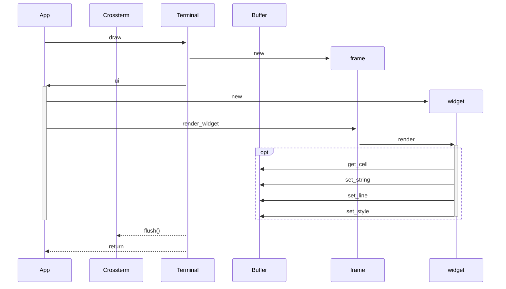
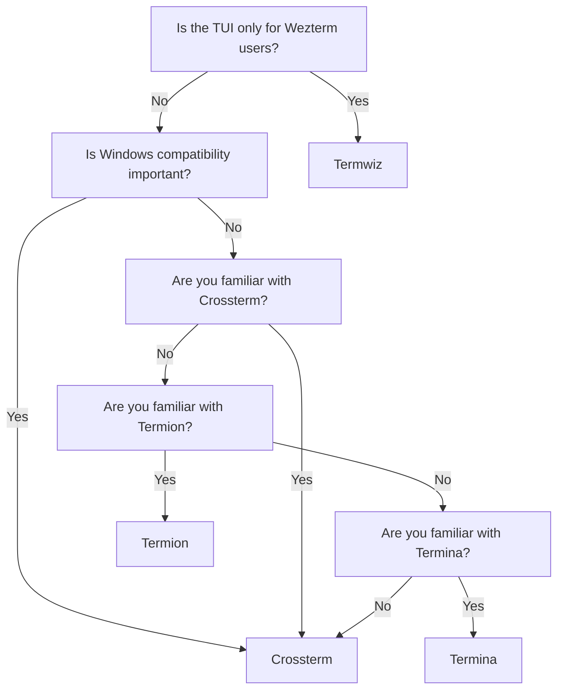
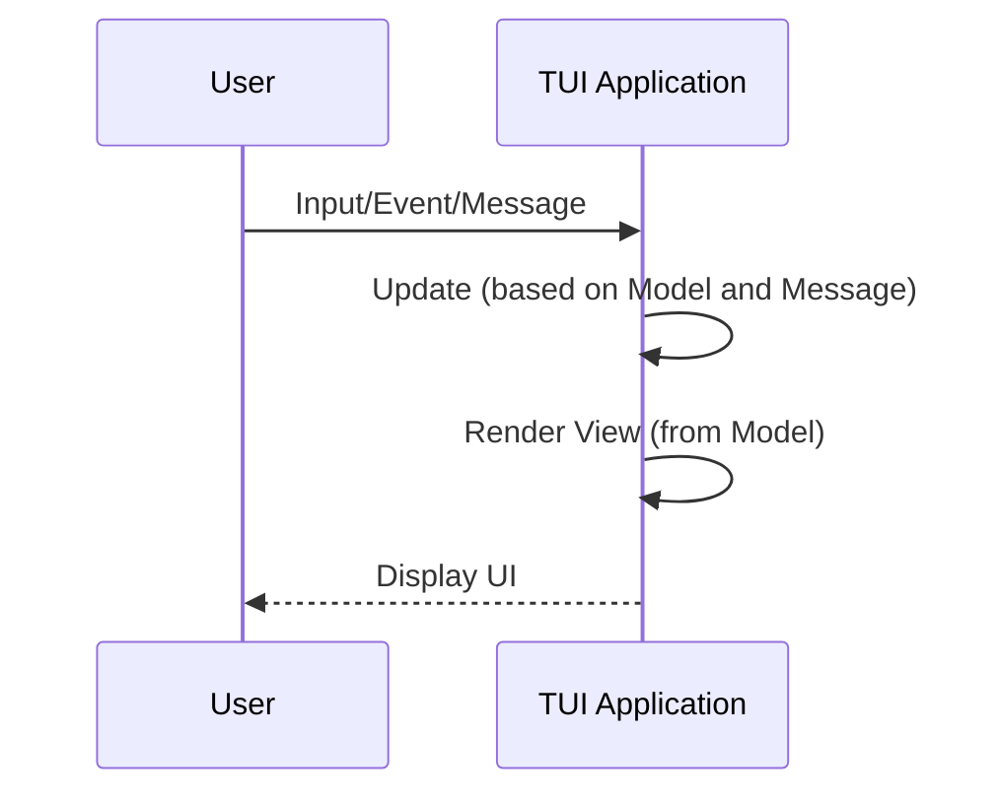
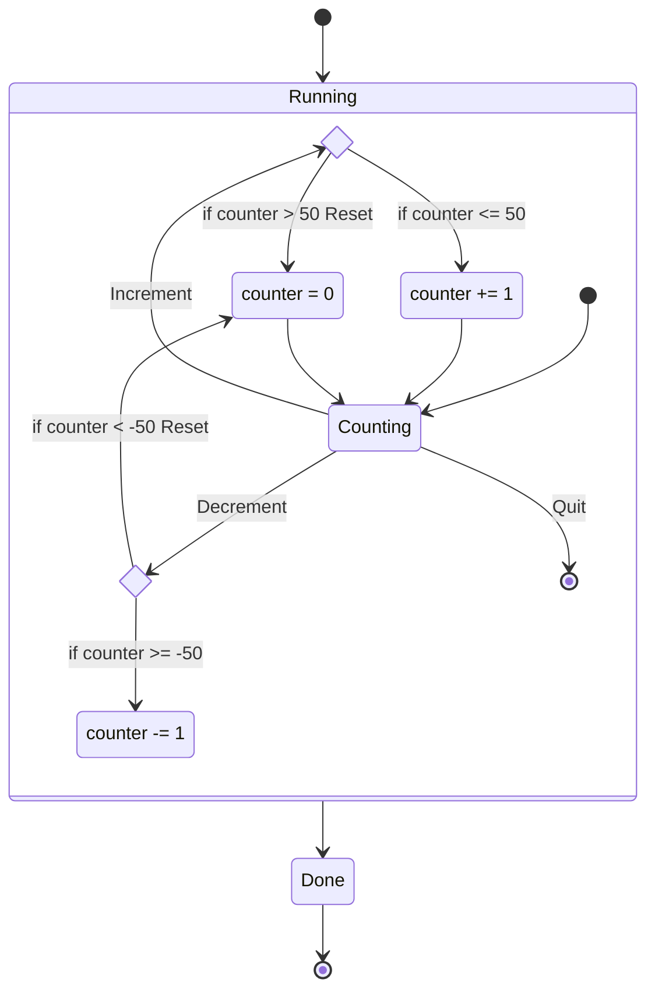
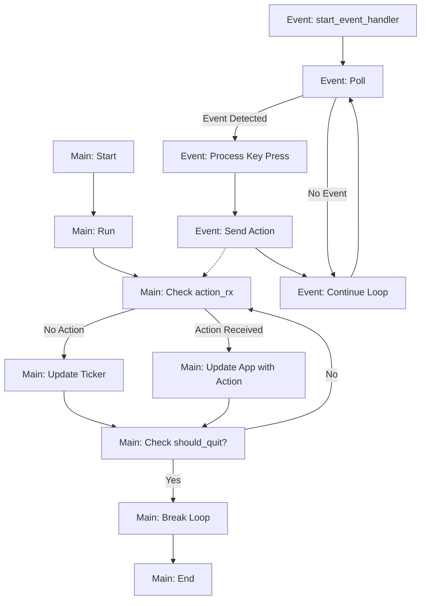

# 시작하기: Ratatui 개요 및 설치 {#part-intro}

## Ratatui 소개 (Introduction)

터미널 사용자 인터페이스(TUI, Terminal User Interface)는 현대 소프트웨어 개발에서 CLI의 기동성과 GUI의 직관적인 인터랙션을 동시에 잡을 수 있는 가장 강력한 인터페이스 방식 중 하나입니다. Ratatui는 Rust 생태계에서 가장 널리 쓰이며 강력한 기능을 제공하는 터미널 UI 라이브러리(이전 `tui-rs`의 공식 계승 프로젝트)입니다.

::: {.callout-note}

### 핵심 설계 철학: Immediate Mode (즉시 모드 렌더링)

Ratatui는 웹의 DOM과 같은 무거운 가상 노드 트리를 유지하지 않습니다. 매 프레임마다 현재 애플리케이션의 상태(State)로부터 화면 버퍼(Buffer)에 직관적으로 셀을 '즉시' 그려 넣으며, 이전 프레임과의 더블 버퍼링(Double Buffering) 차분(Diff)만을 계산하여 터미널 ANSI 이스케이프 시퀀스로 전송합니다. 이를 통해 극도로 빠르고 메모리 누수가 없는 TUI를 구성할 수 있습니다.

:::

{width=350px fig-align="center"}

## 설치 가이드 및 컴파일 기능 플래그 (Installation & Feature Flags)

Ratatui는 사용 환경에 따라 다양한 터미널 백엔드(`crossterm`, `termion`, `termwiz`)와 직렬화 라이브러리(`serde`) 등을 선택할 수 있는 컴파일 피처 플래그를 제공합니다.

[Ratatui 0.30.2] 버전은 Rust 1.88 이상을 필요로 합니다. [`rustup`](https://rustup.rs/)을 통해 최신 안정화(stable) 버전의 Rust 툴체인을 설치한 뒤, 카고(Cargo) 프로젝트에 Ratatui와 기본 백엔드인 [Crossterm]을 추가합니다:

```shell
cargo add ratatui crossterm
```

이 명령어는 `Cargo.toml` 파일에 두 의존성을 추가합니다:

```toml
[dependencies]
crossterm = "0.29"
ratatui = "0.30.2"
```

Ratatui 0.30.2는 기본값으로 Crossterm 0.29를 사용하므로 두 버전이 일치합니다. 애플리케이션에서 직접 선언하는 Crossterm 의존성은 항상 Ratatui가 선택하는 메이저 버전과 동일하게 유지해야 합니다. 카고는 호환되지 않는 두 Crossterm 버전을 하나의 애플리케이션으로 함께 컴파일할 수 있지만, 각각의 이벤트 타입과 터미널 상태가 분리되어 버립니다. 이전 버전을 선택해야 한다면 먼저 [Crossterm 버전 호환성](/installation/feature-flags/#crossterm-versions)을 확인하시기 바랍니다.

기본적으로 `ratatui`는 `crossterm` 기능을 활성화하지만, 기본 기능을 비활성화하고 알맞은 기능 플래그를 켬으로써 `termion`, `termwiz`, `termina`를 대안으로 사용할 수도 있습니다. 자세한 내용은 [백엔드(Backend)] 섹션을 참조하세요.

::: {.callout-note}

Ratatui는 [`ratatui::crossterm`]처럼 자신이 선택한 백엔드 크레이트를 다시 내보냅니다(re-export). 이를 통해 라이브러리 코드는 Ratatui가 사용하는 백엔드 버전을 정확히 참조할 수 있습니다. 반면 일반 애플리케이션에서는 직접 백엔드 의존성을 추가하고 [`crossterm::event`]처럼 직접 임포트하는 것이 소스 코드를 더 명확하게 만들고 백엔드 전용 기능 플래그를 직접 선택할 수 있어 권장됩니다.

:::

[Termion]을 사용하는 경우:

```shell
cargo add ratatui --no-default-features --features termion
cargo add termion
```

또는 `Cargo.toml`에 직접 명시합니다:

```toml
[dependencies]
ratatui = { version = "0.30.2", default-features = false, features = ["termion"] }
termion = "4"
```

[Termwiz]를 사용하는 경우:

```shell
cargo add ratatui --no-default-features --features termwiz
cargo add termwiz
```

또는 `Cargo.toml`에 직접 명시합니다:

```toml
[dependencies]
ratatui = { version = "0.30.2", default-features = false, features = ["termwiz"] }
termwiz = "0.23"
```

[Termina]를 사용하는 경우:

```shell
cargo add ratatui --no-default-features --features termina
cargo add termina
```

또는 `Cargo.toml`에 직접 명시합니다:

```toml
[dependencies]
ratatui = { version = "0.30.2", default-features = false, features = ["termina"] }
termina = "0.3"
```

기능 플래그(Feature flags)를 활용하면 터미널 백엔드를 선택하고, 외부 라이브러리 연동 기능을 켜며, 애플리케이션에서 사용하지 않는 불필요한 코드의 컴파일을 방지할 수 있습니다. 이 페이지에서는 Ratatui 0.30.2에서 제공하는 플래그들을 설명합니다. 어떤 기능이 다른 기능을 함께 활성화하는지는 [docs.rs 기능 의존성 그래프(feature graph)]에서 확인할 수 있습니다. 다른 릴리스 버전을 사용하는 경우 Ratatui 소스 코드의 [기능 정의(feature definitions)]를 확인하시기 바랍니다.

## 기본 활성화 기능 (Default Features)

추가 옵션 없이 `ratatui` 의존성을 기본 추가하면 다음 기능들이 자동으로 활성화됩니다:

| 기능 플래그(Feature) | 활성화되는 내용 |
| ----------------- | --------------------------------------------------------------- |
| `all-widgets`     | 의존성 제약을 받는 모든 위젯 (현재는 `widget-calendar`만 해당) |
| `crossterm`       | Crossterm 0.29 기반 Crossterm 백엔드 |
| `layout-cache`    | 반복적인 레이아웃 계산을 캐싱하기 위한 레이아웃 캐시 |
| `macros`          | 스팬(span), 라인(line), 텍스트(text), 행(row), 레이아웃 생성을 위한 [매크로(Macros)] |
| `underline-color` | 지원 백엔드 및 플랫폼에서 [`Style::underline_color`] 지원 |

기본 기능을 추가하는 대신 완전히 대체해야 할 때는 `default-features = false`를 지정합니다. 기능 플래그는 덧셈 방식(additive)으로 동작하므로, 기본값을 비활성화하면 필요한 모든 기능을 명시적으로 활성화해야 합니다.

## 백엔드 선택 (Backend Selection)

대부분의 경우 기본 제공되는 `crossterm` 백엔드가 가장 올바른 선택입니다. 자세한 내용은 [백엔드(/concepts/backends/)](/concepts/backends/) 문서를 참조하세요. 하지만 필요에 따라 termion, termwiz, termina로 변경할 수 있습니다.

| 기능 플래그(Feature) | 기본 활성화 | 선택되는 터미널 백엔드 |
| ---------------- | ------- | ----------------------------------------------------- |
| `crossterm`      | Yes     | Crossterm 및 [`CrosstermBackend`] |
| `crossterm_0_28` | No      | Crossterm 0.28 지원 (아래 버전 주의사항 참조) |
| `crossterm_0_29` | No      | Crossterm 0.29 지원 (`crossterm`에 의해서도 선택됨) |
| `termina`        | No      | Termina 및 [`TerminaBackend`] |
| `termion`        | No      | Termion 및 비-Windows 대상 [`TermionBackend`] |
| `termwiz`        | No      | Termwiz 및 [`TermwizBackend`] |

Ratatui는 각 기능 플래그가 선택한 백엔드 크레이트를 다시 내보냅니다. 이를 통해 라이브러리는 Ratatui가 사용하는 백엔드 버전을 일관되게 참조할 수 있습니다. 일반 애플리케이션의 경우 백엔드를 직접 의존성으로 추가하고 `crossterm::event`처럼 직접 임포트하는 것이 좋습니다. 이렇게 하면 각 타입의 출처가 명확해지고 애플리케이션 수준에서 백엔드 고유의 기능을 직접 선택할 수 있습니다.

```shell
// 기본값인 crossterm 사용
cargo add ratatui crossterm

// termion 사용 시: 기본 crossterm 기능을 해제하고 termion 기능 활성화
cargo add ratatui --no-default-features --features=termion
cargo add termion

// termwiz 사용 시: 기본 crossterm 기능을 해제하고 termwiz 기능 활성화
cargo add ratatui --no-default-features --features=termwiz
cargo add termwiz

// termina 사용 시: 기본 crossterm 기능을 해제하고 termina 기능 활성화
cargo add ratatui --no-default-features --features=termina
cargo add termina
```

### Crossterm 버전 호환성

Ratatui 0.30.2의 기본 `crossterm` 기능은 Crossterm 0.29를 선택하므로, 대다수의 애플리케이션은 다음과 같이 추가하면 됩니다:

```shell
cargo add ratatui crossterm
```

버전별 특정 기능 플래그는 분리된 [`ratatui-crossterm`] 패키지에 속합니다. 메인 `ratatui` 패키지가 이 플래그들을 전달(forward)하지만, 메인 패키지에서 `crossterm_0_28`을 활성화하면 `ratatui-crossterm`의 기본 기능인 Crossterm 0.29도 함께 활성화됩니다. 결국 두 버전이 모두 컴파일되며, 활성화된 버전 중 더 최신 버전이 우선권을 갖기 때문에 백엔드는 0.29를 사용하게 됩니다.

반드시 Crossterm 0.28을 사용해야 하는 애플리케이션은 `ratatui-crossterm`에서 직접 버전을 선택해야 합니다:

```toml
[dependencies]
crossterm = "0.28"
ratatui = { version = "0.30.2", default-features = false }
ratatui-crossterm = { version = "0.1.2", default-features = false, features = ["crossterm_0_28"] }
```

이렇게 구성하면 메인 패키지가 다시 내보내는 백엔드 및 설정 헬퍼 대신 `ratatui_crossterm::CrosstermBackend`를 통해 백엔드를 사용하게 됩니다. 애플리케이션에 필요한 다른 Ratatui 기능들도 명시적으로 활성화해 주어야 합니다.

두 버전별 기능 플래그를 동시에 활성화하지 마십시오. 둘 다 활성화되면 백엔드는 더 최신 버전을 사용합니다. 만약 이전 버전을 직접 의존성에 추가한 상태라면 서로 다른 두 개의 Crossterm 타입과 터미널 상태 복사본이 생겨나 충돌이 발생합니다.

카고가 어떤 버전을 해석(resolve)했는지 확인하려면 `cargo tree -p crossterm`을 실행하세요. 버전 불일치로 인해 발생하는 컴파일 오류, 이벤트 누락, 터미널 복원 실패 문제 등은 [백엔드 호환성 가이드(backend compatibility guide)]에 자세히 설명되어 있습니다.

## 코어 및 서드파티 연동 기능 (Core & Integrations)

별도 설명이 없는 한, 이 기능들은 선택된 백엔드와 무관하게 독립적으로 동작합니다:

| 기능 플래그(Feature) | 기본 활성화 | 활성화되는 구성요소 |
| ------------------- | ------- | ---------------------------------------------------------- |
| `std`               | Yes[^1] | 표준 라이브러리 지원 |
| `serde`             | No      | [스타일 및 색상 타입]의 직렬화(Serialization) 지원 |
| `layout-cache`      | Yes     | [`Layout::init_cache`]로 설정 가능한 LRU 캐시 |
| `macros`            | Yes     | 스팬, 라인, 텍스트, 행, 레이아웃 생성을 위한 [매크로(Macros)] |
| `palette`           | No      | [`palette`] 색상에서 Ratatui의 [`Color`]로의 변환 지원 |
| `portable-atomic`   | No      | 네이티브 원자적 연산을 지원하지 않는 타깃을 위한 [`portable-atomic`] |
| `scrolling-regions` | No      | [`Terminal::insert_before`]에서 사용하는 스크롤 영역 지원 |
| `underline-color`   | Yes     | 지원 터미널에서의 [`Style::underline_color`] |

[^1]: 기본 백엔드인 `crossterm`을 포함하여 각 백엔드 기능 플래그가 `std`를 활성화합니다.

`scrolling-regions`는 인라인 뷰포트 위에 콘텐츠를 추가할 때 [`Terminal::insert_before`]의 화면 깜빡임을 줄여줍니다. `underline-color`는 Crossterm, Termina, Termwiz에서 동작하며 Windows 7에서는 지원되지 않습니다.

기본 설정을 유지하면서 추가 기능을 활성화하려면 다음과 같이 실행합니다:

```shell
cargo add ratatui --features serde
```

Ratatui는 `no_std` 빌드를 지원합니다. 기본 기능을 비활성화하고 백엔드를 선택하지 않으면 `std`를 비활성화 상태로 둘 수 있습니다. 대부분의 터미널 애플리케이션은 `std`가 필요하므로, 이 구성은 주로 라이브러리나 커스텀 통합 환경에서 유용합니다.

## 위젯별 기능 플래그 (Widget Features)

추가 의존성을 도입하는 위젯은 개별 기능 플래그를 가집니다. `all-widgets`는 이들을 모두 활성화합니다. Ratatui 0.30.2에서 이러한 위젯은 캘린더가 유일합니다:

| 기능 플래그(Feature) | 기본 활성화 | 활성화되는 구성요소 |
| ----------------- | ------- | -------------------------------------------------- |
| `all-widgets`     | Yes     | 외부 의존성이 필요한 모든 위젯 |
| `widget-calendar` | Yes[^2] | [캘린더 위젯(calendar widget)] 및 `time` 크레이트 의존성 |

[^2]: `all-widgets`를 통해 활성화됩니다.

::: {.callout-note}

`all-widgets`는 기본적으로 활성화되어 있습니다. 다른 기본 기능 없이 캘린더 위젯만 단독으로 사용하려면 기본 기능을 비활성화한 뒤 `widget-calendar`를 직접 활성화하세요.

:::

```shell
cargo add ratatui --no-default-features --features=all-widgets
```

```shell
cargo add ratatui --no-default-features --features=widget-calendar
```

## 불안정(Unstable) 기능 플래그

불안정 기능 플래그는 향후 릴리스에서 변경될 수 있는 실험적 API를 제공합니다. 모든 불안정 기능을 묶어놓은 `unstable` 플래그 대신, 실제로 필요한 API만 제공하는 가장 좁은 범위의 플래그를 활성화하는 것이 좋습니다.

| 기능 플래그(Feature) | 활성화되는 내용 |
| ----------------------------- | ----------------------------------------------------------- |
| `unstable`                    | 모든 불안정 기능 |
| `unstable-backend-writer`     | 백엔드 [`writer()`] 및 [`writer_mut()`] 접근자 |
| `unstable-rendered-line-info` | [`Paragraph::line_count()`] 및 [`Paragraph::line_width()`] |
| `unstable-widget-ref`         | [`WidgetRef`] 및 [`StatefulWidgetRef`] 트레이트 |

예를 들어 렌더링된 라인 정보 관련 API만 활성화하려면 다음과 같이 지정합니다:

```shell
cargo add ratatui --features unstable-rendered-line-info
```

::: {.callout-tip}

### 💡 백엔드 선택 권장 사항

- Crossterm (기본 권장): Windows, macOS, Linux 크로스 플랫폼을 완벽 지원하며 가장 활발히 유지보수됩니다.
- Termion: Unix 전용으로 극단적인 미니멀리즘과 성능을 추구할 때 사용합니다.
- Termwiz: WezTerm 터미널의 에뮬레이터 코어를 사용하는 고급 백엔드입니다.

:::

---

# Ratatui 핵심 개념 및 아키텍처 (Core Concepts) {#part-concepts}

## 개념 총론 (Overview)

이 장에서는 터미널 사용자 인터페이스(TUI) 개발의 토대가 되는 핵심 개념들을 종합적으로 다룹니다:

- 렌더링 (Rendering)
- 레이아웃 (Layout)
- 애플리케이션 아키텍처 패턴 (Application patterns)
- 백엔드 (Backends)
- 이벤트 처리 (Event handling)
- `no_std` 환경에서의 활용 (Using `no_std`)

## 렌더링 파이프라인 심층 분석 (Rendering Under the Hood)

Ratatui가 `terminal.draw(...)`를 호출했을 때 터미널 화면에 문자가 나타나기까지의 내부 메커니즘을 상세히 이해하는 것은 복잡한 UI를 효율적으로 설계하는 첫걸음입니다.

이전 섹션에서 Ratatui가 즉시 모드 렌더링(immediate mode rendering) 라이브러리라는 설명을 보셨을 것입니다. 하지만 이는 실제로 무엇을 의미하며 어떻게 구현되어 있을까요? 이 섹션에서는 `Terminal`의 `draw` 메서드 호출부터 시작하여 선택된 백엔드 라이브러리에 이르기까지, Ratatui가 화면에 위젯을 렌더링하는 전 과정을 살펴봅니다.

## 개요 및 원리

Ratatui에서 UI를 렌더링하기 위해 애플리케이션은 [`Terminal::draw()`] 메서드를 호출합니다. 이 메서드는 [`Frame`] 인스턴스를 인자로 전달받는 [클로저(closure)]를 매개변수로 받습니다. 애플리케이션은 `draw` 메서드 내부에서 [`Frame::render_widget()`]을 호출하여 가용한 렌더링 영역 내에 위젯의 상태를 그릴 수 있습니다. 이 페이지에서는 `Frame::render_widget()`을 중심으로 설명하지만, 여기서 다루는 렌더링 원리는 [`Frame::render_stateful_widget()`]에도 똑같이 적용됩니다.

예를 들어, Ratatui를 사용한 간단한 "hello world" 예제의 `terminal.draw()` 호출은 다음과 같습니다.

```rust
terminal.draw(|frame| {
    frame.render_widget(Paragraph::new("Hello World!"), frame.area());
});
```

클로저는 `&mut Frame` 타입의 `frame` 인자를 받습니다.

`frame.area()`는 전체 렌더링 가능한 영역을 나타내는 `Rect`를 반환합니다. 또한 `Frame`은 `render_widget()` 메서드를 통해 위젯을 그릴 수 있는 중간 버퍼(intermediate buffer)에 대한 참조를 보유합니다. `draw` 메서드가 종료되는 시점(클로저 실행이 끝난 후), Ratatui는 버퍼의 내용을 실제 터미널 화면에 영구 출력(persist)합니다. 다음 섹션들에서 보다 구체적인 메커니즘을 살펴보겠습니다.

## `Widget` 트레이트

Ratatui에서 `frame.render_widget()` 메서드는 [`Widget`] 트레이트를 구현한 구조체의 `Widget::render()` 메서드를 호출합니다.

```rust
pub trait Widget {
    /// 주어진 버퍼에 위젯의 현재 상태를 그립니다.
    fn render(self, area: Rect, buf: &mut Buffer);
}
```

Ratatui 내부 구조체이든 서드파티 크레이트이든 상관없이 모든 구조체는 `Widget` 트레이트를 구현하여 터미널에 렌더링 가능한 위젯 인스턴스가 될 수 있습니다. 어떤 구조체를 렌더링 가능한 위젯으로 만들기 위해 필요한 메서드는 `Widget::render()`가 유일합니다.

<!--prettier-ignore-->

앞선 `Paragraph` 예제에서 `frame.render_widget()`은 [`Paragraph에 구현된 Widget::render() 메서드`]를 호출합니다. 콘텐츠를 어떻게 그리는지 살펴보고 싶다면 다른 위젯들의 `render` 구현체를 확인해 볼 수 있습니다.

간단한 예시로 내장된 `Clear` 위젯을 살펴보겠습니다. `Clear` 위젯은 버퍼 내 모든 셀의 스타일 정보를 기본값으로 리셋합니다. 다음은 `Clear` 위젯의 전체 구현 코드입니다:

```rust
pub struct Clear;

impl Widget for Clear {
    fn render(self, area: Rect, buf: &mut Buffer) {
        for x in area.left()..area.right() {
            for y in area.top()..area.bottom() {
                buf.get_mut(x, y).reset();
            }
        }
    }
}
```

위의 `Clear` 위젯 예제에서 애플리케이션이 `Frame::render_widget()` 메서드를 호출하면, 영역(`Rect` 값)과 프레임의 [`Buffer`]에 대한 가변 참조를 전달하며 `Clear`의 `Widget::render()` 메서드를 호출합니다. `render` 메서드가 전체 영역을 순회하며 `buf.get_mut(x, y).reset()`을 호출하는 것을 볼 수 있습니다. 여기서 사용된 `get_mut(x, y)`는 `Cell`을 반환하는 수많은 `Buffer` 메서드 중 하나이며, `reset()`은 [`Cell`]에 정의된 메서드입니다.

## 터미널 버퍼 구조 (`Buffer`)

[`Buffer`]는 애플리케이션이 내용을 조작하여 그릴 수 있는 터미널 [`Viewport`]를 덮는 직사각형 영역을 나타냅니다. `Buffer`는 터미널 디스플레이 영역의 행(row)과 열(column)을 표현하기 위해 [`Cell`] 컬렉션을 포함합니다. 앞선 `Clear` 예제에서 보았듯이, 위젯은 `Buffer`의 메서드를 통해 이 `Cell`들과 상호작용합니다.

다음은 가로 12개의 `Cell`, 세로 4개의 `Cell` 크기를 가진 `Buffer`의 시각적 표현입니다:

```svgbob
        0     1     2     3     4     5     6     7     8     9    10    11
     ┌─────┬─────┬─────┬─────┬─────┬─────┬─────┬─────┬─────┬─────┬─────┬─────┐
   0 │  H  │  e  │  l  │  l  │  o  │     │  W  │  o  │  r  │  l  │  d  │  !  │
     ├─────┼─────┼─────┼─────┼─────┼─────┼─────┼─────┼─────┼─────┼─────┼─────┤
   1 │     │     │     │     │  ▲  │     │     │     │     │     │     │     │
     ├─────┼─────┼─────┼─────┼─ │ ─┼─────┼─────┼─────┼─────┼─────┼─────┼─────┤
   2 │     │     │     │     │  │  │     │     │     │     │     │     │     │
     ├─────┼─────┼─────┼─────┼─ │ ─┼─────┼─────┼─────┼─────┼─────┼─────┼─────┤
   3 │     │     │   ┌──────────┴──────────┐   │     │     │     │     │     │
     └─────┴─────┴── │ ┴─────┴─────┴─────┴ │ ──┴─────┴─────┴─────┴─────┴─────┘
                     │                     │
              ┌──────┴──────┐       ┌──────┴──────┐
              │   symbol    │       │    style    │
              │             │       │             │
              │     “o”     │       │ fg":"Reset  │
              │             │       │ bg":"Reset  │
              │             │       │             │
              └─────────────┘       └─────────────┘


```

Ratatui에서 `Cell` 구조체는 화면에 렌더링되는 가장 작은 기본 단위입니다. 각 `Cell`은 기호(symbol, 문자)와 스타일 정보(전경색, 배경색, 속성 변경자 등)를 추적합니다. `Cell`은 그래픽 UI의 "픽셀(pixel)"과 유사합니다. 일반적으로 터미널은 각 셀의 높이가 너비의 약 2배가 되도록 텍스트를 렌더링합니다. Ratatui의 `Cell`은 보통 폭이 1인 문자열 콘텐츠를 담습니다.

`Buffer`는 텍스트 작성, 특정 영역에 스타일 적용, 개별 셀 조작 등을 위한 다양한 메서드를 구현합니다. 예를 들어 다음과 같습니다:

- `buf.get_mut(0, 0)`: row = 0, col = 0 위치의 셀에 대한 기호 및 스타일 정보가 담긴 `Cell`을 반환합니다.
- `buf.set_string(0, 0, "Hello World!", Style::default())`: row = 0, col = 0부터 시작하여 모든 셀의 스타일을 기본값으로 설정하고 `Buffer`에 `Hello World!`를 렌더링합니다.

이러한 메서드들을 통해 `Widget` 트레이트의 모든 구현체가 `Buffer`의 다양한 위치에 원하는 내용을 기록할 수 있습니다.

애플리케이션이 `terminal.draw(|frame| ...)`를 호출할 때마다, Ratatui는 `Buffer` 인스턴스에 대한 가변 참조를 담고 있는 새로운 [`Frame`] 인스턴스를 클로저에 전달합니다. 터미널 화면에 어떠한 정보가 실제로 출력되기 전에 Ratatui 위젯들은 먼저 이 중간 버퍼에 렌더링되며, `Buffer`에 렌더링된 모든 내용은 오직 해당 `draw` 호출 동안 프레임에 연결된 버퍼에만 유지됩니다. 이는 터미널 화면에 즉시 텍스트가 출력될 수 있는 `crossterm`과 같은 라이브러리를 직접 사용하는 방식과 대비되는 핵심적인 차이점입니다.

::: {.callout-note}

셀의 문자열 콘텐츠 내에 포함된 색상 및 스타일 관련 ANSI 이스케이프 시퀀스는 렌더링되지 않습니다. 스타일 정보는 셀 내에 별도로 분리되어 저장되기 때문입니다. 텍스트에 ANSI 스타일 정보가 포함되어 있다면, 렌더링하기 전에 [`ansi-to-tui`](https://crates.io/crates/ansi-to-tui) 크레이트를 사용하여 `Text` 값으로 변환하는 것을 고려해 보세요. 텍스트 관련 Ratatui 기능과 텍스트 표시에 대한 자세한 내용은 [여기(/recipes/render/display-text/)](/recipes/render/display-text/)에서 확인할 수 있습니다.

:::

## 화면 출력 플러시 (`flush()`)

`draw` 메서드에 전달된 클로저의 실행이 완료되면, `draw` 메서드는 내부적으로 [`Terminal::flush()`]를 호출합니다. `flush()`는 버퍼의 내용을 터미널 화면에 직접 출력합니다. Ratatui는 더블 버퍼링(double buffer) 방식을 채택하고 있습니다. 현재 버퍼와 이전 버퍼 사이의 `차분(diff)`을 계산하여 터미널 화면에 효율적으로 출력할 변경 사항만을 찾아냅니다. `flush()`가 끝나면 Ratatui는 두 버퍼를 교체(swap)하고, 다음 번 `terminal.draw(|frame| ...)` 호출 시 다른 쪽 `Buffer`를 사용하여 `Frame`을 구성합니다.

단일 `terminal.draw(|frame| ...)` 호출 내에서는 모든 위젯이 동일한 `Buffer`에 렌더링되므로, 서로 다른 위젯을 렌더링할 때 버퍼의 동일한 `Cell`을 덮어쓸 수 있습니다. 이는 위젯이 렌더링되는 순서가 최종 UI 결과물에 직접적인 영향을 미친다는 것을 의미합니다.

예를 들어, 아래의 `draw` 예제에서 `"content1"`은 `"content2"`에 의해 덮어씌워지고, 이는 다시 `Buffer` 내에서 `"content3"`에 의해 덮어씌워지므로 Ratatui는 최종적으로 터미널에 `"content3"`만을 출력합니다:

```rust
terminal.draw(|frame| {
    frame.render_widget(Paragraph::new("content1"), frame.area());
    frame.render_widget(Paragraph::new("content2"), frame.area());
    frame.render_widget(Paragraph::new("content3"), frame.area());
})
```

새로운 `Frame`이 생성되기 전에 Ratatui는 현재 버퍼를 깨끗이 지웁니다. 따라서 애플리케이션이 `terminal.draw()`를 호출할 때는 화면의 일부분만이 아니라 터미널에 렌더링되어야 하는 모든 위젯을 매 프레임 빠짐없이 그려주어야 합니다. Ratatui의 차분 계산(diffing) 알고리즘이 터미널 화면으로의 효율적인 쓰기 작업을 완전히 보장합니다.

## 요약 및 결론

요약하자면, 애플리케이션이 `terminal.draw(|frame| ...)`를 호출하면 터미널은 프레임을 생성하여 애플리케이션이 전달한 클로저에 넘겨줍니다. 클로저는 `Frame::render_widget`을 호출하여 각 위젯을 버퍼에 그리고, 이 메서드는 다시 각 위젯의 `render` 메서드를 호출합니다. 마지막으로 Ratatui는 버퍼의 내용을 실제 터미널에 기록합니다.



UI 개발의 세계는 크게 보존 모드(retained mode)와 즉시 모드(immediate mode)라는 두 가지 지배적인 패러다임으로 나뉩니다. 대부분의 전통적인 GUI 라이브러리는 보존 모드 패러다임 하에서 동작합니다. 그러나 `ratatui`는 TUI 개발을 위해 즉시 모드 렌더링 방식을 채택하고 있습니다.

이 때문에 `ratatui`는 기존 GUI 프레임워크와 다르게 동작하며, 개발자가 지시할 때만 화면을 갱신합니다.

## 즉시 모드 렌더링이란 무엇인가?

즉시 모드 렌더링은 매 프레임마다 UI를 처음부터 다시 생성하는 UI 패러다임입니다. 고정된 UI 위젯 세트를 생성해 두고 그 상태를 수정하는 대신, 현재 애플리케이션의 상태에 기반하여 매 프레임 화면을 백지 상태에서 새로 "그립니다".

간단히 요약하면 다음과 같습니다:

- 보존 모드 (Retained Mode): UI를 한 번 설정하고 위젯을 생성한 뒤, 나중에 해당 위젯의 속성을 변경하거나 이벤트를 처리합니다.
- 즉시 모드 (Immediate Mode): 애플리케이션 상태에 따라 매 프레임 UI를 다시 그립니다. 메모리에 영구적인 위젯 객체가 유지되지 않습니다.

`ratatui`에서는 매 프레임마다 UI를 완전히 새롭게 그립니다.

```rust
loop {
    terminal.draw(|f| {
        if state.condition {
            f.render_widget(SomeWidget::new(), layout);
        } else {
            f.render_widget(AnotherWidget::new(), layout);
        }
    })?;
}
```

즉시 모드 렌더링 패러다임이 낯설다면, [이 아티클(Casey Muratori의 글)](https://caseymuratori.com/blog_0001)과 관련 유튜브 영상을 꼭 참고해 보시길 권장합니다.

<https://www.youtube.com/watch?v=Z1qyvQsjK5Y>

`IMGUI`에 관한 아래의 4분짜리 강연 영상도 이 개념을 이해하는 데 큰 도움이 됩니다.

<https://www.youtube.com/watch?v=LSRJ1jZq90k>

### 즉시 모드 렌더링의 장점

- 단순성 (Simplicity): 영구적인 위젯 상태가 존재하지 않으므로, UI 로직은 애플리케이션 상태를 그대로 투영하는 직관적인 결과물이 됩니다. 상태를 동기화하느라 애쓸 필요도 없고 이전 위젯의 잔여 상태를 신경 쓸 필요도 없습니다.
- 유연성 (Flexibility): 어떤 것도 고정되어 있지 않으므로 UI 레이아웃이나 로직을 언제든 쉽게 변경할 수 있습니다. 특정 조건에서 위젯을 숨기고 싶다면, 단지 해당 조건에서 위젯을 그리지 않기만 하면 됩니다.

### 즉시 모드 렌더링의 고려 사항 및 단점

- 렌더링 루프 관리 (Render loop management): 즉시 모드 렌더링에서는 렌더링을 트리거할 책임이 전적으로 프로그래머에게 있습니다. 시각적인 변경이 일어날 때마다 `Backend.draw()`를 호출해야 합니다. 따라서 렌더링 스레드가 부주의로 인해 블로킹되면 스레드가 재개될 때까지 UI가 갱신되지 않습니다. 특히 `ratatui` 라이브러리는 위젯이 "백엔드"(예: `CrosstermBackend`)에 어떻게 렌더링되는지만을 처리합니다. 백엔드는 다시 터미널에 실제로 출력하기 위해 외부 크레이트(예: `crossterm`)를 사용합니다.

- 이벤트 루프 조율 (Event loop orchestration): "렌더링 루프"를 관리하는 것과 함께 개발자는 "이벤트 루프" 역시 직접 처리해야 합니다. 이를 위해 적절한 서드파티 라이브러리를 결정해야 합니다. `crossterm`은 키 입력을 처리하는 데 널리 쓰이는 크레이트이며, 공식 저장소와 온라인 자료에서 수많은 사용 예제를 찾을 수 있습니다. 만약 `tokio`를 사용하고자 한다면 `crossterm`은 비동기(`async`) 이벤트 스트림도 지원합니다.

- 아키텍처 설계 고려사항 (Architecture design considerations): 기본 상태의 `ratatui`는 대규모 애플리케이션을 구조화하는 데 있어 거의 아무런 가이드를 제공하지 않습니다. 궁극적으로 코드 구조를 잡고 일관된 규칙을 세우는 것은 개발자의 몫입니다. 다만 시작을 돕기 위해 여러 [템플릿(templates)]을 제공하고 있습니다.

::: {.callout-note}

### 🔍 렌더링 라이프사이클 다이어그램

1. Model/State (데이터): 앱 구조체 내부의 순수 데이터
2. Terminal::draw(|frame| ...): 프레임 할당 및 현재 버퍼 초기화
3. Widget::render(area, buf): 지정된 사각 영역(`Rect`)의 버퍼 셀(`Cell`) 속성 변경
4. Buffer Diff & Flush: 이전 프레임 버퍼와 바뀐 셀만 터미널 드라이버(`crossterm`)로 전송

:::

---

## 레이아웃 시스템 (Layout System)

화면을 수평/수직으로 분할하고 비례, 고정 크기, 최소/최대 제약조건을 부여하는 Ratatui의 레이아웃 엔진입니다.

Ratatui의 좌표계는 좌측 상단 `(0, 0)`을 원점으로 하여 왼쪽에서 오른쪽, 위에서 아래로 향합니다. x축과 y축 좌표는 `u16` 값으로 표현되며 대부분의 위치에서 일반적으로 이 순서대로 지정됩니다.

```svgbob
"(0,0)"-------------> x "(columns)"

   |
   |
   |
   |
   v

   y "(rows)"
```

레이아웃과 위젯은 Ratatui UI의 근간을 이룹니다. 레이아웃은 제약조건을 사용하여 화면을 여러 구역으로 나누며 인터페이스의 구조를 결정하고, 위젯은 이 구역들을 다양한 콘텐츠로 채웁니다.

화면에 위젯을 렌더링할 때는 먼저 위젯이 표시될 영역을 정의해야 합니다. 이 영역은 버퍼 내에서 특정 높이와 너비를 갖는 직사각형(사각 영역)으로 표현됩니다. 이 사각형을 절대 위치와 크기로 직접 지정할 수도 있고, [`Layout`] 구조체를 사용하여 `Length`, `Min`, `Max`, `Ratio`, `Percentage`와 같은 제약조건에 따라 터미널 창을 동적으로 분할할 수도 있습니다.

다음 예제는 렌더링 영역을 수동으로 계산하여 "Hello world!"를 10번 렌더링합니다:

```rust
for i in 0..10 {
    let area = Rect::new(0, i, frame.area().width, 1);
    frame.render_widget(Paragraph::new("Hello world!"), area);
}
```

## `Layout` 구조체

레이아웃 구조체를 사용하는 간단한 예제는 다음과 같습니다:

```rust
use ratatui::layout::{Constraint, Direction, Layout};

let layout = Layout::default()
    .direction(Direction::Vertical)
    .constraints(vec![
        Constraint::Percentage(50),
        Constraint::Percentage(50),
    ])
    .split(frame.area());
```

이 예제에서는 가용한 공간을 수직으로 2등분하여 화면 높이의 50%씩을 각각 할당하도록 지정했습니다. [`Layout::split`] 함수는 [`Frame::area()`] 메서드가 반환하는 터미널 창의 전체 크기를 인자로 받아, 지정된 제약조건에 따라 각 직사각형 영역의 적절한 크기와 위치를 계산합니다.

레이아웃(또는 일련의 중첩 레이아웃)을 정의하고 나면, 분할된 사각 영역 중 하나를 사용하여 위젯을 렌더링할 수 있습니다. 이는 [`Frame::render_widget`]이나 [`frame::render_stateful_widget`] 메서드를 호출하여 수행합니다:

```rust
frame.render_widget(
    Paragraph::new("Top")
        .block(Block::new().borders(Borders::ALL)),
    layout[0]);
frame.render_widget(
    Paragraph::new("Bottom")
        .block(Block::new().borders(Borders::ALL)),
    layout[1]);
```

결과는 대략 다음과 같이 표시됩니다:

```svgbob
┌───────────────────────────────────┐
│Top                                │
│                                   │
│                                   │
└───────────────────────────────────┘
┌───────────────────────────────────┐
│Bottom                             │
│                                   │
│                                   │
└───────────────────────────────────┘
```

이 예제에서는 "Top"과 "Bottom"이라는 두 개의 `Paragraph` 위젯을 생성했습니다. 그런 다음 이 위젯들을 분할된 버퍼의 첫 번째 영역(`layout[0]`)과 두 번째 영역(`layout[1]`)에 각각 렌더링합니다. 레이아웃은 각 제약조건에 따라 정의된 사각형 영역들을 인덱싱 가능한 목록 형태로 반환한다는 점에 유의하세요. 이 경우 `layout[0]`은 화면 상단 절반을, `layout[1]`은 하단 절반을 가리킵니다.

## 레이아웃 중첩 (Nesting Layouts)

이해해야 할 중요한 개념 중 하나는 레이아웃을 중첩할 수 있다는 점입니다. 즉, 바깥쪽 레이아웃의 직사각형 영역 안에 또 다른 레이아웃을 정의할 수 있습니다. 이러한 중첩 레이아웃을 활용하면 터미널 창 크기 조절에 따라 위젯 격자가 반응하는 방식을 완벽히 제어하면서도 복잡하고 유연한 UI 디자인을 구현할 수 있습니다.

중첩 레이아웃은 다음과 같이 작성할 수 있습니다:

```rust
let outer_layout = Layout::default()
    .direction(Direction::Vertical)
    .constraints(vec![
        Constraint::Percentage(50),
        Constraint::Percentage(50),
    ])
    .split(f.area());

let inner_layout = Layout::default()
    .direction(Direction::Horizontal)
    .constraints(vec![
        Constraint::Percentage(25),
        Constraint::Percentage(75),
    ])
    .split(outer_layout[1]);
```

이 코드에서 터미널 창은 먼저 `outer_layout`에 의해 수직으로 2등분됩니다. 그 후 `inner_layout`은 `outer_layout`의 두 번째 사각형 영역을 수평으로 분할하여, 원래 사각형 너비의 각각 25%와 75%를 차지하는 두 개의 영역을 생성합니다.

위의 레이아웃 영역에 여러 텍스트 문단(`Paragraph`)을 렌더링하면 다음과 같은 결과가 나타납니다:

```rust
frame.render_widget(
    Paragraph::new("outer 0")
        .block(Block::new().borders(Borders::ALL)),
    outer_layout[0]);
frame.render_widget(
    Paragraph::new("inner 0")
        .block(Block::new().borders(Borders::ALL)),
    inner_layout[0]);
frame.render_widget(
    Paragraph::new("inner 1")
        .block(Block::new().borders(Borders::ALL)),
    inner_layout[1]);
```

```svgbob
┌───────────────────────────────────┐
│outer 0                            │
│                                   │
│                                   │
└───────────────────────────────────┘
┌────────┐┌─────────────────────────┐
│inner 0 ││inner 1                  │
│        ││                         │
│        ││                         │
└────────┘└─────────────────────────┘
```

이를 통해 터미널 창을 다양한 크기의 여러 구역으로 나눌 수 있으며, 복잡하고 반응형인 인터페이스를 자유자재로 구성할 수 있습니다.

## 제약조건 (Constraints)

[`Constraint`]는 레이아웃 내 구성요소들의 크기와 배치를 결정합니다. Ratatui 프레임워크는 인터페이스 레이아웃을 정밀하게 조정할 수 있도록 다양한 제약조건 타입을 제공합니다:

- `Constraint::Length(u16)`: 사각형이 차지해야 하는 구체적인 행 또는 열의 수를 지정합니다. 이는 절대적인 크기로 결정되며 전체 터미널 창 크기에 반응하여 변하지 않습니다.

- `Constraint::Percentage(u16)`: 부모 레이아웃 또는 터미널 창 전체 크기에 대한 상대적인 비율 크기를 제공합니다. 예를 들어 `Constraint::Percentage(50)`은 사각형이 부모 크기의 절반을 차지해야 함을 의미합니다.

- `Constraint::Ratio(u16, u16)`: 비율을 활용하여 레이아웃을 더욱 세밀하게 분할할 수 있도록 합니다. 예를 들어 `Constraint::Ratio(1, 3)`은 부모 크기의 3분의 1을 해당 제약조건에 할당합니다.

- `Constraint::Min(u16)`: 구성요소 크기의 최소 한도를 강제합니다. `Min` 제약조건을 `Percentage`나 `Ratio`와 함께 사용하면 구성요소가 지정된 최소 크기 이하로 줄어들지 않습니다.

- `Constraint::Max(u16)`: 구성요소 크기의 최대 한도를 제한합니다. `Min`과 마찬가지로 `Percentage`나 `Ratio`와 조합하면 구성요소가 지정된 최대 크기를 초과하여 커지지 않습니다.

- `Constraint::Fill(u16)`: 다른 모든 `Constraint::Fill` 요소들과 비례하는 스케일링 계수를 적용하여 여분의 남은 공간을 채웁니다.

  해당 요소는 다른 모든 제약조건을 충족한 뒤 남은 유휴 공간으로만 확장되며, 다른 `Constraint::Fill` 요소들과 지정된 비율에 맞추어 공간을 균등 분할합니다.

::: {.callout-caution}

`Ratio`와 `Percentage` 제약조건은 부모의 크기를 기준으로 계산됩니다.

이로 인해 고정 크기 사각형과 유연한 크기의 사각형을 동일한 레이아웃에 함께 배치할 때 예상치 못한 결과가 발생할 수 있습니다. 복잡한 레이아웃을 구성할 때는 필요에 따라 중첩 레이아웃을 사용하거나 크기를 직접 계산하는 것을 고려하세요.

:::

하나의 레이아웃 안에서 여러 제약조건을 유연하게 조합하여 동적이고 조절 가능한 인터페이스를 만들 수 있습니다. 애플리케이션의 레이아웃을 정의할 때 다음과 같이 제약조건들을 사용할 수 있습니다:

```rust
let layout = Layout::default()
    .direction(Direction::Horizontal)
    .constraints([
        Constraint::Length(10),
        Constraint::Percentage(70),
        Constraint::Min(5),
    ]
    .into_iter())
    .split(frame.area());
```

이 예제에서 첫 번째 `Length` 제약조건으로 인해 첫 번째 사각형의 너비는 10자가 됩니다. 다음 사각형은 전체 너비의 70%를 차지합니다. 마지막 사각형은 남은 공간을 모두 차지하되, 결코 5자 미만으로 줄어들지 않습니다.

제약조건을 지정한 순서가 화면 공간에 적용되는 순서와 동일하다는 점에 유의하세요.

기본적으로 `split` 메서드는 가용 영역 내에서 남는 여유 공간을 레이아웃의 마지막 영역에 모두 몰아줍니다. 이러한 동작을 방지하려면 레이아웃의 마지막 제약조건으로 사용하지 않는 `Min(0)`을 추가하세요.

Ratatui는 사각 영역들의 적절한 크기를 결정하기 위해 [Cassowary](https://crates.io/crates/cassowary)라는 제약조건 해결(solver) 알고리즘을 사용합니다. 특정 상황에서는 모든 제약조건을 완벽히 만족시키는 것이 불가능할 수 있으며, 이 경우 솔버는 제약조건을 최대한 충족하는 근사해를 임의로 반환할 수 있습니다. 이런 상황이 발생할 때의 구체적인 결과는 비결정론적(non-deterministic)일 수 있습니다.

## Flex 레이아웃 (Flex Layouts)

[`Flex`] 시스템은 제약조건들의 합이 가용 영역을 완벽하게 채우지 못할 때 요소들이 배치되는 방식을 결정합니다.

### 정렬 전략 (Alignment Strategies)

| Flex 변형 (Variant) | 동작 방식 |
| :------------------- | :------------------------------------------------------------------------------------------ |
| `Flex::Legacy`       | 컨테이너 내의 가용 공간을 채우되, 남는 공간을 마지막 요소에 할당합니다. |
| `Flex::Start`        | 요소들을 컨테이너의 시작 부분에 정렬합니다. |
| `Flex::End`          | 요소들을 컨테이너의 끝 부분에 정렬합니다. |
| `Flex::Center`       | 컨테이너 중앙에 요소들을 정렬합니다. |
| `Flex::SpaceBetween` | 요소들 사이에 여유 공간을 균등하게 추가합니다. |
| `Flex::SpaceAround`  | 각 요소의 양옆 둘레에 여유 공간을 균등하게 추가합니다. |

### 예제

다음은 동일한 80셀 너비의 영역에서 서로 다른 `Flex` 전략을 적용했을 때 두 개의 `Length(20)` 요소가 배치되는 방식입니다:

#### Flex::Start

```svgbob
<--------------------------------------- 80 px ---------------------------------------->
┌────────────────────┐┌────────────────────┐┌╌ ╌ ╌ ╌ ╌ ╌ ╌ ╌ ╌ ╌ ╌ ╌ ╌ ╌ ╌ ╌ ╌ ╌ ╌ ╌ ╌ ┐
│    Length(20)      ││    Length(20)      ││              40 px Spacer                │
└────────────────────┘└────────────────────┘└╌ ╌ ╌ ╌ ╌ ╌ ╌ ╌ ╌ ╌ ╌ ╌ ╌ ╌ ╌ ╌ ╌ ╌ ╌ ╌ ╌ ┘
```

#### Flex::Center

```svgbob
<--------------------------------------- 80 px ---------------------------------------->
┌╌ ╌ ╌ ╌ ╌ ╌ ╌ ╌ ╌ ╌ ┐┌────────────────────┐┌────────────────────┐┌╌ ╌ ╌ ╌ ╌ ╌ ╌ ╌ ╌ ╌ ┐
│   20 px Spacer     ││    Length(20)      ││    Length(20)      ││   20 px Spacer     │
└╌ ╌ ╌ ╌ ╌ ╌ ╌ ╌ ╌ ╌ ┘└────────────────────┘└────────────────────┘└╌ ╌ ╌ ╌ ╌ ╌ ╌ ╌ ╌ ╌ ┘
```

#### Flex::End

```svgbob
<--------------------------------------- 80 px ---------------------------------------->
┌╌ ╌ ╌ ╌ ╌ ╌ ╌ ╌ ╌ ╌ ╌ ╌ ╌ ╌ ╌ ╌ ╌ ╌ ╌ ╌ ╌ ┐┌────────────────────┐┌────────────────────┐
│              40 px Spacer                ││    Length(20)      ││    Length(20)      │
└╌ ╌ ╌ ╌ ╌ ╌ ╌ ╌ ╌ ╌ ╌ ╌ ╌ ╌ ╌ ╌ ╌ ╌ ╌ ╌ ╌ ┘└────────────────────┘└────────────────────┘
```

#### Flex::SpaceAround

```svgbob
<--------------------------------------- 80 px ---------------------------------------->
┌╌ ╌ ╌ ╌ ╌ ┐┌────────────────────┐┌╌ ╌ ╌ ╌ ╌ ╌ ╌ ╌ ╌ ┐┌────────────────────┐┌╌ ╌ ╌ ╌ ╌ ┐
│  Spacer  ││    Length(20)      ││      Spacer      ││    Length(20)      ││  Spacer  │
└╌ ╌ ╌ ╌ ╌ ┘└────────────────────┘└╌ ╌ ╌ ╌ ╌ ╌ ╌ ╌ ╌ ┘└────────────────────┘└╌ ╌ ╌ ╌ ╌ ┘
```

#### Flex::SpaceBetween

```svgbob
<--------------------------------------- 80 px ---------------------------------------->
┌────────────────────┐┌╌ ╌ ╌ ╌ ╌ ╌ ╌ ╌ ╌ ╌ ╌ ╌ ╌ ╌ ╌ ╌ ╌ ╌ ╌ ╌ ╌ ┐┌────────────────────┐
│    Length(20)      ││                 40 px Spacer             ││    Length(20)      │
└────────────────────┘└╌ ╌ ╌ ╌ ╌ ╌ ╌ ╌ ╌ ╌ ╌ ╌ ╌ ╌ ╌ ╌ ╌ ╌ ╌ ╌ ╌ ┘└────────────────────┘
```

::: {.callout-tip}

레이아웃에 [`.spacing(u16)`]을 호출하여 각 요소 사이에 간격을 자동으로 추가할 수도 있습니다:

```rust
let layout = Layout::horizontal([Length(10), Length(10)])
    .flex(Flex::Center)
    .spacing(2) // 항목 사이에 2셀 간격 추가
    .split(area);
```

:::

## 기타 레이아웃 접근 방식

CSS와 유사한 flexbox/grid 알고리즘으로 사각형들을 배치하기 위해 [Taffy](https://crates.io/crates/taffy)를 사용하는 몇 가지 PoC(개념 증명)가 존재합니다. 이 방식은 훌륭하게 동작하지만 아직 Ratatui에 공식 내장되지는 않았습니다. 자세한 내용은 [Ratatui의 Taffy 관련 PR](https://github.com/search?q=repo%3Aratatui%2Fratatui%20taffy&type=pullrequests)을 참조하세요.

## 참고 자료 (See Also)

- [FAQ: 버퍼(`Buffer`)의 유효 범위를 벗어난 셀 접근으로 인한 패닉을 어떻게 방지하나요?][faq-avoid-panics]

---

## 위젯 시스템과 상태 저장 (Widgets & Storing State)

Ratatui에서 UI 컴포넌트는 `Widget`과 `StatefulWidget` 트레이트를 통해 구현됩니다.

위젯은 Ratatui에서 사용자 인터페이스를 구성하는 기본 벽돌(building blocks)입니다. 위젯은 터미널 인터페이스의 레이아웃과 스타일을 생성하고 관리하는 데 사용됩니다. 여러 위젯을 조합하고 중첩하여 복잡한 UI를 구성할 수 있으며, 애플리케이션의 필요에 맞게 손쉽게 커스터마이징할 수 있습니다.

Ratatui는 신속하게 UI를 구축할 수 있도록 매우 다양한 내장 위젯을 제공합니다. 제공되는 위젯 목록은 다음과 같습니다:

- [`Block`]|[`예제`](/examples/widgets/block): 테두리(border), 제목(title), 스타일 옵션을 제공하는 가장 기본적인 블록 위젯.
- [`BarChart`]|[`예제`](/examples/widgets/barchart): 여러 데이터셋을 막대 그래프로 표시하며 그룹화 옵션을 지원합니다.
- [`Calendar`]|[`예제`](/examples/widgets/calendar): 한 달 달력을 표시합니다.
- [`Canvas`]|[`예제`](/examples/widgets/canvas): 그리기 전용 문자를 활용하여 임의의 도형이나 그래프를 그립니다.
- [`Chart`]|[`예제`](/examples/widgets/chart): 여러 데이터셋을 선 그래프나 산점도(scatter graph)로 표시합니다.
- [`Clear`]: 점유한 영역을 깨끗이 지웁니다. 이전에 그려진 위젯 위에 새 위젯을 덮어 그릴 때 유용합니다.
- [`Gauge`]|[`예제`](/examples/widgets/gauge): 블록 문자를 사용하여 진행률 퍼센티지를 표시합니다.
- [`LineGauge`]: 진행률을 한 줄 라인 형태로 표시합니다.
- [`List`]|[`예제`](/examples/widgets/list): 항목 목록을 표시하고 선택 기능을 지원합니다.
- [`Paragraph`]|[`예제`](/examples/widgets/paragraph): 스타일 적용 및 줄바꿈을 지원하는 텍스트 단락을 표시합니다.
- [`Scrollbar`]|[`예제`](/examples/widgets/scrollbar): 스크롤바를 표시합니다.
- [`Sparkline`]|[`예제`](/examples/widgets/sparkline): 단일 데이터 세트를 스파크라인(미니 선 그래프)으로 표시합니다.
- [`Table`]|[`예제`](/examples/widgets/table): 여러 행과 열을 격자 형태로 표시하며 행 선택을 지원합니다.
- [`Tabs`]|[`예제`](/examples/widgets/tabs): 탭 바를 표시하고 탭 선택 기능을 지원합니다.

또한 [`String`], [`&str`], [`Span`], [`Line`], [`Text`] 역시 위젯으로 직접 사용할 수 있습니다 (다만 이를 직접 위젯으로 쓰기보다는 대개 `Paragraph`로 감싸서 사용하는 것이 일반적입니다).

이들 위젯에 대한 자세한 정보는 [위젯 API 문서][widgets-docs]와 [위젯 쇼케이스][showcase]에서 확인할 수 있습니다. 아울러 Ratatui와 함께 사용할 수 있는 다양한 서드파티 위젯들이 존재하며, 이는 [서드파티 위젯 쇼케이스][third-party-widgets]와 [Awesome Ratatui] 저장소에서 찾아볼 수 있습니다.

## 위젯 트레이트 (Widget Traits)

Ratatui에서 위젯은 Rust 트레이트로 구현되어 손쉬운 구현과 확장이 가능합니다. 위젯을 위한 핵심 트레이트 두 가지는 [`Widget`]과 [`StatefulWidget`]이며, 각각 위젯 렌더링 및 상태 관리를 위한 기본 기능을 제공합니다.

또한, [`WidgetRef`] 및 [`StatefulWidgetRef`] 트레이트를 사용하면 참조를 통한 위젯 렌더링이 가능하여, 위젯 컬렉션을 저장하고 렌더링할 때 유용합니다. 후자의 두 트레이트는 Ratatui 0.26에서 추가되었으며, 작성 시점 기준으로는 불안정(unstable) 기능 플래그로 보호되어 있어 서드파티에서의 활용은 제한적일 수 있습니다. 모든 내부 위젯은 ref 트레이트를 구현하도록 업데이트되었으며, `T: WidgetRef`인 경우 `Widget for &T`에 대한 포괄적 구현(blanket implementation)도 제공됩니다.

### Widget

[`Widget`] 트레이트는 Ratatui 위젯 중 가장 기본이 되는 트레이트입니다. 위젯을 버퍼(buffer)에 렌더링하기 위한 기초 기능을 제공합니다.

```rust
pub trait Widget {
    fn render(self, area: Rect, buf: &mut Buffer);
}
```

### StatefulWidget

[`StatefulWidget`] 트레이트는 [`Widget`] 트레이트와 유사하지만, 렌더링 도중 관리하고 업데이트할 수 있는 상태(state)가 포함되어 있습니다.

```rust
pub trait StatefulWidget {
    type State;
    fn render(self, area: Rect, buf: &mut Buffer, state: &mut Self::State);
}
```

### WidgetRef 및 StatefulWidgetRef

[`WidgetRef`] 트레이트를 사용하면 위젯의 소유권을 소비(consume)하는 대신 참조를 통해 위젯을 렌더링할 수 있어, 개별 위젯이나 위젯 컬렉션을 보관하고 렌더링하는 데 유용합니다.

[`StatefulWidgetRef`] 트레이트는 [`WidgetRef`] 트레이트와 유사하지만, 렌더링 도중 관리하고 업데이트할 수 있는 상태가 포함됩니다.

이 두 트레이트는 Ratatui 0.26.0에서 도입되었으며, 렌더링 시 위젯이 항상 소비되던 기존의 한계를 해결하면서도 해당 가정을 기반으로 작성된 기존 코드가 깨지지 않도록 하기 위해 추가되었습니다. 두 위젯 트레이트는 현재 불안정 상태로 표시되어 있으며 `unstable-widget-ref` 기능 플래그 뒤에 숨겨져 있습니다.

```rust
pub trait WidgetRef {
    fn render_ref(&self, area: Rect, buf: &mut Buffer);
}

pub trait StatefulWidgetRef {
    type State;
    fn render_ref(&self, area: Rect, buf: &mut Buffer, state: &mut Self::State);
}
```

위젯 사용하기

Ratatui에서 위젯은 터미널 인터페이스의 레이아웃과 스타일을 구성하고 관리하는 데 사용됩니다. 위젯들을 조합하고 중첩하여 복잡한 UI를 제작할 수 있으며, 애플리케이션 요구에 맞게 손쉽게 커스터마이징할 수 있습니다.

애플리케이션에서 위젯을 사용하려면 일반적으로 [`Frame`] 타입을 활용합니다. 이 타입은 위젯 렌더링을 위한 두 가지 메서드인 [`render_widget`]과 [`render_stateful_widget`](그리고 이에 대응하는 `_ref` 메서드)을 제공합니다. 이 메서드들은 애플리케이션이 위젯을 그리기 위한 진입점이며, 통상 [`Terminal::draw`] 메서드에 전달되는 클로저 내부에서 호출됩니다.

다음은 `render_widget` 메서드를 사용하여 Widget을 그리는 예제입니다:

```rust
terminal.draw(|frame| {
    frame.render_widget(some_widget, frame.area());
});
```

다음은 `render_stateful_widget` 메서드를 사용하여 StatefulWidget을 그리는 예제입니다:

```rust
terminal.draw(|frame| {
    frame.render_stateful_widget(some_stateful_widget, frame.area(), &mut some_state);
});
```

이 메서드들은 내부적으로 [`Widget`] 또는 [`StatefulWidget`] 트레이트의 `render` 함수를 호출하며, 이는 다시 구현된 특정 [`WidgetRef`] 또는 [`StatefulWidgetRef`]의 `render` 함수를 호출하게 됩니다.

흔히 사용되는 컴포지션 패턴 중 하나는 `Frame::render_widget()`에 전달되는 단일 루트 위젯(아래 예제의 `App` 구조체)만을 두고, 해당 위젯 내부 및 하위 위젯들에서 렌더링하려는 영역을 전달하며 직접 render 메서드를 호출하는 방식입니다.

```rust
#[derive(Default)]
struct App {
    // ...
    should_quit: bool
}

fn main() {
    let app = App::default();
    // ...
    while !app.should_quit {
        terminal.draw(|frame| {
            frame.render_widget(&app, frame.area())
        })
    }
}

impl Widget for &App {
    fn render(self, area: Rect, buf: &mut Buffer) {
        // ...
        MyHeaderWidget::new("Header text")
            .render(Rect::new(0, 0, area.width, 1), buf);
    }
}
```

## 위젯 구현하기 (Implementing Widgets)

Ratatui에서 위젯은 Rust 트레이트로 구현되어 손쉬운 구현과 확장이 가능합니다. 위젯을 위한 핵심 트레이트 두 가지는 [`Widget`]과 [`StatefulWidget`]이며, 각각 위젯 렌더링 및 상태 관리를 위한 기본 기능을 제공합니다.

### 언제 커스텀 위젯을 만들어야 할까?

다음 방식들은 모두 렌더링을 구성하는 유효한 방법입니다:

- 작은 규모의 UI를 단일 렌더 함수에 유지하기
- 더 큰 영역을 헬퍼 렌더 함수들로 분할하기
- [`Widget`] 또는 [`StatefulWidget`]을 구현하는 구조체 생성하기

위젯을 구현하는 것은 단순히 재사용성 때문만이 아니라, UI의 특정 구역에 명확한 경계(boundary)가 필요할 때 유용합니다. `fn render_sidebar(area, buf, app: &App)`와 같은 헬퍼 함수는 실수로 `App`의 임의의 필드에 의존하게 될 수 있습니다. 반면 위젯 구조체는 `Sidebar { selected, items }`와 같이 입력을 명시적으로 정의하므로, 렌더 구현부는 해당 필드만 접근하여 사용할 수 있습니다.

이러한 경계는 해당 구역이 명확한 규약(contract)을 가질 때, 재사용될 때, 규모가 커질 때, 혹은 애플리케이션 상태의 제한된 하위 집합에만 접근해야 할 때 유용합니다. 일회성으로 쓰이는 작은 구역은 위젯 경계를 도입하는 것이 코드 이해에 더 도움이 되기 전까지는 렌더 함수 형태로 유지해도 무방합니다.

소유권과 상태에 따라 알맞은 구현 방식을 선택하십시오:

- 렌더링 중 자신을 변경(mutate)하지 않는 재사용 가능한 위젯의 경우 `impl Widget for &MyWidget` 사용
- 매 프레임마다 새로 생성되는 비용이 적은 일회성(ephemeral) 위젯의 경우 `impl Widget for MyWidget` 사용
- 렌더링 시 위젯이 소유한 상태를 업데이트해야 하는 경우 `impl Widget for &mut MyWidget` 사용
- 선택 항목, 스크롤 오프셋, 커서 위치처럼 상태가 위젯 외부에 존재하면서 독립적으로 유지되어야 하는 경우 [`StatefulWidget`] 사용

상태 설계 시 던져볼 만한 유용한 질문은 다음과 같습니다: "이 위젯 값이 재생성될 때 상태도 초기화되어야 하는가?" 그렇다면 위젯이 소유하는 상태로 두어도 좋습니다. 그렇지 않다면 상태를 위젯 외부에 유지하고 이를 인자로 전달하십시오.

다음은 간단한 인사말 Widget에 대해 [`Widget`] 트레이트를 구현한 예제입니다:

```rust
struct GreetingWidget {
    name: String,
}

impl Widget for GreetingWidget {
    fn render(self, area: Rect, buf: &mut Buffer) {
        let greeting = format!("Hello, {}!", self.name);
        buf.set_string(area.x, area.y, greeting, Style::default());
    }
}
```

이 예제에서 `GreetingWidget` 구조체는 `String` 타입의 단일 필드 `name`을 가집니다. `render` 함수는 `Rect`와 `Buffer`에 대한 가변 참조를 받아 버퍼의 지정된 좌표에 문자열을 기록합니다.

위젯은 단순히 `Buffer`의 메서드를 호출하는 것에만 국한되지 않습니다. 자신의 `render` 메서드 안에서 다른 위젯을 생성하고 렌더링할 수도 있습니다. 예를 들어 `buf`의 메서드를 직접 호출하는 대신, 이름 부분의 `Span`에 스타일이 적용된 `Span` 벡터를 포함하는 `Line` 위젯을 생성할 수 있습니다. 그런 다음 이 `Line` 위젯을 해당 Widget의 `render` 메서드 내부에서 렌더링할 수 있습니다.

다음은 중첩된 위젯을 사용한 동일한 인사말 예제입니다:

```rust
struct GreetingWidget {
    name: String,
}

impl Widget for GreetingWidget {
    fn render(self, area: Rect, buf: &mut Buffer) {
        let hello = Span::raw("Hello, ");
        let name = Span::styled(self.name, Modifier::BOLD);
        let line = Line::from(vec![hello, name]);
        line.render(area, buf);
    }
}
```

이러한 접근법을 통해 위젯을 조합하고 재사용할 수 있습니다. 예를 들어 `Line` 위젯은 다른 위젯 내부나 애플리케이션의 다른 부분에서도 재사용할 수 있습니다. 또한 렌더링 관련 코드가 일관된 위치(`impl Widget` 블록)에 정리되므로 위젯의 테스트와 유지보수가 훨씬 수월해집니다.

상태 보존 위젯 (StatefulWidget) 구현하기

특정 상황에서는 위젯이 자체 렌더링 과정에서 추가적인 상태를 변경(mutate)해야 할 수도 있습니다. 기본 내장된 `List` 위젯의 동작 방식이 대표적인 예입니다. `List`는 렌더링 도중 렌더링 영역 내에 선택된 항목이 보이도록 상태의 스크롤 위치를 업데이트합니다.

다음은 프레임 수를 계산하는 위젯에 `StatefulWidget` 트레이트를 구현한 예제입니다:

```rust
struct FrameCountWidget {
    style: Style,
}

impl StatefulWidget for FrameCountWidget {
    type State = i32;

    fn render(self, area: Rect, buf: &mut Buffer, state: &mut i32) {
        *state += 1;
        let text = format!("Frame count: {state}");
        Line::styled(text, self.style).render(area, buf);
    }
}
```

이 예제에서 `FrameCount` 위젯은 렌더링될 때마다 상태를 1씩 증가시켜 렌더링된 프레임 수를 카운트합니다.

WidgetRef 구현하기

Ratatui 0.26.0에서는 [`WidgetRef`](및 유사한 [`StatefulWidgetRef`]) 트레이트가 추가되었습니다. 이를 통해 참조로 렌더링되는 위젯을 생성할 수 있어, 매 프레임마다 새로 구성하는 대신 한 번 저장해 두고 여러 번 렌더링할 수 있습니다. 또한 `Box<dyn T>`를 사용하여 위젯을 박싱함으로써 동적인 위젯 컬렉션(예: 레이아웃 내의 여러 패널/Pane)을 손쉽게 구성할 수 있습니다.

::: {.callout-note}

이 기능을 사용하려면 `unstable-widget-ref` 기능 플래그를 활성화해야 합니다 (조만간 안정화될 예정입니다).

:::

`WidgetRef` / `StatefulWidgetRef` 구현은 소비 버전의 트레이트를 구현하는 것과 유사합니다 (차이점은 메서드 이름이 `render_ref`이며 self가 참조형이라는 점입니다).

```rust
struct GreetingWidget {
    name: String,
}

impl WidgetRef for GreetingWidget {
    fn render_ref(&self, area: Rect, buf: &mut Buffer) {
        let hello = Span::raw("Hello, ");
        let name = Span::styled(self.name, Modifier::BOLD);
        let line = Line::from(vec![hello, name]);
        line.render(area, buf);
    }
}
```

이는 프레임 간에 위젯을 보관하는 용도로 유용하게 쓰일 수 있습니다. 예시:

```rust
struct App {
    greeting: GreetingWidget,
}

// 이후 렌더링 시점:

frame.render_widget_ref(&app.greeting, area);
```

서로 다른 타입의 위젯 컬렉션이 있거나, 컴파일 타임에 타입을 알 수 없는 단일 위젯이 있는 경우, ref 트레이트를 사용하면 [`Box<T>`]를 통해 위젯을 트레이트 객체로 저장할 수 있습니다.

예를 들어 다음 코드는 `Vec`에 저장된 서로 다른 두 위젯을 런타임에 각 위젯의 구체적인 타입을 알지 못한 채 나중에 렌더링하는 방법을 보여줍니다.

```rust
struct Greeting { ... }
struct Farewell { ... }
impl WidgetRef for Greeting { ... }
impl WidgetRef for Farewell { ... }

let widgets: Vec<Box<dyn WidgetRef>> = vec![
    Box::new(Greeting { name: "alice".into() }),
    Box::new(Farewell { name: "bob".into() })
];
for widget in widgets {
    widget.render_ref(area, buf);
}
```

이 페이지에서는 프로그래머가 애플리케이션의 상태를 저장할 수 있는 몇 가지 방법을 다룹니다.

## 단일 사일로 방식 (Single Silo Method)

이 방법은 아마도 가장 이해하기 쉬운 방식이며, 기억해야 할 상태의 양이 많지 않은 소규모 애플리케이션에 가장 적합합니다. 이 방식의 기본 아이디어는 단순합니다. "모든 상태를 담는 하나의 구조체"를 두고, 특정 컴포넌트가 애플리케이션 상태를 알아야 할 때마다 `app` 상태에 대한 참조를 요청하는 것입니다.

이것이 바로 튜토리얼에서 사용된 방식입니다.

### 장점

개념적으로 이해하기 매우 쉽습니다. 모든 상태가 한곳에 저장되므로 서브 컴포넌트로 전달하기가 간단합니다.

### 단점

그러나 애플리케이션 규모가 커져 단일 사일로 상태 관리의 한계를 넘어서게 되면, 다음과 같은 코드를 작성하기 시작하면서 문제점을 체감하게 됩니다:

```rust
        let selected_item = &app.states.history.transacts_list.items[app.states.history.transacts_list.state.selected().unwrap()];
```

이 방식의 또 다른 단점은 멀티스레드 지원의 부재입니다. 애플리케이션 상태에 접근해야 하는 스레드가 여러 개 생겨나면, `Mutex`와 락(lock)이 여기저기 공유되면서 `app`에 대한 접근이 병목이 될 수 있습니다.

---

## 터미널 백엔드 및 모드 (Backends, Raw Mode, Alternate Screen)

터미널 애플리케이션이 정상적으로 키보드 입력을 처리하고 화면 깨짐 없이 실행되기 위해서는 Raw Mode와 Alternate Screen의 제어가 필수적입니다.

Ratatui는 백엔드(backend)를 통해 터미널 에뮬레이터와 인터페이스합니다. 이러한 백엔드 라이브러리들은 [`Terminal`] 타입을 통해 Ratatui가 화면에 스타일이 적용된 텍스트를 그리고, 커서를 조작하며, 콘솔이나 윈도우 크기 같은 터미널 속성을 조회할 수 있도록 지원합니다. 애플리케이션은 일반적으로 백엔드를 직접 사용하여 키보드, 마우스 및 창 이벤트를 캡처하고, 로우 모드(raw mode)와 대체 화면(alternate screen)을 활성화합니다.

Ratatui는 다음 백엔드들을 지원합니다:

- [`CrosstermBackend`] 및 `crossterm` 기능 플래그(기본 활성화됨)를 통한 [Crossterm]. 특정 버전 선택에 대한 자세한 내용은 아래의 [Crossterm 버전 호환성](#crossterm-version-compatibility)을 참조하십시오.
- [`TermionBackend`] 및 `termion` 기능 플래그를 통한 [Termion].
- [`TermwizBackend`] 및 `termwiz` 기능 플래그를 통한 [Termwiz].
- [`TerminaBackend`] 및 `termina` 기능 플래그를 통한 [Termina].
- 애플리케이션 UI의 단위 테스트에 유용한 [`TestBackend`].

백엔드 선택에 대한 자세한 내용은 [비교 (Comparison)](./comparison/) 문서를 참조하십시오.

각 백엔드는 [로우 모드 (Raw Mode)](./raw-mode/)(터미널의 입출력 처리 방식을 변경), 셸 명령이 사용하는 버퍼와 별도의 버퍼에 렌더링할 수 있게 해주는 [대체 화면 (Alternate Screen)](./alternate-screen/), 그리고 애플리케이션이 마우스 이벤트를 캡처할 수 있도록 하는 [마우스 캡처 (Mouse Capture)](./mouse-capture/)를 지원합니다.

## Crossterm 버전 호환성 (Crossterm Version Compatibility)

유의적 버전(semver) 호환성이 없는 여러 [Crossterm] 버전을 동시에 가져오는 것은 피해야 합니다. 서로 다른 메이저 버전은 다음과 같은 문제를 야기합니다:

- 별도의 이벤트 큐를 유지함 (경합 조건 및 이벤트 유실 초래 가능)
- 로우 모드를 개별적으로 추적함 (종료 시 로우 모드가 올바르게 복원되지 않을 수 있음)
- 이름이 동일하더라도 서로 타입을 교환할 수 없음 (컴파일 에러 발생)

또한, 특정 버전을 사용하면 모든 의존성이 최신 상태로 유지되지 않는 한 Ratatui/위젯을 업그레이드하기 어려워질 수 있습니다.

이를 완화하기 위해 분리된 `ratatui-crossterm` 패키지는 `crossterm_{version}` 기능 플래그를 통해 여러 [Crossterm] 메이저 버전을 지원합니다. 메인 `ratatui` 패키지는 기본적으로 Crossterm 0.29를 사용합니다.

Ratatui 0.30.2는 기본적으로 Crossterm 0.29를 사용합니다:

```toml
ratatui = "0.30"
crossterm = "0.29"
```

Crossterm 0.28을 선택하려면 분리된 백엔드 패키지를 직접 사용하십시오. Crossterm 0.29가 함께 활성화되지 않도록 기본 기능을 비활성화해야 합니다:

```toml
crossterm = "0.28"
ratatui = { version = "0.30", default-features = false }
ratatui-crossterm = { version = "0.1", default-features = false, features = ["crossterm_0_28"] }
```

::: {.callout-note}

- 여러 플래그가 활성화된 경우 Ratatui는 최신 버전을 선택합니다.
- 이 방식은 `ratatui_crossterm::CrosstermBackend`를 사용하며, 메인 `ratatui` 패키지의 Crossterm 설정 헬퍼는 활성화되지 않습니다.
- Ratatui의 기본 기능을 비활성화하면 다른 기본 기능들도 비활성화됩니다. 애플리케이션에 필요한 기능들을 다시 활성화하십시오.
- 메인 `ratatui` 패키지도 버전 플래그를 전달하지만, 메인 패키지의 백엔드를 활성화하면 `ratatui-crossterm`의 기본 버전도 함께 활성화됩니다.
- `cargo tree -p crossterm`을 사용하여 의존성 그래프를 확인하고, 다른 Crossterm 메이저 버전을 끌어오는 의존성의 기본 기능을 비활성화하십시오.
- Ratatui 0.30+부터는 `ratatui-core`가 도입되어 백엔드가 별도의 크레이트로 분리되었습니다. 이를 통해 백엔드 변경 사항이 메인 라이브러리와 독립적으로 발전할 수 있으며, 단 하나의 백엔드만 필요한 애플리케이션에서 버전 충돌을 방지하는 데도 도움이 됩니다.

:::

::: {.callout-tip}[요약 (TLDR)]

대부분의 작업에는 [Crossterm](https://crates.io/crates/crossterm)을 선택하십시오.

:::

Ratatui는 "백엔드"를 통해 터미널 에뮬레이터와 상호작용합니다. 백엔드는 `ratatui`가 키 입력을 캡처하고, 커서를 이동시키며, 색상 및 다양한 기능으로 텍스트 스타일을 지정할 수 있는 권한을 부여하는 강력한 라이브러리입니다. 현재 `ratatui`는 네 가지 백엔드를 지원합니다:

- [Crossterm](https://crates.io/crates/crossterm)
- [Termion](https://crates.io/crates/termion)
- [Termwiz](https://crates.io/crates/termwiz)
- [Termina](https://crates.io/crates/termina)

백엔드 선택에 따라 프로젝트 구조가 다소 달라질 수 있지만, 핵심 기능은 모든 옵션에서 동일하게 유지됩니다. 다음 순서도는 결정에 도움을 줄 수 있습니다.



모든 백엔드를 완벽하게 지원하기 위해 노력하고 있지만, 가장 널리 사용되는 백엔드는 Crossterm입니다. Termion, Termwiz 또는 Termina를 사용해야 할 특별한 이유가 없다면, 대중성 덕분에 Crossterm을 배우는 것이 가장 수월할 것입니다.

로우 모드(Raw mode)는 터미널이 입력과 출력에 대해 어떠한 처리나 조작도 수행하지 않는 모드입니다. 즉, 입력된 문자의 에코(화면 출력), 라인 버퍼링, 특수 문자 처리(예: `CTRL-C` 또는 `SIGINT`)와 같은 기능이 비활성화됩니다. 이는 터미널 입출력을 완벽하게 제어하여 각 키 입력을 직접 처리하려는 애플리케이션에 유용합니다.

예를 들어 로우 모드에서는 터미널이 입력에 대해 라인 버퍼링을 수행하지 않으므로, 사용자가 엔터 키를 누를 때까지 기다리지 않고 키를 누르는 즉시 애플리케이션에 전달됩니다. 따라서 텍스트 에디터, 터미널 기반 게임 등 실시간 반응형 애플리케이션에 적합합니다.

각 백엔드는 로우 모드를 서로 다르게 처리하므로 사용하는 백엔드에 따라 동작 방식이 달라질 수 있습니다. 로우 모드를 구현하는 구체적인 세부 사항은 해당 백엔드의 문서를 반드시 참조하십시오.

- [`CrosstermBackend`]
- [`TermionBackend`]
- [`TermwizBackend`]
- [`TerminaBackend`]

대체 화면(Alternate Screen)은 일부 터미널이 메인 화면과 별도로 제공하는 독립된 버퍼입니다. 활성화되면 터미널은 대체 화면을 표시하고 메인 화면의 기존 내용을 숨깁니다. 애플리케이션은 일반 터미널 화면인 것처럼 이 화면에 쓸 수 있지만, 애플리케이션이 종료되면 터미널은 메인 화면으로 다시 전환되며 대체 화면의 내용은 지워집니다. 이는 명령줄 프롬프트나 다른 터미널 내용을 흐트러뜨리지 않고 터미널 창 전체를 활용하고자 하는 텍스트 에디터나 터미널 게임 같은 애플리케이션에 유용합니다.

이를 통해 애플리케이션 실행 전에 표시되었던 내용이 종료 후 다시 나타나므로, 애플리케이션과 일반 터미널 세션 간에 매끄러운 전환이 가능합니다.

아래의 "hello world" 프로그램을 살펴보십시오. `std::io::stderr().execute(EnterAlternateScreen)?`(및 이에 대응하는 `LeaveAlternateScreen`)을 포함하거나 제외하고 실행해 보면 프로그램이 어떻게 다르게 동작하는지 확인할 수 있습니다.

```rust collapse={1-17, 25-30}
use std::{
    io::{Result, stderr},
    thread::sleep,
    time::Duration,
};

use ratatui::{
    Terminal,
    backend::CrosstermBackend,
    crossterm::{
        ExecutableCommand,
        terminal::{EnterAlternateScreen, LeaveAlternateScreen},
    },
    layout::Rect,
    widgets::Paragraph,
};

fn main() -> Result<()> {
  let should_enter_alternate_screen = std::env::args().nth(1).unwrap().parse::<bool>().unwrap();
  if should_enter_alternate_screen {
  stderr().execute(EnterAlternateScreen)?; // remove this line
  }
  let mut terminal = Terminal::new(CrosstermBackend::new(stderr()))?;

  terminal.draw(|f| {
    f.render_widget(Paragraph::new("Hello World!"), Rect::new(10, 20, 20, 1));
  })?;
  sleep(Duration::from_secs(2));

  if should_enter_alternate_screen {
  stderr().execute(LeaveAlternateScreen)?; // remove this line
  }
  Ok(())
}
```

<!--
Output ./demo.gif

Set FontSize 18
Set Width 1200
Set Height 800
Set Theme "Catppuccin Mocha"

Type "# WITH Alternate Screen"
Enter
Type "# Cursor is here before program starts"
Enter

Sleep 5s

Type "cargo run -- true"
Enter
Sleep 5s

Type "# Cursor is here after program completes"
Enter

Sleep 5s

Type "reset"

Enter

Sleep 2s

Type "# WITHOUT Alternate Screen"
Enter
Type "# Cursor is here before program starts"
Enter

Sleep 5s

Type "cargo run -- false"
Enter
Sleep 5s

Type "# Cursor is here after program completes"
Enter

Sleep 5s
-->


이 코드를 직접 실행해 보면서 `EnterAlternateScreen`과 `LeaveAlternateScreen`을 실험해 보십시오.

모든 터미널 에뮬레이터가 대체 화면을 지원하는 것은 아니며, 지원하더라도 처리 방식이 다를 수 있습니다. 따라서 사용하는 백엔드에 따라 동작이 달라질 수 있습니다. 대체 화면을 어떻게 구현하는지 이해하려면 항상 해당 백엔드의 설명서를 참조하십시오.

마우스 캡처(Mouse capture)는 터미널이 클릭, 스크롤, 마우스 이동과 같은 마우스 이벤트를 감지하여 특수 시퀀스나 이벤트 형태로 애플리케이션에 전달하는 모드입니다. 이를 통해 애플리케이션은 마우스 동작을 처리하고 이에 반응하여 터미널 내에서 보다 대화형이고 그래픽적인 사용자 경험을 제공할 수 있습니다. 이는 터미널 기반 게임, 텍스트 에디터 또는 사용자의 보다 직접적인 상호작용이 필요한 프로그램에 특히 유용합니다.

각 백엔드는 마우스 캡처를 다르게 처리하며, 캡처할 수 있는 이벤트의 종류와 표현 방식에 차이가 있습니다. 따라서 사용하는 백엔드에 따라 동작이 달라질 수 있으므로 개발자는 마우스 캡처 구현 방식에 대해 해당 백엔드의 문서를 확인해야 합니다.

---

## 이벤트 핸들링 (Event Handling)

`ratatui` 라이브러리를 사용하여 이벤트를 처리하는 방법에는 여러 가지가 있습니다. 이는 주로 `ratatui`가 이벤트 캐칭 기능을 직접 노출하지 않기 때문이며, 프로그래머는 선택한 백엔드 라이브러리에 의존하게 됩니다.

하지만 이벤트 처리를 고민할 때 도움이 될 만한 몇 가지 접근 방식이 있습니다. 이것이 전부는 아니지만, 보다 일반적인 구현 패턴들을 소개합니다. 다만 기억해야 할 점은, 여러분의 현재 애플리케이션에 가장 잘 맞는 방식이 곧 정답이라는 것입니다.

## 중앙 집중식 이벤트 핸들링 (Centralized Event Handling)

이것은 이벤트가 발생하는 즉시 처리하므로 가장 단순한 방식입니다. 대개 지원되는 다양한 키에 대해 (crossterm의 경우) `event::read()?`의 결과를 매칭하는 단순한 형태입니다.

장점: 메시지 전달이 필요 없다는 장점이 있으며, 가능한 모든 키보드 이벤트를 한곳에서 편집하고 관리할 수 있습니다.

단점: 그러나 이 방식은 확장성이 떨어집니다. _모든_ 이벤트가 한곳에서 처리되기 때문에, 키 바인딩 그룹을 여러 위치로 분리하여 관리하기가 어렵습니다.

## 중앙 집중식 캡처 및 메시지 전달 (Centralized Catching, Message Passing)

이 방식은 한곳에서 이벤트를 폴링(polling)한 다음, 캡처된 이벤트를 담아 메시지를 보내거나 하위 함수를 호출하는 구조입니다.

장점: 첫 번째 방식과 마찬가지로 단순하다는 매력이 있습니다. 이 패러다임을 사용하면 방대한 패턴 매칭을 별도의 파일로 분리할 수 있는 하위 함수들로 쉽게 쪼갤 수 있습니다. 또한 스레드 안전한 메시지 전달을 위해 채널(channel)을 사용하므로 기본적인 멀티스레드 애플리케이션에서 자주 활용되는 개념이기도 합니다.

단점: 중앙 집중화된 위치에서 이벤트를 지속적으로 폴링하기 위해 메인 루프가 계속 실행되고 있어야 합니다.

## 분산 이벤트 루프 / 세그먼트화된 애플리케이션 (Distributed Event Loops / Segmented Applications)

이 스타일에서는 `Terminal`과 메인 루프의 제어권을 서브 모듈에 위임합니다. 이 경우 전체 렌더링 및 이벤트 처리 책임이 서브 모듈로 안전하게 넘어갈 수 있습니다. 이론적으로 이렇게 구축된 애플리케이션은 중앙 집중식 이벤트 리스너가 필요하지 않습니다.

장점: 새 서브 모듈을 생성할 때마다 업데이트해야 하는 중앙 이벤트 루프가 없습니다.

단점: 하지만 애플리케이션의 여러 서브 모듈이 서로 유사한 이벤트 처리 루프를 갖게 되면, 상당한 양의 코드 중복이 발생할 수 있습니다.

---

## 애플리케이션 아키텍처 패턴 (Application Patterns)

Ratatui 앱의 규모가 커짐에 따라 유지보수성을 극대화하기 위한 구조적 패턴들입니다.

### 패턴 개요

이 페이지에서는 애플리케이션에 적용할 수 있는 여러 패턴을 다루며, 이러한 패턴들을 더 심도 있게 탐구하는 다음 글들의 상위 개요 역할을 합니다.

- [엘름 아키텍처 (The Elm Architecture)](./the-elm-architecture/)
- [컴포넌트 아키텍처 (Component Architecture)](./component-architecture/)
- [플럭스 아키텍처 (Flux Architecture)](./flux-architecture/)

### 컴포넌트 아키텍처 (Component Architecture)

TUI를 구성하는 데 있어 보다 객체 지향적인 접근 방식에 관심이 있다면 `컴포넌트(Component)` 기반 아키텍처를 사용할 수 있습니다.

실제 오픈소스 생태계의 여러 프로젝트가 이 방식을 사용하고 있습니다:

- <https://github.com/TaKO8Ki/gobang>
- <https://github.com/nomadiz/edma>

또한 이러한 `Component` 기반 접근법의 예제를 담은 공식 템플릿도 제공하고 있습니다:

- <https://github.com/ratatui/templates/tree/main/component>

앞선 섹션에서 이미 [TEA](../the-elm-architecture/)를 다루었습니다. `Component` 아키텍처는 조금 더 객체 지향적이고 트레이트 기반의 접근 방식을 취합니다.

각 컴포넌트는 자체 상태, 이벤트 핸들러 및 렌더링 로직을 캡슐화합니다.

1. 컴포넌트 초기화 (`init`) - 컴포넌트가 필요로 하는 초기 상태나 리소스를 설정하는 단계입니다. 이벤트 처리나 렌더링과는 분리된 독립적인 프로세스입니다.

2. 이벤트 처리 (`handle_events`, `handle_key_events`, `handle_mouse_events`) - 각 컴포넌트는 자체 이벤트 핸들러를 가집니다. 이를 통해 각 컴포넌트가 관심 있는 이벤트만 처리하는 세분화된 이벤트 핸들링이 가능해집니다. 이는 전체 애플리케이션의 메시지를 단일 함수에서 처리하는 Elm의 update 함수와 대조적입니다.

3. 상태 업데이트 (`update`) - 컴포넌트는 자체 로컬 상태를 가질 수 있으며 액션에 반응하여 이를 업데이트할 수 있습니다. 이 상태는 컴포넌트의 비공개(private) 상태이며, Elm의 전역 모델과는 다릅니다.

4. 렌더링 (`render`) - 각 컴포넌트는 자체 렌더링 로직을 정의합니다. 렌더링 컨텍스트가 주어지면 스스로를 그리는 방법을 알고 있습니다. 이는 Elm의 view 함수와 유사하지만 컴포넌트 단위로 개별 수행됩니다.

다음은 사용할 수 있는 `Component` 트레이트 구현의 한 예시입니다:

```rust
use color_eyre::eyre::Result;
use ratatui::crossterm::event::{KeyEvent, MouseEvent};
use ratatui::layout::Rect;

use crate::{action::Action, event::Event, terminal::Frame};

pub trait Component {
  fn init(&mut self) -> Result<()> {
    Ok(())
  }
  fn handle_events(&mut self, event: Option<Event>) -> Action {
    match event {
      Some(Event::Quit) => Action::Quit,
      Some(Event::Tick) => Action::Tick,
      Some(Event::Key(key_event)) => self.handle_key_events(key_event),
      Some(Event::Mouse(mouse_event)) => self.handle_mouse_events(mouse_event),
      Some(Event::Resize(x, y)) => Action::Resize(x, y),
      Some(_) => Action::Noop,
      None => Action::Noop,
    }
  }
  fn handle_key_events(&mut self, key: KeyEvent) -> Action {
    Action::Noop
  }
  fn handle_mouse_events(&mut self, mouse: MouseEvent) -> Action {
    Action::Noop
  }
  fn update(&mut self, action: Action) -> Action {
    Action::Noop
  }
  fn render(&mut self, f: &mut Frame, rect: Rect);
}
```

이 접근 방식의 장점 중 하나는 컴포넌트 수준에서 `handle_events`, `update`, `render` 함수를 한곳에 응집(co-locate)시키도록 유도한다는 점입니다.

### 엘름 아키텍처 (The Elm Architecture, TEA)

`ratatui`로 터미널 사용자 인터페이스(TUI)를 구축할 때 애플리케이션을 구조화하기 위한 견고한 아키텍처를 갖추는 것이 큰 도움이 됩니다. 입증된 아키텍처 중 하나는 Elm 언어에서 유래한 '엘름 아키텍처(The Elm Architecture, TEA)'입니다.

::: {.callout-tip}

The Elm Architecture를 기반으로 `ratatui`를 사용하는 프레임워크에 관심이 있다면 <https://github.com/veeso/tui-realm/>을 확인해 보시기 바랍니다. 본 페이지의 설명은 이론적 이해와 교육적 목적을 위한 것입니다.

:::

이 섹션에서는 The Elm Architecture 원칙을 `ratatui` TUI 애플리케이션에 적용하는 방법을 살펴봅니다.

## 엘름 아키텍처: 핵심 개요 (The Elm Architecture: A Quick Overview)

기본적으로 TEA는 세 가지 주요 구성 요소로 나뉩니다:

- 모델 (Model): 애플리케이션의 상태입니다. 애플리케이션이 다루는 모든 데이터가 포함됩니다.
- 업데이트 (Update): 사용자 입력과 같은 변화가 발생했을 때, update 함수는 현재 모델과 입력을 받아 새로운 모델을 생성합니다.
- 뷰 (View): 이 함수는 사용자에게 모델을 화면으로 표시하는 역할을 담당합니다. Elm에서는 HTML을 생성하지만, 우리의 경우에는 터미널 UI 요소를 생성합니다.



## `ratatui`에 엘름 아키텍처 적용하기

TEA 원칙을 따를 때는 일반적으로 다음 단계들을 구현하게 됩니다:

1. 모델 정의하기 (Define Your Model)
2. 업데이트 처리하기 (Handling Updates)
3. 뷰 렌더링하기 (Rendering the View)

### 1. 모델 정의하기 (Define Your Model)

`ratatui`에서는 주로 `struct`를 사용하여 모델을 표현합니다:

```rust
struct Model {
    //... 애플리케이션의 데이터가 여기에 들어갑니다
}
```

카운터 앱의 경우 모델은 다음과 같은 형태가 될 수 있습니다:

```rust
#[derive(Debug, Default)]
struct Model {
    counter: i32,
    running_state: RunningState,
}

#[derive(Debug, Default, PartialEq, Eq)]
enum RunningState {
    #[default]
    Running,
    Done,
}
```

### 2. 업데이트 처리하기 (Handling Updates)

TEA에서 업데이트는 사용자 입력과 같은 이벤트에 의해 트리거되는 액션입니다. 핵심 개념은 이러한 액션이나 이벤트를 각각 메시지에 매핑하는 것입니다. 이는 메시지를 추적하는 enum을 생성함으로써 구현할 수 있습니다. 수신된 메시지를 기반으로 모델의 현재 상태를 활용하여 다음 상태를 결정합니다.

`Message` 열거형 정의하기

```rust
enum Message {
    //... 앱에서 처리하고자 하는 다양한 입력이나 액션
    // 예: ButtonPressed, TextEntered 등
}
```

카운터 앱의 경우 `Message` enum은 다음과 같이 정의할 수 있습니다:

```rust
#[derive(PartialEq)]
enum Message {
    Increment,
    Decrement,
    Reset,
    Quit,
}
```

`update()` 함수

update 함수는 이 프로세스의 핵심입니다. 현재 모델과 메시지를 인자로 받아 그 메시지에 반응하여 모델을 어떻게 변경할지 결정합니다.

TEA의 핵심 특징 중 하나는 불변성(immutability)입니다. 따라서 update 함수는 모델을 직접 수정(mutation)하는 것을 지양해야 합니다. 대신 원하는 변경 사항이 반영된 새로운 모델 인스턴스를 반환해야 합니다.

```rust
fn update(model: &Model, msg: Message) -> Model {
    match msg {
        // 가능한 각 메시지를 매칭하여 모델을 어떻게 변경할지 결정
        // 해당 변경 사항이 반영된 새로운 모델 반환
    }
}
```

TEA에서는 데이터(모델)와 이를 변경하는 로직(업데이트) 사이의 명확한 분리를 유지하는 것이 매우 중요합니다. 이러한 불변성 원칙은 예측 가능성을 보장하고 애플리케이션의 동작을 추론하기 쉽게 만듭니다.

::: {.callout-note}

TEA에서는 불변성이 강조되지만, Rust 개발자는 성능과 애플리케이션의 필요에 따라 가장 적합한 방식을 유연하게 선택할 수 있습니다.

예를 들어 다음과 같이 가변 참조를 사용하는 방식도 완전히 유효합니다:

```rust
fn update(model: &mut Model, msg: Message) {
    match msg {
        // 가능한 각 메시지를 매칭하여 모델을 어떻게 변경할지 결정
        // 해당 변경 사항을 반영하여 기존 모델 직접 수정
    };
}
```

:::

TEA에서 `update()` 함수는 `Message`를 기반으로 모델을 수정할 뿐만 아니라 또 다른 `Message`를 반환할 수도 있습니다. 이러한 설계는 메시지를 연쇄적으로 연결(chain)하거나 한 업데이트가 다른 업데이트로 이어지도록 만들고자 할 때 특히 유용합니다.

예를 들어 카운터 앱의 `update()` 함수는 다음과 같이 작성할 수 있습니다:

```rust
fn update(model: &mut Model, msg: Message) -> Option<Message> {
    match msg {
        Message::Increment => {
            model.counter += 1;
            if model.counter > 50 {
                return Some(Message::Reset);
            }
        }
        Message::Decrement => {
            model.counter -= 1;
            if model.counter < -50 {
                return Some(Message::Reset);
            }
        }
        Message::Reset => model.counter = 0,
        Message::Quit => {
            // 여기에서 정리(cleanup) 및 종료 작업을 처리할 수 있습니다
            model.running_state = RunningState::Done;
        }
    };
    None
}
```

::: {.callout-important}

이러한 설계를 채택할 경우 `main` 루프에서 반환된 메시지를 처리하여, 반환된 메시지를 기반으로 `update()`를 다시 호출해 주어야 한다는 점을 명심하십시오.

:::

`update()` 함수에서 `Message`를 반환하는 구조를 취하면 개발자는 자신의 코드를 유한 상태 머신(Finite State Machine, FSM)의 관점에서 사고할 수 있게 됩니다. 유한 상태 머신은 정의된 상태와 전이(transition)를 기반으로 동작하며, 초기 상태와 이벤트(여기서는 `Message`)가 주어지면 다음 상태로 전이합니다. 이러한 연쇄적 접근 방식은 일련의 상호 연결된 이벤트를 처리한 후에도 시스템이 일관되고 예측 가능한 상태를 유지하도록 보장합니다.

다음은 앞서 살펴본 카운터 예제의 상태 전이 다이어그램입니다:



TEA가 유한 상태 머신이라는 용어를 직접 사용하거나 해당 패러다임을 엄격하게 강제하지는 않지만, 애플리케이션의 상태를 상태 머신으로 간주하면 복잡한 상태 전이를 더 작고 관리하기 쉬운 단계로 분해할 수 있습니다. 이는 애플리케이션 로직 설계를 한층 명확하게 만들고 코드의 유지보수성을 크게 향상시킵니다.

### 3. 뷰(View) 렌더링

Elm 아키텍처에서 뷰 함수는 현재 모델을 받아 사용자를 위한 시각적 표현을 생성하는 역할을 담당합니다. Ratatui의 경우, 모델의 상태를 터미널 UI 요소로 변환합니다. 여기서 중요한 점은 뷰 함수가 반드시 순수 함수(Pure function)로 유지되어야 한다는 것입니다. 즉, 주어진 모델의 상태에 대해 항상 동일한 UI 표현을 생성해야 합니다.

```rust
fn view(model: &Model) {
    //... 모델의 상태를 바탕으로 ratatui 함수를 사용해 UI를 그립니다.
}
```

모델이 업데이트될 때마다 뷰 함수는 이러한 변경 사항을 터미널 UI에 정확하게 반영할 수 있어야 합니다.

간단한 카운터 애플리케이션의 뷰 함수는 다음과 같이 작성할 수 있습니다.

```rust
fn view(model: &mut Model, frame: &mut Frame) {
    frame.render_widget(
        Paragraph::new(format!("Counter: {}", model.counter)),
        frame.area(),
    );
}
```

TEA에서는 뷰 함수에 부수 효과(Side-effect)가 없도록 보장해야 합니다. `view()` 함수는 전역 상태를 수정하거나 다른 동작을 수행해서는 안 됩니다. 모델을 시각적 표현으로 매핑하는 것만이 유일한 역할입니다.

모델의 특정 상태에 대해 뷰 함수는 항상 동일한 시각적 결과를 만들어내야 합니다. 이러한 예측 가능성 덕분에 TUI 애플리케이션의 동작을 추론하고 디버깅하기가 훨씬 수월해집니다.

::: {.callout-note}

즉시 모드 렌더링(Immediate Mode Rendering)에서는 한 가지 문제에 부딪힐 수 있습니다. 바로 `view` 함수가 렌더링 시점에만 화면에 그릴 수 있는 영역의 크기를 알 수 있다는 점입니다.

이러한 제약은 즉시 모드 GUI의 잘 알려진 특성입니다. 이를 해결하려면 보통 트레이드오프가 따릅니다. 일반적인 해결책 중 하나는 그릴 수 있는 화면 크기를 저장해 두었다가 다음 프레임에서 참조하는 방식인데, 이는 레이아웃 조정 시 한 프레임 지연을 발생시켜 화면 크기가 바뀔 때 초기 렌더링 시점에 깜빡임(flickering)이 나타날 수 있습니다.

또 다른 대안은 `crossterm`의 `Resize` 이벤트를 감지하여, 해당 이벤트가 발생했을 때 UI를 지우고 모든 것을 강제로 다시 그리는 것입니다.

:::

`ratatui`에는 렌더링 중에 가변 상태 참조가 필요한 [`StatefulWidget`](https://docs.rs/ratatui/latest/ratatui/widgets/trait.StatefulWidget.html)(상태 보존 위젯)들도 존재합니다.

이러한 이유로 때로는 `view`의 불변성 원칙을 완화해야 할 수도 있습니다. 예를 들어 `List`를 렌더링하려는 경우, `view` 함수는 다음과 같은 형태가 됩니다.

```rust
fn view(model: &mut Model, f: &mut Frame) {
    let items = model.items.items.iter().map(|element| ListItem::new(element)).collect();
    f.render_stateful_widget(List::new(items), f.area(), &mut model.items.state);
}

fn main() {
    loop {
        ...
        terminal.draw(|f| view(&mut model, f) )?;
        ...
    }
}
```

`view()` 함수에서 `Frame`에 접근할 수 있을 때의 또 다른 장점은 커서 위치를 직접 설정할 수 있다는 점입니다. 이는 텍스트 입력 필드를 표시할 때 매우 유용합니다. 예를 들어 [`tui-input`](https://github.com/sayanarijit/tui-input)을 사용하여 입력 필드를 그리는 경우, 다음과 같이 `view`를 작성할 수 있습니다.

```rust
fn view(model: &mut Model, f: &mut Frame) {
    let area = f.area();
    let input = Paragraph::new(app.input.value());
    f.render_widget(input, area);
    if model.mode == Mode::Insert {
        f.set_cursor(
            (area.x + 1 + self.input.cursor() as u16).min(area.x + area.width - 2),
            area.y + 1
        )
    }
}
```

## 종합 정리 (Putting it all together)

모든 구성 요소를 하나로 합치면 애플리케이션의 메인 루프는 대략 다음과 같은 흐름으로 동작합니다.

- 사용자 입력을 대기(Listen)합니다.
- 입력을 `Message`로 매핑합니다.
- 해당 메시지를 업데이트(update) 함수로 전달합니다.
- 뷰(view) 함수를 호출하여 UI를 그립니다.

이 주기가 계속 반복되면서 사용자의 상호작용에 맞춰 TUI가 항상 최신 상태를 유지하게 됩니다.

이해를 돕기 위해, 앞서 살펴본 [카운터 앱](/tutorials/counter-app/)을 TEA 패턴으로 리팩터링한 전체 예제를 살펴보겠습니다.

기존 코드와의 주목할 만한 차이점은 애플리케이션 상태를 담는 `Model` 구조체와 애플리케이션이 취할 수 있는 다양한 액션을 정의하는 `Message` 열거형을 사용한다는 점입니다.

```rust
use std::time::Duration;

use ratatui::{
    crossterm::event::{self, Event, KeyCode},
    widgets::Paragraph,
    Frame,
};

// ANCHOR: model
#[derive(Debug, Default)]
struct Model {
    counter: i32,
    running_state: RunningState,
}

#[derive(Debug, Default, PartialEq, Eq)]
enum RunningState {
    #[default]
    Running,
    Done,
}
// ANCHOR_END: model

// ANCHOR: message
#[derive(PartialEq)]
enum Message {
    Increment,
    Decrement,
    Reset,
    Quit,
}
// ANCHOR_END: message

// ANCHOR: main
fn main() -> color_eyre::Result<()> {
    tui::install_panic_hook();
    let mut terminal = tui::init_terminal()?;
    let mut model = Model::default();

    while model.running_state != RunningState::Done {
        // 현재 뷰 렌더링
        terminal.draw(|f| view(&mut model, f))?;

        // 이벤트 처리 및 Message로 매핑
        let mut current_msg = handle_event(&model)?;

        // None이 아닌 메시지가 반환되는 동안 업데이트 처리 반복
        while current_msg.is_some() {
            current_msg = update(&mut model, current_msg.unwrap());
        }
    }

    tui::restore_terminal()?;
    Ok(())
}
// ANCHOR_END: main

// ANCHOR: view
fn view(model: &mut Model, frame: &mut Frame) {
    frame.render_widget(
        Paragraph::new(format!("Counter: {}", model.counter)),
        frame.area(),
    );
}
// ANCHOR_END: view

/// Event를 Message로 변환합니다.
///
/// 이 예제에서는 이 함수에 `model`을 전달할 필요가 없지만,
/// 프로젝트가 확장됨에 따라 필요할 수 있습니다.
fn handle_event(_: &Model) -> color_eyre::Result<Option<Message>> {
    if event::poll(Duration::from_millis(250))?
        && let Event::Key(key) = event::read()?
        && key.kind == event::KeyEventKind::Press
    {
        return Ok(handle_key(key));
    }
    Ok(None)
}

fn handle_key(key: event::KeyEvent) -> Option<Message> {
    match key.code {
        KeyCode::Char('j') => Some(Message::Increment),
        KeyCode::Char('k') => Some(Message::Decrement),
        KeyCode::Char('q') => Some(Message::Quit),
        _ => None,
    }
}

// ANCHOR: update
fn update(model: &mut Model, msg: Message) -> Option<Message> {
    match msg {
        Message::Increment => {
            model.counter += 1;
            if model.counter > 50 {
                return Some(Message::Reset);
            }
        }
        Message::Decrement => {
            model.counter -= 1;
            if model.counter < -50 {
                return Some(Message::Reset);
            }
        }
        Message::Reset => model.counter = 0,
        Message::Quit => {
            // 정리(clean up) 및 종료 처리
            model.running_state = RunningState::Done;
        }
    };
    None
}
// ANCHOR_END: update

mod tui {
    use ratatui::{
        backend::{Backend, CrosstermBackend},
        crossterm::{
            terminal::{
                disable_raw_mode, enable_raw_mode, EnterAlternateScreen, LeaveAlternateScreen,
            },
            ExecutableCommand,
        },
        Terminal,
    };
    use std::{io::{self, stdout}, panic};

    pub fn init_terminal() -> color_eyre::Result<Terminal<impl Backend<Error = io::Error>>> {
        enable_raw_mode()?;
        stdout().execute(EnterAlternateScreen)?;
        let terminal = Terminal::new(CrosstermBackend::new(stdout()))?;
        Ok(terminal)
    }

    pub fn restore_terminal() -> color_eyre::Result<()> {
        stdout().execute(LeaveAlternateScreen)?;
        disable_raw_mode()?;
        Ok(())
    }

    pub fn install_panic_hook() {
        let original_hook = panic::take_hook();
        panic::set_hook(Box::new(move |panic_info| {
            stdout().execute(LeaveAlternateScreen).unwrap();
            disable_raw_mode().unwrap();
            original_hook(panic_info);
        }));
    }
}
```

### Flux 아키텍처 (Flux Architecture)

[Flux](https://facebookarchive.github.io/flux/docs/in-depth-overview/)는 Facebook에서 대규모 웹 애플리케이션 구축 시 발생하는 문제들을 해결하기 위해 고안한 디자인 패턴입니다. 원래는 웹 애플리케이션을 염두에 두고 설계되었지만, Flux 아키텍처는 터미널 애플리케이션을 포함한 모든 클라이언트 사이드 프로젝트에 적용할 수 있습니다. `Flux` 아키텍처를 `ratatui`에 적용한 실제 사례는 <https://github.com/Yengas/rust-chat-server/tree/main/tui> 에서 확인할 수 있습니다.

## 왜 `ratatui`에 `Flux`를 사용하는가?

터미널 애플리케이션은 종종 복잡한 사용자 상호작용, 여러 개의 뷰, 동적 데이터 소스를 처리해야 합니다. 애플리케이션의 동작을 예측 가능하게 유지하고 로직 간의 결합도를 낮추는(decoupling) 것은 매우 중요합니다. 단방향 데이터 흐름을 갖는 `Flux`는 `ratatui` 개발자에게 사용자 입력 처리, 데이터 가공, 뷰 업데이트를 구조화된 방식으로 수행할 수 있는 기반을 제공합니다.

## `Flux` `ratatui` 구조 개요

### 디스패처 (Dispatcher)

디스패처는 애플리케이션의 모든 데이터 흐름을 관리하는 중앙 허브 역할을 합니다. 사용자 입력이든 서버로부터의 응답이든, 애플리케이션 내의 모든 액션(Action)은 디스패처를 거쳐 전달됩니다. 이를 통해 일원화된 방식으로 데이터를 다룰 수 있으며, 디스패처 자체는 별도의 로직을 갖지 않고 등록된 모든 콜백 함수에 액션 데이터가 올바르게 전달되도록 보장하기만 합니다.

```rust
struct Dispatcher {
    store: Store,
}

impl Dispatcher {
    fn dispatch(&mut self, action: Action) {
        self.store.update(action);
    }
}
```

### 스토어 (Stores)

Ratatui에서 스토어는 애플리케이션의 상태와 비즈니스 로직을 보관합니다. 스토어는 다음과 같은 데이터를 표현할 수 있습니다.

- 메뉴의 항목 목록
- 텍스트 에디터나 뷰어의 내용
- 사용자 설정 및 환경 설정(Preferences)

스토어는 디스패처로부터 디스패치된 액션을 감지(listen)합니다. 관련 액션이 디스패치되면 스토어는 자신의 상태를 업데이트하고, 변경 사항이 발생했음을 구독 중인 컴포넌트(또는 뷰)에 알립니다.

```rust
struct Store {
    counter: i32,
}

impl Store {
    fn new() -> Self {
        Self { counter: 0 }
    }

    fn update(&mut self, action: Action) {
        match action {
            Action::Increment => self.counter += 1,
            Action::Decrement => self.counter -= 1,
        }
    }

    fn get_state(&self) -> i32 {
        self.counter
    }
}

```

### 액션 (Actions)

액션은 애플리케이션에서 일어나는 모든 변경 사항이나 이벤트를 나타냅니다. 예를 들어 사용자가 키를 누르거나, 메뉴 항목을 선택하거나, 텍스트를 입력할 때 액션이 생성됩니다. 이 액션은 디스패처를 통해 전달되어 관련 스토어에서 처리되며, 결과적으로 애플리케이션 상태의 변경으로 이어집니다.

```rust
enum Action {
    Increment,
    Decrement,
}
```

### 뷰 / 위젯 (Views / Widgets)

`ratatui`의 위젯은 애플리케이션의 UI를 화면에 표시합니다. 위젯 자체는 애플리케이션 상태를 직접 보관하거나 관리하지 않고 오직 표시하는 역할만 합니다. 사용자가 위젯과 상호작용하면 디스패치될 액션이 생성되고, 이 액션이 스토어의 변경을 일으키며, 최종적으로 위젯이 업데이트되어 다시 렌더링됩니다.

### 경량 빌더 패턴 (Builder Lite Pattern) & no_std 지원

Ratatui에서는 대부분의 위젯(및 기타 여러 객체)이 필드를 설정할 때 [경량 빌더(Builder Lite)] 패턴을 사용합니다. 이를 통해 위젯을 별도의 변수에 저장하고 가변(mutable) 상태로 수정할 필요 없이, 위젯의 표시 방식을 설정하는 메서드를 연쇄 호출하여 단번에 객체를 생성할 수 있습니다.

경량 빌더 패턴은 각 메서드에서 `self` 매개변수를 소유권째 소비(consume)한 뒤, 필드가 업데이트된 새로운 값을 반환합니다. 다음은 Paragraph(및 블록으로 자동 감싸기를 지원하는 다른 모든 위젯)의 구현 예시입니다.

```rust
#[must_use]
pub fn block(mut self, block: Block<'a>) -> Self {
    self.block = Some(block);
    self
}
```

이 메서드는 다음과 같이 호출하여 사용합니다.

```rust
let paragraph = Paragraph::new("foobar").block(Block::bordered())
```

애플리케이션을 컴파일할 때 오류나 경고를 보고 이 페이지를 찾아오셨다면, 객체에 설정자(setter) 메서드를 호출하면서 그 결과값을 저장하거나 사용하지 않았을 가능성이 높습니다. 결과값을 사용하지 않으면 위젯의 실제 렌더링 결과에 아무런 영향을 주지 않으므로 보통 실수로 작성된 코드입니다.

예를 들어, 다음과 같은 코드는:

```rust
let text = Text::raw("wrong");
text.centered();
```

다음과 같이 수정해야 합니다.

```rust
let text = Text::raw("right").centered();
```

또는 위젯 설정을 여러 번 재사용하려는 경우에는 다음과 같이 작성할 수 있습니다.

```rust
let text = Text::raw("right");
let centered_text = text.clone().centered();
let bold_text = text.bold();
```

::: {.callout-note}

`no_std`는 Rust의 표준 라이브러리(std)를 비활성화하는 속성입니다.

이 모드에서는 코드가 `std` 대신 제한적인 기능만 제공하는 `core` 크레이트만 사용할 수 있으므로, 별도로 제공하지 않는 한 운영체제 연동, 파일 입출력(I/O), 스레드, 힙 할당자(heap allocator)를 사용할 수 없습니다.

:::

Ratatui는 `no_std`와 호환되므로 임베디드 및 자원이 제약된 환경에서도 실행할 수 있습니다. 즉, 데스크톱과 임베디드 환경 모두에서 동일한 위젯을 재사용할 수 있으며 훨씬 더 다양한 플랫폼을 대상으로 TUI를 구동할 수 있습니다.

## `std` 없이 Ratatui 사용하기

1. 기본 기능(default features)을 비활성화하여 크레이트가 `std` 전용 의존성을 가져오지 않도록 합니다.

```toml
ratatui = { version = "0.30", default-features = false }
```

::: {.callout-note}

표준 라이브러리에 의존하지 않는 필요한 기능들(예: `macros`, `all-widgets` 등)만 다시 활성화할 수 있습니다.

`crossterm`, `serde` 등 명시적으로 `std`가 필요한 기능들은 제외해야 합니다.

:::

::: {.callout-caution}

원자적 명령어(atomic instructions)를 지원하지 않는 타깃 플랫폼에서는 소프트웨어 수준의 원자성을 제공하기 위해 `portable-atomic` 기능을 활성화해야 합니다.

```toml
ratatui = { version = "0.30", default-features = false, features = ["portable-atomic"] }
```

추가로, 대상 타깃에 따라 특정 `portable-atomic` 기능을 활성화해야 할 수도 있습니다. 자세한 내용은 [`portable-atomic` 크레이트 문서](https://docs.rs/portable-atomic)를 참조하십시오.

:::

2. 대상 플랫폼에서 동작하는 백엔드를 선택합니다.

기본 내장 백엔드들은 `std`에 의존하므로, `no_std` 타깃에서는 `ratatui::backend::Backend`를 구현한 커스텀 백엔드나 [`mousefood`](/ecosystem/mousefood/) 🧀 와 같은 서드파티 옵션을 사용해야 합니다.

3. `no_std` 빌드를 검사할 때는 `no_std` 타깃을 지정하여 컴파일합니다.

예를 들어 ESP32 타깃의 경우 다음과 같이 실행합니다.

```bash
cargo check --target riscv32imc-unknown-none-elf
```

## `no_std` 위젯 제작하기

이미 Ratatui 위젯을 가지고 있다면 몇 가지 간단한 수정만으로 `no_std`와 호환되도록 만들 수 있습니다. 임베디드 개발 경험이 전혀 없더라도 가능합니다!

::: {.callout-tip}[왜 `no_std` 위젯인가?]

동일한 위젯을 Linux 터미널 앱, 마이크로컨트롤러의 대시보드, WebAssembly로 컴파일된 웹 앱 어디서든 재사용할 수 있습니다. 또한, 추가적인 OS 의존성을 끌어오지 않고 핵심 Rust 기능에만 의존하므로 바이너리 크기가 줄어들고 플랫폼 전반에 걸쳐 예측 가능성이 더욱 높아집니다.

:::

1. `no_std`를 선언하고 `alloc` 크레이트를 추가합니다.

   ```rust
   // lib.rs
   #![no_std]
   extern crate alloc;
   ```

2. 백엔드 의존성을 방지하기 위해 전체 `ratatui` 크레이트 대신 `ratatui-core`에 의존하도록 설정합니다.

   ```toml
   ratatui-core = { version = "0.1", default-features = false }
   ```

3. `std` 타입을 이에 상응하는 `core`/`alloc` 타입으로 교체합니다. 예를 들어 `core::fmt`, `alloc::string::String`, `alloc::vec::Vec`, `alloc::boxed::Box` 등이 있습니다.

4. 테스트나 예제 코드와 같은 편의 기능을 위해 `std` 피처(기본 비활성화)를 유지하되, 핵심 위젯 로직은 `std` 없이도 동작하도록 작성합니다.

5. 위젯 코드 경로에서 `std` 전용 API 사용을 피합니다. 예를 들어 `std::time::Duration` 대신 `core::time::Duration`을 사용하고, 파일을 직접 읽는 대신 데이터를 외부에서 전달받도록 하며, I/O가 없는 타깃에서도 사용할 수 있도록 로깅 기능은 별도 피처 뒤에 둡니다.

다음은 최소한의 `no_std` 위젯 구현 예시입니다.

```rust
#![no_std]
extern crate alloc;

use alloc::string::String;

use ratatui_core::buffer::Buffer;
use ratatui_core::layout::Rect;
use ratatui_core::text::Line;
use ratatui_core::widgets::Widget;

struct Greeting {
    message: String,
}

impl Widget for &Greeting {
    fn render(self, area: Rect, buf: &mut Buffer) {
        Line::raw(&self.message).render(area, buf);
    }
}
```

::: {.callout-note}

`no_std` 호환성을 테스트하고 유지하기 위한 몇 가지 팁:

- 회귀(regression)를 방지하기 위해 `cargo check --no-default-features`를 (필요시 `no_std` 타깃과 함께) 실행합니다.
- 사용자가 필요한 기능을 올바르게 켤 수 있도록 어떤 선택적 피처가 `no_std`와 호환되는지 문서화합니다.
- 피처는 항상 추가적(additive)으로 설계합니다. `no_std`를 깨뜨리지 않으면서 추가 기능(예: 로깅)을 얹을 수 있도록 `cfg(feature = "std")`를 활용합니다.

:::

---

# 단계별 실전 튜토리얼 (Tutorials) {#part-tutorials}

## 튜토리얼 시작 가이드 (Overview)

- [Hello Ratatui](./hello-ratatui/): "Hello World"를 화면에 표시하는 간단한 Ratatui 애플리케이션을 만드는 기본 과정을 안내합니다.
- [Counter App](./counter-app/): 카운터를 표시하는 앱을 단계별로 제작하며 `ratatui` 프로젝트의 기초를 다집니다.
- [JSON Editor](./json-editor/): JSON 키-값 쌍을 편집하는 `ratatui` 기반 애플리케이션의 Rust 프로젝트 설정 및 구조화 과정을 다룹니다. JSON 에디터 TUI는 사용자가 키-값 쌍을 입력할 수 있는 인터페이스를 제공하며, 입력된 데이터는 올바른 JSON 형식으로 변환되어 표준 출력(stdout)으로 출력됩니다.

::: {.callout-note}

직접 코드를 작성하며 바로 시작하고 싶다면 템플릿을 활용해 보세요. [템플릿 섹션](/templates)을 참고하시기 바랍니다.  
GitHub에 있는 [예제 모음](https://github.com/ratatui/ratatui/tree/main/examples)도 개발을 시작하는 데 많은 도움이 됩니다.

터미널 환경이 처음이시라면 [How Terminals Work](https://how-terminals-work.vercel.app/) 문서를 먼저 살펴보시는 것을 추천합니다.

:::

::: {.callout-note}

Ratatui 사용자들이 제작한 [동영상 튜토리얼](/tutorials/videos)도 확인해 보실 수 있습니다.

:::

## 1. Hello Ratatui (기본 시작)

::: {.callout-note}

이 튜토리얼의 전체 코드는 다음 링크에서 확인하실 수 있습니다.  
<https://github.com/ratatui/ratatui-website/tree/main/code/tutorials/hello-ratatui>

:::

이 튜토리얼에서는 [Ratatui]의 `hello-world` 템플릿을 사용하여 간단한 "Hello world" TUI를 만드는 과정을 살펴봅니다. 이 애플리케이션은 화면 왼쪽 상단에 텍스트를 표시하고 사용자가 키를 누를 때까지 대기한 후 터미널로 복귀합니다. 여기서의 목표는 앱을 직접 실행해 보고, 모든 Ratatui 애플리케이션에 공통으로 필요한 핵심 구성 요소들을 이해하는 것입니다.

독자 여러분이 터미널에 대한 기본적인 이해가 있고 텍스트 에디터나 IDE를 갖추고 있다고 가정합니다. 선호하는 에디터가 없다면 [rust-analyzer] 확장이 설치된 [VSCode]를 추천합니다.

## 사전 준비 (Prerequisites)

### Rust 설치

아직 Rust가 설치되어 있지 않다면 먼저 Rust를 설치하십시오. 자세한 내용은 공식 Rust Book의 [설치(Installation)] 섹션을 참조하세요. 일반적으로 Rust 버전 및 관련 도구를 관리하는 커맨드라인 도구인 `rustup`을 사용합니다. Ratatui 0.30.2는 Rust 1.88 이상 버전을 요구합니다. Rust 설치가 완료되면 다음 명령어를 실행하여 활성화된 컴파일러 버전을 확인합니다.

```shell title="check rust version"
rustc --version
```

다음과 유사한 출력이 표시되어야 합니다 (정확한 버전, 날짜, 커밋 해시는 다를 수 있습니다).

```text
rustc 1.88.0 (6b00bc388 2025-06-23)
```

### Cargo generate 설치

Ratatui는 새 프로젝트를 빠르게 시작할 수 있는 몇 가지 [템플릿(templates)]을 제공합니다. [Cargo generate]를 사용하면 이러한 템플릿으로부터 Rust 프로젝트를 손쉽게 생성할 수 있습니다. 여기서는 `hello-world` 템플릿을 사용하겠습니다.

다음 명령어로 `cargo-generate`를 설치합니다. 다른 설치 방법은 [설치 가이드(installation instructions)]를 참고하세요.

```shell
cargo install --locked cargo-generate
```

## 새 프로젝트 생성

프로젝트를 생성해 보겠습니다. 터미널에서 프로젝트를 보관할 디렉토리로 이동한 후 다음 명령어를 실행합니다. 두 번째 인수는 사용할 `hello-world` 템플릿을 지정합니다. 기타 옵션에 대한 설명은 [Hello World Template README]를 참조하세요.

```shell title="create new rust project"
cargo generate ratatui/templates hello-world
```

::: {.callout-note}

예제 코드는 MIT 라이선스에 따라 제공됩니다.

:::

프로젝트 이름을 묻는 프롬프트가 나타나면 `hello-ratatui`를 입력합니다. Cargo Generate는 프로젝트에 대한 간단한 설명도 요청합니다.

```shell title="create new rust project"
$ cargo generate ratatui/templates hello-world
⚠️   Favorite `ratatui/templates` not found in config, using it as a git repository: https://github.com/ratatui/templates.git
🤷   Project Name: hello-ratatui
🔧   Destination: /path/to/projects/hello-ratatui ...
🔧   project-name: hello-ratatui ...
🔧   Generating template ...
🤷   Short description of the project: A Ratatui Hello World app
🔧   Moving generated files into: `/path/to/projects/hello-ratatui`...
🔧   Initializing a fresh Git repository
✨   Done! New project created /path/to/projects/hello-ratatui
```

### 프로젝트 구조 살펴보기

명령어를 실행하면 기본적인 바이너리 애플리케이션이 포함된 새 `hello-ratatui` 디렉토리가 생성됩니다. 최상위 파일 구조는 다음과 같습니다.

```text
hello-ratatui/
├── src/
│  └── main.rs
├── Cargo.toml
├── LICENSE
└── README.md
```

생성된 [`Cargo.toml`]에는 애플리케이션에서 사용하는 의존성들이 포함되어 있습니다. [Ratatui]는 인터페이스를 그리고, [Crossterm]은 터미널과 통신하며, [`color-eyre`]는 오류를 보고하는 데 사용됩니다.

```toml title="Cargo.toml"
[package]
name = "hello-ratatui"
version = "0.1.0"
description = "A Ratatui Hello World app"
authors = ["Josh McKinney <joshka@users.noreply.github.com>"]
license = "MIT"
edition = "2024"
rust-version = "1.88"

[dependencies]
color-eyre = "0.6.5"
crossterm = "0.29.0"
ratatui = "0.30.2"

// 자세한 최적화 가이드라인: https://ratatui.rs/recipes/apps/release-your-app/#optimizations
[profile.release]
codegen-units = 1
lto = true
opt-level = "s"
strip = true
```

템플릿 생성 명령어를 통해 다음과 같은 기본 `main.rs`가 작성됩니다.

```rust title="main.rs"
use ratatui::{DefaultTerminal, Frame};

fn main() -> color_eyre::Result<()> {
    color_eyre::install()?;
    ratatui::run(app)?;
    Ok(())
}

fn app(terminal: &mut DefaultTerminal) -> std::io::Result<()> {
    loop {
        terminal.draw(render)?;
        if crossterm::event::read()?.is_key_press() {
            break Ok(());
        }
    }
}

fn render(frame: &mut Frame) {
    frame.render_widget("hello world", frame.area());
}
```

::: {.callout-tip}

과거의 Ratatui 애플리케이션은 보통 로우 모드(raw mode) 전환과 대체 화면(alternate screen) 설정을 명시적으로 작성하곤 했습니다. Ratatui 0.28.1에서는 `ratatui::init()`과 `ratatui::restore()`가 추가되었으며, Ratatui 0.30.0에서는 애플리케이션 클로저의 실행 전후로 이러한 터미널 설정 및 복원을 자동으로 처리해 주는 [`ratatui::run()`]이 추가되었습니다. 단, 커스텀 백엔드나 출력 스트림을 다루는 경우에는 여전히 수동 설정 방식이 유용합니다.

:::

### 앱 실행하기

프로젝트를 빌드하고 실행해 보겠습니다. 다음 명령어를 실행합니다.

```shell title="run the app"
cd hello-ratatui
cargo run
```

빌드 출력이 나타난 후, `hello world` 메시지가 표시되는 TUI 애플리케이션이 실행됩니다.


아무 키나 누르면 앱이 종료되고 이전 터미널 상태로 깨끗하게 복귀합니다.

## 다음 단계

축하합니다! 이제 정상적으로 동작하는 Ratatui 애플리케이션을 완성했습니다. 이어지는 [동기식 카운터 앱(Counter App)](/tutorials/counter-app/) 튜토리얼에서는 템플릿 없이 애플리케이션 상태, 명시적인 키 이벤트 처리, 렌더링 테스트를 직접 구현해 봅니다.

---

## 2. 동기식 카운터 앱 (Counter App)

앞선 [Hello Ratatui] 튜토리얼에서는 화면에 텍스트를 출력하고 사용자가 키를 누를 때까지 대기하는 간단한 TUI를 만들어 보았습니다. 이번 튜토리얼에서는 애플리케이션의 상태(State) 관리와 보다 복잡한 사용자 인터랙션을 다루는 방법을 알아봅니다. 사용자가 화면의 숫자를 증가시키거나 감소시킬 수 있는 카운터 애플리케이션을 구축하게 됩니다.

완성된 애플리케이션의 모습은 다음과 같습니다.


애플리케이션은 [`Paragraph`] 위젯 안에 카운터 값을 렌더링합니다. 사용자가 좌우 화살표 키를 누르면 카운터 값이 1씩 증가하거나 감소합니다.

### 기본 앱 구현 (Basic App)

이 페이지에서 다루는 전체 코드는 웹사이트 공식 GitHub 저장소에서 확인할 수 있습니다.

<https://github.com/ratatui/ratatui-website/tree/main/code/tutorials/counter-app-basic>

## 새 프로젝트 생성

새로운 Rust 프로젝트를 생성하고 편집기로 엽니다.

```shell title="create counter app project"
cargo new ratatui-counter-app
cd ratatui-counter-app
$EDITOR .
```

Ratatui와 Crossterm 크레이트를 추가합니다 (Crossterm을 사용하는 이유는 [백엔드(backends)] 섹션을 참조하세요).

```shell title="add dependencies"
cargo add ratatui crossterm
```

이제 `Cargo.toml` 파일의 의존성 섹션에 다음 항목들이 추가됩니다.

```toml title="Cargo.toml"
[dependencies]
ratatui = "0.30.2"
crossterm = "0.29.0"
```

## 애플리케이션 설정 (Application Setup)

### 주요 모듈 임포트

`main.rs`에 Ratatui와 crossterm에서 필요한 모듈들을 가져오는 코드를 추가합니다. 이 모듈들은 튜토리얼을 진행하면서 사용하게 됩니다. 튜토리얼에서는 코드의 간결함을 위해 와일드카드 임포트(`*`)나 묶음 임포트를 자주 사용하지만, 선호하는 코딩 스타일에 따라 명시적 임포트를 사용하셔도 좋습니다.

```rust title="src/main.rs"
use std::io;

use crossterm::event::{self, Event, KeyCode, KeyEvent, KeyEventKind};
use ratatui::{
    buffer::Buffer,
    layout::Rect,
    style::Stylize,
    symbols::border,
    text::{Line, Text},
    widgets::{Block, Paragraph, Widget},
    DefaultTerminal, Frame,
};
```

::: {.callout-caution}

일부 코드 편집기는 사용하지 않는 임포트를 자동으로 제거하기도 합니다. 따라서 타입을 찾을 수 없다는 등의 컴파일 에러가 발생하면 임포트가 제대로 유지되어 있는지 확인하세요. 특히 충돌을 방지하기 위해 `Stylize`와 같이 공통으로 존재하는 트레이트는 crossterm이 아닌 ratatui에서 임포트했는지 다시 한 번 점검하십시오.

:::

### 메인 함수 (Main Function)

대부분의 Ratatui 애플리케이션에서 공통적으로 발견되는 패턴은 다음과 같습니다.

1. 터미널을 초기화합니다.
2. 사용자가 애플리케이션을 종료할 때까지 루프 내에서 앱을 실행합니다.
3. 터미널을 원래 상태로 복원합니다.

`main` 함수는 `ratatui::run()`을 호출합니다. `ratatui::run()` 함수는 `ratatui::init`과 `ratatui::restore` 메서드를 호출하여 터미널 환경을 설정 및 복원하고, 그 사이에서 App(뒤에서 정의)을 생성 및 실행합니다. 또한 터미널이 완전히 복원된 후에 `App::run()`의 반환 결과를 상위로 전파(defer)하므로, 애플리케이션 종료 후 발생한 모든 `Error` 결과가 터미널 화면에 정상적으로 출력되도록 보장합니다.

`main` 함수를 다음과 같이 작성합니다.

```rust title="src/main.rs"
fn main() -> io::Result<()> {
    ratatui::run(|terminal| App::default().run(terminal))
}
```

### 애플리케이션 상태 (Application State)

카운터 앱은 카운터 값과 애플리케이션의 종료 여부를 나타내는 플래그라는 아주 적은 양의 상태만 저장하면 됩니다. 카운터는 8비트 부호 없는 정수(`u8`)로, 종료 플래그는 단순한 `bool` 타입으로 지정할 수 있습니다. 상태나 모드가 여러 개인 애플리케이션의 경우에는 이 플래그 대신 열거형(enum)을 사용할 수도 있습니다.

애플리케이션 상태를 표현할 `App` 구조체를 작성합니다.

```rust title="src/main.rs"
#[derive(Debug, Default)]
pub struct App {
    counter: u8,
    exit: bool,
}
```

`App::default()`를 호출하면 `counter`는 0, `exit`는 `false`로 초기화된 `App` 인스턴스가 생성됩니다.

### 애플리케이션 메인 루프 (Application Main loop)

대부분의 앱은 사용자가 종료를 선택할 때까지 실행되는 메인 루프를 가지고 있습니다. 루프의 각 반복마다 `Terminal::draw()`를 호출하여 단일 프레임을 그리고, 이어서 앱의 상태를 업데이트합니다.

애플리케이션의 메인 루프 역할을 수행할 `run` 메서드를 포함하는 `App`의 `impl` 블록을 작성합니다.

```rust title="src/main.rs"
impl App {
    
    /// 사용자가 종료할 때까지 애플리케이션의 메인 루프를 실행합니다.
    pub fn run(&mut self, terminal: &mut DefaultTerminal) -> io::Result<()> {
        while !self.exit {
            terminal.draw(|frame| self.draw(frame))?;
            self.handle_events()?;
        }
        Ok(())
    }

    fn draw(&self, frame: &mut Frame) {
        frame.render_widget(self, frame.area());
    }

    /// 사용자 입력을 바탕으로 애플리케이션 상태를 업데이트합니다.
    fn handle_events(&mut self) -> io::Result<()> {
        match event::read()? {
            // Windows에서는 crossterm이 키 릴리스 및 반복 이벤트도 발생시키므로
            // 이벤트가 키 누름(Press) 이벤트인지 확인하는 것이 중요합니다.
            Event::Key(key_event) if key_event.kind == KeyEventKind::Press => {
                self.handle_key_event(key_event)
            }
            _ => {}
        };
        Ok(())
    }

    // ANCHOR: handle_key_event fn
    fn handle_key_event(&mut self, key_event: KeyEvent) {
        match key_event.code {
            KeyCode::Char('q') => self.exit(),
            KeyCode::Left => self.decrement_counter(),
            KeyCode::Right => self.increment_counter(),
            _ => {}
        }
    }
    // ANCHOR_END: handle_key_event fn

    fn exit(&mut self) {
        self.exit = true;
    }

    fn increment_counter(&mut self) {
        self.counter += 1;
    }

    fn decrement_counter(&mut self) {
        self.counter -= 1;
    }
}

    fn draw(&self, frame: &mut Frame) {
        todo!()
    }

    fn handle_events(&mut self) -> io::Result<()> {
        todo!()
    }
}
```

## 애플리케이션 화면 표시 (Displaying the application)

### 프레임 렌더링 (Render a Frame)

UI를 렌더링하기 위해 애플리케이션은 `Frame`을 인자로 받는 클로저와 함께 `Terminal::draw()`를 호출합니다. `Frame`에서 가장 중요한 메서드는 `Paragraph`, `List` 등과 같이 [`Widget` 트레이트](/concepts/widgets)를 구현한 모든 타입을 렌더링하는 `render_widget()`입니다. 렌더링 관련 코드를 한곳에 모아 체계적으로 관리하기 위해 `App` 구조체에 대해 `Widget` 트레이트를 직접 구현하겠습니다. 이렇게 하면 `Terminal::draw`에 전달되는 클로저 안에서 앱 인스턴스를 전달하여 `Frame::render_widget()`을 바로 호출할 수 있습니다.

먼저 새로운 `impl Widget for &App` 블록을 추가합니다. 렌더 함수는 상태를 전혀 변경하지 않으며, `draw` 호출 이후에도 앱 인스턴스를 계속 사용할 수 있어야 하므로 `App` 타입의 참조자(`&App`)에 대해 트레이트를 구현합니다. 렌더 함수는 제목, 하단 안내 문구, 테두리를 가진 블록을 생성합니다. 그리고 블록 내부에는 애플리케이션의 상태(`App`의 counter 필드 값)를 표시하는 `Paragraph` 위젯을 렌더링합니다. 블록과 문단 위젯은 전달된 전체 영역을 차지하게 됩니다.

```rust title="src/main.rs"
impl Widget for &App {
    fn render(self, area: Rect, buf: &mut Buffer) {
        let title = Line::from(" Counter App Tutorial ".bold());
        let instructions = Line::from(vec![
            " Decrement ".into(),
            "<Left>".blue().bold(),
            " Increment ".into(),
            "<Right>".blue().bold(),
            " Quit ".into(),
            "<Q> ".blue().bold(),
        ]);
        let block = Block::bordered()
            .title(title.centered())
            .title_bottom(instructions.centered())
            .border_set(border::THICK);

        let counter_text = Text::from(vec![Line::from(vec![
            "Value: ".into(),
            self.counter.to_string().yellow(),
        ])]);

        Paragraph::new(counter_text)
            .centered()
            .block(block)
            .render(area, buf);
    }
}
```

다음으로 앱을 위젯으로서 렌더링합니다.

```rust title="src/main.rs"
impl App {
fn draw(&self, frame: &mut Frame) {
        frame.render_widget(self, frame.area());
    }

    /// 사용자 입력을 바탕으로 애플리케이션 상태를 업데이트합니다.
    fn handle_events(&mut self) -> io::Result<()> {
        match event::read()? {
            // Windows에서는 crossterm이 키 릴리스 및 반복 이벤트도 발생시키므로
            // 이벤트가 키 누름(Press) 이벤트인지 확인하는 것이 중요합니다.
            Event::Key(key_event) if key_event.kind == KeyEventKind::Press => {
                self.handle_key_event(key_event)
            }
            _ => {}
        };
        Ok(())
    }

    // ANCHOR: handle_key_event fn
    fn handle_key_event(&mut self, key_event: KeyEvent) {
        match key_event.code {
            KeyCode::Char('q') => self.exit(),
            KeyCode::Left => self.decrement_counter(),
            KeyCode::Right => self.increment_counter(),
            _ => {}
        }
    }
    // ANCHOR_END: handle_key_event fn

    fn exit(&mut self) {
        self.exit = true;
    }

    fn increment_counter(&mut self) {
        self.counter += 1;
    }

    fn decrement_counter(&mut self) {
        self.counter -= 1;
    }
}
}
```

::: {.callout-note}

`Terminal::draw()` 메서드에 전달되는 클로저(익명 함수)는 전체 UI를 한 번에 렌더링해야 합니다. 애플리케이션의 메인 루프를 한 번 순회할 때마다 draw 메서드는 단 한 번만 호출해야 합니다. [자세한 내용은 FAQ를 참조하세요.](/faq/)

:::

### UI 출력 테스트 (Testing the UI Output)

`render`가 호출되었을 때 Ratatui가 위젯을 어떻게 화면에 표시하는지 테스트하기 위해, 단위 테스트에서 앱을 메모리 버퍼로 직접 렌더링해 볼 수 있습니다.

`main.rs`에 다음 `tests` 모듈을 추가합니다.

```rust title="src/main.rs"
#[cfg(test)]
mod tests {
    use super::*;
    use ratatui::style::Style;

    #[test]
    fn render() {
        let app = App::default();
        let mut buf = Buffer::empty(Rect::new(0, 0, 50, 4));

        app.render(buf.area, &mut buf);

        let mut expected = Buffer::with_lines(vec![
            "┏━━━━━━━━━━━━━ Counter App Tutorial ━━━━━━━━━━━━━┓",
            "┃                    Value: 0                    ┃",
            "┃                                                ┃",
            "┗━ Decrement <Left> Increment <Right> Quit <Q> ━━┛",
        ]);
        let title_style = Style::new().bold();
        let counter_style = Style::new().yellow();
        let key_style = Style::new().blue().bold();
        expected.set_style(Rect::new(14, 0, 22, 1), title_style);
        expected.set_style(Rect::new(28, 1, 1, 1), counter_style);
        expected.set_style(Rect::new(13, 3, 6, 1), key_style);
        expected.set_style(Rect::new(30, 3, 7, 1), key_style);
        expected.set_style(Rect::new(43, 3, 4, 1), key_style);

        assert_eq!(buf, expected);
    }
}
```

이 테스트를 실행하려면 터미널에서 다음 명령을 실행합니다.

```shell title="run tests"
cargo test
```

다음과 같은 결과가 출력되어야 합니다.

```text title="test output"
running 1 test
test tests::render ... ok

test result: ok. 1 passed; 0 failed; 0 ignored; 0 measured; 0 filtered out; finished in 0.00s
```

## 인터랙션 처리 (Interactivity)

애플리케이션은 표준 입력을 통해 사용자로부터 발생하는 이벤트를 수신해야 합니다. 이 예제 애플리케이션에서 다루어야 하는 이벤트는 키 이벤트뿐입니다. 지원되는 다른 이벤트들에 대한 정보는 [Crossterm events module] 문서를 참조하십시오. 창 크기 변경(Resize), 포커스(Focus), 붙여넣기(Paste), 마우스(Mouse) 이벤트 등이 포함됩니다.

보다 발전된 복잡한 애플리케이션에서는 운영체제 시스템, 네트워크 연결 또는 애플리케이션의 다른 백그라운드 작업으로부터 이벤트가 발생할 수도 있습니다.

### 이벤트 처리 (Handle Events)

앞서 정의한 `handle_events` 메서드는 애플리케이션이 crossterm으로부터 전달되는 이벤트를 기다리고 처리하는 곳입니다.

이전에 작성했던 `handle_events` 메서드를 다음과 같이 업데이트합니다.

```rust title="src/main.rs"
impl App {

    // -- snip --


    /// 사용자 입력에 따라 애플리케이션의 상태를 업데이트합니다.
    fn handle_events(&mut self) -> io::Result<()> {
        match event::read()? {
            // crossterm은 Windows 환경에서 키를 떼는(release) 이벤트와 반복(repeat) 이벤트도
            // 발생시키므로, 키 누름(press) 이벤트인지 확인하는 것이 중요합니다.
            Event::Key(key_event) if key_event.kind == KeyEventKind::Press => {
                self.handle_key_event(key_event)
            }
            _ => {}
        };
        Ok(())
    }

    // ANCHOR: handle_key_event fn
    fn handle_key_event(&mut self, key_event: KeyEvent) {
        match key_event.code {
            KeyCode::Char('q') => self.exit(),
            KeyCode::Left => self.decrement_counter(),
            KeyCode::Right => self.increment_counter(),
            _ => {}
        }
    }
    // ANCHOR_END: handle_key_event fn

    fn exit(&mut self) {
        self.exit = true;
    }

    fn increment_counter(&mut self) {
        self.counter += 1;
    }

    fn decrement_counter(&mut self) {
        self.counter -= 1;
    }
}
}
```

::: {.callout-note}

[`event::read`] 함수는 이벤트가 발생할 때까지 블로킹(대기)됩니다. 만약 애플리케이션이 UI 처리 외에 다른 백그라운드 작업도 수행해야 한다면, 애플리케이션 요구사항에 맞는 적절한 타임아웃을 지정하여 [`event::poll`]을 호출함으로써 대기 중인 이벤트가 있는지 주기적으로 확인해야 합니다. 이에 대한 자세한 내용은 이후 챕터에서 다룹니다.

:::

### 키보드 이벤트 처리 (Handle Keyboard Events)

이번 카운터 애플리케이션은 사용자가 누른 키에 따라 `App` 구조체의 필드 상태를 업데이트합니다. 키보드 이벤트에는 이 앱에서 중요하게 다루는 두 가지 필드가 있습니다.

- `kind`: 키를 누른 이벤트인 `KeyEventKind::Press`와 일치하는지 확인하는 것이 중요합니다. 그렇지 않으면 애플리케이션이 키 누름(down), 반복(repeat), 뗌(up)에 대해 중복된 이벤트를 처리할 수 있습니다.
- `code`: 구체적으로 어떤 키가 눌렸는지를 나타내는 `KeyCode`입니다.

키 이벤트를 처리할 수 있도록 `App`에 `handle_key_event` 메서드를 추가합니다.

```rust title="src/main.rs"
impl App {

    // -- snip --

    fn handle_key_event(&mut self, key_event: KeyEvent) {
        match key_event.code {
            KeyCode::Char('q') => self.exit(),
            KeyCode::Left => self.decrement_counter(),
            KeyCode::Right => self.increment_counter(),
            _ => {}
        }
    }
}
```

다음으로 애플리케이션의 상태 변경을 담당할 메서드들을 추가합니다. 상태 변경 로직을 match 문 내부에 직접 작성하기보다는 `App`의 메서드로 분리하여 정의하는 것이 좋습니다. 이렇게 하면 이벤트 처리와 무관하게 애플리케이션 동작만을 독립적으로 단위 테스트(unit test)하기가 훨씬 수월해집니다.

```rust title="src/main.rs"
impl App {

    // -- snip --

fn exit(&mut self) {
        self.exit = true;
    }

    fn increment_counter(&mut self) {
        self.counter += 1;
    }

    fn decrement_counter(&mut self) {
        self.counter -= 1;
    }
}

fn increment_counter(&mut self) {
        self.counter += 1;
    }

    fn decrement_counter(&mut self) {
        self.counter -= 1;
    }
}

fn decrement_counter(&mut self) {
        self.counter -= 1;
    }
}
}
```

::: {.callout-caution}

일반적으로 애플리케이션은 패닉(panic)이 발생하지 않도록 방어적으로 작성해야 하지만, 여기서는 다음 섹션에서 에러 핸들링 기법을 보여주기 위해 의도적으로 오버플로 버그를 남겨두었습니다. 실제 상용 앱에서는 이러한 패닉을 방지하기 위해 `saturating_sub`나 `saturating_add`를 사용하는 것이 좋습니다.

:::

### 키보드 이벤트 테스트하기 (Testing Keyboard Events)

이와 같이 키보드 이벤트 처리 로직을 별도의 함수로 분리해 두면 실제 터미널을 에뮬레이션하지 않고도 애플리케이션을 쉽게 테스트할 수 있습니다. 원하는 키보드 이벤트를 직접 넘겨주고, 그에 따라 애플리케이션 상태가 의도한 대로 바뀌는지 검증하는 테스트를 작성할 수 있습니다.

`tests` 모듈에 `handle_key_event` 테스트를 추가합니다.

```rust title="src/main.rs"
#[cfg(test)]
mod tests {

    // -- snip --

    #[test]
    fn handle_key_event() {
        let mut app = App::default();
        app.handle_key_event(KeyCode::Right.into());
        assert_eq!(app.counter, 1);

        app.handle_key_event(KeyCode::Left.into());
        assert_eq!(app.counter, 0);

        let mut app = App::default();
        app.handle_key_event(KeyCode::Char('q').into());
        assert!(app.exit);
    }
}
```

테스트를 실행합니다.

```shell title="run tests"
cargo test
```

다음과 같은 결과가 출력될 것입니다.

```text title="test output"
running 2 tests
test tests::handle_key_event ... ok
test tests::render ... ok

test result: ok. 2 passed; 0 failed; 0 ignored; 0 measured; 0 filtered out; finished in 0.00s
```

## 완성된 애플리케이션 (The Finished App)

지금까지 작성한 코드를 모두 합치면 다음과 같은 파일 구성이 완성됩니다.

```rust collapsed title="main.rs (click to expand)"
// ANCHOR: imports
use std::io;

use crossterm::event::{self, Event, KeyCode, KeyEvent, KeyEventKind};
use ratatui::{
    buffer::Buffer,
    layout::Rect,
    style::Stylize,
    symbols::border,
    text::{Line, Text},
    widgets::{Block, Paragraph, Widget},
    DefaultTerminal, Frame,
};
// ANCHOR_END: imports

fn main() -> io::Result<()> {
    ratatui::run(|terminal| App::default().run(terminal))
}

// ANCHOR: app
#[derive(Debug, Default)]
pub struct App {
    counter: u8,
    exit: bool,
}
// ANCHOR_END: app

// ANCHOR: impl App
impl App {
    /// 사용자가 종료할 때까지 애플리케이션의 메인 루프를 실행합니다.
    pub fn run(&mut self, terminal: &mut DefaultTerminal) -> io::Result<()> {
        while !self.exit {
            terminal.draw(|frame| self.draw(frame))?;
            self.handle_events()?;
        }
        Ok(())
    }

    fn draw(&self, frame: &mut Frame) {
        frame.render_widget(self, frame.area());
    }

    /// 사용자 입력에 따라 애플리케이션의 상태를 업데이트합니다.
    fn handle_events(&mut self) -> io::Result<()> {
        match event::read()? {
            // crossterm은 Windows 환경에서 키 뗌 및 반복 이벤트도 발생시키므로,
            // 키 누름 이벤트인지 확인하는 것이 중요합니다.
            Event::Key(key_event) if key_event.kind == KeyEventKind::Press => {
                self.handle_key_event(key_event)
            }
            _ => {}
        };
        Ok(())
    }

    // ANCHOR: handle_key_event fn
    fn handle_key_event(&mut self, key_event: KeyEvent) {
        match key_event.code {
            KeyCode::Char('q') => self.exit(),
            KeyCode::Left => self.decrement_counter(),
            KeyCode::Right => self.increment_counter(),
            _ => {}
        }
    }
    // ANCHOR_END: handle_key_event fn

    fn exit(&mut self) {
        self.exit = true;
    }

    fn increment_counter(&mut self) {
        self.counter += 1;
    }

    fn decrement_counter(&mut self) {
        self.counter -= 1;
    }
}
// ANCHOR_END: impl App

// ANCHOR: impl Widget
impl Widget for &App {
    fn render(self, area: Rect, buf: &mut Buffer) {
        let title = Line::from(" Counter App Tutorial ".bold());
        let instructions = Line::from(vec![
            " Decrement ".into(),
            "<Left>".blue().bold(),
            " Increment ".into(),
            "<Right>".blue().bold(),
            " Quit ".into(),
            "<Q> ".blue().bold(),
        ]);
        let block = Block::bordered()
            .title(title.centered())
            .title_bottom(instructions.centered())
            .border_set(border::THICK);

        let counter_text = Text::from(vec![Line::from(vec![
            "Value: ".into(),
            self.counter.to_string().yellow(),
        ])]);

        Paragraph::new(counter_text)
            .centered()
            .block(block)
            .render(area, buf);
    }
}
// ANCHOR_END: impl Widget

// ANCHOR: tests
#[cfg(test)]
mod tests {

    // ANCHOR: render test
    use super::*;
    use ratatui::style::Style;

    #[test]
    fn render() {
        let app = App::default();
        let mut buf = Buffer::empty(Rect::new(0, 0, 50, 4));

        app.render(buf.area, &mut buf);

        let mut expected = Buffer::with_lines(vec![
            "┏━━━━━━━━━━━━━ Counter App Tutorial ━━━━━━━━━━━━━┓",
            "┃                    Value: 0                    ┃",
            "┃                                                ┃",
            "┗━ Decrement <Left> Increment <Right> Quit <Q> ━━┛",
        ]);
        let title_style = Style::new().bold();
        let counter_style = Style::new().yellow();
        let key_style = Style::new().blue().bold();
        expected.set_style(Rect::new(14, 0, 22, 1), title_style);
        expected.set_style(Rect::new(28, 1, 1, 1), counter_style);
        expected.set_style(Rect::new(13, 3, 6, 1), key_style);
        expected.set_style(Rect::new(30, 3, 7, 1), key_style);
        expected.set_style(Rect::new(43, 3, 4, 1), key_style);

        assert_eq!(buf, expected);
    }
    // ANCHOR_END: render test

    // ANCHOR: handle_key_event test
    #[test]
    fn handle_key_event() {
        let mut app = App::default();
        app.handle_key_event(KeyCode::Right.into());
        assert_eq!(app.counter, 1);

        app.handle_key_event(KeyCode::Left.into());
        assert_eq!(app.counter, 0);

        let mut app = App::default();
        app.handle_key_event(KeyCode::Char('q').into());
        assert!(app.exit);
    }
    // ANCHOR_END: handle_key_event test
}
// ANCHOR_END: tests
```

### 애플리케이션 실행하기 (Running the app)

모든 파일을 저장했는지 확인하고, 위에 기재된 [imports] 목록이 파일 맨 위에 온전히 유지되어 있는지 확인하세요(일부 에디터는 사용되지 않는 import 문을 자동으로 삭제하기도 합니다).

이제 앱을 실행해 봅니다.

```shell title="run the app"
cargo run
```

다음과 같은 UI가 표시됩니다.


왼쪽 및 오른쪽 방향키를 눌러 카운터 값을 조작해 보세요. Q를 누르면 종료됩니다.

카운터 값이 0일 때 왼쪽 방향키를 누르면 어떻게 되는지 확인해 보세요.


Mac / Linux 콘솔에서는 `reset` 명령을 실행하여 망가진 콘솔을 복구할 수 있습니다. Windows 콘솔의 경우 문제를 해결하기 위해 콘솔 창을 다시 시작해야 할 수도 있습니다. 이 문제는 다음 섹션인 [에러 핸들링(Error Handling)]에서 올바르게 처리하는 방법을 배울 것입니다.

## 요약 및 결론

이 간단한 카운터 애플리케이션에 사용된 구조와 구성 요소를 이해함으로써, 이제 `ratatui`를 사용하여 더욱 정교하고 복잡한 터미널 기반 인터페이스를 구축할 준비를 마쳤습니다.

### 에러 핸들링 및 터미널 복구 (Error Handling & Panic Hook)

::: {.callout-note}[Source Code]

전체 소스 코드는 다음 저장소에서 확인할 수 있습니다:
<https://github.com/ratatui/ratatui-website/tree/main/code/tutorials/counter-app-error-handling>.

:::

이전 섹션에서는 사용자가 왼쪽 및 오른쪽 방향키를 눌러 카운터 값을 제어하는 [기본 카운터 앱](../basic-app/)을 만들었습니다. 이번 튜토리얼에서는 해당 코드에서 출발하여 에러 및 패닉 핸들링 기능을 추가해 봅니다.

기본 카운터 앱을 마쳤던 시점의 코드를 간단히 상기해 보겠습니다.

<!-- Note: these includes are correct - they link to the basic app as it's the starting point -->

```toml collapsed title="Cargo.toml (click to expand)"
// -- snip --

[dependencies]
ratatui = "0.30.2"
crossterm = "0.29.0"
```

```rust collapsed title="main.rs (click to expand)"
// ANCHOR: imports
use std::io;

use crossterm::event::{self, Event, KeyCode, KeyEvent, KeyEventKind};
use ratatui::{
    buffer::Buffer,
    layout::Rect,
    style::Stylize,
    symbols::border,
    text::{Line, Text},
    widgets::{Block, Paragraph, Widget},
    DefaultTerminal, Frame,
};
// ANCHOR_END: imports

fn main() -> io::Result<()> {
    ratatui::run(|terminal| App::default().run(terminal))
}

// ANCHOR: app
#[derive(Debug, Default)]
pub struct App {
    counter: u8,
    exit: bool,
}
// ANCHOR_END: app

// ANCHOR: impl App
impl App {
    /// 사용자가 종료할 때까지 애플리케이션의 메인 루프를 실행합니다.
    pub fn run(&mut self, terminal: &mut DefaultTerminal) -> io::Result<()> {
        while !self.exit {
            terminal.draw(|frame| self.draw(frame))?;
            self.handle_events()?;
        }
        Ok(())
    }

    fn draw(&self, frame: &mut Frame) {
        frame.render_widget(self, frame.area());
    }

    /// 사용자 입력에 따라 애플리케이션의 상태를 업데이트합니다.
    fn handle_events(&mut self) -> io::Result<()> {
        match event::read()? {
            // crossterm은 Windows 환경에서 키 뗌 및 반복 이벤트도 발생시키므로,
            // 키 누름 이벤트인지 확인하는 것이 중요합니다.
            Event::Key(key_event) if key_event.kind == KeyEventKind::Press => {
                self.handle_key_event(key_event)
            }
            _ => {}
        };
        Ok(())
    }

    // ANCHOR: handle_key_event fn
    fn handle_key_event(&mut self, key_event: KeyEvent) {
        match key_event.code {
            KeyCode::Char('q') => self.exit(),
            KeyCode::Left => self.decrement_counter(),
            KeyCode::Right => self.increment_counter(),
            _ => {}
        }
    }
    // ANCHOR_END: handle_key_event fn

    fn exit(&mut self) {
        self.exit = true;
    }

    fn increment_counter(&mut self) {
        self.counter += 1;
    }

    fn decrement_counter(&mut self) {
        self.counter -= 1;
    }
}
// ANCHOR_END: impl App

// ANCHOR: impl Widget
impl Widget for &App {
    fn render(self, area: Rect, buf: &mut Buffer) {
        let title = Line::from(" Counter App Tutorial ".bold());
        let instructions = Line::from(vec![
            " Decrement ".into(),
            "<Left>".blue().bold(),
            " Increment ".into(),
            "<Right>".blue().bold(),
            " Quit ".into(),
            "<Q> ".blue().bold(),
        ]);
        let block = Block::bordered()
            .title(title.centered())
            .title_bottom(instructions.centered())
            .border_set(border::THICK);

        let counter_text = Text::from(vec![Line::from(vec![
            "Value: ".into(),
            self.counter.to_string().yellow(),
        ])]);

        Paragraph::new(counter_text)
            .centered()
            .block(block)
            .render(area, buf);
    }
}
// ANCHOR_END: impl Widget

// ANCHOR: tests
#[cfg(test)]
mod tests {

    // ANCHOR: render test
    use super::*;
    use ratatui::style::Style;

    #[test]
    fn render() {
        let app = App::default();
        let mut buf = Buffer::empty(Rect::new(0, 0, 50, 4));

        app.render(buf.area, &mut buf);

        let mut expected = Buffer::with_lines(vec![
            "┏━━━━━━━━━━━━━ Counter App Tutorial ━━━━━━━━━━━━━┓",
            "┃                    Value: 0                    ┃",
            "┃                                                ┃",
            "┗━ Decrement <Left> Increment <Right> Quit <Q> ━━┛",
        ]);
        let title_style = Style::new().bold();
        let counter_style = Style::new().yellow();
        let key_style = Style::new().blue().bold();
        expected.set_style(Rect::new(14, 0, 22, 1), title_style);
        expected.set_style(Rect::new(28, 1, 1, 1), counter_style);
        expected.set_style(Rect::new(13, 3, 6, 1), key_style);
        expected.set_style(Rect::new(30, 3, 7, 1), key_style);
        expected.set_style(Rect::new(43, 3, 4, 1), key_style);

        assert_eq!(buf, expected);
    }
    // ANCHOR_END: render test

    // ANCHOR: handle_key_event test
    #[test]
    fn handle_key_event() {
        let mut app = App::default();
        app.handle_key_event(KeyCode::Right.into());
        assert_eq!(app.counter, 1);

        app.handle_key_event(KeyCode::Left.into());
        assert_eq!(app.counter, 0);

        let mut app = App::default();
        app.handle_key_event(KeyCode::Char('q').into());
        assert!(app.exit);
    }
    // ANCHOR_END: handle_key_event test
}
// ANCHOR_END: tests
```

## 문제점 (The problem)

이전 섹션에서 빌드한 앱에는 카운터가 이미 0인 상태에서 사용자가 왼쪽 방향키를 누를 때 패닉을 일으키는 의도적인 버그가 포함되어 있습니다. 패닉이 발생하면 프로그램이 즉시 종료되면서 `main` 함수가 터미널 상태를 정상적으로 복구(restore)할 기회를 얻지 못합니다.

```rust title="src/main.rs (from basic app)" {3,5}
fn main() -> io::Result<()> {
    ratatui::run(|terminal| App::default().run(terminal))
}
```

결과적으로 애플리케이션의 기본 패닉 핸들러가 실행되어 에러 내용을 뒤죽박죽으로 깨진 채 표시하게 됩니다. 이는 로우 모드(raw mode) 상태가 유지되어 터미널이 개행 문자(newline)를 평소처럼 해석하지 못하기 때문입니다. 또한 셸 프롬프트도 엉뚱한 위치에 렌더링됩니다.


이를 복구하려면 macOS나 Linux 콘솔에서는 `reset` 명령을 실행해야 하며, Windows 콘솔에서는 콘솔 창을 다시 시작해야 할 수 있습니다.

## 훅 설정하기 (Setup Hooks)

Rust 애플리케이션이 실패하는 방식에는 크게 두 가지가 있습니다. 러스트 공식 가이드북의 [에러 처리(error handling)] 챕터에서 이에 대해 자세히 설명하고 있습니다.

> Rust는 에러를 크게 _복구 가능한(recoverable)_ 에러와 _복구 불가능한(unrecoverable)_ 에러 두 가지 범주로 나눕니다. _파일을 찾을 수 없는 오류_와 같은 복구 가능한 에러의 경우, 보통 사용자에게 문제를 알리고 작업을 재시도하는 것으로 처리합니다. 반면 복구 불가능한 에러는 항상 배열의 범위를 벗어나 접근하려는 시도와 같은 버그의 증상이며, 프로그램을 즉시 중단해야 합니다. -- <https://doc.rust-lang.org/book/ch09-00-error-handling.html>

처리되지 않은 에러를 깔끔하게 표시하는 효과적인 접근법 중 하나는 [color-eyre] 크레이트를 사용하여 에러 보고 훅을 확장하는 것입니다. [대체 화면(alternate screen)]과 [로우 모드(raw mode)]에서 실행되는 ratatui 애플리케이션에서는 이러한 에러를 사용자에게 표시하기 전에 반드시 터미널을 원래 상태로 복구해야 합니다.

---

`color-eyre` 크레이트를 추가합니다.

```shell title="add color-eyre"
cargo add color-eyre
```

`main` 함수의 반환 타입을 [`color_eyre::Result<()>`]로 업데이트하고 [`color_eyre::install`] 함수를 호출합니다. 또한 터미널 복구에 실패할 경우 앱 사용자에게 대처 방법을 안내하는 에러 메시지를 추가할 수도 있습니다.

```rust {8,12} ins={9,13-17}
// main.rs

use color_eyre::{
    eyre::{bail, WrapErr},
    Result,
};

fn main() -> Result<()> {
    color_eyre::install()?;
    let mut terminal = ratatui::init();
    let app_result = App::default().run(&mut terminal);
    ratatui::restore();
    app_result
}
```

## color_eyre 사용하기 (Using color_eyre)

Color eyre는 `Result`에 부가적인 맥락 정보를 추가하는 방식으로 동작합니다. `wrap_err`(`color_eyre::eyre::WrapErr` 트레이트에 정의됨)를 호출하여 에러에 컨텍스트를 덧붙일 수 있습니다.

`App::run` 함수를 업데이트하여 업데이트 로직 실패에 대한 정보를 추가하고 반환 타입을 변경합니다.

```rust {4,7}
// main.rs
impl App {
    /// 사용자가 종료할 때까지 애플리케이션의 메인 루프를 실행합니다.
    pub fn run(&mut self, terminal: &mut DefaultTerminal) -> Result<()> {
        while !self.exit {
            terminal.draw(|frame| self.render_frame(frame))?;
            self.handle_events().wrap_err("handle events failed")?;
        }
        Ok(())
    }
}
```

::: {.callout-tip}

[좋은 Rust API 에러 메시지(Good Rust API error messages)]는 일반적으로 소문자로 작성하고, 끝에 마침표를 찍지 않으며 간결하게 작성합니다. 다만 여러분의 애플리케이션에서는 개발자가 아닌 일반 사용자가 에러를 보게 되는 경우가 많으므로, 이러한 관례보다 더 구체적인 설명을 제공하도록 선택할 수도 있습니다.

:::

## 복구 가능한 에러 생성하기 (Creating a recoverable error)

이번 튜토리얼에서는 복구 가능한 에러를 처리하는 방법을 보여주기 위해 인위적인 에러를 하나 추가합니다. `handle_key_event`가 `color_eyre::Result`를 반환하도록 변경하고, 호출자에게 에러를 전파할 수 있도록 증가 및 감소 호출 시 `?` 연산자를 붙여줍니다.

```rust {3,6,7}
// main.rs
impl App {
    fn handle_key_event(&mut self, key_event: KeyEvent) -> Result<()> {
        match key_event.code {
            KeyCode::Char('q') => self.exit(),
            KeyCode::Left => self.decrement_counter()?,
            KeyCode::Right => self.increment_counter()?,
            _ => {}
        }
        Ok(())
    }
}
```

이제 카운터 값이 2를 초과할 때 발생하는 에러를 추가해 보겠습니다. 두 메서드의 반환 타입도 함께 변경합니다. `increment_counter` 메서드에 새 에러 로직을 추가합니다. 이때 `bail!` 매크로를 유용하게 사용할 수 있습니다.

```rust {3,8} ins={10-12}
// main.rs
impl App {
    fn decrement_counter(&mut self) -> Result<()> {
        self.counter -= 1;
        Ok(())
    }

    fn increment_counter(&mut self) -> Result<()> {
        self.counter += 1;
        if self.counter > 2 {
            bail!("counter overflow");
        }
        Ok(())
    }
}
```

`handle_events` 메서드에서는 어떤 키로 인해 실패가 발생했는지에 대한 부가 정보를 추가하고 반환 타입을 업데이트합니다.

```rust {4, 9-11}
// main.rs
impl App {
    /// 사용자 입력에 따라 애플리케이션의 상태를 업데이트합니다.
    fn handle_events(&mut self) -> Result<()> {
        match event::read()? {
            // crossterm은 Windows 환경에서 키 뗌 및 반복 이벤트도 발생시키므로,
            // 키 누름 이벤트인지 확인하는 것이 중요합니다.
            Event::Key(key_event) if key_event.kind == KeyEventKind::Press => self
                .handle_key_event(key_event)
                .wrap_err_with(|| format!("handling key event failed:\n{key_event:#?}")),
            _ => Ok(()),
        }
    }
}
```

이 메서드에 대한 테스트 코드도 수정하여 `handle_key_event` 호출 시 `unwrap`을 수행하도록 합니다. 이렇게 하면 에러가 반환될 경우 테스트가 실패하게 됩니다.

```rust {6,9,13}
// main.rs
mod tests {
    #[test]
    fn handle_key_event() {
        let mut app = App::default();
        app.handle_key_event(KeyCode::Right.into()).unwrap();
        assert_eq!(app.counter, 1);

        app.handle_key_event(KeyCode::Left.into()).unwrap();
        assert_eq!(app.counter, 0);

        let mut app = App::default();
        app.handle_key_event(KeyCode::Char('q').into()).unwrap();
        assert!(app.exit);
    }
}
```

패닉 상황과 오버플로 조건에 대한 테스트를 추가합니다.

```rust
// main.rs
mod tests {
    #[test]
    #[should_panic(expected = "attempt to subtract with overflow")]
    fn handle_key_event_panic() {
        let mut app = App::default();
        let _ = app.handle_key_event(KeyCode::Left.into());
    }

    #[test]
    fn handle_key_event_overflow() {
        let mut app = App::default();
        assert!(app.handle_key_event(KeyCode::Right.into()).is_ok());
        assert!(app.handle_key_event(KeyCode::Right.into()).is_ok());
        assert_eq!(
            app.handle_key_event(KeyCode::Right.into())
                .unwrap_err()
                .to_string(),
            "counter overflow"
        );
    }
}
```

테스트를 실행합니다.

```shell title="run tests"
cargo test
```

```text collapse={8-27}
running 4 tests
thread 'tests::handle_key_event_panic' panicked at code/counter-app-error-handling/src/main.rs:94:9:
attempt to subtract with overflow
test tests::handle_key_event ... okstack backtrace:

test tests::handle_key_event_overflow ... ok
test tests::render ... ok
   0: rust_begin_unwind
             at /rustc/07dca489ac2d933c78d3c5158e3f43beefeb02ce/library/std/src/panicking.rs:645:5
   1: core::panicking::panic_fmt
             at /rustc/07dca489ac2d933c78d3c5158e3f43beefeb02ce/library/core/src/panicking.rs:72:14
   2: core::panicking::panic
             at /rustc/07dca489ac2d933c78d3c5158e3f43beefeb02ce/library/core/src/panicking.rs:144:5
   3: counter_app_error_handling::App::decrement_counter
             at ./src/main.rs:94:9
   4: counter_app_error_handling::App::handle_key_event
             at ./src/main.rs:79:30
   5: counter_app_error_handling::tests::handle_key_event_panic
             at ./src/main.rs:200:17
   6: counter_app_error_handling::tests::handle_key_event_panic::{{closure}}
             at ./src/main.rs:198:32
   7: core::ops::function::FnOnce::call_once
             at /rustc/07dca489ac2d933c78d3c5158e3f43beefeb02ce/library/core/src/ops/function.rs:250:5
   8: core::ops::function::FnOnce::call_once
             at /rustc/07dca489ac2d933c78d3c5158e3f43beefeb02ce/library/core/src/ops/function.rs:250:5
note: Some details are omitted, run with `RUST_BACKTRACE=full` for a verbose backtrace.
test tests::handle_key_event_panic - should panic ... ok

test result: ok. 4 passed; 0 failed; 0 ignored; 0 measured; 0 filtered out; finished in 0.01s
```

## 완성된 애플리케이션 (The Finished App)

이 모든 과정을 합치면 다음과 같은 최종 코드가 됩니다.

```rust collapsed title="main.rs (click to expand)"
// ANCHOR: new-imports
use color_eyre::{
    eyre::{bail, WrapErr},
    Result,
};
// ANCHOR_END: new-imports
use ratatui::{
    buffer::Buffer,
    crossterm::event::{self, Event, KeyCode, KeyEvent, KeyEventKind},
    layout::Rect,
    style::Stylize,
    symbols::border,
    text::{Line, Text},
    widgets::{Block, Borders, Paragraph, Widget},
    DefaultTerminal, Frame,
};

// ANCHOR: main
fn main() -> Result<()> {
    color_eyre::install()?;
    let mut terminal = ratatui::init();
    let app_result = App::default().run(&mut terminal);
    ratatui::restore();
    app_result
}
// ANCHOR_END: main

// ANCHOR: app
#[derive(Debug, Default)]
pub struct App {
    counter: u8,
    exit: bool,
}
// ANCHOR_END: app

// ANCHOR: impl App
impl App {
    // ANCHOR: run
    /// 사용자가 종료할 때까지 애플리케이션의 메인 루프를 실행합니다.
    pub fn run(&mut self, terminal: &mut DefaultTerminal) -> Result<()> {
        while !self.exit {
            terminal.draw(|frame| self.render_frame(frame))?;
            self.handle_events().wrap_err("handle events failed")?;
        }
        Ok(())
    }
    // ANCHOR_END: run

    // ANCHOR: render_frame
    fn render_frame(&self, frame: &mut Frame) {
        frame.render_widget(self, frame.area());
    }
    // ANCHOR_END: render_frame

    // ANCHOR: handle_events
    /// 사용자 입력에 따라 애플리케이션의 상태를 업데이트합니다.
    fn handle_events(&mut self) -> Result<()> {
        match event::read()? {
            // crossterm은 Windows 환경에서 키 뗌 및 반복 이벤트도 발생시키므로,
            // 키 누름 이벤트인지 확인하는 것이 중요합니다.
            Event::Key(key_event) if key_event.kind == KeyEventKind::Press => self
                .handle_key_event(key_event)
                .wrap_err_with(|| format!("handling key event failed:\n{key_event:#?}")),
            _ => Ok(()),
        }
    }
    // ANCHOR_END: handle_events

    // ANCHOR: handle_key_event
    fn handle_key_event(&mut self, key_event: KeyEvent) -> Result<()> {
        match key_event.code {
            KeyCode::Char('q') => self.exit(),
            KeyCode::Left => self.decrement_counter()?,
            KeyCode::Right => self.increment_counter()?,
            _ => {}
        }
        Ok(())
    }
    // ANCHOR_END: handle_key_event

    // ANCHOR: methods
    fn exit(&mut self) {
        self.exit = true;
    }

    // ANCHOR: increment_decrement
    fn decrement_counter(&mut self) -> Result<()> {
        self.counter -= 1;
        Ok(())
    }

    fn increment_counter(&mut self) -> Result<()> {
        self.counter += 1;
        if self.counter > 2 {
            bail!("counter overflow");
        }
        Ok(())
    }
    // ANCHOR_END: increment_decrement
    // ANCHOR_END: methods
}
// ANCHOR_END: impl App

// ANCHOR: impl Widget
impl Widget for &App {
    fn render(self, area: Rect, buf: &mut Buffer) {
        let title = Line::from(" Counter App Tutorial ".bold());
        let instructions = Line::from(vec![
            " Decrement ".into(),
            "<Left>".blue().bold(),
            " Increment ".into(),
            "<Right>".blue().bold(),
            " Quit ".into(),
            "<Q> ".blue().bold(),
        ]);
        let block = Block::default()
            .title(title.centered())
            .title_bottom(instructions.centered())
            .borders(Borders::ALL)
            .border_set(border::THICK);

        let counter_text = Text::from(vec![Line::from(vec![
            "Value: ".into(),
            self.counter.to_string().yellow(),
        ])]);

        Paragraph::new(counter_text)
            .centered()
            .block(block)
            .render(area, buf);
    }
}
// ANCHOR_END: impl Widget

// ANCHOR: tests
#[cfg(test)]
mod tests {
    use ratatui::style::Style;

    // ANCHOR: render test
    use super::*;

    #[test]
    fn render() {
        let app = App::default();
        let mut buf = Buffer::empty(Rect::new(0, 0, 50, 4));

        app.render(buf.area, &mut buf);

        let mut expected = Buffer::with_lines(vec![
            "┏━━━━━━━━━━━━━ Counter App Tutorial ━━━━━━━━━━━━━┓",
            "┃                    Value: 0                    ┃",
            "┃                                                ┃",
            "┗━ Decrement <Left> Increment <Right> Quit <Q> ━━┛",
        ]);
        let title_style = Style::new().bold();
        let counter_style = Style::new().yellow();
        let key_style = Style::new().blue().bold();
        expected.set_style(Rect::new(14, 0, 22, 1), title_style);
        expected.set_style(Rect::new(28, 1, 1, 1), counter_style);
        expected.set_style(Rect::new(13, 3, 6, 1), key_style);
        expected.set_style(Rect::new(30, 3, 7, 1), key_style);
        expected.set_style(Rect::new(43, 3, 4, 1), key_style);

        assert_eq!(buf, expected);
    }
    // ANCHOR_END: render test

    // ANCHOR: handle_key_event test
    #[test]
    fn handle_key_event() {
        let mut app = App::default();
        app.handle_key_event(KeyCode::Right.into()).unwrap();
        assert_eq!(app.counter, 1);

        app.handle_key_event(KeyCode::Left.into()).unwrap();
        assert_eq!(app.counter, 0);

        let mut app = App::default();
        app.handle_key_event(KeyCode::Char('q').into()).unwrap();
        assert!(app.exit);
    }
    // ANCHOR_END: handle_key_event test

    // ANCHOR: handle_key_event_panic
    #[test]
    #[should_panic(expected = "attempt to subtract with overflow")]
    fn handle_key_event_panic() {
        let mut app = App::default();
        let _ = app.handle_key_event(KeyCode::Left.into());
    }
    // ANCHOR_END: handle_key_event_panic

    // ANCHOR: handle_key_event_overflow
    #[test]
    fn handle_key_event_overflow() {
        let mut app = App::default();
        assert!(app.handle_key_event(KeyCode::Right.into()).is_ok());
        assert!(app.handle_key_event(KeyCode::Right.into()).is_ok());
        assert_eq!(
            app.handle_key_event(KeyCode::Right.into())
                .unwrap_err()
                .to_string(),
            "counter overflow"
        );
    }
    // ANCHOR_END: handle_key_event_overflow
}
// ANCHOR_END: tests
```

## 패닉 처리하기 (Handling Panics)

애플리케이션에서 패닉이 발생할 때 어떤 일이 일어나는지 직접 시험해 보겠습니다. 이 앱에는 카운터 필드에 `u8` 타입을 사용하면서도 0 미만으로 감소하는 것을 방지하지 않는 의도적인 버그가 있습니다. 앱을 실행하고 왼쪽 방향키를 눌러보세요.


에러가 발생한 위치에 대한 더 자세한 정보를 얻으려면 실행 명령 앞에 `RUST_BACKTRACE=full`을 추가합니다.


## 에러 처리하기 (Handling Errors)

애플리케이션이 처리되지 않은 에러를 `Result`로 반환할 때 어떤 일이 일어나는지 시험해 보겠습니다. 이 앱은 카운터가 2를 초과하여 증가할 때 에러를 발생시킵니다. 앱을 실행하고 오른쪽 방향키를 세 번 눌러보세요.


에러가 발생한 위치에 대한 더 자세한 정보를 얻으려면 실행 명령 앞에 `RUST_BACKTRACE=full`을 추가합니다.


### 다중 파일 모듈화 (Multiple Files Modularization)

지금까지는 모든 코드를 단 하나의 파일에 작성했습니다. 하지만 애플리케이션의 규모를 더 확장하려 할 때 이러한 단일 파일 방식은 비실용적입니다.

이전 섹션에서 다룬 다양한 개념들을 역할별로 나타낼 수 있도록 여러 개의 파일을 생성하는 것으로 시작해 보겠습니다.

```bash
$ tree .
├── Cargo.toml
├── LICENSE
└── src
   ├── app.rs
   ├── event.rs
   ├── main.rs
   ├── tui.rs
   ├── ui.rs
   └── update.rs
```

코드를 직접 둘러보고 싶다면 다음 링크에서 완성된 소스 코드를 확인할 수 있습니다:
<https://github.com/ratatui/ratatui-website/tree/main/code/tutorials/ratatui-counter-app>

이제 `src/main.rs`에 이 파일들을 모듈로 선언해 보겠습니다.

```rust
/// Application.
pub mod app;

/// Terminal events handler.
pub mod event;

/// Widget renderer.
pub mod ui;

/// Terminal user interface.
pub mod tui;

/// Application updater.
pub mod update;
```

튜토리얼의 이번 섹션에서는 `anyhow`를 사용합니다.

```bash
cargo add anyhow
```

::: {.callout-tip}

`anyhow` 대신 [`eyre`](https://github.com/eyre-rs/eyre)나 [`color-eyre`](https://github.com/eyre-rs/color-eyre)를 사용할 수도 있습니다.

```diff
- use anyhow::Result;
+ use color_eyre::eyre::Result;
```

그럴 경우 `color-eyre`를 추가하고 `anyhow`를 제거해야 합니다.

```shell
cargo remove anyhow
cargo add color-eyre
```

`color_eyre`를 사용하는 경우, `main()` 함수의 시작 부분에 `color_eyre::install()?`을 호출해야 합니다.

```rust
use color_eyre::eyre::Result;

fn main() -> Result<()> {
    color_eyre::install()?;
    // ...
    Ok(())
}
```

`color_eyre`는 온갖 종류의 에러에 대해 다채롭고 일관되며 보기 좋게 포맷팅된 리포트를 제공하는 에러 리포트 핸들러입니다. color-eyre로 패닉 훅을 설정하는 방법에 대한 자세한 내용은 [해당 섹션](/recipes/apps/panic-hooks/)을 참조하세요.

:::

이제 애플리케이션 리팩터링을 시작할 준비가 되었습니다.

#### main.rs

모든 구성 요소를 종합한 `main.rs` 함수는 다음과 같습니다.

```rust
// ANCHOR: declare_mods
/// Application.
pub mod app;

/// Terminal events handler.
pub mod event;

/// Widget renderer.
pub mod ui;

/// Terminal user interface.
pub mod tui;

/// Application updater.
pub mod update;
// ANCHOR_END: declare_mods
use app::App;
use color_eyre::Result;
use event::{Event, EventHandler};
use ratatui::{backend::CrosstermBackend, Terminal};
use tui::Tui;
use update::update;

fn main() -> Result<()> {
    // Create an application.
    let mut app = App::new();

    // Initialize the terminal user interface.
    let backend = CrosstermBackend::new(std::io::stderr());
    let terminal = Terminal::new(backend)?;
    let events = EventHandler::new(250);
    let mut tui = Tui::new(terminal, events);
    tui.enter()?;

    // Start the main loop.
    while !app.should_quit {
        // Render the user interface.
        tui.draw(&mut app)?;
        // Handle events.
        match tui.events.next()? {
            Event::Tick => {}
            Event::Key(key_event) => update(&mut app, key_event),
            Event::Mouse(_) => {}
            Event::Resize(_, _) => {}
        };
    }

    // Exit the user interface.
    tui.exit()?;
    Ok(())
}
```

루프 내에서 `tui.events.next()`를 호출하기 때문에 새 이벤트가 발생할 때까지 실행이 블로킹됩니다. 키 누름 이벤트가 발생하면 상태가 업데이트되고 UI가 새로고침됩니다. 만약 키 입력이 없더라도 250밀리초마다 `Tick` 이벤트가 발생하므로 UI가 정기적으로 새로고침됩니다.

실제 동작 흐름은 다음과 같습니다.

- TUI 실행
- 2.5초 대기
- `j` 키 5회 누름
- 2.5초 대기
- `k` 키 5회 누름
- 2.5초 대기
- `q` 키 누름

<!--

```
Set Shell zsh
Sleep 2.5s
Type "cargo run"
Enter
Sleep 5s
Type "jjjjj"
Sleep 500ms
Type "kkkkk"
Sleep 5s
Type "q"
Sleep 2.5s
```

-->


이 다중 파일 튜토리얼의 전체 소스 코드는 다음 링크에서 확인할 수 있습니다:
<https://github.com/ratatui/ratatui-website/tree/main/code/tutorials/ratatui-counter-app>.

::: {.callout-note}[과제]

현재 이 TUI 애플리케이션은 키가 눌릴 때마다 화면을 렌더링합니다. 연습 삼아 미리 정의된 틱 레이트(tick rate) 주기에만 렌더링하도록 앱을 수정해 보시겠습니까?

:::

#### app.rs

이전과 동일한 `struct` 정의부터 시작해 보겠습니다.

```rust
/// Application.
#[derive(Debug, Default)]
pub struct App {
    /// should the application exit?
    pub should_quit: bool,
    /// counter
    pub counter: u8,
}
```

이 `Application` 구조체에 추가 메서드들을 구현할 수 있습니다.

```rust
impl App {
    /// Constructs a new instance of [`App`].
    pub fn new() -> Self {
        Self::default()
    }

    /// Handles the tick event of the terminal.
    pub fn tick(&self) {}

    /// Set should_quit to true to quit the application.
    pub fn quit(&mut self) {
        self.should_quit = true;
    }

    pub fn increment_counter(&mut self) {
        if let Some(res) = self.counter.checked_add(1) {
            self.counter = res;
        }
    }

    pub fn decrement_counter(&mut self) {
        if let Some(res) = self.counter.checked_sub(1) {
            self.counter = res;
        }
    }
}
```

여기서는 캡슐화(encapsulation) 원칙을 적용하여 상태를 수정할 수 있는 인터페이스를 메서드로 노출했습니다. 이 예제에서는 다소 과하게 느껴질 수도 있지만, 여전히 좋은 개발 습관입니다.

이렇게 작성했을 때 얻을 수 있는 실질적인 이점은 상태 변화를 손쉽게 테스트할 수 있다는 점입니다.

```rust
#[cfg(test)]
mod tests {
    use super::*;
    #[test]
    fn test_app_increment_counter() {
        let mut app = App::default();
        app.increment_counter();
        assert_eq!(app.counter, 1);
    }

    #[test]
    fn test_app_decrement_counter() {
        let mut app = App::default();
        app.decrement_counter();
        assert_eq!(app.counter, 0);
    }
}
```

::: {.callout-tip}

특정 단일 테스트 함수만 실행하려면 다음과 같이 테스트 함수의 전체 모듈 경로(fully qualified module path)를 명시하여 실행할 수 있습니다.

```bash
cargo test -- app::tests::test_app_increment_counter --nocapture
```

더 나아가 다음과 같이 `test_app_`로 시작하는 모든 테스트 함수를 한 번에 실행할 수도 있습니다.

```bash
cargo test -- app::tests::test_app_ --nocapture
```

`--nocapture` 플래그는 테스트 중 stdout과 stderr 출력을 콘솔에 그대로 표시해 주므로 테스트 디버깅에 매우 유용합니다.

:::

#### ui.rs

이전에는 스타일이 전혀 적용되지 않은 `Paragraph`를 렌더링했습니다.

이번에는 몇 가지 개선을 진행해 보겠습니다.

1. 모서리가 둥근 테두리와 `"Counter App"`이라는 제목을 가진 `Block`을 추가합니다.
2. `Paragraph` 내부의 모든 텍스트 전경색(글자색)을 `Color::Yellow`로 지정합니다.

이제 작성할 코드는 다음과 같습니다.

```rust
use ratatui::{
    layout::Alignment,
    style::{Color, Style},
    widgets::{Block, BorderType, Borders, Paragraph},
    Frame,
};

use crate::app::App;

pub fn render(app: &mut App, frame: &mut Frame) {
    frame.render_widget(
        Paragraph::new(format!(
            "
        Press `Esc`, `Ctrl-C` or `q` to stop running.\n\
        Press `j` and `k` to increment and decrement the counter respectively.\n\
        Counter: {}
      ",
            app.counter
        ))
        .block(
            Block::default()
                .title("Counter App")
                .title_alignment(Alignment::Center)
                .borders(Borders::ALL)
                .border_type(BorderType::Rounded),
        )
        .style(Style::default().fg(Color::Yellow))
        .alignment(Alignment::Center),
        frame.area(),
    )
}
```

이 코드는 `tui::Frame`과 연동하는 코드를 작성하기 전까지는 아직 렌더링되지 않는다는 점에 유의하십시오.

렌더링이 완료되면 UI는 다음과 같은 모습이 됩니다.


#### update.rs

마지막으로 `update.rs` 파일입니다. 여기서 `update()` 함수는 두 개의 인수를 받습니다.

- `key_event`: 사용자의 키 입력을 나타내는 `crossterm` 크레이트 제공 이벤트입니다.
- `app`: `App` 구조체로 표현되는 애플리케이션 상태에 대한 가변 참조(`&mut App`)입니다.

```rust
use ratatui::crossterm::event::{KeyCode, KeyEvent, KeyModifiers};

use crate::app::App;

pub fn update(app: &mut App, key_event: KeyEvent) {
    match key_event.code {
        KeyCode::Esc | KeyCode::Char('q') => app.quit(),
        KeyCode::Char('c') | KeyCode::Char('C') if key_event.modifiers == KeyModifiers::CONTROL => {
            app.quit()
        }
        KeyCode::Right | KeyCode::Char('j') => app.increment_counter(),
        KeyCode::Left | KeyCode::Char('k') => app.decrement_counter(),
        _ => {}
    };
}
```

여기서는 `key_event.kind`가 `KeyEventKind::Press`인지 검사할 필요가 없습니다. [event.rs](../event/)에서 이미 해당 검사를 수행하여 채널에는 `KeyEventKind::Press` 이벤트만 전송하기 때문입니다.

::: {.callout-note}[과제]

연습 과제로, 이 앱을 "엘름 아키텍처(The Elm Architecture)" 원칙에 따라 리팩터링해 볼 수 있을까요?

참고 자료로 [엘름 아키텍처 개념 페이지](/concepts/application-patterns/the-elm-architecture/)를 살펴보시기 바랍니다.

:::

#### event.rs

대부분의 애플리케이션은 다음과 같은 메인 실행 루프를 가집니다.

```rust collapse={4-5,9-10}
fn main() -> Result<()> {
  crossterm::terminal::enable_raw_mode()?; // enter raw mode
  crossterm::execute!(std::io::stderr(), crossterm::terminal::EnterAlternateScreen)?;
  let mut app = App::new();
  let mut terminal = Terminal::new(CrosstermBackend::new(std::io::stderr()))?;
  // --snip--
  loop {
    // --snip--
    terminal.draw(|f| { // <- `terminal.draw` is the only ratatui function here
      ui(app, f) // render state to terminal
    })?;
  }
  crossterm::execute!(std::io::stderr(), crossterm::terminal::LeaveAlternateScreen)?;
  crossterm::terminal::disable_raw_mode()?; // exit raw mode
  Ok(())
}
```

애플리케이션이 "로우 모드(raw mode)"에 있는 동안, 해당 터미널 창에서의 모든 키 입력은 `stdin`으로 전달됩니다. 이러한 키 입력에 반응하여 동작하게 하려면 애플리케이션이 `stdin`에서 키 입력을 읽어 들이도록 만들어야 합니다.

지금까지의 튜토리얼에서는 다음과 같이 `crossterm::event::poll()`과 `crossterm::event::read()`를 사용해 왔습니다.

```rust collapse={1-7,33-37}
fn main() -> Result {
  let mut app = App::new();

  let mut t = Tui::new()?;

  t.enter()?;

  loop {
    // crossterm::event::poll() here will block for a maximum 250ms
    // will return true as soon as key is available to read
    if crossterm::event::poll(Duration::from_millis(250))? {

      // crossterm::event::read() blocks till it can read single key
      // when used with poll, key is always available
      if let Event::Key(key) = crossterm::event::read()? {

        if key.kind == event::KeyEventKind::Press {
          match key.code {
            KeyCode::Char('j') => app.increment(),
            KeyCode::Char('k') => app.decrement(),
            KeyCode::Char('q') => break,
            _ => {},
          }
        }

      }

    };
    t.terminal.draw(|f| {
      ui(app, f)
    })?;
  }

   t.exit()?;

   Ok(())
 }
```

`crossterm::event::poll()`은 `stdin`으로 키가 수신될 때까지 블로킹되며, 수신되는 즉시 `true`를 반환하고, 이어서 `crossterm::event::read()`가 단일 키 이벤트를 읽어 들입니다.

이 방식은 완벽하게 잘 동작하며, 중소형 규모의 프로그램 다수는 이 방식만으로도 충분히 목적을 달성할 수 있습니다.

하지만 이 접근 방식은 키 입력 처리와 앱 상태 업데이트를 혼합하며, 그것도 화면을 그리는 "draw" 루프 내부에서 처리하게 됩니다. 이 방식의 실질적인 문제점은 키 입력을 기다리는 동안 draw 루프가 최대 250ms 동안 블로킹된다는 것입니다. 이는 이상한 부작용을 일으킬 수 있는데, 예를 들어 키를 누른 채 유지하면 터미널 화면 갱신이 비정상적으로 빨라집니다. 아무 키나 누른 상태를 유지하면서 `top`이나 `htop`으로 CPU 사용량을 확인해 보면 이를 직접 체험할 수 있습니다.

아키텍처 관점에서도 코드의 흐름을 파악하고 추론하기가 복잡해질 수 있습니다. 예를 들어 앱의 현재 상태에 따라 동일한 키 입력이라도 _서로 다른_ 의미를 갖게 하고 싶을 수 있습니다 (텍스트 입력 필드에 포커스가 있을 때는 `"j"`를 입력 필드에 텍스트로 넣어야 하지만, 항목 목록에 포커스가 있을 때는 목록을 아래로 스크롤하고 싶을 수 있습니다).


<!--
```
Set Shell zsh
Sleep 1s
Hide
Type "cargo run"
Enter
Sleep 1s
Show
Type "jjj"
Sleep 5s
Sleep 5s
Type "/jjj"
Sleep 5s
Escape
Type "q"
```
-->

제대로 구조를 갖추기 위해 몇 가지 작업을 수행해야 하므로, 단계별로 차근차근 진행해 보겠습니다.

먼저, 폴링 대신 채널을 도입하여 키 입력을 "백그라운드"에서 수신한 뒤 채널을 통해 전달하도록 하겠습니다. 그런 다음 `main` 루프에서 이 채널을 통해 이벤트를 수신합니다.

발생할 수 있는 다양한 이벤트 유형을 처리하기 위해 `Event` 열거형(enum)을 만들어 보겠습니다.

```rust
use ratatui::crossterm::event::{KeyEvent, MouseEvent};

/// Terminal events.
#[derive(Clone, Copy, Debug)]
pub enum Event {
    /// Terminal tick.
    Tick,
    /// Key press.
    Key(KeyEvent),
    /// Mouse click/scroll.
    Mouse(MouseEvent),
    /// Terminal resize.
    Resize(u16, u16),
}
```

다음으로 `EventHandler` 구조체를 정의합니다.

```rust
use std::{sync::mpsc, thread};

/// Terminal event handler.
#[derive(Debug)]
pub struct EventHandler {
    /// Event sender channel.
    #[allow(dead_code)]
    sender: mpsc::Sender<Event>,
    /// Event receiver channel.
    receiver: mpsc::Receiver<Event>,
    /// Event handler thread.
    #[allow(dead_code)]
    handler: thread::JoinHandle<()>,
}
```

여기서는 다중 생산자 단일 소비자(Multiple Producer Single Consumer) 채널인 [`std::sync::mpsc`](https://doc.rust-lang.org/std/sync/mpsc/)를 사용합니다.

::: {.callout-tip}

채널(Channel)은 스레드 간에 데이터를 안전하게 전송할 수 있도록 지원하는 스레드 안전(thread-safe) 통신 메커니즘입니다. 본질적으로 하나 이상의 스레드(생산자)가 데이터를 보내고, 다른 스레드(소비자)가 이 데이터를 받을 수 있는 파이프라인 역할을 합니다.

:::

Rust에서 채널은 락(lock)이나 여타 동기화 메커니즘을 명시적으로 사용할 필요 없이 스레드 간에 데이터를 주고받을 때 특히 유용합니다. `std::sync::mpsc`의 "다중 생산자, 단일 소비자" 특성은 여러 스레드가 채널로 데이터를 보낼 수 있지만, 오직 하나의 스레드만이 이 데이터를 가져와 처리할 수 있음을 의미하므로 정보 흐름이 명확하고 질서 있게 유지됩니다.

::: {.callout-note}

이번 절의 코드에서는 "단일 생산자, 단일 소비자"만 있으면 충분하지만, 향후 확장을 대비해 `mpsc`를 사용합니다.

:::

마지막으로 `crossterm`으로부터 이벤트를 폴링하여 우리가 정의한 `Event` 열거형으로 변환하는 스레드를 시작하는 코드입니다.

```rust
use std::{
    sync::mpsc,
    thread,
    time::{Duration, Instant},
};

use color_eyre::Result;
use ratatui::crossterm::event::{self, Event as CrosstermEvent, KeyEvent, MouseEvent};

// -- snip --

impl EventHandler {
    /// Constructs a new instance of [`EventHandler`].
    pub fn new(tick_rate: u64) -> Self {
        let tick_rate = Duration::from_millis(tick_rate);
        let (sender, receiver) = mpsc::channel();
        let handler = {
            let sender = sender.clone();
            thread::spawn(move || {
                let mut last_tick = Instant::now();
                loop {
                    let timeout = tick_rate
                        .checked_sub(last_tick.elapsed())
                        .unwrap_or(tick_rate);

                    // ANCHOR: eventhandler_poll
                    if event::poll(timeout).expect("unable to poll for event") {
                        match event::read().expect("unable to read event") {
                            CrosstermEvent::Key(e) => {
                                if e.kind == event::KeyEventKind::Press {
                                    sender.send(Event::Key(e))
                                } else {
                                    Ok(()) // ignore KeyEventKind::Release on windows
                                }
                            }
                            CrosstermEvent::Mouse(e) => sender.send(Event::Mouse(e)),
                            CrosstermEvent::Resize(w, h) => sender.send(Event::Resize(w, h)),
                            _ => unimplemented!(),
                        }
                        .expect("failed to send terminal event")
                    }
                    // ANCHOR_END: eventhandler_poll

                    if last_tick.elapsed() >= tick_rate {
                        sender.send(Event::Tick).expect("failed to send tick event");
                        last_tick = Instant::now();
                    }
                }
            })
        };
        Self {
            sender,
            receiver,
            handler,
        }
    }

    /// Receive the next event from the handler thread.
    ///
    /// This function will always block the current thread if
    /// there is no data available and it's possible for more data to be sent.
    pub fn next(&self) -> Result<Event> {
        Ok(self.receiver.recv()?)
    }
}
```

`EventHandler::new` 메서드의 시작 부분에서 `mpsc::channel()`을 사용해 채널을 생성합니다.

```rust
let (sender, receiver) = mpsc::channel();
```

이를 통해 `sender`와 `receiver` 쌍이 생성됩니다. `sender`는 이벤트를 전송하는 데 사용되고, `receiver`는 이벤트를 수신하는 데 사용됩니다.

이 `EventHandler`에서는 `std::thread::spawn`을 사용하고 있음에 유의하십시오. 이 스레드는 이벤트를 처리하기 위해 생성되어 백그라운드에서 실행되며, 이벤트를 폴링하여 채널을 통해 메인 애플리케이션으로 전달하는 역할을 담당합니다. 이후 [비동기 카운터 튜토리얼](/tutorials/counter-async-app/async-event-stream/)에서는 대신 `tokio::task::spawn`을 사용할 것입니다.

이 백그라운드 스레드 내에서는 `event::poll(timeout)`을 통해 지속적으로 이벤트를 폴링합니다. 사용 가능한 이벤트가 있으면 이를 읽어서 송신 채널로 보냅니다. 여기서 처리하는 이벤트 유형에는 키 누름, 마우스 움직임, 화면 크기 조정, 그리고 주기적인 타이머 틱(tick)이 포함됩니다.

```rust
if event::poll(timeout)? {
  match event::read()? {
    CrosstermEvent::Key(e) => {
        if e.kind == event::KeyEventKind::Press {
            sender.send(Event::Key(e))
        } else {
            Ok(()) // ignore KeyEventKind::Release on windows
        }
    },
    CrosstermEvent::Mouse(e) => sender.send(Event::Mouse(e))?,
    CrosstermEvent::Resize(w, h) => sender.send(Event::Resize(w, h))?,
    _ => unimplemented!(),
  }
}
```

그리고 `next()` 메서드의 일부로 `receiver` 채널을 외부에 노출합니다.

```rust
  pub fn next(&self) -> Result<Event> {
    Ok(self.receiver.recv()?)
  }
```

`event_handler.next()` 메서드를 호출하면 내부적으로 `receiver.recv()`가 호출되며, `receiver`에 새 이벤트가 도착할 때까지 현재 스레드가 블로킹됩니다.

마지막으로, 이전 `Tick` 이후 경과된 시간을 기반으로 `last_tick` 값을 업데이트합니다. 이 과정에서 채널로 `Event::Tick`도 함께 전송합니다.

```rust
if last_tick.elapsed() >= tick_rate {
    sender.send(Event::Tick).expect("failed to send tick event");
    last_tick = Instant::now();
}
```

요약하자면, `EventHandler`는 이벤트 폴링 및 처리의 복잡성을 전담 백그라운드 스레드로 깔끔하게 추상화합니다.

참고를 위한 전체 코드는 다음과 같습니다.

```rust
// ANCHOR: event_import
use std::{
    sync::mpsc,
    thread,
    time::{Duration, Instant},
};

use color_eyre::Result;
use ratatui::crossterm::event::{self, Event as CrosstermEvent, KeyEvent, MouseEvent};
// ANCHOR_END: event_import

// ANCHOR: event

/// Terminal events.
#[derive(Clone, Copy, Debug)]
pub enum Event {
    /// Terminal tick.
    Tick,
    /// Key press.
    Key(KeyEvent),
    /// Mouse click/scroll.
    Mouse(MouseEvent),
    /// Terminal resize.
    Resize(u16, u16),
}
// ANCHOR_END: event

// ANCHOR: eventhandler
/// Terminal event handler.
#[derive(Debug)]
pub struct EventHandler {
    /// Event sender channel.
    #[allow(dead_code)]
    sender: mpsc::Sender<Event>,
    /// Event receiver channel.
    receiver: mpsc::Receiver<Event>,
    /// Event handler thread.
    #[allow(dead_code)]
    handler: thread::JoinHandle<()>,
}
// ANCHOR_END: eventhandler

// ANCHOR: eventhandler_impl
impl EventHandler {
    /// Constructs a new instance of [`EventHandler`].
    pub fn new(tick_rate: u64) -> Self {
        let tick_rate = Duration::from_millis(tick_rate);
        let (sender, receiver) = mpsc::channel();
        let handler = {
            let sender = sender.clone();
            thread::spawn(move || {
                let mut last_tick = Instant::now();
                loop {
                    let timeout = tick_rate
                        .checked_sub(last_tick.elapsed())
                        .unwrap_or(tick_rate);

                    // ANCHOR: eventhandler_poll
                    if event::poll(timeout).expect("unable to poll for event") {
                        match event::read().expect("unable to read event") {
                            CrosstermEvent::Key(e) => {
                                if e.kind == event::KeyEventKind::Press {
                                    sender.send(Event::Key(e))
                                } else {
                                    Ok(()) // ignore KeyEventKind::Release on windows
                                }
                            }
                            CrosstermEvent::Mouse(e) => sender.send(Event::Mouse(e)),
                            CrosstermEvent::Resize(w, h) => sender.send(Event::Resize(w, h)),
                            _ => unimplemented!(),
                        }
                        .expect("failed to send terminal event")
                    }
                    // ANCHOR_END: eventhandler_poll

                    if last_tick.elapsed() >= tick_rate {
                        sender.send(Event::Tick).expect("failed to send tick event");
                        last_tick = Instant::now();
                    }
                }
            })
        };
        Self {
            sender,
            receiver,
            handler,
        }
    }

    /// Receive the next event from the handler thread.
    ///
    /// This function will always block the current thread if
    /// there is no data available and it's possible for more data to be sent.
    pub fn next(&self) -> Result<Event> {
        Ok(self.receiver.recv()?)
    }
}
// ANCHOR_END: eventhandler_impl
```

#### tui.rs

다음으로, 이전의 터미널 관련 기능들을 `Tui` 구조체로 한 단계 더 추상화할 수 있습니다.

`Tui` 구조체는 터미널을 관리하고, 이벤트를 처리하며, 콘텐츠를 렌더링하는 간결하고 효율적인 방법을 제공합니다. 그 구성과 세부 기능을 살펴보겠습니다.

도입부에는 이전과 동일한 임포트 구문 및 타입 정의가 포함되어 있습니다. 여기에 `CrosstermTerminal` 타입 별칭을 추가로 정의합니다.

```rust
use std::{io, panic};

use color_eyre::Result;
use ratatui::crossterm::{
    event::{DisableMouseCapture, EnableMouseCapture},
    execute,
    terminal::{self, EnterAlternateScreen, LeaveAlternateScreen},
};

pub type CrosstermTerminal = ratatui::Terminal<ratatui::backend::CrosstermBackend<std::io::Stderr>>;

use crate::{app::App, event::EventHandler, ui};
```

`Tui` 구조체는 다음과 같이 두 개의 핵심 필드로 정의할 수 있습니다.

- `terminal`: 화면 그리기, 화면 지우기 등의 작업을 수행할 수 있는 터미널과의 직접적인 인터페이스를 제공합니다.
- `events`: 이전 섹션에서 정의한 이벤트 핸들러로, 키 입력, 마우스 이동 및 기타 입력 이벤트와 같은 터미널 이벤트를 관리하는 역할을 합니다.

```rust
/// Representation of a terminal user interface.
///
/// It is responsible for setting up the terminal,
/// initializing the interface and handling the draw events.
pub struct Tui {
    /// Interface to the Terminal.
    terminal: CrosstermTerminal,
    /// Terminal event handler.
    pub events: EventHandler,
}
```

이 `Tui` 구조체를 기반으로 터미널 상태 변경을 다루는 헬퍼 메서드들을 추가할 수 있습니다. 예를 들어 `init` 역할을 하는 `enter` 메서드는 다음과 같습니다.

```rust
impl Tui {
    /// Constructs a new instance of [`Tui`].
    pub fn new(terminal: CrosstermTerminal, events: EventHandler) -> Self {
        Self { terminal, events }
    }

    /// Initializes the terminal interface.
    ///
    /// It enables the raw mode and sets terminal properties.
    pub fn enter(&mut self) -> Result<()> {
        terminal::enable_raw_mode()?;
        execute!(io::stderr(), EnterAlternateScreen, EnableMouseCapture)?;

        // Define a custom panic hook to reset the terminal properties.
        // This way, you won't have your terminal messed up if an unexpected error happens.
        let panic_hook = panic::take_hook();
        panic::set_hook(Box::new(move |panic| {
            Self::reset().expect("failed to reset the terminal");
            panic_hook(panic);
        }));

        self.terminal.hide_cursor()?;
        self.terminal.clear()?;
        Ok(())
    }
}
```

이는 본질적으로 이전의 `startup` 함수와 동일합니다. 여기서 주목할 중요한 점은, 이 함수 내에서 `reset()` 메서드를 호출하는 패닉 훅(panic hook)을 설정할 수 있다는 것입니다.

```rust
impl Tui {
  // --snip--

    /// Resets the terminal interface.
    ///
    /// This function is also used for the panic hook to revert
    /// the terminal properties if unexpected errors occur.
    fn reset() -> Result<()> {
        terminal::disable_raw_mode()?;
        execute!(io::stderr(), LeaveAlternateScreen, DisableMouseCapture)?;
        Ok(())
    }

    /// Exits the terminal interface.
    ///
    /// It disables the raw mode and reverts back the terminal properties.
    pub fn exit(&mut self) -> Result<()> {
        Self::reset()?;
        self.terminal.show_cursor()?;
        Ok(())
    }

  // --snip--
}
```

이러한 패닉 훅을 등록해 두면 예상치 못한 오류나 패닉이 발생하더라도 터미널 속성이 원래대로 복원되므로, 터미널 화면이 깨지거나 비정상적인 상태로 남는 것을 방지할 수 있습니다.

마지막으로 화면을 그리는 `draw` 메서드를 구성합니다.

```rust
impl Tui {
    // --snip--

    /// [`Draw`] the terminal interface by [`rendering`] the widgets.
    ///
    /// [`Draw`]: tui::Terminal::draw
    /// [`rendering`]: crate::ui:render
    pub fn draw(&mut self, app: &mut App) -> Result<()> {
        self.terminal.draw(|frame| ui::render(app, frame))?;
        Ok(())
    }
}
```

이 `draw` 메서드는 이번 섹션 앞부분에서 다룬 `ui::render` 함수를 활용하여 애플리케이션의 상태를 위젯으로 변환한 다음 터미널에 표시합니다.

참고를 위한 전체 `tui.rs` 파일 코드는 다음과 같습니다.

```rust

// ANCHOR: tui_imports
use std::{io, panic};

use color_eyre::Result;
use ratatui::crossterm::{
    event::{DisableMouseCapture, EnableMouseCapture},
    execute,
    terminal::{self, EnterAlternateScreen, LeaveAlternateScreen},
};

pub type CrosstermTerminal = ratatui::Terminal<ratatui::backend::CrosstermBackend<std::io::Stderr>>;

use crate::{app::App, event::EventHandler, ui};
// ANCHOR_END: tui_imports

// ANCHOR: tui
/// Representation of a terminal user interface.
///
/// It is responsible for setting up the terminal,
/// initializing the interface and handling the draw events.
pub struct Tui {
    /// Interface to the Terminal.
    terminal: CrosstermTerminal,
    /// Terminal event handler.
    pub events: EventHandler,
}
// ANCHOR_END: tui

// ANCHOR: tui_enter
impl Tui {
    /// Constructs a new instance of [`Tui`].
    pub fn new(terminal: CrosstermTerminal, events: EventHandler) -> Self {
        Self { terminal, events }
    }

    /// Initializes the terminal interface.
    ///
    /// It enables the raw mode and sets terminal properties.
    pub fn enter(&mut self) -> Result<()> {
        terminal::enable_raw_mode()?;
        execute!(io::stderr(), EnterAlternateScreen, EnableMouseCapture)?;

        // Define a custom panic hook to reset the terminal properties.
        // This way, you won't have your terminal messed up if an unexpected error happens.
        let panic_hook = panic::take_hook();
        panic::set_hook(Box::new(move |panic| {
            Self::reset().expect("failed to reset the terminal");
            panic_hook(panic);
        }));

        self.terminal.hide_cursor()?;
        self.terminal.clear()?;
        Ok(())
    }

    // ANCHOR_END: tui_enter

    // ANCHOR: tui_draw
    /// [`Draw`] the terminal interface by [`rendering`] the widgets.
    ///
    /// [`Draw`]: tui::Terminal::draw
    /// [`rendering`]: crate::ui:render
    pub fn draw(&mut self, app: &mut App) -> Result<()> {
        self.terminal.draw(|frame| ui::render(app, frame))?;
        Ok(())
    }
    // ANCHOR_END: tui_draw

    // ANCHOR: tui_exit
    /// Resets the terminal interface.
    ///
    /// This function is also used for the panic hook to revert
    /// the terminal properties if unexpected errors occur.
    fn reset() -> Result<()> {
        terminal::disable_raw_mode()?;
        execute!(io::stderr(), LeaveAlternateScreen, DisableMouseCapture)?;
        Ok(())
    }

    /// Exits the terminal interface.
    ///
    /// It disables the raw mode and reverts back the terminal properties.
    pub fn exit(&mut self) -> Result<()> {
        Self::reset()?;
        self.terminal.show_cursor()?;
        Ok(())
    }
    // ANCHOR_END: tui_exit
}
```

---

## 3. 비동기 카운터 앱 (Counter Async App - Tokio 기반)

앞서 다룬 카운터 앱은 완전히 순차적이고 블로킹 방식으로 동작하는 애플리케이션이었습니다. 하지만 입출력(I/O) 작업이나 복잡한 연산을 비동기적으로 실행해야 하는 경우가 종종 있습니다.

이번 튜토리얼에서는 [tokio](https://tokio.rs/)를 활용하여 단일 파일 형태의 비동기 TUI 앱을 제작해 보겠습니다. 본 튜토리얼 섹션은 [비동기 ratatui 카운터 앱(async ratatui counter app)](https://github.com/ratatui/async-template/tree/main/ratatui-counter)의 간소화 버전입니다.

## 설치 (Installation)

이번 튜토리얼에 필요한 `Cargo.toml` 파일의 예시는 다음과 같습니다.

```toml
[package]
name = "ratatui-counter-async-app"
version = "0.1.0"
edition = "2021"

[dependencies]
color-eyre = "0.6.2"
crossterm = { version = "0.28.0", features = ["event-stream"] }
ratatui = "0.28.0"
tokio = { version = "1.32.0", features = ["full"] }
tokio-util = "0.7.9"
futures = "0.3.28"
```

::: {.callout-note}

기존에 `crossterm`을 이미 사용하고 계셨다면, crossterm의 비동기 기능을 활용하기 위해 `features = ["event-stream"]`을 추가해야 한다는 점에 유의하십시오.

명령줄에서 `cargo add` 명령을 사용하여 위의 모든 의존성을 한 번에 추가할 수도 있습니다.

```bash
cargo add ratatui crossterm color-eyre tokio tokio-util futures --features tokio/full,crossterm/event-stream
```

:::

## 초기 설정 (Setup)

앞선 카운터 앱에서 작성했던 단일 파일 다중 함수 예제를 다시 가져와 보겠습니다.

```rust
fn main() -> Result<()> {
  // setup terminal
  startup()?;

  let result = run();

  // teardown terminal before unwrapping Result of app run
  shutdown()?;

  result?;

  Ok(())
}
```

Tokio는 Rust 프로그래밍 언어를 위한 비동기 런타임입니다. 네트워크 애플리케이션 등을 작성하는 데 필요한 기본 빌딩 블록들을 제공합니다. 자세한 내용은 [Tokio 공식 문서](https://tokio.rs/tokio/tutorial)를 참고하시길 권장합니다.

이번 튜토리얼 섹션의 초기 설정을 위해 코드에 딱 한 가지 변경만 가하겠습니다. 바로 `main` 함수를 `tokio` 진입점으로 만드는 것입니다.

```rust
#[tokio::main]
async fn main() -> Result<()> {
  // setup terminal
  startup()?;

  let result = run();

  // teardown terminal before unwrapping Result of app run
  shutdown()?;

  result?;

  Ok(())
}
```

이 `#[tokio::main]` 매크로를 추가하면 `main` 내부에서 tokio 태스크를 생성(spawn)할 수 있게 됩니다. 현재로서는 `main` 외에는 `async` 함수가 없고 아직 어디서도 `.await`를 사용하지 않았습니다. 다음 섹션에서 이를 변경해 나가겠습니다. 하지만 그 전에 먼저 `Action` 열거형을 소개하겠습니다.

### 동기 증가/감소 구현

비동기(`async`) 애플리케이션을 구성하려면 `Action`의 생성을 "비동기식"으로 처리하는 것이 중요합니다.

다음과 같이 tokio 태스크를 스폰하여 이를 수행할 수 있습니다.

```rust
fn start_event_handler(app: &App, tx: mpsc::UnboundedSender<Action>) -> tokio::task::JoinHandle<()> {
  let tick_rate = std::time::Duration::from_millis(250);
  tokio::spawn(async move {
    loop {
      let action = if crossterm::event::poll(tick_rate).unwrap() {
        if let crossterm::event::Event::Key(key) = crossterm::event::read().unwrap() {
          if key.kind == event::KeyEventKind::Press {
            match key.code {
              crossterm::event::KeyCode::Char('j') => Action::Increment,
              crossterm::event::KeyCode::Char('k') => Action::Decrement,
              crossterm::event::KeyCode::Char('q') => Action::Quit,
              _ => Action::None,
            }
          } else {
            Action::None
          }
        } else {
          Action::None
        }
      } else {
        Action::None
      };
      if let Err(_) = tx.send(action) {
        break;
      }
    }
  })
}
```

다음은 별도의 `tokio` 태스크를 사용하여 `Action` 이벤트 생성을 관리할 때 애플리케이션의 아키텍처를 보여줍니다.



참고를 위한 전체 코드는 다음과 같습니다.

```rust
use color_eyre::eyre::Result;
use ratatui::{
    Frame, Terminal,
    backend::CrosstermBackend,
    crossterm::{self, event},
    layout::Alignment,
    style::{Color, Style},
    widgets::{Block, BorderType, Borders, Paragraph},
};
use tokio::sync::mpsc;

pub fn initialize_panic_handler() {
  let original_hook = std::panic::take_hook();
  std::panic::set_hook(Box::new(move |panic_info| {
    shutdown().unwrap();
    original_hook(panic_info);
  }));
}

fn startup() -> Result<()> {
  crossterm::terminal::enable_raw_mode()?;
  crossterm::execute!(std::io::stderr(), crossterm::terminal::EnterAlternateScreen)?;
  Ok(())
}

fn shutdown() -> Result<()> {
  crossterm::execute!(std::io::stderr(), crossterm::terminal::LeaveAlternateScreen)?;
  crossterm::terminal::disable_raw_mode()?;
  Ok(())
}

struct App {
  action_tx: mpsc::UnboundedSender<Action>,
  counter: i64,
  should_quit: bool,
  ticker: i64,
}

fn ui(f: &mut Frame, app: &mut App) {
  let area = f.area();
  f.render_widget(
    Paragraph::new(format!(
      "Press j or k to increment or decrement.\n\nCounter: {}\n\nTicker: {}",
      app.counter, app.ticker
    ))
    .block(
      Block::default()
        .title("ratatui async counter app")
        .title_alignment(Alignment::Center)
        .borders(Borders::ALL)
        .border_type(BorderType::Rounded),
    )
    .style(Style::default().fg(Color::Cyan))
    .alignment(Alignment::Center),
    area,
  );
}

#[derive(PartialEq)]
enum Action {
  Increment,
  Decrement,
  Quit,
  None,
}

fn update(app: &mut App, msg: Action) -> Action {
  match msg {
    Action::Increment => {
      app.counter += 1;
    },
    Action::Decrement => {
      app.counter -= 1;
    },
    Action::Quit => app.should_quit = true, // You can handle cleanup and exit here
    _ => {},
  };
  Action::None
}

fn start_event_handler(app: &App, tx: mpsc::UnboundedSender<Action>) -> tokio::task::JoinHandle<()> {
  let tick_rate = std::time::Duration::from_millis(250);
  tokio::spawn(async move {
    loop {
      let action = if crossterm::event::poll(tick_rate).unwrap() {
        if let crossterm::event::Event::Key(key) = crossterm::event::read().unwrap() {
          if key.kind == event::KeyEventKind::Press {
            match key.code {
              crossterm::event::KeyCode::Char('j') => Action::Increment,
              crossterm::event::KeyCode::Char('k') => Action::Decrement,
              crossterm::event::KeyCode::Char('q') => Action::Quit,
              _ => Action::None,
            }
          } else {
            Action::None
          }
        } else {
          Action::None
        }
      } else {
        Action::None
      };
      if let Err(_) = tx.send(action) {
        break;
      }
    }
  })
}

async fn run() -> Result<()> {
  let mut t = Terminal::new(CrosstermBackend::new(std::io::stderr()))?;

  let (action_tx, mut action_rx) = mpsc::unbounded_channel();

  let mut app = App { counter: 0, should_quit: false, action_tx, ticker: 0 };

  let task = start_event_handler(&app, app.action_tx.clone());

  loop {
    t.draw(|f| {
      ui(f, &mut app);
    })?;

    if let Some(action) = action_rx.recv().await {
      update(&mut app, action);
    }

    if app.should_quit {
      break;
    }
    app.ticker += 1;
  }

  task.abort();

  Ok(())
}

#[tokio::main]
async fn main() -> Result<()> {
  initialize_panic_handler();
  startup()?;
  run().await?;
  shutdown()?;
  Ok(())
}
```

### 비동기 증가/감소 구현

마지막으로 `tokio::spawn`을 활용하여 증가 및 감소 연산의 스케줄링을 비동기로 처리할 수 있습니다.

참고를 위한 전체 코드는 다음과 같습니다.

```rust
use std::time::Duration;

use color_eyre::eyre::Result;
use ratatui::{
    Frame, Terminal,
    backend::CrosstermBackend,
    crossterm,
    layout::Alignment,
    style::{Color, Style},
    widgets::{Block, BorderType, Borders, Paragraph},
};
use tokio::sync::mpsc;

pub fn initialize_panic_handler() {
  let original_hook = std::panic::take_hook();
  std::panic::set_hook(Box::new(move |panic_info| {
    shutdown().unwrap();
    original_hook(panic_info);
  }));
}

fn startup() -> Result<()> {
  crossterm::terminal::enable_raw_mode()?;
  crossterm::execute!(std::io::stderr(), crossterm::terminal::EnterAlternateScreen)?;
  Ok(())
}

fn shutdown() -> Result<()> {
  crossterm::execute!(std::io::stderr(), crossterm::terminal::LeaveAlternateScreen)?;
  crossterm::terminal::disable_raw_mode()?;
  Ok(())
}

struct App {
  action_tx: mpsc::UnboundedSender<Action>,
  counter: i64,
  should_quit: bool,
  ticker: i64,
}

fn ui(f: &mut Frame, app: &mut App) {
  let area = f.area();
  f.render_widget(
    Paragraph::new(format!(
      "Press j or k to increment or decrement.\n\nCounter: {}\n\nTicker: {}",
      app.counter, app.ticker
    ))
    .block(
      Block::default()
        .title("ratatui async counter app")
        .title_alignment(Alignment::Center)
        .borders(Borders::ALL)
        .border_type(BorderType::Rounded),
    )
    .style(Style::default().fg(Color::Cyan))
    .alignment(Alignment::Center),
    area,
  );
}

#[derive(PartialEq)]
enum Action {
  ScheduleIncrement,
  ScheduleDecrement,
  Increment,
  Decrement,
  Quit,
  None,
}

fn update(app: &mut App, msg: Action) -> Action {
  match msg {
    Action::Increment => {
      app.counter += 1;
    },
    Action::Decrement => {
      app.counter -= 1;
    },
    Action::ScheduleIncrement => {
      let tx = app.action_tx.clone();
      tokio::spawn(async move {
        tokio::time::sleep(Duration::from_secs(5)).await;
        tx.send(Action::Increment).unwrap();
      });
    },
    Action::ScheduleDecrement => {
      let tx = app.action_tx.clone();
      tokio::spawn(async move {
        tokio::time::sleep(Duration::from_secs(5)).await;
        tx.send(Action::Decrement).unwrap();
      });
    },
    Action::Quit => app.should_quit = true, // You can handle cleanup and exit here
    _ => {},
  };
  Action::None
}

fn handle_event(app: &App, tx: mpsc::UnboundedSender<Action>) -> tokio::task::JoinHandle<()> {
  let tick_rate = std::time::Duration::from_millis(250);
  tokio::spawn(async move {
    loop {
      let action = if crossterm::event::poll(tick_rate).unwrap() {
        if let crossterm::event::Event::Key(key) = crossterm::event::read().unwrap() {
          if key.kind == crossterm::event::KeyEventKind::Press {
            match key.code {
              crossterm::event::KeyCode::Char('j') => Action::ScheduleIncrement,
              crossterm::event::KeyCode::Char('k') => Action::ScheduleDecrement,
              crossterm::event::KeyCode::Char('q') => Action::Quit,
              _ => Action::None,
            }
          } else {
            Action::None
          }
        } else {
          Action::None
        }
      } else {
        Action::None
      };
      if let Err(_) = tx.send(action) {
        break;
      }
    }
  })
}

async fn run() -> Result<()> {
  let mut t = Terminal::new(CrosstermBackend::new(std::io::stderr()))?;

  let (action_tx, mut action_rx) = mpsc::unbounded_channel();

  let mut app = App { counter: 0, should_quit: false, action_tx, ticker: 0 };

  let task = handle_event(&app, app.action_tx.clone());

  loop {
    t.draw(|f| {
      ui(f, &mut app);
    })?;

    if let Some(action) = action_rx.recv().await {
      update(&mut app, action);
    }

    if app.should_quit {
      break;
    }
    app.ticker += 1;
  }

  task.abort();

  Ok(())
}

#[tokio::main]
async fn main() -> Result<()> {
  initialize_panic_handler();
  startup()?;
  run().await?;
  shutdown()?;
  Ok(())
}
```

### 비동기 이벤트 스트림

이번 절에서는 "그린(green)" 스레드 또는 태스크, 즉 Rust의 `async`-`await` 기능과 퓨처 실행기(future executor)를 활용하여 `EventHandler`를 만들어 보겠습니다. 비동기 런타임으로는 `tokio`를 사용합니다.

다음은 `std::thread`와 `tokio::task`를 비교하여 비동기 방식으로 키 입력을 읽는 예제 코드입니다. 주목할 점은 `std::sync::mpsc` 채널 대신 `tokio::sync::mpsc` 채널을 사용한다는 것입니다. 이에 따라 채널에서 이벤트를 수신할 때 `.await`를 호출해야 하므로, 해당 메서드 역시 `async fn`이어야 합니다.

```diff lang="rust"
  enum Event {
    Key(crossterm::event::KeyEvent)
  }

  struct EventHandler {
-   rx: std::sync::mpsc::Receiver<Event>,
+   rx: tokio::sync::mpsc::UnboundedReceiver<Event>,
  }

  impl EventHandler {
    fn new() -> Self {
      let tick_rate = std::time::Duration::from_millis(250);
-     let (tx, rx) =  std::sync::mpsc::channel();
+     let (tx, mut rx) =  tokio::sync::mpsc::unbounded_channel();
-     std::thread::spawn(move || {
+     tokio::spawn(async move {
        loop {
          if crossterm::event::poll(tick_rate).unwrap() {
            match crossterm::event::read().unwrap() {
              CrosstermEvent::Key(key) => {
                if key.kind == event::KeyEventKind::Press {
                  tx.send(Event::Key(key)).unwrap()
                }
              },
              _ => unimplemented!(),
            }
          }
        }
      });

      EventHandler { rx }
    }

-   fn next(&self) -> Result<Event> {
+   async fn next(&mut self) -> Result<Event> {
-     Ok(self.rx.recv()?)
+     self.rx.recv().await.ok_or(color_eyre::eyre::eyre!("Unable to get event"))
    }
  }
```

이렇게 변경하더라도 `EventHandler`는 이전과 동일하게 동작합니다. `tokio`의 진정한 장점을 활용하려면 `tokio::select!`를 사용해야 합니다.

[`tokio`의 `select!` 매크로](https://tokio.rs/tokio/tutorial/select)를 사용하면 여러 `async` 비동기 연산을 동시에 대기하다가, 그중 어느 하나라도 완료되는 즉시 결과를 반환받을 수 있습니다.

::: {.callout-note}

`crossterm::event::EventStream::new()`를 사용하려면 `event-stream` 기능을 활성화해야 합니다. 또한 `futures` 크레이트가 필요하며, 당연히 `tokio`도 필요합니다.

아직 설정하지 않았다면 `Cargo.toml` 파일에 다음 내용을 추가하십시오.

```toml
crossterm = { version = "0.28.0", features = ["event-stream"] }
futures = "0.3.28"
tokio = { version = "1.32.0", features = ["full"] }
tokio-util = "0.7.9" # 다음 절에서 소개할 `CancellationToken`에 필요합니다.
```

:::

`select!` 매크로를 적용한 `EventHandler`의 모습은 다음과 같습니다.

```rust
use color_eyre::eyre::Result;
use ratatui::crossterm::event::KeyEvent;
use futures::{FutureExt, StreamExt};
use tokio::{sync::mpsc, task::JoinHandle};

#[derive(Clone, Copy, Debug)]
pub enum Event {
  Error,
  Tick,
  Key(KeyEvent),
}

#[derive(Debug)]
pub struct EventHandler {
  _tx: mpsc::UnboundedSender<Event>,
  rx: mpsc::UnboundedReceiver<Event>,
  task: Option<JoinHandle<()>>,
}

impl EventHandler {
  pub fn new() -> Self {
    let tick_rate = std::time::Duration::from_millis(250);

    let (tx, rx) = mpsc::unbounded_channel();
    let _tx = tx.clone();

    let task = tokio::spawn(async move {
      let mut reader = crossterm::event::EventStream::new();
      let mut interval = tokio::time::interval(tick_rate);
      loop {
        let delay = interval.tick();
        let crossterm_event = reader.next().fuse();
        tokio::select! {
          maybe_event = crossterm_event => {
            match maybe_event {
              Some(Ok(evt)) => {
                match evt {
                  crossterm::event::Event::Key(key) => {
                    if key.kind == crossterm::event::KeyEventKind::Press {
                      tx.send(Event::Key(key)).unwrap();
                    }
                  },
                  _ => {},
                }
              }
              Some(Err(_)) => {
                tx.send(Event::Error).unwrap();
              }
              None => {},
            }
          },
          _ = delay => {
              tx.send(Event::Tick).unwrap();
          },
        }
      }
    });

    Self { _tx, rx, task: Some(task) }
  }

  pub async fn next(&mut self) -> Result<Event> {
    self.rx.recv().await.ok_or(color_eyre::eyre::eyre!("Unable to get event"))
  }
}
```

앞서 언급했듯이 `EventHandler::next()`가 `async` 함수이므로, 이를 호출할 때는 `.await`를 붙여야 합니다. 그리고 `event_handler.next().await`를 호출하는 위치의 함수 역시 `async` 함수여야 합니다. 이번 튜토리얼에서는 이벤트 핸들러를 호출하는 `run()` 함수를 `async`로 전환하겠습니다.

또한 이벤트를 비동기로 가져오게 되었으므로, `update` 함수 내에서 `crossterm::event::poll()`을 호출할 필요가 없습니다. 이제 `update` 함수가 `Event`를 직접 전달받도록 수정해 보겠습니다.

위의 `EventHandler` 코드를 `src/tui.rs` 파일에 작성했다면, 전체 애플리케이션 코드는 다음과 같은 형태가 됩니다.

```rust
mod tui;

fn update(app: &mut App, event: Event) -> Result<()> {
  if let Event::Key(key) = event {
    match key.code {
      Char('j') => app.counter += 1,
      Char('k') => app.counter -= 1,
      Char('q') => app.should_quit = true,
      _ => {},
    }
  }
  Ok(())
}

async fn run() -> Result<()> {

  let mut events = tui::EventHandler::new(); // 변경됨

  // ratatui 터미널
  let mut t = Terminal::new(CrosstermBackend::new(std::io::stderr()))?;

  // 애플리케이션 상태
  let mut app = App { counter: 0, should_quit: false };

  loop {
    let event = events.next().await?; // 변경됨

    // 애플리케이션 상태 업데이트
    update(&mut app, event)?;

    // 애플리케이션 렌더링
    t.draw(|f| {
      ui(f, &app);
    })?;

    // 애플리케이션 종료 처리
    if app.should_quit {
      break;
    }
  }

  Ok(())
}

#[tokio::main]
async fn main() -> Result<()> {
  // 터미널 설정 초기화
  startup()?;

  let result = run().await;

  // 앱 실행 결과(Result)를 언래핑하기 전에 터미널 설정을 원상 복구
  shutdown()?;

  result?;

  Ok(())
}
```

그러나 이런 방식으로 `tokio`를 사용하면 키 이벤트 처리만 비동기화될 뿐, 애플리케이션의 나머지 부분은 아직 완전한 비동기로 동작하지 않습니다. 이 부분은 다음 절에서 자세히 다루겠습니다.

### 액션 디스패치 시스템 (Actions)

진정한 `async` TUI 애플리케이션을 구축하기 위한 첫 단계 중 하나는 `Command`, `Action` 또는 `Message` 패턴을 도입하는 것입니다.

::: {.callout-tip}

`Command`(명령) 패턴은 "메서드 호출을 객체로 실체화(reified method calls)"한다는 개념입니다. 이 패턴에 대한 자세한 내용은 [http://gameprogrammingpatterns.com](http://gameprogrammingpatterns.com/command.html)에서 훌륭한 설명을 확인하실 수 있습니다.

:::

이 개념에 대한 자세한 내용은 공식 문서의 [Elm 아키텍처 (The Elm Architecture)](/concepts/application-patterns/the-elm-architecture/) 절에서도 살펴보실 수 있습니다.

우리는 앞서 JSON 에디터 튜토리얼에서 열거형(enum)에 대해 배웠습니다. 이번에는 Rust의 enum 기능을 활용하여 카운터 애플리케이션을 `Action` 기반으로 확장해 보겠습니다. 핵심 아이디어는 `App`이 수행할 수 있는 모든 동작을 추적하는 `Action` 열거형을 정의하는 것입니다. 사용할 `Action` 열거형의 배리언트(variant)는 다음과 같습니다.

```rust
pub enum Action {
  Tick,
  Increment,
  Decrement,
  Quit,
  None,
}
```

이제 `Event`를 `Action`으로 매핑하는 새로운 `get_action` 함수를 추가합니다.

```rust
fn get_action(_app: &App, event: Event) -> Action {
  if let Key(key) = event {
    return match key.code {
      Char('j') => Action::Increment,
      Char('k') => Action::Decrement,
      Char('q') => Action::Quit,
      _ => Action::None,
    };
  };
  Action::None
}
```

::: {.callout-tip}

`Action`에 `None` 배리언트를 두는 대신, `Action`에서 `None`을 제거하고 Rust 내장 `Option` 타입을 사용할 수도 있습니다. 그렇게 구현하면 코드는 다음과 같은 형태가 됩니다.

```rust
fn get_action(_app: &App, event: Event) -> Result<Option<Action>> {
  if let Key(key) = event {
    let action = match key.code {
      Char('j') => Action::Increment,
      Char('k') => Action::Decrement,
      Char('q') => Action::Quit,
      _ => return Ok(None),
    };
    return Ok(Some(action))
  };
  Ok(None)
}
```

하지만 이해를 돕기 위해, 본 튜토리얼에서는 당분간 `Action::None`을 그대로 사용하는 방식을 유지하겠습니다.

:::

그리고 `update` 함수는 이제 이벤트 대신 `Action`을 전달받습니다.

```rust
fn update(app: &mut App, action: Action) {
  match action {
    Action::Quit => app.should_quit = true,
    Action::Increment => app.counter += 1,
    Action::Decrement => app.counter -= 1,
    Action::Tick => {},
    _ => {},
  };
}

```

참고할 수 있도록 `Action` 열거형을 적용한 단일 파일 카운터 앱의 전체 코드를 아래에 첨부합니다.

```rust
mod tui;

use color_eyre::eyre::Result;
use ratatui::crossterm::event::Event;
use ratatui::widgets::Paragraph;
use ratatui::{
    Frame,
    crossterm::{
        event::{self, Event::Key, KeyCode::Char},
        execute,
        terminal::{EnterAlternateScreen, LeaveAlternateScreen, disable_raw_mode, enable_raw_mode},
    },
};

// 앱 상태
struct App {
  counter: i64,
  should_quit: bool,
}

// 앱 액션
pub enum Action {
  Tick,
  Increment,
  Decrement,
  Quit,
  None,
}

// 앱 UI 렌더링 함수
fn ui(app: &App, f: &mut Frame) {
  f.render_widget(Paragraph::new(format!("Counter: {}", app.counter)), f.area());
}

fn get_action(_app: &App, event: Event) -> Action {
  if let Key(key) = event {
    return match key.code {
      Char('j') => Action::Increment,
      Char('k') => Action::Decrement,
      Char('q') => Action::Quit,
      _ => Action::None,
    };
  };
  Action::None
}

fn update(app: &mut App, action: Action) {
  match action {
    Action::Quit => app.should_quit = true,
    Action::Increment => app.counter += 1,
    Action::Decrement => app.counter -= 1,
    Action::Tick => {},
    _ => {},
  };
}

fn run() -> Result<()> {
  // ratatui 터미널
  let mut tui = tui::Tui::new()?.tick_rate(1.0).frame_rate(30.0);
  tui.enter()?;

  // 애플리케이션 상태
  let mut app = App { counter: 0, should_quit: false };

  loop {
    let event = tui.next().await?; // 다음 이벤트가 올 때까지 블록 대기

    if let Event::Render = event.clone() {
      // 애플리케이션 렌더링
      tui.draw(|f| {
        ui(f, &app);
      })?;
    }
    let action = get_action(&mut app, event); // 신규

    // 애플리케이션 상태 업데이트
    update(&mut app, action); // 신규

    // 애플리케이션 종료
    if app.should_quit {
      break;
    }
  }

  Ok(())
}

#[tokio::main]
async fn main() -> Result<()> {
  let result = run().await;

  result?;

  Ok(())
}
```

동일한 동작을 구현하는 데 상용구(boilerplate) 코드가 훨씬 많아진 것처럼 보일 수 있지만, `Action` 열거형을 사용하면 몇 가지 확실한 이점이 있습니다.

첫째, 키 입력을 프로그래밍 방식으로 유연하게 매핑할 수 있습니다. 예를 들어, 어떤 키가 어떤 `Action`에 대응하는지 정의하는 설정 파일을 다음과 같이 작성할 수 있습니다.

```toml
[keymap]
"q" = "Quit"
"j" = "Increment"
"k" = "Decrement"
```

그런 다음 `App`에 새 키 설정 필드를 다음과 같이 추가할 수 있습니다.

```rust
struct App {
  counter: i64,
  should_quit: bool,
  // 신규 필드
  keyconfig: HashMap<KeyCode, Action>
}
```

사용자가 제공한 `toml` 파일의 내용으로 `keyconfig`를 채워 넣었다면, `get_action()` 함수를 수정하여 어떤 액션을 실행해야 하는지 쉽게 파악할 수 있습니다.

```rust
fn get_action(app: &App, event: Event) -> Action {
  if let Event::Key(key) = event {
    return app.keyconfig.get(key.code).unwrap_or(Action::None)
  };
  Action::None
}
```

또 다른 장점은 `Tui`나 `EventHandler` 인스턴스를 직접 생성하지 않고도 `App` 구조체의 비즈니스 로직을 격리하여 테스트할 수 있다는 점입니다.

```rust
mod tests {
  #[test]
  fn test_app() {
    let mut app = App::new();
    let old_counter = app.counter;
    update(&mut app, Action::Increment);
    assert!(app.counter == old_counter + 1);
  }
}
```

위 테스트 코드에서는 `Terminal`이나 `EventHandler`의 인스턴스를 전혀 생성하지 않았고, `run` 함수도 호출하지 않았지만, 애플리케이션의 핵심 비즈니스 로직을 완벽하게 검증할 수 있습니다. `Action`에 따라 앱 상태를 갱신하는 구조는 애플리케이션을 하나의 "상태 머신(state machine)"으로 만들어 주며, 이는 코드 이해도와 테스트 용이성을 크게 향상시킵니다.

엄격한 함수형 아키텍처를 추구한다면 불변(immutable)의 `AppState` 구조체를 만들고, `update` 함수가 새로운 `AppState` 인스턴스를 반환하도록 설계할 수도 있습니다.

```rust
fn update(app_state: AppState, action: Action) -> AppState {
  let mut state = app_state.clone();
  state.counter += 1;
  state
}
```

::: {.callout-note}

[`Charm`의 `bubbletea`](https://github.com/charmbracelet/bubbletea) 역시 이러한 TEA(The Elm Architecture) 패러다임을 따릅니다. Go 언어로 작성된 카운터 예제의 `Update` 함수는 다음과 같습니다.

```go
func (m model) Update(msg tea.Msg) (tea.Model, tea.Cmd) {
    switch msg := msg.(type) {

    // 키 입력 이벤트인가?
    case tea.KeyMsg:
        // 프로그램 종료 키 처리
        case "q":
            return m, tea.Quit

        case "k":
            m.counter--

        case "j":
            m.counter++
    }

    // 커맨드를 반환하지 않는 경우
    return m, nil
}
```

:::

`Charm` 프레임워크처럼 `update` 이후 후속 액션을 실행하고 싶다면 또 다른 `Action`을 반환하도록 할 수도 있습니다.

```rust
fn update(app_state: AppState, action: Action) -> (AppState, Action) {
  let mut state = app_state.clone();
  state.counter += 1;
  (state, Action::None) // 후속 액션 없음
  // 또는
  (state, Action::Tick) // 앱이 강제로 틱을 발생시키도록 지정
}
```

다만 이 방식을 수용하려면 `run` 함수도 수정해야 합니다. 또한 Rust에서 이러한 아키텍처를 따르도록 코드를 작성하려면 `AppState` 구조체를 `Clone`하기 쉽게 만들어야 하는 등 사전에 더 많은 설계적 고민이 필요합니다.

따라서 본 튜토리얼에서는 가변(mutable) `App`을 사용하는 방식을 유지하겠습니다.

```rust
fn update(app: &mut App, action: Action) {
  match action {
    Action::Quit => app.should_quit = true,
    Action::Increment => app.counter += 1,
    Action::Decrement => app.counter -= 1,
    Action::Tick => {},
    _ => {},
  };
}
```

`Action` 열거형을 사용하는 또 다른 장점은 채널을 통해 메시지를 전송함으로써 애플리케이션이 다음에 수행해야 할 작업을 지시할 수 있다는 점입니다. 이 방식은 다음 절에서 살펴보겠습니다.

### 전체 비동기 액션 파이프라인 (Full Async Actions)

`Event`와 `Action`을 도입했으므로, 이제 `Action` 전용의 새로운 `mpsc::channel`을 추가해 보겠습니다. 이렇게 하면 채널로 `Action`을 전송하여 프로그래밍 방식으로 앱의 상태 갱신을 트리거할 수 있다는 장점이 있습니다.

다음은 `Action` 채널을 도입하여 리팩터링한 `run` 함수입니다. 리팩터링과 더불어 채널의 송신단인 `action_tx`를 `App` 내부에 저장합니다.

```rust
async fn run() -> Result<()> {
    let (action_tx, mut action_rx) = mpsc::unbounded_channel(); // 신규

    // ratatui 터미널
    let mut tui = tui::Tui::new()?.tick_rate(1.0).frame_rate(30.0);
    tui.enter()?;

    // 애플리케이션 상태
    let mut app = App {
        counter: 0,
        should_quit: false,
        action_tx: action_tx.clone(),
    };

    loop {
        let e = tui.next().await?;
        match e {
            tui::Event::Quit => action_tx.send(Action::Quit)?,
            tui::Event::Tick => action_tx.send(Action::Tick)?,
            tui::Event::Render => action_tx.send(Action::Render)?,
            tui::Event::Key(_) => {
                let action = get_action(&app, e);
                action_tx.send(action.clone())?;
            }
            _ => {}
        };

        while let Ok(action) = action_rx.try_recv() {
            // 애플리케이션 상태 업데이트
            update(&mut app, action.clone());
            // Action::Render를 수신했을 때만 렌더링 수행
            if let Action::Render = action {
                tui.draw(|f| {
                    ui(f, &mut app);
                })?;
            }
        }

        // 애플리케이션 종료
        if app.should_quit {
            break;
        }
    }
    tui.exit()?;

    Ok(())
}
```

이렇게 변경하고 코드를 실행해도 기존과 완전히 동일하게 동작합니다.

이제 채널의 `action_tx` 송신단을 `App`에 보관해 두었으므로, 이를 활용해 비동기 작업을 스케줄링할 수 있습니다. 예를 들어, `J`와 `K` 키를 누르면 네트워크 요청을 수행한 _후에_ 카운터를 증감시키고 싶다고 가정해 보겠습니다.

먼저 `Action` 열거형을 업데이트해야 합니다.

```rust
#[derive(Clone)]
pub enum Action {
    Tick,
    Increment,
    Decrement,
    NetworkRequestAndThenIncrement, // 신규
    NetworkRequestAndThenDecrement, // 신규
    Quit,
    Render,
    None,
}
```

다음으로 이벤트 핸들러를 업데이트합니다.

```rust
fn get_action(_app: &App, event: Event) -> Action {
    match event {
        Event::Error => Action::None,
        Event::Tick => Action::Tick,
        Event::Render => Action::Render,
        Event::Key(key) => {
            match key.code {
                Char('j') => Action::Increment,
                Char('k') => Action::Decrement,
                Char('J') => Action::NetworkRequestAndThenIncrement, // 신규
                Char('K') => Action::NetworkRequestAndThenDecrement, // 신규
                Char('q') => Action::Quit,
                _ => Action::None,
            }
        }
        _ => Action::None,
    }
}
```

마지막으로 `update` 함수 내에서 tokio 태스크를 생성(`tokio::spawn`)하여 액션을 처리합니다.

```rust
fn update(app: &mut App, action: Action) {
    match action {
        Action::Increment => {
            app.counter += 1;
        }
        Action::Decrement => {
            app.counter -= 1;
        }
        Action::NetworkRequestAndThenIncrement => {
            let tx = app.action_tx.clone();
            tokio::spawn(async move {
                tokio::time::sleep(Duration::from_secs(5)).await; // 네트워크 요청 시뮬레이션
                tx.send(Action::Increment).unwrap();
            });
        }
        Action::NetworkRequestAndThenDecrement => {
            let tx = app.action_tx.clone();
            tokio::spawn(async move {
                tokio::time::sleep(Duration::from_secs(5)).await; // 네트워크 요청 시뮬레이션
                tx.send(Action::Decrement).unwrap();
            });
        }
        Action::Quit => app.should_quit = true,
        _ => {}
    };
}
```

참고를 위한 전체 코드는 다음과 같습니다.

```rust
mod tui;

use std::time::Duration;

use color_eyre::eyre::Result;
use ratatui::{
    crossterm::event::KeyCode::Char,
    layout::Alignment,
    style::{Color, Style},
    widgets::{Block, BorderType, Borders, Paragraph},
    Frame,
};
use tokio::sync::mpsc::{self, UnboundedSender};
use tui::Event;

// 앱 상태
struct App {
    counter: i64,
    should_quit: bool,
    action_tx: UnboundedSender<Action>,
}

// 앱 액션
// ANCHOR: action_enum
#[derive(Clone)]
pub enum Action {
    Tick,
    Increment,
    Decrement,
    NetworkRequestAndThenIncrement, // 신규
    NetworkRequestAndThenDecrement, // 신규
    Quit,
    Render,
    None,
}
// ANCHOR_END: action_enum

// 앱 UI 렌더링 함수
fn ui(frame: &mut Frame, app: &mut App) {
    let area = frame.area();
    frame.render_widget(
        Paragraph::new(format!(
            "Press j or k to increment or decrement.\n\nCounter: {}",
            app.counter,
        ))
        .block(
            Block::default()
                .title("ratatui async counter app")
                .title_alignment(Alignment::Center)
                .borders(Borders::ALL)
                .border_type(BorderType::Rounded),
        )
        .style(Style::default().fg(Color::Cyan))
        .alignment(Alignment::Center),
        area,
    );
}

// ANCHOR: get_action
fn get_action(_app: &App, event: Event) -> Action {
    match event {
        Event::Error => Action::None,
        Event::Tick => Action::Tick,
        Event::Render => Action::Render,
        Event::Key(key) => {
            match key.code {
                Char('j') => Action::Increment,
                Char('k') => Action::Decrement,
                Char('J') => Action::NetworkRequestAndThenIncrement, // 신규
                Char('K') => Action::NetworkRequestAndThenDecrement, // 신규
                Char('q') => Action::Quit,
                _ => Action::None,
            }
        }
        _ => Action::None,
    }
}
// ANCHOR_END: get_action

// ANCHOR: update
fn update(app: &mut App, action: Action) {
    match action {
        Action::Increment => {
            app.counter += 1;
        }
        Action::Decrement => {
            app.counter -= 1;
        }
        Action::NetworkRequestAndThenIncrement => {
            let tx = app.action_tx.clone();
            tokio::spawn(async move {
                tokio::time::sleep(Duration::from_secs(5)).await; // 네트워크 요청 시뮬레이션
                tx.send(Action::Increment).unwrap();
            });
        }
        Action::NetworkRequestAndThenDecrement => {
            let tx = app.action_tx.clone();
            tokio::spawn(async move {
                tokio::time::sleep(Duration::from_secs(5)).await; // 네트워크 요청 시뮬레이션
                tx.send(Action::Decrement).unwrap();
            });
        }
        Action::Quit => app.should_quit = true,
        _ => {}
    };
}
// ANCHOR_END: update

// ANCHOR: run
async fn run() -> Result<()> {
    let (action_tx, mut action_rx) = mpsc::unbounded_channel(); // 신규

    // ratatui 터미널
    let mut tui = tui::Tui::new()?.tick_rate(1.0).frame_rate(30.0);
    tui.enter()?;

    // 애플리케이션 상태
    let mut app = App {
        counter: 0,
        should_quit: false,
        action_tx: action_tx.clone(),
    };

    loop {
        let e = tui.next().await?;
        match e {
            tui::Event::Quit => action_tx.send(Action::Quit)?,
            tui::Event::Tick => action_tx.send(Action::Tick)?,
            tui::Event::Render => action_tx.send(Action::Render)?,
            tui::Event::Key(_) => {
                let action = get_action(&app, e);
                action_tx.send(action.clone())?;
            }
            _ => {}
        };

        while let Ok(action) = action_rx.try_recv() {
            // 애플리케이션 상태 업데이트
            update(&mut app, action.clone());
            // Action::Render를 수신했을 때만 렌더링 수행
            if let Action::Render = action {
                tui.draw(|f| {
                    ui(f, &mut app);
                })?;
            }
        }

        // 애플리케이션 종료
        if app.should_quit {
            break;
        }
    }
    tui.exit()?;

    Ok(())
}
// ANCHOR_END: run

#[tokio::main]
async fn main() -> Result<()> {
    let result = run().await;

    result?;

    Ok(())
}
```

이제 작업을 동시에 처리할 수 있는 태스크를 스폰할 수 있는, 완전한 비동기 지원 Tokio 기반 애플리케이션이 완성되었습니다.

### 전체 비동기 이벤트 핸들링 (Full Async Events)

애플리케이션을 보다 비동기적인 방식으로 동작하게 만드는 방법에는 여러 가지가 있습니다. 가장 손쉬운 방법은 기존의 `EventHandler`에 더 다양한 `Event` 배리언트를 추가하는 것입니다. 구체적으로는 메인 실행 루프에서 `Event::Render` 배리언트를 수신했을 때만 렌더링을 수행하도록 구성하고 싶습니다.

```rust
#[derive(Clone, Debug, Serialize, Deserialize)]
pub enum Event {
  Quit,
  Error,
  Tick,
  Render, // 신규
  Key(KeyEvent),
}
```

개인적으로 선호하는 또 다른 방법은 `EventHandler` 구조체와 `Terminal` 기능을 하나로 통합하는 것입니다. 이를 위해 기존의 `EventHandler` 구조체 이름을 `Tui` 구조체로 변경하겠습니다. 또한 애플리케이션의 기능을 더욱 확장하기 위해 몇 가지 `Event` 배리언트를 추가하겠습니다.

다음은 업데이트된 `Tui` 구조체의 핵심 코드 일부입니다. 코드 블록 오른쪽 상단의 "숨겨진 줄 표시(Show hidden lines)" 버튼을 클릭하거나 본서의 [터미널 및 이벤트 핸들러 레시피](/recipes/apps/terminal-and-event-handler/) 절에서 이 구조체의 전체 코드를 확인하실 수 있습니다.

여기서 주목해야 할 핵심은 `tokio::select!`를 통해 폴링할 수 있는 `tick_interval`, `render_interval`, 그리고 `reader` 스트림을 생성한다는 점입니다. 이를 통해 키 입력을 기다리는 동안에도 일정한 주기마다 `Event::Tick`과 `Event::Render`가 계속해서 전송됩니다.

```rust
#[derive(Clone, Debug)]
pub enum Event {
  Init,
  Quit,
  Error,
  Closed,
  Tick,
  Render,
  FocusGained,
  FocusLost,
  Paste(String),
  Key(KeyEvent),
  Mouse(MouseEvent),
  Resize(u16, u16),
}

pub struct Tui {
  pub terminal: ratatui::Terminal<Backend<std::io::Stderr>>,
  pub task: JoinHandle<()>,
  pub event_rx: UnboundedReceiver<Event>,
  pub event_tx: UnboundedSender<Event>,
  pub frame_rate: f64,
  pub tick_rate: f64,
}

impl Tui {
  pub fn start(&mut self) {
    let tick_delay = std::time::Duration::from_secs_f64(1.0 / self.tick_rate);
    let render_delay = std::time::Duration::from_secs_f64(1.0 / self.frame_rate);
    let _event_tx = self.event_tx.clone();
    self.task = tokio::spawn(async move {
      let mut reader = crossterm::event::EventStream::new();
      let mut tick_interval = tokio::time::interval(tick_delay);
      let mut render_interval = tokio::time::interval(render_delay);
      loop {
        let tick_delay = tick_interval.tick();
        let render_delay = render_interval.tick();
        let crossterm_event = reader.next().fuse();
        tokio::select! {
          maybe_event = crossterm_event => {
            match maybe_event {
              Some(Ok(evt)) => {
                match evt {
                  CrosstermEvent::Key(key) => {
                    if key.kind == KeyEventKind::Press {
                      _event_tx.send(Event::Key(key)).unwrap();
                    }
                  },
                }
              }
              Some(Err(_)) => {
                _event_tx.send(Event::Error).unwrap();
              }
              None => {},
            }
          },
          _ = tick_delay => {
              _event_tx.send(Event::Tick).unwrap();
          },
          _ = render_delay => {
              _event_tx.send(Event::Render).unwrap();
          },
        }
      }
    });
  }
```

이 `Tui` 구조체에는 여러 가지 개선 사항이 적용되었습니다.

1. `Deref`와 `DerefMut`를 구현하여, `tui.draw(|f| ...)`를 호출하면 내부적으로 `tui.terminal.draw(|f| ...)`가 호출되도록 했습니다.
2. `startup()` 및 `shutdown()` 기능을 `Tui` 구조체 내부로 이전했습니다.
3. tokio 태스크의 시작과 중지를 더욱 원활하게 관리할 수 있도록 `CancellationToken`을 추가했습니다.
4. `Resize`, `Focus`, `Paste`에 대응하는 `Event` 배리언트를 추가했습니다.
5. `tick_rate`와 `frame_rate`를 설정하고, `mouse` 또는 `paste` 이벤트 활성화 여부를 지정할 수 있는 메서드를 추가했습니다.

다음은 완전히 비동기화된 애플리케이션의 전체 코드입니다.

```rust
mod tui;

use color_eyre::eyre::Result;
use ratatui::{Frame, crossterm::event::KeyCode::Char, widgets::Paragraph};
use tui::Event;
use tui::Event;

// 앱 상태
struct App {
  counter: i64,
  should_quit: bool,
}

// 앱 UI 렌더링 함수
fn ui(f: &mut Frame, app: &App) {
  f.render_widget(Paragraph::new(format!("Counter: {}", app.counter)), f.area());
}

fn update(app: &mut App, event: Event) {
  match event {
    Event::Key(key) => {
      match key.code {
        Char('j') => app.counter += 1,
        Char('k') => app.counter -= 1,
        Char('q') => app.should_quit = true,
        _ => {}
      }
    },
    _ => {},
  };
}

async fn run() -> Result<()> {
  // ratatui 터미널
  let mut tui = tui::Tui::new()?.tick_rate(1.0).frame_rate(30.0);
  tui.enter()?;

  // 애플리케이션 상태
  let mut app = App { counter: 0, should_quit: false };

  loop {
    let event = tui.next().await?; // 다음 이벤트가 올 때까지 대기

    if let Event::Render = event.clone() {
      // 애플리케이션 렌더링
      tui.draw(|f| {
        ui(f, &app);
      })?;
    }

    // 애플리케이션 상태 업데이트
    update(&mut app, event);

    // 애플리케이션 종료
    if app.should_quit {
      break;
    }
  }
  tui.exit()?;

  Ok(())
}

#[tokio::main]
async fn main() -> Result<()> {
  let result = run().await;

  result?;

  Ok(())
}
```

위 코드는 일정한 프레임 레이트로 렌더링이 수행되도록 보장합니다. 직접 프레임 레이트와 틱 레이트 값을 변경해 보면서 CPU 사용량이 어떻게 달라지는지 확인해 보는 것도 좋은 실습이 될 것입니다.

비록 애플리케이션 렌더링은 비동기식으로 동작하지만, 사용자 "액션" 역시 비동기 방식으로 수행할 수 있어야 합니다. 다음 절에서는 애플리케이션이 진정한 비동기 기능을 갖추도록 이를 개선해 보겠습니다.

### 결론 및 정리

지금까지 Ratatui를 사용하여 `async` 비동기 애플리케이션을 구축하는 기본 프레임워크를 살펴보았습니다. 구체적으로는 `tokio`와 `crossterm`의 비동기 기능을 활용하여 `Render` 배리언트를 포함하는 `Event` 및 `Action` 열거형을 만드는 방법을 배웠습니다. 또한 `tokio` 채널을 사용하여 도메인 고유의 비동기 작업을 병행 실행하기 위해 `Action`을 전달하는 방법도 확인했습니다.

공식 문서에는 [`컴포넌트 기반 아키텍처 (Component-based Architecture)`](/concepts/application-patterns/component-architecture/) 설정을 다루는 템플릿에 관한 추가 정보가 수록되어 있습니다.

---

## 4. 실전 복합 앱: 대화형 JSON 에디터 (Interactive JSON Editor)

앞서 [Hello Ratatui]와 [Counter] 앱의 기초를 다루었으므로, 이제 보다 복합적이고 완성도 높은 애플리케이션을 구축하고 관리할 준비가 되었습니다.

이번 튜토리얼에서는 사용자가 키-값(key-value) 쌍을 손쉽게 입력할 수 있는 인터페이스를 제공하고, 이를 JSON 형식으로 변환하여 `stdout`으로 출력하는 애플리케이션을 제작합니다. 이 애플리케이션의 목적은 사용자가 쉼표나 대괄호, 중괄호 같은 문법 기호를 직접 신경 쓸 필요 없이, 깔끔하고 올바른 JSON 데이터를 생성할 수 있는 직관적인 인터페이스를 제공하는 것입니다.

완성된 프로그램을 실행했을 때의 동작 예시는 다음 GIF와 같습니다.


## 프로젝트 초기화 (Initialization)

먼저 다음 명령어로 새 Rust 프로젝트를 생성합니다.

```shell
cargo new ratatui-json-editor
```

그리고 `Cargo.toml` 파일에 다음 의존성을 추가합니다.

```toml

[dependencies]
ratatui = "0.30.2"
serde = { version = "1.0.219", features = ["derive"] }
serde_json = "1.0.140"
```

또는 해당 라이브러리들의 최신 버전을 사용해도 무방합니다.

## 파일 구조 (Filestructure)

이제 `src/` 디렉터리 안에 두 개의 파일을 새로 생성하여 다음과 같은 구조를 만듭니다.

```
src
├── main.rs
├── ui.rs
└── app.rs
```

이 구조는 상태(state) 파일, UI 파일, 그리고 이 둘을 하나로 엮어주는 메인 파일로 구성되는 `ratatui` 소규모 애플리케이션의 일반적인 설계 패턴을 따릅니다.

### main.rs 구조

많은 Ratatui 애플리케이션에서 `main` 파일은 시작/종료 루프와 때에 따라 이벤트 핸들링을 담당하는 진입점 역할을 합니다. 이벤트를 처리하는 다양한 방법에 대해서는 [이벤트 핸들링 (Event Handling)](/concepts/event-handling/) 문서를 참조하십시오.

이 애플리케이션의 `main` 함수에서는 초기화 단계를 실행하고 메인 루프를 시작합니다. 또한 메인 루프의 제어 로직과 이벤트 핸들링 역시 이 파일에 함께 작성할 것입니다.

## Main 함수

`main` 함수에서는 터미널을 설정하고, 애플리케이션 상태를 생성한 뒤 앱을 실행하며, 마지막으로 터미널을 진입 전의 원래 상태로 복원합니다.

### 애플리케이션 실행 전 준비 단계

`ratatui` 애플리케이션은 화면 전체를 차지하고 모든 키보드 입력을 가로채므로, `main` 함수의 시작 부분에 몇 가지 상용구 코드가 필요합니다.

```rust
use ratatui::crossterm::event::EnableMouseCapture;
use ratatui::crossterm::execute;
use ratatui::crossterm::terminal::{enable_raw_mode, EnterAlternateScreen};
use std::io;
```

```rust
fn main() -> Result<(), Box<dyn Error>> {
    // 터미널 설정
    enable_raw_mode()?;
    let mut stderr = io::stderr(); // 특수한 경우입니다. 일반적으로는 stdout을 사용해도 좋습니다.
    execute!(stderr, EnterAlternateScreen, EnableMouseCapture)?;
    // --생략--
```

여기서 출력 대상으로 `stderr`를 사용하고 있음을 알 수 있습니다. 그 이유는 사용자가 완성된 JSON 출력을 `ratatui-tutorial > output.json`과 같이 다른 프로그램이나 파일로 파이프 연결할 수 있도록 지원하기 위함입니다. 이를 구현하기 위해 `stderr`가 `stdout`과 별개의 스트림으로 리다이렉트된다는 점을 이용합니다. 즉, TUI 화면 렌더링 출력은 `stderr`로 보내고, 최종 완성된 JSON 데이터는 `stdout`으로 출력하는 것입니다.

자세한 내용은 [crossterm 공식 문서](https://docs.rs/crossterm/latest/crossterm/)를 참조하십시오.

### 상태 생성 및 루프 시작

애플리케이션 실행을 위한 터미널 환경 준비가 끝났으므로, 이제 애플리케이션을 실제로 구동할 차례입니다.

먼저 프로그램의 모든 상태를 보관할 `App` 인스턴스를 생성한 다음, 이벤트 처리 및 화면 렌더링 루프를 담당하는 함수를 호출합니다.

```rust
    // --생략--
    let backend = CrosstermBackend::new(stderr);
    let mut terminal = Terminal::new(backend)?;

    // 앱 생성 및 실행
    let mut app = App::new();
    let res = run_app(&mut terminal, &mut app);
    // --생략--
```

### 애플리케이션 실행 후 복원 단계

`ratatui` 애플리케이션은 [실행 전 상용구](#애플리케이션-실행-전-준비-단계)를 통해 사용자의 터미널 상태를 변경했기 때문에, 애플리케이션이 종료될 때 변경 사항을 취소하고 터미널을 진입 전 원래 상태로 되돌려 놓아야 합니다.

이 복원 함수들은 대부분 앞서 실행했던 설정 함수의 반대 동작을 수행합니다.

```rust
use ratatui::crossterm::event::DisableMouseCapture;
use ratatui::crossterm::terminal::{disable_raw_mode, LeaveAlternateScreen};
```

```rust
    // --생략--
    // 터미널 복원
    disable_raw_mode()?;
    execute!(
        terminal.backend_mut(),
        LeaveAlternateScreen,
        DisableMouseCapture
    )?;
    terminal.show_cursor()?;
    // --생략--
```

만약 이 종료 상용구 코드를 거치지 않고 애플리케이션이 비정상 종료되면 터미널이 매우 이상하게 동작하며, 대개의 경우 사용자가 해당 터미널 세션을 닫고 새 창을 열어야 합니다. 따라서 오류가 발생하더라도 마지막 복원 코드가 반드시 실행될 수 있도록 에러를 적절히 처리하는 것이 매우 중요합니다.

```rust
    // --생략--
    if let Ok(do_print) = res {
        if do_print {
            app.print_json()?;
        }
    } else if let Err(err) = res {
        println!("{err:?}");
    }

    Ok(())
}
```

상용구 끝부분의 `if` 문은 `run_app` 함수에서 에러가 발생했는지, 아니면 정상적인 `Ok` 상태를 반환했는지를 검사합니다. `Ok` 상태를 반환받았다면 JSON 데이터를 출력해야 하는지 여부를 확인합니다.

만약 `execute!(LeaveAlternateScreen)`을 호출하기 전에 JSON 출력 함수를 먼저 호출하면, 출력 내용이 이전 대체 화면(alternate screen)에 렌더링되어 화면을 빠져나오는 순간 함께 사라져 버립니다. (이 동작 원리에 대한 자세한 내용은 [Crossterm 문서](https://docs.rs/crossterm/latest/crossterm/terminal/struct.LeaveAlternateScreen.html)를 참조하십시오.)

따라서 이 모든 과정을 종합한 완성된 `main` 함수는 다음과 같습니다.

```rust
// ANCHOR: setup_boilerplate
fn main() -> Result<(), Box<dyn Error>> {
    // 터미널 설정
    enable_raw_mode()?;
    let mut stderr = io::stderr(); // 특수한 경우입니다. 일반적으로는 stdout을 사용해도 좋습니다.
    execute!(stderr, EnterAlternateScreen, EnableMouseCapture)?;
    // ANCHOR_END: setup_boilerplate
    // ANCHOR: application_startup
    let backend = CrosstermBackend::new(stderr);
    let mut terminal = Terminal::new(backend)?;

    // 앱 생성 및 실행
    let mut app = App::new();
    let res = run_app(&mut terminal, &mut app);
    // ANCHOR_END: application_startup

    // ANCHOR: ending_boilerplate
    // 터미널 원상 복원
    disable_raw_mode()?;
    execute!(
        terminal.backend_mut(),
        LeaveAlternateScreen,
        DisableMouseCapture
    )?;
    terminal.show_cursor()?;
    // ANCHOR_END: ending_boilerplate

    // ANCHOR: final_print
    if let Ok(do_print) = res {
        if do_print {
            app.print_json()?;
        }
    } else if let Err(err) = res {
        println!("{err:?}");
    }

    Ok(())
}
// ANCHOR_END: final_print
```

## `run_app` 함수

이 함수에서 실제 애플리케이션 로직을 구현하기 시작합니다.

### 메서드 시그니처

먼저 메서드 시그니처부터 살펴보겠습니다.

```rust
fn run_app<B: Backend>(terminal: &mut Terminal<B>, app: &mut App) -> io::Result<bool>
where
    io::Error: From<B::Error>,
{
    // --생략--
```

이 함수가 `ratatui::backend::Backend` 트레이트에 대해 제네릭으로 작성되었음을 알 수 있습니다. 이전 섹션들에서는 `CrosstermBackend`를 직접 명시(하드코딩)했으나, 이와 같이 트레이트 접근법을 취하면 특정 백엔드에 종속되지 않는 백엔드 독립적(backend-agnostic) 코드를 작성할 수 있습니다.

이 메서드는 `ratatui::backend::Backend` 트레이트를 구현하는 `Terminal` 타입의 객체를 인자로 받습니다. 이 트레이트는 `ratatui`에 기본 포함된 세 가지 공식 지원 백엔드(`TestBackend`까지 포함하면 네 가지)를 포괄하며, 서드파티 백엔드 구현도 지원합니다.

또한 `run_app`은 본 프로젝트에서 정의한 애플리케이션 상태 객체에 대한 가변 참조(`&mut App`)를 필요로 합니다.

반환 타입은 기본적으로 `io::Result<bool>`이지만, 한 가지 추가 제약 조건이 붙어 있습니다: 바로 `io::Error: From<B::Error>`입니다. 이는 `Terminal::draw()`가 백엔드 고유의 에러 타입을 사용하는 `Result`를 반환하기 때문에, `?` 연산자로 에러를 전파하려면 해당 에러가 `io::Error`로 변환될 수 있어야 하기 때문입니다.

이러한 에러 변환 조건을 설정해 두면, `run_app` 내부에서 `event::read()`와 `terminal.draw(...)` 양쪽 모두에 `?` 연산자를 자유롭게 사용하면서도, 완성된 JSON의 출력 여부를 나타내는 `Ok(true)` 또는 `Ok(false)`를 깔끔하게 반환할 수 있습니다.

### UI 루프 (UI Loop)

`ratatui`는 개발자가 직접 이벤트 및 UI 루프를 구현해야 하므로, 다음과 같은 코드로 메인 루프를 갱신합니다.

```rust
    // --생략--
    loop {
        terminal.draw(|f| ui(f, app))?;
        // --생략--
```

위의 `draw` 호출 동작을 간략히 분석해 보겠습니다.

- `terminal`은 인자로 전달받은 `Terminal<Backend>` 인스턴스입니다.
- `draw`는 터미널에 `Frame`을 그리도록 지시하는 `ratatui` 명령입니다[^note].
- `|f| ui(f, &app)`는 클로저로 전달된 `f: <Frame>`을 `ui` 함수에 전달하며, `ui` 함수가 해당 `Frame` 위에 위젯을 렌더링하도록 지시합니다.

<!-- prettier-ignore -->

[^note]: 엄밀히 말하면 이는 `Terminal<Backend>`에 전달하는 명령이지만, 이 차이가 유의미한 경우는 `TestBackend`를 다룰 때뿐입니다.

여기서 `ui` 함수에 애플리케이션 상태의 불변 참조를 전달한다는 점에 주목하십시오. 이는 나중에 중요한 의미를 갖습니다.

### 이벤트 핸들링 (Event handling)

앱 구동 준비를 마치고 UI 렌더링 설정까지 완료했으므로, 이제 이벤트 핸들링을 구현해 보겠습니다.

#### 폴링 (Polling)

`crossterm`을 사용하고 있으므로, 다음과 같이 키보드 이벤트를 간단히 폴링할 수 있습니다.

```rust
if let Event::Key(key) = event::read()? {
    dbg!(key.code)
}
```

그런 다음 그 결과를 매칭하면 됩니다.

대안으로 백그라운드에서 스레드를 실행하여 `Event`를 폴링하고 전송하도록 구성할 수도 있지만, 여기서는 설명의 편의를 위해 단순한 방식을 유지하겠습니다.

이벤트 폴링 프로세스는 사용하는 백엔드에 따라 달라질 수 있으므로, 자세한 내용은 해당 백엔드의 문서를 참조해야 합니다.

#### 메인 화면 (Main Screen)

먼저 `CurrentScreen::Main`에 대한 키 바인딩 및 이벤트 처리를 살펴보겠습니다.

```rust
        // --snip--
        if let Event::Key(key) = event::read()? {
            if key.kind == event::KeyEventKind::Release {
                // Skip events that are not KeyEventKind::Press
                continue;
            }
            match app.current_screen {
                CurrentScreen::Main => match key.code {
                    KeyCode::Char('e') => {
                        app.current_screen = CurrentScreen::Editing;
                        app.currently_editing = Some(CurrentlyEditing::Key);
                    }
                    KeyCode::Char('q') => {
                        app.current_screen = CurrentScreen::Exiting;
                    }
                    _ => {}
                },
                // --snip--
```

`Main` 열거형 배리언트와 매칭한 후 이벤트를 매칭합니다. 사용자가 메인 화면에 있을 때는 두 가지 키 바인딩만 존재하며, 나머지는 모두 무시됩니다.

이 경우 `KeyCode::Char('e')`는 현재 화면을 `CurrentScreen::Editing`으로 전환하고, `CurrentlyEditing`을 `Some`으로 설정하여 사용자가 `Value` 필드가 아닌 `Key` 필드를 편집해야 함을 지정합니다.

`KeyCode::Char('q')`는 매우 직관적입니다. 애플리케이션을 `Exiting` 화면으로 전환하기만 하면, UI와 후속 이벤트 루프가 나머지 처리를 담당합니다.

#### 종료 화면 (Exiting)

다음으로 작성할 핸들러는 애플리케이션이 `CurrentScreen::Exiting` 상태일 때의 이벤트를 처리합니다. 이 화면의 역할은 사용자가 JSON을 출력하지 않고 종료할 것인지 묻는 것입니다. 단순히 `y/n` 질문이므로 해당 입력만 감지합니다. 또한 `q`를 눌러 종료할 수도 있도록 대체 종료 키도 추가합니다. 만약 사용자가 JSON 출력을 선택하면 `Ok(true)`를 반환하며, 이는 터미널을 정상 상태로 복원한 뒤 `main` 함수에서 `app.print_json()`을 호출하여 직렬화 및 출력을 수행하도록 알려줍니다.

```rust
                // --snip--
                CurrentScreen::Exiting => match key.code {
                    KeyCode::Char('y') => {
                        return Ok(true);
                    }
                    KeyCode::Char('n') | KeyCode::Char('q') => {
                        return Ok(false);
                    }
                    _ => {}
                },
                // --snip--
```

#### 편집 화면 (Editing)

마지막 핸들러는 내부 변수의 상태를 변경하므로 조금 더 복잡합니다.

여기서 `Enter` 키는 두 가지 용도로 동작하도록 구현합니다. 사용자가 `Key`를 편집 중일 때 Enter 키를 누르면 `Value` 편집으로 포커스가 전환됩니다. 반면 현재 편집 중인 대상이 `Value`라면, `Enter` 키는 해당 키-값 쌍을 저장하고 `Main` 화면으로 복귀합니다.

```rust
                // --snip--
                CurrentScreen::Editing if key.kind == KeyEventKind::Press => {
                    match key.code {
                        KeyCode::Enter => {
                            if let Some(editing) = &app.currently_editing {
                                match editing {
                                    CurrentlyEditing::Key => {
                                        app.currently_editing = Some(CurrentlyEditing::Value);
                                    }
                                    CurrentlyEditing::Value => {
                                        app.save_key_value();
                                        app.current_screen = CurrentScreen::Main;
                                    }
                                }
                            }
                        }
                        // --snip--
```

`Backspace`를 누르면 먼저 사용자가 `Key`를 편집 중인지 `Value`를 편집 중인지 확인한 다음, 해당 문자열의 끝에서 문자를 `pop()`하여 삭제합니다.

```rust
                        // --snip--
                        KeyCode::Backspace => {
                            if let Some(editing) = &app.currently_editing {
                                match editing {
                                    CurrentlyEditing::Key => {
                                        app.key_input.pop();
                                    }
                                    CurrentlyEditing::Value => {
                                        app.value_input.pop();
                                    }
                                }
                            }
                        }
                        // --snip--
```

`Escape` 키를 누르면 편집 모드를 종료합니다.

```rust
                        // --snip--
                        KeyCode::Esc => {
                            app.current_screen = CurrentScreen::Main;
                            app.currently_editing = None;
                        }
                        // --snip--
```

`Tab` 키를 누르면 현재 편집 중인 선택 대상이 전환됩니다.

```rust
                        // --snip--
                        KeyCode::Tab => {
                            app.toggle_editing();
                        }
                        // --snip--
```

마지막으로 유효한 문자를 입력하면 이를 캡처하여 최종 키 또는 값 문자열에 추가합니다.

```rust
                        // --snip--
                        KeyCode::Char(value) => {
                            if let Some(editing) = &app.currently_editing {
                                match editing {
                                    CurrentlyEditing::Key => {
                                        app.key_input.push(value);
                                    }
                                    CurrentlyEditing::Value => {
                                        app.value_input.push(value);
                                    }
                                }
                            }
                        }
                        // --snip--
```

이를 종합한 전체 이벤트 루프의 모습은 다음과 같습니다:

```rust
        // --snip--
        // ANCHOR: main_screen
        if let Event::Key(key) = event::read()? {
            if key.kind == event::KeyEventKind::Release {
                // Skip events that are not KeyEventKind::Press
                continue;
            }
            match app.current_screen {
                CurrentScreen::Main => match key.code {
                    KeyCode::Char('e') => {
                        app.current_screen = CurrentScreen::Editing;
                        app.currently_editing = Some(CurrentlyEditing::Key);
                    }
                    KeyCode::Char('q') => {
                        app.current_screen = CurrentScreen::Exiting;
                    }
                    _ => {}
                },
                // ANCHOR_END: main_screen
                // ANCHOR: exiting_screen
                CurrentScreen::Exiting => match key.code {
                    KeyCode::Char('y') => {
                        return Ok(true);
                    }
                    KeyCode::Char('n') | KeyCode::Char('q') => {
                        return Ok(false);
                    }
                    _ => {}
                },
                // ANCHOR_END: exiting_screen
                // ANCHOR: editing_enter
                CurrentScreen::Editing if key.kind == KeyEventKind::Press => {
                    match key.code {
                        KeyCode::Enter => {
                            if let Some(editing) = &app.currently_editing {
                                match editing {
                                    CurrentlyEditing::Key => {
                                        app.currently_editing = Some(CurrentlyEditing::Value);
                                    }
                                    CurrentlyEditing::Value => {
                                        app.save_key_value();
                                        app.current_screen = CurrentScreen::Main;
                                    }
                                }
                            }
                        }
                        // ANCHOR_END: editing_enter
                        // ANCHOR: backspace_editing
                        KeyCode::Backspace => {
                            if let Some(editing) = &app.currently_editing {
                                match editing {
                                    CurrentlyEditing::Key => {
                                        app.key_input.pop();
                                    }
                                    CurrentlyEditing::Value => {
                                        app.value_input.pop();
                                    }
                                }
                            }
                        }
                        // ANCHOR_END: backspace_editing
                        // ANCHOR: escape_editing
                        KeyCode::Esc => {
                            app.current_screen = CurrentScreen::Main;
                            app.currently_editing = None;
                        }
                        // ANCHOR_END: escape_editing
                        // ANCHOR: tab_editing
                        KeyCode::Tab => {
                            app.toggle_editing();
                        }
                        // ANCHOR_END: tab_editing
                        // ANCHOR: character_editing
                        KeyCode::Char(value) => {
                            if let Some(editing) = &app.currently_editing {
                                match editing {
                                    CurrentlyEditing::Key => {
                                        app.key_input.push(value);
                                    }
                                    CurrentlyEditing::Value => {
                                        app.value_input.push(value);
                                    }
                                }
                            }
                        }
                        // ANCHOR_END: character_editing
                        _ => {}
                    }
                }
                _ => {}
            }
        }
        // --snip--
```

### app.rs 상태 모델

앞 절에서 살펴보았듯이 규모가 작은 `ratatui` 애플리케이션에서는 흔히 `App` 또는 이와 유사한 이름의 단일 애플리케이션 상태 구조체를 둡니다. 이번 애플리케이션에서도 동일한 패러다임을 따릅니다.

이 구조체는 모든 "영속(persistent)" 데이터를 포함하며, 애플리케이션의 현재 상태를 파악해야 하는 모든 함수에 전달됩니다.

<!--
    (다른 상태 모델을 살펴보려면 [애플리케이션 패턴 개념](/concepts/storing_state/)을 참고하세요)
-->

## 애플리케이션 모드 (Application modes)

애플리케이션이 가질 수 있는 여러 "모드(mode)"를 고려해보는 것이 유용합니다. 모드 단위로 사고하면 화면에 렌더링할 창부터 수신 대기할 키 바인딩에 이르기까지 모든 요소를 명확히 분리하기 쉬워집니다.

여기서는 애플리케이션 상태를 사용하여 다음 두 가지를 추적합니다:

1. 사용자가 현재 보고 있는 화면
2. "키" 또는 "값" 중 어느 상자가 강조 표시되어야 하는지 (사용자가 키-값 쌍을 편집 중일 때만 해당)

### 현재 화면 열거형 (Current Screen Enum)

이 튜토리얼 애플리케이션에는 세 가지 "화면"이 있습니다:

- `Main`: 지금까지 입력된 모든 키-값 쌍을 보여주는 메인 요약 화면
- `Editing`: 사용자가 새로운 키-값 쌍을 생성하고자 할 때 표시되는 화면
- `Exiting`: 입력한 키-값 쌍을 출력할 것인지 묻는 프롬프트를 표시하는 화면

이러한 모드들을 다음과 같은 단순한 열거형으로 표현합니다:

```rust
pub enum CurrentScreen {
    Main,
    Editing,
    Exiting,
}
```

### 현재 편집 대상 열거형 (Currently Editing Enum)

이미 알고 계실 수도 있듯이, `ratatui`는 화면을 자동으로 다시 그리지 않습니다[^note]. 또한 `ratatui`는 이전 프레임에서 무엇을 그렸는지 전혀 기억하지 않습니다.

이는 프로그래머가 모든 상태를 관리하고 변경 사항을 반영하도록 위젯을 직접 업데이트해야 함을 의미합니다. 이번 예제에서는 `Editing` 모드에서 사용자가 키와 값이라는 두 개의 문자열을 입력할 수 있도록 합니다. 따라서 사용자가 둘 중 어느 쪽을 편집하려 하는지 추적하는 것은 온전히 프로그래머의 몫입니다.

이를 위해 사용자가 현재 입력 중인 필드를 추적할 또 다른 열거형 `CurrentlyEditing`을 애플리케이션 상태용으로 정의합니다:

```rust
pub enum CurrentlyEditing {
    Key,
    Value,
}
```

## 전체 애플리케이션 상태

사용자의 현재 위치를 추적할 열거형을 갖추었으므로, 이제 필요한 곳 어디든 전달할 수 있는 실제 데이터 저장용 구조체를 만듭니다.

```rust
pub struct App {
    pub key_input: String,              // the currently being edited json key.
    pub value_input: String,            // the currently being edited json value.
    pub pairs: HashMap<String, String>, // The representation of our key and value pairs with serde Serialize support
    pub current_screen: CurrentScreen, // the current screen the user is looking at, and will later determine what is rendered.
    pub currently_editing: Option<CurrentlyEditing>, // the optional state containing which of the key or value pair the user is editing. It is an option, because when the user is not directly editing a key-value pair, this will be set to `None`.
}
```

## 헬퍼 함수

애플리케이션 상태를 단순한 값 보관용으로만 둘 수도 있지만, 코드의 다른 부분에서 작업을 수월하게 해줄 몇 가지 헬퍼 함수를 추가할 수도 있습니다. 물론 이러한 함수들은 애플리케이션 상태 자체에만 영향을 미쳐야 하며, 상태 외부의 어떤 것에도 영향을 주어서는 안 됩니다.

### `new()`

이 함수는 단순히 상태 인스턴스를 보다 쉽게 생성하기 위해 추가합니다. 변수 인스턴스화 시점에 모든 필드를 직접 지정하여 생략할 수도 있지만, 생성자 함수를 두면 상태의 전역 기본값을 손쉽게 변경할 수 있습니다.

```rust
impl App {
    pub fn new() -> App {
        App {
            key_input: String::new(),
            value_input: String::new(),
            pairs: HashMap::new(),
            current_screen: CurrentScreen::Main,
            currently_editing: None,
        }
    }
    // --snip--
```

### `save_key_value()`

이 함수는 사용자가 편집기에서 키-값 쌍을 저장할 때 호출됩니다. 보관 중이던 두 변수를 키-값 쌍 `HashMap`에 추가하고, 모든 편집 관련 변수의 상태를 초기화합니다.

```rust
    // --snip--
    pub fn save_key_value(&mut self) {
        self.pairs
            .insert(self.key_input.clone(), self.value_input.clone());

        self.key_input = String::new();
        self.value_input = String::new();
        self.currently_editing = None;
    }
    // --snip--
```

### `toggle_editing()`

단순한 로직은 편의 함수로 분리해 두면 메인 코드 블록에서 신경 쓸 필요가 없어 편리한 경우가 많습니다. `toggle_editing`이 바로 그런 예입니다. 현재 무언가 편집 중인지 확인하고, 그렇다면 Key 필드와 Value 필드 간 편집 대상을 맞바꿔 주는 것이 전부입니다.

```rust
    // --snip--
    pub fn toggle_editing(&mut self) {
        if let Some(edit_mode) = &self.currently_editing {
            match edit_mode {
                CurrentlyEditing::Key => self.currently_editing = Some(CurrentlyEditing::Value),
                CurrentlyEditing::Value => self.currently_editing = Some(CurrentlyEditing::Key),
            };
        } else {
            self.currently_editing = Some(CurrentlyEditing::Key);
        }
    }
    // --snip--
```

### `print_json()`

마지막으로 저장된 모든 키-값 쌍을 직렬화된 JSON 형태로 출력해 주는 또 하나의 편의 함수입니다.

```rust
    // --snip--
    pub fn print_json(&self) -> serde_json::Result<()> {
        let output = serde_json::to_string(&self.pairs)?;
        println!("{output}");
        Ok(())
    }
    // --snip--
```

<!-- prettier-ignore -->

[^note]: ratatui에서는 매 프레임마다 UI를 새로 그립니다. 자세한 내용은 [렌더링(Rendering) 섹션](/concepts/rendering/)을 참조하세요.

### ui.rs 화면 구성

마지막으로 퍼즐의 마지막 조각이자, 처음 `ratatui` TUI를 만들기 시작할 때 가장 까다롭게 느껴지는 부분인 UI를 다룰 차례입니다. 이전 튜토리얼에서는 단 하나의 위젯만으로 구성된 매우 단순한 UI를 만들었지만, 여기서는 좀 더 정교한 레이아웃을 살펴보겠습니다.

::: {.callout-note}

이전에 UI를 만들어 본 경험이 있다면 UI 코드가 생각보다 훨씬 많은 분량을 차지한다는 사실을 잘 알고 계실 것이며, 이번 예제 역시 예외는 아닙니다. 여기서는 `ratatui`에서 제공하는 전반적인 기능과 핵심 설계 원리를 간략히만 살펴봅니다.

이어지는 절에서 자세히 다루고 있는 관련 자료 링크를 제공합니다.

:::

## 레이아웃 기초 (Layout basics)

첫 번째 단계는 위젯을 터미널에 렌더링하는 방식을 이해하는 것입니다.

핵심 원리는 다음과 같습니다: 위젯을 생성한 후 지정된 `Rect` 내에 배치되는 `Frame`을 사용하여 화면에 그립니다.

이제 렌더링 가능한 `Rect` 영역을 세 개의 개별 영역으로 분할하는 시나리오를 상상해 보겠습니다. 이를 위해 `ratatui`의 `Layout` 기능을 사용할 수 있습니다.

```rust
    let chunks = Layout::default()
        .direction(Direction::Vertical)
        .constraints([
            Constraint::Length(3),
            Constraint::Min(1),
            Constraint::Length(3),
        ])
        .split(frame.area());
```

이는 커다란 직사각형을 더 작은 구획으로 나누는 것에 비유할 수 있습니다.

::: {.callout-tip}

레이아웃과 제약 조건(Constraints)에 대해 더 자세히 알아보려면 [레이아웃(Layout)](/concepts/layout/) 개념 페이지를 참조하세요.

:::

위의 예제 코드는 다음과 같이 말로 풀어 설명할 수 있습니다:

1. `f.area()` 영역(직사각형)을 가져와 수평으로 잘라 세 개의 수직 조각으로 분할합니다.
2. 첫 번째 구역의 높이는 3줄입니다.
3. 두 번째 구역의 높이는 1줄보다 작아지지 않으며, 필요 시 확장될 수 있습니다.
4. 마지막 구역의 높이 역시 3줄입니다.

시각적인 이해를 돕기 위해 다음 다이어그램을 참고하세요:

```svgbob
+--------------------------------------------+
|          Top segment always                | Constraint::Length  == 3
|          remains 3 lines                   |
+--------------------------------------------+
|                                            |
|                                            |
|      Middle segment maintains a minimum    |
|      height of 1 line, but can expand if   |
|      additional space is present.          | Constraint::Length  > = 1
|                                            |
|                                            |
+--------------------------------------------|
|          Bottom segment is                 | Constraint::Length  == 3
|          consistently 3 lines              |
+--------------------------------------------+
```

기본 개념을 파악했으니 이제 애플리케이션의 TUI를 만들어 보겠습니다.

## 함수 시그니처

UI 요소들을 성공적으로 생성하기 위해 UI 함수에는 두 가지가 필요합니다. 렌더링 시점의 터미널 크기를 담고 있는 `Frame`(터미널 창 크기 조정을 지원하는 데 필수적임)과 애플리케이션 상태입니다.

```rust
pub fn ui(frame: &mut Frame, app: &App) {
```

본격적으로 진행하기 전에 `centered_rect` 헬퍼 함수를 구현해 보겠습니다. 이 코드는 [팝업 예제](https://ratatui.rs/examples/apps/popup/)를 응용한 것입니다.

```rust
/// helper function to create a centered rect using up certain percentage of the available rect `r`
fn centered_rect(percent_x: u16, percent_y: u16, r: Rect) -> Rect {
    // Cut the given rectangle into three vertical pieces
    let popup_layout = Layout::default()
        .direction(Direction::Vertical)
        .constraints([
            Constraint::Percentage((100 - percent_y) / 2),
            Constraint::Percentage(percent_y),
            Constraint::Percentage((100 - percent_y) / 2),
        ])
        .split(r);

    // Then cut the middle vertical piece into three width-wise pieces
    Layout::default()
        .direction(Direction::Horizontal)
        .constraints([
            Constraint::Percentage((100 - percent_x) / 2),
            Constraint::Percentage(percent_x),
            Constraint::Percentage((100 - percent_x) / 2),
        ])
        .split(popup_layout[1])[1] // Return the middle chunk
}
```

이 함수는 이후 하위 절에서 유용하게 사용됩니다.

### ui-main.rs 메인 뷰

`Main` 화면은 편집 팝업 뒤에 깔려서 렌더링되어야 하므로 메인 화면을 먼저 그리고, 그 위에 팝업을 표시하는 추가 로직을 적용합니다.

## 레이아웃 구성

`Frame`이 준비되었으므로 본격적으로 위젯을 그릴 수 있습니다. 먼저 레이아웃을 정의하는 것부터 시작하겠습니다.

```rust
    let chunks = Layout::default()
        .direction(Direction::Vertical)
        .constraints([
            Constraint::Length(3),
            Constraint::Min(1),
            Constraint::Length(3),
        ])
        .split(frame.area());
```

`chunks` 변수에는 각 영역의 좌상단 모서리 좌표와 크기를 담고 있는 길이 3짜리 `Rect` 배열이 저장됩니다. 위젯을 준비한 뒤 이 청크들을 사용할 것입니다.

## 타이틀 (The title)

타이틀은 모든 애플리케이션에서 중요한 요소입니다. 사용자가 무엇을 할 수 있고 현재 어디에 위치해 있는지 이해하는 데 도움을 줍니다. 타이틀을 만들기 위해 텍스트 전용 표시에 사용되는 `Paragraph` 위젯을 사용할 것이며, 테두리가 활성화된 `Block`을 전달하여 `Paragraph` 주위에 테두리를 두르도록 설정합니다. `Block`과 `Paragraph`에 대한 자세한 내용은 [Block 레시피](/recipes/widgets/block/) 및 [Paragraph 레시피](/recipes/widgets/paragraph/)를 참조하세요.

```rust
    let title_block = Block::default()
        .borders(Borders::ALL)
        .style(Style::default());

    let title = Paragraph::new(Text::styled(
        "Create New Json",
        Style::default().fg(Color::Green),
    ))
    .block(title_block);

    frame.render_widget(title, chunks[0]);
```

이 코드에서 먼저 모든 테두리가 켜진 기본 스타일의 `Block`을 생성합니다. 다음으로 녹색 스타일이 적용된 "Create New Json" 텍스트를 가진 단락(Paragraph) 위젯을 생성합니다. 단락 위젯 생성에 대한 자세한 내용은 [Paragraph 레시피](/recipes/widgets/paragraph/)를, 텍스트 스타일링에 대한 내용은 [텍스트 스타일 레시피](/recipes/render/style-text/)를 참고하세요. 마지막으로 `Frame`의 `render_widget`을 호출하여 렌더링할 위젯과 배치될 위치 및 크기를 나타내는 `Rect`를 전달합니다. (모든 위젯은 이러한 방식으로 그려집니다)

## 기존 키-값 쌍 목록

또한 사용자가 이미 입력한 키-값 쌍을 확인할 수 있도록 지원하고자 합니다. 이를 위해 또 다른 위젯인 `List`를 사용합니다. 이름 그대로 `List`는 각 `ListItem`마다 새로운 줄을 생성하며, 상태(State) 전달을 지원하므로 약간의 추가 작업만으로 목록의 항목 선택 기능을 구현할 수 있습니다. 여기서는 이미 입력된 내용을 단순히 보여주기만 하면 되므로 선택 기능은 구현하지 않습니다.

```rust
    let mut list_items = Vec::<ListItem>::new();

    for key in app.pairs.keys() {
        list_items.push(ListItem::new(Line::from(Span::styled(
            format!("{: <25} : {}", key, app.pairs.get(key).unwrap()),
            Style::default().fg(Color::Yellow),
        ))));
    }

    let list = List::new(list_items);

    frame.render_widget(list, chunks[1]);
```

Line, Span 및 Style에 대한 자세한 내용은 [텍스트 표시 레시피](/recipes/render/display-text/)를 참조하세요.

이 함수 부분에서는 `ListItem`의 벡터를 생성하고, 스타일과 서식이 지정된 키-값 쌍으로 채웁니다. 마지막으로 `List` 위젯을 생성하여 렌더링합니다.

## 하단 내비게이션 바

어떤 키를 누를 수 있는지 힌트를 제공하면 애플리케이션을 처음 접하는 사용자에게 큰 도움이 됩니다. 이를 위해 두 개의 바와 또 다른 레이아웃을 구현하겠습니다. 이 두 바에는 1) 현재 화면(`Main`, `Editing`, `Exiting`)에 대한 정보와 2) 사용 가능한 키 바인딩 정보가 표시됩니다.

여기서는 `Paragraph`에 의해 나중에 한 줄로 변환될 `Span` 벡터를 생성합니다. (`Span`은 스타일이 적용된 `Text`의 일부분을 나타내며 개행 문자로 끝나지 않는다는 점에서 `Line`과 구별됩니다)

```rust
    let current_navigation_text = vec![
        // The first half of the text
        match app.current_screen {
            CurrentScreen::Main => Span::styled("Normal Mode", Style::default().fg(Color::Green)),
            CurrentScreen::Editing => {
                Span::styled("Editing Mode", Style::default().fg(Color::Yellow))
            }
            CurrentScreen::Exiting => Span::styled("Exiting", Style::default().fg(Color::LightRed)),
        }
        .to_owned(),
        // A white divider bar to separate the two sections
        Span::styled(" | ", Style::default().fg(Color::White)),
        // The final section of the text, with hints on what the user is editing
        {
            if let Some(editing) = &app.currently_editing {
                match editing {
                    CurrentlyEditing::Key => {
                        Span::styled("Editing Json Key", Style::default().fg(Color::Green))
                    }
                    CurrentlyEditing::Value => {
                        Span::styled("Editing Json Value", Style::default().fg(Color::LightGreen))
                    }
                }
            } else {
                Span::styled("Not Editing Anything", Style::default().fg(Color::DarkGray))
            }
        },
    ];

    let mode_footer = Paragraph::new(Line::from(current_navigation_text))
        .block(Block::default().borders(Borders::ALL));
```

다음으로 사용 가능한 키에 대한 힌트를 내비게이션 바에 만듭니다. 이 부분은 서로 다른 스타일이 적용된 여러 텍스트 섹션이 필요하지 않으므로 코드가 훨씬 간결합니다.

```rust
    let current_keys_hint = {
        match app.current_screen {
            CurrentScreen::Main => Span::styled(
                "(q) to quit / (e) to make new pair",
                Style::default().fg(Color::Red),
            ),
            CurrentScreen::Editing => Span::styled(
                "(ESC) to cancel/(Tab) to switch boxes/enter to complete",
                Style::default().fg(Color::Red),
            ),
            CurrentScreen::Exiting => Span::styled(
                "(q) to quit / (e) to make new pair",
                Style::default().fg(Color::Red),
            ),
        }
    };

    let key_notes_footer =
        Paragraph::new(Line::from(current_keys_hint)).block(Block::default().borders(Borders::ALL));
```

마지막으로 첫 번째 중첩 레이아웃을 생성합니다. `Layout.split` 함수는 `Frame`이 아닌 `Rect`를 인수로 받으므로, 이전 레이아웃에서 얻은 청크 중 하나를 새 레이아웃의 공간으로 전달할 수 있습니다. 위 다이어그램의 맨 아래 섹션을 다시 떠올려보십시오:

```svgbob
+----------------------------------+ Constraint::Length  == 3
|       This section should        |
|     always be 3 lines tall       |
|                                  |
+----------------------------------+
```

이 공간(`chunks[2]`)을 `split`의 인수로 전달하여 새로운 레이아웃을 생성합니다.

```rust
    let footer_chunks = Layout::default()
        .direction(Direction::Horizontal)
        .constraints([Constraint::Percentage(50), Constraint::Percentage(50)])
        .split(chunks[2]);
```

이 코드의 시각적 표현은 다음과 같습니다:

```svgbob
+---------------------------------+ Constraint::Length  == 3
|                |                |
| Length == 50%  | Length == 50%  |
|                |                |
+---------------------------------+
```

이제 푸터 단락 위젯들을 해당 공간에 렌더링할 수 있습니다.

```rust
    frame.render_widget(mode_footer, footer_chunks[0]);
    frame.render_widget(key_notes_footer, footer_chunks[1]);
```

### ui-editing.rs 팝업 입력 모달

`Main` 화면을 렌더링했으므로, 이제 `Editing` 팝업을 렌더링해야 하는지 확인할 차례입니다. `ratatui` 렌더러는 `render_widget` 실행 시 `Rect` 내부의 셀에 단순히 덮어쓰기 방식으로 그리므로, `Main` 화면 위에 겹치는 영역을 `render_widget`에 전달하기만 하면 팝업 효과를 쉽게 연출할 수 있습니다.

## 팝업 영역과 타이틀

가장 먼저 할 일은 팝업을 담을 `Block`을 그리는 것입니다. 이 `Block`에는 사용자에게 용도를 설명하는 타이틀도 함께 지정합니다.

```rust
    if let Some(editing) = &app.currently_editing {
        let popup_block = Block::default()
            .title("Enter a new key-value pair")
            .borders(Borders::NONE)
            .style(Style::default().bg(Color::DarkGray));

        let area = centered_rect(60, 25, frame.area());
        frame.render_widget(popup_block, area);
```

## 팝업 내용

팝업이 위치할 영역이 정해졌으므로 팝업의 내부 레이아웃을 만들고, 그 안에 들어갈 위젯들을 생성하여 그릴 수 있습니다.

먼저 `centered_rect`로부터 받은 `Rect`를 분할하여 레이아웃을 구성합니다. `margin(1)`을 사용한 점에 주목하세요. 이는 모든 레이아웃 블록 주위에 1칸의 여백을 두어, 새로 추가되는 블록과 위젯이 첫 번째 팝업 블록의 테두리나 내용을 덮어쓰지 않도록 방지합니다.

```rust
        let popup_chunks = Layout::default()
            .direction(Direction::Horizontal)
            .margin(1)
            .constraints([Constraint::Percentage(50), Constraint::Percentage(50)])
            .split(area);
```

키와 값을 표시할 레이아웃이 준비되었으므로, 이제 사용자가 이미 입력한 내용을 보여줄 블록과 단락 위젯을 생성합니다.

```rust
        let mut key_block = Block::default().title("Key").borders(Borders::ALL);
        let mut value_block = Block::default().title("Value").borders(Borders::ALL);

        let active_style = Style::default().bg(Color::LightYellow).fg(Color::Black);

        match editing {
            CurrentlyEditing::Key => key_block = key_block.style(active_style),
            CurrentlyEditing::Value => value_block = value_block.style(active_style),
        };

        let key_text = Paragraph::new(app.key_input.clone()).block(key_block);
        frame.render_widget(key_text, popup_chunks[0]);

        let value_text = Paragraph::new(app.value_input.clone()).block(value_block);
        frame.render_widget(value_text, popup_chunks[1]);
    }
```

블록을 변수로 선언한 뒤, 사용자가 현재 편집 중인 블록에만 추가 스타일을 적용하고 있음을 유의 깊게 보시기 바랍니다. 그런 다음 `Paragraph` 위젯을 생성하고 해당 블록 변수들을 할당합니다. 또한 이 위젯들을 렌더링할 때 `popup_block` 영역 대신 `popup_chunks` 레이아웃 영역을 전달했다는 점도 확인하세요.

### ui-exit.rs 종료 확인 다이얼로그

이미 입력된 키-값 쌍을 확인하는 방법과 새 항목을 입력하는 방법을 모두 갖추었습니다. 이제 마지막으로 구현할 화면은 종료/확인 다이얼로그 화면입니다.

이 화면에서는 입력한 키-값 쌍을 `stdout` 파이프로 출력할 것인지, 아니면 아무것도 출력하지 않고 종료할 것인지를 사용자에게 묻습니다.

```rust
    if let CurrentScreen::Exiting = app.current_screen {
        frame.render_widget(Clear, frame.area()); //this clears the entire screen and anything already drawn
        let popup_block = Block::default()
            .title("Y/N")
            .borders(Borders::NONE)
            .style(Style::default().bg(Color::DarkGray));

        let exit_text = Text::styled(
            "Would you like to output the buffer as json? (y/n)",
            Style::default().fg(Color::Red),
        );
        // the `trim: false` will stop the text from being cut off when over the edge of the block
        let exit_paragraph = Paragraph::new(exit_text)
            .block(popup_block)
            .wrap(Wrap { trim: false });

        let area = centered_rect(60, 25, frame.area());
        frame.render_widget(exit_paragraph, area);
    }
```

이 부분에서 이전과 다른 유일한 점은 [`Clear`](https://docs.rs/ratatui/latest/ratatui/widgets/struct.Clear.html) 위젯을 사용했다는 것입니다. 이는 이름 그대로 렌더링되는 영역의 모든 내용을 깨끗이 지워주는 특수 위젯입니다.

### 결론 및 확장 방향

이 튜토리얼을 통해 `ratatui` 프로그램의 기본적인 동작 흐름을 이해하셨기를 바랍니다. 그러나 이는 `ratatui` 애플리케이션을 작성하는 _수많은 방법 중 하나_일 뿐입니다. `ratatui`는 다른 UI 프레임워크에 비해 상대적으로 저수준(low-level)이므로 거의 모든 애플리케이션 아키텍처 모델을 구현할 수 있습니다. [개념: 애플리케이션 패턴](/concepts/application-patterns/the-elm-architecture/)에서 다양한 패턴을 살펴보고, 여러분의 애플리케이션에 가장 적합한 모델에 대한 영감을 얻어보세요.

## 완성된 파일

튜토리얼에 사용된 완성된 프로젝트는 [GitHub](https://github.com/ratatui/ratatui-website/tree/main/code/tutorials/json-editor)에서 확인할 수 있습니다. 전체 코드는 이 페이지 하단에도 함께 수록되어 있습니다.

다음 명령어를 실행하여 애플리케이션을 직접 테스트할 수 있습니다:

```shell
cargo run > test.json
```

그리고 출력 결과를 다시 한 번 확인해 보세요.

### Main.rs

```rust
use std::{error::Error, io};

use ratatui::{
    backend::{Backend, CrosstermBackend},
    crossterm::{
        event::{self, DisableMouseCapture, EnableMouseCapture, Event, KeyCode, KeyEventKind},
        execute,
        terminal::{disable_raw_mode, enable_raw_mode, EnterAlternateScreen, LeaveAlternateScreen},
    },
    Terminal,
};

mod app;
mod ui;
use crate::{
    app::{App, CurrentScreen, CurrentlyEditing},
    ui::ui,
};

// ANCHOR: main_all
// ANCHOR: setup_boilerplate
fn main() -> Result<(), Box<dyn Error>> {
    // setup terminal
    enable_raw_mode()?;
    let mut stderr = io::stderr(); // This is a special case. Normally using stdout is fine
    execute!(stderr, EnterAlternateScreen, EnableMouseCapture)?;
    // ANCHOR_END: setup_boilerplate
    // ANCHOR: application_startup
    let backend = CrosstermBackend::new(stderr);
    let mut terminal = Terminal::new(backend)?;

    // create app and run it
    let mut app = App::new();
    let res = run_app(&mut terminal, &mut app);
    // ANCHOR_END: application_startup

    // ANCHOR: ending_boilerplate
    // restore terminal
    disable_raw_mode()?;
    execute!(
        terminal.backend_mut(),
        LeaveAlternateScreen,
        DisableMouseCapture
    )?;
    terminal.show_cursor()?;
    // ANCHOR_END: ending_boilerplate

    // ANCHOR: final_print
    if let Ok(do_print) = res {
        if do_print {
            app.print_json()?;
        }
    } else if let Err(err) = res {
        println!("{err:?}");
    }

    Ok(())
}
// ANCHOR_END: final_print
// ANCHOR_END: main_all

// ANCHOR: run_app_all
// ANCHOR: run_method_signature
fn run_app<B: Backend>(terminal: &mut Terminal<B>, app: &mut App) -> io::Result<bool>
where
    io::Error: From<B::Error>,
{
    // ANCHOR_END: run_method_signature
    // ANCHOR: ui_loop
    loop {
        terminal.draw(|f| ui(f, app))?;
        // ANCHOR_END: ui_loop

        // ANCHOR: event_poll
        // ANCHOR: main_screen
        if let Event::Key(key) = event::read()? {
            if key.kind == event::KeyEventKind::Release {
                // Skip events that are not KeyEventKind::Press
                continue;
            }
            match app.current_screen {
                CurrentScreen::Main => match key.code {
                    KeyCode::Char('e') => {
                        app.current_screen = CurrentScreen::Editing;
                        app.currently_editing = Some(CurrentlyEditing::Key);
                    }
                    KeyCode::Char('q') => {
                        app.current_screen = CurrentScreen::Exiting;
                    }
                    _ => {}
                },
                // ANCHOR_END: main_screen
                // ANCHOR: exiting_screen
                CurrentScreen::Exiting => match key.code {
                    KeyCode::Char('y') => {
                        return Ok(true);
                    }
                    KeyCode::Char('n') | KeyCode::Char('q') => {
                        return Ok(false);
                    }
                    _ => {}
                },
                // ANCHOR_END: exiting_screen
                // ANCHOR: editing_enter
                CurrentScreen::Editing if key.kind == KeyEventKind::Press => {
                    match key.code {
                        KeyCode::Enter => {
                            if let Some(editing) = &app.currently_editing {
                                match editing {
                                    CurrentlyEditing::Key => {
                                        app.currently_editing = Some(CurrentlyEditing::Value);
                                    }
                                    CurrentlyEditing::Value => {
                                        app.save_key_value();
                                        app.current_screen = CurrentScreen::Main;
                                    }
                                }
                            }
                        }
                        // ANCHOR_END: editing_enter
                        // ANCHOR: backspace_editing
                        KeyCode::Backspace => {
                            if let Some(editing) = &app.currently_editing {
                                match editing {
                                    CurrentlyEditing::Key => {
                                        app.key_input.pop();
                                    }
                                    CurrentlyEditing::Value => {
                                        app.value_input.pop();
                                    }
                                }
                            }
                        }
                        // ANCHOR_END: backspace_editing
                        // ANCHOR: escape_editing
                        KeyCode::Esc => {
                            app.current_screen = CurrentScreen::Main;
                            app.currently_editing = None;
                        }
                        // ANCHOR_END: escape_editing
                        // ANCHOR: tab_editing
                        KeyCode::Tab => {
                            app.toggle_editing();
                        }
                        // ANCHOR_END: tab_editing
                        // ANCHOR: character_editing
                        KeyCode::Char(value) => {
                            if let Some(editing) = &app.currently_editing {
                                match editing {
                                    CurrentlyEditing::Key => {
                                        app.key_input.push(value);
                                    }
                                    CurrentlyEditing::Value => {
                                        app.value_input.push(value);
                                    }
                                }
                            }
                        }
                        // ANCHOR_END: character_editing
                        _ => {}
                    }
                }
                _ => {}
            }
        }
        // ANCHOR_END: event_poll
    }
}
// ANCHOR: run_app_all
```

### App.rs

```rust
use std::collections::HashMap;

// ANCHOR: screen_modes
pub enum CurrentScreen {
    Main,
    Editing,
    Exiting,
}
// ANCHOR_END: screen_modes

// ANCHOR: currently_editing
pub enum CurrentlyEditing {
    Key,
    Value,
}
// ANCHOR_END: currently_editing

// ANCHOR: app_fields
pub struct App {
    pub key_input: String,              // the currently being edited json key.
    pub value_input: String,            // the currently being edited json value.
    pub pairs: HashMap<String, String>, // The representation of our key and value pairs with serde Serialize support
    pub current_screen: CurrentScreen, // the current screen the user is looking at, and will later determine what is rendered.
    pub currently_editing: Option<CurrentlyEditing>, // the optional state containing which of the key or value pair the user is editing. It is an option, because when the user is not directly editing a key-value pair, this will be set to `None`.
}
// ANCHOR_END: app_fields

// ANCHOR: impl_new
impl App {
    pub fn new() -> App {
        App {
            key_input: String::new(),
            value_input: String::new(),
            pairs: HashMap::new(),
            current_screen: CurrentScreen::Main,
            currently_editing: None,
        }
    }
    // ANCHOR_END: impl_new

    // ANCHOR: save_key_value
    pub fn save_key_value(&mut self) {
        self.pairs
            .insert(self.key_input.clone(), self.value_input.clone());

        self.key_input = String::new();
        self.value_input = String::new();
        self.currently_editing = None;
    }
    // ANCHOR_END: save_key_value

    // ANCHOR: toggle_editing
    pub fn toggle_editing(&mut self) {
        if let Some(edit_mode) = &self.currently_editing {
            match edit_mode {
                CurrentlyEditing::Key => self.currently_editing = Some(CurrentlyEditing::Value),
                CurrentlyEditing::Value => self.currently_editing = Some(CurrentlyEditing::Key),
            };
        } else {
            self.currently_editing = Some(CurrentlyEditing::Key);
        }
    }
    // ANCHOR_END: toggle_editing

    // ANCHOR: print_json
    pub fn print_json(&self) -> serde_json::Result<()> {
        let output = serde_json::to_string(&self.pairs)?;
        println!("{output}");
        Ok(())
    }
    // ANCHOR_END: print_json
}
```

### UI.rs

```rust
use ratatui::{
    layout::{Constraint, Direction, Layout, Rect},
    style::{Color, Style},
    text::{Line, Span, Text},
    widgets::{Block, Borders, Clear, List, ListItem, Paragraph, Wrap},
    Frame,
};

use crate::app::{App, CurrentScreen, CurrentlyEditing};

// ANCHOR: method_sig
pub fn ui(frame: &mut Frame, app: &App) {
    // ANCHOR_END: method_sig
    // Create the layout sections.
    // ANCHOR: ui_layout
    let chunks = Layout::default()
        .direction(Direction::Vertical)
        .constraints([
            Constraint::Length(3),
            Constraint::Min(1),
            Constraint::Length(3),
        ])
        .split(frame.area());
    // ANCHOR_END: ui_layout

    // ANCHOR: title_paragraph
    let title_block = Block::default()
        .borders(Borders::ALL)
        .style(Style::default());

    let title = Paragraph::new(Text::styled(
        "Create New Json",
        Style::default().fg(Color::Green),
    ))
    .block(title_block);

    frame.render_widget(title, chunks[0]);
    // ANCHOR_END: title_paragraph
    // ANCHOR: key_value_list
    let mut list_items = Vec::<ListItem>::new();

    for key in app.pairs.keys() {
        list_items.push(ListItem::new(Line::from(Span::styled(
            format!("{: <25} : {}", key, app.pairs.get(key).unwrap()),
            Style::default().fg(Color::Yellow),
        ))));
    }

    let list = List::new(list_items);

    frame.render_widget(list, chunks[1]);
    // ANCHOR_END: key_value_list
    // ANCHOR: lower_navigation_current_screen
    let current_navigation_text = vec![
        // The first half of the text
        match app.current_screen {
            CurrentScreen::Main => Span::styled("Normal Mode", Style::default().fg(Color::Green)),
            CurrentScreen::Editing => {
                Span::styled("Editing Mode", Style::default().fg(Color::Yellow))
            }
            CurrentScreen::Exiting => Span::styled("Exiting", Style::default().fg(Color::LightRed)),
        }
        .to_owned(),
        // A white divider bar to separate the two sections
        Span::styled(" | ", Style::default().fg(Color::White)),
        // The final section of the text, with hints on what the user is editing
        {
            if let Some(editing) = &app.currently_editing {
                match editing {
                    CurrentlyEditing::Key => {
                        Span::styled("Editing Json Key", Style::default().fg(Color::Green))
                    }
                    CurrentlyEditing::Value => {
                        Span::styled("Editing Json Value", Style::default().fg(Color::LightGreen))
                    }
                }
            } else {
                Span::styled("Not Editing Anything", Style::default().fg(Color::DarkGray))
            }
        },
    ];

    let mode_footer = Paragraph::new(Line::from(current_navigation_text))
        .block(Block::default().borders(Borders::ALL));
    // ANCHOR_END: lower_navigation_current_screen

    // ANCHOR: lower_navigation_key_hint
    let current_keys_hint = {
        match app.current_screen {
            CurrentScreen::Main => Span::styled(
                "(q) to quit / (e) to make new pair",
                Style::default().fg(Color::Red),
            ),
            CurrentScreen::Editing => Span::styled(
                "(ESC) to cancel/(Tab) to switch boxes/enter to complete",
                Style::default().fg(Color::Red),
            ),
            CurrentScreen::Exiting => Span::styled(
                "(q) to quit / (e) to make new pair",
                Style::default().fg(Color::Red),
            ),
        }
    };

    let key_notes_footer =
        Paragraph::new(Line::from(current_keys_hint)).block(Block::default().borders(Borders::ALL));
    // ANCHOR_END: lower_navigation_key_hint

    // ANCHOR: lower_navigation_layout
    let footer_chunks = Layout::default()
        .direction(Direction::Horizontal)
        .constraints([Constraint::Percentage(50), Constraint::Percentage(50)])
        .split(chunks[2]);
    // ANCHOR_END: lower_navigation_layout

    // ANCHOR: lower_navigation_rendering
    frame.render_widget(mode_footer, footer_chunks[0]);
    frame.render_widget(key_notes_footer, footer_chunks[1]);
    // ANCHOR_END: lower_navigation_rendering

    // ANCHOR: editing_popup
    if let Some(editing) = &app.currently_editing {
        let popup_block = Block::default()
            .title("Enter a new key-value pair")
            .borders(Borders::NONE)
            .style(Style::default().bg(Color::DarkGray));

        let area = centered_rect(60, 25, frame.area());
        frame.render_widget(popup_block, area);
        // ANCHOR_END: editing_popup

        // ANCHOR: popup_layout
        let popup_chunks = Layout::default()
            .direction(Direction::Horizontal)
            .margin(1)
            .constraints([Constraint::Percentage(50), Constraint::Percentage(50)])
            .split(area);
        // ANCHOR_END: popup_layout

        // ANCHOR: key_value_blocks
        let mut key_block = Block::default().title("Key").borders(Borders::ALL);
        let mut value_block = Block::default().title("Value").borders(Borders::ALL);

        let active_style = Style::default().bg(Color::LightYellow).fg(Color::Black);

        match editing {
            CurrentlyEditing::Key => key_block = key_block.style(active_style),
            CurrentlyEditing::Value => value_block = value_block.style(active_style),
        };

        let key_text = Paragraph::new(app.key_input.clone()).block(key_block);
        frame.render_widget(key_text, popup_chunks[0]);

        let value_text = Paragraph::new(app.value_input.clone()).block(value_block);
        frame.render_widget(value_text, popup_chunks[1]);
    }
    // ANCHOR_END: key_value_blocks

    // ANCHOR: exit_screen
    if let CurrentScreen::Exiting = app.current_screen {
        frame.render_widget(Clear, frame.area()); //this clears the entire screen and anything already drawn
        let popup_block = Block::default()
            .title("Y/N")
            .borders(Borders::NONE)
            .style(Style::default().bg(Color::DarkGray));

        let exit_text = Text::styled(
            "Would you like to output the buffer as json? (y/n)",
            Style::default().fg(Color::Red),
        );
        // the `trim: false` will stop the text from being cut off when over the edge of the block
        let exit_paragraph = Paragraph::new(exit_text)
            .block(popup_block)
            .wrap(Wrap { trim: false });

        let area = centered_rect(60, 25, frame.area());
        frame.render_widget(exit_paragraph, area);
    }
    // ANCHOR_END: exit_screen
}

// ANCHOR: centered_rect
/// helper function to create a centered rect using up certain percentage of the available rect `r`
fn centered_rect(percent_x: u16, percent_y: u16, r: Rect) -> Rect {
    // Cut the given rectangle into three vertical pieces
    let popup_layout = Layout::default()
        .direction(Direction::Vertical)
        .constraints([
            Constraint::Percentage((100 - percent_y) / 2),
            Constraint::Percentage(percent_y),
            Constraint::Percentage((100 - percent_y) / 2),
        ])
        .split(r);

    // Then cut the middle vertical piece into three width-wise pieces
    Layout::default()
        .direction(Direction::Horizontal)
        .constraints([
            Constraint::Percentage((100 - percent_x) / 2),
            Constraint::Percentage(percent_x),
            Constraint::Percentage((100 - percent_x) / 2),
        ])
        .split(popup_layout[1])[1] // Return the middle chunk
}
// ANCHOR_END: centered_rect
```

---

# 위젯 및 스타일 레퍼런스 가이드 (Widgets & Styling) {#part-widgets}

## 내장 위젯 모음 (Built-in Widgets)

### Block 위젯

[`Block`](https://docs.rs/ratatui/0.30.2/ratatui/widgets/struct.Block.html) 위젯의 구조와 실전 렌더링 사용법을 설명합니다.
출처: [block.rs](https://github.com/ratatui/ratatui/blob/ratatui-v0.30.2/ratatui-widgets/examples/block.rs).

```shell title=run example
git clone https://github.com/ratatui/ratatui.git --branch ratatui-v0.30.2 --depth 1
cd ratatui
cargo run -p ratatui-widgets --example block
```


```rust title=block.rs
//! # [Ratatui] `Block` 예제
//!
//! 이 예제의 최신 버전은 저장소의 [위젯 예제] 폴더에서 확인할 수 있습니다.
//!
//! 예제 코드는 GitHub 저장소의 `main` 브랜치를 기준으로 실행되도록 작성되었습니다.
//! 따라서 crates.io의 최신 릴리스 버전이나 로컬에 설치된 버전과는 컴파일되지 않을 수 있습니다.
//!
//! 사용하는 라이브러리 버전에 맞는 예제를 찾는 방법은 [예제 README]를 참고하십시오.
//!
//! [Ratatui]: https://github.com/ratatui/ratatui
//! [widget examples]: https://github.com/ratatui/ratatui/blob/main/ratatui-widgets/examples
//! [examples readme]: https://github.com/ratatui/ratatui/blob/main/examples/README.md

use color_eyre::Result;
use crossterm::event;
use ratatui::Frame;
use ratatui::layout::{Constraint, Layout, Rect};
use ratatui::style::{Style, Stylize};
use ratatui::text::{Line, Span};
use ratatui::widgets::{Block, BorderType};

fn main() -> Result<()> {
    color_eyre::install()?;
    ratatui::run(|terminal| {
        loop {
            terminal.draw(render)?;
            if event::read()?.is_key_press() {
                break Ok(());
            }
        }
    })
}

/// 다양한 블록을 사용하여 UI를 렌더링합니다.
fn render(frame: &mut Frame) {
    let vertical = Layout::vertical([Constraint::Length(1), Constraint::Fill(1)]).spacing(1);
    let horizontal = Layout::horizontal([Constraint::Percentage(33); 3]).spacing(1);
    let [top, main] = frame.area().layout(&vertical);
    let [left, middle, right] = main.layout(&horizontal);

    let title = Line::from_iter([
        Span::from("Block Widget").bold(),
        Span::from(" (Press 'q' to quit)"),
    ]);
    frame.render_widget(title.centered(), top);

    render_bordered_block(frame, left);
    render_styled_block(frame, middle);
    render_custom_bordered_block(frame, right);
}

/// 테두리가 있는 블록을 렌더링합니다.
pub fn render_bordered_block(frame: &mut Frame, area: Rect) {
    let block = Block::bordered().title("Bordered block");
    frame.render_widget(block, area);
}

/// 스타일이 적용된 블록을 렌더링합니다.
pub fn render_styled_block(frame: &mut Frame, area: Rect) {
    let block = Block::bordered()
        .style(Style::new().blue().on_black().bold().italic())
        .title("Styled block");
    frame.render_widget(block, area);
}

/// 사용자 정의 테두리가 적용된 블록을 렌더링합니다.
pub fn render_custom_bordered_block(frame: &mut Frame, area: Rect) {
    let block = Block::bordered()
        .border_type(BorderType::Rounded)
        .border_style(Style::new().red())
        .title("Custom borders");
    frame.render_widget(block, area);
}
```

### Paragraph 위젯

[`Paragraph`](https://docs.rs/ratatui/0.30.2/ratatui/widgets/struct.Paragraph.html) 위젯의 구조와 실전 렌더링 사용법을 설명합니다.
출처: [paragraph.rs](https://github.com/ratatui/ratatui/blob/ratatui-v0.30.2/ratatui-widgets/examples/paragraph.rs).

```shell title=run example
git clone https://github.com/ratatui/ratatui.git --branch ratatui-v0.30.2 --depth 1
cd ratatui
cargo run -p ratatui-widgets --example paragraph
```


```rust title=paragraph.rs
//! # [Ratatui] `Paragraph` 예제
//!
//! 이 예제의 최신 버전은 저장소의 [위젯 예제] 폴더에서 확인할 수 있습니다.
//!
//! 예제 코드는 GitHub 저장소의 `main` 브랜치를 기준으로 실행되도록 작성되었습니다.
//! 따라서 crates.io의 최신 릴리스 버전이나 로컬에 설치된 버전과는 컴파일되지 않을 수 있습니다.
//!
//! 사용하는 라이브러리 버전에 맞는 예제를 찾는 방법은 [예제 README]를 참고하십시오.
//!
//! [Ratatui]: https://github.com/ratatui/ratatui
//! [widget examples]: https://github.com/ratatui/ratatui/blob/main/ratatui-widgets/examples
//! [examples readme]: https://github.com/ratatui/ratatui/blob/main/examples/README.md

use color_eyre::Result;
use crossterm::event;
use ratatui::Frame;
use ratatui::layout::{Alignment, Constraint, Layout, Rect};
use ratatui::style::{Color, Stylize};
use ratatui::text::{Line, Masked, Span};
use ratatui::widgets::{Paragraph, Wrap};

fn main() -> Result<()> {
    color_eyre::install()?;
    ratatui::run(|terminal| {
        loop {
            terminal.draw(render)?;
            if event::read()?.is_key_press() {
                break Ok(());
            }
        }
    })
}

/// 다양한 텍스트 서식을 사용하여 UI를 렌더링합니다.
fn render(frame: &mut Frame) {
    let vertical = Layout::vertical([Constraint::Length(1), Constraint::Fill(1)]).spacing(1);
    let horizontal = Layout::horizontal([Constraint::Percentage(50); 2]).spacing(1);
    let [top, main] = frame.area().layout(&vertical);
    let [first, second] = main.layout(&horizontal);

    let title = Line::from_iter([
        Span::from("Paragraph Widget").bold(),
        Span::from(" (Press 'q' to quit)"),
    ]);
    frame.render_widget(title.centered(), top);

    render_centered_paragraph(frame, first);
    render_wrapped_paragraph(frame, second);
}

/// 중앙 정렬된 텍스트 단락을 렌더링합니다.
pub fn render_centered_paragraph(frame: &mut Frame, area: Rect) {
    let text = "Centered text\nwith multiple lines.\nCheck out the recipe!";
    let paragraph = Paragraph::new(text)
        .style(Color::White)
        .alignment(Alignment::Center);

    frame.render_widget(paragraph, area);
}

/// 자동 줄바꿈이 적용된 긴 단락을 렌더링합니다.
pub fn render_wrapped_paragraph(frame: &mut Frame, area: Rect) {
    let paragraph = Paragraph::new(create_lines(area))
        .style(Color::White)
        .scroll((0, 0))
        .wrap(Wrap { trim: true });

    frame.render_widget(paragraph, area);
}

/// 단락에 사용할 텍스트 라인들을 생성합니다.
fn create_lines(area: Rect) -> Vec<Line<'static>> {
    let short_line = "Slice, layer, and bake the vegetables. ";
    let long_line = short_line.repeat((area.width as usize) / short_line.len() + 2);
    vec![
        "Recipe: Ratatouille".into(),
        "Ingredients:".bold().into(),
        Line::from_iter([
            "Bell Peppers".into(),
            ", Eggplant".italic(),
            ", Tomatoes".bold(),
            ", Onion".into(),
        ]),
        Line::from_iter([
            "Secret Ingredient: ".underlined(),
            Span::styled(Masked::new("herbs de Provence", '*'), Color::Red),
        ]),
        "Instructions:".bold().yellow().into(),
        long_line.green().italic().into(),
    ]
}
```

### List 위젯

[`List`](https://docs.rs/ratatui/0.30.2/ratatui/widgets/struct.List.html) 위젯의 구조와 실전 렌더링 사용법을 설명합니다.
출처: [list.rs](https://github.com/ratatui/ratatui/blob/ratatui-v0.30.2/ratatui-widgets/examples/list.rs).

```shell title=run example
git clone https://github.com/ratatui/ratatui.git --branch ratatui-v0.30.2 --depth 1
cd ratatui
cargo run -p ratatui-widgets --example list
```


```rust title=list.rs
//! # [Ratatui] `List` 예제
//!
//! 이 예제의 최신 버전은 저장소의 [위젯 예제] 폴더에서 확인할 수 있습니다.
//!
//! 예제 코드는 GitHub 저장소의 `main` 브랜치를 기준으로 실행되도록 작성되었습니다.
//! 따라서 crates.io의 최신 릴리스 버전이나 로컬에 설치된 버전과는 컴파일되지 않을 수 있습니다.
//!
//! 사용하는 라이브러리 버전에 맞는 예제를 찾는 방법은 [예제 README]를 참고하십시오.
//!
//! [Ratatui]: https://github.com/ratatui/ratatui
//! [widget examples]: https://github.com/ratatui/ratatui/blob/main/ratatui-widgets/examples
//! [examples readme]: https://github.com/ratatui/ratatui/blob/main/examples/README.md

use crossterm::event::{self, KeyCode};
use ratatui::Frame;
use ratatui::layout::{Constraint, Layout, Rect};
use ratatui::style::{Color, Modifier, Style, Stylize};
use ratatui::text::{Line, Span};
use ratatui::widgets::{List, ListDirection, ListState};

fn main() -> color_eyre::Result<()> {
    color_eyre::install()?;

    let mut list_state = ListState::default().with_selected(Some(0));
    ratatui::run(|terminal| {
        loop {
            terminal.draw(|frame| render(frame, &mut list_state))?;
            if let Some(key) = event::read()?.as_key_press_event() {
                match key.code {
                    KeyCode::Char('j') | KeyCode::Down => list_state.select_next(),
                    KeyCode::Char('k') | KeyCode::Up => list_state.select_previous(),
                    KeyCode::Char('q') | KeyCode::Esc => break Ok(()),
                    _ => {}
                }
            }
        }
    })
}

/// 다양한 목록을 구성하여 UI를 렌더링합니다.
fn render(frame: &mut Frame, list_state: &mut ListState) {
    let constraints = [
        Constraint::Length(1),
        Constraint::Fill(1),
        Constraint::Fill(1),
    ];
    let layout = Layout::vertical(constraints).spacing(1);
    let [top, first, second] = frame.area().layout(&layout);

    let title = Line::from_iter([
        Span::from("List Widget").bold(),
        Span::from(" (Press 'q' to quit and arrow keys to navigate)"),
    ]);
    frame.render_widget(title.centered(), top);

    render_list(frame, first, list_state);
    render_bottom_list(frame, second);
}

/// 목록(List)을 렌더링합니다.
pub fn render_list(frame: &mut Frame, area: Rect, list_state: &mut ListState) {
    let items = ["Item 1", "Item 2", "Item 3", "Item 4"];
    let list = List::new(items)
        .style(Color::White)
        .highlight_style(Modifier::REVERSED)
        .highlight_symbol("> ");

    frame.render_stateful_widget(list, area, list_state);
}

/// 아래에서 위로 쌓이는(Bottom-to-Top) 목록을 렌더링합니다.
pub fn render_bottom_list(frame: &mut Frame, area: Rect) {
    let items = [
        "[Remy]: I'm building one now.\nIt even supports multiline text!",
        "[Gusteau]: With enough passion, yes.",
        "[Remy]: But can anyone build a TUI in Rust?",
        "[Gusteau]: Anyone can cook!",
    ];
    let list = List::new(items)
        .style(Color::White)
        .highlight_style(Style::new().yellow().italic())
        .highlight_symbol("> ".red())
        .scroll_padding(1)
        .direction(ListDirection::BottomToTop)
        .repeat_highlight_symbol(true);

    let mut state = ListState::default();
    state.select_first();

    frame.render_stateful_widget(list, area, &mut state);
}
```

### Table 위젯

[`Table`](https://docs.rs/ratatui/0.30.2/ratatui/widgets/struct.Table.html) 위젯의 구조와 실전 렌더링 사용법을 설명합니다.
출처: [table.rs](https://github.com/ratatui/ratatui/blob/ratatui-v0.30.2/ratatui-widgets/examples/table.rs).

```shell title=run example
git clone https://github.com/ratatui/ratatui.git --branch ratatui-v0.30.2 --depth 1
cd ratatui
cargo run -p ratatui-widgets --example table
```


```rust title=table.rs
//! # [Ratatui] `Table` 예제
//!
//! 이 예제의 최신 버전은 저장소의 [위젯 예제] 폴더에서 확인할 수 있습니다.
//!
//! 예제 코드는 GitHub 저장소의 `main` 브랜치를 기준으로 실행되도록 작성되었습니다.
//! 따라서 crates.io의 최신 릴리스 버전이나 로컬에 설치된 버전과는 컴파일되지 않을 수 있습니다.
//!
//! 사용하는 라이브러리 버전에 맞는 예제를 찾는 방법은 [예제 README]를 참고하십시오.
//!
//! [Ratatui]: https://github.com/ratatui/ratatui
//! [widget examples]: https://github.com/ratatui/ratatui/blob/main/ratatui-widgets/examples
//! [examples readme]: https://github.com/ratatui/ratatui/blob/main/examples/README.md

use color_eyre::Result;
use crossterm::event::{self, KeyCode};
use ratatui::Frame;
use ratatui::layout::{Constraint, Layout, Rect};
use ratatui::style::{Color, Style, Stylize};
use ratatui::text::{Line, Span};
use ratatui::widgets::{Row, Table, TableState};

fn main() -> Result<()> {
    color_eyre::install()?;

    let mut table_state = TableState::default();
    table_state.select_first();
    table_state.select_first_column();
    ratatui::run(|terminal| {
        loop {
            terminal.draw(|frame| render(frame, &mut table_state))?;
            if let Some(key) = event::read()?.as_key_press_event() {
                match key.code {
                    KeyCode::Char('q') | KeyCode::Esc => return Ok(()),
                    KeyCode::Char('j') | KeyCode::Down => table_state.select_next(),
                    KeyCode::Char('k') | KeyCode::Up => table_state.select_previous(),
                    KeyCode::Char('l') | KeyCode::Right => table_state.select_next_column(),
                    KeyCode::Char('h') | KeyCode::Left => table_state.select_previous_column(),
                    KeyCode::Char('g') => table_state.select_first(),
                    KeyCode::Char('G') => table_state.select_last(),
                    _ => {}
                }
            }
        }
    })
}

/// 테이블을 포함한 UI를 렌더링합니다.
fn render(frame: &mut Frame, table_state: &mut TableState) {
    let layout = Layout::vertical([Constraint::Length(1), Constraint::Fill(1)]).spacing(1);
    let [top, main] = frame.area().layout(&layout);

    let title = Line::from_iter([
        Span::from("Table Widget").bold(),
        Span::from(" (Press 'q' to quit and arrow keys to navigate)"),
    ]);
    frame.render_widget(title.centered(), top);

    render_table(frame, main, table_state);
}

/// 행과 열이 포함된 테이블을 렌더링합니다.
pub fn render_table(frame: &mut Frame, area: Rect, table_state: &mut TableState) {
    let header = Row::new(["Ingredient", "Quantity", "Macros"])
        .style(Style::new().bold())
        .bottom_margin(1);

    let rows = [
        Row::new(["Eggplant", "1 medium", "25 kcal, 6g carbs, 1g protein"]),
        Row::new(["Tomato", "2 large", "44 kcal, 10g carbs, 2g protein"]),
        Row::new(["Zucchini", "1 medium", "33 kcal, 7g carbs, 2g protein"]),
        Row::new(["Bell Pepper", "1 medium", "24 kcal, 6g carbs, 1g protein"]),
        Row::new(["Garlic", "2 cloves", "9 kcal, 2g carbs, 0.4g protein"]),
    ];
    let footer = Row::new([
        "Ratatouille Recipe",
        "",
        "135 kcal, 31g carbs, 6.4g protein",
    ]);
    let widths = [
        Constraint::Percentage(30),
        Constraint::Percentage(20),
        Constraint::Percentage(50),
    ];
    let table = Table::new(rows, widths)
        .header(header)
        .footer(footer.italic())
        .column_spacing(1)
        .style(Color::White)
        .row_highlight_style(Style::new().on_black().bold())
        .column_highlight_style(Color::Gray)
        .cell_highlight_style(Style::new().reversed().yellow())
        .highlight_symbol("🍴 ");

    frame.render_stateful_widget(table, area, table_state);
}
```

### BarChart 위젯

[`BarChart`](https://docs.rs/ratatui/0.30.2/ratatui/widgets/struct.BarChart.html) 위젯의 구조와 실전 렌더링 사용법을 설명합니다.
출처: [barchart.rs](https://github.com/ratatui/ratatui/blob/ratatui-v0.30.2/ratatui-widgets/examples/barchart.rs).

```shell title="run example"
git clone https://github.com/ratatui/ratatui.git --branch ratatui-v0.30.2 --depth 1
cd ratatui
cargo run -p ratatui-widgets --example barchart
```


```rust title=barchart.rs
//! # [Ratatui] `BarChart` 예제
//!
//! 이 예제의 최신 버전은 저장소의 [위젯 예제] 폴더에서 확인할 수 있습니다.
//!
//! 예제 코드는 GitHub 저장소의 `main` 브랜치를 기준으로 실행되도록 작성되었습니다.
//! 따라서 crates.io의 최신 릴리스 버전이나 로컬에 설치된 버전과는 컴파일되지 않을 수 있습니다.
//!
//! 사용하는 라이브러리 버전에 맞는 예제를 찾는 방법은 [예제 README]를 참고하십시오.
//!
//! [Ratatui]: https://github.com/ratatui/ratatui
//! [widget examples]: https://github.com/ratatui/ratatui/blob/main/ratatui-widgets/examples
//! [examples readme]: https://github.com/ratatui/ratatui/blob/main/examples/README.md

use color_eyre::Result;
use crossterm::event;
use ratatui::Frame;
use ratatui::layout::{Constraint, Layout, Rect};
use ratatui::style::Stylize;
use ratatui::text::{Line, Span};
use ratatui::widgets::{Bar, BarChart};

fn main() -> Result<()> {
    color_eyre::install()?;
    ratatui::run(|terminal| {
        loop {
            terminal.draw(render)?;
            if event::read()?.is_key_press() {
                break Ok(());
            }
        }
    })
}

/// 제목과 두 개의 바 차트로 UI를 렌더링합니다.
fn render(frame: &mut Frame) {
    let vertical = Layout::vertical([Constraint::Length(1), Constraint::Fill(1)]).spacing(1);
    let horizontal = Layout::horizontal([Constraint::Length(28), Constraint::Fill(1)]).spacing(1);
    let [top, main] = frame.area().layout(&vertical);
    let [left, right] = main.layout(&horizontal);

    let title = Line::from_iter([
        Span::from("BarChart Widget").bold(),
        Span::from(" (Press 'q' to quit)"),
    ]);
    frame.render_widget(title.centered(), top);
    render_vertical_barchart(frame, left);
    render_horizontal_barchart(frame, right);
}

/// 샘플 데이터를 사용하여 가로 바 차트를 렌더링합니다.
fn render_horizontal_barchart(frame: &mut Frame, area: Rect) {
    let bars = vec![
        Bar::with_label("Red", 30).red(),
        Bar::with_label("Blue", 20).blue(),
        Bar::with_label("Green", 15).green(),
        Bar::with_label("Yellow", 10).yellow(),
    ];
    let chart = BarChart::horizontal(bars).bar_width(3);
    frame.render_widget(chart, area);
}

/// 샘플 데이터를 사용하여 세로 바 차트를 렌더링합니다.
fn render_vertical_barchart(frame: &mut Frame, area: Rect) {
    let bars = vec![
        Bar::with_label("Red", 30).red(),
        Bar::with_label("Blue", 20).blue(),
        Bar::with_label("Green", 15).green(),
        Bar::with_label("Yellow", 10).yellow(),
    ];
    let chart = BarChart::vertical(bars).bar_width(6);
    frame.render_widget(chart, area);
}
```

### Chart (차트 및 산점도/선 그래프)

[`Chart`](https://docs.rs/ratatui/0.30.2/ratatui/widgets/struct.Chart.html) 위젯의 구조와 실전 렌더링 사용법을 설명합니다.
출처: [chart.rs](https://github.com/ratatui/ratatui/blob/ratatui-v0.30.2/ratatui-widgets/examples/chart.rs).

```shell title=run example
git clone https://github.com/ratatui/ratatui.git --branch ratatui-v0.30.2 --depth 1
cd ratatui
cargo run -p ratatui-widgets --example chart
```


```rust title=chart.rs
//! # [Ratatui] `Chart` 예제
//!
//! 이 예제의 최신 버전은 저장소의 [위젯 예제] 폴더에서 확인할 수 있습니다.
//!
//! 예제 코드는 GitHub 저장소의 `main` 브랜치를 기준으로 실행되도록 작성되었습니다.
//! 따라서 crates.io의 최신 릴리스 버전이나 로컬에 설치된 버전과는 컴파일되지 않을 수 있습니다.
//!
//! 사용하는 라이브러리 버전에 맞는 예제를 찾는 방법은 [예제 README]를 참고하십시오.
//!
//! [Ratatui]: https://github.com/ratatui/ratatui
//! [widget examples]: https://github.com/ratatui/ratatui/blob/main/ratatui-widgets/examples
//! [examples readme]: https://github.com/ratatui/ratatui/blob/main/examples/README.md

use color_eyre::Result;
use crossterm::event;
use ratatui::Frame;
use ratatui::layout::{Constraint, Layout, Rect};
use ratatui::style::{Color, Stylize};
use ratatui::symbols::Marker;
use ratatui::text::{Line, Span};
use ratatui::widgets::{Axis, Chart, Dataset, GraphType};

fn main() -> Result<()> {
    color_eyre::install()?;
    ratatui::run(|terminal| {
        loop {
            terminal.draw(render)?;
            if event::read()?.is_key_press() {
                break Ok(());
            }
        }
    })
}

/// 차트를 포함한 UI를 렌더링합니다.
fn render(frame: &mut Frame) {
    let layout = Layout::vertical([Constraint::Length(1), Constraint::Fill(1)]).spacing(1);
    let [top, main] = frame.area().layout(&layout);

    let title = Line::from_iter([
        Span::from("Chart Widget").bold(),
        Span::from(" (Press 'q' to quit)"),
    ]);
    frame.render_widget(title.centered(), top);

    render_chart(frame, main);
}

/// 2개의 차트 데이터셋을 렌더링합니다. 첫 번째는 상승 곡선이며, 두 번째는 하강 곡선에 아래쪽 영역이 채워집니다.
pub fn render_chart(frame: &mut Frame, area: Rect) {
    let dataset_upward = Dataset::default()
        .name("Stonks")
        .marker(Marker::Braille)
        .graph_type(GraphType::Line)
        .style(Color::Blue)
        .data(&[
            (0.0, 10.0),
            (1.0, 14.0),
            (2.0, 12.0),
            (3.0, 15.0),
            (4.0, 12.5),
            (5.0, 16.0),
            (6.0, 13.0),
            (7.0, 18.0),
            (8.0, 17.0),
            (9.0, 19.0),
            (10.0, 20.0),
        ]);

    let dataset_downward = Dataset::default()
        .name("Not stonks")
        .marker(Marker::Braille)
        .graph_type(GraphType::Area)
        .fill_to_y(0.0)
        .style(Color::Red)
        .data(&[
            (0.0, 10.0),
            (1.0, 8.0),
            (2.0, 8.5),
            (3.0, 6.0),
            (4.0, 7.0),
            (5.0, 5.0),
            (6.0, 5.5),
            (7.0, 4.0),
            (8.0, 3.5),
            (9.0, 1.5),
            (10.0, 2.5),
        ]);

    let x_axis = Axis::default()
        .title("Hustle".blue())
        .bounds([0.0, 10.0])
        .labels(["0%", "50%", "100%"]);

    let y_axis = Axis::default()
        .title("Profit".blue())
        .bounds([0.0, 20.0])
        .labels(["0", "10", "20"]);

    let chart = Chart::new(vec![dataset_downward, dataset_upward])
        .x_axis(x_axis)
        .y_axis(y_axis);
    frame.render_widget(chart, area);
}
```

### Gauge & LineGauge (진행률 표시기)

[`Gauge`](https://docs.rs/ratatui/0.30.2/ratatui/widgets/struct.Gauge.html) 위젯의 구조와 실전 렌더링 사용법을 설명합니다.
출처: [gauge.rs](https://github.com/ratatui/ratatui/blob/ratatui-v0.30.2/ratatui-widgets/examples/gauge.rs).

```shell title=run example
git clone https://github.com/ratatui/ratatui.git --branch ratatui-v0.30.2 --depth 1
cd ratatui
cargo run -p ratatui-widgets --example gauge
```


```rust title=gauge.rs
//! # [Ratatui] `Gauge` 예제
//!
//! 이 예제의 최신 버전은 저장소의 [위젯 예제] 폴더에서 확인할 수 있습니다.
//!
//! 예제 코드는 GitHub 저장소의 `main` 브랜치를 기준으로 실행되도록 작성되었습니다.
//! 따라서 crates.io의 최신 릴리스 버전이나 로컬에 설치된 버전과는 컴파일되지 않을 수 있습니다.
//!
//! 사용하는 라이브러리 버전에 맞는 예제를 찾는 방법은 [예제 README]를 참고하십시오.
//!
//! [Ratatui]: https://github.com/ratatui/ratatui
//! [widget examples]: https://github.com/ratatui/ratatui/blob/main/ratatui-widgets/examples
//! [examples readme]: https://github.com/ratatui/ratatui/blob/main/examples/README.md

use color_eyre::Result;
use crossterm::event;
use ratatui::layout::{Constraint, Layout, Rect};
use ratatui::style::{Modifier, Style, Stylize};
use ratatui::text::{Line, Span};
use ratatui::widgets::{Gauge, LineGauge};
use ratatui::{Frame, symbols};

fn main() -> Result<()> {
    color_eyre::install()?;
    ratatui::run(|terminal| {
        loop {
            terminal.draw(render)?;
            if event::read()?.is_key_press() {
                break Ok(());
            }
        }
    })
}

/// 다양한 진행률 표시줄(Progress bar)을 UI에 렌더링합니다.
fn render(frame: &mut Frame) {
    let constraints = [
        Constraint::Length(1),
        Constraint::Max(2),
        Constraint::Fill(1),
    ];
    let layout = Layout::vertical(constraints).spacing(1);
    let [top, first, second] = frame.area().layout(&layout);

    let title = Line::from_iter([
        Span::from("Gauge Widget").bold(),
        Span::from(" (Press 'q' to quit)"),
    ]);
    frame.render_widget(title.centered(), top);

    render_gauge(frame, first);
    render_line_gauge(frame, second);
}

/// 커스텀 스타일이 적용된 게이지를 렌더링합니다.
pub fn render_gauge(frame: &mut Frame, area: Rect) {
    let gauge = Gauge::default()
        .style(Modifier::BOLD)
        .gauge_style(Style::new().blue().on_black())
        .label("Year Progress")
        .percent(80);
    frame.render_widget(gauge, area);
}

/// 라인 게이지(컴팩트한 한 줄 진행률 표시줄)를 렌더링합니다.
pub fn render_line_gauge(frame: &mut Frame, area: Rect) {
    let line_gauge = LineGauge::default()
        .filled_style(Style::new().white().on_red().bold())
        .unfilled_style(Style::new().gray().on_black())
        .label("❤️ HP")
        .ratio(0.42)
        .filled_symbol(symbols::line::THICK_HORIZONTAL)
        .unfilled_symbol(symbols::line::THICK_HORIZONTAL);
    frame.render_widget(line_gauge, area);
}
```

### Sparkline (스파크라인 소형 차트)

[`Sparkline`](https://docs.rs/ratatui/0.30.2/ratatui/widgets/struct.Sparkline.html) 위젯의 구조와 실전 렌더링 사용법을 설명합니다.
출처: [sparkline.rs](https://github.com/ratatui/ratatui/blob/ratatui-v0.30.2/ratatui-widgets/examples/sparkline.rs).

```shell title=run example
git clone https://github.com/ratatui/ratatui.git --branch ratatui-v0.30.2 --depth 1
cd ratatui
cargo run -p ratatui-widgets --example sparkline
```


```rust title=sparkline.rs
//! # [Ratatui] `Sparkline` 예제
//!
//! 이 예제의 최신 버전은 저장소의 [위젯 예제] 폴더에서 확인할 수 있습니다.
//!
//! 예제 코드는 GitHub 저장소의 `main` 브랜치를 기준으로 실행되도록 작성되었습니다.
//! 따라서 crates.io의 최신 릴리스 버전이나 로컬에 설치된 버전과는 컴파일되지 않을 수 있습니다.
//!
//! 사용하는 라이브러리 버전에 맞는 예제를 찾는 방법은 [예제 README]를 참고하십시오.
//!
//! [Ratatui]: https://github.com/ratatui/ratatui
//! [widget examples]: https://github.com/ratatui/ratatui/blob/main/ratatui-widgets/examples
//! [examples readme]: https://github.com/ratatui/ratatui/blob/main/examples/README.md

use core::time::Duration;

use color_eyre::Result;
use crossterm::event;
use ratatui::layout::{Constraint, Layout, Rect};
use ratatui::style::{Color, Style, Stylize};
use ratatui::text::{Line, Span};
use ratatui::widgets::{RenderDirection, Sparkline};
use ratatui::{Frame, symbols};

fn main() -> Result<()> {
    color_eyre::install()?;
    let frame_timeout = Duration::from_secs_f64(1.0 / 60.0); // 60 FPS로 실행
    ratatui::run(|terminal| {
        loop {
            terminal.draw(render)?;
            if event::poll(frame_timeout)? && event::read()?.is_key_press() {
                break Ok(());
            }
        }
    })
}

/// 다양한 스파크라인을 UI에 렌더링합니다.
fn render(frame: &mut Frame) {
    let constraints = [
        Constraint::Length(1),
        Constraint::Max(2),
        Constraint::Fill(1),
        Constraint::Fill(1),
    ];
    let layout = Layout::vertical(constraints).spacing(1);
    let [top, first, second, _] = frame.area().layout(&layout);

    let title = Line::from_iter([
        Span::from("Sparkline Widget").bold(),
        Span::from(" (Press 'q' to quit)"),
    ]);
    frame.render_widget(title.centered(), top);

    render_sparkline(frame, first);
    render_sin_wave(frame, second);
}

/// 샘플 데이터로 스파크라인을 렌더링합니다.
pub fn render_sparkline(frame: &mut Frame, area: Rect) {
    let data = [1, 2, 3, 4, 5, 6, 7, 8, 9, 10].repeat(area.width.into());
    let sparkline = Sparkline::default()
        .data(&data)
        .max(10)
        .direction(RenderDirection::LeftToRight)
        .style(Color::Cyan);

    frame.render_widget(sparkline, area);
}

/// 현재 프레임 카운트를 기반으로 사인파(sin wave)를 렌더링합니다.
pub fn render_sin_wave(frame: &mut Frame, area: Rect) {
    let phase_shift = frame.count() as f64 * 0.2;
    let data: Vec<u64> = (0..area.width)
        .map(|v| {
            let angle = f64::from(v) * 0.5 + phase_shift;
            ((angle.sin() * 3.0 + 3.0) * 10.0).round() as u64
        })
        .collect();

    let sparkline = Sparkline::default()
        .data(&data)
        .max(100)
        .direction(RenderDirection::RightToLeft)
        .style(Style::default().magenta().on_black())
        .absent_value_style(Color::Red)
        .absent_value_symbol(symbols::shade::FULL);

    frame.render_widget(sparkline, area);
}
```

### Tabs (탭 내비게이션)

[`Tabs`](https://docs.rs/ratatui/0.30.2/ratatui/widgets/struct.Tabs.html) 위젯의 구조와 실전 렌더링 사용법을 설명합니다.
소스 코드: [tabs.rs](https://github.com/ratatui/ratatui/blob/ratatui-v0.30.2/ratatui-widgets/examples/tabs.rs).

```shell title=run example
git clone https://github.com/ratatui/ratatui.git --branch ratatui-v0.30.2 --depth 1
cd ratatui
cargo run -p ratatui-widgets --example tabs
```


```rust title=tabs.rs
//! # [Ratatui] `Tabs` example
//!
//! The latest version of this example is available in the [widget examples] folder in the
//! repository.
//!
//! Please note that the examples are designed to be run against the `main` branch of the Github
//! repository. This means that you may not be able to compile with the latest release version on
//! crates.io, or the one that you have installed locally.
//!
//! See the [examples readme] for more information on finding examples that match the version of the
//! library you are using.
//!
//! [Ratatui]: https://github.com/ratatui/ratatui
//! [widget examples]: https://github.com/ratatui/ratatui/blob/main/ratatui-widgets/examples
//! [examples readme]: https://github.com/ratatui/ratatui/blob/main/examples/README.md

use color_eyre::Result;
use crossterm::event::{self, KeyCode};
use ratatui::layout::{Alignment, Constraint, Layout, Offset, Rect};
use ratatui::style::{Color, Style, Stylize};
use ratatui::text::{Line, Span};
use ratatui::widgets::{Block, Paragraph, Tabs};
use ratatui::{Frame, symbols};

fn main() -> Result<()> {
    color_eyre::install()?;

    let mut selection = 0;
    ratatui::run(|terminal| {
        loop {
            terminal.draw(|frame| render(frame, selection))?;
            if let Some(key) = event::read()?.as_key_press_event() {
                match key.code {
                    KeyCode::Char('q') | KeyCode::Esc => break Ok(()),
                    KeyCode::Char('l') | KeyCode::Right => selection = (selection + 1) % 3,
                    KeyCode::Char('h') | KeyCode::Left => selection = (selection + 2) % 3,
                    _ => {}
                }
            }
        }
    })
}

/// Render the UI with tabs.
fn render(frame: &mut Frame, selected_tab: usize) {
    let layout = Layout::vertical([Constraint::Length(1), Constraint::Fill(1)]).spacing(1);
    let [top, main] = frame.area().layout(&layout);

    let title = Line::from_iter([
        Span::from("Tabs Widget").bold(),
        Span::from(" (Press 'q' to quit, arrow keys to navigate tabs)"),
    ]);
    frame.render_widget(title.centered(), top);

    render_content(frame, main, selected_tab);
    render_tabs(frame, main + Offset::new(1, 0), selected_tab);
}

/// Render the tabs.
pub fn render_tabs(frame: &mut Frame, area: Rect, selected_tab: usize) {
    let tabs = Tabs::new(vec!["Tab1", "Tab2", "Tab3"])
        .style(Color::White)
        .highlight_style(Style::default().magenta().on_black().bold())
        .select(selected_tab)
        .divider(symbols::DOT)
        .padding(" ", " ");
    frame.render_widget(tabs, area);
}

/// Render the tab content.
pub fn render_content(frame: &mut Frame, area: Rect, selected_tab: usize) {
    let text = match selected_tab {
        0 => "Great terminal interfaces start with a single widget.".into(),
        1 => "In the terminal, we don't just render widgets; we create dreams.".into(),
        2 => "Render boldly, style with purpose.".bold(),
        _ => unreachable!(),
    };
    let block = Paragraph::new(text)
        .alignment(Alignment::Center)
        .block(Block::bordered());
    frame.render_widget(block, area);
}
```

### Scrollbar (스크롤바)

[`Scrollbar`](https://docs.rs/ratatui/0.30.2/ratatui/widgets/struct.Scrollbar.html) 위젯의 구조와 실전 렌더링 사용법을 설명합니다.
소스 코드: [scrollbar.rs](https://github.com/ratatui/ratatui/blob/ratatui-v0.30.2/ratatui-widgets/examples/scrollbar.rs).

```shell title=run example
git clone https://github.com/ratatui/ratatui.git --branch ratatui-v0.30.2 --depth 1
cd ratatui
cargo run -p ratatui-widgets --example scrollbar
```


```rust title=scrollbar.rs
//! # [Ratatui] `Scrollbar` example
//!
//! The latest version of this example is available in the [widget examples] folder in the
//! repository.
//!
//! Please note that the examples are designed to be run against the `main` branch of the Github
//! repository. This means that you may not be able to compile with the latest release version on
//! crates.io, or the one that you have installed locally.
//!
//! See the [examples readme] for more information on finding examples that match the version of the
//! library you are using.
//!
//! [Ratatui]: https://github.com/ratatui/ratatui
//! [widget examples]: https://github.com/ratatui/ratatui/blob/main/ratatui-widgets/examples
//! [examples readme]: https://github.com/ratatui/ratatui/blob/main/examples/README.md

use color_eyre::Result;
use crossterm::event::{self, KeyCode};
use ratatui::Frame;
use ratatui::layout::{Constraint, Layout, Margin, Rect};
use ratatui::style::{Color, Stylize};
use ratatui::symbols::scrollbar::Set;
use ratatui::text::{Line, Span};
use ratatui::widgets::{Paragraph, Scrollbar, ScrollbarOrientation, ScrollbarState};

fn main() -> Result<()> {
    color_eyre::install()?;

    let mut vertical = ScrollbarState::new(100);
    let mut horizontal = ScrollbarState::new(100);
    ratatui::run(|terminal| {
        loop {
            terminal.draw(|frame| render(frame, &mut vertical, &mut horizontal))?;
            if let Some(key) = event::read()?.as_key_press_event() {
                match key.code {
                    KeyCode::Char('q') | KeyCode::Esc => break Ok(()),
                    KeyCode::Char('j') | KeyCode::Down => vertical.next(),
                    KeyCode::Char('k') | KeyCode::Up => vertical.prev(),
                    KeyCode::Char('l') | KeyCode::Right => horizontal.next(),
                    KeyCode::Char('h') | KeyCode::Left => horizontal.prev(),
                    _ => {}
                }
            }
        }
    })
}

/// Render the UI with vertical/horizontal scrollbars.
fn render(frame: &mut Frame, vertical: &mut ScrollbarState, horizontal: &mut ScrollbarState) {
    let layout = Layout::vertical([Constraint::Length(1), Constraint::Fill(1)]).spacing(1);
    let [top, main] = frame.area().layout(&layout);

    let title = Line::from_iter([
        Span::from("Scrollbar Widget").bold(),
        Span::from(" (Press 'q' to quit, arrow keys to scroll)"),
    ]);
    frame.render_widget(title.centered(), top);

    render_content(frame, main, vertical, horizontal);
    render_vertical_scrollbar(frame, main, vertical);
    render_horizontal_scrollbar(frame, main, horizontal);
}

/// Render a vertical scrollbar on the right side of the area.
pub fn render_vertical_scrollbar(frame: &mut Frame, area: Rect, vertical: &mut ScrollbarState) {
    let scrollbar = Scrollbar::new(ScrollbarOrientation::VerticalRight);
    frame.render_stateful_widget(
        scrollbar,
        area.inner(Margin {
            vertical: 1,
            horizontal: 0,
        }),
        vertical,
    );
}

/// Render a horizontal scrollbar at the bottom of the area.
pub fn render_horizontal_scrollbar(frame: &mut Frame, area: Rect, horizontal: &mut ScrollbarState) {
    let scrollbar = Scrollbar::new(ScrollbarOrientation::HorizontalBottom)
        .symbols(Set {
            track: "-",
            thumb: "▮",
            begin: "<",
            end: ">",
        })
        .track_style(Color::Yellow)
        .begin_style(Color::Green)
        .end_style(Color::Red);

    frame.render_stateful_widget(
        scrollbar,
        area.inner(Margin {
            vertical: 0,
            horizontal: 1,
        }),
        horizontal,
    );
}

/// Render some content.
fn render_content(
    frame: &mut Frame,
    area: Rect,
    vertical: &ScrollbarState,
    horizontal: &ScrollbarState,
) {
    let content = vec![
        Line::from("This is a paragraph with a vertical and horizontal scrollbar."),
        Line::from_iter(["Lorem ipsum dolor sit amet, consectetur adipiscing elit.".repeat(10)]),
        Line::from_iter([
            "Horizontal: ".bold(),
            horizontal.get_position().to_string().yellow(),
        ]),
        Line::from_iter([
            "Vertical: ".bold(),
            vertical.get_position().to_string().yellow(),
        ]),
    ];
    frame.render_widget(
        Paragraph::new(content).scroll((
            vertical.get_position() as u16,
            horizontal.get_position() as u16,
        )),
        area,
    );
}
```

### Canvas (아스키 캔버스 그리기 도구)

[`Canvas`](https://docs.rs/ratatui/0.30.2/ratatui/widgets/canvas/index.html) 위젯 및 [`canvas`](https://docs.rs/ratatui/0.30.2/ratatui/widgets/canvas/index.html) 모듈에 포함된 다양한 도형의 활용법을 설명합니다.
소스 코드: [canvas.rs](https://github.com/ratatui/ratatui/blob/ratatui-v0.30.2/ratatui-widgets/examples/canvas.rs).

```shell title=run example
git clone https://github.com/ratatui/ratatui.git --branch ratatui-v0.30.2 --depth 1
cd ratatui
cargo run -p ratatui-widgets --example canvas
```


```rust title=canvas.rs
//! # [Ratatui] `Canvas` example
//!
//! The latest version of this example is available in the [widget examples] folder in the
//! repository.
//!
//! Please note that the examples are designed to be run against the `main` branch of the Github
//! repository. This means that you may not be able to compile with the latest release version on
//! crates.io, or the one that you have installed locally.
//!
//! See the [examples readme] for more information on finding examples that match the version of the
//! library you are using.
//!
//! [Ratatui]: https://github.com/ratatui/ratatui
//! [widget examples]: https://github.com/ratatui/ratatui/blob/main/ratatui-widgets/examples
//! [examples readme]: https://github.com/ratatui/ratatui/blob/main/examples/README.md

use color_eyre::Result;
use crossterm::event;
use ratatui::Frame;
use ratatui::layout::{Constraint, Layout, Rect};
use ratatui::style::{Color, Stylize};
use ratatui::symbols::Marker;
use ratatui::text::{Line as TextLine, Span};
use ratatui::widgets::canvas::{Canvas, Line, Map, MapResolution, Points, Rectangle};

fn main() -> Result<()> {
    color_eyre::install()?;
    ratatui::run(|terminal| {
        loop {
            terminal.draw(render)?;
            if event::read()?.is_key_press() {
                break Ok(());
            }
        }
    })
}

/// Render the UI with a canvas widget.
fn render(frame: &mut Frame) {
    let vertical = Layout::vertical([Constraint::Length(1), Constraint::Fill(1)]).spacing(1);
    let horizontal = Layout::horizontal([Constraint::Percentage(100)]).spacing(1);
    let [top, main] = frame.area().layout(&vertical);
    let [area] = main.layout(&horizontal);

    let title = TextLine::from_iter([
        Span::from("Canvas Widget").bold(),
        Span::from(" (Press 'q' to quit)"),
    ]);
    frame.render_widget(title.centered(), top);

    render_canvas(frame, area);
}

/// Renders the canvas widget with various shapes and a map.
pub fn render_canvas(frame: &mut Frame, area: Rect) {
    let canvas = Canvas::default()
        .x_bounds([-180.0, 180.0])
        .y_bounds([-90.0, 90.0])
        .marker(Marker::Braille)
        .paint(|ctx| {
            ctx.draw(&Map {
                resolution: MapResolution::High,
                color: Color::White,
            });
            ctx.layer();
            ctx.draw(&Line::new(0.0, 10.0, 10.0, 10.0, Color::Blue));
            ctx.draw(&Rectangle {
                x: 10.0,
                y: 20.0,
                width: 10.0,
                height: 10.0,
                color: Color::Green,
            });
            ctx.draw(&Points {
                coords: &[
                    (2.3522, 48.8566),    // Paris
                    (-122.3321, 47.6062), // Seattle
                    (-79.3837, 43.6511),  // Toronto
                    (32.8597, 39.9334),   // Ankara
                ],
                color: Color::Red,
            });
        });

    frame.render_widget(canvas, area);
}
```

### Calendar (달력 위젯)

[`Calendar`](https://docs.rs/ratatui/0.30.2/ratatui/widgets/calendar/) 위젯의 구조와 실전 렌더링 사용법을 설명합니다.
소스 코드: [calendar.rs](https://github.com/ratatui/ratatui/blob/ratatui-v0.30.2/ratatui-widgets/examples/calendar.rs).

```shell title=run example
git clone https://github.com/ratatui/ratatui.git --branch ratatui-v0.30.2 --depth 1
cd ratatui
cargo run -p ratatui-widgets --example calendar
```


```rust title=calendar.rs
//! # [Ratatui] `Calendar` example
//!
//! The latest version of this example is available in the [widget examples] folder in the
//! repository.
//!
//! Please note that the examples are designed to be run against the `main` branch of the Github
//! repository. This means that you may not be able to compile with the latest release version on
//! crates.io, or the one that you have installed locally.
//!
//! See the [examples readme] for more information on finding examples that match the version of the
//! library you are using.
//!
//! [Ratatui]: https://github.com/ratatui/ratatui
//! [widget examples]: https://github.com/ratatui/ratatui/blob/main/ratatui-widgets/examples
//! [examples readme]: https://github.com/ratatui/ratatui/blob/main/examples/README.md

use color_eyre::Result;
use crossterm::event;
use ratatui::Frame;
use ratatui::layout::{Constraint, Layout, Rect};
use ratatui::style::{Color, Modifier, Style, Stylize};
use ratatui::text::{Line, Span};
use ratatui::widgets::calendar::{CalendarEventStore, Monthly};
use ratatui::widgets::{Block, Padding};
use time::{Date, Month, OffsetDateTime};

fn main() -> Result<()> {
    color_eyre::install()?;
    ratatui::run(|terminal| {
        loop {
            terminal.draw(render)?;
            if event::read()?.is_key_press() {
                break Ok(());
            }
        }
    })
}

/// Render the UI with 2 monthly calendars side by side.
fn render(frame: &mut Frame) {
    let vertical = Layout::vertical([Constraint::Length(1), Constraint::Fill(1)]).spacing(1);
    let horizontal = Layout::horizontal([Constraint::Percentage(50); 2]).spacing(1);
    let [top, main] = frame.area().layout(&vertical);
    let [left, right] = main.layout(&horizontal);

    let title = Line::from_iter([
        Span::from("Calendar Widget").bold(),
        Span::from(" (Press 'q' to quit)"),
    ]);
    frame.render_widget(title.centered(), top);

    render_current_month(frame, left);
    render_styled_month(frame, right);
}

/// Render the current month calendar.
fn render_current_month(frame: &mut Frame, area: Rect) {
    let date = OffsetDateTime::now_utc().date();

    let monthly = Monthly::new(
        date,
        CalendarEventStore::today(Style::default().red().bold()),
    )
    .block(Block::new().padding(Padding::new(0, 0, 2, 0)))
    .show_month_header(Modifier::BOLD)
    .show_weekdays_header(Modifier::ITALIC);
    frame.render_widget(monthly, area);
}

/// Render an arbitrary month with more styles.
fn render_styled_month(frame: &mut Frame, area: Rect) {
    // Release date of the movie Ratatouille.
    let date = Date::from_calendar_date(2007, Month::June, 29).unwrap();

    let mut event_store = CalendarEventStore::today(Style::default().red().bold());
    event_store.add(date, Style::default().blue().italic());

    let monthly = Monthly::new(date, event_store)
        .show_surrounding(Modifier::DIM)
        .show_month_header(Modifier::BOLD)
        .show_weekdays_header(Style::default().bold().green())
        .default_style(Style::default().bold().bg(Color::Rgb(50, 50, 50)));
    frame.render_widget(monthly, area);
}
```

### Collapsed Borders (테두리 병합 기법)

중첩 레이아웃 간격(spacing)과 테두리 병합 전략을 조합하여 인접한 [`Block`](https://docs.rs/ratatui/0.30.2/ratatui/widgets/struct.Block.html) 간의 테두리를 하나로 깔끔하게 합치는(collapse) 기법을 설명합니다.
소스 코드: [collapsed-borders.rs](https://github.com/ratatui/ratatui/blob/ratatui-v0.30.2/ratatui-widgets/examples/collapsed-borders.rs).

```shell title=run example
git clone https://github.com/ratatui/ratatui.git --branch ratatui-v0.30.2 --depth 1
cd ratatui
cargo run -p ratatui-widgets --example collapsed-borders
```


```rust title=collapsed-borders.rs
//! # [Ratatui] [`Block`] with collapsed borders example
//!
//! The latest version of this example is available in the [widget examples] folder in the
//! repository.
//!
//! Please note that the examples are designed to be run against the `main` branch of the Github
//! repository. This means that you may not be able to compile with the latest release version on
//! crates.io, or the one that you have installed locally.
//!
//! See the [examples readme] for more information on finding examples that match the version of the
//! library you are using.
//!
//! [Ratatui]: https://github.com/ratatui/ratatui
//! [widget examples]: https://github.com/ratatui/ratatui/blob/main/ratatui-widgets/examples
//! [examples readme]: https://github.com/ratatui/ratatui/blob/main/examples/README.md

use std::collections::HashMap;

use color_eyre::Result;
use crossterm::event;
use ratatui::Frame;
use ratatui::layout::{Constraint, Layout, Rect, Spacing};
use ratatui::style::{Color, Stylize};
use ratatui::symbols::merge::MergeStrategy;
use ratatui::text::Line;
use ratatui::widgets::{Block, BorderType};

fn main() -> Result<()> {
    color_eyre::install()?;
    ratatui::run(|terminal| {
        let mut selected_pane = Pane::Top;
        loop {
            terminal.draw(|frame| render(frame, selected_pane))?;
            if let Some(key_event) = event::read()?.as_key_press_event() {
                match key_event.code {
                    event::KeyCode::Up => selected_pane = Pane::Top,
                    event::KeyCode::Left => selected_pane = Pane::Left,
                    event::KeyCode::Right => selected_pane = Pane::Right,
                    event::KeyCode::Down => selected_pane = Pane::Bottom,
                    event::KeyCode::Char('q') => return Ok(()),
                    _ => {}
                }
            }
        }
    })
}

// Derive Eq, PartialEq, Hash for Pane to use as HashMap key
#[derive(Copy, Clone, Eq, PartialEq, Hash)]
enum Pane {
    Top,
    Left,
    Right,
    Bottom,
}

/// Render the UI with various blocks.
fn render(frame: &mut Frame, selected_pane: Pane) {
    let [title, blocks] = frame.area().layout(&Layout::vertical([
        Constraint::Length(1),
        Constraint::Fill(1),
    ]));

    render_title(frame, title);
    render_blocks(selected_pane, frame, blocks);
}

fn render_title(frame: &mut Frame<'_>, area: Rect) {
    let title = Line::from_iter([
        "Block With Collapsed Borders".bold(),
        " (Press 'q' to quit)".into(),
    ]);
    frame.render_widget(title.centered(), area);
}

fn render_blocks(selected_pane: Pane, frame: &mut Frame<'_>, area: Rect) {
    // The recipe to achieve collapsed borders is as follows:
    // 1. Use `MergeStrategy::Exact` (or `MergeStrategy::Fuzzy`) to merge borders of adjacent
    //    blocks.
    // 2. Use a layout with `Spacing::Overlap(1)` to ensure that the borders overlap
    // 3. Use `BorderType::Thick` for the selected pane to make it visually distinct.
    // 4. Render the selected pane last so it appears on top of the others.
    let [top, middle, bottom] =
        area.layout(&Layout::vertical([Constraint::Fill(1); 3]).spacing(Spacing::Overlap(1)));
    let [left, right] =
        middle.layout(&Layout::horizontal([Constraint::Fill(1); 2]).spacing(Spacing::Overlap(1)));

    // Store pane areas and titles in a single HashMap indexed by Pane. A real application might
    // store actual data or widgets in these areas instead (and use `WidgetRef` to handle
    // heterogeneous widgets).
    let mut panes = HashMap::new();
    panes.insert(Pane::Top, (top, "Top Block"));
    panes.insert(Pane::Left, (left, "Left Block"));
    panes.insert(Pane::Right, (right, "Right Block"));
    panes.insert(Pane::Bottom, (bottom, "Bottom Block"));

    // Render all panes except the selected one first
    for (&pane, &(area, title)) in &panes {
        if pane != selected_pane {
            // MergeStrategy::Exact causes the borders to collapse
            let block = Block::bordered()
                .merge_borders(MergeStrategy::Exact)
                .title(title);
            frame.render_widget(block, area);
        }
    }
    // Render the selected pane last (so it appears on top) with a thick border
    if let Some(&(area, title)) = panes.get(&selected_pane) {
        // MergeStrategy::Exact causes the borders to collapse
        let block = Block::bordered()
            .merge_borders(MergeStrategy::Exact)
            .border_type(BorderType::Thick)
            .border_style(Color::Yellow)
            .title(title);
        frame.render_widget(block, area);
    }
}
```

### Shadow 효과

[`Shadow`](https://docs.rs/ratatui/0.30.2/ratatui/widgets/struct.Shadow.html) 위젯의 오버레이(overlay), 블록(block), 심볼(symbol) 및 커스텀 렌더링 모드를 설명합니다.
소스 코드: [shadow.rs](https://github.com/ratatui/ratatui/blob/ratatui-v0.30.2/ratatui-widgets/examples/shadow.rs).

```shell title=run example
git clone https://github.com/ratatui/ratatui.git --branch ratatui-v0.30.2 --depth 1
cd ratatui
cargo run -p ratatui-widgets --example shadow
```

```rust title=shadow.rs
//! # [Ratatui] `Shadow` example
//!
//! The latest version of this example is available in the [widget examples] folder in the
//! repository.
//!
//! Please note that the examples are designed to be run against the `main` branch of the Github
//! repository. This means that you may not be able to compile with the latest release version on
//! crates.io, or the one that you have installed locally.
//!
//! See the [examples readme] for more information on finding examples that match the version of the
//! library you are using.
//!
//! [Ratatui]: https://github.com/ratatui/ratatui
//! [widget examples]: https://github.com/ratatui/ratatui/blob/main/ratatui-widgets/examples
//! [examples readme]: https://github.com/ratatui/ratatui/blob/main/examples/README.md

use color_eyre::Result;
use crossterm::event;
use ratatui::Frame;
use ratatui::layout::{Constraint, Layout, Offset, Rect};
use ratatui::style::{Color, Style, Stylize};
use ratatui::text::{Line, Text};
use ratatui::widgets::{Block, Clear, Paragraph, Shadow, Wrap, dimmed};

fn main() -> Result<()> {
    color_eyre::install()?;
    ratatui::run(|terminal| {
        loop {
            terminal.draw(render)?;
            if event::read()?.is_key_press() {
                break Ok(());
            }
        }
    })
}

fn render(frame: &mut Frame) {
    let [title_area, content_area] = frame
        .area()
        .layout(&Layout::vertical([Constraint::Length(1), Constraint::Fill(1)]).spacing(1));
    let title = Line::from("Shadow Widget (press any key to quit)").bold();
    frame.render_widget(title.centered(), title_area);

    let [top, bottom] = content_area.layout(
        &Layout::vertical([Constraint::Percentage(50), Constraint::Percentage(50)]).spacing(1),
    );
    let [top_left, top_right] = top.layout(
        &Layout::horizontal([Constraint::Percentage(50), Constraint::Percentage(50)]).spacing(1),
    );
    let [bottom_left, bottom_right] = bottom.layout(
        &Layout::horizontal([Constraint::Percentage(50), Constraint::Percentage(50)]).spacing(1),
    );

    render_overlay_shadow(frame, top_left);
    render_block_shadow(frame, top_right);
    render_symbol_shadow(frame, bottom_left);
    render_dimmed_shadow(frame, bottom_right);
}

fn render_overlay_shadow(frame: &mut Frame, area: Rect) {
    render_background_paragraph(frame, area, Style::new().fg(Color::White).bg(Color::Blue));
    let shadow = Shadow::overlay().style(Style::new().bg(Color::DarkGray));
    let block = Block::bordered()
        .title("Overlay shadow")
        .style(Style::new().black().on_yellow())
        .shadow(shadow);
    render_popup(frame, area, block);
}

fn render_block_shadow(frame: &mut Frame, area: Rect) {
    render_background_paragraph(frame, area, Style::new().fg(Color::White));
    let shadow = Shadow::block()
        .style(Style::new().fg(Color::DarkGray))
        .offset(Offset::new(2, 1));
    let block = Block::bordered()
        .title("Block shadow")
        .style(Style::new().black().on_yellow())
        .shadow(shadow);
    render_popup(frame, area, block);
}

fn render_symbol_shadow(frame: &mut Frame, area: Rect) {
    render_background_paragraph(frame, area, Style::new().fg(Color::White));
    let shadow = Shadow::symbol("$")
        .style(Style::new().fg(Color::DarkGray))
        .offset(Offset::new(2, 1));
    let block = Block::bordered()
        .title("Symbol shadow")
        .style(Style::new().white().on_red())
        .shadow(shadow);
    render_popup(frame, area, block);
}

fn render_dimmed_shadow(frame: &mut Frame, area: Rect) {
    render_background_paragraph(frame, area, Style::new().fg(Color::White).bg(Color::Blue));
    let shadow = Shadow::custom(dimmed())
        .style(Style::new().bg(Color::DarkGray))
        .offset(Offset::new(2, 1));
    let block = Block::bordered()
        .title("Dimmed shadow")
        .style(Style::new().black().on_green())
        .shadow(shadow);
    render_popup(frame, area, block);
}

fn render_background_paragraph(frame: &mut Frame, area: Rect, style: Style) {
    let background = Paragraph::new(background_text(area))
        .block(Block::bordered())
        .wrap(Wrap { trim: true })
        .style(style);
    frame.render_widget(background, area);
}

fn render_popup(frame: &mut Frame, area: Rect, block: Block<'_>) {
    let popup_area = area.centered(
        Constraint::Length(area.width.saturating_sub(18)),
        Constraint::Length(area.height.saturating_sub(8)),
    );
    frame.render_widget(Clear, popup_area);
    frame.render_widget(block, popup_area);
}

fn background_text(area: Rect) -> Text<'static> {
    let sentence = "Lorem ipsum dolor sit amet, consectetur adipiscing elit, sed do eiusmod tempor incididunt ut labore et dolore magna aliqua. ";
    let repeated = sentence.repeat(area.height as usize);
    Text::from(Line::from(repeated))
}
```

### 커스텀 위젯 구현 (Custom Widget Implementation)

[`Widget`](https://docs.rs/ratatui/0.30.2/ratatui/widgets/trait.Widget.html) 트레이트를 직접 구현하는 방법과 마우스 상호작용 처리 방식을 설명합니다.
소스 코드: [main.rs](https://github.com/ratatui/ratatui/blob/ratatui-v0.30.2/examples/apps/custom-widget/src/main.rs).

```shell title=run example
git clone https://github.com/ratatui/ratatui.git --branch ratatui-v0.30.2 --depth 1
cd ratatui
cargo run -p custom-widget
```


```rust title=main.rs
/// A Ratatui example that demonstrates how to create a custom widget that can be interacted
/// with using the mouse.
///
/// This example runs with the Ratatui library code in the branch that you are currently
/// reading. See the [`latest`] branch for the code which works with the most recent Ratatui
/// release.
///
/// [`latest`]: https://github.com/ratatui/ratatui/tree/latest
use std::{io::stdout, ops::ControlFlow, time::Duration};

use color_eyre::Result;
use crossterm::event::{
    self, DisableMouseCapture, EnableMouseCapture, Event, KeyCode, KeyEvent, MouseButton,
    MouseEvent, MouseEventKind,
};
use crossterm::execute;
use ratatui::buffer::Buffer;
use ratatui::layout::{Constraint, Flex, Layout, Rect};
use ratatui::style::{Color, Style};
use ratatui::text::Line;
use ratatui::widgets::{Paragraph, Widget};
use ratatui::{DefaultTerminal, Frame};

fn main() -> Result<()> {
    color_eyre::install()?;
    let terminal = ratatui::init();
    execute!(stdout(), EnableMouseCapture)?;
    let app_result = run(terminal);
    ratatui::restore();
    if let Err(err) = execute!(stdout(), DisableMouseCapture) {
        eprintln!("Error disabling mouse capture: {err}");
    }
    app_result
}

/// A custom widget that renders a button with a label, theme and state.
#[derive(Debug, Clone)]
struct Button<'a> {
    label: Line<'a>,
    theme: Theme,
    state: State,
}

#[derive(Debug, Clone, Copy, PartialEq, Eq)]
enum State {
    Normal,
    Selected,
    Active,
}

#[derive(Debug, Clone, Copy)]
struct Theme {
    text: Color,
    background: Color,
    highlight: Color,
    shadow: Color,
}

const BLUE: Theme = Theme {
    text: Color::Rgb(16, 24, 48),
    background: Color::Rgb(48, 72, 144),
    highlight: Color::Rgb(64, 96, 192),
    shadow: Color::Rgb(32, 48, 96),
};

const RED: Theme = Theme {
    text: Color::Rgb(48, 16, 16),
    background: Color::Rgb(144, 48, 48),
    highlight: Color::Rgb(192, 64, 64),
    shadow: Color::Rgb(96, 32, 32),
};

const GREEN: Theme = Theme {
    text: Color::Rgb(16, 48, 16),
    background: Color::Rgb(48, 144, 48),
    highlight: Color::Rgb(64, 192, 64),
    shadow: Color::Rgb(32, 96, 32),
};

/// A button with a label that can be themed.
impl<'a> Button<'a> {
    pub fn new<T: Into<Line<'a>>>(label: T) -> Self {
        Button {
            label: label.into(),
            theme: BLUE,
            state: State::Normal,
        }
    }

    pub const fn theme(mut self, theme: Theme) -> Self {
        self.theme = theme;
        self
    }

    pub const fn state(mut self, state: State) -> Self {
        self.state = state;
        self
    }
}

impl Widget for Button<'_> {
    #[expect(clippy::cast_possible_truncation)]
    fn render(self, area: Rect, buf: &mut Buffer) {
        let (background, text, shadow, highlight) = self.colors();
        buf.set_style(area, Style::new().bg(background).fg(text));

        // render top line if there's enough space
        if area.height > 2 {
            buf.set_string(
                area.x,
                area.y,
                "▔".repeat(area.width as usize),
                Style::new().fg(highlight).bg(background),
            );
        }
        // render bottom line if there's enough space
        if area.height > 1 {
            buf.set_string(
                area.x,
                area.y + area.height - 1,
                "▁".repeat(area.width as usize),
                Style::new().fg(shadow).bg(background),
            );
        }
        // render label centered
        buf.set_line(
            area.x + (area.width.saturating_sub(self.label.width() as u16)) / 2,
            area.y + (area.height.saturating_sub(1)) / 2,
            &self.label,
            area.width,
        );
    }
}

impl Button<'_> {
    const fn colors(&self) -> (Color, Color, Color, Color) {
        let theme = self.theme;
        match self.state {
            State::Normal => (theme.background, theme.text, theme.shadow, theme.highlight),
            State::Selected => (theme.highlight, theme.text, theme.shadow, theme.highlight),
            State::Active => (theme.background, theme.text, theme.highlight, theme.shadow),
        }
    }
}

fn run(mut terminal: DefaultTerminal) -> Result<()> {
    let mut selected_button: usize = 0;
    let mut button_states = [State::Selected, State::Normal, State::Normal];
    loop {
        terminal.draw(|frame| render(frame, button_states))?;
        if !event::poll(Duration::from_millis(100))? {
            continue;
        }
        match event::read()? {
            Event::Key(key)
                if handle_key_event(key, &mut button_states, &mut selected_button).is_break() =>
            {
                break;
            }
            Event::Mouse(mouse) => {
                handle_mouse_event(mouse, &mut button_states, &mut selected_button);
            }
            _ => (),
        }
    }
    Ok(())
}

fn render(frame: &mut Frame, states: [State; 3]) {
    let layout = Layout::vertical([
        Constraint::Length(1),
        Constraint::Max(3),
        Constraint::Length(1),
        Constraint::Min(0), // ignore remaining space
    ]);
    let [title, buttons, help, _] = frame.area().layout(&layout);

    frame.render_widget(
        Paragraph::new("Custom Widget Example (mouse enabled)"),
        title,
    );
    render_buttons(frame, buttons, states);
    frame.render_widget(Paragraph::new("←/→: select, Space: toggle, q: quit"), help);
}

fn render_buttons(frame: &mut Frame<'_>, area: Rect, states: [State; 3]) {
    let layout = Layout::horizontal([Constraint::Length(15); 3]).flex(Flex::Start);
    let [red, green, blue] = area.layout(&layout);

    frame.render_widget(Button::new("Red").theme(RED).state(states[0]), red);
    frame.render_widget(Button::new("Green").theme(GREEN).state(states[1]), green);
    frame.render_widget(Button::new("Blue").theme(BLUE).state(states[2]), blue);
}

fn handle_key_event(
    key: KeyEvent,
    button_states: &mut [State; 3],
    selected_button: &mut usize,
) -> ControlFlow<()> {
    if !key.is_press() {
        return ControlFlow::Continue(());
    }
    match key.code {
        KeyCode::Char('q') => return ControlFlow::Break(()),
        KeyCode::Left | KeyCode::Char('h') => {
            button_states[*selected_button] = State::Normal;
            *selected_button = selected_button.saturating_sub(1);
            button_states[*selected_button] = State::Selected;
        }
        KeyCode::Right | KeyCode::Char('l') => {
            button_states[*selected_button] = State::Normal;
            *selected_button = selected_button.saturating_add(1).min(2);
            button_states[*selected_button] = State::Selected;
        }
        KeyCode::Char(' ') => {
            if button_states[*selected_button] == State::Active {
                button_states[*selected_button] = State::Normal;
            } else {
                button_states[*selected_button] = State::Active;
            }
        }
        _ => (),
    }
    ControlFlow::Continue(())
}

fn handle_mouse_event(
    mouse: MouseEvent,
    button_states: &mut [State; 3],
    selected_button: &mut usize,
) {
    match mouse.kind {
        MouseEventKind::Moved => {
            let old_selected_button = *selected_button;
            *selected_button = match mouse.column {
                x if x < 15 => 0,
                x if x < 30 => 1,
                _ => 2,
            };
            if old_selected_button != *selected_button {
                if button_states[old_selected_button] != State::Active {
                    button_states[old_selected_button] = State::Normal;
                }
                if button_states[*selected_button] != State::Active {
                    button_states[*selected_button] = State::Selected;
                }
            }
        }
        MouseEventKind::Down(MouseButton::Left) => {
            if button_states[*selected_button] == State::Active {
                button_states[*selected_button] = State::Normal;
            } else {
                button_states[*selected_button] = State::Active;
            }
        }
        _ => (),
    }
}
```

---

## 레이아웃 및 스타일 실전 예제

### 레이아웃 제약조건 (Constraints & Flex)

[`Layout`](https://docs.rs/ratatui/0.30.2/ratatui/layout/struct.Layout.html)의 동작 방식을 설명합니다. 본 문서에 수록되었던 기존의 독립형 `layout` 예제는 업스트림에서 제거되었으며, 현재 레이아웃 동작을 다루는 공식 예제는 `constraint-explorer`입니다.
소스 코드: [main.rs](https://github.com/ratatui/ratatui/blob/ratatui-v0.30.2/examples/apps/constraint-explorer/src/main.rs).

```shell title=run example
git clone https://github.com/ratatui/ratatui.git --branch ratatui-v0.30.2 --depth 1
cd ratatui
cargo run -p constraint-explorer
```


```rust title=constraint-explorer.rs
use std::cmp::Ordering;

/// A Ratatui example that demonstrates how different layout constraints work.
///
/// It also supports swapping constraints, adding and removing blocks, and changing the spacing
/// between blocks.
///
/// This example runs with the Ratatui library code in the branch that you are currently
/// reading. See the [`latest`] branch for the code which works with the most recent Ratatui
/// release.
///
/// [`latest`]: https://github.com/ratatui/ratatui/tree/latest
use color_eyre::Result;
use crossterm::event::{self, KeyCode};
use itertools::Itertools;
use ratatui::DefaultTerminal;
use ratatui::buffer::Buffer;
use ratatui::layout::Constraint::{self, Fill, Length, Max, Min, Percentage, Ratio};
use ratatui::layout::{Flex, Layout, Rect};
use ratatui::style::palette::tailwind::{BLUE, SKY, SLATE, STONE};
use ratatui::style::{Color, Style, Stylize};
use ratatui::symbols::{self, line};
use ratatui::text::{Line, Span, Text};
use ratatui::widgets::{Block, Paragraph, Widget, Wrap};
use strum::{Display, EnumIter, FromRepr};

fn main() -> Result<()> {
    color_eyre::install()?;
    ratatui::run(|terminal| App::default().run(terminal))
}

#[derive(Default)]
struct App {
    mode: AppMode,
    spacing: i16,
    constraints: Vec<Constraint>,
    selected_index: usize,
    value: u16,
}

#[derive(Debug, Default, PartialEq, Eq)]
enum AppMode {
    #[default]
    Running,
    Quit,
}

/// A variant of [`Constraint`] that can be rendered as a tab.
#[derive(Debug, Default, Clone, Copy, PartialEq, Eq, EnumIter, FromRepr, Display)]
enum ConstraintName {
    #[default]
    Length,
    Percentage,
    Ratio,
    Min,
    Max,
    Fill,
}

/// A widget that renders a [`Constraint`] as a block. E.g.:
/// ```plain
/// ┌──────────────┐
/// │  Length(16)  │
/// │     16px     │
/// └──────────────┘
/// ```
struct ConstraintBlock {
    constraint: Constraint,
    legend: bool,
    selected: bool,
}

/// A widget that renders a spacer with a label indicating the width of the spacer. E.g.:
///
/// ```plain
/// ┌      ┐
///   8 px
/// └      ┘
/// ```
struct SpacerBlock;

// App behaviour
impl App {
    fn run(mut self, terminal: &mut DefaultTerminal) -> Result<()> {
        self.insert_test_defaults();

        while self.is_running() {
            terminal.draw(|frame| frame.render_widget(&self, frame.area()))?;
            self.handle_events()?;
        }
        Ok(())
    }

    // TODO remove these - these are just for testing
    fn insert_test_defaults(&mut self) {
        self.constraints = vec![
            Constraint::Length(20),
            Constraint::Length(20),
            Constraint::Length(20),
        ];
        self.value = 20;
    }

    fn is_running(&self) -> bool {
        self.mode == AppMode::Running
    }

    fn handle_events(&mut self) -> Result<()> {
        if let Some(key) = event::read()?.as_key_press_event() {
            match key.code {
                KeyCode::Char('q') | KeyCode::Esc => self.exit(),
                KeyCode::Char('1') => self.swap_constraint(ConstraintName::Min),
                KeyCode::Char('2') => self.swap_constraint(ConstraintName::Max),
                KeyCode::Char('3') => self.swap_constraint(ConstraintName::Length),
                KeyCode::Char('4') => self.swap_constraint(ConstraintName::Percentage),
                KeyCode::Char('5') => self.swap_constraint(ConstraintName::Ratio),
                KeyCode::Char('6') => self.swap_constraint(ConstraintName::Fill),
                KeyCode::Char('+') => self.increment_spacing(),
                KeyCode::Char('-') => self.decrement_spacing(),
                KeyCode::Char('x') => self.delete_block(),
                KeyCode::Char('a') => self.insert_block(),
                KeyCode::Char('k') | KeyCode::Up => self.increment_value(),
                KeyCode::Char('j') | KeyCode::Down => self.decrement_value(),
                KeyCode::Char('h') | KeyCode::Left => self.prev_block(),
                KeyCode::Char('l') | KeyCode::Right => self.next_block(),
                _ => {}
            }
        }
        Ok(())
    }

    fn increment_value(&mut self) {
        let Some(constraint) = self.constraints.get_mut(self.selected_index) else {
            return;
        };
        match constraint {
            Constraint::Length(v)
            | Constraint::Min(v)
            | Constraint::Max(v)
            | Constraint::Fill(v)
            | Constraint::Percentage(v) => *v = v.saturating_add(1),
            Constraint::Ratio(_n, d) => *d = d.saturating_add(1),
        }
    }

    fn decrement_value(&mut self) {
        let Some(constraint) = self.constraints.get_mut(self.selected_index) else {
            return;
        };
        match constraint {
            Constraint::Length(v)
            | Constraint::Min(v)
            | Constraint::Max(v)
            | Constraint::Fill(v)
            | Constraint::Percentage(v) => *v = v.saturating_sub(1),
            Constraint::Ratio(_n, d) => *d = d.saturating_sub(1),
        }
    }

    /// select the next block with wrap around
    const fn next_block(&mut self) {
        if self.constraints.is_empty() {
            return;
        }
        let len = self.constraints.len();
        self.selected_index = (self.selected_index + 1) % len;
    }

    /// select the previous block with wrap around
    const fn prev_block(&mut self) {
        if self.constraints.is_empty() {
            return;
        }
        let len = self.constraints.len();
        self.selected_index = (self.selected_index + self.constraints.len() - 1) % len;
    }

    /// delete the selected block
    fn delete_block(&mut self) {
        if self.constraints.is_empty() {
            return;
        }
        self.constraints.remove(self.selected_index);
        self.selected_index = self.selected_index.saturating_sub(1);
    }

    /// insert a block after the selected block
    fn insert_block(&mut self) {
        let index = self
            .selected_index
            .saturating_add(1)
            .min(self.constraints.len());
        let constraint = Constraint::Length(self.value);
        self.constraints.insert(index, constraint);
        self.selected_index = index;
    }

    const fn increment_spacing(&mut self) {
        self.spacing = self.spacing.saturating_add(1);
    }

    const fn decrement_spacing(&mut self) {
        self.spacing = self.spacing.saturating_sub(1);
    }

    const fn exit(&mut self) {
        self.mode = AppMode::Quit;
    }

    fn swap_constraint(&mut self, name: ConstraintName) {
        if self.constraints.is_empty() {
            return;
        }
        let constraint = match name {
            ConstraintName::Length => Length(self.value),
            ConstraintName::Percentage => Percentage(self.value),
            ConstraintName::Min => Min(self.value),
            ConstraintName::Max => Max(self.value),
            ConstraintName::Fill => Fill(self.value),
            ConstraintName::Ratio => Ratio(1, u32::from(self.value) / 4), // for balance
        };
        self.constraints[self.selected_index] = constraint;
    }
}

impl From<Constraint> for ConstraintName {
    fn from(constraint: Constraint) -> Self {
        match constraint {
            Length(_) => Self::Length,
            Percentage(_) => Self::Percentage,
            Ratio(_, _) => Self::Ratio,
            Min(_) => Self::Min,
            Max(_) => Self::Max,
            Fill(_) => Self::Fill,
        }
    }
}

impl Widget for &App {
    fn render(self, area: Rect, buf: &mut Buffer) {
        let [
            header_area,
            instructions_area,
            swap_legend_area,
            _,
            blocks_area,
        ] = area.layout(&Layout::vertical([
            Length(2), // header
            Length(2), // instructions
            Length(1), // swap key legend
            Length(1), // gap
            Fill(1),   // blocks
        ]));

        App::header().render(header_area, buf);
        App::instructions().render(instructions_area, buf);
        App::swap_legend().render(swap_legend_area, buf);
        self.render_layout_blocks(blocks_area, buf);
    }
}

// App rendering
impl App {
    const HEADER_COLOR: Color = SLATE.c200;
    const TEXT_COLOR: Color = SLATE.c400;
    const AXIS_COLOR: Color = SLATE.c500;

    fn header() -> impl Widget {
        let text = "Constraint Explorer";
        text.bold().fg(Self::HEADER_COLOR).into_centered_line()
    }

    fn instructions() -> impl Widget {
        let text = "◄ ►: select, ▲ ▼: edit, 1-6: swap, a: add, x: delete, q: quit, +/-: spacing";
        Paragraph::new(text)
            .fg(Self::TEXT_COLOR)
            .centered()
            .wrap(Wrap { trim: false })
    }

    fn swap_legend() -> impl Widget {
        #[expect(unstable_name_collisions)]
        Paragraph::new(
            Line::from(
                [
                    ConstraintName::Min,
                    ConstraintName::Max,
                    ConstraintName::Length,
                    ConstraintName::Percentage,
                    ConstraintName::Ratio,
                    ConstraintName::Fill,
                ]
                .iter()
                .enumerate()
                .map(|(i, name)| {
                    format!("  {i}: {name}  ", i = i + 1)
                        .fg(SLATE.c200)
                        .bg(name.color())
                })
                .intersperse(Span::from(" "))
                .collect_vec(),
            )
            .centered(),
        )
        .wrap(Wrap { trim: false })
    }

    /// A bar like `<----- 80 px (gap: 2 px) ----->`
    ///
    /// Only shows the gap when spacing is not zero
    fn axis(&self, width: u16) -> impl Widget {
        let label = match self.spacing.cmp(&0) {
            Ordering::Greater => format!("{width} px (gap: {} px)", self.spacing),
            Ordering::Less => {
                format!("{width} px (overlap: {} px)", self.spacing.unsigned_abs())
            }
            Ordering::Equal => format!("{width} px"),
        };
        let bar_width = width.saturating_sub(2) as usize; // we want to `<` and `>` at the ends
        let width_bar = format!("<{label:-^bar_width$}>");
        Paragraph::new(width_bar).fg(Self::AXIS_COLOR).centered()
    }

    fn render_layout_blocks(&self, area: Rect, buf: &mut Buffer) {
        let main_layout = Layout::vertical([Length(3), Fill(1)]).spacing(1);
        let [user_constraints, area] = area.layout(&main_layout);

        self.render_user_constraints_legend(user_constraints, buf);

        let [
            start,
            center,
            end,
            space_between,
            space_around,
            space_evenly,
        ] = area.layout(&Layout::vertical([Length(7); 6]));

        self.render_layout_block(Flex::Start, start, buf);
        self.render_layout_block(Flex::Center, center, buf);
        self.render_layout_block(Flex::End, end, buf);
        self.render_layout_block(Flex::SpaceBetween, space_between, buf);
        self.render_layout_block(Flex::SpaceAround, space_around, buf);
        self.render_layout_block(Flex::SpaceEvenly, space_evenly, buf);
    }

    fn render_user_constraints_legend(&self, area: Rect, buf: &mut Buffer) {
        let constraints = self.constraints.iter().map(|_| Constraint::Fill(1));
        let blocks = Layout::horizontal(constraints).split(area);

        for (i, (area, constraint)) in blocks.iter().zip(self.constraints.iter()).enumerate() {
            let selected = self.selected_index == i;
            ConstraintBlock::new(*constraint, selected, true).render(*area, buf);
        }
    }

    fn render_layout_block(&self, flex: Flex, area: Rect, buf: &mut Buffer) {
        let layout = Layout::vertical([Length(1), Max(1), Length(4)]);
        let [label_area, axis_area, blocks_area] = area.layout(&layout);

        if label_area.height > 0 {
            format!("Flex::{flex:?}").bold().render(label_area, buf);
        }

        self.axis(area.width).render(axis_area, buf);

        let (blocks, spacers) = Layout::horizontal(&self.constraints)
            .flex(flex)
            .spacing(self.spacing)
            .split_with_spacers(blocks_area);

        for (i, (area, constraint)) in blocks.iter().zip(self.constraints.iter()).enumerate() {
            let selected = self.selected_index == i;
            ConstraintBlock::new(*constraint, selected, false).render(*area, buf);
        }

        for area in spacers.iter() {
            SpacerBlock.render(*area, buf);
        }
    }
}

impl Widget for ConstraintBlock {
    fn render(self, area: Rect, buf: &mut Buffer) {
        match area.height {
            1 => self.render_1px(area, buf),
            2 => self.render_2px(area, buf),
            _ => self.render_4px(area, buf),
        }
    }
}

impl ConstraintBlock {
    const TEXT_COLOR: Color = SLATE.c200;

    const fn new(constraint: Constraint, selected: bool, legend: bool) -> Self {
        Self {
            constraint,
            legend,
            selected,
        }
    }

    fn label(&self, width: u16) -> String {
        let long_width = format!("{width} px");
        let short_width = format!("{width}");
        // border takes up 2 columns
        let available_space = width.saturating_sub(2) as usize;
        let width_label = if long_width.len() < available_space {
            long_width
        } else if short_width.len() < available_space {
            short_width
        } else {
            String::new()
        };
        format!("{}\n{}", self.constraint, width_label)
    }

    fn render_1px(&self, area: Rect, buf: &mut Buffer) {
        let lighter_color = ConstraintName::from(self.constraint).lighter_color();
        let main_color = ConstraintName::from(self.constraint).color();
        let selected_color = if self.selected {
            lighter_color
        } else {
            main_color
        };
        Block::new()
            .fg(Self::TEXT_COLOR)
            .bg(selected_color)
            .render(area, buf);
    }

    fn render_2px(&self, area: Rect, buf: &mut Buffer) {
        let lighter_color = ConstraintName::from(self.constraint).lighter_color();
        let main_color = ConstraintName::from(self.constraint).color();
        let selected_color = if self.selected {
            lighter_color
        } else {
            main_color
        };
        Block::bordered()
            .border_set(symbols::border::QUADRANT_OUTSIDE)
            .border_style(Style::reset().fg(selected_color).reversed())
            .render(area, buf);
    }

    fn render_4px(&self, area: Rect, buf: &mut Buffer) {
        let lighter_color = ConstraintName::from(self.constraint).lighter_color();
        let main_color = ConstraintName::from(self.constraint).color();
        let selected_color = if self.selected {
            lighter_color
        } else {
            main_color
        };
        let color = if self.legend {
            selected_color
        } else {
            main_color
        };
        let label = self.label(area.width);
        let block = Block::bordered()
            .border_set(symbols::border::QUADRANT_OUTSIDE)
            .border_style(Style::reset().fg(color).reversed())
            .fg(Self::TEXT_COLOR)
            .bg(color);
        Paragraph::new(label)
            .centered()
            .fg(Self::TEXT_COLOR)
            .bg(color)
            .block(block)
            .render(area, buf);

        if !self.legend {
            let border_color = if self.selected {
                lighter_color
            } else {
                main_color
            };
            if let Some(last_row) = area.rows().next_back() {
                buf.set_style(last_row, border_color);
            }
        }
    }
}

impl Widget for SpacerBlock {
    fn render(self, area: Rect, buf: &mut Buffer) {
        match area.height {
            1 => (),
            2 => Self::render_2px(area, buf),
            3 => Self::render_3px(area, buf),
            _ => Self::render_4px(area, buf),
        }
    }
}

impl SpacerBlock {
    const TEXT_COLOR: Color = SLATE.c500;
    const BORDER_COLOR: Color = SLATE.c600;

    /// A block with a corner borders
    fn block() -> impl Widget {
        let corners_only = symbols::border::Set {
            top_left: line::NORMAL.top_left,
            top_right: line::NORMAL.top_right,
            bottom_left: line::NORMAL.bottom_left,
            bottom_right: line::NORMAL.bottom_right,
            vertical_left: " ",
            vertical_right: " ",
            horizontal_top: " ",
            horizontal_bottom: " ",
        };
        Block::bordered()
            .border_set(corners_only)
            .border_style(Self::BORDER_COLOR)
    }

    /// A vertical line used if there is not enough space to render the block
    fn line() -> impl Widget {
        Paragraph::new(Text::from(vec![
            Line::from(""),
            Line::from("│"),
            Line::from("│"),
            Line::from(""),
        ]))
        .style(Self::BORDER_COLOR)
    }

    /// A label that says "Spacer" if there is enough space
    fn spacer_label(width: u16) -> impl Widget {
        let label = if width >= 6 { "Spacer" } else { "" };
        label.fg(Self::TEXT_COLOR).into_centered_line()
    }

    /// A label that says "8 px" if there is enough space
    fn label(width: u16) -> impl Widget {
        let long_label = format!("{width} px");
        let short_label = format!("{width}");
        let label = if long_label.len() < width as usize {
            long_label
        } else if short_label.len() < width as usize {
            short_label
        } else {
            String::new()
        };
        Line::styled(label, Self::TEXT_COLOR).centered()
    }

    fn render_2px(area: Rect, buf: &mut Buffer) {
        if area.width > 1 {
            Self::block().render(area, buf);
        } else {
            Self::line().render(area, buf);
        }
    }

    fn render_3px(area: Rect, buf: &mut Buffer) {
        if area.width > 1 {
            Self::block().render(area, buf);
        } else {
            Self::line().render(area, buf);
        }

        let row = area.rows().nth(1).unwrap_or_default();
        Self::spacer_label(area.width).render(row, buf);
    }

    fn render_4px(area: Rect, buf: &mut Buffer) {
        if area.width > 1 {
            Self::block().render(area, buf);
        } else {
            Self::line().render(area, buf);
        }

        let row = area.rows().nth(1).unwrap_or_default();
        Self::spacer_label(area.width).render(row, buf);

        let row = area.rows().nth(2).unwrap_or_default();
        Self::label(area.width).render(row, buf);
    }
}

impl ConstraintName {
    const fn color(self) -> Color {
        match self {
            Self::Length => SLATE.c700,
            Self::Percentage => SLATE.c800,
            Self::Ratio => SLATE.c900,
            Self::Fill => SLATE.c950,
            Self::Min => BLUE.c800,
            Self::Max => BLUE.c900,
        }
    }

    const fn lighter_color(self) -> Color {
        match self {
            Self::Length => STONE.c500,
            Self::Percentage => STONE.c600,
            Self::Ratio => STONE.c700,
            Self::Fill => STONE.c800,
            Self::Min => SKY.c600,
            Self::Max => SKY.c700,
        }
    }
}
```

다양한 [`Constraint`](https://docs.rs/ratatui/0.30.2/ratatui/layout/enum.Constraint.html)가 레이아웃 내에서 서로 어떻게 영향을 미치는지 보여줍니다. 소스 코드: [main.rs](https://github.com/ratatui/ratatui/blob/ratatui-v0.30.2/examples/apps/constraints/src/main.rs).

```shell title=run example
git clone https://github.com/ratatui/ratatui.git --branch ratatui-v0.30.2 --depth 1
cd ratatui
cargo run -p constraints
```


```rust title=main.rs
/// A Ratatui example that demonstrates different types of constraints.
///
/// This example runs with the Ratatui library code in the branch that you are currently
/// reading. See the [`latest`] branch for the code which works with the most recent Ratatui
/// release.
///
/// [`latest`]: https://github.com/ratatui/ratatui/tree/latest
use color_eyre::Result;
use crossterm::event::{self, KeyCode};
use ratatui::buffer::Buffer;
use ratatui::layout::Constraint::{self, Fill, Length, Max, Min, Percentage, Ratio};
use ratatui::layout::{Layout, Rect};
use ratatui::style::palette::tailwind;
use ratatui::style::{Color, Modifier, Style, Stylize};
use ratatui::text::Line;
use ratatui::widgets::{
    Block, Padding, Paragraph, Scrollbar, ScrollbarOrientation, ScrollbarState, StatefulWidget,
    Tabs, Widget,
};
use ratatui::{DefaultTerminal, symbols};
use strum::{Display, EnumIter, FromRepr, IntoEnumIterator};

const SPACER_HEIGHT: u16 = 0;
const ILLUSTRATION_HEIGHT: u16 = 4;
const EXAMPLE_HEIGHT: u16 = ILLUSTRATION_HEIGHT + SPACER_HEIGHT;

// priority 2
const MIN_COLOR: Color = tailwind::BLUE.c900;
const MAX_COLOR: Color = tailwind::BLUE.c800;
// priority 3
const LENGTH_COLOR: Color = tailwind::SLATE.c700;
const PERCENTAGE_COLOR: Color = tailwind::SLATE.c800;
const RATIO_COLOR: Color = tailwind::SLATE.c900;
// priority 4
const FILL_COLOR: Color = tailwind::SLATE.c950;

fn main() -> Result<()> {
    color_eyre::install()?;
    ratatui::run(|terminal| App::default().run(terminal))
}

#[derive(Default, Clone, Copy)]
struct App {
    selected_tab: SelectedTab,
    scroll_offset: u16,
    max_scroll_offset: u16,
    state: AppState,
}

/// Tabs for the different examples
///
/// The order of the variants is the order in which they are displayed.
#[derive(Default, Debug, Copy, Clone, Display, FromRepr, EnumIter, PartialEq, Eq)]
enum SelectedTab {
    #[default]
    Min,
    Max,
    Length,
    Percentage,
    Ratio,
    Fill,
}

#[derive(Debug, Default, Clone, Copy, PartialEq, Eq)]
enum AppState {
    #[default]
    Running,
    Quit,
}

impl App {
    fn run(mut self, terminal: &mut DefaultTerminal) -> Result<()> {
        self.update_max_scroll_offset();
        while self.is_running() {
            terminal.draw(|frame| frame.render_widget(self, frame.area()))?;
            self.handle_events()?;
        }
        Ok(())
    }

    const fn update_max_scroll_offset(&mut self) {
        self.max_scroll_offset = (self.selected_tab.get_example_count() - 1) * EXAMPLE_HEIGHT;
    }

    fn is_running(self) -> bool {
        self.state == AppState::Running
    }

    fn handle_events(&mut self) -> Result<()> {
        if let Some(key) = event::read()?.as_key_press_event() {
            match key.code {
                KeyCode::Char('q') | KeyCode::Esc => self.quit(),
                KeyCode::Char('l') | KeyCode::Right => self.next(),
                KeyCode::Char('h') | KeyCode::Left => self.previous(),
                KeyCode::Char('j') | KeyCode::Down => self.down(),
                KeyCode::Char('k') | KeyCode::Up => self.up(),
                KeyCode::Char('g') | KeyCode::Home => self.top(),
                KeyCode::Char('G') | KeyCode::End => self.bottom(),
                _ => (),
            }
        }
        Ok(())
    }

    const fn quit(&mut self) {
        self.state = AppState::Quit;
    }

    fn next(&mut self) {
        self.selected_tab = self.selected_tab.next();
        self.update_max_scroll_offset();
        self.scroll_offset = 0;
    }

    fn previous(&mut self) {
        self.selected_tab = self.selected_tab.previous();
        self.update_max_scroll_offset();
        self.scroll_offset = 0;
    }

    const fn up(&mut self) {
        self.scroll_offset = self.scroll_offset.saturating_sub(1);
    }

    fn down(&mut self) {
        self.scroll_offset = self
            .scroll_offset
            .saturating_add(1)
            .min(self.max_scroll_offset);
    }

    const fn top(&mut self) {
        self.scroll_offset = 0;
    }

    const fn bottom(&mut self) {
        self.scroll_offset = self.max_scroll_offset;
    }
}

impl Widget for App {
    fn render(self, area: Rect, buf: &mut Buffer) {
        let [tabs, axis, demo] = area.layout(&Layout::vertical([Length(3), Length(3), Fill(0)]));

        self.render_tabs(tabs, buf);
        Self::render_axis(axis, buf);
        self.render_demo(demo, buf);
    }
}

impl App {
    fn render_tabs(self, area: Rect, buf: &mut Buffer) {
        let titles = SelectedTab::iter().map(SelectedTab::to_tab_title);
        let block = Block::new()
            .title("Constraints ".bold())
            .title(" Use h l or ◄ ► to change tab and j k or ▲ ▼  to scroll");
        Tabs::new(titles)
            .block(block)
            .highlight_style(Modifier::REVERSED)
            .select(self.selected_tab as usize)
            .padding("", "")
            .divider(" ")
            .render(area, buf);
    }

    fn render_axis(area: Rect, buf: &mut Buffer) {
        let width = area.width as usize;
        // a bar like `<----- 80 px ----->`
        let width_label = format!("{width} px");
        let width_bar = format!(
            "<{width_label:-^width$}>",
            width = width - width_label.len() / 2
        );
        Paragraph::new(width_bar.dark_gray())
            .centered()
            .block(Block::new().padding(Padding {
                left: 0,
                right: 0,
                top: 1,
                bottom: 0,
            }))
            .render(area, buf);
    }

    /// Render the demo content
    ///
    /// This function renders the demo content into a separate buffer and then splices the buffer
    /// into the main buffer. This is done to make it possible to handle scrolling easily.
    #[expect(clippy::cast_possible_truncation)]
    fn render_demo(self, area: Rect, buf: &mut Buffer) {
        // render demo content into a separate buffer so all examples fit we add an extra
        // area.height to make sure the last example is fully visible even when the scroll offset is
        // at the max
        let height = self.selected_tab.get_example_count() * EXAMPLE_HEIGHT;
        let demo_area = Rect::new(0, 0, area.width, height + area.height);
        let mut demo_buf = Buffer::empty(demo_area);

        let scrollbar_needed = self.scroll_offset != 0 || height > area.height;
        let content_area = if scrollbar_needed {
            Rect {
                width: demo_area.width - 1,
                ..demo_area
            }
        } else {
            demo_area
        };
        self.selected_tab.render(content_area, &mut demo_buf);

        let visible_content = demo_buf
            .content
            .into_iter()
            .skip((demo_area.width * self.scroll_offset) as usize)
            .take(area.area() as usize);
        for (i, cell) in visible_content.enumerate() {
            let x = i as u16 % area.width;
            let y = i as u16 / area.width;
            buf[(area.x + x, area.y + y)] = cell;
        }

        if scrollbar_needed {
            let mut state = ScrollbarState::new(self.max_scroll_offset as usize)
                .position(self.scroll_offset as usize);
            Scrollbar::new(ScrollbarOrientation::VerticalRight).render(area, buf, &mut state);
        }
    }
}

impl SelectedTab {
    /// Get the previous tab, if there is no previous tab return the current tab.
    fn previous(self) -> Self {
        let current_index: usize = self as usize;
        let previous_index = current_index.saturating_sub(1);
        Self::from_repr(previous_index).unwrap_or(self)
    }

    /// Get the next tab, if there is no next tab return the current tab.
    fn next(self) -> Self {
        let current_index = self as usize;
        let next_index = current_index.saturating_add(1);
        Self::from_repr(next_index).unwrap_or(self)
    }

    const fn get_example_count(self) -> u16 {
        #[expect(clippy::match_same_arms)]
        match self {
            Self::Length => 4,
            Self::Percentage => 5,
            Self::Ratio => 4,
            Self::Fill => 2,
            Self::Min => 5,
            Self::Max => 5,
        }
    }

    fn to_tab_title(value: Self) -> Line<'static> {
        let text = format!("  {value}  ");
        let color = match value {
            Self::Length => LENGTH_COLOR,
            Self::Percentage => PERCENTAGE_COLOR,
            Self::Ratio => RATIO_COLOR,
            Self::Fill => FILL_COLOR,
            Self::Min => MIN_COLOR,
            Self::Max => MAX_COLOR,
        };
        text.fg(tailwind::SLATE.c200).bg(color).into()
    }
}

impl Widget for SelectedTab {
    fn render(self, area: Rect, buf: &mut Buffer) {
        match self {
            Self::Length => Self::render_length_example(area, buf),
            Self::Percentage => Self::render_percentage_example(area, buf),
            Self::Ratio => Self::render_ratio_example(area, buf),
            Self::Fill => Self::render_fill_example(area, buf),
            Self::Min => Self::render_min_example(area, buf),
            Self::Max => Self::render_max_example(area, buf),
        }
    }
}

impl SelectedTab {
    fn render_length_example(area: Rect, buf: &mut Buffer) {
        let layout = Layout::vertical([Length(EXAMPLE_HEIGHT); 4]);
        let [example1, example2, example3, _] = area.layout(&layout);

        Example::new(&[Length(20), Length(20)]).render(example1, buf);
        Example::new(&[Length(20), Min(20)]).render(example2, buf);
        Example::new(&[Length(20), Max(20)]).render(example3, buf);
    }

    fn render_percentage_example(area: Rect, buf: &mut Buffer) {
        let layout = Layout::vertical([Length(EXAMPLE_HEIGHT); 6]);
        let [example1, example2, example3, example4, example5, _] = area.layout(&layout);

        Example::new(&[Percentage(75), Fill(0)]).render(example1, buf);
        Example::new(&[Percentage(25), Fill(0)]).render(example2, buf);
        Example::new(&[Percentage(50), Min(20)]).render(example3, buf);
        Example::new(&[Percentage(0), Max(0)]).render(example4, buf);
        Example::new(&[Percentage(0), Fill(0)]).render(example5, buf);
    }

    fn render_ratio_example(area: Rect, buf: &mut Buffer) {
        let layout = Layout::vertical([Length(EXAMPLE_HEIGHT); 5]);
        let [example1, example2, example3, example4, _] = area.layout(&layout);

        Example::new(&[Ratio(1, 2); 2]).render(example1, buf);
        Example::new(&[Ratio(1, 4); 4]).render(example2, buf);
        Example::new(&[Ratio(1, 2), Ratio(1, 3), Ratio(1, 4)]).render(example3, buf);
        Example::new(&[Ratio(1, 2), Percentage(25), Length(10)]).render(example4, buf);
    }

    fn render_fill_example(area: Rect, buf: &mut Buffer) {
        let [example1, example2, _] = area.layout(&Layout::vertical([Length(EXAMPLE_HEIGHT); 3]));

        Example::new(&[Fill(1), Fill(2), Fill(3)]).render(example1, buf);
        Example::new(&[Fill(1), Percentage(50), Fill(1)]).render(example2, buf);
    }

    fn render_min_example(area: Rect, buf: &mut Buffer) {
        let layout = Layout::vertical([Length(EXAMPLE_HEIGHT); 6]);
        let [example1, example2, example3, example4, example5, _] = area.layout(&layout);

        Example::new(&[Percentage(100), Min(0)]).render(example1, buf);
        Example::new(&[Percentage(100), Min(20)]).render(example2, buf);
        Example::new(&[Percentage(100), Min(40)]).render(example3, buf);
        Example::new(&[Percentage(100), Min(60)]).render(example4, buf);
        Example::new(&[Percentage(100), Min(80)]).render(example5, buf);
    }

    fn render_max_example(area: Rect, buf: &mut Buffer) {
        let layout = Layout::vertical([Length(EXAMPLE_HEIGHT); 6]);
        let [example1, example2, example3, example4, example5, _] = area.layout(&layout);

        Example::new(&[Percentage(0), Max(0)]).render(example1, buf);
        Example::new(&[Percentage(0), Max(20)]).render(example2, buf);
        Example::new(&[Percentage(0), Max(40)]).render(example3, buf);
        Example::new(&[Percentage(0), Max(60)]).render(example4, buf);
        Example::new(&[Percentage(0), Max(80)]).render(example5, buf);
    }
}

struct Example {
    constraints: Vec<Constraint>,
}

impl Example {
    fn new(constraints: &[Constraint]) -> Self {
        Self {
            constraints: constraints.into(),
        }
    }
}

impl Widget for Example {
    fn render(self, area: Rect, buf: &mut Buffer) {
        let vertical = Layout::vertical([Length(ILLUSTRATION_HEIGHT), Length(SPACER_HEIGHT)]);
        let horizontal = Layout::horizontal(&self.constraints);
        let [area, _] = area.layout(&vertical);
        let blocks = area.layout_vec(&horizontal);

        for (block, constraint) in blocks.iter().zip(&self.constraints) {
            Self::illustration(*constraint, block.width).render(*block, buf);
        }
    }
}

impl Example {
    fn illustration(constraint: Constraint, width: u16) -> impl Widget {
        let color = match constraint {
            Constraint::Length(_) => LENGTH_COLOR,
            Constraint::Percentage(_) => PERCENTAGE_COLOR,
            Constraint::Ratio(_, _) => RATIO_COLOR,
            Constraint::Fill(_) => FILL_COLOR,
            Constraint::Min(_) => MIN_COLOR,
            Constraint::Max(_) => MAX_COLOR,
        };
        let fg = Color::White;
        let title = format!("{constraint}");
        let content = format!("{width} px");
        let text = format!("{title}\n{content}");
        let block = Block::bordered()
            .border_set(symbols::border::QUADRANT_OUTSIDE)
            .border_style(Style::reset().fg(color).reversed())
            .style(Style::default().fg(fg).bg(color));
        Paragraph::new(text).centered().block(block)
    }
}
```

[`flex`](https://docs.rs/ratatui/0.30.2/ratatui/layout/enum.Flex.html) 레이아웃 변형들을 보여줍니다. 소스 코드: [main.rs](https://github.com/ratatui/ratatui/blob/ratatui-v0.30.2/examples/apps/flex/src/main.rs).

```shell title=run example
git clone https://github.com/ratatui/ratatui.git --branch ratatui-v0.30.2 --depth 1
cd ratatui
cargo run -p flex
```


```rust title=main.rs
/// A Ratatui example that demonstrates different types of flex layouts.
///
/// You can also change the spacing between the constraints, and toggle between different types
/// of flex layouts.
///
/// This example runs with the Ratatui library code in the branch that you are currently
/// reading. See the [`latest`] branch for the code which works with the most recent Ratatui
/// release.
///
/// [`latest`]: https://github.com/ratatui/ratatui/tree/latest
use std::num::NonZeroUsize;
use std::sync::LazyLock;

use color_eyre::Result;
use crossterm::event::{self, KeyCode};
use ratatui::DefaultTerminal;
use ratatui::buffer::Buffer;
use ratatui::layout::Constraint::{self, Fill, Length, Max, Min, Percentage, Ratio};
use ratatui::layout::{Alignment, Flex, Layout, Rect};
use ratatui::style::palette::tailwind;
use ratatui::style::{Color, Modifier, Style, Stylize};
use ratatui::symbols::{self, line};
use ratatui::text::{Line, Text};
use ratatui::widgets::{
    Block, Paragraph, Scrollbar, ScrollbarOrientation, ScrollbarState, StatefulWidget, Tabs, Widget,
};
use strum::{Display, EnumIter, FromRepr, IntoEnumIterator};

fn main() -> Result<()> {
    color_eyre::install()?;
    ratatui::run(|terminal| App::new().run(terminal))
}

static THEME: LazyLock<Theme> = LazyLock::new(Theme::new);

const EXAMPLE_DATA: &[(&str, &[Constraint])] = &[
    (
        "Min(u16) takes any excess space always",
        &[Length(10), Min(10), Max(10), Percentage(10), Ratio(1, 10)],
    ),
    (
        "Fill(u16) takes any excess space always",
        &[Length(20), Percentage(20), Ratio(1, 5), Fill(1)],
    ),
    (
        "Here's all constraints in one line",
        &[
            Length(10),
            Min(10),
            Max(10),
            Percentage(10),
            Ratio(1, 10),
            Fill(1),
        ],
    ),
    ("", &[Max(50), Min(50)]),
    ("", &[Max(20), Length(10)]),
    ("", &[Max(20), Length(10)]),
    (
        "Min grows always but also allows Fill to grow",
        &[Percentage(50), Fill(1), Fill(2), Min(50)],
    ),
    (
        "In `Legacy`, the last constraint of lowest priority takes excess space",
        &[Length(20), Length(20), Percentage(20)],
    ),
    ("", &[Length(20), Percentage(20), Length(20)]),
    (
        "A lowest priority constraint will be broken before a high priority constraint",
        &[Ratio(1, 4), Percentage(20)],
    ),
    (
        "`Length` is higher priority than `Percentage`",
        &[Percentage(20), Length(10)],
    ),
    (
        "`Min/Max` is higher priority than `Length`",
        &[Length(10), Max(20)],
    ),
    ("", &[Length(100), Min(20)]),
    (
        "`Length` is higher priority than `Min/Max`",
        &[Max(20), Length(10)],
    ),
    ("", &[Min(20), Length(90)]),
    (
        "Fill is the lowest priority and will fill any excess space",
        &[Fill(1), Ratio(1, 4)],
    ),
    (
        "Fill can be used to scale proportionally with other Fill blocks",
        &[Fill(1), Percentage(20), Fill(2)],
    ),
    ("", &[Ratio(1, 3), Percentage(20), Ratio(2, 3)]),
    (
        "Legacy will stretch the last lowest priority constraint\nStretch will only stretch equal weighted constraints",
        &[Length(20), Length(15)],
    ),
    ("", &[Percentage(20), Length(15)]),
    (
        "`Fill(u16)` fills up excess space, but is lower priority to spacers.\ni.e. Fill will only have widths in Flex::Stretch and Flex::Legacy",
        &[Fill(1), Fill(1)],
    ),
    ("", &[Length(20), Length(20)]),
    (
        "When not using `Flex::Stretch` or `Flex::Legacy`,\n`Min(u16)` and `Max(u16)` collapse to their lowest values",
        &[Min(20), Max(20)],
    ),
    ("", &[Max(20)]),
    ("", &[Min(20), Max(20), Length(20), Length(20)]),
    ("", &[Fill(0), Fill(0)]),
    (
        "`Fill(1)` can be to scale with respect to other `Fill(2)`",
        &[Fill(1), Fill(2)],
    ),
    ("", &[Fill(1), Min(10), Max(10), Fill(2)]),
    (
        "`Fill(0)` collapses if there are other non-zero `Fill(_)`\nconstraints. e.g. `[Fill(0), Fill(0), Fill(1)]`:",
        &[Fill(0), Fill(0), Fill(1)],
    ),
];

#[derive(Default, Clone, Copy)]
struct App {
    selected_tab: SelectedTab,
    scroll_offset: u16,
    spacing: u16,
    state: AppState,
}

#[derive(Debug, Default, Clone, Copy, PartialEq, Eq)]
enum AppState {
    #[default]
    Running,
    Quit,
}

#[derive(Debug, Clone, PartialEq, Eq)]
struct Example {
    constraints: Vec<Constraint>,
    description: String,
    flex: Flex,
    spacing: u16,
}

/// Tabs for the different layouts
///
/// Note: the order of the variants will determine the order of the tabs this uses several derive
/// macros from the `strum` crate to make it easier to iterate over the variants.
/// (`FromRepr`,`Display`,`EnumIter`).
#[derive(Default, Debug, Copy, Clone, PartialEq, Eq, FromRepr, Display, EnumIter)]
enum SelectedTab {
    #[default]
    Legacy,
    Start,
    Center,
    End,
    SpaceAround,
    SpaceEvenly,
    SpaceBetween,
}

impl App {
    fn new() -> Self {
        Self {
            selected_tab: SelectedTab::default(),
            scroll_offset: 0,
            spacing: 0,
            state: AppState::default(),
        }
    }
    fn run(mut self, terminal: &mut DefaultTerminal) -> Result<()> {
        // increase the layout cache to account for the number of layout events. This ensures that
        // layout is not generally reprocessed on every frame (which would lead to possible janky
        // results when there are more than one possible solution to the requested layout). This
        // assumes the user changes spacing about a 100 times or so.
        let cache_size = EXAMPLE_DATA.len() * SelectedTab::iter().len() * 100;
        Layout::init_cache(NonZeroUsize::new(cache_size).unwrap());

        while self.is_running() {
            terminal.draw(|frame| frame.render_widget(self, frame.area()))?;
            self.handle_events()?;
        }
        Ok(())
    }

    fn is_running(self) -> bool {
        self.state == AppState::Running
    }

    fn handle_events(&mut self) -> Result<()> {
        if let Some(key) = event::read()?.as_key_press_event() {
            match key.code {
                KeyCode::Char('q') | KeyCode::Esc => self.quit(),
                KeyCode::Char('l') | KeyCode::Right => self.next(),
                KeyCode::Char('h') | KeyCode::Left => self.previous(),
                KeyCode::Char('j') | KeyCode::Down => self.down(),
                KeyCode::Char('k') | KeyCode::Up => self.up(),
                KeyCode::Char('g') | KeyCode::Home => self.top(),
                KeyCode::Char('G') | KeyCode::End => self.bottom(),
                KeyCode::Char('+') => self.increment_spacing(),
                KeyCode::Char('-') => self.decrement_spacing(),
                _ => (),
            }
        }
        Ok(())
    }

    fn next(&mut self) {
        self.selected_tab = self.selected_tab.next();
    }

    fn previous(&mut self) {
        self.selected_tab = self.selected_tab.previous();
    }

    const fn up(&mut self) {
        self.scroll_offset = self.scroll_offset.saturating_sub(1);
    }

    fn down(&mut self) {
        self.scroll_offset = self
            .scroll_offset
            .saturating_add(1)
            .min(max_scroll_offset());
    }

    const fn top(&mut self) {
        self.scroll_offset = 0;
    }

    fn bottom(&mut self) {
        self.scroll_offset = max_scroll_offset();
    }

    const fn increment_spacing(&mut self) {
        self.spacing = self.spacing.saturating_add(1);
    }

    const fn decrement_spacing(&mut self) {
        self.spacing = self.spacing.saturating_sub(1);
    }

    const fn quit(&mut self) {
        self.state = AppState::Quit;
    }
}

// when scrolling, make sure we don't scroll past the last example
fn max_scroll_offset() -> u16 {
    example_height()
        - EXAMPLE_DATA
            .last()
            .map_or(0, |(desc, _)| get_description_height(desc) + 4)
}

/// The height of all examples combined
///
/// Each may or may not have a title so we need to account for that.
fn example_height() -> u16 {
    EXAMPLE_DATA
        .iter()
        .map(|(desc, _)| get_description_height(desc) + 4)
        .sum()
}

impl Widget for App {
    fn render(self, area: Rect, buf: &mut Buffer) {
        let layout = Layout::vertical([Length(3), Length(1), Fill(0)]);
        let [tabs, axis, demo] = area.layout(&layout);
        self.tabs().render(tabs, buf);
        let scroll_needed = self.render_demo(demo, buf);
        let axis_width = if scroll_needed {
            axis.width.saturating_sub(1)
        } else {
            axis.width
        };
        Self::axis(axis_width, self.spacing).render(axis, buf);
    }
}

impl App {
    fn tabs(self) -> impl Widget {
        let tab_titles = SelectedTab::iter().map(|tab| SelectedTab::to_tab_title(tab, *THEME));
        let block = Block::new()
            .title("Flex Layouts ".bold())
            .title(" Use ◄ ► to change tab, ▲ ▼  to scroll, - + to change spacing ");
        Tabs::new(tab_titles)
            .block(block)
            .highlight_style(Modifier::REVERSED)
            .select(self.selected_tab as usize)
            .divider(" ")
            .padding("", "")
    }

    /// a bar like `<----- 80 px (gap: 2 px)? ----->`
    fn axis(width: u16, spacing: u16) -> impl Widget {
        let width = width as usize;
        // only show gap when spacing is not zero
        let label = if spacing != 0 {
            format!("{width} px (gap: {spacing} px)")
        } else {
            format!("{width} px")
        };
        let bar_width = width.saturating_sub(2); // we want to `<` and `>` at the ends
        let width_bar = format!("<{label:-^bar_width$}>");
        Paragraph::new(width_bar.dark_gray()).centered()
    }

    /// Render the demo content
    ///
    /// This function renders the demo content into a separate buffer and then splices the buffer
    /// into the main buffer. This is done to make it possible to handle scrolling easily.
    ///
    /// Returns bool indicating whether scroll was needed
    #[expect(clippy::cast_possible_truncation)]
    fn render_demo(self, area: Rect, buf: &mut Buffer) -> bool {
        // render demo content into a separate buffer so all examples fit we add an extra
        // area.height to make sure the last example is fully visible even when the scroll offset is
        // at the max
        let height = example_height();
        let demo_area = Rect::new(0, 0, area.width, height);
        let mut demo_buf = Buffer::empty(demo_area);

        let scrollbar_needed = self.scroll_offset != 0 || height > area.height;
        let content_area = if scrollbar_needed {
            Rect {
                width: demo_area.width - 1,
                ..demo_area
            }
        } else {
            demo_area
        };

        let mut spacing = self.spacing;
        self.selected_tab
            .render(content_area, &mut demo_buf, &mut spacing);

        let visible_content = demo_buf
            .content
            .into_iter()
            .skip((area.width * self.scroll_offset) as usize)
            .take(area.area() as usize);
        for (i, cell) in visible_content.enumerate() {
            let x = i as u16 % area.width;
            let y = i as u16 / area.width;
            buf[(area.x + x, area.y + y)] = cell;
        }

        if scrollbar_needed {
            let area = area.intersection(buf.area);
            let mut state = ScrollbarState::new(max_scroll_offset() as usize)
                .position(self.scroll_offset as usize);
            Scrollbar::new(ScrollbarOrientation::VerticalRight).render(area, buf, &mut state);
        }
        scrollbar_needed
    }
}

impl SelectedTab {
    /// Get the previous tab, if there is no previous tab return the current tab.
    fn previous(self) -> Self {
        let current_index: usize = self as usize;
        let previous_index = current_index.saturating_sub(1);
        Self::from_repr(previous_index).unwrap_or(self)
    }

    /// Get the next tab, if there is no next tab return the current tab.
    fn next(self) -> Self {
        let current_index = self as usize;
        let next_index = current_index.saturating_add(1);
        Self::from_repr(next_index).unwrap_or(self)
    }

    /// Convert a `SelectedTab` into a `Line` to display it by the `Tabs` widget.
    fn to_tab_title(value: Self, theme: Theme) -> Line<'static> {
        let text = value.to_string();
        let color = match value {
            Self::Legacy => theme.legacy_tab,
            Self::Start => theme.start_tab,
            Self::Center => theme.center_tab,
            Self::End => theme.end_tab,
            Self::SpaceEvenly => theme.space_evenly_tab,
            Self::SpaceBetween => theme.space_between_tab,
            Self::SpaceAround => theme.space_around_tab,
        };
        format!(" {text} ").fg(color).bg(Color::Black).into()
    }
}

impl StatefulWidget for SelectedTab {
    type State = u16;
    fn render(self, area: Rect, buf: &mut Buffer, spacing: &mut Self::State) {
        let spacing = *spacing;
        match self {
            Self::Legacy => Self::render_examples(area, buf, Flex::Legacy, spacing),
            Self::Start => Self::render_examples(area, buf, Flex::Start, spacing),
            Self::Center => Self::render_examples(area, buf, Flex::Center, spacing),
            Self::End => Self::render_examples(area, buf, Flex::End, spacing),
            Self::SpaceEvenly => {
                Self::render_examples(area, buf, Flex::SpaceEvenly, spacing);
            }
            Self::SpaceBetween => {
                Self::render_examples(area, buf, Flex::SpaceBetween, spacing);
            }
            Self::SpaceAround => {
                Self::render_examples(area, buf, Flex::SpaceAround, spacing);
            }
        }
    }
}

impl SelectedTab {
    fn render_examples(area: Rect, buf: &mut Buffer, flex: Flex, spacing: u16) {
        let heights = EXAMPLE_DATA
            .iter()
            .map(|(desc, _)| get_description_height(desc) + 4);
        let areas = Layout::vertical(heights).flex(Flex::Start).split(area);
        for (area, (description, constraints)) in areas.iter().zip(EXAMPLE_DATA.iter()) {
            Example::new(constraints, description, flex, spacing).render(*area, buf);
        }
    }
}

impl Example {
    fn new(constraints: &[Constraint], description: &str, flex: Flex, spacing: u16) -> Self {
        Self {
            constraints: constraints.into(),
            description: description.into(),
            flex,
            spacing,
        }
    }
}

impl Widget for Example {
    fn render(self, area: Rect, buf: &mut Buffer) {
        let title_height = get_description_height(&self.description);
        let layout = Layout::vertical([Length(title_height), Fill(0)]);
        let [title, illustrations] = area.layout(&layout);

        let (blocks, spacers) = Layout::horizontal(&self.constraints)
            .flex(self.flex)
            .spacing(self.spacing)
            .split_with_spacers(illustrations);

        if !self.description.is_empty() {
            Paragraph::new(
                self.description
                    .split('\n')
                    .map(|s| format!("// {s}").italic().fg(THEME.description_fg))
                    .map(Line::from)
                    .collect::<Vec<Line>>(),
            )
            .render(title, buf);
        }

        for (block, constraint) in blocks.iter().zip(&self.constraints) {
            Self::illustration(*constraint, block.width, *THEME).render(*block, buf);
        }

        for spacer in spacers.iter() {
            Self::render_spacer(*spacer, buf);
        }
    }
}

impl Example {
    fn render_spacer(spacer: Rect, buf: &mut Buffer) {
        if spacer.width > 1 {
            let corners_only = symbols::border::Set {
                top_left: line::NORMAL.top_left,
                top_right: line::NORMAL.top_right,
                bottom_left: line::NORMAL.bottom_left,
                bottom_right: line::NORMAL.bottom_right,
                vertical_left: " ",
                vertical_right: " ",
                horizontal_top: " ",
                horizontal_bottom: " ",
            };
            Block::bordered()
                .border_set(corners_only)
                .border_style(Style::reset().dark_gray())
                .render(spacer, buf);
        } else {
            Paragraph::new(Text::from(vec![
                Line::from(""),
                Line::from("│"),
                Line::from("│"),
                Line::from(""),
            ]))
            .style(Style::reset().dark_gray())
            .render(spacer, buf);
        }
        let width = spacer.width;
        let label = if width > 4 {
            format!("{width} px")
        } else if width > 2 {
            format!("{width}")
        } else {
            String::new()
        };
        let text = Text::from(vec![
            Line::raw(""),
            Line::raw(""),
            Line::styled(label, Style::reset().dark_gray()),
        ]);
        Paragraph::new(text)
            .style(Style::reset().dark_gray())
            .alignment(Alignment::Center)
            .render(spacer, buf);
    }

    fn illustration(constraint: Constraint, width: u16, theme: Theme) -> impl Widget {
        let main_color = color_for_constraint(constraint, theme);
        let fg_color = Color::White;
        let title = format!("{constraint}");
        let content = format!("{width} px");
        let text = format!("{title}\n{content}");
        let block = Block::bordered()
            .border_set(symbols::border::QUADRANT_OUTSIDE)
            .border_style(Style::reset().fg(main_color).reversed())
            .style(Style::default().fg(fg_color).bg(main_color));
        Paragraph::new(text).centered().block(block)
    }
}
const fn color_for_constraint(constraint: Constraint, theme: Theme) -> Color {
    match constraint {
        Constraint::Min(_) => theme.min_bg,
        Constraint::Max(_) => theme.max_bg,
        Constraint::Length(_) => theme.length_bg,
        Constraint::Percentage(_) => theme.percentage_bg,
        Constraint::Ratio(_, _) => theme.ratio_bg,
        Constraint::Fill(_) => theme.fill_bg,
    }
}

#[expect(clippy::cast_possible_truncation)]
fn get_description_height(s: &str) -> u16 {
    if s.is_empty() {
        0
    } else {
        s.split('\n').count() as u16
    }
}

#[derive(Debug, Clone, Copy, Eq, PartialEq)]
struct Theme {
    min_bg: Color,
    max_bg: Color,
    length_bg: Color,
    percentage_bg: Color,
    ratio_bg: Color,
    fill_bg: Color,
    legacy_tab: Color,
    start_tab: Color,
    center_tab: Color,
    end_tab: Color,
    space_evenly_tab: Color,
    space_between_tab: Color,
    space_around_tab: Color,
    description_fg: Color,
}

impl Theme {
    pub fn new() -> Self {
        use tailwind::{BLUE, INDIGO, ORANGE, SKY, SLATE};

        let is_true_color = Self::is_true_color_supported();
        let color = |true_color, ansi_color| {
            if is_true_color {
                true_color
            } else {
                ansi_color
            }
        };

        Self {
            min_bg: color(BLUE.c900, Color::Indexed(24)),
            max_bg: color(BLUE.c800, Color::Indexed(25)),
            length_bg: color(SLATE.c700, Color::Indexed(67)),
            percentage_bg: color(SLATE.c800, Color::Indexed(18)),
            ratio_bg: color(SLATE.c900, Color::Indexed(17)),
            fill_bg: color(SLATE.c950, Color::Indexed(16)),
            legacy_tab: color(ORANGE.c400, Color::Indexed(173)),
            start_tab: color(SKY.c400, Color::Indexed(74)),
            center_tab: color(SKY.c300, Color::Indexed(116)),
            end_tab: color(SKY.c200, Color::Indexed(152)),
            space_evenly_tab: color(INDIGO.c400, Color::Indexed(104)),
            space_between_tab: color(INDIGO.c300, Color::Indexed(146)),
            space_around_tab: color(INDIGO.c500, Color::Indexed(68)),
            description_fg: color(SLATE.c400, Color::Indexed(109)),
        }
    }

    // Checks whether truecolor (24-bit color) is supported in the current terminal.
    //
    // Terminals known *not* to support truecolor:
    // - Apple Terminal.app: all versions before 2.15 (build 465)
    //
    // Environment variables used:
    // - "TERM_PROGRAM": identifies the terminal application in use
    // - "TERM_PROGRAM_VERSION": version number of that terminal application
    fn is_true_color_supported() -> bool {
        let term = std::env::var("TERM_PROGRAM").unwrap_or_default();
        if term == "Apple_Terminal" {
            let term_v = std::env::var("TERM_PROGRAM_VERSION")
                .unwrap_or_default()
                .parse()
                .unwrap_or(0);
            if term_v < 465 {
                return false;
            }
        }
        true
    }
}
```

제약 조건 탐색기(Constraint Explorer)는 여러 레이아웃 제약 조건들이 서로 어떻게 상호작용하는지 직접 확인해 볼 수 있는 유용한 도구입니다. 소스 코드: [main.rs](https://github.com/ratatui/ratatui/blob/ratatui-v0.30.2/examples/apps/constraint-explorer/src/main.rs).

```shell title=run example
git clone https://github.com/ratatui/ratatui.git --branch ratatui-v0.30.2 --depth 1
cd ratatui
cargo run -p constraint-explorer
```


```rust title=constraint-explorer.rs
use std::cmp::Ordering;

/// A Ratatui example that demonstrates how different layout constraints work.
///
/// It also supports swapping constraints, adding and removing blocks, and changing the spacing
/// between blocks.
///
/// This example runs with the Ratatui library code in the branch that you are currently
/// reading. See the [`latest`] branch for the code which works with the most recent Ratatui
/// release.
///
/// [`latest`]: https://github.com/ratatui/ratatui/tree/latest
use color_eyre::Result;
use crossterm::event::{self, KeyCode};
use itertools::Itertools;
use ratatui::DefaultTerminal;
use ratatui::buffer::Buffer;
use ratatui::layout::Constraint::{self, Fill, Length, Max, Min, Percentage, Ratio};
use ratatui::layout::{Flex, Layout, Rect};
use ratatui::style::palette::tailwind::{BLUE, SKY, SLATE, STONE};
use ratatui::style::{Color, Style, Stylize};
use ratatui::symbols::{self, line};
use ratatui::text::{Line, Span, Text};
use ratatui::widgets::{Block, Paragraph, Widget, Wrap};
use strum::{Display, EnumIter, FromRepr};

fn main() -> Result<()> {
    color_eyre::install()?;
    ratatui::run(|terminal| App::default().run(terminal))
}

#[derive(Default)]
struct App {
    mode: AppMode,
    spacing: i16,
    constraints: Vec<Constraint>,
    selected_index: usize,
    value: u16,
}

#[derive(Debug, Default, PartialEq, Eq)]
enum AppMode {
    #[default]
    Running,
    Quit,
}

/// A variant of [`Constraint`] that can be rendered as a tab.
#[derive(Debug, Default, Clone, Copy, PartialEq, Eq, EnumIter, FromRepr, Display)]
enum ConstraintName {
    #[default]
    Length,
    Percentage,
    Ratio,
    Min,
    Max,
    Fill,
}

/// A widget that renders a [`Constraint`] as a block. E.g.:
/// ```plain
/// ┌──────────────┐
/// │  Length(16)  │
/// │     16px     │
/// └──────────────┘
/// ```
struct ConstraintBlock {
    constraint: Constraint,
    legend: bool,
    selected: bool,
}

/// A widget that renders a spacer with a label indicating the width of the spacer. E.g.:
///
/// ```plain
/// ┌      ┐
///   8 px
/// └      ┘
/// ```
struct SpacerBlock;

// App behaviour
impl App {
    fn run(mut self, terminal: &mut DefaultTerminal) -> Result<()> {
        self.insert_test_defaults();

        while self.is_running() {
            terminal.draw(|frame| frame.render_widget(&self, frame.area()))?;
            self.handle_events()?;
        }
        Ok(())
    }

    // TODO remove these - these are just for testing
    fn insert_test_defaults(&mut self) {
        self.constraints = vec![
            Constraint::Length(20),
            Constraint::Length(20),
            Constraint::Length(20),
        ];
        self.value = 20;
    }

    fn is_running(&self) -> bool {
        self.mode == AppMode::Running
    }

    fn handle_events(&mut self) -> Result<()> {
        if let Some(key) = event::read()?.as_key_press_event() {
            match key.code {
                KeyCode::Char('q') | KeyCode::Esc => self.exit(),
                KeyCode::Char('1') => self.swap_constraint(ConstraintName::Min),
                KeyCode::Char('2') => self.swap_constraint(ConstraintName::Max),
                KeyCode::Char('3') => self.swap_constraint(ConstraintName::Length),
                KeyCode::Char('4') => self.swap_constraint(ConstraintName::Percentage),
                KeyCode::Char('5') => self.swap_constraint(ConstraintName::Ratio),
                KeyCode::Char('6') => self.swap_constraint(ConstraintName::Fill),
                KeyCode::Char('+') => self.increment_spacing(),
                KeyCode::Char('-') => self.decrement_spacing(),
                KeyCode::Char('x') => self.delete_block(),
                KeyCode::Char('a') => self.insert_block(),
                KeyCode::Char('k') | KeyCode::Up => self.increment_value(),
                KeyCode::Char('j') | KeyCode::Down => self.decrement_value(),
                KeyCode::Char('h') | KeyCode::Left => self.prev_block(),
                KeyCode::Char('l') | KeyCode::Right => self.next_block(),
                _ => {}
            }
        }
        Ok(())
    }

    fn increment_value(&mut self) {
        let Some(constraint) = self.constraints.get_mut(self.selected_index) else {
            return;
        };
        match constraint {
            Constraint::Length(v)
            | Constraint::Min(v)
            | Constraint::Max(v)
            | Constraint::Fill(v)
            | Constraint::Percentage(v) => *v = v.saturating_add(1),
            Constraint::Ratio(_n, d) => *d = d.saturating_add(1),
        }
    }

    fn decrement_value(&mut self) {
        let Some(constraint) = self.constraints.get_mut(self.selected_index) else {
            return;
        };
        match constraint {
            Constraint::Length(v)
            | Constraint::Min(v)
            | Constraint::Max(v)
            | Constraint::Fill(v)
            | Constraint::Percentage(v) => *v = v.saturating_sub(1),
            Constraint::Ratio(_n, d) => *d = d.saturating_sub(1),
        }
    }

    /// select the next block with wrap around
    const fn next_block(&mut self) {
        if self.constraints.is_empty() {
            return;
        }
        let len = self.constraints.len();
        self.selected_index = (self.selected_index + 1) % len;
    }

    /// select the previous block with wrap around
    const fn prev_block(&mut self) {
        if self.constraints.is_empty() {
            return;
        }
        let len = self.constraints.len();
        self.selected_index = (self.selected_index + self.constraints.len() - 1) % len;
    }

    /// delete the selected block
    fn delete_block(&mut self) {
        if self.constraints.is_empty() {
            return;
        }
        self.constraints.remove(self.selected_index);
        self.selected_index = self.selected_index.saturating_sub(1);
    }

    /// insert a block after the selected block
    fn insert_block(&mut self) {
        let index = self
            .selected_index
            .saturating_add(1)
            .min(self.constraints.len());
        let constraint = Constraint::Length(self.value);
        self.constraints.insert(index, constraint);
        self.selected_index = index;
    }

    const fn increment_spacing(&mut self) {
        self.spacing = self.spacing.saturating_add(1);
    }

    const fn decrement_spacing(&mut self) {
        self.spacing = self.spacing.saturating_sub(1);
    }

    const fn exit(&mut self) {
        self.mode = AppMode::Quit;
    }

    fn swap_constraint(&mut self, name: ConstraintName) {
        if self.constraints.is_empty() {
            return;
        }
        let constraint = match name {
            ConstraintName::Length => Length(self.value),
            ConstraintName::Percentage => Percentage(self.value),
            ConstraintName::Min => Min(self.value),
            ConstraintName::Max => Max(self.value),
            ConstraintName::Fill => Fill(self.value),
            ConstraintName::Ratio => Ratio(1, u32::from(self.value) / 4), // for balance
        };
        self.constraints[self.selected_index] = constraint;
    }
}

impl From<Constraint> for ConstraintName {
    fn from(constraint: Constraint) -> Self {
        match constraint {
            Length(_) => Self::Length,
            Percentage(_) => Self::Percentage,
            Ratio(_, _) => Self::Ratio,
            Min(_) => Self::Min,
            Max(_) => Self::Max,
            Fill(_) => Self::Fill,
        }
    }
}

impl Widget for &App {
    fn render(self, area: Rect, buf: &mut Buffer) {
        let [
            header_area,
            instructions_area,
            swap_legend_area,
            _,
            blocks_area,
        ] = area.layout(&Layout::vertical([
            Length(2), // header
            Length(2), // instructions
            Length(1), // swap key legend
            Length(1), // gap
            Fill(1),   // blocks
        ]));

        App::header().render(header_area, buf);
        App::instructions().render(instructions_area, buf);
        App::swap_legend().render(swap_legend_area, buf);
        self.render_layout_blocks(blocks_area, buf);
    }
}

// App rendering
impl App {
    const HEADER_COLOR: Color = SLATE.c200;
    const TEXT_COLOR: Color = SLATE.c400;
    const AXIS_COLOR: Color = SLATE.c500;

    fn header() -> impl Widget {
        let text = "Constraint Explorer";
        text.bold().fg(Self::HEADER_COLOR).into_centered_line()
    }

    fn instructions() -> impl Widget {
        let text = "◄ ►: select, ▲ ▼: edit, 1-6: swap, a: add, x: delete, q: quit, +/-: spacing";
        Paragraph::new(text)
            .fg(Self::TEXT_COLOR)
            .centered()
            .wrap(Wrap { trim: false })
    }

    fn swap_legend() -> impl Widget {
        #[expect(unstable_name_collisions)]
        Paragraph::new(
            Line::from(
                [
                    ConstraintName::Min,
                    ConstraintName::Max,
                    ConstraintName::Length,
                    ConstraintName::Percentage,
                    ConstraintName::Ratio,
                    ConstraintName::Fill,
                ]
                .iter()
                .enumerate()
                .map(|(i, name)| {
                    format!("  {i}: {name}  ", i = i + 1)
                        .fg(SLATE.c200)
                        .bg(name.color())
                })
                .intersperse(Span::from(" "))
                .collect_vec(),
            )
            .centered(),
        )
        .wrap(Wrap { trim: false })
    }

    /// A bar like `<----- 80 px (gap: 2 px) ----->`
    ///
    /// Only shows the gap when spacing is not zero
    fn axis(&self, width: u16) -> impl Widget {
        let label = match self.spacing.cmp(&0) {
            Ordering::Greater => format!("{width} px (gap: {} px)", self.spacing),
            Ordering::Less => {
                format!("{width} px (overlap: {} px)", self.spacing.unsigned_abs())
            }
            Ordering::Equal => format!("{width} px"),
        };
        let bar_width = width.saturating_sub(2) as usize; // we want to `<` and `>` at the ends
        let width_bar = format!("<{label:-^bar_width$}>");
        Paragraph::new(width_bar).fg(Self::AXIS_COLOR).centered()
    }

    fn render_layout_blocks(&self, area: Rect, buf: &mut Buffer) {
        let main_layout = Layout::vertical([Length(3), Fill(1)]).spacing(1);
        let [user_constraints, area] = area.layout(&main_layout);

        self.render_user_constraints_legend(user_constraints, buf);

        let [
            start,
            center,
            end,
            space_between,
            space_around,
            space_evenly,
        ] = area.layout(&Layout::vertical([Length(7); 6]));

        self.render_layout_block(Flex::Start, start, buf);
        self.render_layout_block(Flex::Center, center, buf);
        self.render_layout_block(Flex::End, end, buf);
        self.render_layout_block(Flex::SpaceBetween, space_between, buf);
        self.render_layout_block(Flex::SpaceAround, space_around, buf);
        self.render_layout_block(Flex::SpaceEvenly, space_evenly, buf);
    }

    fn render_user_constraints_legend(&self, area: Rect, buf: &mut Buffer) {
        let constraints = self.constraints.iter().map(|_| Constraint::Fill(1));
        let blocks = Layout::horizontal(constraints).split(area);

        for (i, (area, constraint)) in blocks.iter().zip(self.constraints.iter()).enumerate() {
            let selected = self.selected_index == i;
            ConstraintBlock::new(*constraint, selected, true).render(*area, buf);
        }
    }

    fn render_layout_block(&self, flex: Flex, area: Rect, buf: &mut Buffer) {
        let layout = Layout::vertical([Length(1), Max(1), Length(4)]);
        let [label_area, axis_area, blocks_area] = area.layout(&layout);

        if label_area.height > 0 {
            format!("Flex::{flex:?}").bold().render(label_area, buf);
        }

        self.axis(area.width).render(axis_area, buf);

        let (blocks, spacers) = Layout::horizontal(&self.constraints)
            .flex(flex)
            .spacing(self.spacing)
            .split_with_spacers(blocks_area);

        for (i, (area, constraint)) in blocks.iter().zip(self.constraints.iter()).enumerate() {
            let selected = self.selected_index == i;
            ConstraintBlock::new(*constraint, selected, false).render(*area, buf);
        }

        for area in spacers.iter() {
            SpacerBlock.render(*area, buf);
        }
    }
}

impl Widget for ConstraintBlock {
    fn render(self, area: Rect, buf: &mut Buffer) {
        match area.height {
            1 => self.render_1px(area, buf),
            2 => self.render_2px(area, buf),
            _ => self.render_4px(area, buf),
        }
    }
}

impl ConstraintBlock {
    const TEXT_COLOR: Color = SLATE.c200;

    const fn new(constraint: Constraint, selected: bool, legend: bool) -> Self {
        Self {
            constraint,
            legend,
            selected,
        }
    }

    fn label(&self, width: u16) -> String {
        let long_width = format!("{width} px");
        let short_width = format!("{width}");
        // border takes up 2 columns
        let available_space = width.saturating_sub(2) as usize;
        let width_label = if long_width.len() < available_space {
            long_width
        } else if short_width.len() < available_space {
            short_width
        } else {
            String::new()
        };
        format!("{}\n{}", self.constraint, width_label)
    }

    fn render_1px(&self, area: Rect, buf: &mut Buffer) {
        let lighter_color = ConstraintName::from(self.constraint).lighter_color();
        let main_color = ConstraintName::from(self.constraint).color();
        let selected_color = if self.selected {
            lighter_color
        } else {
            main_color
        };
        Block::new()
            .fg(Self::TEXT_COLOR)
            .bg(selected_color)
            .render(area, buf);
    }

    fn render_2px(&self, area: Rect, buf: &mut Buffer) {
        let lighter_color = ConstraintName::from(self.constraint).lighter_color();
        let main_color = ConstraintName::from(self.constraint).color();
        let selected_color = if self.selected {
            lighter_color
        } else {
            main_color
        };
        Block::bordered()
            .border_set(symbols::border::QUADRANT_OUTSIDE)
            .border_style(Style::reset().fg(selected_color).reversed())
            .render(area, buf);
    }

    fn render_4px(&self, area: Rect, buf: &mut Buffer) {
        let lighter_color = ConstraintName::from(self.constraint).lighter_color();
        let main_color = ConstraintName::from(self.constraint).color();
        let selected_color = if self.selected {
            lighter_color
        } else {
            main_color
        };
        let color = if self.legend {
            selected_color
        } else {
            main_color
        };
        let label = self.label(area.width);
        let block = Block::bordered()
            .border_set(symbols::border::QUADRANT_OUTSIDE)
            .border_style(Style::reset().fg(color).reversed())
            .fg(Self::TEXT_COLOR)
            .bg(color);
        Paragraph::new(label)
            .centered()
            .fg(Self::TEXT_COLOR)
            .bg(color)
            .block(block)
            .render(area, buf);

        if !self.legend {
            let border_color = if self.selected {
                lighter_color
            } else {
                main_color
            };
            if let Some(last_row) = area.rows().next_back() {
                buf.set_style(last_row, border_color);
            }
        }
    }
}

impl Widget for SpacerBlock {
    fn render(self, area: Rect, buf: &mut Buffer) {
        match area.height {
            1 => (),
            2 => Self::render_2px(area, buf),
            3 => Self::render_3px(area, buf),
            _ => Self::render_4px(area, buf),
        }
    }
}

impl SpacerBlock {
    const TEXT_COLOR: Color = SLATE.c500;
    const BORDER_COLOR: Color = SLATE.c600;

    /// A block with a corner borders
    fn block() -> impl Widget {
        let corners_only = symbols::border::Set {
            top_left: line::NORMAL.top_left,
            top_right: line::NORMAL.top_right,
            bottom_left: line::NORMAL.bottom_left,
            bottom_right: line::NORMAL.bottom_right,
            vertical_left: " ",
            vertical_right: " ",
            horizontal_top: " ",
            horizontal_bottom: " ",
        };
        Block::bordered()
            .border_set(corners_only)
            .border_style(Self::BORDER_COLOR)
    }

    /// A vertical line used if there is not enough space to render the block
    fn line() -> impl Widget {
        Paragraph::new(Text::from(vec![
            Line::from(""),
            Line::from("│"),
            Line::from("│"),
            Line::from(""),
        ]))
        .style(Self::BORDER_COLOR)
    }

    /// A label that says "Spacer" if there is enough space
    fn spacer_label(width: u16) -> impl Widget {
        let label = if width >= 6 { "Spacer" } else { "" };
        label.fg(Self::TEXT_COLOR).into_centered_line()
    }

    /// A label that says "8 px" if there is enough space
    fn label(width: u16) -> impl Widget {
        let long_label = format!("{width} px");
        let short_label = format!("{width}");
        let label = if long_label.len() < width as usize {
            long_label
        } else if short_label.len() < width as usize {
            short_label
        } else {
            String::new()
        };
        Line::styled(label, Self::TEXT_COLOR).centered()
    }

    fn render_2px(area: Rect, buf: &mut Buffer) {
        if area.width > 1 {
            Self::block().render(area, buf);
        } else {
            Self::line().render(area, buf);
        }
    }

    fn render_3px(area: Rect, buf: &mut Buffer) {
        if area.width > 1 {
            Self::block().render(area, buf);
        } else {
            Self::line().render(area, buf);
        }

        let row = area.rows().nth(1).unwrap_or_default();
        Self::spacer_label(area.width).render(row, buf);
    }

    fn render_4px(area: Rect, buf: &mut Buffer) {
        if area.width > 1 {
            Self::block().render(area, buf);
        } else {
            Self::line().render(area, buf);
        }

        let row = area.rows().nth(1).unwrap_or_default();
        Self::spacer_label(area.width).render(row, buf);

        let row = area.rows().nth(2).unwrap_or_default();
        Self::label(area.width).render(row, buf);
    }
}

impl ConstraintName {
    const fn color(self) -> Color {
        match self {
            Self::Length => SLATE.c700,
            Self::Percentage => SLATE.c800,
            Self::Ratio => SLATE.c900,
            Self::Fill => SLATE.c950,
            Self::Min => BLUE.c800,
            Self::Max => BLUE.c900,
        }
    }

    const fn lighter_color(self) -> Color {
        match self {
            Self::Length => STONE.c500,
            Self::Percentage => STONE.c600,
            Self::Ratio => STONE.c700,
            Self::Fill => STONE.c800,
            Self::Min => SKY.c600,
            Self::Max => SKY.c700,
        }
    }
}
```

### 스타일, 색상 및 텍스트 수식자 (Colors & Modifiers)

이 예제는 사용 가능한 [`Color`](https://docs.rs/ratatui/0.30.2/ratatui/style/enum.Color.html) 옵션들을 보여줍니다. 이 색상들은 모든 스타일 필드에서 활용할 수 있습니다. 소스 코드: [main.rs](https://github.com/ratatui/ratatui/blob/ratatui-v0.30.2/examples/apps/color-explorer/src/main.rs).

```shell title=run example
git clone https://github.com/ratatui/ratatui.git --branch ratatui-v0.30.2 --depth 1
cd ratatui
cargo run -p color-explorer
```


```rust title=main.rs
//! A Ratatui example that demonstrates how to handle colors.
//!
//! This example shows all the colors supported by Ratatui. It will render a grid of foreground
//! and background colors with their names and indexes.
//!
//! This example runs with the Ratatui library code in the branch that you are currently reading.
//! See the [`latest`] branch for the code which works with the most recent Ratatui release.
//!
//! [`latest`]: https://github.com/ratatui/ratatui/tree/latest

use color_eyre::Result;
use crossterm::event;
use itertools::Itertools;
use ratatui::Frame;
use ratatui::layout::{Alignment, Constraint, Layout, Rect};
use ratatui::style::{Color, Style, Stylize};
use ratatui::text::Line;
use ratatui::widgets::{Block, Borders, Paragraph};

fn main() -> Result<()> {
    color_eyre::install()?;
    ratatui::run(|terminal| {
        loop {
            terminal.draw(render)?;
            if event::read()?.is_key_press() {
                return Ok(());
            }
        }
    })
}

fn render(frame: &mut Frame) {
    let [named, indexed_colors, indexed_greys] = Layout::vertical([
        Constraint::Length(30),
        Constraint::Length(17),
        Constraint::Length(2),
    ])
    .areas(frame.area());

    render_named_colors(frame, named);
    render_indexed_colors(frame, indexed_colors);
    render_indexed_grayscale(frame, indexed_greys);
}

const NAMED_COLORS: [Color; 16] = [
    Color::Black,
    Color::Red,
    Color::Green,
    Color::Yellow,
    Color::Blue,
    Color::Magenta,
    Color::Cyan,
    Color::Gray,
    Color::DarkGray,
    Color::LightRed,
    Color::LightGreen,
    Color::LightYellow,
    Color::LightBlue,
    Color::LightMagenta,
    Color::LightCyan,
    Color::White,
];

fn render_named_colors(frame: &mut Frame, area: Rect) {
    let layout = Layout::vertical([Constraint::Length(3); 10]).split(area);

    render_fg_named_colors(frame, Color::Reset, layout[0]);
    render_fg_named_colors(frame, Color::Black, layout[1]);
    render_fg_named_colors(frame, Color::DarkGray, layout[2]);
    render_fg_named_colors(frame, Color::Gray, layout[3]);
    render_fg_named_colors(frame, Color::White, layout[4]);

    render_bg_named_colors(frame, Color::Reset, layout[5]);
    render_bg_named_colors(frame, Color::Black, layout[6]);
    render_bg_named_colors(frame, Color::DarkGray, layout[7]);
    render_bg_named_colors(frame, Color::Gray, layout[8]);
    render_bg_named_colors(frame, Color::White, layout[9]);
}

fn render_fg_named_colors(frame: &mut Frame, bg: Color, area: Rect) {
    let block = title_block(format!("Foreground colors on {bg} background"));
    let inner = block.inner(area);
    frame.render_widget(block, area);

    let vertical = Layout::vertical([Constraint::Length(1); 2]);
    let horizontal = Layout::horizontal([Constraint::Ratio(1, 8); 8]);
    let areas = inner
        .layout_vec(&vertical)
        .into_iter()
        .flat_map(|area| area.layout_vec(&horizontal));
    for (fg, area) in NAMED_COLORS.into_iter().zip(areas) {
        let color_name = fg.to_string();
        let paragraph = Paragraph::new(color_name).fg(fg).bg(bg);
        frame.render_widget(paragraph, area);
    }
}

fn render_bg_named_colors(frame: &mut Frame, fg: Color, area: Rect) {
    let block = title_block(format!("Background colors with {fg} foreground"));
    let inner = block.inner(area);
    frame.render_widget(block, area);

    let vertical = Layout::vertical([Constraint::Length(1); 2]);
    let horizontal = Layout::horizontal([Constraint::Ratio(1, 8); 8]);
    let areas = inner
        .layout_vec(&vertical)
        .into_iter()
        .flat_map(|area| area.layout_vec(&horizontal));
    for (bg, area) in NAMED_COLORS.into_iter().zip(areas) {
        let color_name = bg.to_string();
        let paragraph = Paragraph::new(color_name).fg(fg).bg(bg);
        frame.render_widget(paragraph, area);
    }
}

fn render_indexed_colors(frame: &mut Frame, area: Rect) {
    let block = title_block("Indexed colors".into());
    let inner = block.inner(area);
    frame.render_widget(block, area);

    let layout = Layout::vertical([
        Constraint::Length(1), // 0 - 15
        Constraint::Length(1), // blank
        Constraint::Min(6),    // 16 - 123
        Constraint::Length(1), // blank
        Constraint::Min(6),    // 124 - 231
        Constraint::Length(1), // blank
    ])
    .split(inner);

    //    0   1   2   3   4   5    6   7   8   9  10  11   12  13  14  15
    let color_layout = Layout::horizontal([Constraint::Length(5); 16]).split(layout[0]);
    for i in 0..16 {
        let color = Color::Indexed(i);
        let color_index = format!("{i:0>2}");
        let bg = if i < 1 { Color::DarkGray } else { Color::Black };
        let paragraph = Paragraph::new(Line::from(vec![
            color_index.fg(color).bg(bg),
            "██".bg(color).fg(color),
        ]));
        frame.render_widget(paragraph, color_layout[i as usize]);
    }

    //   16  17  18  19  20  21   52  53  54  55  56  57   88  89  90  91  92  93
    //   22  23  24  25  26  27   58  59  60  61  62  63   94  95  96  97  98  99
    //   28  29  30  31  32  33   64  65  66  67  68  69  100 101 102 103 104 105
    //   34  35  36  37  38  39   70  71  72  73  74  75  106 107 108 109 110 111
    //   40  41  42  43  44  45   76  77  78  79  80  81  112 113 114 115 116 117
    //   46  47  48  49  50  51   82  83  84  85  86  87  118 119 120 121 122 123
    //
    //  124 125 126 127 128 129  160 161 162 163 164 165  196 197 198 199 200 201
    //  130 131 132 133 134 135  166 167 168 169 170 171  202 203 204 205 206 207
    //  136 137 138 139 140 141  172 173 174 175 176 177  208 209 210 211 212 213
    //  142 143 144 145 146 147  178 179 180 181 182 183  214 215 216 217 218 219
    //  148 149 150 151 152 153  184 185 186 187 188 189  220 221 222 223 224 225
    //  154 155 156 157 158 159  190 191 192 193 194 195  226 227 228 229 230 231

    // the above looks complex but it's so the colors are grouped into blocks that display nicely
    let index_layout = [layout[2], layout[4]]
        .iter()
        // two rows of 3 columns
        .flat_map(|area| {
            Layout::horizontal([Constraint::Length(27); 3])
                .split(*area)
                .to_vec()
        })
        // each with 6 rows
        .flat_map(|area| {
            Layout::vertical([Constraint::Length(1); 6])
                .split(area)
                .to_vec()
        })
        // each with 6 columns
        .flat_map(|area| {
            Layout::horizontal([Constraint::Min(4); 6])
                .split(area)
                .to_vec()
        })
        .collect_vec();

    for i in 16..=231 {
        let color = Color::Indexed(i);
        let color_index = format!("{i:0>3}");
        let paragraph = Paragraph::new(Line::from(vec![
            color_index.fg(color).bg(Color::Reset),
            ".".bg(color).fg(color),
            // There's a bug in VHS that seems to bleed backgrounds into the next
            // character. This is a workaround to make the bug less obvious.
            "███".reversed(),
        ]));
        frame.render_widget(paragraph, index_layout[i as usize - 16]);
    }
}

fn title_block(title: String) -> Block<'static> {
    Block::new()
        .borders(Borders::TOP)
        .title_alignment(Alignment::Center)
        .border_style(Style::new().dark_gray())
        .title_style(Style::reset())
        .title(title)
}

fn render_indexed_grayscale(frame: &mut Frame, area: Rect) {
    let layout = Layout::vertical([
        Constraint::Length(1), // 232 - 243
        Constraint::Length(1), // 244 - 255
    ])
    .split(area)
    .iter()
    .flat_map(|area| {
        Layout::horizontal([Constraint::Length(6); 12])
            .split(*area)
            .to_vec()
    })
    .collect_vec();

    for i in 232..=255 {
        let color = Color::Indexed(i);
        let color_index = format!("{i:0>3}");
        // make the dark colors easier to read
        let bg = if i < 244 { Color::Gray } else { Color::Black };
        let paragraph = Paragraph::new(Line::from(vec![
            color_index.fg(color).bg(bg),
            "██".bg(color).fg(color),
            // There's a bug in VHS that seems to bleed backgrounds into the next
            // character. This is a workaround to make the bug less obvious.
            "███████".reversed(),
        ]));
        frame.render_widget(paragraph, layout[i as usize - 232]);
    }
}
```

이 예제는 사용 가능한 RGB [`Color`](https://docs.rs/ratatui/0.30.2/ratatui/style/enum.Color.html) 옵션들을 보여줍니다. 이 색상들은 모든 스타일 필드에서 활용할 수 있습니다. 직사각형 터미널 셀 하나에 하프 블록(half block) 기법을 적용하여 거의 정사각형에 가까운 픽셀 2개를 렌더링합니다. 소스 코드: [main.rs](https://github.com/ratatui/ratatui/blob/ratatui-v0.30.2/examples/apps/colors-rgb/src/main.rs).

```shell title=run example
git clone https://github.com/ratatui/ratatui.git --branch ratatui-v0.30.2 --depth 1
cd ratatui
cargo run -p colors-rgb
```

<!-- TODO update this to use the mov file -->


```rust title=main.rs
//! A Ratatui example that shows the full range of RGB colors that can be displayed in the terminal.
//!
//! Requires a terminal that supports 24-bit color (true color) and unicode.
//!
//! This example also demonstrates how implementing the Widget trait on a mutable reference
//! allows the widget to update its state while it is being rendered. This allows the fps
//! widget to update the fps calculation and the colors widget to update a cached version of
//! the colors to render instead of recalculating them every frame.
//!
//! This is an alternative to using the `StatefulWidget` trait and a separate state struct. It
//! is useful when the state is only used by the widget and doesn't need to be shared with
//! other widgets.
//!
//! This example runs with the Ratatui library code in the branch that you are currently reading.
//! See the [`latest`] branch for the code which works with the most recent Ratatui release.
//!
//! [`latest`]: https://github.com/ratatui/ratatui/tree/latest

use std::time::{Duration, Instant};

use color_eyre::Result;
use crossterm::event;
use palette::convert::FromColorUnclamped;
use palette::{Okhsv, Srgb};
use ratatui::DefaultTerminal;
use ratatui::buffer::Buffer;
use ratatui::layout::{Constraint, Layout, Position, Rect};
use ratatui::style::Color;
use ratatui::text::Text;
use ratatui::widgets::Widget;

fn main() -> Result<()> {
    color_eyre::install()?;
    ratatui::run(|terminal| App::default().run(terminal))
}

#[derive(Debug, Default)]
struct App {
    /// The current state of the app (running or quit)
    state: AppState,

    /// A widget that displays the current frames per second
    fps_widget: FpsWidget,

    /// A widget that displays the full range of RGB colors that can be displayed in the terminal.
    colors_widget: ColorsWidget,
}

#[derive(Debug, Default, PartialEq, Eq)]
enum AppState {
    /// The app is running
    #[default]
    Running,

    /// The user has requested the app to quit
    Quit,
}

/// A widget that displays the current frames per second
#[derive(Debug)]
struct FpsWidget {
    /// The number of elapsed frames that have passed - used to calculate the fps
    frame_count: usize,

    /// The last instant that the fps was calculated
    last_instant: Instant,

    /// The current frames per second
    fps: Option<f32>,
}

/// A widget that displays the full range of RGB colors that can be displayed in the terminal.
///
/// This widget is animated and will change colors over time.
#[derive(Debug, Default)]
struct ColorsWidget {
    /// The colors to render - should be double the height of the area as we render two rows of
    /// pixels for each row of the widget using the half block character. This is computed any time
    /// the size of the widget changes.
    colors: Vec<Vec<Color>>,

    /// the number of elapsed frames that have passed - used to animate the colors by shifting the
    /// x index by the frame number
    frame_count: usize,
}

impl App {
    /// Run the app
    ///
    /// This is the main event loop for the app.
    pub fn run(mut self, terminal: &mut DefaultTerminal) -> Result<()> {
        while self.is_running() {
            terminal.draw(|frame| frame.render_widget(&mut self, frame.area()))?;
            self.handle_events()?;
        }
        Ok(())
    }

    const fn is_running(&self) -> bool {
        matches!(self.state, AppState::Running)
    }

    /// Handle any events that have occurred since the last time the app was rendered.
    fn handle_events(&mut self) -> Result<()> {
        // Ensure that the app only blocks for a period that allows the app to render at
        // approximately 60 FPS (this doesn't account for the time to render the frame, and will
        // also update the app immediately any time an event occurs)
        let timeout = Duration::from_secs_f32(1.0 / 60.0);
        if !event::poll(timeout)? {
            return Ok(());
        }
        if event::read()?.is_key_press() {
            self.state = AppState::Quit;
        }
        Ok(())
    }
}

/// Implement the Widget trait for &mut App so that it can be rendered
///
/// This is implemented on a mutable reference so that the app can update its state while it is
/// being rendered. This allows the fps widget to update the fps calculation and the colors widget
/// to update the colors to render.
impl Widget for &mut App {
    fn render(self, area: Rect, buf: &mut Buffer) {
        use Constraint::{Length, Min};
        let [top, colors] = area.layout(&Layout::vertical([Length(1), Min(0)]));
        let [title, fps] = top.layout(&Layout::horizontal([Min(0), Length(8)]));
        Text::from("colors_rgb example. Press q to quit")
            .centered()
            .render(title, buf);
        self.fps_widget.render(fps, buf);
        self.colors_widget.render(colors, buf);
    }
}

/// Default impl for `FpsWidget`
///
/// Manual impl is required because we need to initialize the `last_instant` field to the current
/// instant.
impl Default for FpsWidget {
    fn default() -> Self {
        Self {
            frame_count: 0,
            last_instant: Instant::now(),
            fps: None,
        }
    }
}

/// Widget impl for `FpsWidget`
///
/// This is implemented on a mutable reference so that we can update the frame count and fps
/// calculation while rendering.
impl Widget for &mut FpsWidget {
    fn render(self, area: Rect, buf: &mut Buffer) {
        self.calculate_fps();
        if let Some(fps) = self.fps {
            let text = format!("{fps:.1} fps");
            Text::from(text).render(area, buf);
        }
    }
}

impl FpsWidget {
    /// Update the fps calculation.
    ///
    /// This updates the fps once a second, but only if the widget has rendered at least 2 frames
    /// since the last calculation. This avoids noise in the fps calculation when rendering on slow
    /// machines that can't render at least 2 frames per second.
    #[expect(clippy::cast_precision_loss)]
    fn calculate_fps(&mut self) {
        self.frame_count += 1;
        let elapsed = self.last_instant.elapsed();
        if elapsed > Duration::from_secs(1) && self.frame_count > 2 {
            self.fps = Some(self.frame_count as f32 / elapsed.as_secs_f32());
            self.frame_count = 0;
            self.last_instant = Instant::now();
        }
    }
}

/// Widget impl for `ColorsWidget`
///
/// This is implemented on a mutable reference so that we can update the frame count and store a
/// cached version of the colors to render instead of recalculating them every frame.
impl Widget for &mut ColorsWidget {
    /// Render the widget
    fn render(self, area: Rect, buf: &mut Buffer) {
        self.setup_colors(area);
        let colors = &self.colors;
        for (xi, x) in (area.left()..area.right()).enumerate() {
            // animate the colors by shifting the x index by the frame number
            let xi = (xi + self.frame_count) % (area.width as usize);
            for (yi, y) in (area.top()..area.bottom()).enumerate() {
                // render a half block character for each row of pixels with the foreground color
                // set to the color of the pixel and the background color set to the color of the
                // pixel below it
                let fg = colors[yi * 2][xi];
                let bg = colors[yi * 2 + 1][xi];
                buf[Position::new(x, y)].set_char('▀').set_fg(fg).set_bg(bg);
            }
        }
        self.frame_count += 1;
    }
}

impl ColorsWidget {
    /// Setup the colors to render.
    ///
    /// This is called once per frame to setup the colors to render. It caches the colors so that
    /// they don't need to be recalculated every frame.
    #[expect(clippy::cast_precision_loss)]
    fn setup_colors(&mut self, size: Rect) {
        let Rect { width, height, .. } = size;
        // double the height because each screen row has two rows of half block pixels
        let height = height as usize * 2;
        let width = width as usize;
        // only update the colors if the size has changed since the last time we rendered
        if self.colors.len() == height && self.colors[0].len() == width {
            return;
        }
        self.colors = Vec::with_capacity(height);
        for y in 0..height {
            let mut row = Vec::with_capacity(width);
            for x in 0..width {
                let hue = x as f32 * 360.0 / width as f32;
                let value = (height - y) as f32 / height as f32;
                let saturation = Okhsv::max_saturation();
                let color = Okhsv::new(hue, saturation, value);
                let color = Srgb::<f32>::from_color_unclamped(color);
                let color: Srgb<u8> = color.into_format();
                let color = Color::Rgb(color.red, color.green, color.blue);
                row.push(color);
            }
            self.colors.push(row);
        }
    }
}
```

이 예제는 스타일 [`Modifiers`](https://docs.rs/ratatui/0.30.2/ratatui/style/struct.Modifier.html)(텍스트 수식자)를 다루는 방법을 보여줍니다. 소스 코드: [main.rs](https://github.com/ratatui/ratatui/blob/ratatui-v0.30.2/examples/apps/modifiers/src/main.rs).

```shell title=run example
git clone https://github.com/ratatui/ratatui.git --branch ratatui-v0.30.2 --depth 1
cd ratatui
cargo run -p modifiers
```


```rust title=main.rs
/// A Ratatui example that demonstrates how to use modifiers.
///
/// It will render a grid of combinations of foreground and background colors with all
/// modifiers applied to them.
///
/// This example runs with the Ratatui library code in the branch that you are currently
/// reading. See the [`latest`] branch for the code which works with the most recent Ratatui
/// release.
///
/// [`latest`]: https://github.com/ratatui/ratatui/tree/latest
use std::{error::Error, iter::once, result};

use crossterm::event;
use itertools::Itertools;
use ratatui::Frame;
use ratatui::layout::{Constraint, Layout};
use ratatui::style::{Color, Modifier, Style, Stylize};
use ratatui::text::Line;
use ratatui::widgets::Paragraph;

type Result<T> = result::Result<T, Box<dyn Error>>;

fn main() -> Result<()> {
    color_eyre::install()?;
    ratatui::run(|terminal| {
        loop {
            terminal.draw(render)?;
            if event::read()?.is_key_press() {
                break Ok(());
            }
        }
    })
}

fn render(frame: &mut Frame) {
    let layout = Layout::vertical([Constraint::Length(1), Constraint::Min(0)]);
    let [text_area, main_area] = frame.area().layout(&layout);
    frame.render_widget(
        Paragraph::new("Note: not all terminals support all modifiers")
            .style(Style::default().fg(Color::Red).add_modifier(Modifier::BOLD)),
        text_area,
    );
    let layout = Layout::vertical([Constraint::Length(1); 50])
        .split(main_area)
        .iter()
        .flat_map(|area| {
            Layout::horizontal([Constraint::Percentage(20); 5])
                .split(*area)
                .to_vec()
        })
        .collect_vec();

    let colors = [
        Color::Black,
        Color::DarkGray,
        Color::Gray,
        Color::White,
        Color::Red,
    ];
    let all_modifiers = once(Modifier::empty())
        .chain(Modifier::all().iter())
        .collect_vec();
    let mut index = 0;
    for bg in &colors {
        for fg in &colors {
            for modifier in &all_modifiers {
                let modifier_name = format!("{modifier:11?}");
                let padding = (" ").repeat(12 - modifier_name.len());
                let paragraph = Paragraph::new(Line::from(vec![
                    modifier_name.fg(*fg).bg(*bg).add_modifier(*modifier),
                    padding.fg(*fg).bg(*bg).add_modifier(*modifier),
                    // This is a hack to work around a bug in VHS which is used for rendering the
                    // examples to gifs. The bug is that the background color of a paragraph seems
                    // to bleed into the next character.
                    ".".black().on_black(),
                ]));
                frame.render_widget(paragraph, layout[index]);
                index += 1;
            }
        }
    }
}
```

---

# 실전 개발 레시피 및 하우투 (Recipes & How-To Guides) {#part-recipes}

## 애플리케이션 개발 실전 기법

### 견고한 패닉 훅과 color-eyre 통합

::: {.callout-note}[Source Code]

전체 소스 코드는 다음 위치에서 확인할 수 있습니다:
<https://github.com/ratatui/ratatui-website/tree/main/code/how-to-color_eyre/>

:::

[`color_eyre`] 크레이트는 패닉(panic) 및 에러에 대한 리포트 핸들러를 제공합니다. 에러 리포트를 보기 좋게 서식화하고 색상을 입혀 화면에 출력해 줍니다. 이러한 핸들러를 올바르게 사용하려면, Ratatui 애플리케이션이 에러를 출력하기 전에 터미널 화면을 반드시 원래 상태로 복원해야 합니다.

## 설치 방법 (Installation)

먼저 `Cargo.toml` 파일에 해당 크레이트를 추가합니다.

```shell title="add color_eyre to Cargo.toml"
cargo add color_eyre
```

`main` 함수에서 [`color_eyre::install`] 메서드를 호출하고, 반환 타입을 [`color_eyre::Result<()>`]로 변경합니다.

```rust title=main.rs {1} ins={2} collapse={3-11}
fn main() -> color_eyre::Result<()> {
    color_eyre::install()?;
    let terminal = tui::init()?;
    let result = run(terminal).wrap_err("run failed");
    if let Err(err) = tui::restore() {
        eprintln!(
            "failed to restore terminal. Run `reset` or restart your terminal to recover: {err}"
        );
    }
    result
}
```

터미널 초기화 함수에 러스트 기본 패닉 핸들러를 교체하는 코드를 추가합니다. 새 패닉 핸들러는 패닉 상세 정보를 표시하기 전에 터미널을 먼저 복원합니다. 이렇게 구성해 두면 패닉이 발생할 때는 물론, 프로그램 끝까지 처리되지 않고 전파되는 미처리 에러(unhandled error)에 대해서도 동일하게 터미널이 안전하게 복원됩니다.

```rust title=tui.rs ins={5, 9-15}
/// Initialize the terminal
pub fn init() -> io::Result<ratatui::Terminal<CrosstermBackend<Stdout>>> {
    execute!(stdout(), EnterAlternateScreen)?;
    enable_raw_mode()?;
    set_panic_hook();
    Terminal::new(CrosstermBackend::new(stdout()))
}

fn set_panic_hook() {
    let hook = std::panic::take_hook();
    std::panic::set_hook(Box::new(move |panic_info| {
        let _ = restore(); // ignore any errors as we are already failing
        hook(panic_info);
    }));
}
```

</details>

## 사용법 (Usage)

애플리케이션 내에서 필요한 경우 에러에 추가 맥락(context) 정보를 덧씌워 래핑합니다.

다음 임포트를 추가합니다:

```rust
// main.rs
use color_eyre::eyre::WrapErr;
```

에러가 발생할 가능성이 있는 메서드 뒤에 `wrap_err`를 호출합니다.

```rust
// main.rs
fn main() -> color_eyre::Result<()> {
    color_eyre::install()?;
    let terminal = tui::init()?;
    let result = run(terminal).wrap_err("run failed");
    if let Err(err) = tui::restore() {
        eprintln!(
            "failed to restore terminal. Run `reset` or restart your terminal to recover: {err}"
        );
    }
    result
}
```

## 데모 (Demo)

<details><summary>Full code</summary>

```rust
// main.rs
use std::panic;

// ANCHOR: error_imports
use color_eyre::eyre::WrapErr;
// ANCHOR_END: error_imports
use color_eyre::eyre::bail;
use ratatui::{
    crossterm::event::{self, Event, KeyCode, KeyEvent},
    widgets::Paragraph,
    DefaultTerminal,
};

// ANCHOR: modules
mod tui;
// ANCHOR_END: modules

// ANCHOR: main
fn main() -> color_eyre::Result<()> {
    color_eyre::install()?;
    let terminal = tui::init()?;
    let result = run(terminal).wrap_err("run failed");
    if let Err(err) = tui::restore() {
        eprintln!(
            "failed to restore terminal. Run `reset` or restart your terminal to recover: {err}"
        );
    }
    result
}
// ANCHOR_END: main

// ANCHOR: run
fn run(mut terminal: DefaultTerminal) -> color_eyre::Result<()> {
    loop {
        terminal.draw(|frame| {
            let message = "Press <Q> to quit, <P> to panic, or <E> to error";
            frame.render_widget(Paragraph::new(message), frame.area());
        })?;
        match event::read()? {
            Event::Key(KeyEvent {
                code: KeyCode::Char('q'),
                ..
            }) => break,
            Event::Key(KeyEvent {
                code: KeyCode::Char('p'),
                ..
            }) => panic!("User triggered panic"),
            Event::Key(KeyEvent {
                code: KeyCode::Char('e'),
                ..
            }) => {
                bail!("user triggered error");
            }
            _ => {}
        }
    }
    Ok(())
}
// ANCHOR_END: run
```

```rust
// tui.rs
use std::io::{self, stdout, Stdout};

use ratatui::{
    backend::CrosstermBackend,
    crossterm::{
        execute,
        terminal::{disable_raw_mode, enable_raw_mode, EnterAlternateScreen, LeaveAlternateScreen},
    },
    Terminal,
};

// ANCHOR: init
/// Initialize the terminal
pub fn init() -> io::Result<ratatui::Terminal<CrosstermBackend<Stdout>>> {
    execute!(stdout(), EnterAlternateScreen)?;
    enable_raw_mode()?;
    set_panic_hook();
    Terminal::new(CrosstermBackend::new(stdout()))
}

fn set_panic_hook() {
    let hook = std::panic::take_hook();
    std::panic::set_hook(Box::new(move |panic_info| {
        let _ = restore(); // ignore any errors as we are already failing
        hook(panic_info);
    }));
}
// ANCHOR_END: init

// ANCHOR: restore
/// Restore the terminal to its original state
pub fn restore() -> io::Result<()> {
    execute!(stdout(), LeaveAlternateScreen)?;
    disable_raw_mode()?;
    Ok(())
}
// ANCHOR_END: restore
```

</details>

### 패닉 (Panic)


`RUST_BACKTRACE=full` 환경 변수를 설정했을 때:


### 에러 (Error)


`RUST_BACKTRACE=full` 환경 변수를 설정했을 때:


### 정상 종료 (Normal exit)


## 추가 단계 (Further Steps)

보다 고급 설정에 대해서는 `color_eyre`의 [공식 문서][docs] 및 [예제 모음][examples]을 참고하십시오. 예:

- [스팬 추적(span traces) 캡처](https://github.com/eyre-rs/eyre/blob/master/color-eyre/examples/usage.rs)
- [자동 이슈 URL(issue URL) 구성](https://github.com/eyre-rs/eyre/blob/master/color-eyre/examples/github_issue.rs)

`ratatui`로 TUI 애플리케이션을 구축할 때, 프로그램에서 패닉이 발생하더라도 터미널을 원래 상태로 깔끔하게 복원하도록 만드는 것은 매우 중요합니다. 그렇지 않으면 터미널이 변경된 상태(로우 모드나 대체 화면 등)에 갇혀 버려, 사용자에게 큰 불편을 초래할 수 있습니다.

러스트 표준 라이브러리는 패닉이 발생할 때마다 실행되는 패닉 훅(panic hook)을 설정할 수 있게 해줍니다. Ratatui 애플리케이션에서는 이 메커니즘을 활용하여 로우 모드(raw mode)를 해제하고 기본 메인 화면으로 복귀해야 합니다.

다음과 같이 1초 지연 후 패닉을 발생시키는 간단한 애플리케이션을 기본 뼈대로 삼아, 각 백엔드별로 패닉 훅을 구현하는 방법을 살펴보겠습니다.

```rust title=main.rs
pub fn main() -> io::Result<()> {
    init_panic_hook();
    let mut tui = init_tui()?;
    tui.draw(|frame| frame.render_widget(Span::from("Hello, world!"), frame.area()))?;
    sleep(Duration::from_secs(1));
    panic!("This is a panic!");
}
```

## Crossterm

`CrosstermBackend`를 사용하는 애플리케이션에서 터미널 상태를 복원하는 것은 꽤 간단합니다. `init_panic_hook` 함수는 현재 등록된 패닉 훅의 복사본을 보관한 다음, 원래 훅을 호출하기 전에 터미널을 원래 상태로 복원하는 새 훅을 설정합니다. 터미널 상태를 복원하는 과정 중에 또 다른 패닉이 발생하지 않도록 주의해야 합니다. 그렇지 않으면 원래 발생했던 패닉 원인이 유실될 수 있기 때문입니다. 실제 애플리케이션에서는 이 과정에 파일 로깅 등의 작업을 추가할 수도 있습니다.

```rust collapse={1-26} title=main.rs
use std::{
    io::{self, stdout, Stdout},
    panic::{set_hook, take_hook},
    thread::sleep,
    time::Duration,
};

use ratatui::{
    backend::CrosstermBackend,
    crossterm::{
        execute,
        terminal::{disable_raw_mode, enable_raw_mode, EnterAlternateScreen, LeaveAlternateScreen},
    },
    text::Span,
    Terminal,
};

// ANCHOR: main
pub fn main() -> io::Result<()> {
    init_panic_hook();
    let mut tui = init_tui()?;
    tui.draw(|frame| frame.render_widget(Span::from("Hello, world!"), frame.area()))?;
    sleep(Duration::from_secs(1));
    panic!("This is a panic!");
}
// ANCHOR_END: main

pub fn init_panic_hook() {
    let original_hook = take_hook();
    set_hook(Box::new(move |panic_info| {
        // intentionally ignore errors here since we're already in a panic
        let _ = restore_tui();
        original_hook(panic_info);
    }));
}

pub fn init_tui() -> io::Result<Terminal<CrosstermBackend<Stdout>>> {
    enable_raw_mode()?;
    execute!(stdout(), EnterAlternateScreen)?;
    Terminal::new(CrosstermBackend::new(stdout()))
}

pub fn restore_tui() -> io::Result<()> {
    disable_raw_mode()?;
    execute!(stdout(), LeaveAlternateScreen)?;
    Ok(())
}
```

## Termion

Termion을 사용할 때는 조금 더 신경을 써야 합니다. 로우 모드를 활성화하고 비활성화하는 코드가 `RawTerminal` 타입에서만 제공되기 때문입니다. 이 타입은 생성될 때 현재 터미널 상태를 저장해 두고, 드롭(drop)될 때 원래 상태로 복원합니다. 또한 터미널 상태를 일시적으로 원래대로 되돌리는 `suspend_raw_mode` 함수를 가지고 있습니다.

`init_tui` 메서드가 터미널을 쿠크드 모드(cooked mode, 로우 모드의 반대인 일반 모드)로 감지할 수 있게 하려면, `init_panic_hook` 함수에서 패닉 훅 내부에서 사용할 `RawTerminal` 인스턴스를 하나 생성한 직후 즉시 로우 모드를 일시 중단(`suspend_raw_mode`)해야 합니다.

Termion은 대체 화면(Alternate Screen)에 대해서도 유사한 래퍼 타입을 제공하지만, 이 타입은 드롭될 때를 제외하고는 대체 화면을 빠져나가는 메서드를 구현하고 있지 않습니다. 따라서 애플리케이션에서는 `IntoAlternateScreen` 래퍼 대신 `ToAlternateScreen` / `ToMainScreen`을 사용해야 합니다. 또한 변경 사항이 즉시 화면에 반영되도록 `stdout().flush`를 호출하는 것도 잊지 마십시오.

```rust collapse={1-23} title=main.rs
use std::{
    io::{self, stdout, Stdout, Write},
    panic::{set_hook, take_hook},
    thread::sleep,
    time::Duration,
};

use ratatui::{
    backend::TermionBackend,
    termion::{
        raw::{IntoRawMode, RawTerminal},
        screen::{ToAlternateScreen, ToMainScreen},
    },
    text::Span,
    Terminal,
};

pub fn main() -> io::Result<()> {
    init_panic_hook()?;
    let mut tui = init_tui()?;
    tui.draw(|frame| frame.render_widget(Span::from("Hello, world!"), frame.area()))?;
    sleep(Duration::from_secs(1));
    panic!("This is a panic!");
}

pub fn init_panic_hook() -> io::Result<()> {
    let raw_output = stdout().into_raw_mode()?;
    raw_output.suspend_raw_mode()?;

    let original_hook = take_hook();
    set_hook(Box::new(move |panic_info| {
        // intentionally ignore errors here since we're already in a panic
        let _ = raw_output.suspend_raw_mode();
        let _ = restore_tui();
        original_hook(panic_info);
    }));
    Ok(())
}

pub fn init_tui() -> io::Result<Terminal<TermionBackend<RawTerminal<Stdout>>>> {
    let mut stdout = stdout().into_raw_mode()?;
    write!(stdout, "{}", ToAlternateScreen)?;
    stdout.flush()?;
    Terminal::new(TermionBackend::new(stdout))
}

pub fn restore_tui() -> io::Result<()> {
    write!(stdout(), "{}", ToMainScreen)?;
    stdout().flush()?;
    Ok(())
}
```

이에 대한 자세한 논의는 다음 이슈를 참고하십시오:

- <https://github.com/ratatui/ratatui/issues/1005>
- <https://gitlab.redox-os.org/redox-os/termion/-/issues/176>

## Termwiz

Termwiz는 로우 모드를 해제하고 대체 화면을 빠져나가는 메서드가 터미널 인스턴스에 대한 가변 접근(mutable access)을 요구하기 때문에 다루기가 조금 더 까다롭습니다.

```rust
// TODO
```

## 요약 및 결론

일반적인 원칙으로, 원래의 기본 패닉 훅을 보관해 둔 뒤 터미널 정리(정상 복원) 작업을 마친 후에 그 훅을 실행해야 합니다. 다음 섹션들에서는 에러와 패닉을 다룰 때 더욱 가독성 높은 출력을 제공해 주는 서드파티 패키지들을 살펴보겠습니다.

애플리케이션은 여러 가지 이유로 패닉을 일으킬 수 있습니다(예: `None`에 대해 `.unwrap()`을 호출할 때 등). 이러한 상황이 발생했을 때 훌륭한 개발자로서 지켜야 할 매너는 다음과 같습니다:

1. 사용자가 오류를 개발자에게 쉽게 제보할 수 있도록 유용한 스택 트레이스(stacktrace)를 제공합니다.
2. 사용자의 터미널 상태를 엉망인 채로 방치하지 않고, 반드시 원래 상태로 깨끗하게 복원합니다.

## `better-panic`

[`better-panic`](https://github.com/mitsuhiko/better-panic)은 패닉 발생 시 깔끔하고 미려한 백트레이스(Backtrace)를 제공합니다.

```shell
cargo add better-panic
```

다음은 기본적으로 더 깔끔한 백트레이스를 제공하도록 `better-panic`을 사용하는 `initialize_panic_handler()`의 예시입니다.

```rust
use better_panic::Settings;

pub fn initialize_panic_handler() {
  std::panic::set_hook(Box::new(|panic_info| {
    crossterm::execute!(std::io::stderr(), crossterm::terminal::LeaveAlternateScreen).unwrap();
    crossterm::terminal::disable_raw_mode().unwrap();
    Settings::auto().most_recent_first(false).lineno_suffix(true).create_panic_handler()(panic_info);
  }));
}
```

개인적으로는 패닉 핸들러에서도 [`Tui`](../terminal-and-event-handler/) 구조체를 재사용하는 방식을 선호합니다. 이렇게 하면 향후 `crossterm`에서 `termion`으로 전환하더라도 프로젝트 내에서 리팩터링해야 할 곳이 하나 줄어들기 때문입니다.

다음은 기본적으로 더 보기 좋은 백트레이스를 제공하기 위해 [`better_panic`](https://docs.rs/better-panic/latest/better_panic/)과 [`libc`](https://docs.rs/libc/latest/libc/)를 함께 사용하는 `initialize_panic_handler()`의 예시입니다.

```rust
use better_panic::Settings;

pub fn initialize_panic_handler() {
  std::panic::set_hook(Box::new(|panic_info| {
    match crate::tui::Tui::new() {
      Ok(t) => {
        if let Err(r) = t.exit() {
          error!("Unable to exit Terminal: {r:?}");
        }
      },
      Err(r) => error!("Unable to exit Terminal: {r:?}"),
    }
    better_panic::Settings::auto()
      .most_recent_first(false)
      .lineno_suffix(true)
      .verbosity(better_panic::Verbosity::Full)
      .create_panic_handler()(panic_info);
    std::process::exit(libc::EXIT_FAILURE);
  }));
}
```

이제 예시 삼아 애플리케이션에 `panic!`을 추가했다고 가정해 보겠습니다.

```diff
diff --git a/src/components/app.rs b/src/components/app.rs
index 289e40b..de48392 100644
--- a/src/components/app.rs
+++ b/src/components/app.rs
@@ -77,6 +77,7 @@ impl App {
   }

   pub fn increment(&mut self, i: usize) {
+    panic!("At the disco");
     self.counter = self.counter.saturating_add(i);
   }
```

이때 `better-panic`을 통해 출력되는 깔끔한 스택 트레이스는 다음과 같습니다.

```
Backtrace (most recent call last):
  File "/Users/kd/gitrepos/myapp/src/main.rs:46", in ratatui_async_template::main
    Ok(())
  File "/Users/kd/.cargo/registry/src/index.crates.io-6f17d22bba15001f/tokio-1.28.2/src/runtime/runtime.rs:304", in tokio::runtime::runtime::Runtime::block_on
    Scheduler::MultiThread(exec) => exec.block_on(&self.handle.inner, future),
  File "/Users/kd/.cargo/registry/src/index.crates.io-6f17d22bba15001f/tokio-1.28.2/src/runtime/scheduler/multi_thread/mod.rs:66", in tokio::runtime::scheduler::multi_thread::MultiThread::block_on
    enter
  File "/Users/kd/.cargo/registry/src/index.crates.io-6f17d22bba15001f/tokio-1.28.2/src/runtime/context.rs:315", in tokio::runtime::context::BlockingRegionGuard::block_on
    park.block_on(f)
  File "/Users/kd/.cargo/registry/src/index.crates.io-6f17d22bba15001f/tokio-1.28.2/src/runtime/park.rs:283", in tokio::runtime::park::CachedParkThread::block_on
    if let Ready(v) = crate::runtime::coop::budget(|| f.as_mut().poll(&mut cx)) {
  File "/Users/kd/.cargo/registry/src/index.crates.io-6f17d22bba15001f/tokio-1.28.2/src/runtime/coop.rs:73", in tokio::runtime::coop::budget
    with_budget(Budget::initial(), f)
  File "/Users/kd/.cargo/registry/src/index.crates.io-6f17d22bba15001f/tokio-1.28.2/src/runtime/coop.rs:107", in tokio::runtime::coop::with_budget
    f()
  File "/Users/kd/.cargo/registry/src/index.crates.io-6f17d22bba15001f/tokio-1.28.2/src/runtime/park.rs:283", in tokio::runtime::park::CachedParkThread::block_on::{{closure}}
    if let Ready(v) = crate::runtime::coop::budget(|| f.as_mut().poll(&mut cx)) {
  File "/Users/kd/gitrepos/myapp/src/main.rs:44", in ratatui_async_template::main::{{closure}}
    runner.run().await?;
  File "/Users/kd/gitrepos/myapp/src/runner.rs:80", in ratatui_async_template::runner::Runner::run::{{closure}}
    if let Some(action) = component.update(action.clone())? {
  File "/Users/kd/gitrepos/myapp/src/components/app.rs:132", in <ratatui_async_template::components::app::App as ratatui_async_template::components::Component>::update
    Action::Increment(i) => self.increment(i),
  File "/Users/kd/gitrepos/myapp/src/components/app.rs:80", in ratatui_async_template::components::app::App::increment
    panic!("At the disco");

The application panicked (crashed).
  At the disco
in src/components/app.rs:80
thread: main
```

`.most_recent_first(false)` 설정을 적용하면 스택 트레이스의 마지막 줄에 일반적으로 오류가 발생한 지점이 표시됩니다. 덕분에 터미널 히스토리를 위로 스크롤할 필요 없이 에러 위치를 빠르고 쉽게 확인할 수 있어, 개발 중 반복 작업(Iteration) 속도를 크게 높여줍니다.

이러한 상세 스택 트레이스는 디버그 빌드에서만 제공됩니다. 릴리스 빌드에서는 인라인화되거나 생략된 스택 트레이스가 출력될 수 있습니다.

예를 들어, 모든 최적화를 켠 상태로 컴파일했을 때 출력되는 결과는 다음과 같습니다.

```
Backtrace (most recent call last):
  File "<unknown>:0", in __mh_execute_header
  File "<unknown>:0", in __mh_execute_header
  File "<unknown>:0", in __mh_execute_header
  File "<unknown>:0", in __mh_execute_header
  File "<unknown>:0", in __mh_execute_header
  File "<unknown>:0", in __mh_execute_header
  File "<unknown>:0", in __mh_execute_header
  File "<unknown>:0", in __mh_execute_header
  File "<unknown>:0", in __mh_execute_header
  File "<unknown>:0", in __mh_execute_header
  File "<unknown>:0", in __mh_execute_header
  File "<unknown>:0", in __mh_execute_header
  File "<unknown>:0", in __mh_execute_header

The application panicked (crashed).
  At the disco
in src/components/app.rs:80
thread: main
```

이러한 출력은 일반 사용자에게 보여주기에 그다지 유용하지 않습니다. 다음 하위 절에서는 애플리케이션 사용자에게 무엇을 보여줄지에 대한 더 나은 해결책들을 살펴봅니다.

## human-panic

[human-panic](https://github.com/rust-cli/human-panic)을 사용하려면 먼저 의존성으로 추가해야 합니다.

```shell
cargo add human-panic
```

개인적으로 사용자가 예기치 않은 패닉을 겪었을 때, `human-panic`이 가장 사용자 친화적인 기본 패닉 처리 기능을 제공한다고 생각합니다.

```
Well, this is embarrassing.

myapp had a problem and crashed. To help us diagnose the problem you can send us a crash report.

We have generated a report file at "/var/folders/l4/bnjjc6p15zd3jnty8c_qkrtr0000gn/T/report-ce1e29cb-c17c-4684-b9d4-92d9678242b7.toml". Submit an issue or email with the subject of "myapp Crash Report" and include the report as an attachment.

- Authors: Dheepak Krishnamurthy

We take privacy seriously, and do not perform any automated error collection. In order to improve the software, we rely on people to submit reports.

Thank you kindly!
```

이 크레이트는 비정상 종료와 관련된 정보를 기록한 리포트 파일을 생성합니다. 다음은 `human-panic`이 생성한 임시 리포트 파일의 내용입니다(최적화 옵션 활성화 상태).

```
name = "myapp"
operating_system = "Mac OS 13.5.2 [64-bit]"
crate_version = "0.1.0"
explanation = """
Panic occurred in file 'src/components/app.rs' at line 80
"""
cause = "At the disco"
method = "Panic"
backtrace = """

   0: 0x10448f5f8 - __mh_execute_header
   1: 0x1044a43c8 - __mh_execute_header
   2: 0x1044a01ac - __mh_execute_header
   3: 0x10446f8c0 - __mh_execute_header
   4: 0x1044ac850 - __mh_execute_header"""
```

디버그 모드에서는 이전과 마찬가지로 상세한 스택 트레이스가 기록됩니다.

## 구성 설정 (Configuration)

이러한 여러 패닉 핸들러를 조합하여 사용할 수도 있습니다. 디버그 빌드에는 `better-panic`을 사용하고, 릴리스 빌드에는 `color-eyre`와 `human-panic`을 활용하는 방식입니다. 아래 예제 코드는 확실한 기록을 위해 (ANSI 이스케이프 시퀀스를 제거한 후) `color-eyre` 스택 트레이스를 `log::error!`로도 기록합니다.

```shell
cargo add color-eyre human-panic libc better-panic strip-ansi-escapes
```

다음은 프로젝트에 그대로 복사하여 사용할 수 있는 코드입니다(터미널 종료 처리에 [`Tui`](./terminal-and-event-handler/) 구조체를 사용하는 경우).

```rust
pub fn initialize_panic_handler() -> Result<()> {
  let (panic_hook, eyre_hook) = color_eyre::config::HookBuilder::default()
    .panic_section(format!("This is a bug. Consider reporting it at {}", env!("CARGO_PKG_REPOSITORY")))
    .display_location_section(true)
    .display_env_section(true)
    .into_hooks();
  eyre_hook.install()?;
  std::panic::set_hook(Box::new(move |panic_info| {
    if let Ok(t) = crate::tui::Tui::new() {
      if let Err(r) = t.exit() {
        error!("Unable to exit Terminal: {:?}", r);
      }
    }

    let msg = format!("{}", panic_hook.panic_report(panic_info));
    #[cfg(not(debug_assertions))]
    {
        eprintln!("{msg}");
        use human_panic::{handle_dump, print_msg, Metadata};
        let author = format!("authored by {}", env!("CARGO_PKG_AUTHORS"));
        let support = format!(
            "You can open a support request at {}",
            env!("CARGO_PKG_REPOSITORY")
        );
        let meta = Metadata::new(env!("CARGO_PKG_NAME"), env!("CARGO_PKG_VERSION"))
            .authors(author)
            .support(support);

        let file_path = handle_dump(&meta, panic_info);
        print_msg(file_path, &meta).expect("human-panic: printing error message to console failed");
    }
    log::error!("Error: {}", strip_ansi_escapes::strip_str(msg));

    #[cfg(debug_assertions)]
    {
      // Better Panic stacktrace that is only enabled when debugging.
      better_panic::Settings::auto()
        .most_recent_first(false)
        .lineno_suffix(true)
        .verbosity(better_panic::Verbosity::Full)
        .create_panic_handler()(panic_info);
    }

    std::process::exit(libc::EXIT_FAILURE);
  }));
  Ok(())
}
```

### 터미널 및 이벤트 핸들러 추상화

::: {.callout-tip}

터미널 및 이벤트 핸들러 코드에 대한 더욱 단순하고 모듈화된 접근 방식을 보려면 [`crates-tui`](https://github.com/ratatui/crates-tui/) 저장소의 [`tui.rs`](https://github.com/ratatui/crates-tui/blob/main/src/tui.rs) 및 [`events.rs`](https://github.com/ratatui/crates-tui/blob/main/src/events.rs)를 참조하십시오.

:::

만약 다음과 같은 기능을 갖춘 `Tui` 구조체가 필요하다면:

- `Deref` 및 `DerefMut` 구현
- `Terminal`의 로우 모드(Raw mode) 진입/해제 등 지원
- 시그널 처리 지원
- `crossterm`의 `EventStream`을 지원하는 키 이벤트 `EventHandler`
- 그리고 `tokio`의 `select!` 연동

이 `Tui` 구조체를 프로젝트에 그대로 복사하여 사용할 수 있습니다.

다음 의존성을 추가합니다.

```bash
cargo add ratatui tokio tokio_util futures # 필수(required)
cargo add color_eyre serde serde_derive # 선택(optional)
```

이 코드를 `./src/tui.rs` 파일로 복사합니다.

```rust
use std::{
  ops::{Deref, DerefMut},
  time::Duration,
};

use color_eyre::eyre::Result;

use futures::{FutureExt, StreamExt};
use ratatui::backend::CrosstermBackend as Backend;
use ratatui::crossterm::{
  cursor,
  event::{
    DisableBracketedPaste, DisableMouseCapture, EnableBracketedPaste, EnableMouseCapture, Event as CrosstermEvent,
    KeyEvent, KeyEventKind, MouseEvent,
  },
  terminal::{EnterAlternateScreen, LeaveAlternateScreen},
};
use serde::{Deserialize, Serialize};
use tokio::{
  sync::mpsc::{self, UnboundedReceiver, UnboundedSender},
  task::JoinHandle,
};
use tokio_util::sync::CancellationToken;

#[derive(Clone, Debug, Serialize, Deserialize)]
pub enum Event {
  Init,
  Quit,
  Error,
  Closed,
  Tick,
  Render,
  FocusGained,
  FocusLost,
  Paste(String),
  Key(KeyEvent),
  Mouse(MouseEvent),
  Resize(u16, u16),
}

pub struct Tui {
  pub terminal: ratatui::Terminal<Backend<std::io::Stderr>>,
  pub task: JoinHandle<()>,
  pub cancellation_token: CancellationToken,
  pub event_rx: UnboundedReceiver<Event>,
  pub event_tx: UnboundedSender<Event>,
  pub frame_rate: f64,
  pub tick_rate: f64,
  pub mouse: bool,
  pub paste: bool,
}

impl Tui {
  pub fn new() -> Result<Self> {
    let tick_rate = 4.0;
    let frame_rate = 60.0;
    let terminal = ratatui::Terminal::new(Backend::new(std::io::stderr()))?;
    let (event_tx, event_rx) = mpsc::unbounded_channel();
    let cancellation_token = CancellationToken::new();
    let task = tokio::spawn(async {});
    let mouse = false;
    let paste = false;
    Ok(Self { terminal, task, cancellation_token, event_rx, event_tx, frame_rate, tick_rate, mouse, paste })
  }

  pub fn tick_rate(mut self, tick_rate: f64) -> Self {
    self.tick_rate = tick_rate;
    self
  }

  pub fn frame_rate(mut self, frame_rate: f64) -> Self {
    self.frame_rate = frame_rate;
    self
  }

  pub fn mouse(mut self, mouse: bool) -> Self {
    self.mouse = mouse;
    self
  }

  pub fn paste(mut self, paste: bool) -> Self {
    self.paste = paste;
    self
  }

  pub fn start(&mut self) {
    let tick_delay = std::time::Duration::from_secs_f64(1.0 / self.tick_rate);
    let render_delay = std::time::Duration::from_secs_f64(1.0 / self.frame_rate);
    self.cancel();
    self.cancellation_token = CancellationToken::new();
    let _cancellation_token = self.cancellation_token.clone();
    let _event_tx = self.event_tx.clone();
    self.task = tokio::spawn(async move {
      let mut reader = crossterm::event::EventStream::new();
      let mut tick_interval = tokio::time::interval(tick_delay);
      let mut render_interval = tokio::time::interval(render_delay);
      _event_tx.send(Event::Init).unwrap();
      loop {
        let tick_delay = tick_interval.tick();
        let render_delay = render_interval.tick();
        let crossterm_event = reader.next().fuse();
        tokio::select! {
          _ = _cancellation_token.cancelled() => {
            break;
          }
          maybe_event = crossterm_event => {
            match maybe_event {
              Some(Ok(evt)) => {
                match evt {
                  CrosstermEvent::Key(key) => {
                    if key.kind == KeyEventKind::Press {
                      _event_tx.send(Event::Key(key)).unwrap();
                    }
                  },
                  CrosstermEvent::Mouse(mouse) => {
                    _event_tx.send(Event::Mouse(mouse)).unwrap();
                  },
                  CrosstermEvent::Resize(x, y) => {
                    _event_tx.send(Event::Resize(x, y)).unwrap();
                  },
                  CrosstermEvent::FocusLost => {
                    _event_tx.send(Event::FocusLost).unwrap();
                  },
                  CrosstermEvent::FocusGained => {
                    _event_tx.send(Event::FocusGained).unwrap();
                  },
                  CrosstermEvent::Paste(s) => {
                    _event_tx.send(Event::Paste(s)).unwrap();
                  },
                }
              }
              Some(Err(_)) => {
                _event_tx.send(Event::Error).unwrap();
              }
              None => {},
            }
          },
          _ = tick_delay => {
              _event_tx.send(Event::Tick).unwrap();
          },
          _ = render_delay => {
              _event_tx.send(Event::Render).unwrap();
          },
        }
      }
    });
  }

  pub fn stop(&self) -> Result<()> {
    self.cancel();
    let mut counter = 0;
    while !self.task.is_finished() {
      std::thread::sleep(Duration::from_millis(1));
      counter += 1;
      if counter > 50 {
        self.task.abort();
      }
      if counter > 100 {
        log::error!("Failed to abort task in 100 milliseconds for unknown reason");
        break;
      }
    }
    Ok(())
  }

  pub fn enter(&mut self) -> Result<()> {
    crossterm::terminal::enable_raw_mode()?;
    crossterm::execute!(std::io::stderr(), EnterAlternateScreen, cursor::Hide)?;
    if self.mouse {
      crossterm::execute!(std::io::stderr(), EnableMouseCapture)?;
    }
    if self.paste {
      crossterm::execute!(std::io::stderr(), EnableBracketedPaste)?;
    }
    self.start();
    Ok(())
  }

  pub fn exit(&mut self) -> Result<()> {
    self.stop()?;
    if crossterm::terminal::is_raw_mode_enabled()? {
      self.flush()?;
      if self.paste {
        crossterm::execute!(std::io::stderr(), DisableBracketedPaste)?;
      }
      if self.mouse {
        crossterm::execute!(std::io::stderr(), DisableMouseCapture)?;
      }
      crossterm::execute!(std::io::stderr(), LeaveAlternateScreen, cursor::Show)?;
      crossterm::terminal::disable_raw_mode()?;
    }
    Ok(())
  }

  pub fn cancel(&self) {
    self.cancellation_token.cancel();
  }

  pub fn suspend(&mut self) -> Result<()> {
    self.exit()?;
    #[cfg(not(windows))]
    signal_hook::low_level::raise(signal_hook::consts::signal::SIGTSTP)?;
    Ok(())
  }

  pub fn resume(&mut self) -> Result<()> {
    self.enter()?;
    Ok(())
  }

  pub async fn next(&mut self) -> Option<Event> {
    self.event_rx.recv().await
  }
}

impl Deref for Tui {
  type Target = ratatui::Terminal<Backend<std::io::Stderr>>;

  fn deref(&self) -> &Self::Target {
    &self.terminal
  }
}

impl DerefMut for Tui {
  fn deref_mut(&mut self) -> &mut Self::Target {
    &mut self.terminal
  }
}

impl Drop for Tui {
  fn drop(&mut self) {
    self.exit().unwrap();
  }
}
```

::: {.callout-note}[왜 `stderr`를 사용할까요?]

자세한 내용은 [FAQ](/faq/#should-i-use-stdout-or-stderr)를 참조하십시오.

:::

이제 다음과 같은 방식으로 코드를 작성할 수 있습니다.

```rust
mod tui;

impl App {
  async fn run(&mut self) -> Result<()> {

    let mut tui = tui::Tui::new()?
            .tick_rate(4.0) // 초당 4틱
            .frame_rate(30.0); // 초당 30프레임

    tui.enter()?; // 이벤트 핸들러 시작, 로우 모드 진입, 대체 화면 진입

    loop {

      tui.draw(|f| { // Deref를 통해 `tui.terminal.draw` 호출 가능
        self.ui(f);
      })?;

      if let Some(evt) = tui.next().await { // `tui.next().await`는 다음 이벤트까지 대기(블로킹)
        let mut maybe_action = self.handle_event(evt);
        while let Some(action) = maybe_action {
          maybe_action = self.update(action);
        }
      };

      if self.should_quit {
        break;
      }
    }

    tui.exit()?; // 이벤트 핸들러 중지, 로우 모드 해제, 대체 화면 해제

    Ok(())
  }
}
```

### tracing을 활용한 로그 파일 기록 (터미널 오염 방지)

`tracing` 및 관련 의존성들을 설치해야 합니다.

```shell
cargo add tracing-error tracing
cargo add tracing-subscriber --features env-filter
cargo add directories color-eyre # (선택 사항)
```

프로젝트 내 어느 모듈에나 다음 코드를 붙여넣어 활용할 수 있습니다.

```rust
use std::{path::PathBuf, sync::LazyLock};

use color_eyre::eyre::{Context, Result};
use directories::ProjectDirs;
use tracing::error;
use tracing_error::ErrorLayer;
use tracing_subscriber::{self, layer::SubscriberExt, util::SubscriberInitExt, Layer};


pub static PROJECT_NAME: LazyLock<String> =
    LazyLock::new(|| env!("CARGO_CRATE_NAME").to_uppercase().to_string());
pub static DATA_FOLDER: LazyLock<Option<PathBuf>> = LazyLock::new(|| {
    std::env::var(format!("{}_DATA", PROJECT_NAME.clone()))
        .ok()
        .map(PathBuf::from)
});
pub static LOG_ENV: LazyLock<String> =
    LazyLock::new(|| format!("{}_LOGLEVEL", PROJECT_NAME.clone()));
pub static LOG_FILE: LazyLock<String> = LazyLock::new(|| format!("{}.log", env!("CARGO_PKG_NAME")));

fn project_directory() -> Option<ProjectDirs> {
  ProjectDirs::from("com", "kdheepak", env!("CARGO_PKG_NAME"))
}

pub fn get_data_dir() -> PathBuf {
  let directory = if let Some(s) = DATA_FOLDER.clone() {
    s
  } else if let Some(proj_dirs) = project_directory() {
    proj_dirs.data_local_dir().to_path_buf()
  } else {
    PathBuf::from(".").join(".data")
  };
  directory
}

pub fn initialize_logging() -> Result<()> {
  let directory = get_data_dir();
  std::fs::create_dir_all(directory.clone())?;
  let log_path = directory.join(LOG_FILE.clone());
  let log_file = std::fs::File::create(log_path)?;
  let log_filter = std::env::var("RUST_LOG")
    .or_else(|_| std::env::var(LOG_ENV.clone()))
    .unwrap_or_else(|_| format!("{}=info", env!("CARGO_CRATE_NAME")));
  let file_subscriber = tracing_subscriber::fmt::layer()
    .with_file(true)
    .with_line_number(true)
    .with_writer(log_file)
    .with_target(false)
    .with_ansi(false)
    .with_filter(tracing_subscriber::filter::EnvFilter::builder().parse_lossy(log_filter));
  tracing_subscriber::registry().with(file_subscriber).with(ErrorLayer::default()).init();
  Ok(())
}

/// `std::dbg!` 매크로와 유사하지만, stdout으로 출력하는 대신
/// `tracing` 이벤트를 생성합니다.
///
/// 생성되는 이벤트의 상세도(verbosity) 기본값은 `DEBUG`이지만,
/// 사용자가 직접 지정할 수 있습니다.
#[macro_export]
macro_rules! trace_dbg {
    (target: $target:expr, level: $level:expr, $ex:expr) => {{
        match $ex {
            value => {
                tracing::event!(target: $target, $level, ?value, stringify!($ex));
                value
            }
        }
    }};
    (level: $level:expr, $ex:expr) => {
        trace_dbg!(target: module_path!(), level: $level, $ex)
    };
    (target: $target:expr, $ex:expr) => {
        trace_dbg!(target: $target, level: tracing::Level::DEBUG, $ex)
    };
    ($ex:expr) => {
        trace_dbg!(level: tracing::Level::DEBUG, $ex)
    };
}

```

`main()` 함수에서 `initialize_logging()?`을 호출합니다.

로그 레벨은 `${YOUR_CRATE_NAME}_LOGLEVEL` 환경 변수에 의해 결정됩니다(기본값 = `log::LevelFilter::Info`).

또한 로그 파일의 위치는 환경 변수에 따라 결정됩니다. 자세한 내용은 [XDG 디렉터리 관련 절](../config-directories/)을 참조하십시오.

::: {.callout-tip}

tracing과 함께 TUI 로거 위젯을 구성하려면 [`tui-logger`](https://github.com/gin66/tui-logger)를 확인해 보세요.

:::


### CLI 인자 파싱 (clap 연동)

명령줄 인터페이스(CLI) 도구는 동작 방식을 제어하기 위해 입력 매개변수를 필요로 하는 경우가 많습니다. [`clap`](https://docs.rs/clap/latest/clap/)(Command Line Argument Parser)은 이러한 인자들을 직관적으로 파싱할 수 있게 해 주는 기능이 풍부한 Rust 라이브러리입니다.

다음 코드 조각과 같이 derive 구문을 사용하려면 반드시 `derive` 기능을 활성화해야 합니다(즉, `cargo add clap --features derive` 실행).

## 명령줄 인자 정의

다음 코드 스니펫에서는 `clap` 라이브러리를 사용하여 `Args` 구조체를 정의하며, 이를 통해 애플리케이션으로 전달된 인자를 캡처하고 구조화합니다.

```rust
use clap::Parser;

#[derive(Parser, Debug)]
#[command(version = version(), about = "ratatui template with crossterm and tokio")]
struct Args {
  /// App tick rate
  #[arg(short, long, default_value_t = 1000)]
  app_tick_rate: u64,
}
```

여기서 `Args` 구조체는 하나의 명령줄 인자를 정의합니다.

- `app_tick_rate`: 애플리케이션의 틱 속도(Tick rate)를 지정합니다.

기본값이 함께 제공되므로 사용자가 이 인자를 직접 지정하지 않더라도 애플리케이션이 기본값으로 정상 동작합니다.

## 버전 정보 표시

CLI의 일반적인 관례 중 하나는 버전 정보를 표시하는 기능입니다. 여기서는 Git 커밋 해시를 포함한 다양한 매개변수를 조합하여 버전 정보를 제공합니다.

스니펫에 나온 `version()` 함수는 이러한 정보를 가져옵니다.

```rust
pub fn version() -> String {
  let author = clap::crate_authors!();

  let commit_hash = env!("RATATUI_TEMPLATE_GIT_INFO");

  // let current_exe_path = PathBuf::from(clap::crate_name!()).display().to_string();
  let config_dir_path = get_config_dir().unwrap().display().to_string();
  let data_dir_path = get_data_dir().unwrap().display().to_string();

  format!(
    "\
{commit_hash}

Authors: {author}

Config directory: {config_dir_path}
Data directory: {data_dir_path}"
  )
}
```

이 함수는 [XDG 디렉터리 관련 절](../config-directories/)의 `get_data_dir()` 및 `get_config_dir()`을 사용합니다.

또한 이 함수는 Git 커밋 해시를 얻기 위해 `RATATUI_TEMPLATE_GIT_INFO` 환경 변수를 활용합니다. 이 변수는 빌드 과정에서 `build.rs`에 의해 설정될 수 있습니다.

```rust
  println!("cargo:rustc-env=RATATUI_TEMPLATE_GIT_INFO={}", git_describe);
```

사용자가 `--version` 플래그를 사용하여 CLI 도구를 실행하면 작성자, 커밋 해시, 설정 및 데이터 디렉터리 경로를 포함한 상세 버전 정보가 표시됩니다.


`version()` 함수의 출력은 하나의 예시일 뿐입니다. 위의 문자열 템플릿 코드를 수정하여 내용을 원하는 대로 쉽게 변경할 수 있습니다.

참고를 위한 전체 `build.rs` 코드는 다음과 같습니다.

```rust
fn main() {
  let git_output = std::process::Command::new("git").args(["rev-parse", "--git-dir"]).output().ok();
  let git_dir = git_output.as_ref().and_then(|output| {
    std::str::from_utf8(&output.stdout).ok().and_then(|s| s.strip_suffix('\n').or_else(|| s.strip_suffix("\r\n")))
  });

  // Tell cargo to rebuild if the head or any relevant refs change.
  if let Some(git_dir) = git_dir {
    let git_path = std::path::Path::new(git_dir);
    let refs_path = git_path.join("refs");
    if git_path.join("HEAD").exists() {
      println!("cargo:rerun-if-changed={}/HEAD", git_dir);
    }
    if git_path.join("packed-refs").exists() {
      println!("cargo:rerun-if-changed={}/packed-refs", git_dir);
    }
    if refs_path.join("heads").exists() {
      println!("cargo:rerun-if-changed={}/refs/heads", git_dir);
    }
    if refs_path.join("tags").exists() {
      println!("cargo:rerun-if-changed={}/refs/tags", git_dir);
    }
  }

  let git_output =
    std::process::Command::new("git").args(["describe", "--always", "--tags", "--long", "--dirty"]).output().ok();
  let git_info = git_output.as_ref().and_then(|output| std::str::from_utf8(&output.stdout).ok().map(str::trim));
  let cargo_pkg_version = env!("CARGO_PKG_VERSION");

  // Default git_describe to cargo_pkg_version
  let mut git_describe = String::from(cargo_pkg_version);

  if let Some(git_info) = git_info {
    // If the `git_info` contains `CARGO_PKG_VERSION`, we simply use `git_info` as it is.
    // Otherwise, prepend `CARGO_PKG_VERSION` to `git_info`.
    if git_info.contains(cargo_pkg_version) {
      // Remove the 'g' before the commit sha
      let git_info = &git_info.replace('g', "");
      git_describe = git_info.to_string();
    } else {
      git_describe = format!("v{}-{}", cargo_pkg_version, git_info);
    }
  }

  println!("cargo:rustc-env=RATATUI_TEMPLATE_GIT_INFO={}", git_describe);
}

```

### 설정 디렉토리 표준 경로 관리

명령줄 또는 TUI 애플리케이션에서 파일과 디렉터리를 올바르게 처리하면 애플리케이션이 사용자의 워크플로에 자연스럽게 녹아들고 확립된 표준 관례를 따를 수 있습니다. Linux 기반 시스템의 핵심 표준 중 하나는 XDG Base Directory 명세(XDG Base Directory Specification)입니다.

## 왜 XDG Base Directory 명세인가?

XDG Base Directory 명세는 사용자 파일이 어디에 위치해야 하는지를 정의하는 일련의 표준으로, 홈 디렉터리를 깔끔하게 유지하고 체계적인 저장 방식을 확립해 줍니다. 이 표준을 준수하면 애플리케이션이 예상된 디렉터리에 파일을 저장하므로 동작을 예측하기 쉽고 사용자 친화적이 됩니다.

## `directories-rs`를 활용한 경로 해석

`directories-rs` 라이브러리는 XDG Base Directory 명세를 포함하여 널리 확립된 관례에 따라 공통 디렉터리(예: 설정 및 데이터 디렉터리)를 찾을 수 있는 Rust 친화적인 인터페이스를 제공합니다.

1. `Cargo.toml`에 `directories-rs`를 추가합니다.

   ```shell
   cargo add directories
   ```

2. `ProjectDirs` 구조체를 사용하여 프로젝트의 도메인과 프로젝트 이름을 기반으로 경로를 가져오고, `data_dir` 및 `config_dir`을 얻는 도우미 함수를 작성합니다.

3. 사용자가 환경 변수를 통해 커스텀 위치를 지정할 수 있도록 허용합니다. 이러한 유연성은 고유한 디렉터리 구조를 사용하는 사용자나 테스트 환경에서 매우 유용합니다.

4. 설정 및 데이터 디렉터리의 위치를 사용자에게 알려주는 것도 좋은 모범 사례입니다. 템플릿의 예시처럼 사용자가 `--version` 명령줄 인자를 실행했을 때 이러한 위치를 출력해 줄 수 있습니다. 자세한 내용은 [명령줄 인자 파싱](../cli-arguments/) 절을 참조하십시오.

참고를 위한 `get_data_dir()` 및 `get_config_dir()` 함수 예제는 다음과 같습니다.

```rust
use std::path::PathBuf;

use color_eyre::eyre::{self, WrapErr};
use directories::ProjectDirs;

pub fn get_data_dir() -> eyre::Result<PathBuf> {
  let directory = if let Ok(s) = std::env::var("RATATUI_TEMPLATE_DATA") {
    PathBuf::from(s)
  } else if let Some(proj_dirs) = ProjectDirs::from("com", "kdheepak", "ratatui-template") {
    proj_dirs.data_local_dir().to_path_buf()
  } else {
    return Err(eyre::eyre!("Unable to find data directory for ratatui-template"));
  };
  Ok(directory)
}

pub fn get_config_dir() -> eyre::Result<PathBuf> {
  let directory = if let Ok(s) = std::env::var("RATATUI_TEMPLATE_CONFIG") {
    PathBuf::from(s)
  } else if let Some(proj_dirs) = ProjectDirs::from("com", "kdheepak", "ratatui-template") {
    proj_dirs.config_local_dir().to_path_buf()
  } else {
    return Err(eyre::eyre!("Unable to find config directory for ratatui-template"));
  };
  Ok(directory)
}
```

`kdheepak` 부분은 본인의 사용자 이름이나 회사 이름(또는 고유한 식별자)으로, `ratatui-app`은 CLI 도구의 이름으로 변경하면 됩니다.

저의 경우 <https://kdheepak.com> 도메인을 소유하고 있으므로 프로젝트 디렉터리에 `com.kdheepak.ratatui-app` 형식을 주로 사용합니다. 이렇게 하면 배포할 애플리케이션의 설정 파일이 다른 프로그램과 충돌하거나 간섭받을 가능성을 줄일 수 있습니다.

### 외부 에디터(Vim) 서브프로세스 호출 및 복귀

이번 레시피에서는 TUI 앱 내부에서 외부 에디터(Vim)를 실행하는 방법을 살펴봅니다. 이 예제는 일시적으로 TUI를 종료하고, 외부 명령을 실행한 후 다시 원래의 TUI 앱으로 복귀하는 전체 과정을 보여줍니다.

전체 코드:

```rust collapsed title="main.rs (click to expand)"
// ANCHOR: all
// ANCHOR: imports
use ratatui::{
    backend::CrosstermBackend,
    crossterm::{
        event::{self, Event, KeyCode, KeyEventKind},
        terminal::{disable_raw_mode, enable_raw_mode, EnterAlternateScreen, LeaveAlternateScreen},
        ExecutableCommand,
    },
    widgets::Paragraph,
    DefaultTerminal, Frame,
};
use std::io::{stdout, Result};
use std::process::Command;

type Terminal = ratatui::Terminal<CrosstermBackend<std::io::Stdout>>;
// ANCHOR_END: imports

// ANCHOR: action_enum
enum Action {
    EditFile,
    Quit,
    None,
}
// ANCHOR_END: action_enum

// ANCHOR: main
fn main() -> Result<()> {
    let terminal = ratatui::init();
    let app_result = run(terminal);
    ratatui::restore();
    app_result
}
// ANCHOR_END: main

// ANCHOR: run
fn run(mut terminal: DefaultTerminal) -> Result<()> {
    loop {
        terminal.draw(draw)?;
        match handle_events()? {
            Action::EditFile => run_editor(&mut terminal)?,
            Action::Quit => break,
            Action::None => {}
        }
    }
    Ok(())
}
// ANCHOR_END: run

// ANCHOR: handle-events
fn handle_events() -> Result<Action> {
    if !event::poll(std::time::Duration::from_millis(16))? {
        return Ok(Action::None);
    }
    match event::read()? {
        Event::Key(key) if key.kind == KeyEventKind::Press => match key.code {
            KeyCode::Char('q') => Ok(Action::Quit),
            KeyCode::Char('e') => Ok(Action::EditFile),
            _ => Ok(Action::None),
        },
        _ => Ok(Action::None),
    }
}
// ANCHOR_END: handle-events

// ANCHOR: run_editor
fn run_editor(terminal: &mut Terminal) -> Result<()> {
    stdout().execute(LeaveAlternateScreen)?;
    disable_raw_mode()?;
    Command::new("vim").arg("/tmp/a.txt").status()?;
    stdout().execute(EnterAlternateScreen)?;
    enable_raw_mode()?;
    terminal.clear()?;
    Ok(())
}
// ANCHOR_END: run_editor

// ANCHOR: draw
fn draw(frame: &mut Frame) {
    frame.render_widget(
        Paragraph::new("Hello ratatui! (press 'q' to quit, 'e' to edit a file)"),
        frame.area(),
    );
}
// ANCHOR_END: draw
// ANCHOR_END: all
```

## 환경 구성 및 기본 구조

먼저 `main` 함수와 이벤트 처리 로직을 살펴보겠습니다.

```rust title="main.rs"
enum Action {
    EditFile,
    Quit,
    None,
}

fn main() -> Result<()> {
    let terminal = ratatui::init();
    let app_result = run(terminal);
    ratatui::restore();
    app_result
}

fn run(mut terminal: DefaultTerminal) -> Result<()> {
    loop {
        terminal.draw(draw)?;
        match handle_events()? {
            Action::EditFile => run_editor(&mut terminal)?,
            Action::Quit => break,
            Action::None => {}
        }
    }
    Ok(())
}

fn handle_events() -> Result<Action> {
    if !event::poll(std::time::Duration::from_millis(16))? {
        return Ok(Action::None);
    }
    match event::read()? {
        Event::Key(key) if key.kind == KeyEventKind::Press => match key.code {
            KeyCode::Char('q') => Ok(Action::Quit),
            KeyCode::Char('e') => Ok(Action::EditFile),
            _ => Ok(Action::None),
        },
        _ => Ok(Action::None),
    }
}
```

`main` 함수에서 터미널을 초기화한 후 `run` 함수에 진입하여 UI를 그리고 이벤트를 처리하는 루프를 시작합니다. `handle_events` 함수는 키 이벤트를 감지하고 입력된 키에 따라 적절한 `Action`을 반환합니다. 여기서는 `Action::EditFile`이 발생할 때 `run_editor` 함수를 호출하며, 이 함수는 다음 섹션에서 정의합니다.

## Vim 서브프로세스 실행

이제 `Action::EditFile` 액션에 연결된 `run_editor` 함수를 정의해 보겠습니다.

```rust title="main.rs"
fn run_editor(terminal: &mut Terminal) -> Result<()> {
    stdout().execute(LeaveAlternateScreen)?;
    disable_raw_mode()?;
    Command::new("vim").arg("/tmp/a.txt").status()?;
    stdout().execute(EnterAlternateScreen)?;
    enable_raw_mode()?;
    terminal.clear()?;
    Ok(())
}
```

TUI 앱에서 Vim을 실행하려면 먼저 입출력 제어권을 넘겨주어 Vim이 터미널을 완전히 제어할 수 있도록 해야 합니다.

`run_editor` 함수는 Vim을 실행하는 로직을 담당합니다. 먼저 대체 화면에서 빠져나오고(`LeaveAlternateScreen`) 로우 모드를 해제(`disable_raw_mode`)하여 터미널을 원래 상태로 복원합니다. 이 부분은 `main` 함수에서 [`ratatui::restore`](https://docs.rs/ratatui/latest/ratatui/fn.restore.html) 함수가 수행하는 작업과 유사합니다. 다음으로 `Command::new("vim").arg("/tmp/a.txt").status()`를 통해 자식 프로세스를 생성하여 주어진 파일을 편집할 `vim`을 실행합니다. 이 시점에서 TUI 앱의 제어권은 완전히 Vim으로 넘어갑니다. TUI 앱은 자식 프로세스가 종료될 때까지 대기합니다. 사용자가 Vim을 종료하면, TUI 앱은 대체 화면에 다시 진입하고 로우 모드를 활성화하여 터미널 제어권을 다시 가져옵니다. 마지막으로 터미널을 지워(clear) TUI가 정상적으로 다시 표시되도록 합니다.

::: {.callout-note}

앱 내에서 다른 애플리케이션을 실행하기 전에는 반드시 입출력 제어권을 넘겨주어야 해당 애플리케이션이 정상적으로 동작할 수 있습니다.

위 예제에서는 간단한 이벤트 처리 구성을 사용했습니다. 하지만 [컴포넌트 템플릿(component template)](https://github.com/ratatui/templates)과 같은 고급 아키텍처를 사용하는 경우, Vim과 같은 외부 프로세스를 실행하기 전에 입력 이벤트를 일시 정지해야 합니다. 그렇지 않으면 Vim이 키 바인딩을 온전히 제어하지 못해 제대로 동작하지 않을 수 있습니다.

컴포넌트 템플릿의 [`tui` 모듈](https://github.com/ratatui/templates/blob/5e823efc871107345d59e5deff9284235c1f0bbc/component/template/src/tui.rs)을 사용하면 다음과 같은 방식으로 이벤트 핸들러를 일시 중지하고 재개할 수 있습니다.

```rust
Action::EditFile => {
  tui.exit()?;
  let cmd = String::from("vim");
  let cmd_args = vec!["/tmp/a.txt".into()];
  let status = std::process::Command::new(&command).args(&args).status()?;
  if !status.success() {
    eprintln!("\nCommand failed with status: {}", status);
  }
  tui.enter()?;
  tui.terminal.clear();
}
```

추가로 유의할 점은 컴포넌트 템플릿의 패턴을 사용하지 않고 외부 프로세스를 실행할 경우, 외부 프로세스에서 복귀할 때 ANSI RGB 값이 TUI 화면에 출력되는 등의 문제가 발생할 수 있다는 점입니다. 이는 Vim이 터미널 배경색을 요청하고, 터미널이 stdin을 통해 응답할 때 해당 응답을 Crossterm이 대신 읽어버리기 때문에 발생합니다. 이러한 문제를 겪는다면 [orhun/rattler-build@84ea16a](https://github.com/orhun/rattler-build/commit/84ea16a4f5af33e2703b6330fcb977065263cef6) 및 [kdheepak/taskwarrior-tui#46](https://github.com/kdheepak/taskwarrior-tui/issues/46)을 참고하십시오. 컴포넌트 템플릿처럼 `select!` + `cancellation_token` + `tokio`를 사용하면 이 문제를 방지할 수 있습니다.

:::

## 코드 실행 (Running code)

이 프로그램을 실행하면 터미널에 `"Hello ratatui! (press 'q' to quit, 'e' to edit a file)"`라는 문구가 표시됩니다. `'e'`를 누르면 자식 프로세스가 생성되어 임시 파일을 편집할 수 있도록 Vim이 실행되며, Vim을 닫으면 다시 Ratatui 애플리케이션으로 돌아옵니다.

`Action::EditFile` 브랜치에 작성된 명령어를 수정하여 `nvim`, `nano` 등 사용자가 선호하는 다른 편집기를 사용하도록 이 예제를 자유롭게 변경해 보세요.

::: {.callout-tip}

사용자가 지정한 `$EDITOR` 환경 변수의 편집기를 실행하고 편집된 버퍼 내용(수정된 텍스트)을 애플리케이션으로 직접 다시 가져오고 싶다면 [`edit`](https://crates.io/crates/edit) 크레이트를 사용할 수 있습니다. 이는 편집기에서 사용자가 변경한 내용을 애플리케이션이 캡처해야 할 때 특히 유용합니다. `VISUAL` 또는 `EDITOR` 환경 변수를 바탕으로 편집기 실행을 더 세밀하게 제어하거나 재정의하고 싶다면 [`editor-command`](https://docs.rs/editor-command/latest/editor_command) 크레이트도 좋은 선택지입니다.

또는 Ratatui 생태계의 일부로 Vim 스타일의 텍스트 편집기 위젯을 제공하는 [`edtui`](https://github.com/preiter93/edtui) 크레이트를 활용할 수도 있습니다.

:::

### tui-rs에서 Ratatui로 마이그레이션하기

[Ratatui](https://github.com/tui-rs-revival/ratatui)는 [tui-rs](https://github.com/fdehau/tui-rs/) 프로젝트의 지속적인 유지보수를 위해 만들어진 포크(fork) 프로젝트입니다.

애플리케이션과 라이브러리를 마이그레이션하는 데는 다음과 같은 여러 옵션이 있습니다:

- `tui-rs`를 `ratatui`로 완전히 교체 (가장 권장되는 방식)
- `ratatui`를 `tui`라는 별칭(alias)으로 지정하여 드롭인 대체재로 사용
- `tui`와 `ratatui`를 동시에 지원

## Tui를 Ratatui로 완전히 교체하기

대부분의 새로운 코드는 이 방식을 사용해야 합니다. 이 방법으로 마이그레이션하려면 전체 코드베이스에서 `tui::`를 `ratatui::`로 찾아 바꾸기(find and replace)를 수행하면 됩니다.

```toml
ratatui = { version = "0.28.0" }
crossterm = { version = "0.28.0" }
```

## 드롭인 대체재로 사용하기

`ratatui`로 전환하는 가장 간단한 방법은 기존 `tui`의 직접 대체재(drop-in replacement)로 패키지를 별칭 지정하고, 사용 중인 터미널 라이브러리(`crossterm` / `termion`)의 버전을 업데이트하는 것입니다. 예:

```toml
tui = { package = "ratatui", version = "0.28.0", features = ["crossterm"] }
crossterm = { version = "0.28.0" }
```

## tui와 ratatui 동시 지원하기

라이브러리(또는 일부 애플리케이션)가 ratatui를 지원하면서 동시에 기존 tui에 대한 지원도 유지해야 하는 복잡한 시나리오의 경우, Cargo 피처 플래그(feature flags)를 활용하여 사용할 라이브러리를 선택하도록 구성할 수 있습니다. 이 방식의 실제 구현 사례는 [tui-logger](https://github.com/gin66/tui-logger)를 참조하세요.

## 하위 호환성 및 주요 변경 사항 (Breaking Changes)

- [BREAKING-CHANGES.md](https://github.com/ratatui/ratatui/blob/main/BREAKING-CHANGES.md)
- [breaking changes](https://github.com/ratatui/ratatui/pulls?q=is%3Apr+label%3A%22breaking+change%22+is%3Aclosed) 라벨이 지정된 풀 리퀘스트(PR) 목록

### 완성된 TUI 앱 패키징 및 배포 (Release)

언젠가는 완성한 애플리케이션을 세상에 공개하고 배포하고 싶을 것입니다. 여기에서는 Ratatui 디스코드 서버의 쇼케이스 채널이나 포럼에서 자주 권장되는 유용한 릴리스 가이드라인을 소개합니다. 전체를 망라한 완전한 목록은 아니지만, 시작하는 데 큰 도움이 될 것입니다.

## 릴리스 체크리스트

- `Cargo.lock` 파일을 버전 관리 시스템(Git)에 반드시 커밋하세요.
- `cargo install` 안내 명령어에 `--locked` 플래그를 추가하세요. 이렇게 하면 사용자가 개발자가 앱을 빌드할 때 사용했던 동일한 버전의 의존성 패키지를 그대로 설치하게 됩니다.
- 프로젝트에 `README.md` 파일을 작성하세요. 이 파일에는 다음 내용이 포함되어야 합니다:
  - 앱에 대한 간략한 소개 및 설명
  - 단축키(Hotkeys) 목록 및 각 기능 안내
  - 실행 중인 앱의 스크린샷 또는 데모
- 프로젝트에 `LICENSE` 라이선스 파일을 추가하세요. 앱에 적용할 오픈소스 라이선스를 명시해야 합니다. 가장 흔히 사용되는 라이선스는 MIT 및 Apache 2.0입니다. 라이선스 선택에 도움이 필요하다면 [ChooseALicense]를 참고하세요.
- `Cargo.toml` 파일에 추가 [최적화(optimizations)] 설정을 활성화하세요.
- GitHub 릴리스 자동화를 위해 `Release-plz` 도입을 고려해 보세요. 자동으로 생성되는 PR을 머지하는 것만으로 손쉽게 새 버전을 릴리스할 수 있습니다.
- [Awesome Ratatui] 목록, [Ratatui Discord], [Ratatui Forum]에 앱을 등록하고 공유하세요. 앱에 대한 소중한 피드백을 받고 더 많은 사용자에게 알릴 수 있는 훌륭한 방법입니다.

## 스크린샷

실행 중인 앱의 스크린샷이나 GIF 데모를 추가하는 것을 잊지 마세요. 사용자가 앱의 외형과 동작 방식을 직관적으로 이해하는 데 큰 도움이 됩니다. 스크린샷과 GIF 생성을 자동화하려면 [VHS] 같은 도구를 사용하는 것을 강력히 추천합니다. Ratatui의 모든 예제와 위젯에서 VHS를 사용해 스크린샷 및 GIF를 생성하는 방법은 [Ratatui repository]의 `.tape` 파일들을 참조하세요.

좋은 스크린샷을 만들기 위한 몇 가지 팁:

요약: [VHS] 사용, `Set Width 1200`, `Set Theme "Aardvark Blue"`, `Sleep 2s`, 앱 실행 CLI 명령어 전후로 `Hide`/`Show` 적용

- 터미널 배경은 어두운 색상(Dark background)을 사용하세요. 눈부신 밝은 화면으로 개발자들의 눈을 피로하게 만들지 마세요.
- 앱의 매력을 잘 드러내는 훌륭한 색상 테마를 선택하세요. Ratatui 공식 예제에서는 Aardvark Blue를 사용하고 있으며, Catppuccin과 Solarized도 훌륭한 선택지입니다. 물론 피해야 할 별로인 테마도 많습니다 :D
- 이미지 가로 너비는 1200px 이하로 설정하세요. GitHub UI 및 crates.io 페이지 레이아웃과 가장 잘 어울립니다.
- 폰트 크기는 GitHub README에 렌더링되는 텍스트 크기와 시각적으로 비슷하게 설정하세요. VHS의 기본 폰트 크기가 적당합니다.
- VHS의 `Hide`와 `Show` 명령을 사용하여 스크린샷에서 쉘 명령어 입력 과정을 숨기세요. 이렇게 하면 스크린샷이 훨씬 깔끔하고 전문적으로 보입니다.
- 화면의 내용이 변경된 후에는 시청자가 변경 사항을 충분히 읽고 이해할 수 있도록 약 2초 정도 대기(`Sleep 2s`) 시간을 두세요. 매 프레임마다 많은 정보가 바뀌는 GIF의 경우 특히 중요합니다.
- 스크린샷이나 GIF 파일을 Git 저장소 자체에 직접 커밋하여 저장하는 것은 피하세요. 저장소 용량이 불필요하게 커져 클론(clone) 속도가 느려집니다. 대신 VHS의 퍼블리시 기능(`vhs publish`)을 사용하거나, PR 코멘트, 이미지 호스팅 서비스, 또는 개인 웹사이트에 업로드하여 링크하세요.
- 가능한 한 빠르게 앱의 핵심 화면을 보여주세요. 로딩 화면이나 스플래시 화면에서 불필요하게 시간을 끌지 마세요. 사용자의 시선을 사로잡을 수 있는 시간이 한정되어 있는 GIF에서는 특히 중요합니다.

## 컴파일 최적화

릴리스 빌드 시 추가적인 컴파일러 최적화를 활성화했는지 확인하세요. 이를 통해 최종 바이너리의 크기를 대폭 줄일 수 있습니다. `Cargo.toml` 파일에 다음 설정을 추가하세요:

```toml
[profile.release]
codegen-units = 1 # 컴파일러가 더 나은 최적화를 수행할 수 있도록 단일 코드젠 단위를 사용합니다.
lto = true # 링크 타임 최적화(LTO)를 활성화합니다.
opt-level = "s" # 바이너리 크기 최소화를 우선합니다. 실행 속도가 중요하다면 `3`을 사용하세요.
strip = true # 바이너리에서 디버그 심볼을 확실히 제거합니다.
```

### 참고 자료

- [codegen-units]: 컴파일 소요 시간과 컴파일 타임 최적화 사이의 트레이드오프를 조정합니다.
- [lto]: 링크 타임 최적화(Link-time Optimization)를 활성화합니다.
- [opt-level]: 컴파일러 최적화의 목표를 결정합니다. 성능 최적화는 `3`, 크기 최적화는 `z`, 둘 사이의 균형은 `s`를 사용합니다.
- [strip]: 바이너리에서 심볼 테이블 또는 디버그 정보를 제거(strip)합니다.

---

## 레이아웃, 렌더링 및 테스트 레시피

### 위젯 정중앙 배치 (Center a Widget)

## 문제 (Problem)

TUI 레이아웃의 특정 영역 한가운데에 위젯을 정중앙 정렬하여 배치하고 싶습니다.

## 해결 방법 (Solution)

위젯을 특정 영역의 중앙에 배치하려면, 해당 영역 내에서 정중앙에 위치하는 [`Rect`]를 생성해야 합니다. 위젯을 감싸는 부모 영역의 너비와 높이에서 위젯 자체의 너비와 높이를 각각 뺀 뒤, 2로 나누어 위젯의 시작 x, y 좌표를 직접 계산할 수 있습니다.

더 간단한 방법으로, [`Rect`]에 내장된 `.centered_vertically()` 및 `.centered_horizontally()` 메서드를 활용할 수도 있습니다.

### 가로 중앙 정렬

```rust
use ratatui::layout::{Constraint, Rect};

fn center_horizontal(area: Rect, width: u16) -> Rect {
    area.centered_horizontally(Constraint::Length(width))
}
```

### 세로 중앙 정렬

```rust
use ratatui::layout::{Constraint, Rect};

fn center_vertical(area: Rect, height: u16) -> Rect {
    area.centered_vertically(Constraint::Length(height))
}
```

### 가로 및 세로 동시 중앙 정렬

`.centered` 메서드를 사용하면 단번에 정중앙에 위치한 `Rect`를 얻을 수 있습니다.

```rust collapse={1-13}
/// Centers a [`Rect`] within another [`Rect`] using the provided [`Constraint`]s.
///
/// # Examples
///
/// ```rust
/// use ratatui::layout::{Constraint, Rect};
/// use recipes::layout::center;
///
/// let area = Rect::new(0, 0, 100, 100);
/// let horizontal = Constraint::Percentage(20);
/// let vertical = Constraint::Percentage(30);
///
/// let centered = center(area, horizontal, vertical);
/// ```
pub fn center(area: Rect, horizontal: Constraint, vertical: Constraint) -> Rect {
    area.centered(horizontal, vertical)
}
```

### 위젯 중앙 정렬 렌더링

이러한 메서드를 사용하면 부모 영역의 정중앙에 어떤 위젯이든 손쉽게 그릴 수 있습니다.

```rust
fn render(frame: &mut Frame) {
    let text = Text::raw("Hello world!");
    let area = frame.area().centered(
        Constraint::Length(text.width() as u16),
        Constraint::Length(1),
    );
    frame.render_widget(text, area);
}
```

### 팝업 다이얼로그 (Popups)

이 기능의 대표적인 사용 사례는 팝업 스타일의 대화 상자 블록을 만드는 것입니다. 팝업을 띄울 때는 일반적으로 콘텐츠를 렌더링하기 전에 [`Clear`] 위젯을 사용하여 팝업 영역의 기존 텍스트를 깨끗이 지워야 합니다. 다음은 팝업을 구현하는 전형적인 예제입니다:

```rust
fn render_popup(frame: &mut Frame) {
    let area = frame.area().centered(
        Constraint::Percentage(20),
        Constraint::Length(3), // 상단/하단 테두리 + 내부 텍스트 1줄
    );
    let popup = Paragraph::new("Popup content").block(Block::bordered().title("Popup"));
    frame.render_widget(Clear, area);
    frame.render_widget(popup, area);
}
```

## 요약 (Summary)

위젯을 중앙에 배치하려면 전체 영역의 한가운데에 위치하는 `Rect`를 구하고 그 안에 위젯을 배치하세요. 이 영역은 수학적으로 직접 계산할 수도 있고, [`Rect`]의 `.centered`, `.centered_horizontally()`, `.centered_vertically()` 도우미 메서드를 활용해 구할 수도 있습니다. 그런 다음 해당 영역에 위젯(팝업 포함)을 렌더링하면 됩니다.

::: {.callout-note}

현재 영역 내에서 텍스트를 세로 방향으로 자동 중앙 정렬해 주는 내장 메서드는 아직 제공되지 않습니다. 따라서 [textwrap 크레이트] 등을 사용하여 텍스트 줄바꿈을 미리 처리한 뒤, 전체 줄 수를 계산하여 렌더링 시작 위치를 결정하는 방식을 권장합니다.

:::

이 레시피의 전체 코드는 공식 웹사이트 저장소에서 확인할 수 있습니다:
<https://github.com/ratatui/ratatui-website/blob/main/code/recipes/how-to-misc/src/layout.rs>

## 관련 참고 자료 (See also)

팝업을 보다 쉽게 다룰 수 있게 해주는 여러 서드파티 위젯 라이브러리도 존재합니다:

- [tui-popup](https://crates.io/crates/tui-popup)
- [tui-confirm-dialog](https://crates.io/crates/tui-confirm-dialog)

### 테두리 붕괴(Collapse Borders) 기법

화면을 여러 패널(Pane)로 분할하고 각 패널마다 테두리를 두르는 것은 TUI 애플리케이션에서 흔히 쓰이는 레이아웃입니다. 하지만 이 방식은 패널 간의 경계가 서로 단절되어 보이는 어색한 UI를 만들곤 합니다. 예를 들어 다음과 같은 레이아웃을 볼 수 있습니다:


위 화면은 다음 코드로 작성되었습니다:

```rust
fn draw(frame: &mut Frame) {
    // create a layout that splits the screen into 2 equal columns and the right column
    // into 2 equal rows
    let [left, right] = Layout::horizontal([Constraint::Fill(1); 2]).areas(frame.area());
    let [top_right, bottom_right] = Layout::vertical([Constraint::Fill(1); 2]).areas(right);

    frame.render_widget(Block::bordered().title("Left Block"), left);
    frame.render_widget(Block::bordered().title("Top Right Block"), top_right);
    frame.render_widget(Block::bordered().title("Bottom Right Block"), bottom_right);
}
```

하지만 테두리 붕괴(Collapse borders) 기법을 사용하면 경계선을 자연스럽게 맞물리게 개선할 수 있습니다:


Ratatui 0.30부터 새롭게 도입된 `merge_borders` 메서드와 `Spacing::Overlap` 덕분에 테두리 붕괴 처리가 훨씬 쉬워졌습니다. 구현 레시피는 매우 간단합니다:

1.  `Spacing`과 `MergeStrategy`를 임포트합니다.

    ```rust ins={2-3}
    use ratatui::{
    layout::{Constraint, Layout, Spacing},
    symbols::merge::MergeStrategy,
    widgets::Block,
    DefaultTerminal, Frame,

};
    ```

2.  레이아웃에 `Spacing::Overlap(1)`을 지정하여 인접한 테두리가 서로 겹치도록 설정합니다.

    ```rust
        // Use Spacing::Overlap(1) to make the borders overlap
    let [left, right] = Layout::horizontal([Constraint::Fill(1); 2])
        .spacing(Spacing::Overlap(1))
        .areas(frame.area());
    let [top_right, bottom_right] = Layout::vertical([Constraint::Fill(1); 2])
        .spacing(Spacing::Overlap(1))
        .areas(right);
    ```

3.  블록에 `.merge_borders(MergeStrategy::Exact)`를 추가하여 테두리가 자동으로 결합되도록 합니다(다양한 전략에 대한 자세한 내용은 [`MergeStrategy` 문서](https://docs.rs/ratatui/latest/ratatui/symbols/merge/enum.MergeStrategy.html#variants)를 참조하세요).

    ```rust
        // Use merge_borders(MergeStrategy::Exact) to automatically handle border merging
    let left_block = Block::bordered()
        .title("Left Block")
        .merge_borders(MergeStrategy::Exact);

    let top_right_block = Block::bordered()
        .title("Top Right Block")
        .merge_borders(MergeStrategy::Exact);

    let bottom_right_block = Block::bordered()
        .title("Bottom Right Block")
        .merge_borders(MergeStrategy::Exact);
    ```

`merge_borders`를 `MergeStrategy::Exact` 또는 `MergeStrategy::Fuzzy`로 설정하면 복잡한 테두리 교차점 연결 로직을 라이브러리가 알아서 처리해 줍니다. `Spacing::Overlap(1)`은 인접한 테두리가 동일한 터미널 셀 공간을 공유하도록 만들어 자연스러운 병합을 가능하게 합니다.

::: {.callout-tip}

Ratatui 0.30에서 지원하는 이 새로운 방식은 이전 버전에서 요구되던 복잡한 수동 테두리 관리 작업을 완전히 대체합니다. 만약 이전 버전의 Ratatui를 사용 중이라면, 이전 레시피 가이드에 설명된 대로 커스텀 테두리 세트와 선택적 테두리 렌더링 방식을 사용해야 합니다.

:::

이 예제의 전체 소스 코드는 다음 저장소에서 확인할 수 있습니다:
<https://github.com/ratatui/ratatui-website/blob/main/code/recipes/how-to-collapse-borders>

```rust collapsed title="collapse-borders.rs"
use std::time::Duration;

use color_eyre::Result;
use ratatui::crossterm::event::{self, Event};
// ANCHOR: imports
use ratatui::{
    layout::{Constraint, Layout, Spacing},
    symbols::merge::MergeStrategy,
    widgets::Block,
    DefaultTerminal, Frame,
};
// ANCHOR_END: imports

/// This example shows how to use the new Ratatui v0.30 border merging feature to collapse borders
/// between widgets.
/// See https://ratatui.rs/how-to/layout/collapse-borders for more info
fn main() -> Result<()> {
    color_eyre::install()?;
    let terminal = ratatui::init();
    let result = run(terminal);
    ratatui::restore();
    result
}

fn run(mut terminal: DefaultTerminal) -> Result<()> {
    loop {
        terminal.draw(draw)?;
        if key_pressed()? {
            return Ok(());
        }
    }
}

fn key_pressed() -> Result<bool> {
    Ok(event::poll(Duration::from_millis(16))? && matches!(event::read()?, Event::Key(_)))
}

fn draw(frame: &mut Frame) {
    // create a layout that splits the screen into 2 equal columns and the right column
    // into 2 equal rows

    // ANCHOR: layout
    // Use Spacing::Overlap(1) to make the borders overlap
    let [left, right] = Layout::horizontal([Constraint::Fill(1); 2])
        .spacing(Spacing::Overlap(1))
        .areas(frame.area());
    let [top_right, bottom_right] = Layout::vertical([Constraint::Fill(1); 2])
        .spacing(Spacing::Overlap(1))
        .areas(right);
    // ANCHOR_END: layout

    // ANCHOR: blocks
    // Use merge_borders(MergeStrategy::Exact) to automatically handle border merging
    let left_block = Block::bordered()
        .title("Left Block")
        .merge_borders(MergeStrategy::Exact);

    let top_right_block = Block::bordered()
        .title("Top Right Block")
        .merge_borders(MergeStrategy::Exact);

    let bottom_right_block = Block::bordered()
        .title("Bottom Right Block")
        .merge_borders(MergeStrategy::Exact);
    // ANCHOR_END: blocks

    frame.render_widget(left_block, left);
    frame.render_widget(top_right_block, top_right);
    frame.render_widget(bottom_right_block, bottom_right);
}
```

### 동적 레이아웃 구성

실제 애플리케이션의 콘텐츠는 사용자의 인터랙션에 따라 동적으로 변하는 경우가 많습니다. 예를 들어 채팅 애플리케이션에서는 수신된 메시지 수에 따라 채팅 입력창의 크기를 유동적으로 조절해야 할 수 있습니다. 이를 구현하려면 상황에 맞게 레이아웃을 동적으로 생성하면 됩니다:

```rust
fn get_layout_based_on_messages(msg_count: usize, f: &Frame) -> Rc<[Rect]> {
    let msg_percentage = if msg_count > 50 { 80 } else { 50 };

    Layout::default()
        .direction(Direction::Vertical)
        .constraints([
            Constraint::Percentage(msg_percentage),
            Constraint::Percentage(100 - msg_percentage),
        ])
        .split(f.area())
}
```

사용자 입력이나 특정 명령어에 따라 레이아웃 크기를 동적으로 갱신할 수도 있습니다:

```rust
match action {
    Action::IncreaseSize => {
        current_percentage += 5;
        if current_percentage > 95 {
            current_percentage = 95;
        }
    },
    Action::DecreaseSize => {
        current_percentage -= 5;
        if current_percentage < 5 {
            current_percentage = 5;
        }
    },
    _ => {}
}

let chunks = Layout::default()
    .direction(Direction::Horizontal)
    .constraints([
        Constraint::Percentage(current_percentage),
        Constraint::Percentage(100 - current_percentage),
    ])
    .split(f.area());

```

### 그리드 시스템 레이아웃

## 문제 (Problem)

TUI 애플리케이션에서 위젯들을 바둑판 형태의 격자(Grid) 구조로 정렬하여 배치하고 싶습니다.

## 해결 방법 (Solution)

그리드 레이아웃을 구성하려면 `Layout` 구조체를 사용하여 행(Row)과 열(Column)의 가로 및 세로 제약 조건(Constraints)을 정의합니다. 이러한 제약 조건들을 반복자(Iterator) 메서드와 결합하면 깔끔한 격자형 레이아웃을 손쉽게 완성할 수 있습니다.

## 예제 코드

다음과 같은 그리드 구조체가 있다고 가정해 보겠습니다:

```rust
struct Grid {
    cols: usize,
    rows: usize,
}
```

그리고 다음과 같이 `Widget` 트레이트를 구현합니다:

```rust
impl Widget for Grid {
    fn render(self, area: Rect, buf: &mut Buffer) {
        let col_constraints = (0..self.cols).map(|_| Constraint::Length(9));
        let row_constraints = (0..self.rows).map(|_| Constraint::Length(3));
        let horizontal = Layout::horizontal(col_constraints).spacing(1);
        let vertical = Layout::vertical(row_constraints).spacing(1);

        let rows = vertical.split(area);
        let cells = rows.iter().flat_map(|&row| horizontal.split(row).to_vec());

        for (i, cell) in cells.enumerate() {
            Paragraph::new(format!("Area {:02}", i + 1))
                .block(Block::bordered())
                .render(cell, buf);
        }
    }
}
```

실행하면 다음과 같은 화면이 출력됩니다:

```text
┌───────┐ ┌───────┐ ┌───────┐ ┌───────┐
│Area 01│ │Area 02│ │Area 03│ │Area 04│
└───────┘ └───────┘ └───────┘ └───────┘

┌───────┐ ┌───────┐ ┌───────┐ ┌───────┐
│Area 05│ │Area 06│ │Area 07│ │Area 08│
└───────┘ └───────┘ └───────┘ └───────┘

┌───────┐ ┌───────┐ ┌───────┐ ┌───────┐
│Area 09│ │Area 10│ │Area 11│ │Area 12│
└───────┘ └───────┘ └───────┘ └───────┘

┌───────┐ ┌───────┐ ┌───────┐ ┌───────┐
│Area 13│ │Area 14│ │Area 15│ │Area 16│
└───────┘ └───────┘ └───────┘ └───────┘
```

Ratatui 0.30에서는 [Rect에 도입된 새로운 편의 메서드들] 덕분에 대여 검사기(Borrow Checker)를 만족시키기 위해 `rows` 변수를 바인딩할 필요가 없어졌으며, 단 한 줄의 코드로 간결하게 표현할 수 있습니다:

```rust
let cells = area.layout_vec(&vertical).iter().flat_map(|row| row.layout_vec(&horizontal));
```

### 특정 영역 덮어쓰기 (Overwrite Regions)

::: {.callout-tip}[핵심 요약]

화면의 특정 영역에 위젯을 새로 그릴 때는 [`Clear`] 위젯을 먼저 렌더링하여 이전에 그려진 위젯의 스타일이나 문자가 의도치 않게 비치거나 번져 나오는(bleed) 현상을 방지하세요.

:::

Ratatui는 애플리케이션이 버퍼에 기록하는 순서대로 텍스트와 UI 요소를 렌더링합니다. 즉, 나중에 작성된 명령어가 먼저 작성된 명령어를 덮어쓰게 됩니다. 하지만 위젯이 자신이 렌더링되는 영역의 모든 셀을 항상 완전히 비우고 덮어쓰는 것은 아니라는 점에 주의해야 합니다. 이로 인해 이전에 버퍼에 렌더링되었던 문자나 스타일이 새로 그 위에 그려진 위젯의 빈 셀 틈새로 비쳐 보이는 문제가 발생할 수 있습니다.

다음 코드는 이러한 문제점을 보여줍니다:

```rust
use lipsum::lipsum;
use ratatui::{
    backend::CrosstermBackend,
    crossterm::{
        event::{self, Event},
        terminal::{disable_raw_mode, enable_raw_mode, EnterAlternateScreen, LeaveAlternateScreen},
        ExecutableCommand,
    },
    layout::Rect,
    style::{Style, Stylize},
    widgets::{Block, Borders, Paragraph, Wrap},
    Frame, Terminal,
};

// -- snip --

fn ui(frame: &mut Frame) {
    let area = frame.area();
    let background_text = Paragraph::new(lipsum(1000))
        .wrap(Wrap { trim: true })
        .light_blue()
        .italic()
        .on_black();
    frame.render_widget(background_text, area);

    // take up a third of the screen vertically and half horizontally
    let popup_area = Rect {
        x: area.width / 4,
        y: area.height / 3,
        width: area.width / 2,
        height: area.height / 3,
    };
    let bad_popup = Paragraph::new("Hello world!")
        .wrap(Wrap { trim: true })
        .style(Style::new().yellow())
        .block(
            Block::new()
                .title("Without Clear")
                .title_style(Style::new().white().bold())
                .borders(Borders::ALL)
                .border_style(Style::new().red()),
        );
    frame.render_widget(bad_popup, popup_area);
}
```


위 화면을 보면 팝업의 배경 뒤로 기존의 배경색(검정색), 이탤릭 스타일, 로렘 입숨(Lorem Ipsum) 텍스트가 그대로 투과되어 어색하게 노출되는 것을 볼 수 있습니다.

이 문제는 메인 팝업 위젯을 렌더링하기 직전에 [`Clear`] 위젯을 먼저 렌더링함으로써 아주 쉽게 해결할 수 있습니다. 다음은 이 기법을 적용하여 깔끔한 `Popup` 위젯을 만드는 예제입니다:

```rust
use derive_setters::Setters;
use lipsum::lipsum;
use ratatui::{
    backend::CrosstermBackend,
    buffer::Buffer,
    crossterm::{
        event::{self, Event},
        terminal::{disable_raw_mode, enable_raw_mode, EnterAlternateScreen, LeaveAlternateScreen},
        ExecutableCommand,
    },
    layout::Rect,
    style::{Style, Stylize},
    text::{Line, Text},
    widgets::{Block, Borders, Clear, Paragraph, Widget, Wrap},
    Frame, Terminal,
};

#[derive(Debug, Default, Setters)]
struct Popup<'a> {
    #[setters(into)]
    title: Line<'a>,
    #[setters(into)]
    content: Text<'a>,
    border_style: Style,
    title_style: Style,
    style: Style,
}

impl Widget for Popup<'_> {
    fn render(self, area: Rect, buf: &mut Buffer) {
        // ensure that all cells under the popup are cleared to avoid leaking content
        Clear.render(area, buf);
        let block = Block::new()
            .title(self.title)
            .title_style(self.title_style)
            .borders(Borders::ALL)
            .border_style(self.border_style);
        Paragraph::new(self.content)
            .wrap(Wrap { trim: true })
            .style(self.style)
            .block(block)
            .render(area, buf);
    }
}
```

이제 완성된 `Popup` 위젯을 다음과 같이 호출하여 사용할 수 있습니다:

```rust
    let popup = Popup::default()
        .content("Hello world!")
        .style(Style::new().yellow())
        .title("With Clear")
        .title_style(Style::new().white().bold())
        .border_style(Style::new().red());
    frame.render_widget(popup, popup_area);
    // ANCHOR_END: solution;
}
// ANCHOR_END: ui

fn key_pressed() -> color_eyre::Result<bool> {
    Ok(event::poll(Duration::from_millis(16))? && matches!(event::read()?, Event::Key(_)))
}

impl Term {
    fn init() -> color_eyre::Result<Self> {
        stdout().execute(EnterAlternateScreen)?;
        enable_raw_mode()?;
        let terminal = Terminal::new(CrosstermBackend::new(stdout()))?;
        Ok(Self { terminal })
    }
}

impl Drop for Term {
    fn drop(&mut self) {
        disable_raw_mode().unwrap();
        stdout().execute(LeaveAlternateScreen).unwrap();
    }
}
```

이 코드를 실행하면 다음과 같이 완벽하게 영역이 덮어씌워진 화면을 얻게 됩니다:


팝업 내부의 배경이 기본 배경색으로 깨끗하게 초기화되었으며, 배경 텍스트의 이탤릭 스타일이나 글자가 전혀 비쳐 보이지 않는 것을 확인할 수 있습니다.

이 글의 전체 소스 코드는 다음 저장소에서 제공됩니다:
<https://github.com/ratatui/ratatui-website/tree/main/code/recipes/how-to-overwrite-regions>

### 텍스트 렌더링 및 스타일링 테크닉

이 절에서는 Ratatui에서 텍스트를 화면에 표시하는 전반적인 메커니즘을 살펴봅니다. 텍스트 표시의 핵심 구성 요소인 `Span`, `Line`, `Text`의 개념과 이를 생성, 스타일링, 표시 및 조작하는 방법을 자세히 다룹니다.

## `Span`

`Span`은 고유한 스타일이 적용된 텍스트 조각(세그먼트)을 의미합니다. 자신만의 독자적인 스타일을 가진 부분 문자열(substring)이라고 생각할 수 있습니다. 이는 `ratatui`에서 텍스트를 화면에 표시할 때 사용하는 가장 기초적인 단위입니다.

아래 예제들은 다음 모듈들이 임포트되어 있다고 가정합니다:

```rust
use ratatui::{
    Frame,
    layout::Alignment,
    style::{Color, Style, Stylize},
    text::{Line, Span, Text},
    widgets::*,
};
```

`Span`은 표시할 "텍스트 내용(content)"과 그에 적용할 "스타일(style)"로 구성됩니다. `Span`은 다음과 같은 여러 방법으로 생성할 수 있습니다:

1. `Span::raw` 사용:

   ```rust
   fn ui(_app: &App, f: &mut Frame) {
       let span = Span::raw("This is text that is not styled");
       // --snip--
   }
   ```

2. `Span::styled` 사용:

   ```rust
   fn ui(_app: &App, f: &mut Frame) {
       let span = Span::styled("This is text that will be yellow", Style::default().fg(Color::Yellow));
       // --snip--
   }
   ```

3. `Stylize` 트레이트 확장 메서드 사용:

   ```rust
   fn ui(_app: &App, f: &mut Frame) {
       let span = "This is text that will be yellow".yellow();
       // --snip--
   }
   ```

`Span`은 스타일이 적용된 텍스트를 구성하는 기본 벽돌과 같으며, 텍스트가 표시되는 모든 곳에서 자유롭게 사용할 수 있습니다.

## `Line`

그다음으로 살펴볼 핵심 구성 요소는 `Line`입니다. `Line`은 일련의 문자소(Grapheme) 클러스터를 나타내며, 줄 내부의 각 세그먼트는 서로 다른 고유한 스타일을 가질 수 있습니다. 즉, `Line` 구조체의 인스턴스는 본질적으로 여러 `Span` 객체들의 집합, 즉 `Vec<Span>` 형태로 생각할 수 있습니다.

하나의 `Line` 구조체 안에 여러 `Span` 객체를 담을 수 있으므로, 단어, 어구, 문장 단위로 각양각색의 다채로운 스타일을 한 줄 안에 혼합하여 표현할 수 있습니다.

```rust
fn ui(_: &App, f: &mut Frame) {
    let line = Line::from(vec![
        "hello".red(),
        " ".into(),
        "world".red().bold()
    ]);
    // --snip--
}
```

`Into<Cow<'a, &str>>`를 만족하는 문자열 콘텐츠로부터 `Line`을 직접 구성할 수도 있습니다:

```rust
fn ui(_: &App, f: &mut Frame) {
    let line = Line::from("hello world");
    // --snip--
}
```

한 줄 전체에 단일 스타일을 직접 적용하는 것도 가능합니다:

```rust
fn ui(_: &App, f: &mut Frame) {
    let line = Line::styled("hello world", Style::default().fg(Color::Yellow));
    // --snip--
}
```

`into()`를 호출하여 `Line`에 직접 `Stylize` 트레이트의 스타일링 메서드를 체이닝할 수도 있습니다:

```rust
fn ui(_: &App, f: &mut Frame) {
    let line: Line = "hello world".yellow().into();
    // --snip--
}
```

마지막으로, `alignment()` 메서드 또는 `left_aligned()`, `centered()`, `right_aligned()`와 같은 축약 메서드를 사용하여 줄의 정렬 방식을 지정할 수 있습니다. 내부적으로 `Line`을 사용하는 위젯들은 일반적으로 이 정렬 설정을 충실히 반영합니다.

```rust
fn ui(_: &App, f: &mut Frame) {
    let line = Line::from("hello world").alignment(Alignment::Center);
    let line = Line::from("hello world").centered(); // 축약 메서드
    // --snip--
}
```

## `Text`

`Text`는 터미널에 텍스트를 출력하기 위한 최상위 빌딩 블록입니다. `Text` 객체는 여러 줄의 `Line` 객체들을 모아둔 컬렉션을 나타냅니다.

Ratatui의 대부분의 텍스트 위젯은 `Text`로 변환될 수 있는 모든 콘텐츠를 인자로 수용합니다.

```rust
fn ui(_: &App, f: &mut Frame) {
    let span1 = "hello".red();
    let span2 = "world".red().bold();
    let line = Line::from(vec![span1, " ".into(), span2]);
    let text = Text::from(line);
    f.render_widget(Paragraph::new(text).block(Block::bordered()), f.area());
}
```

위 코드가 터미널에 렌더링되었을 때의 모습을 HTML로 시뮬레이션하면 다음과 같습니다:

<div style="border: 1px solid black; display: inline-block; padding: 5px;">
    <span style="color: red;">hello</span>
    <span style="color: red; font-weight: bold;">world</span>
</div>

위와 같은 코드는 종종 다음과 같이 한층 간결하게 단축할 수 있습니다:

```rust
fn ui(_: &App, f: &mut Frame) {
    let line: Line = vec![
        "hello".red(),
        " ".into(),
        "world".red().bold()
    ].into();
    f.render_widget(Paragraph::new(line).block(Block::bordered()), f.area());
}
```

이것이 가능한 이유는 Rust 컴파일러가 문맥을 바탕으로 타입을 추론하고 적절한 타입 변환(`into()`)을 자동으로 수행해 주기 때문입니다.

`Text` 인스턴스 역시 `raw` 또는 `styled` 생성자를 통해 직접 생성할 수 있습니다.

`Paragraph` 위젯을 작성하다 보면 줄마다 서로 다른 스타일을 적용하고 싶을 때가 매우 흔합니다. 다음과 같은 패턴으로 작성할 수 있습니다:

```rust
fn ui(_: &App, f: &mut Frame) {
    let text = vec![
        "hello world 1".into(),
        "hello world 2".blue().into(),
        Line::from(vec!["hello".green(), " ".into(), "world".green().bold(), "3".into()]),
    ];
    f.render_widget(Paragraph::new(text).block(Block::bordered()), f.area());
}
```

<div style="border: 1px solid black; display: inline-block; padding: 5px;">
    <p>
        hello world 1
    </p>
    <p>
        <span style="color: blue;">hello world 2</span>
    </p>
    <p>
        <span style="color: green;">hello</span>
        <span style="color: green; font-weight: bold;">world</span> 3
    </p>
</div>

스타일링에 대한 더 구체적인 내용은 다음 섹션에서 살펴봅니다.

`Line`과 마찬가지로 `Text` 역시 `alignment()`나 `left_aligned()`, `centered()`, `right_aligned()` 축약 메서드를 통해 정렬 방식을 지정할 수 있습니다. 내부에서 `Text`를 렌더링하는 위젯들은 이 정렬 속성을 준수합니다. 아래 예제에서 보듯이, 전체 텍스트의 기본 정렬뿐만 아니라 특정 줄(Line)의 정렬 방식을 개별적으로 재정의(override)할 수도 있습니다.

```rust
fn ui(_: &App, f: &mut Frame) {
    let text= Text::from(vec![
        Line::from("hello world 1").left_aligned(),
        Line::from("hello world 2"),
        Line::from("hello world 3").right_aligned(),
    ]).centered();
    f.render_widget(Paragraph::new(text).block(Block::bordered()), f.area());
}
```

<div style="border: 1px solid black; display: inline-block; padding: 5px; width: 100%">
    <p style="text-align: left;">hello world 1</p>
    <p style="text-align: center;">hello world 2</p>
    <p style="text-align: right;">hello world 3</p>
</div>

스타일링은 텍스트에 다채로운 색상, 강조 효과 및 시각적 위계를 부여하여 사용자 경험(UX)을 대폭 향상시킵니다. `ratatui`에서 스타일링을 처리하는 핵심 도구는 `ratatui::style::Style` 구조체입니다.

`ratatui::style::Style`은 텍스트에 다양한 스타일 속성을 지정할 수 있는 일련의 빌더 메서드를 제공합니다. 이렇게 정의한 스타일은 `Text`, `Span`, `Line`과 같은 텍스트 구조체뿐만 아니라 텍스트 이외의 다양한 위젯에도 두루 적용할 수 있습니다.

자주 사용되는 대표적인 스타일 속성은 다음과 같습니다:

- 전경색(글자색) 및 배경색 (`fg` 및 `bg`)
- 텍스트 수정자 (수식어, Modifiers: `bold`, `italic`, `underline` 등)

1. 기본적인 색상 스타일링

   전경색(글자 색상)과 배경색 지정:

   ```rust
   let styled_text = Span::styled(
       "Hello, Ratatui!",
       Style::default().fg(Color::Red).bg(Color::Yellow)
   );
   ```

2. `Modifiers` 수정자 활용

   글자를 굵게(볼드) 처리하거나 이탤릭체로 지정:

   ```rust
   let bold_text = Span::styled(
       "This is bold",
       Style::default().add_modifier(Modifier::BOLD)
   );

   let italic_text = Span::styled(
       "This is italic",
       Style::default().add_modifier(Modifier::ITALIC)
   );
   ```

   비트 OR(`|`) 연산자를 사용하여 여러 수정자를 동시에 결합할 수도 있습니다:

   ```rust
   let bold_italic_text = Span::styled(
       "This is bold and italic",
       Style::default().add_modifier(Modifier::BOLD | Modifier::ITALIC)
   );
   ```

3. 한 줄 안에서의 복합 스타일링

   하나의 줄 안에서 서로 다른 스타일이 적용된 여러 span을 자유롭게 조합할 수 있습니다:

   ```rust
   let mixed_line = Line::from(vec![
       Span::styled("This is mixed", Style::default().fg(Color::Green)),
       Span::styled("styling", Style::default().fg(Color::Red).add_modifier(Modifier::BOLD)),
       Span::from("!"),
   ]);
   ```

각 줄마다 서로 다른 스타일을 부여하여 `Paragraph` 위젯으로 렌더링하는 종합 예제는 다음과 같습니다:

```rust
fn ui(_: &App, f: &mut Frame) {
  let styled_text = Span::styled("Hello, Ratatui!", Style::default().fg(Color::Red).bg(Color::Yellow));
  let bold_text = Span::styled("This is bold", Style::default().add_modifier(Modifier::BOLD));
  let italic_text = Span::styled("This is italic", Style::default().add_modifier(Modifier::ITALIC));
  let bold_italic_text =
    Span::styled("This is bold and italic", Style::default().add_modifier(Modifier::BOLD | Modifier::ITALIC));
  let mixed_line = vec![
    Span::styled("This is mixed", Style::default().fg(Color::Green)),
    Span::styled("styling", Style::default().fg(Color::Red).add_modifier(Modifier::BOLD)),
    Span::from("!"),
  ];
  let text: Vec<Line<'_>> =
    vec![styled_text.into(), bold_text.into(), italic_text.into(), bold_italic_text.into(), mixed_line.into()];
  f.render_widget(Paragraph::new(text).block(Block::default().borders(Borders::ALL)), f.area());
}
```

위 스타일링 코드가 터미널에 렌더링된 결과를 HTML로 표현하면 다음과 같습니다:

<div style="border: 1px solid black; display: inline-block; padding: 5px;">
    <p style="color: red; background-color: yellow;">Hello, Ratatui!</p>
    <p style="font-weight: bold;">This is bold</p>
    <p style="font-style: italic;">This is italic</p>
    <p style="font-weight: bold; font-style: italic;">This is bold and italic</p>
    <p>
        <span style="color: green;">This is mixed</span>
        <span style="color: red; font-weight: bold;">styling</span>
        !
    </p>
</div>

::: {.callout-tip}

문자열로부터 직접 `Color` 인스턴스를 파싱하여 생성할 수도 있습니다:

```rust
use std::str::FromStr;

let color: Color = Color::from_str("blue").unwrap();
assert_eq!(color, Color::Blue);

let color: Color = Color::from_str("#FF0000").unwrap();
assert_eq!(color, Color::Rgb(255, 0, 0));

let color: Color = Color::from_str("10").unwrap();
assert_eq!(color, Color::Indexed(10));
```

:::

더 자세한 사양은 온라인 공식 레퍼런스 문서의 [`Color` 열거형](https://docs.rs/ratatui/latest/ratatui/style/enum.Color.html) 및 [`Modifier`](https://docs.rs/ratatui/latest/ratatui/style/struct.Modifier.html) 항목을 확인하세요.

### 스냅샷 테스트 및 위젯 상태 디버깅

스냅샷 테스트(Snapshot testing)를 사용하면 기준이 되는 기대 출력값(레퍼런스)을 한 번 캡처해 둠으로써, 향후 모든 테스트 실행 시 일일이 지루한 단언문(assertion)을 손으로 작성하는 수고를 덜 수 있습니다. [insta](https://insta.rs/)와 [cargo-insta](https://crates.io/crates/cargo-insta) 도구를 사용하면 Ratatui 애플리케이션 및 위젯에 대한 스냅샷 테스트를 손쉽게 구축할 수 있습니다.

### 1. 의존성 추가

먼저 `cargo-insta` CLI를 설치하고, `Cargo.toml` 파일의 개발용 의존성에 [`insta`] 크레이트를 추가합니다:

```shell
cargo install cargo-insta
cargo add insta --dev
```

### 2. 애플리케이션 구조화

TUI의 핵심 로직과 렌더링을 담당하는 `App` 구조체를 구현한 간단한 애플리케이션이 있다고 가정해 보겠습니다. insta 스냅샷으로 이를 테스트하려면 테스트 환경에서 터미널 출력을 캡처해 주는 Ratatui의 [`TestBackend`]를 사용합니다.

애플리케이션과 테스트 코드의 기본 구조는 다음과 같습니다:

```rust
#[derive(Default)]
pub struct App { /* Your app struct */ }

impl Widget for App { /* Implement the Widget trait */ }

// Now in tests module:
#[cfg(test)]
mod tests {
    use super::App;
    use insta::assert_snapshot;
    use ratatui::{backend::TestBackend, Terminal};

    #[test]
    fn test_render_app() {
        let app = App::default();
        let mut terminal = Terminal::new(TestBackend::new(80, 20)).unwrap();
        terminal
            .draw(|frame| frame.render_widget(&app, frame.area()))
            .unwrap();
        assert_snapshot!(terminal.backend());
    }
}
```

### 3. 테스트 실행하기

테스트를 실행하면(`cargo test`), `Terminal::draw()` 메서드의 렌더링 출력이 스냅샷과 비교됩니다. 테스트를 처음 실행하거나 출력이 변경된 경우, [`insta`]는 `snapshots/` 디렉터리 아래에 스냅샷 파일을 생성합니다.

예를 들어 테스트를 실행한 후 다음과 같은 위치에 새로운 스냅샷 파일이 생성될 수 있습니다.

```
snapshots/demo2__tests__render_app.snap
```

이 파일은 터미널의 시각적 표현 상태를 문자열 형태로 저장합니다.

```text
---
source: examples/demo2/main.rs
expression: terminal.backend()
---
"Ratatui                               Recipe  Email  Traceroute  Weather        "
"▀▀▀▀▀▀▀▀▀▀▀▀▀▀▀▀▀▀▀▀▀▀▀▀▀▀▀▀▀▀▀▀▀▀▀▀▀▀▀▀▀▀▀▀▀▀▀▀▀▄▄███▄▀▀▀▀▀▀▀▀▀▀▀▀▀▀▀▀▀▀▀▀▀▀▀▀▀"
"▀▀▀▀▀▀▀▀▀▀▀▀▀▀▀▀▀▀▀▀▀▀▀▀▀▀▀▀▀▀▀▀▀▀▀▀▀▀▀▀▀▀▀▀▀▀▀▄███████▀▀▀▀▀▀▀▀▀▀▀▀▀▀▀▀▀▀▀▀▀▀▀▀▀"
"▀▀▀▀▀▀▀▀▀▀▀▀▀▀▀▀▀▀▀▀▀▀▀▀▀▀▀▀▀▀▀▀▀▀▀▀▀▀▀▀▀▀▀▀▀▄█████████▀▀▀▀▀▀▀▀▀▀▀▀▀▀▀▀▀▀▀▀▀▀▀▀▀"
"▀▀▀▀▀▀▀▀▀▀▀▀▀▀▀▀▀▀▀▀▀▀▀▀▀▀▀▀▀▀▀▀▀▀▀▀▀▀▀▀▀▀▀▀████████████▄▀▀▀▀▀▀▀▀▀▀▀▀▀▀▀▀▀▀▀▀▀▀▀"
"▀▀                              ▀▀▀▀▀▀▀▀▀▀▀▀▀███████████▀▀▀▀▄▄██████▀▀▀▀▀▀▀▀▀▀▀▀"
"▀▀  ──────── Ratatui ─────────  ▀▀▀▀▀▀▀▀▀▀▀▀▀▀▀▀▀▀▀███▀▄█▀▀████████▀▀▀▀▀▀▀▀▀▀▀▀▀"
"▀▀  - cooking up terminal user  ▀▀▀▀▀▀▀▀▀▀▀▀▀▀▀▀▄▄▄▄▀▄████████████▀▀▀▀▀▀▀▀▀▀▀▀▀▀"
"▀▀  interfaces -                ▀▀▀▀▀▀▀▀▀▀▀▀▀▀▀████████████████▀▀▀▀▀▀▀▀▀▀▀▀▀▀▀▀▀"
"▀▀                              ▀▀▀▀▀▀▀▀▀▀▀▀▀▀▀▀███▀██████████▀▀▀▀▀▀▀▀▀▀▀▀▀▀▀▀▀▀"
"▀▀  Ratatui is a Rust crate     ▀▀▀▀▀▀▀▀▀▀▀▀▀▄▀▀▄▀▀▀█████████▀▀▀▀▀▀▀▀▀▀▀▀▀▀▀▀▀▀▀"
"▀▀  that provides widgets       ▀▀▀▀▀▀▀▀▀▀▀▄▀ ▄  ▀▄▀█████████▀▀▀▀▀▀▀▀▀▀▀▀▀▀▀▀▀▀▀"
"▀▀  (e.g. Paragraph, Table)     ▀▀▀▀▀▀▀▀▀▄▀  ▀▀    ▀▄▀███████▄▄▄▀▀▀▀▀▀▀▀▀▀▀▀▀▀▀▀"
"▀▀  and draws them to the       ▀▀▀▀▀▀▀▄▀      ▄▄    ▀▄▀█████████▀▀▀▀▀▀▀▀▀▀▀▀▀▀▀"
"▀▀                              ▀▀▀▀▀▄▀         ▀▀     ▀▄▀██▀▀▀███▀▀▀▀▀▀▀▀▀▀▀▀▀▀"
"▀▀▀▀▀▀▀▀▀▀▀▀▀▀▀▀▀▀▀▀▀▀▀▀▀▀▀▀▀▀▀▀▀▀▀▀█                    ▀▄▀▀▀▄██▀▀▀▀▀▀▀▀▀▀▀▀▀▀▀"
"▀▀▀▀▀▀▀▀▀▀▀▀▀▀▀▀▀▀▀▀▀▀▀▀▀▀▀▀▀▀▀▀▀▀▀▀▀▀▄                    ▀▄▀█▀▀▀▀▀▀▀▀▀▀▀▀▀▀▀▀▀"
"▀▀▀▀▀▀▀▀▀▀▀▀▀▀▀▀▀▀▀▀▀▀▀▀▀▀▀▀▀▀▀▀▀▀▀▀▀▀▀▀▀▀▀▀▀▀▀▀▀▀▀▀▀▀▀▀▀▀▀▀▀▀▀▀▀▀▀▀▀▀▀▀▀▀▀▀▀▀▀▀"
"▀▀▀▀▀▀▀▀▀▀▀▀▀▀▀▀▀▀▀▀▀▀▀▀▀▀▀▀▀▀▀▀▀▀▀▀▀▀▀▀▀▀▀▀▀▀▀▀▀▀▀▀▀▀▀▀▀▀▀▀▀▀▀▀▀▀▀▀▀▀▀▀▀▀▀▀▀▀▀▀"
"     H/←  Left  L/→  Right  K/↑  Up  J/↓  Down  D/Del  Destroy  Q/Esc  Quit     "
```

스냅샷에서 각 줄은 터미널의 한 행을 나타내며, TUI의 렌더링된 상태를 그대로 캡처합니다. 다음번에 테스트를 실행할 때 출력 결과가 이 파일과 자동으로 비교되어 의도치 않은 변경 사항을 즉시 감지할 수 있습니다.

::: {.callout-note}

현재 색상 정보에 대한 단언(assertion)은 지원되지 않습니다. 자세한 내용은 다음 이슈를 참고하십시오.
<https://github.com/ratatui/ratatui/issues/1402>

:::

### 4. 스냅샷 변경 사항 처리하기

UI 변경이 의도된 것이라면 다음 명령을 실행하여 스냅샷을 갱신할 수 있습니다.

```bash
cargo insta review
```

이 명령을 통해 차이점(diff)을 검토하고 원하는 경우 새 스냅샷을 승인할 수 있습니다.

::: {.callout-tip}

- UI가 자주 변경된다면 CI/CD 파이프라인에서 지속적인 실패가 발생하는 것을 방지하기 위해 유의미한 업데이트 이후에 스냅샷을 검토하는 것이 좋습니다.
- 재현 가능한 결과를 보장하려면 일관된 터미널 크기(이 예시에서는 `80x20`)를 사용하십시오.

스냅샷 테스트 관리에 대한 자세한 내용은 [cargo-insta documentation] 문서를 확인하십시오.

:::

::: {.callout-tip}[전체 애플리케이션 테스트하기]

`TestBackend`는 프로세스 내에서 렌더링을 테스트하지만, 이벤트 루프, 키 이벤트 처리, 터미널 설정/복원(setup/teardown) 또는 종료 코드는 다루지 않습니다. 애플리케이션의 이러한 영역까지 검증하려면 가상 터미널(PTY) 내에서 컴파일된 바이너리를 실행하고, 입력을 전달한 뒤 렌더링된 화면에 대해 단언(assert)을 수행할 수 있습니다.

[termlens]는 이러한 종류의 엔드투엔드(E2E) 테스트 프레임워크를 제공하는 크레이트 중 하나입니다. 중요한 소수의 핵심 사용자 플로우에 대해 `TestBackend` 스냅샷을 보완하는 용도로 적합하지만, 빠르고 정밀한 위젯 단위 테스트를 완전히 대체하지는 않습니다.

<details>
<summary>PTY 통합 테스트 예시</summary>

개발 의존성으로 `termlens`를 추가합니다.

```shell
cargo add termlens --dev
```

그런 다음 테스트 코드를 `tests/e2e.rs`에 작성합니다. Cargo는 `CARGO_BIN_EXE_<name>` 환경 변수를 통해 통합 테스트에서 컴파일된 애플리케이션 실행 파일에 접근할 수 있게 해줍니다.

```rust title="tests/e2e.rs"
use std::time::Duration;
use termlens::{Key, Terminal};

#[test]
fn counts_up_and_quits() -> termlens::Result<()> {
    let mut terminal = Terminal::builder()
        .size(80, 24)
        .env_clear()
        .timeout(Duration::from_secs(5))
        .spawn(env!("CARGO_BIN_EXE_counter-app"))?;

    terminal.wait_until(|screen| screen.contains("Counter: 0"))?;

    terminal.send(Key::Char('j'))?;
    terminal.send(Key::Char('j'))?;
    terminal.wait_until(|screen| screen.contains("Counter: 2"))?;

    // PTY 출력은 비동기적으로 전달됩니다.
    // 전체 화면 스냅샷을 찍기 전에 완전한 렌더링이 도착할 때까지 대기합니다.
    terminal.wait_idle(Duration::from_millis(50))?;
    insta::assert_snapshot!(terminal.screen());

    terminal.send(Key::Char('q'))?;
    assert!(terminal.wait_exit()?.success());
    Ok(())
}
```

`counter-app`을 실제 바이너리 이름으로 변경하십시오. 고정된 시간 동안 대기(`sleep`)하는 대신 화면에 표시되는 콘텐츠를 기준으로 대기하면 상호작용의 결정론적(deterministic) 동작이 유지됩니다. `wait_idle`은 전체 화면 렌더링이 완전히 완료되어야 하는 전체 화면 스냅샷 직전에 유용합니다.

</details>

:::

Ratatui 애플리케이션에서 위젯 상태를 디버깅하는 것은 다소 까다로울 수 있습니다. Ratatui가 터미널 제어권을 완전히 장악하기 때문에 일반적인 `println!`이나 `dbg!` 매크로가 의도한 대로 동작하지 않기 때문입니다. 하지만 파일로 로그를 기록하거나 [tui-logger]를 사용하면 위젯 상태를 효과적으로 디버깅할 수 있습니다.

때로는 위젯의 상태나 특정 애플리케이션 값을 터미널 내부에서 직접 확인하고 싶을 때가 있습니다. 이 경우 위젯이나 값의 디버그 텍스트를 화면 한구석에 적절히 렌더링하고, 이를 켜고 끌 수 있는 토글 기능을 제공하면 손쉽게 해결할 수 있습니다. 이는 개발 및 디버깅 과정에서 매우 유용합니다.


다음 코드는 간단한 폼(form)의 상태에 대해 이를 구현하는 방법을 보여줍니다. 규모가 큰 애플리케이션에서는 더 정교한 디버그 뷰가 필요할 수 있지만 기본 원리는 동일합니다. 애플리케이션 상태에는 켜고 끌 수 있는 `show_debug` 필드가 있으며, `render` 함수는 `show_debug`가 참(`true`)일 때 디버그 정보를 렌더링할 공간을 할당합니다.

```rust collapse={3-19}
//! Demonstrates how to debug widget state in a Rust application by showing a debug view of the state.

use crossterm::event::{self, Event, KeyCode, KeyEventKind};
use ratatui::{
    buffer::Buffer,
    layout::{Constraint, Layout, Rect},
    text::Text,
    widgets::Widget,
    DefaultTerminal, Frame,
};

fn main() -> color_eyre::Result<()> {
    color_eyre::install()?;
    let terminal = ratatui::init();
    let result = run(terminal);
    ratatui::restore();
    result
}

#[derive(Debug, Default)]
struct AppState {
    show_debug: bool,
    form: Form,
}

#[derive(Debug, Default)]
struct Form {
    name: String,
    age: u8,
}

impl Widget for &Form {
    fn render(self, area: Rect, buf: &mut Buffer) {
        let [name, age] = Layout::vertical([Constraint::Length(1); 2]).areas(area);
        format!("Name: {}", self.name).render(name, buf);
        format!("Age: {}", self.age).render(age, buf);
    }
}

fn run(mut terminal: DefaultTerminal) -> color_eyre::Result<()> {
    let mut state = AppState::default();
    loop {
        terminal.draw(|frame| render(frame, &state))?;
        match event::read()? {
            Event::Key(key) if key.kind == KeyEventKind::Press => {
                match key.code {
                    KeyCode::Char('q') => return Ok(()),
                    KeyCode::Char('d') => state.show_debug = !state.show_debug, // Toggle debug view
                    KeyCode::Char('n') => state.form.name.push('a'), // Simulate user input
                    KeyCode::Char('a') => state.form.age += 1,       // Simulate user input
                    _ => {}
                }
            }
            _ => {}
        }
    }
}

fn render(frame: &mut Frame, state: &AppState) {
    let debug_width = u16::from(state.show_debug);
    let [main, debug] = Layout::horizontal([Constraint::Fill(1), Constraint::Fill(debug_width)])
        .areas(frame.area());
    frame.render_widget(&state.form, main);

    if state.show_debug {
        let debug_text = Text::from(format!("state: {state:#?}"));
        frame.render_widget(debug_text, debug);
    }
}
```

---

# 실무 프로덕션 템플릿 아키텍처 (Production Templates) {#part-templates}

대규모 TUI 애플리케이션 개발 시 권장되는 비동기 컴포넌트 템플릿 구조입니다.

Ratatui는 [Cargo Generate]를 사용해 애플리케이션을 신속하게 시작할 수 있는 [템플릿(templates)][templates]을 제공합니다.

템플릿을 사용하려면 먼저 [Cargo Generate를 설치][install Cargo Generate]한 뒤, 원하는 템플릿을 기반으로 새 애플리케이션을 생성하십시오.

```shell
cargo install cargo-generate
cargo generate ratatui/templates
```


## 주요 기능 (Features)

- 비동기 이벤트를 위해 [tokio](https://tokio.rs/) 사용
  - vim과 같은 외부 TUI 도구로 셸 전환(shell out)할 수 있도록 키 이벤트 시작 및 정지 지원
  - 일시 중단(suspend) 시그널 훅 지원
- [tracing](https://github.com/tokio-rs/tracing) 기반 로깅
- [better-panic](https://github.com/mitsuhiko/better-panic)
- [color-eyre](https://github.com/eyre-rs/color-eyre)
- [human-panic](https://github.com/rust-cli/human-panic)
- 커맨드라인 인자 파싱을 위한 [clap](https://github.com/clap-rs/clap)
- 예시로 제공되는 [`Home`](https://github.com/ratatui/templates/blob/main/component/template/src/components/home.rs) 및 [`Fps`](https://github.com/ratatui/templates/blob/main/component/template/src/components/fps.rs) 컴포넌트가 포함된 `Component` 트레이트

::: {.callout-note}

또 다른 대안적 시작 지점으로, 테마 지원과 맞춤 설정이 가능한 Ratatui용 컴포넌트를 제공하는 [ratcn](/ecosystem/ratcn/)을 확인해 보십시오.

:::

## 사용법 (Usage)

`cargo-generate`를 사용하여 바로 시작할 수 있습니다.

```bash
cargo install cargo-generate
cargo generate --git https://github.com/ratatui/templates component --name ratatui-hello-world
cd ratatui-hello-world
```

대화형 프롬프트를 건너뛰려면 [`template.toml`](https://github.com/ratatui/templates/blob/main/component/.github/workflows/template.toml) 파일을 사용할 수도 있습니다.

```bash
$ cargo generate --git https://github.com/ratatui/templates component --template-values-file ./path/to/template.toml --name ratatui-hello-world
// OR generate from local clone
$ git clone https://github.com/ratatui/templates
$ cd templates
$ cargo generate --path ./component --template-values-file ./.github/workflows/template.toml --name ratatui-hello-world
```

### 실행 (Run)

```bash
cargo run # Press `q` to exit
```

### 도움말 확인 (`help`)

```bash
$ cargo run -- --help
Hello World project using ratatui-template

Usage: ratatui-hello-world [OPTIONS]

Options:
  -t, --tick-rate <FLOAT>   Tick rate, i.e. number of ticks per second [default: 1]
  -f, --frame-rate <FLOAT>  Frame rate, i.e. number of frames per second [default: 60]
  -h, --help                Print help
  -V, --version             Print version
```

### 버전 확인 (`version`)

`direnv` 환경 변수 미적용 시:

```bash
$ cargo run -- --version
    Finished dev [unoptimized + debuginfo] target(s) in 0.07s
     Running `target/debug/ratatui-hello-world --version`
ratatui-hello-world v0.1.0-47-eb0a31a

Authors: Dheepak Krishnamurthy

Config directory: /Users/kd/Library/Application Support/com.kdheepak.ratatui-hello-world
Data directory: /Users/kd/Library/Application Support/com.kdheepak.ratatui-hello-world
```

direnv 환경 변수 적용 시:

```bash
$ direnv allow
direnv: loading ~/gitrepos/component-template/ratatui-hello-world/.envrc
direnv: export +RATATUI_HELLO_WORLD_CONFIG +RATATUI_HELLO_WORLD_DATA +RATATUI_HELLO_WORLD_LOG_LEVEL

$ # OR

$ export RATATUI_HELLO_WORLD_CONFIG=`pwd`/.config
$ export RATATUI_HELLO_WORLD_DATA=`pwd`/.data
$ export RATATUI_HELLO_WORLD_LOG_LEVEL=debug
$ cargo run -- --version
    Finished dev [unoptimized + debuginfo] target(s) in 0.07s
     Running `target/debug/ratatui-hello-world --version`
ratatui-hello-world v0.1.0-47-eb0a31a

Authors: Dheepak Krishnamurthy

Config directory: /Users/kd/gitrepos/component-template/ratatui-hello-world/.config
Data directory: /Users/kd/gitrepos/component-template/ratatui-hello-world/.data
```

### 문서 (Documentation)

템플릿의 설계 결정에 대한 자세한 문서는 다음 링크에서 확인할 수 있습니다.
<https://ratatui.rs/templates/component/>

## 배경 (Background)

[`ratatui`](https://github.com/ratatui/ratatui)는 풍부한 터미널 사용자 인터페이스(TUI)와 대시보드를 구축하기 위한 Rust 라이브러리입니다. 원래의 [`tui-rs`](https://github.com/fdehau/tui-rs) 프로젝트를 유지보수하고 개선하기 위해 시작된 커뮤니티 포크(fork)입니다.

[이 프로젝트의 소스 코드](https://github.com/ratatui/templates/tree/main/component)는 `ratatui`를 빠르게 시작할 수 있도록 돕는 주관적(opinionated) 템플릿입니다. 필요와 취향에 따라 템플릿의 구성 요소를 선별하여 채택할 수 있습니다. 본 문서의 나머지 부분에서는 코드가 왜 이렇게 구조화되었는지 그 이유를 단계별로 살펴보며, 각자의 요구사항에 맞게 수정할 수 있도록 안내합니다.

`ratatui`는 중간 버퍼를 사용하는 즉시 모드 렌더링(immediate mode rendering) 원리를 기반으로 동작합니다. 이는 매 새로운 프레임마다 UI에 표시될 모든 위젯을 다시 구성해야 함을 의미합니다. 요컨대, `ratatui` 라이브러리는 주로 터미널에 화면을 그리는 역할만을 전담합니다.

또한, 라이브러리 자체는 입력 처리나 이벤트 시스템을 별도로 제공하지 않습니다. 키보드 입력 이벤트를 수신하고, 해당 이벤트에 따라 애플리케이션 상태를 변경하며, 그 상태를 가장 잘 반영하는 위젯을 결정하는 책임은 전적으로 개발자에게 있습니다.

`ratatui` 프로젝트에는 기본적인 내용을 다루는 템플릿이 이미 포함되어 있으며, 다음 링크에서 확인할 수 있습니다.
<https://github.com/ratatui/templates/tree/main/simple>

여기서는 `tokio`를 사용하고 코드를 조금 다르게 구성하는 또 다른 형태의 템플릿을 시도해보고자 했습니다. 이는 `ratatui` 프로젝트를 구조화하는 하나의 주관적 관점입니다.

::: {.callout-note}

`ratatui`는 즉시 모드 렌더링 기반 라이브러리이므로 코드를 구성하는 방법에는 _여러 가지_ 방식이 존재하며, 유일한 "정답"은 없습니다. 여러분의 환경에 가장 잘 맞는 방식을 선택하십시오!

:::

이 프로젝트에는 로깅, 명령줄 인자 파싱, 설정 옵션 등 실무에서 흔히 쓰이는 의존성들도 미리 추가되어 있습니다.

본 문서에서는 온전하게 동작하는 터미널 사용자 인터페이스를 구축하기 위해 코드와 프로젝트를 구성할 수 있는 여러 방법들을 살펴볼 것입니다. 마음에 드는 부분을 자유롭게 골라 사용할 수 있습니다.

또한 다음 링크들도 함께 참고하시기 바랍니다(대략 복잡도가 높아지는 순서대로 나열되어 있습니다).

- <https://github.com/ratatui/ratatui/tree/main/examples>: `ratatui`의 다양한 위젯과 기능을 설명하는 간단한 단일 파일 예제 모음
- <https://github.com/ratatui/templates/tree/main/simple>: `ratatui` 시작 키트
- <https://github.com/ratatui/templates/tree/main/simple-async>: `tokio` 기반 `async` 환경에서 `ratatui`를 사용하는 시작 키트
- <https://github.com/ratatui/ratatui-website/tree/main/code/tutorials/json-editor>: 사용자가 키-값 쌍을 입력하면 JSON으로 출력해 주는 간단한 인터페이스의 튜토리얼 프로젝트
- <https://github.com/ratatui/templates/tree/main/component>: `ratatui` 사용을 위한 "컴포넌트" 기반의 비동기 tokio 및 crossterm 주관적 스타터 키트
- <https://github.com/veeso/tui-realm/>: 프로퍼티와 상태를 가진 재사용 가능한 컴포넌트 방식으로 터미널 사용자 인터페이스를 보다 쉽게 구현할 수 있게 해주는 `tui.rs` 기반 프레임워크

### 디렉토리 구조 및 프로젝트 레이아웃

`component` 프로젝트의 Rust 파일들은 다음과 같이 구성되어 있습니다.

```bash
$ tree
.
├── build.rs
└── src
    ├── action.rs
    ├── app.rs
    ├── cli.rs
    ├── components
    │   ├── fps.rs
    │   └── home.rs
    ├── components.rs
    ├── config.rs
    ├── errors.rs
    ├── logging.rs
    ├── main.rs
    └── tui.rs
```

프로젝트를 한 번 설정하고 나면, `components` 폴더 외부에 있는 파일의 내용을 수정할 일은 거의 없습니다.

먼저 `src` 폴더에 있는 파일들의 내용과 이 파일들이 서로 어떻게 상호작용하는지, 그리고 왜 그렇게 구현되었는지를 살펴보겠습니다.

### main.rs

이 섹션에서는 `main.rs`, `build.rs`, `utils.rs`의 내용을 다룹니다.

`main.rs` 파일은 애플리케이션의 진입점입니다. 전체 `main.rs` 코드는 다음과 같습니다.

```rust
use clap::Parser;
use cli::Cli;
use color_eyre::Result;

use crate::app::App;

mod action;
mod app;
mod cli;
mod components;
mod config;
mod errors;
mod logging;
mod tui;

#[tokio::main]
async fn main() -> Result<()> {
    crate::errors::init()?;
    crate::logging::init()?;

    let args = Cli::parse();
    let mut app = App::new(args.tick_rate, args.frame_rate)?;
    app.run().await?;
    Ok(())
}
```

본질적으로 `main` 함수는 `App`의 인스턴스를 생성하고 `App.run()`을 호출하며, 이 메서드는 "`이벤트 처리` -> `상태 갱신` -> `그리기`" 루프를 실행합니다. 이에 대해서는 뒤에서 자세히 다루겠습니다.

이 `main.rs` 파일은 반드시 `ratatui`에 국한된 것은 아니지만, 터미널 사용자 인터페이스(TUI) 프로그램을 작성할 때 필수적이라고 판단되는 핵심 기능들을 통합하고 있습니다.

- 커맨드라인 인자 파싱 (`clap`)
- XDG 기본 디렉터리 사양(Base Directory Specification) 지원
- 로깅 시스템
- 패닉 핸들러

이러한 내용들은 [`config.rs`], [`cli.rs`], [`errors.rs`], [`logging.rs`] 파일에 더 자세히 설명되어 있습니다.

### app.rs

이제 모든 조각을 결합하여 `Run` 구조체를 살펴볼 준비가 거의 되었습니다. 그 전에 TUI의 일반적인 프로세스 흐름을 짚고 넘어갈 필요가 있습니다.

대부분의 TUI는 단일 프로세스, 단일 스레드 애플리케이션입니다.

```svgbob
 ,-------------.
 |Get Key Event|
 `-----+-------'
       |
       |
 ,-----v------.
 |Update State|
 `-----+------'
       |
       |
   ,---v---.
   | Draw  |
   `-------'
```

애플리케이션이 위와 같이 구조화된 경우, TUI는 매 단계마다 블로킹(blocking) 방식으로 동작합니다.

1. 이벤트를 대기합니다.
   - 250ms 동안 키 또는 마우스 이벤트가 없으면 `Tick`을 전송합니다.
2. 수신된 `event`나 `action`에 따라 애플리케이션 상태를 갱신합니다.
3. `ratatui`를 사용하여 터미널에 애플리케이션 상태를 그립니다(`draw`).

이 방식은 소규모 애플리케이션에서 완벽하게 잘 작동하며, 처음 시작할 때 강력히 권장하는 방식입니다. _대부분의_ TUI에서는 이러한 프로세스 방법론을 벗어날 필요가 전혀 없습니다.

일반적으로 `draw`와 `get_events`는 체감상 문제가 없을 정도로 충분히 빠릅니다. 하지만 상태를 갱신하는 도중에 연산량이 많거나 I/O 집약적인 작업(예: 데이터베이스 조회, 복잡한 수학 연산, 웹 요청 등)을 수행해야 한다면, 작업이 진행되는 동안 애플리케이션이 "멈춤(hang)" 현상을 겪을 수 있습니다.

예를 들어 사용자가 목록을 아래로 스크롤하기 위해 `j` 키를 누른다고 가정해 봅시다. 그리고 사용자가 `j`를 누를 때마다 목록에 추가할 새 항목을 웹에서 확인하려고 합니다.

사용자가 `j` 키를 계속 누르고 있을 때는 어떤 일이 일어나야 할까요? 이러한 상황에서 TUI 애플리케이션이 어떻게 반응할지 결정하는 것은 개발자의 몫입니다.

목록에 추가할 새 요소를 다운로드하는 동안 애플리케이션이 멈추도록 하고, 앱이 멈춰 있는 동안 눌린 모든 키 입력을 다운로드가 완료된 후 "즉시" 처리하도록 결정할 수 있습니다.

혹은 키보드 이벤트가 버퍼에 쌓이지 않도록 모두 비워내(`flush`)는 방식을 선택할 수도 있으며, 다음과 같이 구현할 수 있습니다.

```rust
let mut app = App::new();
loop {
  // ...
  let before_draw = Instant::now();
  t.terminal.draw(|f| self.render(f))?;
  // If drawing to the terminal is slow, flush all keyboard events so they're not buffered.
  if before_draw.elapsed() > Duration::from_millis(20) {
      while let Ok(_) = events.try_next() {}
  }
  // ...
}
```

다른 대안으로, 앱이 백그라운드에서 업데이트되도록 하고 새 요소를 다운로드하는 동안에도 사용자가 기존 목록을 계속 스크롤할 수 있도록 설계할 수도 있습니다.

경험상 이 문제는 개발 복잡도와 사용자 편의성(ergonomics) 간의 트레이드오프인 경우가 많습니다.

복잡성에 크게 구애받지 않고 백그라운드에서 연산 집약적이거나 I/O 집약적인 작업을 처리하고 싶다고 가정해 봅시다.

이를 위해 특정 작업을 수행하기 위한 `Action`을 발행하고 수신하는 디스패치 모델을 채택합니다. 이 모델을 사용하면 하나의 액션이 다른 액션으로 자연스럽게 이어지도록 쉽게 연결할 수 있습니다. 예를 들어 네트워크 요청을 보낸 뒤 UI를 다시 렌더링해야 하는 경우, 다음과 같은 구조의 `update()` 함수를 작성할 수 있습니다.

```rust
fn update(&mut self, action: Action) -> Option<Action> {
    match action {
        Action::Tick => {
            self.last_tick_key_events.drain(..);
        }
        Action::Quit => self.should_quit = true,
        Action::Suspend => self.should_suspend = true,
        Action::Resume => self.should_suspend = false,
        Action::ClearScreen => tui.terminal.clear()?,
        Action::Resize(w, h) => self.handle_resize(tui, w, h)?,
        Action::Render => self.render(tui)?,
        Action::NetworkRequest => {
            self.perform_expensive_request();
            Some(Action::Render) // Triggers a render
        }
        _ => None,
    }
}
```

각 컴포넌트에도 이와 유사한 메서드가 정의되어, 자신의 `Action`을 애플리케이션의 다른 부분으로 전송할 수 있습니다.

이를 위해 `App` 구조체 내에 `action_tx` 채널 송신자와 `action_rx` 채널 수신자를 구성합니다.

```rust
pub struct App {
    should_quit: bool,
    should_suspend: bool,
    action_tx: mpsc::UnboundedSender<Action>,
    action_rx: mpsc::UnboundedReceiver<Action>,
}
```

여러 컴포넌트가 각자의 로직에 따라 `Render`나 `Tick` 같은 액션을 자체적으로 발생시킬 수 있도록, 각 컴포넌트는 중앙 액션 핸들러로 `Action`을 보낼 수 있는 `register_action_handler()` 메서드를 갖습니다.

그런 다음 컴포넌트들이 보낸 액션을 처리해야 합니다. 각 컴포넌트의 `update` 메서드에서 반환된 액션이 있다면 이를 수신자에게 전파합니다. 이렇게 하면 모든 액션이 누락 없이 처리됩니다. 따라서 `handle_actions` 함수는 다음과 같이 구현됩니다.

```rust
fn handle_actions(&mut self, tui: &mut Tui) -> Result<()> {
    while let Ok(action) = self.action_rx.try_recv() {
        if action != Action::Tick && action != Action::Render {
            debug!("{action:?}");
        }
        match action {
            Action::Tick => {
                self.last_tick_key_events.drain(..);
            }
            Action::Quit => self.should_quit = true,
            Action::Suspend => self.should_suspend = true,
            Action::Resume => self.should_suspend = false,
            Action::ClearScreen => tui.terminal.clear()?,
            Action::Resize(w, h) => self.handle_resize(tui, w, h)?,
            Action::Render => self.render(tui)?,
            _ => {}
        }
        for component in self.components.iter_mut() {
            if let Some(action) = component.update(action.clone())? {
                self.action_tx.send(action)?
            };
        }
    }
    Ok(())
}
```

액션과 마찬가지로 애플리케이션이 실행되는 동안 발생할 수 있는 특정 이벤트들이 있습니다. 예를 들어 키 입력, 마우스 클릭 등이 있습니다. 이를 처리하기 위해 `app` 구조체에는 이러한 이벤트를 담당하는 `handle_event`와 `handle_key_event` 메서드가 있습니다. 이 메서드들 역시 모든 컴포넌트에 대해 정의됩니다. 이벤트가 발생하면 필요한 기능을 수행하고, 경우에 따라 해당 이벤트와 관련된 `Action`을 전송합니다. 이 두 함수의 코드는 다음과 같습니다.

```rust
async fn handle_events(&mut self, tui: &mut Tui) -> Result<()> {
    let Some(event) = tui.next_event().await else {
        return Ok(());
    };
    let action_tx = self.action_tx.clone();
    match event {
        Event::Quit => action_tx.send(Action::Quit)?,
        Event::Tick => action_tx.send(Action::Tick)?,
        Event::Render => action_tx.send(Action::Render)?,
        Event::Resize(x, y) => action_tx.send(Action::Resize(x, y))?,
        Event::Key(key) => self.handle_key_event(key)?,
        _ => {}
    }
    for component in self.components.iter_mut() {
        if let Some(action) = component.handle_events(Some(event.clone()))? {
            action_tx.send(action)?;
        }
    }
    Ok(())
}

fn handle_key_event(&mut self, key: KeyEvent) -> Result<()> {
    let action_tx = self.action_tx.clone();
    let Some(keymap) = self.config.keybindings.get(&self.mode) else {
        return Ok(());
    }; // See `config.rs`
    match keymap.get(&vec![key]) {
        Some(action) => {
            info!("Got action: {action:?}");
            action_tx.send(action.clone())?;
        }
        _ => {
            // If the key was not handled as a single key action,
            // then consider it for multi-key combinations.
            self.last_tick_key_events.push(key);

            // Check for multi-key combinations
            if let Some(action) = keymap.get(&self.last_tick_key_events) {
                info!("Got action: {action:?}");
                action_tx.send(action.clone())?;
            }
        }
    }
    Ok(())
}
```

이제 최종 아키텍처는 다음과 같은 모습이 됩니다.

```svgbob
    Render Thread               Event Thread                  Main Thread

                             ,------------------.
                             |  Get Key Event   |
                             `--------+---------'
                                      |
                            ,---------v-----------.
                            | Map Event to Action |
                            `---------+-----------'
                                      |
                         ,------------V--------------.        ,-------------.
                         | Send Action on action_tx  |------->| Recv Action |
                         `---------------------------'        `-----+-------'
                                                                    |
,-------------------.                                      ,--------v--------.
| Recv on render_rx |<-------------------------------------| Dispatch Action |
`--------+----------'                                      `--------+--------'
         |                                                          |
,--------v---------.                                       ,--------v---------.
| Render Component |                                       | Update Component |
`------------------'                                       `------------------'
```

원하는 경우 애플리케이션에서 각 "스레드" 또는 "태스크"가 담당하는 역할을 유연하게 변경할 수 있습니다.

이 패턴을 도입할 가치가 있는지 판단하는 것은 여러분의 몫입니다. 이 템플릿에서는 복잡도를 낮추기 위해 구조를 조금 더 단순하게 유지합니다. 모든 `Event`를 단 하나의 스레드 또는 태스크에서 처리하도록 구성합니다.

```svgbob
       Event Thread                            Main Thread

    ,------------------.
    |  Get Event       |
    `--------+---------'
             |
,------------V--------------.        ,------------------------------.
| Send Event on event_tx    |------->| Recv Event and Map to Action |
`---------------------------'        `--------------+---------------'
                                                    |
                                           ,--------v---------.
                                           | Update Component |
                                           `------------------'
```

모든 비즈니스 로직은 `App` 구조체에 위치하게 됩니다.

```rust
#[derive(Default)]
struct App {
  counter: i64,
}

impl App {
  fn handle_events(&mut self, event: Option<Event>) -> Action {
    match event {
      Some(Event::Quit) => Action::Quit,
      Some(Event::AppTick) => Action::Tick,
      Some(Event::Render) => Action::Render,
      Some(Event::Key(key_event)) => {
        if let Some(key) = event {
            match key.code {
              KeyCode::Char('j') => Action::Increment,
              KeyCode::Char('k') => Action::Decrement
              _ => {}
          }
        }
      },
      Some(_) => Action::Noop,
      None => Action::Noop,
    }
  }

  fn update(&mut self, action: Action) {
    match action {
      Action::Tick => self.tick(),
      Action::Increment => self.increment(),
      Action::Decrement => self.decrement(),
  }

  fn increment(&mut self) {
    self.counter += 1;
  }

  fn decrement(&mut self) {
    self.counter -= 1;
  }

  fn render(&mut self, f: &mut Frame<'_>) {
    f.render_widget(
      Paragraph::new(format!(
        "Press j or k to increment or decrement.\n\nCounter: {}",
        self.counter
      ))
    )
  }
}
```

이에 따라 `App`의 구조는 훨씬 더 단순해집니다.

```rust
pub struct App {
  pub tick_rate: (u64, u64),
  pub component: Home,
  pub should_quit: bool,
}

impl Component {
  pub fn new(tick_rate: (u64, u64)) -> Result<Self> {
    let component = Home::new();
    Ok(Self { tick_rate, component, should_quit: false, should_suspend: false })
  }

  pub async fn run(&mut self) -> Result<()> {
    let (action_tx, mut action_rx) = mpsc::unbounded_channel();

    let mut tui = Tui::new();
    tui.enter()

    loop {
      if let Some(e) = tui.next().await {
        if let Some(action) = self.component.handle_events(Some(e.clone())) {
          action_tx.send(action)?;
        }
      }

      while let Ok(action) = action_rx.try_recv().await {
        match action {
          Action::Render => tui.draw(|f| self.component.render(f, f.area()))?,
          Action::Quit => self.should_quit = true,
          _ => self.component.update(action),
        }
      }
      if self.should_quit {
        tui.stop()?;
        break;
      }
    }
    tui.exit()
    Ok(())
  }
}
```

이제 애플리케이션을 구동할 프레임워크가 갖추어졌으므로 앱을 시작하는 `run` 메서드를 정의할 수 있습니다. 이 메서드는 모든 컴포넌트의 이벤트 핸들러를 등록하고, 이벤트와 액션을 처리하는 이벤트 루프를 시작합니다.

```rust
pub async fn run(&mut self) -> Result<()> {
    let mut tui = Tui::new()?
        // .mouse(true) // uncomment this line to enable mouse support
        .tick_rate(self.tick_rate)
        .frame_rate(self.frame_rate);
    tui.enter()?;

    for component in self.components.iter_mut() {
        component.register_action_handler(self.action_tx.clone())?;
    }
    for component in self.components.iter_mut() {
        component.register_config_handler(self.config.clone())?;
    }
    for component in self.components.iter_mut() {
        component.init(tui.size()?)?;
    }

    let action_tx = self.action_tx.clone();
    loop {
        self.handle_events(&mut tui).await?;
        self.handle_actions(&mut tui)?;
        if self.should_suspend {
            tui.suspend()?;
            action_tx.send(Action::Resume)?;
            action_tx.send(Action::ClearScreen)?;
            // tui.mouse(true);
            tui.enter()?;
        } else if self.should_quit {
            tui.stop()?;
            break;
        }
    }
    tui.exit()?;
    Ok(())
}
```

애플리케이션의 다양한 모드를 처리하기 위해 `App` 구조체에 `mode` 필드를 둡니다. 또한 설정 가능한 멀티 키 조합 입력을 처리하기 위해 직전 틱(`last tick`)에서 발생한 이벤트를 추적합니다.

`app.rs` 파일의 전체 코드는 다음과 같습니다.

```rust
use color_eyre::Result;
use crossterm::event::KeyEvent;
use ratatui::prelude::Rect;
use serde::{Deserialize, Serialize};
use tokio::sync::mpsc;
use tracing::{debug, info};

use crate::{
    action::Action,
    components::{Component, fps::FpsCounter, home::Home},
    config::Config,
    tui::{Event, Tui},
};

pub struct App {
    config: Config,
    tick_rate: f64,
    frame_rate: f64,
    components: Vec<Box<dyn Component>>,
    should_quit: bool,
    should_suspend: bool,
    mode: Mode,
    last_tick_key_events: Vec<KeyEvent>,
    action_tx: mpsc::UnboundedSender<Action>,
    action_rx: mpsc::UnboundedReceiver<Action>,
}

#[derive(Default, Debug, Copy, Clone, PartialEq, Eq, Hash, Serialize, Deserialize)]
pub enum Mode {
    #[default]
    Home,
}

impl App {
    pub fn new(tick_rate: f64, frame_rate: f64) -> Result<Self> {
        let (action_tx, action_rx) = mpsc::unbounded_channel();
        Ok(Self {
            tick_rate,
            frame_rate,
            components: vec![Box::new(Home::new()), Box::new(FpsCounter::default())],
            should_quit: false,
            should_suspend: false,
            config: Config::new()?,
            mode: Mode::Home,
            last_tick_key_events: Vec::new(),
            action_tx,
            action_rx,
        })
    }

    pub async fn run(&mut self) -> Result<()> {
        let mut tui = Tui::new()?
            // .mouse(true) // uncomment this line to enable mouse support
            .tick_rate(self.tick_rate)
            .frame_rate(self.frame_rate);
        tui.enter()?;

        for component in self.components.iter_mut() {
            component.register_action_handler(self.action_tx.clone())?;
        }
        for component in self.components.iter_mut() {
            component.register_config_handler(self.config.clone())?;
        }
        for component in self.components.iter_mut() {
            component.init(tui.size()?)?;
        }

        let action_tx = self.action_tx.clone();
        loop {
            self.handle_events(&mut tui).await?;
            self.handle_actions(&mut tui)?;
            if self.should_suspend {
                tui.suspend()?;
                action_tx.send(Action::Resume)?;
                action_tx.send(Action::ClearScreen)?;
                // tui.mouse(true);
                tui.enter()?;
            } else if self.should_quit {
                tui.stop()?;
                break;
            }
        }
        tui.exit()?;
        Ok(())
    }

    async fn handle_events(&mut self, tui: &mut Tui) -> Result<()> {
        let Some(event) = tui.next_event().await else {
            return Ok(());
        };
        let action_tx = self.action_tx.clone();
        match event {
            Event::Quit => action_tx.send(Action::Quit)?,
            Event::Tick => action_tx.send(Action::Tick)?,
            Event::Render => action_tx.send(Action::Render)?,
            Event::Resize(x, y) => action_tx.send(Action::Resize(x, y))?,
            Event::Key(key) => self.handle_key_event(key)?,
            _ => {}
        }
        for component in self.components.iter_mut() {
            if let Some(action) = component.handle_events(Some(event.clone()))? {
                action_tx.send(action)?;
            }
        }
        Ok(())
    }

    fn handle_key_event(&mut self, key: KeyEvent) -> Result<()> {
        let action_tx = self.action_tx.clone();
        let Some(keymap) = self.config.keybindings.get(&self.mode) else {
            return Ok(());
        };
        match keymap.get(&vec![key]) {
            Some(action) => {
                info!("Got action: {action:?}");
                action_tx.send(action.clone())?;
            }
            _ => {
                // If the key was not handled as a single key action,
                // then consider it for multi-key combinations.
                self.last_tick_key_events.push(key);

                // Check for multi-key combinations
                if let Some(action) = keymap.get(&self.last_tick_key_events) {
                    info!("Got action: {action:?}");
                    action_tx.send(action.clone())?;
                }
            }
        }
        Ok(())
    }

    fn handle_actions(&mut self, tui: &mut Tui) -> Result<()> {
        while let Ok(action) = self.action_rx.try_recv() {
            if action != Action::Tick && action != Action::Render {
                debug!("{action:?}");
            }
            match action {
                Action::Tick => {
                    self.last_tick_key_events.drain(..);
                }
                Action::Quit => self.should_quit = true,
                Action::Suspend => self.should_suspend = true,
                Action::Resume => self.should_suspend = false,
                Action::ClearScreen => tui.terminal.clear()?,
                Action::Resize(w, h) => self.handle_resize(tui, w, h)?,
                Action::Render => self.render(tui)?,
                _ => {}
            }
            for component in self.components.iter_mut() {
                if let Some(action) = component.update(action.clone())? {
                    self.action_tx.send(action)?
                };
            }
        }
        Ok(())
    }

    fn handle_resize(&mut self, tui: &mut Tui, w: u16, h: u16) -> Result<()> {
        tui.resize(Rect::new(0, 0, w, h))?;
        self.render(tui)?;
        Ok(())
    }

    fn render(&mut self, tui: &mut Tui) -> Result<()> {
        tui.draw(|frame| {
            for component in self.components.iter_mut() {
                if let Err(err) = component.draw(frame, frame.area()) {
                    let _ = self
                        .action_tx
                        .send(Action::Error(format!("Failed to draw: {:?}", err)));
                }
            }
        })?;
        Ok(())
    }
}
```

### tui.rs

이 문서에서는 `components` 템플릿의 `tui.rs` 파일이 어떻게 작동하는지 설명합니다.

## 터미널 (Terminal)

이번 튜토리얼 섹션에서는 `Tui` 구조체의 기본 구성 요소들을 살펴보겠습니다.

대부분의 사람들은 다음과 같이 `crossterm`을 사용하여 터미널 애플리케이션의 초기 설정(setup)과 정리(teardown)를 구현합니다:

```rust
fn setup_terminal() -> Result<Terminal<CrosstermBackend<Stdout>>> {
  let mut stdout = io::stdout();
  crossterm::terminal::enable_raw_mode()?;
  crossterm::execute!(stdout, EnterAlternateScreen, EnableMouseCapture, HideCursor)?;
  Terminal::new(CrosstermBackend::new(stdout))
}

fn teardown_terminal(terminal: &mut Terminal<CrosstermBackend<Stdout>>) -> Result<()> {
  let mut stdout = io::stdout();
  crossterm::terminal::disable_raw_mode()?;
  crossterm::execute!(stdout, LeaveAlternateScreen, DisableMouseCapture, ShowCursor)?;
  Ok(())
}

fn main() -> Result<()> {
  let mut terminal = setup_terminal()?;
  run_app(&mut terminal)?;
  teardown_terminal(&mut terminal)?;
  Ok(())
}
```

여기서 `crossterm` 대신 `termion`, `termwiz`, 혹은 `termina`를 사용할 수도 있으며, 그에 맞게 `setup_terminal`과 `teardown_terminal`의 구현을 변경하면 됩니다.

자세한 내용은 [백엔드(backends)](http://ratatui.rs/concepts/backends/) 문서를 참조하세요.

::: {.callout-note}

터미널은 각 창마다 두 개의 화면 버퍼(screen buffer)를 가집니다. 기본 화면 버퍼는 터미널을 처음 시작했을 때 마주하게 되는 화면입니다. 두 번째 화면 버퍼인 대체 화면(Alternate Screen)은 `vim`, `less` 등과 같은 대화형 애플리케이션을 실행할 때 사용됩니다.

터미널 사용자 인터페이스가 작동하는 방식에 대해 더 자세히 알고 싶다면, 저자가 JuliaCon2020에서 발표한 8분 분량의 강연 영상을 시청해 보시기 바랍니다:
<https://www.youtube.com/watch?v=-TASx67pphw>

:::

우리가 구현할 `Tui` 구조체는 다음과 같은 부분들로 구성됩니다:

- 터미널의 초기 설정 및 정리 (Setup and Teardown)
- `Tui` 구조체 자체
- `tokio`를 사용한 비동기 이벤트 처리

터미널 설정 및 정리 (Terminal Setup and Teardown)

`Tui` 구조체에는 `ratatui::Terminal<Backend<Stdout>>` 타입의 `terminal` 필드가 포함되어 있습니다. 이 템플릿은 백엔드로 `crossterm`을 사용합니다. `Tui` 구조체의 생성자에서는 새로운 `ratatui::Terminal`을 생성하여 저장합니다. 터미널의 초기 설정과 종료 후 정리는 다음 메서드들로 관리됩니다:

```rust
impl Tui {
    pub fn start(&mut self) {
        self.cancel(); // Cancel any existing task
        self.cancellation_token = CancellationToken::new();
        let event_loop = Self::event_loop(
            self.event_tx.clone(),
            self.cancellation_token.clone(),
            self.tick_rate,
            self.frame_rate,
        );
        self.task = tokio::spawn(async {
            event_loop.await;
        });
    }
    pub fn enter(&mut self) -> Result<()> {
        crossterm::terminal::enable_raw_mode()?;
        crossterm::execute!(stdout(), EnterAlternateScreen, cursor::Hide)?;
        if self.mouse {
            crossterm::execute!(stdout(), EnableMouseCapture)?;
        }
        if self.paste {
            crossterm::execute!(stdout(), EnableBracketedPaste)?;
        }
        self.start();
        Ok(())
    }

    pub fn exit(&mut self) -> Result<()> {
        self.stop()?;
        if crossterm::terminal::is_raw_mode_enabled()? {
            self.flush()?;
            if self.paste {
                crossterm::execute!(stdout(), DisableBracketedPaste)?;
            }
            if self.mouse {
                crossterm::execute!(stdout(), DisableMouseCapture)?;
            }
            crossterm::execute!(stdout(), LeaveAlternateScreen, cursor::Show)?;
            crossterm::terminal::disable_raw_mode()?;
        }
        Ok(())
    }

    pub fn stop(&self) -> Result<()> {
        self.cancel();
        let mut counter = 0;
        while !self.task.is_finished() {
            std::thread::sleep(Duration::from_millis(1));
            counter += 1;
            if counter > 50 {
                self.task.abort();
            }
            if counter > 100 {
                error!("Failed to abort task in 100 milliseconds for unknown reason");
                break;
            }
        }
        Ok(())
    }
}
```

`App` 구조체의 `run()` 메서드(`main.rs` 파일에서 호출한 함수)를 실행하면 가장 먼저 `Tui::enter()` 함수가 실행됩니다. 이 함수는 터미널을 로우 모드(raw mode)로 전환하고, 대체 화면(Alternate Screen)으로 진입하며, 애플리케이션에 마우스 컨트롤이 활성화되어 있다면 마우스 캡처를 켭니다. 그런 다음 `Tui::start()` 메서드를 호출하여 이벤트 루프를 초기화합니다.

```rust
self.task = tokio::spawn(async {
    event_loop.await;
});
```

## 이벤트 루프 (Event Loop)

"로우 모드(raw mode)"에 있는 동안, 즉 `t.enter()`를 호출한 이후에는 해당 터미널 창에서 발생하는 모든 키 입력이 `stdin`으로 전송됩니다. 이 키 입력을 애플리케이션의 동작과 연결하려면 `stdin`으로부터 입력을 직접 읽어 들여야 합니다.

이를 처리하는 방법에는 여러 가지가 있습니다. `crossterm`에는 이러한 키 입력을 읽어 들일 수 있는 기능을 구현한 `event` 모듈이 제공됩니다.

키보드의 `j`를 누르면 카운터가 증가하고 `k`를 누르면 감소하는 간단한 "카운터(counter)" 애플리케이션을 만든다고 가정해 보겠습니다:

```rust
fn main() -> Result {
  let mut app = App::new();

  let mut t = Tui::new()?;

  t.enter()?;

  loop {
    if crossterm::event::poll(Duration::from_millis(250))? {
      if let Event::Key(key) = crossterm::event::read()? {
        match key.code {
          KeyCode::Char('j') => app.increment(),
          KeyCode::Char('k') => app.decrement(),
          KeyCode::Char('q') => break,
          _ => (),
        }
      }
    };

    t.terminal.draw(|f| {
      ui(app, f)
    })?;
  }

  t.exit()?;

  Ok(())
}
```

이 코드는 완벽하게 동작하며, 중소 규모의 수많은 프로그램에서는 이 정도 구조만으로도 충분히 목적을 달성할 수 있습니다.

하지만 이 방식은 키 입력 처리와 앱 상태 업데이트를 하나로 결합하고 있으며, 이를 화면을 그리는 "draw" 루프 내에서 직접 수행합니다. 이 접근 방식의 실제적인 문제점은 키 입력을 기다리느라 draw 루프가 250ms 동안 블로킹된다는 점입니다. 이로 인해 키를 길게 누르고 있을 때 터미널 렌더링이 더 빨라지는 등 기이한 부작용이 발생할 수 있습니다.

소프트웨어 아키텍처 측면에서도 코드의 흐름을 파악하고 추론하기가 점점 복잡해집니다. 예를 들어, 애플리케이션의 상태에 따라 키 입력이 서로 *다른* 동작을 수행해야 할 수도 있습니다(텍스트 입력 필드에 포커스가 있을 때는 문자 `"j"`를 입력해야 하지만, 항목 목록에 포커스가 있을 때는 목록 아래로 스크롤해야 합니다).

따라서 우리는 먼저 폴링(polling) 방식 대신 채널(channel)을 도입하여 키 입력을 비동기적으로 읽어 들이고, 이를 채널을 통해 전송하도록 구성할 것입니다. 그런 다음 메인 루프에서 해당 채널의 메시지를 수신하게 됩니다.

다음 코드 블록은 이벤트 루프를 비동기적으로 실행하기 위해 새로운 `tokio::task`를 생성합니다. 이를 통해 `key_events`를 폴링하는 등의 작업으로 인해 메인 스레드가 블로킹되지 않도록 보장합니다.

`event_loop` 함수는 다음과 같이 정의됩니다:

```rust
    async fn event_loop(
        event_tx: UnboundedSender<Event>,
        cancellation_token: CancellationToken,
        tick_rate: f64,
        frame_rate: f64,
    ) {
        let mut event_stream = EventStream::new();
        let mut tick_interval = interval(Duration::from_secs_f64(1.0 / tick_rate));
        let mut render_interval = interval(Duration::from_secs_f64(1.0 / frame_rate));

        // if this fails, then it's likely a bug in the calling code
        event_tx
            .send(Event::Init)
            .expect("failed to send init event");
        loop {
            let event = tokio::select! {
                _ = cancellation_token.cancelled() => {
                    break;
                }
                _ = tick_interval.tick() => Event::Tick,
                _ = render_interval.tick() => Event::Render,
                crossterm_event = event_stream.next().fuse() => match crossterm_event {
                    Some(Ok(event)) => match event {
                        CrosstermEvent::Key(key) if key.kind == KeyEventKind::Press => Event::Key(key),
                        CrosstermEvent::Mouse(mouse) => Event::Mouse(mouse),
                        CrosstermEvent::Resize(x, y) => Event::Resize(x, y),
                        CrosstermEvent::FocusLost => Event::FocusLost,
                        CrosstermEvent::FocusGained => Event::FocusGained,
                        CrosstermEvent::Paste(s) => Event::Paste(s),
                        _ => continue, // ignore other events
                    }
                    Some(Err(_)) => Event::Error,
                    None => break, // the event stream has stopped and will not produce any more events
                },
            };
            if event_tx.send(event).is_err() {
                // the receiver has been dropped, so there's no point in continuing the loop
                break;
            }
        }
        cancellation_token.cancel();
    }
```

::: {.callout-caution}

실제 수많은 외부 예제 코드에서는 키 입력을 전송할 때 다음과 같은 코드를 자주 사용합니다:

```rust
  CrosstermEvent::Key(e) => tx.send(Event::Key(e)),
```

그러나 Windows 환경에서 `Crossterm`을 사용할 경우, 이 코드는 동일한 `Event::Key(e)`를 두 번 전송합니다. 한 번은 키를 눌렀을 때(`KeyEventKind::Press`), 다른 한 번은 키를 뗐을 때(`KeyEventKind::Release`). 반면 `MacOS`와 `Linux`에서는 `KeyEventKind::Press` 종류의 키 이벤트만 발생합니다.

모든 플랫폼에서 의도한 대로 일관되게 동작하도록 만들려면 다음과 같이 작성해야 합니다:

```rust
  CrosstermEvent::Key(key) => {
    if key.kind == KeyEventKind::Press {
      event_tx.send(Event::Key(key)).unwrap();
    }
  },
```

:::

이벤트 루프 함수는 `event_tx`를 매개변수로 받습니다. 이 송신자를 사용하여 키 입력과 같은 이벤트를 애플리케이션의 다른 부분으로 전송합니다. 이 통신은 언바운디드 다중 생산자 단일 소비자(`mpsc`, Multiple Producer Single Consumer) 채널을 통해 이루어집니다. 이 함수는 틱 레이트(`tick` 사이의 시간 간격), 프레임 레이트, 그리고 `event_stream`을 초기화합니다. 여기서 `tick`은 우리 애플리케이션의 기본 시간 단위입니다. 마이크로컨트롤러에 있는 것과 유사한, 애플리케이션을 위한 `클록(CLOCK)`이라고 생각하시면 됩니다. 매 틱마다 애플리케이션의 실행 상태가 한 단계 전진합니다. 기본 틱 레이트는 초당 4틱(TPS)입니다. 그런 다음 루프는 이벤트를 수신하여 애플리케이션에 전달합니다. 처리 가능한 이벤트 목록은 다음과 같습니다:

```rust
pub enum Event {
    Init,
    Quit,
    Error,
    Closed,
    Tick,
    Render,
    FocusGained,
    FocusLost,
    Paste(String),
    Key(KeyEvent),
    Mouse(MouseEvent),
    Resize(u16, u16),
}
```

## 정리 및 종료 (Cleanup and Teardown)

애플리케이션을 종료해야 할 때를 위해, `Tui` 구조체는 `cancellation_token` 필드를 가지고 있습니다. 이는 요청 시 `tokio` 작업을 중지시키는 데 사용할 수 있는 `CancellationToken`입니다. `exit` 메서드가 호출되면 `stop` 메서드를 호출하여 대기 중인 모든 `tokio` 작업을 중단합니다. 그 후 터미널을 정리하여 사용자의 터미널이 망가진 상태로 남지 않도록 복원합니다. 애플리케이션이 예기치 않게 종료되는 경우에도 사용자의 터미널 상태를 훼손해서는 안 되므로, `Tui` 구조체에 `Drop` 트레이트를 구현합니다. 구조체가 드롭될 때 자동으로 `exit` 함수를 호출하여 터미널을 원래대로 복구합니다.

```rust
impl Drop for Tui {
    fn drop(&mut self) {
        self.exit().unwrap();
    }
}
```

::: {.callout-note}

오류 발생 시 패닉 훅을 활용하여 터미널을 우아하게 정리하는 방법에 대해서는 [패닉 훅(panic hooks)](https://ratatui.rs/recipes/apps/panic-hooks/) 문서를 참조하세요.

:::

## 완성된 코드 (Finished Code)

```rust
use std::{
    io::{Stdout, stdout},
    ops::{Deref, DerefMut},
    time::Duration,
};

use color_eyre::Result;
use crossterm::{
    cursor,
    event::{
        DisableBracketedPaste, DisableMouseCapture, EnableBracketedPaste, EnableMouseCapture,
        Event as CrosstermEvent, EventStream, KeyEvent, KeyEventKind, MouseEvent,
    },
    terminal::{EnterAlternateScreen, LeaveAlternateScreen},
};
use futures::{FutureExt, StreamExt};
use ratatui::backend::CrosstermBackend as Backend;
use serde::{Deserialize, Serialize};
use tokio::{
    sync::mpsc::{self, UnboundedReceiver, UnboundedSender},
    task::JoinHandle,
    time::interval,
};
use tokio_util::sync::CancellationToken;
use tracing::error;

#[derive(Clone, Debug, Serialize, Deserialize)]
pub enum Event {
    Init,
    Quit,
    Error,
    Closed,
    Tick,
    Render,
    FocusGained,
    FocusLost,
    Paste(String),
    Key(KeyEvent),
    Mouse(MouseEvent),
    Resize(u16, u16),
}

pub struct Tui {
    pub terminal: ratatui::Terminal<Backend<Stdout>>,
    pub task: JoinHandle<()>,
    pub cancellation_token: CancellationToken,
    pub event_rx: UnboundedReceiver<Event>,
    pub event_tx: UnboundedSender<Event>,
    pub frame_rate: f64,
    pub tick_rate: f64,
    pub mouse: bool,
    pub paste: bool,
}

impl Tui {
    pub fn new() -> Result<Self> {
        let (event_tx, event_rx) = mpsc::unbounded_channel();
        Ok(Self {
            terminal: ratatui::Terminal::new(Backend::new(stdout()))?,
            task: tokio::spawn(async {}),
            cancellation_token: CancellationToken::new(),
            event_rx,
            event_tx,
            frame_rate: 60.0,
            tick_rate: 4.0,
            mouse: false,
            paste: false,
        })
    }

    pub fn tick_rate(mut self, tick_rate: f64) -> Self {
        self.tick_rate = tick_rate;
        self
    }

    pub fn frame_rate(mut self, frame_rate: f64) -> Self {
        self.frame_rate = frame_rate;
        self
    }

    pub fn mouse(mut self, mouse: bool) -> Self {
        self.mouse = mouse;
        self
    }

    pub fn paste(mut self, paste: bool) -> Self {
        self.paste = paste;
        self
    }

    pub fn start(&mut self) {
        self.cancel(); // Cancel any existing task
        self.cancellation_token = CancellationToken::new();
        let event_loop = Self::event_loop(
            self.event_tx.clone(),
            self.cancellation_token.clone(),
            self.tick_rate,
            self.frame_rate,
        );
        self.task = tokio::spawn(async {
            event_loop.await;
        });
    }
    // ANCHOR: event_loop
    async fn event_loop(
        event_tx: UnboundedSender<Event>,
        cancellation_token: CancellationToken,
        tick_rate: f64,
        frame_rate: f64,
    ) {
        let mut event_stream = EventStream::new();
        let mut tick_interval = interval(Duration::from_secs_f64(1.0 / tick_rate));
        let mut render_interval = interval(Duration::from_secs_f64(1.0 / frame_rate));

        // if this fails, then it's likely a bug in the calling code
        event_tx
            .send(Event::Init)
            .expect("failed to send init event");
        loop {
            let event = tokio::select! {
                _ = cancellation_token.cancelled() => {
                    break;
                }
                _ = tick_interval.tick() => Event::Tick,
                _ = render_interval.tick() => Event::Render,
                crossterm_event = event_stream.next().fuse() => match crossterm_event {
                    Some(Ok(event)) => match event {
                        CrosstermEvent::Key(key) if key.kind == KeyEventKind::Press => Event::Key(key),
                        CrosstermEvent::Mouse(mouse) => Event::Mouse(mouse),
                        CrosstermEvent::Resize(x, y) => Event::Resize(x, y),
                        CrosstermEvent::FocusLost => Event::FocusLost,
                        CrosstermEvent::FocusGained => Event::FocusGained,
                        CrosstermEvent::Paste(s) => Event::Paste(s),
                        _ => continue, // ignore other events
                    }
                    Some(Err(_)) => Event::Error,
                    None => break, // the event stream has stopped and will not produce any more events
                },
            };
            if event_tx.send(event).is_err() {
                // the receiver has been dropped, so there's no point in continuing the loop
                break;
            }
        }
        cancellation_token.cancel();
    }
    // ANCHOR_END: event_loop

    pub fn stop(&self) -> Result<()> {
        self.cancel();
        let mut counter = 0;
        while !self.task.is_finished() {
            std::thread::sleep(Duration::from_millis(1));
            counter += 1;
            if counter > 50 {
                self.task.abort();
            }
            if counter > 100 {
                error!("Failed to abort task in 100 milliseconds for unknown reason");
                break;
            }
        }
        Ok(())
    }

    pub fn enter(&mut self) -> Result<()> {
        crossterm::terminal::enable_raw_mode()?;
        crossterm::execute!(stdout(), EnterAlternateScreen, cursor::Hide)?;
        if self.mouse {
            crossterm::execute!(stdout(), EnableMouseCapture)?;
        }
        if self.paste {
            crossterm::execute!(stdout(), EnableBracketedPaste)?;
        }
        self.start();
        Ok(())
    }

    pub fn exit(&mut self) -> Result<()> {
        self.stop()?;
        if crossterm::terminal::is_raw_mode_enabled()? {
            self.flush()?;
            if self.paste {
                crossterm::execute!(stdout(), DisableBracketedPaste)?;
            }
            if self.mouse {
                crossterm::execute!(stdout(), DisableMouseCapture)?;
            }
            crossterm::execute!(stdout(), LeaveAlternateScreen, cursor::Show)?;
            crossterm::terminal::disable_raw_mode()?;
        }
        Ok(())
    }

    pub fn cancel(&self) {
        self.cancellation_token.cancel();
    }

    pub fn suspend(&mut self) -> Result<()> {
        self.exit()?;
        #[cfg(not(windows))]
        signal_hook::low_level::raise(signal_hook::consts::signal::SIGTSTP)?;
        Ok(())
    }

    pub fn resume(&mut self) -> Result<()> {
        self.enter()?;
        Ok(())
    }

    pub async fn next_event(&mut self) -> Option<Event> {
        self.event_rx.recv().await
    }
}

impl Deref for Tui {
    type Target = ratatui::Terminal<Backend<Stdout>>;

    fn deref(&self) -> &Self::Target {
        &self.terminal
    }
}

impl DerefMut for Tui {
    fn deref_mut(&mut self) -> &mut Self::Target {
        &mut self.terminal
    }
}

impl Drop for Tui {
    fn drop(&mut self) {
        self.exit().unwrap();
    }
}
```

### action.rs

애플리케이션에서 수행할 수 있는 동작들을 표현하는 `Action` 열거형(enum)을 정의합니다.

::: {.callout-tip}

`Action` 패턴은 "구체화된 메서드 호출(reified method calls)"이라는 개념입니다. 이 패턴에 대한 자세한 내용은 훌륭한 게임 프로그래밍 서적인 [Game Programming Patterns의 Command 장](http://gameprogrammingpatterns.com/command.html)에서 확인하실 수 있습니다.

:::

이러한 패턴의 요소들은 통상적으로 `Action` 또는 `Message`라고 부릅니다.

::: {.callout-note}

`ratatui`(즉시 모드 렌더링 라이브러리)를 사용하여 터미널 사용자 인터페이스를 구축하는 과정이 게임 개발이나 일반적인 UI 라이브러리와 매우 유사하다는 점은 놀라운 일이 아닙니다. 실제로 이러한 분야들은 모두 각자만의 "입력 처리(input handling)", "이벤트 루프(event loop)", "렌더링(draw)" 단계를 가지고 있습니다.

만약 `Elm`이나 `React` 배경지식을 가지고 `ratatui`를 접하셨거나, 보다 표준적인 UI 디자인 패러다임을 제공하도록 `ratatui` 라이브러리를 확장한 프레임워크를 찾고 계시다면, 더욱 다양한 기본 기능을 갖춘 [`tui-realm`](https://github.com/veeso/tui-realm/)을 살펴보시기 바랍니다.

:::

```rust
pub enum Action {
    Tick,
    Render,
    Resize(u16, u16),
    Suspend,
    Resume,
    Quit,
    ClearScreen,
    Error(String),
    Help,
}
```

`action.rs` 파일의 전체 코드는 다음과 같습니다:

```rust
use serde::{Deserialize, Serialize};
use strum::Display;

#[derive(Debug, Clone, PartialEq, Eq, Display, Serialize, Deserialize)]
pub enum Action {
    Tick,
    Render,
    Resize(u16, u16),
    Suspend,
    Resume,
    Quit,
    ClearScreen,
    Error(String),
    Help,
}
```

### config.rs

현재는 키 바인딩이 애플리케이션 코드 내에 하드코딩되어 있습니다.

```rust {filename="components/home.rs"}
impl Component for Home {

  fn handle_key_events(&mut self, key: KeyEvent) -> Action {
    match self.mode {
      Mode::Normal | Mode::Processing => {
        match key.code {
          KeyCode::Char('q') => Action::Quit,
          KeyCode::Char('d') if key.modifiers.contains(KeyModifiers::CONTROL) => Action::Quit,
          KeyCode::Char('c') if key.modifiers.contains(KeyModifiers::CONTROL) => Action::Quit,
          KeyCode::Char('z') if key.modifiers.contains(KeyModifiers::CONTROL) => Action::Suspend,
          KeyCode::Char('?') => Action::ToggleShowHelp,
          KeyCode::Char('j') => Action::ScheduleIncrement,
          KeyCode::Char('k') => Action::ScheduleDecrement,
          KeyCode::Char('/') => Action::EnterInsert,
          _ => Action::Tick,
        }
      },
      Mode::Insert => {
        match key.code {
          KeyCode::Esc => Action::EnterNormal,
          KeyCode::Enter => Action::EnterNormal,
          _ => {
            self.input.handle_event(&crossterm::event::Event::Key(key));
            Action::Update
          },
        }
      },
    }
  }
```

만약 사용자가 `Up`과 `Down` 화살표 키를 눌러 `ScheduleIncrement`와 `ScheduleDecrement`를 실행하고 싶다면, 소스 코드를 직접 수정하고 애플리케이션을 다시 컴파일하는 방법밖에 없습니다. 따라서 사용자가 키 입력과 동작(Action)을 매핑할 수 있는 설정 파일을 제공하는 것이 훨씬 바람직합니다.

예를 들어, 사용자가 아래와 같은 `config.toml` 파일에서 키 이벤트와 액션 간의 매핑을 설정할 수 있도록 지원한다고 가정해 봅시다:

```toml
[keymap]
"q" = "Quit"
"j" = "ScheduleIncrement"
"k" = "ScheduleDecrement"
"l" = "ToggleShowHelp"
"/" = "EnterInsert"
"ESC" = "EnterNormal"
"Enter" = "EnterNormal"
"Ctrl-d" = "Quit"
"Ctrl-c" = "Quit"
"Ctrl-z" = "Suspend"
```

[훌륭한 `config` 크레이트](https://docs.rs/config/0.13.3/config/)를 사용하여 다음과 같이 `Config` 구조체를 구성할 수 있습니다:

```rust
use std::collections::HashMap;
use std::path::PathBuf;

use color_eyre::eyre::Result;
use ratatui::crossterm::event::KeyEvent;
use serde::Deserialize;

use crate::action::Action;

#[derive(Clone, Debug, Deserialize, Default)]
pub struct AppConfig {
    #[serde(default)]
    pub data_dir: PathBuf,
    #[serde(default)]
    pub config_dir: PathBuf,
}

#[derive(Clone, Debug, Default, Deref, DerefMut)]
pub struct KeyBindings(pub HashMap<Mode, HashMap<Vec<KeyEvent>, Action>>);

#[derive(Clone, Debug, Default, Deserialize)]
pub struct Config {
    #[serde(default, flatten)]
    pub config: AppConfig,
    #[serde(default)]
    pub keybindings: KeyBindings,
    #[serde(default)]
    pub styles: Styles,
}
```

## 키 바인딩 및 스타일 (Key Bindings and Styles)

여기서는 TOML 파일로부터 역직렬화(deserialize)하기 위해 `serde`를 사용하고 있습니다.

그런데 `KeyEvent`의 기본 직렬화 포맷은 사용자가 편집하기에 그다지 친숙하지 않으므로, 직접 파싱 로직을 구현해 보겠습니다:

```rust
#[derive(Clone, Debug, Default, Deref, DerefMut)]
pub struct KeyBindings(pub HashMap<Mode, HashMap<Vec<KeyEvent>, Action>>);

impl<'de> Deserialize<'de> for KeyBindings {
    fn deserialize<D>(deserializer: D) -> Result<Self, D::Error>
    where
        D: Deserializer<'de>,
    {
        let parsed_map = HashMap::<Mode, HashMap<String, Action>>::deserialize(deserializer)?;

        let keybindings = parsed_map
            .into_iter()
            .map(|(mode, inner_map)| {
                let converted_inner_map = inner_map
                    .into_iter()
                    .map(|(key_str, cmd)| (parse_key_sequence(&key_str).unwrap(), cmd))
                    .collect();
                (mode, converted_inner_map)
            })
            .collect();

        Ok(KeyBindings(keybindings))
    }
}
```

이제 `parse_key_event` 함수만 구현하면 됩니다.
[이 구현 예제는 소스 코드에서 확인하실 수 있습니다](https://github.com/ratatui/templates/blob/main/component/template/src/config.rs#L150-L154).

::: {.callout-tip}

TOML 설정 파일에 섹션을 추가함으로써, 애플리케이션의 모드(Mode)에 따라 동일한 키 입력이라도 서로 다른 액션에 매핑되도록 설정할 수 있습니다.

:::

그리고 `handle_key_events`에서는 수행해야 할 `Action`을 `HashMap`에서 직접 가져옵니다.

```rust
impl App {
    fn handle_key_events(&mut self, key: KeyEvent) -> Result<()> {
        let action_tx = self.action_tx.clone();
        let Some(keymap) = self.config.keybindings.get(&self.mode) else {
            return Ok(());
        };
        match keymap.get(&vec![key]) {
            Some(action) => {
                info!("Got action: {action:?}");
                action_tx.send(action.clone())?;
            }
            _ => {
                // If the key was not handled as a single key action,
                // then consider it for multi-key combinations.
                self.last_tick_key_events.push(key);

                // Check for multi-key combinations
                if let Some(action) = keymap.get(&self.last_tick_key_events) {
                    info!("Got action: {action:?}");
                    action_tx.send(action.clone())?;
                }
            }
        }
        Ok(())
    }
}
```

템플릿에서는 `Vec<KeyEvent>`가 `Action`에 매핑되도록 설계되어 있습니다. 이를 통해 다음과 같은 키 시퀀스 매핑이 가능합니다:

- `<g><j>` -> `Action::GotoBottom`
- `<g><k>` -> `Action::GotoTop`

템플릿에서 사용하는 JSON 설정 파일의 예는 다음과 같습니다:

```json
{
  "keybindings": {
    "Home": {
      "<q>": "Quit", // Quit the application
      "<j>": "ScheduleIncrement",
      "<k>": "ScheduleDecrement",
      "<l>": "ToggleShowHelp",
      "</>": "EnterInsert",
      "<Ctrl-d>": "Quit", // Another way to quit
      "<Ctrl-c>": "Quit", // Yet another way to quit
      "<Ctrl-z>": "Suspend", // Suspend the application
    },
  },
}
```

마찬가지로 설정 파일에서 커스텀 스타일을 파싱하는 `Styles` 구조체도 정의되어 있습니다.

```rust
#[derive(Clone, Debug, Default, Deref, DerefMut)]
pub struct Styles(pub HashMap<Mode, HashMap<String, Style>>);

impl<'de> Deserialize<'de> for Styles {
    fn deserialize<D>(deserializer: D) -> Result<Self, D::Error>
    where
        D: Deserializer<'de>,
    {
        let parsed_map = HashMap::<Mode, HashMap<String, String>>::deserialize(deserializer)?;

        let styles = parsed_map
            .into_iter()
            .map(|(mode, inner_map)| {
                let converted_inner_map = inner_map
                    .into_iter()
                    .map(|(str, style)| (str, parse_style(&style)))
                    .collect();
                (mode, converted_inner_map)
            })
            .collect();

        Ok(Styles(styles))
    }
}
```

`config.rs` 파일에는 스타일과 키 바인딩을 파싱하는 데 활용할 수 있는 몇 가지 헬퍼 함수들이 포함되어 있습니다.

## XDG 디렉터리 (XDG Directories)

이 템플릿에는 설정 파일과 데이터 파일을 저장하기 위한 두 개의 주요 디렉터리가 정의되어 있습니다.

`directories` 크레이트를 사용하면 현재 사용자의 XDG 표준 디렉터리 경로를 가져올 수 있습니다. 이를 통해 플랫폼에 구애받지 않고(platform-agnostic) 설정 및 데이터 파일을 일관된 방식으로 저장할 수 있습니다.

```rust
pub static PROJECT_NAME: LazyLock<String> =
    LazyLock::new(|| env!("CARGO_CRATE_NAME").to_uppercase().to_string());
pub static DATA_FOLDER: LazyLock<Option<PathBuf>> = LazyLock::new(|| {
    env::var(format!("{}_DATA", PROJECT_NAME.clone()))
        .ok()
        .map(PathBuf::from)
});
pub static CONFIG_FOLDER: LazyLock<Option<PathBuf>> = LazyLock::new(|| {
    env::var(format!("{}_CONFIG", PROJECT_NAME.clone()))
        .ok()
        .map(PathBuf::from)
});

// -- snip --
pub fn get_data_dir() -> PathBuf {
    let directory = if let Some(s) = DATA_FOLDER.clone() {
        s
    } else if let Some(proj_dirs) = project_directory() {
        proj_dirs.data_local_dir().to_path_buf()
    } else {
        PathBuf::from(".").join(".data")
    };
    directory
}

pub fn get_config_dir() -> PathBuf {
    let directory = if let Some(s) = CONFIG_FOLDER.clone() {
        s
    } else if let Some(proj_dirs) = project_directory() {
        proj_dirs.config_local_dir().to_path_buf()
    } else {
        PathBuf::from(".").join(".config")
    };
    directory
}

fn project_directory() -> Option<ProjectDirs> {
    ProjectDirs::from("com", "kdheepak", env!("CARGO_PKG_NAME")) // Replace kdheepak with your name/project name.
}
```

## 최종 코드 {#final-code}

```rust

use std::{collections::HashMap, env, path::PathBuf, sync::LazyLock};

use color_eyre::Result;
use crossterm::event::{KeyCode, KeyEvent, KeyModifiers};
use derive_deref::{Deref, DerefMut};
use directories::ProjectDirs;
use ratatui::style::{Color, Modifier, Style};
use serde::{Deserialize, de::Deserializer};
use tracing::error;

use crate::{action::Action, app::Mode};

const CONFIG: &str = include_str!("../.config/config.json5");

#[derive(Clone, Debug, Deserialize, Default)]
pub struct AppConfig {
    #[serde(default)]
    pub data_dir: PathBuf,
    #[serde(default)]
    pub config_dir: PathBuf,
}

#[derive(Clone, Debug, Default, Deserialize)]
pub struct Config {
    #[serde(default, flatten)]
    pub config: AppConfig,
    #[serde(default)]
    pub keybindings: KeyBindings,
    #[serde(default)]
    pub styles: Styles,
}

pub static PROJECT_NAME: LazyLock<String> =
    LazyLock::new(|| env!("CARGO_CRATE_NAME").to_uppercase().to_string());
pub static DATA_FOLDER: LazyLock<Option<PathBuf>> = LazyLock::new(|| {
    env::var(format!("{}_DATA", PROJECT_NAME.clone()))
        .ok()
        .map(PathBuf::from)
});
pub static CONFIG_FOLDER: LazyLock<Option<PathBuf>> = LazyLock::new(|| {
    env::var(format!("{}_CONFIG", PROJECT_NAME.clone()))
        .ok()
        .map(PathBuf::from)
});

impl Config {
    pub fn new() -> Result<Self, config::ConfigError> {
        let default_config: Config = json5::from_str(CONFIG).unwrap();
        let data_dir = get_data_dir();
        let config_dir = get_config_dir();
        let mut builder = config::Config::builder()
            .set_default("data_dir", data_dir.to_str().unwrap())?
            .set_default("config_dir", config_dir.to_str().unwrap())?;

        let config_files = [
            ("config.json5", config::FileFormat::Json5),
            ("config.json", config::FileFormat::Json),
            ("config.yaml", config::FileFormat::Yaml),
            ("config.toml", config::FileFormat::Toml),
            ("config.ini", config::FileFormat::Ini),
        ];
        let mut found_config = false;
        for (file, format) in &config_files {
            let source = config::File::from(config_dir.join(file))
                .format(*format)
                .required(false);
            builder = builder.add_source(source);
            if config_dir.join(file).exists() {
                found_config = true
            }
        }
        if !found_config {
            error!("No configuration file found. Application may not behave as expected");
        }

        let mut cfg: Self = builder.build()?.try_deserialize()?;

        for (mode, default_bindings) in default_config.keybindings.iter() {
            let user_bindings = cfg.keybindings.entry(*mode).or_default();
            for (key, cmd) in default_bindings.iter() {
                user_bindings
                    .entry(key.clone())
                    .or_insert_with(|| cmd.clone());
            }
        }
        for (mode, default_styles) in default_config.styles.iter() {
            let user_styles = cfg.styles.entry(*mode).or_default();
            for (style_key, style) in default_styles.iter() {
                user_styles.entry(style_key.clone()).or_insert(*style);
            }
        }

        Ok(cfg)
    }
}

pub fn get_data_dir() -> PathBuf {
    let directory = if let Some(s) = DATA_FOLDER.clone() {
        s
    } else if let Some(proj_dirs) = project_directory() {
        proj_dirs.data_local_dir().to_path_buf()
    } else {
        PathBuf::from(".").join(".data")
    };
    directory
}

pub fn get_config_dir() -> PathBuf {
    let directory = if let Some(s) = CONFIG_FOLDER.clone() {
        s
    } else if let Some(proj_dirs) = project_directory() {
        proj_dirs.config_local_dir().to_path_buf()
    } else {
        PathBuf::from(".").join(".config")
    };
    directory
}

fn project_directory() -> Option<ProjectDirs> {
    ProjectDirs::from("com", "kdheepak", env!("CARGO_PKG_NAME"))
}

#[derive(Clone, Debug, Default, Deref, DerefMut)]
pub struct KeyBindings(pub HashMap<Mode, HashMap<Vec<KeyEvent>, Action>>);

impl<'de> Deserialize<'de> for KeyBindings {
    fn deserialize<D>(deserializer: D) -> Result<Self, D::Error>
    where
        D: Deserializer<'de>,
    {
        let parsed_map = HashMap::<Mode, HashMap<String, Action>>::deserialize(deserializer)?;

        let keybindings = parsed_map
            .into_iter()
            .map(|(mode, inner_map)| {
                let converted_inner_map = inner_map
                    .into_iter()
                    .map(|(key_str, cmd)| (parse_key_sequence(&key_str).unwrap(), cmd))
                    .collect();
                (mode, converted_inner_map)
            })
            .collect();

        Ok(KeyBindings(keybindings))
    }
}

fn parse_key_event(raw: &str) -> Result<KeyEvent, String> {
    let raw_lower = raw.to_ascii_lowercase();
    let (remaining, modifiers) = extract_modifiers(&raw_lower);
    parse_key_code_with_modifiers(remaining, modifiers)
}

fn extract_modifiers(raw: &str) -> (&str, KeyModifiers) {
    let mut modifiers = KeyModifiers::empty();
    let mut current = raw;

    loop {
        match current {
            rest if rest.starts_with("ctrl-") => {
                modifiers.insert(KeyModifiers::CONTROL);
                current = &rest[5..];
            }
            rest if rest.starts_with("alt-") => {
                modifiers.insert(KeyModifiers::ALT);
                current = &rest[4..];
            }
            rest if rest.starts_with("shift-") => {
                modifiers.insert(KeyModifiers::SHIFT);
                current = &rest[6..];
            }
            _ => break, // 인식할 수 있는 접두사가 없으면 루프를 종료합니다.
        };
    }

    (current, modifiers)
}

fn parse_key_code_with_modifiers(
    raw: &str,
    mut modifiers: KeyModifiers,
) -> Result<KeyEvent, String> {
    let c = match raw {
        "esc" => KeyCode::Esc,
        "enter" => KeyCode::Enter,
        "left" => KeyCode::Left,
        "right" => KeyCode::Right,
        "up" => KeyCode::Up,
        "down" => KeyCode::Down,
        "home" => KeyCode::Home,
        "end" => KeyCode::End,
        "pageup" => KeyCode::PageUp,
        "pagedown" => KeyCode::PageDown,
        "backtab" => {
            modifiers.insert(KeyModifiers::SHIFT);
            KeyCode::BackTab
        }
        "backspace" => KeyCode::Backspace,
        "delete" => KeyCode::Delete,
        "insert" => KeyCode::Insert,
        "f1" => KeyCode::F(1),
        "f2" => KeyCode::F(2),
        "f3" => KeyCode::F(3),
        "f4" => KeyCode::F(4),
        "f5" => KeyCode::F(5),
        "f6" => KeyCode::F(6),
        "f7" => KeyCode::F(7),
        "f8" => KeyCode::F(8),
        "f9" => KeyCode::F(9),
        "f10" => KeyCode::F(10),
        "f11" => KeyCode::F(11),
        "f12" => KeyCode::F(12),
        "space" => KeyCode::Char(' '),
        "hyphen" => KeyCode::Char('-'),
        "minus" => KeyCode::Char('-'),
        "tab" => KeyCode::Tab,
        c if c.len() == 1 => {
            let mut c = c.chars().next().unwrap();
            if modifiers.contains(KeyModifiers::SHIFT) {
                c = c.to_ascii_uppercase();
            }
            KeyCode::Char(c)
        }
        _ => return Err(format!("Unable to parse {raw}")),
    };
    Ok(KeyEvent::new(c, modifiers))
}

pub fn key_event_to_string(key_event: &KeyEvent) -> String {
    let char;
    let key_code = match key_event.code {
        KeyCode::Backspace => "backspace",
        KeyCode::Enter => "enter",
        KeyCode::Left => "left",
        KeyCode::Right => "right",
        KeyCode::Up => "up",
        KeyCode::Down => "down",
        KeyCode::Home => "home",
        KeyCode::End => "end",
        KeyCode::PageUp => "pageup",
        KeyCode::PageDown => "pagedown",
        KeyCode::Tab => "tab",
        KeyCode::BackTab => "backtab",
        KeyCode::Delete => "delete",
        KeyCode::Insert => "insert",
        KeyCode::F(c) => {
            char = format!("f({c})");
            &char
        }
        KeyCode::Char(' ') => "space",
        KeyCode::Char(c) => {
            char = c.to_string();
            &char
        }
        KeyCode::Esc => "esc",
        KeyCode::Null => "",
        KeyCode::CapsLock => "",
        KeyCode::Menu => "",
        KeyCode::ScrollLock => "",
        KeyCode::Media(_) => "",
        KeyCode::NumLock => "",
        KeyCode::PrintScreen => "",
        KeyCode::Pause => "",
        KeyCode::KeypadBegin => "",
        KeyCode::Modifier(_) => "",
    };

    let mut modifiers = Vec::with_capacity(3);

    if key_event.modifiers.intersects(KeyModifiers::CONTROL) {
        modifiers.push("ctrl");
    }

    if key_event.modifiers.intersects(KeyModifiers::SHIFT) {
        modifiers.push("shift");
    }

    if key_event.modifiers.intersects(KeyModifiers::ALT) {
        modifiers.push("alt");
    }

    let mut key = modifiers.join("-");

    if !key.is_empty() {
        key.push('-');
    }
    key.push_str(key_code);

    key
}

pub fn parse_key_sequence(raw: &str) -> Result<Vec<KeyEvent>, String> {
    if raw.chars().filter(|c| *c == '>').count() != raw.chars().filter(|c| *c == '<').count() {
        return Err(format!("Unable to parse ", raw));
    }
    let raw = if !raw.contains("><") {
        let raw = raw.strip_prefix('<').unwrap_or(raw);
        let raw = raw.strip_prefix('>').unwrap_or(raw);
        raw
    } else {
        raw
    };
    let sequences = raw
        .split("><")
        .map(|seq| {
            if let Some(s) = seq.strip_prefix('<') {
                s
            } else if let Some(s) = seq.strip_suffix('>') {
                s
            } else {
                seq
            }
        })
        .collect::<Vec<_>>();

    sequences.into_iter().map(parse_key_event).collect()
}

#[derive(Clone, Debug, Default, Deref, DerefMut)]
pub struct Styles(pub HashMap<Mode, HashMap<String, Style>>);

impl<'de> Deserialize<'de> for Styles {
    fn deserialize<D>(deserializer: D) -> Result<Self, D::Error>
    where
        D: Deserializer<'de>,
    {
        let parsed_map = HashMap::<Mode, HashMap<String, String>>::deserialize(deserializer)?;

        let styles = parsed_map
            .into_iter()
            .map(|(mode, inner_map)| {
                let converted_inner_map = inner_map
                    .into_iter()
                    .map(|(str, style)| (str, parse_style(&style)))
                    .collect();
                (mode, converted_inner_map)
            })
            .collect();

        Ok(Styles(styles))
    }
}

pub fn parse_style(line: &str) -> Style {
    let (foreground, background) =
        line.split_at(line.to_lowercase().find("on ").unwrap_or(line.len()));
    let foreground = process_color_string(foreground);
    let background = process_color_string(&background.replace("on ", ""));

    let mut style = Style::default();
    if let Some(fg) = parse_color(&foreground.0) {
        style = style.fg(fg);
    }
    if let Some(bg) = parse_color(&background.0) {
        style = style.bg(bg);
    }
    style = style.add_modifier(foreground.1 | background.1);
    style
}

fn process_color_string(color_str: &str) -> (String, Modifier) {
    let color = color_str
        .replace("grey", "gray")
        .replace("bright ", "")
        .replace("bold ", "")
        .replace("underline ", "")
        .replace("inverse ", "");

    let mut modifiers = Modifier::empty();
    if color_str.contains("underline") {
        modifiers |= Modifier::UNDERLINED;
    }
    if color_str.contains("bold") {
        modifiers |= Modifier::BOLD;
    }
    if color_str.contains("inverse") {
        modifiers |= Modifier::REVERSED;
    }

    (color, modifiers)
}

fn parse_color(s: &str) -> Option<Color> {
    let s = s.trim_start();
    let s = s.trim_end();
    if s.contains("bright color") {
        let s = s.trim_start_matches("bright ");
        let c = s
            .trim_start_matches("color")
            .parse::<u8>()
            .unwrap_or_default();
        Some(Color::Indexed(c.wrapping_shl(8)))
    } else if s.contains("color") {
        let c = s
            .trim_start_matches("color")
            .parse::<u8>()
            .unwrap_or_default();
        Some(Color::Indexed(c))
    } else if s.contains("gray") {
        let c = 232
            + s.trim_start_matches("gray")
                .parse::<u8>()
                .unwrap_or_default();
        Some(Color::Indexed(c))
    } else if s.contains("rgb") {
        let red = (s.as_bytes()[3] as char).to_digit(10).unwrap_or_default() as u8;
        let green = (s.as_bytes()[4] as char).to_digit(10).unwrap_or_default() as u8;
        let blue = (s.as_bytes()[5] as char).to_digit(10).unwrap_or_default() as u8;
        let c = 16 + red * 36 + green * 6 + blue;
        Some(Color::Indexed(c))
    } else if s == "bold black" {
        Some(Color::Indexed(8))
    } else if s == "bold red" {
        Some(Color::Indexed(9))
    } else if s == "bold green" {
        Some(Color::Indexed(10))
    } else if s == "bold yellow" {
        Some(Color::Indexed(11))
    } else if s == "bold blue" {
        Some(Color::Indexed(12))
    } else if s == "bold magenta" {
        Some(Color::Indexed(13))
    } else if s == "bold cyan" {
        Some(Color::Indexed(14))
    } else if s == "bold white" {
        Some(Color::Indexed(15))
    } else if s == "black" {
        Some(Color::Indexed(0))
    } else if s == "red" {
        Some(Color::Indexed(1))
    } else if s == "green" {
        Some(Color::Indexed(2))
    } else if s == "yellow" {
        Some(Color::Indexed(3))
    } else if s == "blue" {
        Some(Color::Indexed(4))
    } else if s == "magenta" {
        Some(Color::Indexed(5))
    } else if s == "cyan" {
        Some(Color::Indexed(6))
    } else if s == "white" {
        Some(Color::Indexed(7))
    } else {
        None
    }
}
```

### cli.rs

`cli.rs` 파일은 애플리케이션의 명령줄 인자(CLI arguments)를 정의하는 곳입니다.

```rust
use clap::Parser;

use crate::config::{get_config_dir, get_data_dir};

#[derive(Parser, Debug)]
#[command(author, version = version(), about)]
pub struct Cli {
    /// 틱 레이트(초당 틱 횟수)
    #[arg(short, long, value_name = "FLOAT", default_value_t = 4.0)]
    pub tick_rate: f64,

    /// 프레임 레이트(초당 프레임 수)
    #[arg(short, long, value_name = "FLOAT", default_value_t = 60.0)]
    pub frame_rate: f64,
}

const VERSION_MESSAGE: &str = concat!(
    env!("CARGO_PKG_VERSION"),
    "-",
    env!("VERGEN_GIT_DESCRIBE"),
    " (",
    env!("VERGEN_BUILD_DATE"),
    ")"
);

pub fn version() -> String {
    let author = clap::crate_authors!();

    // let current_exe_path = PathBuf::from(clap::crate_name!()).display().to_string();
    let config_dir_path = get_config_dir().display().to_string();
    let data_dir_path = get_data_dir().display().to_string();

    format!(
        "{VERSION_MESSAGE}

Authors: {author}

Config directory: {config_dir_path}
Data directory: {data_dir_path}"
    )
}
```

명령줄 인터페이스 정의에는 `clap` 크레이트를 사용합니다.

### components 트레이트 (components.rs)

`components/mod.rs`에서는 `Component`라는 `trait`을 구현합니다.

```rust
pub trait Component {
    /// 필요한 경우 액션을 전송하여 처리할 수 있는 액션 핸들러를 등록합니다.
    ///
    /// # Arguments
    ///
    /// * `tx` - 액션을 전송할 수 있는 언바운디드 송신자(UnboundedSender).
    ///
    /// # Returns
    ///
    /// * `Result<()>` - 성공 결과 또는 에러.
    fn register_action_handler(&mut self, tx: UnboundedSender<Action>) -> Result<()> {
        let _ = tx; // clippy 경고 방지용
        Ok(())
    }
    /// 필요한 경우 설정 옵션을 제공하는 설정 핸들러를 등록합니다.
    ///
    /// # Arguments
    ///
    /// * `config` - 설정 옵션.
    ///
    /// # Returns
    ///
    /// * `Result<()>` - 성공 결과 또는 에러.
    fn register_config_handler(&mut self, config: Config) -> Result<()> {
        let _ = config; // clippy 경고 방지용
        Ok(())
    }
    /// 필요한 경우 컴포넌트를 지정된 영역에 맞추어 초기화합니다.
    ///
    /// # Arguments
    ///
    /// * `area` - 컴포넌트를 초기화할 직사각형 영역 크기.
    ///
    /// # Returns
    ///
    /// * `Result<()>` - 성공 결과 또는 에러.
    fn init(&mut self, area: Size) -> Result<()> {
        let _ = area; // clippy 경고 방지용
        Ok(())
    }
    /// 인입 이벤트를 처리하고 필요한 경우 액션을 생성합니다.
    ///
    /// # Arguments
    ///
    /// * `event` - 처리할 선택적 이벤트.
    ///
    /// # Returns
    ///
    /// * `Result<Option<Action>>` - 처리할 액션 또는 None.
    fn handle_events(&mut self, event: Option<Event>) -> Result<Option<Action>> {
        let action = match event {
            Some(Event::Key(key_event)) => self.handle_key_event(key_event)?,
            Some(Event::Mouse(mouse_event)) => self.handle_mouse_event(mouse_event)?,
            _ => None,
        };
        Ok(action)
    }
    /// 키 이벤트를 처리하고 필요한 경우 액션을 생성합니다.
    ///
    /// # Arguments
    ///
    /// * `key` - 처리할 키 이벤트.
    ///
    /// # Returns
    ///
    /// * `Result<Option<Action>>` - 처리할 액션 또는 None.
    fn handle_key_event(&mut self, key: KeyEvent) -> Result<Option<Action>> {
        let _ = key; // clippy 경고 방지용
        Ok(None)
    }
    /// 마우스 이벤트를 처리하고 필요한 경우 액션을 생성합니다.
    ///
    /// # Arguments
    ///
    /// * `mouse` - 처리할 마우스 이벤트.
    ///
    /// # Returns
    ///
    /// * `Result<Option<Action>>` - 처리할 액션 또는 None.
    fn handle_mouse_event(&mut self, mouse: MouseEvent) -> Result<Option<Action>> {
        let _ = mouse; // clippy 경고 방지용
        Ok(None)
    }
    /// 수신한 액션을 기반으로 컴포넌트의 상태를 업데이트합니다. (필수 구현)
    ///
    /// # Arguments
    ///
    /// * `action` - 컴포넌트 상태를 변경할 수 있는 액션.
    ///
    /// # Returns
    ///
    /// * `Result<Option<Action>>` - 처리할 액션 또는 None.
    fn update(&mut self, action: Action) -> Result<Option<Action>> {
        let _ = action; // clippy 경고 방지용
        Ok(None)
    }
    /// 화면에 컴포넌트를 렌더링합니다. (필수 구현)
    ///
    /// # Arguments
    ///
    /// * `f` - 렌더링에 사용되는 프레임.
    /// * `area` - 컴포넌트가 그려질 영역.
    ///
    /// # Returns
    ///
    /// * `Result<()>` - 성공 결과 또는 에러.
    fn draw(&mut self, frame: &mut Frame, area: Rect) -> Result<()>;
}
// ANCHOR_END: component
```

개인적으로는 각 컴포넌트마다 `handle_events`(이벤트 -> 액션 매핑), `dispatch`(액션 -> 상태 업데이트 매핑), `render`(상태 -> 그리기 매핑)를 수행하는 함수들을 한 파일 안에 모아두는 것을 선호합니다.

`components.rs` 파일의 전체 코드는 다음과 같습니다.

```rust
use color_eyre::Result;
use crossterm::event::{KeyEvent, MouseEvent};
use ratatui::{
    Frame,
    layout::{Rect, Size},
};
use tokio::sync::mpsc::UnboundedSender;

use crate::{action::Action, config::Config, tui::Event};

pub mod fps;
pub mod home;

/// `Component`는 사용자 인터페이스의 시각적 및 상호작용 가능한 요소를 나타내는 트레이트입니다.
///
/// 이 트레이트를 구현한 구조체는 메인 애플리케이션 루프에 등록되어
/// 이벤트를 수신하고, 상태를 업데이트하며, 화면에 렌더링될 수 있습니다.
// ANCHOR: component
pub trait Component {
    /// 필요한 경우 액션을 전송하여 처리할 수 있는 액션 핸들러를 등록합니다.
    ///
    /// # Arguments
    ///
    /// * `tx` - 액션을 전송할 수 있는 언바운디드 송신자(UnboundedSender).
    ///
    /// # Returns
    ///
    /// * `Result<()>` - 성공 결과 또는 에러.
    fn register_action_handler(&mut self, tx: UnboundedSender<Action>) -> Result<()> {
        let _ = tx; // clippy 경고 방지용
        Ok(())
    }
    /// 필요한 경우 설정 옵션을 제공하는 설정 핸들러를 등록합니다.
    ///
    /// # Arguments
    ///
    /// * `config` - 설정 옵션.
    ///
    /// # Returns
    ///
    /// * `Result<()>` - 성공 결과 또는 에러.
    fn register_config_handler(&mut self, config: Config) -> Result<()> {
        let _ = config; // clippy 경고 방지용
        Ok(())
    }
    /// 필요한 경우 컴포넌트를 지정된 영역에 맞추어 초기화합니다.
    ///
    /// # Arguments
    ///
    /// * `area` - 컴포넌트를 초기화할 직사각형 영역 크기.
    ///
    /// # Returns
    ///
    /// * `Result<()>` - 성공 결과 또는 에러.
    fn init(&mut self, area: Size) -> Result<()> {
        let _ = area; // clippy 경고 방지용
        Ok(())
    }
    /// 인입 이벤트를 처리하고 필요한 경우 액션을 생성합니다.
    ///
    /// # Arguments
    ///
    /// * `event` - 처리할 선택적 이벤트.
    ///
    /// # Returns
    ///
    /// * `Result<Option<Action>>` - 처리할 액션 또는 None.
    fn handle_events(&mut self, event: Option<Event>) -> Result<Option<Action>> {
        let action = match event {
            Some(Event::Key(key_event)) => self.handle_key_event(key_event)?,
            Some(Event::Mouse(mouse_event)) => self.handle_mouse_event(mouse_event)?,
            _ => None,
        };
        Ok(action)
    }
    /// 키 이벤트를 처리하고 필요한 경우 액션을 생성합니다.
    ///
    /// # Arguments
    ///
    /// * `key` - 처리할 키 이벤트.
    ///
    /// # Returns
    ///
    /// * `Result<Option<Action>>` - 처리할 액션 또는 None.
    fn handle_key_event(&mut self, key: KeyEvent) -> Result<Option<Action>> {
        let _ = key; // clippy 경고 방지용
        Ok(None)
    }
    /// 마우스 이벤트를 처리하고 필요한 경우 액션을 생성합니다.
    ///
    /// # Arguments
    ///
    /// * `mouse` - 처리할 마우스 이벤트.
    ///
    /// # Returns
    ///
    /// * `Result<Option<Action>>` - 처리할 액션 또는 None.
    fn handle_mouse_event(&mut self, mouse: MouseEvent) -> Result<Option<Action>> {
        let _ = mouse; // clippy 경고 방지용
        Ok(None)
    }
    /// 수신한 액션을 기반으로 컴포넌트의 상태를 업데이트합니다. (필수 구현)
    ///
    /// # Arguments
    ///
    /// * `action` - 컴포넌트 상태를 변경할 수 있는 액션.
    ///
    /// # Returns
    ///
    /// * `Result<Option<Action>>` - 처리할 액션 또는 None.
    fn update(&mut self, action: Action) -> Result<Option<Action>> {
        let _ = action; // clippy 경고 방지용
        Ok(None)
    }
    /// 화면에 컴포넌트를 렌더링합니다. (필수 구현)
    ///
    /// # Arguments
    ///
    /// * `f` - 렌더링에 사용되는 프레임.
    /// * `area` - 컴포넌트가 그려질 영역.
    ///
    /// # Returns
    ///
    /// * `Result<()>` - 성공 결과 또는 에러.
    fn draw(&mut self, frame: &mut Frame, area: Rect) -> Result<()>;
}
// ANCHOR_END: component
```

### 홈 컴포넌트 (home.rs)

추가적인 상태를 포함하는 `Home` 컴포넌트의 예시입니다.

1. `show_help`: 도움말 창의 렌더링 여부를 추적하는 `bool` 필드입니다.
1. `ticker`: 매 `AppTick`마다 증가하는 카운터입니다.

또한 이 `Home` 컴포넌트에는 `input: Input` 필드가 추가되었으며, `action_tx: mpsc::UnboundedSender<Action>`에 대한 참조를 보관합니다.

```rust
use std::{collections::HashMap, time::Duration};

use color_eyre::eyre::Result;
use log::error;
use ratatui::{
  crossterm::event::{KeyCode, KeyEvent},
  layout::{Alignment, Constraint, Layout, Margin, Position, Rect},
  style::{Color, Modifier, Style, Stylize},
  text::{Line, Span},
  widgets::{Block, BorderType, Borders, Clear, Paragraph, Row, Table},
  Frame,
};
use tokio::sync::mpsc::UnboundedSender;
use tracing::trace;
use tui_input::{backend::crossterm::EventHandler, Input};

use super::Component;
use crate::{action::Action, config::key_event_to_string};

#[derive(Default, Copy, Clone, PartialEq, Eq)]
pub enum Mode {
  #[default]
  Normal,
  Insert,
  Processing,
}

#[derive(Default)]
pub struct Home {
  pub show_help: bool,
  pub counter: usize,
  pub app_ticker: usize,
  pub render_ticker: usize,
  pub mode: Mode,
  pub input: Input,
  pub action_tx: Option<UnboundedSender<Action>>,
  pub keymap: HashMap<KeyEvent, Action>,
  pub text: Vec<String>,
  pub last_events: Vec<KeyEvent>,
}

impl Home {
  pub fn new() -> Self {
    Self::default()
  }

  pub fn keymap(mut self, keymap: HashMap<KeyEvent, Action>) -> Self {
    self.keymap = keymap;
    self
  }

  pub fn tick(&mut self) {
    log::info!("Tick");
    self.app_ticker = self.app_ticker.saturating_add(1);
    self.last_events.drain(..);
  }

  pub fn render_tick(&mut self) {
    log::debug!("Render Tick");
    self.render_ticker = self.render_ticker.saturating_add(1);
  }

  pub fn add(&mut self, s: String) {
    self.text.push(s)
  }

  pub fn schedule_increment(&mut self, i: usize) {
    let tx = self.action_tx.clone().unwrap();
    tokio::spawn(async move {
      tx.send(Action::EnterProcessing).unwrap();
      tokio::time::sleep(Duration::from_secs(1)).await;
      tx.send(Action::Increment(i)).unwrap();
      tx.send(Action::ExitProcessing).unwrap();
    });
  }

  pub fn schedule_decrement(&mut self, i: usize) {
    let tx = self.action_tx.clone().unwrap();
    tokio::spawn(async move {
      tx.send(Action::EnterProcessing).unwrap();
      tokio::time::sleep(Duration::from_secs(1)).await;
      tx.send(Action::Decrement(i)).unwrap();
      tx.send(Action::ExitProcessing).unwrap();
    });
  }

  pub fn increment(&mut self, i: usize) {
    self.counter = self.counter.saturating_add(i);
  }

  pub fn decrement(&mut self, i: usize) {
    self.counter = self.counter.saturating_sub(i);
  }
}

impl Component for Home {
  fn register_action_handler(&mut self, tx: UnboundedSender<Action>) -> Result<()> {
    self.action_tx = Some(tx);
    Ok(())
  }

  fn handle_key_events(&mut self, key: KeyEvent) -> Result<Option<Action>> {
    self.last_events.push(key);
    let action = match self.mode {
      Mode::Normal | Mode::Processing => return Ok(None),
      Mode::Insert => match key.code {
        KeyCode::Esc => Action::EnterNormal,
        KeyCode::Enter => {
          if let Some(sender) = &self.action_tx {
            if let Err(e) = sender.send(Action::CompleteInput(self.input.value().to_string())) {
              error!("Failed to send action: {:?}", e);
            }
          }
          Action::EnterNormal
        },
        _ => {
          self.input.handle_event(&ratatui::crossterm::event::Event::Key(key));
          Action::Update
        },
      },
    };
    Ok(Some(action))
  }

  fn update(&mut self, action: Action) -> Result<Option<Action>> {
    match action {
      Action::Tick => self.tick(),
      Action::Render => self.render_tick(),
      Action::ToggleShowHelp => self.show_help = !self.show_help,
      Action::ScheduleIncrement => self.schedule_increment(1),
      Action::ScheduleDecrement => self.schedule_decrement(1),
      Action::Increment(i) => self.increment(i),
      Action::Decrement(i) => self.decrement(i),
      Action::CompleteInput(s) => self.add(s),
      Action::EnterNormal => {
        self.mode = Mode::Normal;
      },
      Action::EnterInsert => {
        self.mode = Mode::Insert;
      },
      Action::EnterProcessing => {
        self.mode = Mode::Processing;
      },
      Action::ExitProcessing => {
        // TODO: 이전 모드로 복귀하도록 수정
        self.mode = Mode::Normal;
      },
      _ => (),
    }
    Ok(None)
  }

  fn draw(&mut self, f: &mut Frame<'_>, rect: Rect) -> Result<()> {
    let rects = Layout::default().constraints([Constraint::Percentage(100), Constraint::Min(3)].as_ref()).split(rect);

    let mut text: Vec<Line> = self.text.clone().iter().map(|l| Line::from(l.clone())).collect();
    text.insert(0, "".into());
    text.insert(0, "Type into input and hit enter to display here".dim().into());
    text.insert(0, "".into());
    text.insert(0, format!("Render Ticker: {}", self.render_ticker).into());
    text.insert(0, format!("App Ticker: {}", self.app_ticker).into());
    text.insert(0, format!("Counter: {}", self.counter).into());
    text.insert(0, "".into());
    text.insert(
      0,
      Line::from(vec![
        "Press ".into(),
        Span::styled("j", Style::default().fg(Color::Red)),
        " or ".into(),
        Span::styled("k", Style::default().fg(Color::Red)),
        " to ".into(),
        Span::styled("increment", Style::default().fg(Color::Yellow)),
        " or ".into(),
        Span::styled("decrement", Style::default().fg(Color::Yellow)),
        ".".into(),
      ]),
    );
    text.insert(0, "".into());

    f.render_widget(
      Paragraph::new(text)
        .block(
          Block::default()
            .title("ratatui async template")
            .title_alignment(Alignment::Center)
            .borders(Borders::ALL)
            .border_style(match self.mode {
              Mode::Processing => Style::default().fg(Color::Yellow),
              _ => Style::default(),
            })
            .border_type(BorderType::Rounded),
        )
        .style(Style::default().fg(Color::Cyan))
        .alignment(Alignment::Center),
      rects[0],
    );
    let width = rects[1].width.max(3) - 3; // 테두리용 2칸, 커서용 1칸 확보
    let scroll = self.input.visual_scroll(width as usize);
    let input = Paragraph::new(self.input.value())
      .style(match self.mode {
        Mode::Insert => Style::default().fg(Color::Yellow),
        _ => Style::default(),
      })
      .scroll((0, scroll as u16))
      .block(Block::default().borders(Borders::ALL).title(Line::from(vec![
        Span::raw("Enter Input Mode "),
        Span::styled("(Press ", Style::default().fg(Color::DarkGray)),
        Span::styled("/", Style::default().add_modifier(Modifier::BOLD).fg(Color::Gray)),
        Span::styled(" to start, ", Style::default().fg(Color::DarkGray)),
        Span::styled("ESC", Style::default().add_modifier(Modifier::BOLD).fg(Color::Gray)),
        Span::styled(" to finish)", Style::default().fg(Color::DarkGray)),
      ])));
    f.render_widget(input, rects[1]);
    if self.mode == Mode::Insert {
      let position = Position {
        x: (rects[1].x + 1 + self.input.cursor() as u16).min(rects[1].x + rects[1].width - 2),
        y: rects[1].y + 1,
      };
      f.set_cursor_position(position)
    }

    if self.show_help {
      let rect = rect.inner(Margin { horizontal: 4, vertical: 2 });
      f.render_widget(Clear, rect);
      let block = Block::default()
        .title(Line::from(vec![Span::styled("Key Bindings", Style::default().add_modifier(Modifier::BOLD))]))
        .borders(Borders::ALL)
        .border_style(Style::default().fg(Color::Yellow));
      f.render_widget(block, rect);
      let rows = vec![
        Row::new(vec!["j", "Increment"]),
        Row::new(vec!["k", "Decrement"]),
        Row::new(vec!["/", "Enter Input"]),
        Row::new(vec!["ESC", "Exit Input"]),
        Row::new(vec!["Enter", "Submit Input"]),
        Row::new(vec!["q", "Quit"]),
        Row::new(vec!["?", "Open Help"]),
      ];
      let table = Table::new(rows, [Constraint::Percentage(10), Constraint::Percentage(90)])
        .header(Row::new(vec!["Key", "Action"]).bottom_margin(1).style(Style::default().add_modifier(Modifier::BOLD)))
        .column_spacing(1);
      f.render_widget(table, rect.inner(Margin { vertical: 4, horizontal: 2 }));
    };

    f.render_widget(
      Block::default()
        .title(
          Line::from(format!(
            "{:?}",
            &self.last_events.iter().map(key_event_to_string).collect::<Vec<_>>()
          ))
          .alignment(Alignment::Right),
        )
        .title_style(Style::default().add_modifier(Modifier::BOLD)),
      Rect { x: rect.x + 1, y: rect.height.saturating_sub(1), width: rect.width.saturating_sub(2), height: 1 },
    );

    Ok(())
  }
}
```

`render` 함수는 `Frame`을 받아 카운터를 표시하는 문단(Paragraph)과 텍스트 입력창을 화면에 그립니다.


`Home` 컴포넌트에는 앞서 살펴본 `increment` 및 `decrement` 메서드가 포함되어 있지만, 이번에는 값 증가 작업의 시작과 종료를 추적하기 위해 `action_tx` 채널로 추가적인 `Action`들을 전달합니다.

```rust
  pub fn schedule_increment(&mut self, i: usize) {
    let tx = self.action_tx.clone().unwrap();
    tokio::task::spawn(async move {
      tx.send(Action::EnterProcessing).unwrap();
      tokio::time::sleep(Duration::from_secs(5)).await;
      tx.send(Action::Increment(i)).unwrap();
      tx.send(Action::ExitProcessing).unwrap();
    });
  }

  pub fn schedule_decrement(&mut self, i: usize) {
    let tx = self.action_tx.clone().unwrap();
    tokio::task::spawn(async move {
      tx.send(Action::EnterProcessing).unwrap();
      tokio::time::sleep(Duration::from_secs(5)).await;
      tx.send(Action::Decrement(i)).unwrap();
      tx.send(Action::ExitProcessing).unwrap();
    });
  }
```

액션 채널로 `Action`이 전송되면, `main` 스레드의 `app.run()` 루프에서 이를 수신한 후 해당 액션을 인자로 넘겨 `dispatch` 메서드를 호출합니다.

```rust
  fn dispatch(&mut self, action: Action) -> Option<Action> {
    match action {
      Action::Tick => self.tick(),
      Action::ToggleShowHelp => self.show_help = !self.show_help,
      Action::ScheduleIncrement=> self.schedule_increment(1),
      Action::ScheduleDecrement=> self.schedule_decrement(1),
      Action::Increment(i) => self.increment(i),
      Action::Decrement(i) => self.decrement(i),
      Action::EnterNormal => {
        self.mode = Mode::Normal;
      },
      Action::EnterInsert => {
        self.mode = Mode::Insert;
      },
      Action::EnterProcessing => {
        self.mode = Mode::Processing;
      },
      Action::ExitProcessing => {
        // TODO: 이전 모드로 복귀하도록 수정
        self.mode = Mode::Normal;
      },
      _ => (),
    }
    None
  }
```

이 방식을 이용하면 수신된 액션을 하위 컴포넌트 전체로 전파하여, 하나의 `Action`이 여러 컴포넌트에 영향을 미치도록 처리할 수 있습니다.

`Mode`가 `Insert`로 전환되면 모든 이벤트는 훌륭한 서드파티 크레이트인 [`tui-input` crate](https://github.com/sayanarijit/tui-input)의 `Input` 위젯으로 넘겨져 처리됩니다.


### FPS 성능 모니터링 컴포넌트 (fps.rs)

템플릿에 구현되어 있는 `FpsCounter` 컴포넌트의 예시를 살펴보겠습니다.

## 상태 (State)

이 컴포넌트는 다음과 같은 상태를 관리합니다.

1. `last_tick_update`: `tick` 메서드가 마지막으로 호출된 시점을 추적하는 `Instant`입니다.
2. `tick_count`: 지난 1초 동안 발생한 틱 횟수를 추적하는 `u32`입니다.
3. `ticks_per_second`: 초당 틱 횟수(Ticks Per Second)를 나타내는 `f64`입니다.
4. `last_frame_update`: `render` 메서드가 마지막으로 호출된 시점을 추적하는 `Instant`입니다.
5. `frames_per_second`: 초당 렌더링된 프레임 수(FPS)를 나타내는 `f64`입니다.

```rust
#[derive(Debug, Clone, PartialEq)]
pub struct FpsCounter {
    last_tick_update: Instant,
    tick_count: u32,
    ticks_per_second: f64,

    last_frame_update: Instant,
    frame_count: u32,
    frames_per_second: f64,
}
```

## 메서드 (Methods)

### `impl FpsCounter`

이 `impl` 블록에서는 새로운 `FpsCounter` 컴포넌트를 생성하는 `new` 메서드를 정의합니다. 또한 틱 횟수(`tick count`) 및 초당 틱 수(`ticks_per_second`) 등을 계산하는 보조 메서드들을 정의합니다.

```rust

impl FpsCounter {
    pub fn new() -> Self {
        Self {
            last_tick_update: Instant::now(),
            tick_count: 0,
            ticks_per_second: 0.0,
            last_frame_update: Instant::now(),
            frame_count: 0,
            frames_per_second: 0.0,
        }
    }

    fn app_tick(&mut self) -> Result<()> {
        self.tick_count += 1;
        let now = Instant::now();
        let elapsed = (now - self.last_tick_update).as_secs_f64();
        if elapsed >= 1.0 {
            self.ticks_per_second = self.tick_count as f64 / elapsed;
            self.last_tick_update = now;
            self.tick_count = 0;
        }
        Ok(())
    }

    fn render_tick(&mut self) -> Result<()> {
        self.frame_count += 1;
        let now = Instant::now();
        let elapsed = (now - self.last_frame_update).as_secs_f64();
        if elapsed >= 1.0 {
            self.frames_per_second = self.frame_count as f64 / elapsed;
            self.last_frame_update = now;
            self.frame_count = 0;
        }
        Ok(())
    }
}
```

### `impl Component`

마지막으로 `FpsCounter` 컴포넌트에 대해 `Component` 트레이트를 구현합니다. 이를 통해 애플리케이션 내에서 컴포넌트로 활용할 수 있게 됩니다.

```rust
impl Component for FpsCounter {
    fn update(&mut self, action: Action) -> Result<Option<Action>> {
        match action {
            Action::Tick => self.app_tick()?,
            Action::Render => self.render_tick()?,
            _ => {}
        };
        Ok(None)
    }

    fn draw(&mut self, frame: &mut Frame, area: Rect) -> Result<()> {
        let [top, _] = Layout::vertical([Constraint::Length(1), Constraint::Min(0)]).areas(area);
        let message = format!(
            "{:.2} ticks/sec, {:.2} FPS",
            self.ticks_per_second, self.frames_per_second
        );
        let span = Span::styled(message, Style::new().dim());
        let paragraph = Paragraph::new(span).right_aligned();
        frame.render_widget(paragraph, top);
        Ok(())
    }
}
```

---

# 쇼케이스 및 생태계 라이브러리 (Showcase & Ecosystem) {#part-ecosystem}

## 내장 위젯 쇼케이스 (Widget Showcase)

import LinkBadge from "/src/components/LinkBadge.astro";

쇼케이스에 기여하는 방법은 [쇼케이스 등록 안내][Submitting to the Showcase] 문서를 참고하세요.

다음 위젯들은 `ratatui` 크레이트에 기본적으로 내장되어 바로 사용할 수 있습니다. 모든 위젯의 자세한 사양은 [API 공식 문서](https://docs.rs/ratatui/latest/ratatui/widgets/index.html)에 정리되어 있습니다.

::: {.callout-note}

이 스크린샷들은 [widget-showcase] 프로젝트와 [VHS]를 활용하여 제작되었습니다. 쇼케이스에 기여하고자 하신다면 해당 프로젝트들을 참고해 주시기 바랍니다.

:::

## Block  


## BarChart  


## Calendar  


## Canvas  


## Chart  


## Gauge  


## LineGauge 


## List  


## Paragraph  


## Scrollbar  


## Sparkline  


## Table  


## Tabs  


## 서드파티 위젯 안내

다양한 외부 서드파티 위젯 모음은 다음 페이지인 [서드파티 위젯 모음](../third-party-widgets)에서 확인하실 수 있습니다.

## 서드파티 위젯 모음 (Third-Party Widgets)

import LinkBadge from "/src/components/LinkBadge.astro";

쇼케이스에 기여하는 방법은 [쇼케이스 등록 안내][Submitting to the Showcase] 문서를 참고하세요.

{/* 위젯을 추가하기 전에 https://ratatui.rs/recipes/apps/submitting-to-the-showcase/ 문서를 확인하시고 https://github.com/ratatui/ratatui-website/issues/new?template=showcase-submission.yml 링크를 통해 이슈를 등록해 주세요. */}

본 목록에 여러분이 제작한 위젯을 추가하려면 [서드파티 위젯 안내 문서(README)](https://github.com/ratatui/ratatui-website/blob/main/code/showcase/widget-showcase-third-party/README.md)를 참고해 주시기 바랍니다.

## Ratatui-image   

[`ratatui-image`](https://crates.io/crates/ratatui-image)는 다양한 그래픽 프로토콜 백엔드(sixel, iTerm2, kitty 등)를 지원하는 이미지 렌더링 위젯입니다.


## Ratatui-textarea   

[`ratatui-textarea`](https://crates.io/crates/ratatui-textarea)는 ratatui 및 tui-rs를 위한 HTML의 `<textarea>`와 유사한 단순하면서도 강력한 텍스트 에디터 위젯입니다. TUI 애플리케이션에 다중 라인 텍스트 에디터를 손쉽게 구성할 수 있습니다.


## Throbber-widgets-tui   

[`throbber-widgets-tui`](https://crates.io/crates/throbber-widgets-tui)는 스로버(throbber)를 화면에 표시해 주는 위젯입니다. 활성 표시기(activity indicator), 진행률 바(progress bar), 로딩 아이콘, 스피너(spinner) 또는 빙글빙글(ぐるぐる, guru guru)이라고도 부릅니다.


## Tui-big-text   

[`tui-big-text`](https://crates.io/crates/tui-big-text)는 [font8x8](https://crates.io/crates/font8x8) 크레이트의 글리프(glyph)를 활용하여 대형 픽셀 텍스트를 위젯 형태로 렌더링해 주는 Rust 크레이트입니다.


## Tui-checkbox   

[`tui-checkbox`](https://crates.io/crates/tui-checkbox)는 커스텀 스타일, 기호(유니코드, 이모지, ASCII), 선택적 블록 래퍼를 지원하는 사용자 정의 가능한 체크박스 위젯입니다.


## Tui-logger   

[`tui-logger`](https://crates.io/crates/tui-logger)는 로그를 수집하고 화면에 시각화해 주는 위젯입니다.


## Tui-menu   

[`tui-menu`](https://crates.io/crates/tui-menu)는 중첩 메뉴 구성을 지원하는 메뉴 렌더링 위젯입니다.


## Tui-nodes   

[`tui-nodes`](https://crates.io/crates/tui-nodes)는 노드 그래프(Node Graph)를 시각화해 주는 위젯입니다.


## Tui-piechart   

[`tui-piechart`](https://crates.io/crates/tui-piechart)는 표준 해상도와 고해상도 모두를 지원하는 다재다능한 파이 차트 위젯으로, 풍부한 기본 제공 기호 세트를 갖추고 있으며 사용자가 직접 기호를 추가할 수도 있습니다.


## Tui-scrollview   

[`tui-scrollview`](https://crates.io/crates/tui-scrollview)는 스크롤 가능한 뷰를 생성하기 위한 위젯입니다.


## Tui-term   

[`tui-term`](https://crates.io/crates/tui-term)은 가상 터미널(pseudoterminal) 위젯입니다.


## Tui-tree-widget   

[`tui-tree-widget`](https://crates.io/crates/tui-tree-widget)은 트리(Tree) 데이터 구조를 표시하기 위해 만들어진 위젯입니다.


## Tui-widget-list   

[`tui-widget-list`](https://crates.io/crates/tui-widget-list)는 `Listable` 트레이트를 구현하는 모든 위젯 목록을 다룰 수 있게 해주는 Ratatui용 상태 보존 위젯 목록(`List`) 구현체입니다.


## 대표 애플리케이션 쇼케이스 (Applications Built with Ratatui)

쇼케이스에 기여하려면 [Submitting to the Showcase]를 참고하세요.

<!--
Before adding an app, read the showcase submission guidance and open a showcase submission issue:
https://ratatui.rs/recipes/apps/submitting-to-the-showcase/
https://github.com/ratatui/ratatui-website/issues/new?template=showcase-submission.yml
-->

## [`atuin`](https://github.com/atuinsh/atuin)

Atuin은 기존 셸 히스토리를 SQLite 데이터베이스로 교체하고, 명령어에 대한 추가 컨텍스트를 기록합니다.


---

## [`bandwhich`](https://github.com/imsnif/bandwhich)

프로세스, 연결 및 원격 IP/호스트 이름별로 현재 네트워크 사용량을 표시하는 CLI 유틸리티입니다.


---

## [`binsider`](https://github.com/orhun/binsider)

터미널에서 직접 바이너리 분석을 수행합니다.


---

## [`bottom`](https://github.com/ClementTsang/bottom)

터미널을 위한 사용자 정의 가능한 크로스 플랫폼 그래픽 프로세스/시스템 모니터입니다.


---

## [`chess-tui`](https://github.com/thomas-mauran/chess-tui)

터미널에서 체스를 플레이할 수 있습니다.


---

## [`codex`](https://github.com/openai/codex)

Codex는 셸에서 애플리케이션을 직접 생성, 편집 및 실행할 수 있는 터미널 네이티브 코딩 에이전트입니다.


---

## [`crossword`](https://github.com/matrixfrog/crossword)

터미널에서 십자말풀이(크로스워드 퍼즐)를 즐겨보세요.


---

## [`csvlens`](https://github.com/YS-L/csvlens)

`csvlens`는 커맨드라인 CSV 파일 뷰어입니다. `less`와 유사하지만 CSV 파일 처리에 특화되어 있습니다.

<!-- This is in the public folder not the app folder as it causes astro to crash during processing
See https://github.com/withastro/astro/issues/8886 -->


---

## [`dua`](https://github.com/Byron/dua-cli)

`dua`는 속도를 고려하여 설계된 디스크 공간 분석 도구로, 병렬 처리를 활용하여 디스크 사용량 정보를 빠르게 제공하며 표준 'rm' 명령에 비해 불필요한 데이터를 훨씬 빠르게 삭제할 수 있습니다.

[](https://asciinema.org/a/kDnXUOeqBxZVMoWuFNqzfpeey)

---

## [`eilmeldung`](https://github.com/christo-auer/eilmeldung)

`eilmeldung`은 news-flash 라이브러리를 기반으로 하는 RSS 리더로, 여러 RSS 제공자를 지원하고 설정 유연성이 뛰어나며, 기사 쿼리 언어 및 대량 일괄 처리를 지원합니다.


---

## [`fzf-make`](https://github.com/kyu08/fzf-make)

미리보기 창과 함께 퍼지 검색기를 사용하여 make 타깃을 실행하는 커맨드라인 도구입니다.


---

## [`gitui`](https://github.com/extrawurst/gitui)

Rust로 작성된 Git용 터미널 사용자 인터페이스(TUI)입니다.


---

## [`gpg-tui`](https://github.com/orhun/gpg-tui)

gpg-tui는 GnuPG를 위한 터미널 사용자 인터페이스(TUI)입니다.


---

## [`joshuto`](https://github.com/kamiyaa/joshuto)

Rust로 작성된 Ranger 스타일의 터미널 파일 관리자입니다.


---

## [`material`](https://crates.io/crates/material)

터미널을 위한 머티리얼 디자인 컬러 팔레트입니다.


---

## [`mdfried`](https://github.com/benjajaja/mdfried)

헤더를 본문보다 더 큰 텍스트로 렌더링하는 터미널용 마크다운 뷰어입니다.


---

## [`minesweep-rs`](https://github.com/cpcloud/minesweep-rs)

Rust로 작성된 지뢰 찾기 게임입니다.


---

## [`nightlightd`](https://github.com/umutdinceryananer/nightlightd)

X11 화면 색온도 데몬을 위한 터미널 대시보드입니다. 인터페이스는 데몬이 적용 중인 색조에서 강조 색상을 가져오므로, 낮의 황금빛에서 밤의 촛불 같은 주황빛으로 따뜻하게 변화합니다.


---

## [`oatmeal`](https://github.com/dustinblackman/oatmeal/)

Oatmeal은 슬래시 명령어와 멋진 채팅 말풍선을 갖추고 LLM과 대화할 수 있는 터미널 UI 채팅 애플리케이션입니다. 백엔드에 구애받지 않도록 설계되어 막강한 ChatGPT를 사용하거나 Ollama를 통해 비공개로 유지하며 전환할 수 있습니다. Oatmeal은 단독 터미널 애플리케이션으로도 훌륭하지만, Neovim 같은 편집기와 함께 사용할 때 더욱 빛을 발합니다!


---

## [`oha`](https://github.com/hatoo/oha/)

oha는 웹 애플리케이션에 부하를 전송하고 실시간 TUI를 보여주는 가볍고 실용적인 프로그램입니다.


---

## [`oxker`](https://github.com/mrjackwills/oxker/)

Docker 컨테이너를 확인하고 제어할 수 있는 심플한 TUI 도구입니다.


---

## [`openapi-tui`](https://github.com/zaghaghi/openapi-tui)

터미널에서 직접 간단하고 빠르게 API의 강력함을 활용해 보세요. 터미널 환경에서 OpenAPI 문서를 확인할 수 있습니다.


---

## [`patent`](https://github.com/r14dd/patent)

개발 도구 아이디어를 위한 선행 기술(선행 사례) 검색 도구입니다. 개발하려는 도구를 일상적인 영어로 설명하면 `patent`가 패키지 레지스트리, GitHub, Hacker News를 검색하고, 시맨틱 유사도에 따라 일치 항목의 순위를 매기며, 해당 영역이 비어 있는지, 혼잡한지, 포화 상태인지를 알려줍니다.


---

## [`rainfrog`](https://github.com/achristmascarl/rainfrog)

데이터베이스와 상호작용하기 위한 가볍고 실용적인 터미널 기반 도구입니다.


---

## [`rucola`](https://github.com/Linus-Mussmaecher/rucola)

터미널에서 마크다운 노트를 관리하고 HTML로 컴파일할 수 있는 애플리케이션입니다.


---

## [`scope-tui`](https://github.com/alemidev/scope-tui)

터미널을 위한 심플한 오실로스코프/벡터스코프/스펙트로스코프 도구입니다.


---

## [`slumber`](https://github.com/LucasPickering/slumber)

터미널 기반 HTTP/REST 클라이언트입니다.


---

## [`steer`](https://github.com/BrendanGraham14/steer)

로컬 개발, 스크립트/CI 및 자동화를 위한 CLI 기반 AI 코딩 에이전트입니다.


---

## [`suzui-rs`](https://github.com/thatdevsherry/suzui-rs)

스즈키 시리얼 데이터 라인(SDL, Serial Data Line) 뷰어입니다.


---

## [`taskwarrior-tui`](https://github.com/kdheepak/taskwarrior-tui)

Taskwarrior를 위한 터미널 사용자 인터페이스(TUI)입니다.


---

## [`television`](https://github.com/alexpasmantier/television)

Television은 빠르고 다재다능한 퍼지 검색(fuzzy finder) TUI입니다.

퍼지 매칭 알고리즘을 사용하여 모든 종류의 데이터 소스(파일, Git 리포지토리, 환경 변수, Docker 이미지 등 원하는 모든 대상)를 빠르게 검색할 수 있으며, 손쉽게 확장할 수 있도록 설계되었습니다.


---

## [`trippy`](https://github.com/fujiapple852/trippy)

traceroute와 ping의 기능을 결합하여 네트워크 문제 분석을 돕도록 설계된 네트워크 진단 도구입니다.


---

## [`twozero48`](https://github.com/de-sh/twozero48)

터미널에서 2048 게임을 플레이해 보세요.


---

## [`xplr`](https://github.com/sayanarijit/xplr)

해킹하기 쉽고, 미니멀하며, 빠른 TUI 파일 탐색기입니다.

<https://www.youtube.com/watch?v=QJaEMeVo9Uw>

---

## [`yazi`](https://yazi-rs.github.io)

비동기 I/O를 기반으로 한, 압도적으로 빠른 Rust 기반 터미널 파일 관리자입니다.

[기능(Features)](https://yazi-rs.github.io/features)

<video controls>
  <source src="https://github.com/sxyazi/yazi/assets/17523360/92ff23fa-0cd5-4f04-b387-894c12265cc7" type="video/mp4">
  Your browser does not support the video tag.
</video>

---

## [`yozefu`](https://github.com/MAIF/yozefu)

Yōzefu는 카프카(Kafka) 클러스터의 데이터를 탐색하기 위한 대화형 TUI 애플리케이션입니다.

AKHQ, Redpanda Console 또는 JetBrains IDE용 카프카 플러그인을 대체할 수 있는 훌륭한 대안 도구입니다. SQL에서 영감을 얻은 검색 쿼리 언어를 포함하고 있어 세밀한 필터링 기능을 제공합니다.


## 생태계 프로젝트 (Ecosystem Projects)

## Tachyonfx

> Ratatui 애플리케이션을 위한 이펙트 및 애니메이션 라이브러리입니다.

단순한 효과들을 조합하고 레이어링하여 복잡한 애니메이션을 구축함으로써, 터미널 화면에 부드러운 전환 효과와 시각적 완성도를 더해줍니다.

[](https://junkdog.github.io/exabind/)

- [시작하기 (Getting Started)](https://github.com/ratatui/tachyonfx?tab=readme-ov-file#getting-started)
- [이펙트 API (Effects API)](https://docs.rs/tachyonfx/latest/tachyonfx/fx/index.html)
- [예제 모음 (Examples)](https://github.com/ratatui/tachyonfx/tree/development/examples)

::: {.callout-tip}

Tachyonfx FTL을 통해 브라우저에서 이러한 이펙트를 직접 체험해 볼 수 있습니다:
<https://junkdog.github.io/tachyonfx-ftl/>

:::


::: {.callout-note}

FTL 웹사이트 역시 Ratatui([Ratzilla](/ecosystem/ratzilla) 활용)로 제작되었습니다.

:::

## Mousefood

> Ratatui를 위한 [embedded-graphics](https://docs.rs/embedded-graphics) 백엔드입니다! `no_std` 환경을 지원합니다.


- [빠른 시작 (Quickstart)](https://github.com/ratatui/mousefood?tab=readme-ov-file#quickstart)
- [API 문서](https://docs.rs/mousefood/)
- [Mousefood 기반 프로젝트](https://github.com/ratatui/mousefood?tab=readme-ov-file#built-with-mousefood)

::: {.callout-note}[예제 프로젝트]

[Tuitar](https://github.com/orhun/tuitar)는 Ratatui와 Mousefood로 제작된 기타 학습 도구이자 DIY 키트입니다.


:::

::: {.callout-tip}

Mousefood는 모든 `embedded-graphics` 드로우 타깃(draw target)의 백엔드로 사용할 수 있으므로, 매우 다양한 디스플레이와 플랫폼에서 활용할 수 있습니다.

예시:


`rust-psp`를 통해 [PSP에서 실행되는 Ratatui](https://github.com/overdrivenpotato/rust-psp/tree/master/examples/ratatui)


[`nx`](https://github.com/aarch64-switch-rs/nx)를 통해 [닌텐도 스위치에서 실행되는 Ratatui](https://github.com/sermuns/ratatui-on-nintendo-switch)

:::

## ratcn

> shadcn/ui에서 영감을 얻은, 테마 설정이 가능한 Ratatui용 터미널 UI 컴포넌트 라이브러리입니다.


Ratcn은 Ratatui를 위해 테마 변경이 가능한 버튼, 목록, 탭, 대화상자 및 기타 컴포넌트들을 제공합니다. 크레이트에서 컴포넌트를 직접 사용하거나, `cargo ratcn add` 명령어를 사용하여 소스 코드를 복사하고 커스터마이징할 수 있습니다.

선택적으로 사용할 수 있는 런타임은 포커스, 호버, 키보드 및 마우스 이벤트 라우팅을 처리합니다. 애플리케이션은 상태와 이벤트 루프에 대한 완전한 제어권을 그대로 유지합니다.

브라우저에서 [대화형 데모](https://ratcn.com/docs/demos)를 확인해 보거나, 터미널에서 `ssh ratcn.com`을 입력하여 쇼케이스를 직접 실행해 보세요.

- [시작하기 (Getting Started)](https://ratcn.com/docs/getting-started)
- [API 문서](https://docs.rs/ratcn/)
- [GitHub](https://github.com/kristoferlund/ratcn)

::: {.callout-note}

또 다른 출발점을 원하신다면, 비동기 이벤트 처리와 예제 컴포넌트들이 포함된 체계적인 Ratatui 애플리케이션 구조를 제공하는 [Component Template](/templates/component/)을 확인해 보세요.

:::

## Ratzilla

> Rust와 WebAssembly로 터미널 테마의 웹 애플리케이션을 제작해 보세요.


➡️ 데모: <https://ratatui.github.io/ratzilla/demo/>

- [빠른 시작 (Quickstart)](https://github.com/ratatui/ratzilla?tab=readme-ov-file#quickstart)
- [API 문서](https://docs.rs/ratzilla/)
- [예제 모음 (Examples)](https://github.com/ratatui/ratzilla/tree/main/examples)
- [Ratzilla로 제작된 웹사이트](https://github.com/ratatui/ratzilla?tab=readme-ov-file#websites-built-with-ratzilla)

다음 크레이트들을 사용하면 운영체제가 부팅되기 전 단계에서 실행되는 EFI 애플리케이션 형태의 Ratatui 앱을 개발할 수 있습니다.

## ratatuefi

> Ratatui를 위한 [uefi](https://docs.rs/uefi) 백엔드를 제공합니다(`no_std`).


<video controls src="https://github.com/user-attachments/assets/9c12cd86-6aef-4f9b-9006-e8e9d527dcc2"></video>

- [GitHub](https://github.com/sermuns/ratatuefi)
- [API 문서](https://docs.rs/ratatuefi)
- [예제 모음 (Examples)](https://github.com/sermuns/ratatuefi/tree/main/examples)

::: {.callout-note}[예제 프로젝트]

[efimux](https://github.com/sermuns/efimux)는 Ratatui와 `ratatuefi`로 구축된 부트로더 형태의 EFI 애플리케이션입니다. 감지된 파일 시스템에서 다른 EFI 애플리케이션을 탐색하고 부팅할 수 있습니다.

<video controls src="https://github.com/user-attachments/assets/c37e6d62-5e2a-4e62-86b2-3bcd2e930065"></video>

:::

## tui-uefi

> 마찬가지로 Ratatui를 위한 [uefi](https://docs.rs/uefi) 백엔드를 제공합니다(`no_std`).


- [GitHub](https://github.com/reubeno/tui-uefi)
- [예제 모음 (Examples)](https://github.com/reubeno/tui-uefi/tree/main/examples)

---

# 릴리스 하이라이트 및 FAQ (Release Highlights & FAQ) {#part-highlights-faq}

## 주요 릴리스 하이라이트

### Ratatui v0.30 릴리스


Ratatui 역대 최대 규모의 릴리스 중 하나인 Ratatui 0.30.0 소식을 발표하게 되어 매우 기쁩니다! 🐁🚀🌕

이번 릴리스에서는 [크레이트 모듈화](#modularization)를 단행하고, 임베디드 타깃을 위한 완전한 [`no_std` 지원](#no_std-support)을 추가했으며, 새로운 [`ratatui::run()`](#execution) API를 도입했고, 주요 [위젯](#widgets) 및 [레이아웃](#layout) 기능을 대폭 개선했습니다. 이 모든 개선 사항은 더욱 강화된 [백엔드](#backend) 유연성과 스타일링 개선과 함께 제공됩니다.

변경 사항 전체 목록은 [변경 로그(changelog)](https://github.com/ratatui/ratatui/blob/main/CHANGELOG.md)를 확인하세요. [이번 릴리스의 호환성을 깨는 변경 사항(breaking changes)](https://github.com/ratatui/ratatui/blob/main/BREAKING-CHANGES.md)도 함께 참고하시기 바랍니다.

## 모듈화 (Modularization) 🧩 {#modularization}

Ratatui 0.30.0부터 코드베이스가 단일 모놀리식 크레이트에서 여러 특화된 크레이트로 구성된 모듈형 워크스페이스로 재편되었습니다. 이러한 아키텍처 결정은 모듈성을 향상시키고 컴파일 시간을 단축하며, 종속성 관리를 더욱 유연하게 하고, 서드파티 위젯 라이브러리에 더 우수한 API 안정성을 제공하기 위해 이루어졌습니다.

새로운 Ratatui 워크스페이스의 구조는 다음과 같습니다:

```text
ratatui
├── ratatui-core
├── ratatui-widgets (depends on ratatui-core)
├── ratatui-crossterm (depends on ratatui-core)
├── ratatui-termion (depends on ratatui-core)
├── ratatui-termwiz (depends on ratatui-core)
└── ratatui-macros
```

자세한 내용은 [아키텍처 개요](https://github.com/ratatui/ratatui/blob/main/ARCHITECTURE.md)를 참고하세요.

### 마이그레이션 가이드 (Migration Guide)

일반 애플리케이션 개발자라면 이전과 동일하게 `ratatui`를 계속 사용하시면 됩니다 🎉

위젯 작성자라면 더 나은 안정성을 위해 `ratatui-core`로 전환하는 것을 고려해 보세요:

```rust
// 이전 (0.29.x 및 그 이전, v0.30.0+ 일반 사용자의 경우)
use ratatui::{
    widgets::{Widget, StatefulWidget},
    buffer::Buffer,
    layout::Rect,
};

// 이후 (위젯 개발자를 위한 0.30.0+)
use ratatui_core::{
    widgets::{Widget, StatefulWidget},
    buffer::Buffer,
    layout::Rect,
};
```

::: {.callout-note}

`ratatui-core` 크레이트는 Ratatui의 기반을 이루는 핵심 타입, 트레이트, 유틸리티를 담고 있습니다. 메인 `ratatui` 크레이트나 백엔드/위젯 크레이트보다 변경 빈도가 낮으므로, 호환성을 깨는 변경 사항이 훨씬 적고 서드파티 위젯 라이브러리에 더욱 예측 가능한 API 표면을 제공합니다.

:::

## `no_std` 지원 🛠️ {#no_std-support}

_이제 진정한 임베디드를 지원합니다._

Ratatui가 이제 `no_std` 타깃 컴파일을 지원합니다! 🎉

이는 운영체제가 없는 베어메탈(bare-metal) 환경이나 마이크로컨트롤러에서도 Ratatui를 실행할 수 있음을 의미합니다. Ratatui는 실험적 백엔드를 통해 ESP32, STM32H7, PSP(휴대용 콘솔 맞습니다), 그리고 UEFI 환경에서 성공적으로 구동 테스트를 마쳤습니다.


`no_std` 프로젝트에서 사용하려면 `default-features`를 비활성화하세요:

```toml
ratatui = { version = "0.30.0", default-features = false }
```

`std` 기능에 의존하지 않는 모든 기능 플래그는 `no_std`에서도 정상 지원되며, 필요에 따라 다시 활성화할 수 있습니다.

::: {.callout-note}

- `no_std` 프로젝트에서 Ratatui를 사용하려면 커스텀 `Backend`를 직접 구현하거나 [mousefood](https://github.com/ratatui/mousefood) 같은 서드파티 백엔드를 사용해야 합니다.
- Ratatui는 여전히 메모리 할당을 사용하므로 글로벌 할당자(global allocator) 정의가 필요합니다.
- Ratatui는 원자적(atomic) 타입을 필요로 합니다. 타깃이 원자적 연산을 지원하지 않는 경우 `portable-atomic` 기능을 활성화해 보세요. 자세한 내용은 [`portable-atomic`](http://docs.rs/portable-atomic) 크레이트 문서를 확인하세요.

:::

::: {.callout-tip}

위젯 크레이트 작성자라면 위젯을 `no_std`와 호환되도록 만드는 팁을 다룬 `ratatui-widgets` 문서를 확인해 보세요.

:::

::: {.callout-tip}

임베디드 시스템에서 Ratatui를 사용하는 방법은 Rust impl 서적의 [이 튜토리얼](https://esp32.implrust.com/ratatui/index.html)을 참고하세요.

:::

## 실행 (Execution) 🛠️ {#execution}

대부분의 애플리케이션에 적합한 합리적인 기본값으로 터미널을 초기화한 후 클로저를 실행하는 `ratatui::run()` 메서드가 도입되었습니다.

이 메서드는 클로저를 실행하기 전에 내부적으로 `ratatui::init()`을 호출하고, 클로저가 완료된 후 `ratatui::restore()`를 호출하여 화면을 복원하며, 클로저의 반환 결과를 반환합니다.

새로운 `ratatui::run()` 메서드를 사용한 최소한의 Hello World 예제입니다:

```rust
fn main() -> Result<(), Box<dyn std::error::Error>> {
    ratatui::run(|terminal| {
        loop {
            terminal.draw(|frame| frame.render_widget("Hello World!", frame.area()))?;
            if crossterm::event::read()?.is_key_press() {
                break Ok(());
            }
        }
    })
}
```

물론 일반 독립 함수나 구조체를 사용하는 애플리케이션에서도 문제없이 동작합니다:

```rust
fn run(terminal: &mut DefaultTerminal) -> Result<(), AppError> { ... }

ratatui::run(run)?;
```

```rust
struct App { ... }

impl App {
    fn new() -> Self { ... }
    fn run(mut self, terminal: &mut DefaultTerminal) -> Result<(), AppError> { ... }
}

ratatui::run(|terminal| App::new().run(terminal))?;
```

## 위젯 (Widgets) 🧩 {#widgets}

### BarChart 📊

#### 라벨 처리 간소화

`Bar::label()` 및 `BarGroup::label()`이 이제 `Line<'a>` 대신 `Into<Line<'a>>`를 허용합니다:

```diff
- Bar::default().label("foo".into());
+ Bar::default().label("foo");
```

```diff
- BarGroup::default().label("bar".into());
+ BarGroup::default().label("bar");
```

#### 새로운 생성자 함수

- `BarChart::new`, `BarChart::vertical`, `BarChart::horizontal`, `BarChart::grouped`
- `Bar::new`, `Bar::with_label`
- `BarGroup::new`, `BarGroup::with_label`

이를 통해 빌더 패턴을 쓰지 않고도 막대 차트와 막대를 훨씬 직관적으로 생성할 수 있습니다:

```rust
BarChart::grouped(vec![
    BarGroup::with_label(
        "Group 1",
        vec![Bar::with_label("A", 10), Bar::with_label("B", 20)],
    ),
    BarGroup::with_label(
        "Group 2",
        [Bar::with_label("C", 30), Bar::with_label("D", 40)],
    ),
]);
```

#### 기타 개선 사항

`Bar`가 이제 `Styled`를 구현합니다.

### Canvas 🎨

더 높은 해상도를 지원하기 위해 새로운 마커 타입들이 `Canvas`에 추가되었습니다:

- `Marker::Quadrant`: 문자당 2x2 해상도를 제공하는 조밀하고 균일한 간격의 유사 픽셀(pseudo-pixel)로, 셀 사이에 눈에 띄는 빈 줄(밴드 현상)이 발생하지 않습니다(예: '▌', '▞', '▛').
- `Marker::Sextant`: `Quadrant`와 동일한 방식이지만 문자당 2x3 해상도를 제공합니다(예: '🬪', '🬫', '🬬').
- `Marker::Octant`: `Braille`과 유사하지만 문자당 2x4 해상도를 제공합니다(예: '𜶟', '𜶠', '𜶡').

::: {.callout-note}

`Octant` 마커는 `Braille` 마커와 해상도는 동일하지만, 행과 열 사이에 눈에 띄는 빈틈 없이 조밀하고 규칙적인 유사 픽셀을 제공하는 훌륭한 대안입니다.

현재 `Sextant`와 `Octant` 유니코드 문자는 폰트나 터미널에 따라 지원 폭이 다소 좁을 수 있어, 여전히 `Braille`이 기본값으로 유지되었습니다.

:::

::: {.callout-caution}

다음과 같은 호환성을 깨는 변경 사항이 적용되었습니다:

- `symbols::braille::BLANK` 및 `symbols::braille::DOTS`가 제거되고, 모든 점자 문자의 정렬된 배열로 대체되었습니다.
- `Marker` 열거형에 `#[non_exhaustive]` 속성이 추가되었으므로, `Marker`에 대해 완전한 패턴 매칭을 수행하던 기존 코드는 와일드카드 매치 암(예: `_ => { /* 다른 케이스 처리 */ }`)을 추가해야 합니다.

:::

### Scrollbar 🖱️

이제 `ScrollbarState::get_position()`을 통해 `ScrollbarState`의 위치 값을 직접 조회할 수 있습니다.

### Block 🧱

#### 테두리 병합 지원

두 개의 테두리가 겹칠 때 어색하게 덮어쓰지 않고, 하나의 깔끔한 테두리로 자동 병합됩니다.

이를 통해 시각적 선명도가 향상되고 모서리 부분의 렌더링 글리치가 줄어듭니다.

예시:

```rust
assert_eq!(Cell::new("┘").merge_symbol("┏", MergeStrategy::Exact).symbol(), "╆");
```

자세한 동작 방식은 `MergeStrategy` 문서를 확인하세요.

간단히 말해, 다음과 같이 테두리를 매끄럽게 합칠 수 있습니다:

```plain
┌───┐    ┌───┐  ┌───┬───╮┌───┐
│   │    │   │  │   │   ││   │
│   │    │ ╭─┼─╮│   │   ││   │
│   │    │ │ │ ││   │   ││   │
└───┼───╮└─┼─┘ │└───┴───╯├───┤
    │   │  │   │         │   │
    │   │  ╰───╯         │   │
    │   │                │   │
    ╰───╯                ╰───╯
```

#### 새로운 `BorderType`

<details>
  <summary>확인하려면 여기를 클릭하세요!</summary>

`LightDoubleDashed`:

```plain
┌╌╌╌╌╌╌╌┐
╎       ╎
└╌╌╌╌╌╌╌┘
```

`HeavyDoubleDashed`:

```plain
┏╍╍╍╍╍╍╍┓
╏       ╏
┗╍╍╍╍╍╍╍┛
```

`LightTripleDashed`:

```plain
┌┄┄┄┄┄┄┄┐
┆       ┆
└┄┄┄┄┄┄┄┘
```

`HeavyTripleDashed`:

```plain
┏┅┅┅┅┅┅┅┓
┇       ┇
┗┅┅┅┅┅┅┅┛
```

`LightQuadrupleDashed`:

```plain
┌┈┈┈┈┈┈┈┐
┊       ┊
└┈┈┈┈┈┈┈┘
```

`HeavyQuadrupleDashed`:

```plain
┏┉┉┉┉┉┉┉┓
┋       ┋
┗┉┉┉┉┉┉┉┛
```

</details>

#### `Block::title` 제거

제목의 정렬 방식은 `Line`에서 직접 표현하는 것이 라이브러리의 나머지 구조와 훨씬 일관성이 높기 때문에 구조가 정리되었습니다.

- `widgets::block` 모듈은 더 이상 export되지 않습니다.
- `widgets::block::Title`은 더 이상 존재하지 않습니다.
- `widgets::block::Position`은 이제 `widgets::TitlePosition`으로 변경되었습니다.
- `Block::title()`은 이제 `Into<Title>` 대신 `Into::<Line>`을 받습니다.
- `BlockExt`는 이제 `widgets::block::BlockExt`가 아닌 `widgets::BlockExt`에서 export됩니다.

이는 [호환성을 깨는 변경 사항](https://github.com/ratatui/ratatui/blob/main/BREAKING-CHANGES.md#blocktitle-no-longer-exists-1926)입니다.

### LineGauge 📏

#### 사용자 정의 심볼 지원

`LineGauge`가 이제 `LineGauge::filled_symbol` 및 `LineGauge::unfilled_symbol` 메서드를 통해 사용자 정의 심볼을 지원합니다:

```rust
let gauge = LineGauge::default()
    .filled_symbol("█")
    .unfilled_symbol("░")
    .ratio(0.80);
```

```plain
80% ████████████░░░░
```

#### 지원 중단 (Deprecations)

`LineGauge::line_set` 메서드는 이제 deprecated되었습니다.

### List 📃

`List::highlight_symbol`이 이제 `&str` 대신 `Into<Line>`을 받습니다.

이를 통해 다음과 같이 하이라이트 심볼의 스타일을 다채롭게 지정할 수 있습니다:

```rust
let list = List::new(["Item 0", "Item 1", "Item 2"])
  .highlight_symbol(Line::from(">>").red().bold());
```

이는 호환성을 깨는 변경 사항이며, 기존 변환 메서드를 사용하던 코드는 수정이 필요합니다. `Into::into`는 const 함수가 아니므로 이 함수를 const 컨텍스트에서 호출할 수 없습니다.

### Tabs 📑

모든 구분선과 패딩을 포함한 탭의 전체 너비를 쉽게 계산할 수 있는 `Tabs::width` 메서드가 추가되었습니다.

### `RatatuiMascot` 위젯 🐁

Ratatui 마스코트를 화면에 그려주는 전용 위젯인 `RatatuiMascot`을 소개합니다!

```rust
let mascot = RatatuiMascot::new().set_eye(MascotEyeColor::Red);
```

```text
              ▄▄███
            ▄███████
          ▄█████████
         ████████████
         ▀███████████▀   ▄▄██████
               ▀███▀▄█▀▀████████
             ▄▄▄▄▀▄████████████
            ████████████████
            ▀███▀██████████
          ▄▀▀▄   █████████
        ▄▀ ▄  ▀▄▀█████████
      ▄▀  ▀▀    ▀▄▀███████
    ▄▀      ▄▄    ▀▄▀█████████
  ▄▀         ▀▀     ▀▄▀██▀  ███
 █                    ▀▄▀  ▄██
  ▀▄                    ▀▄▀█
```

## 공식 실전 예제 모음 🧪

예제 코드가 전면적으로 간소화되고 재구성되었습니다.

- [`ratatui-widgets/examples`](https://github.com/ratatui/ratatui/tree/main/ratatui-widgets/examples):
  간단한 위젯 예제 모음(손쉽게 복사해서 붙여넣을 수 있도록 구성).
- [`examples/`](https://github.com/ratatui/ratatui/tree/main/examples):
  독자적인 애플리케이션을 설계할 때 영감을 얻기 좋은 복합 애플리케이션 및 개념 예제 모음.

또한 [`mouse-drawing`](https://github.com/ratatui/ratatui/tree/main/examples/apps/mouse-drawing),
[`widget-ref-container`](https://github.com/ratatui/ratatui/tree/main/examples/apps/widget-ref-container),
[`collapsed-borders`](https://github.com/ratatui/ratatui/blob/main/ratatui-widgets/examples/collapsed-borders.rs)와 같은 새로운 예제들이 추가되었습니다.

## Text 📝

### `Text`에 대한 `AddAssign` 구현

`Text`가 이제 `AddAssign` 트레이트를 구현합니다.

이를 통해 `+=` 연산자를 사용하여 첫 번째 `Text` 인스턴스에 두 번째 `Text` 인스턴스를 손쉽게 이어 붙일 수 있습니다.

```rust
let mut text = Text::from("line 1");
text += Text::from("line 2");
```

두 번째 텍스트에 적용된 전체 스타일과 정렬은 무시되지만, 개별 행(line)과 스팬(span)의 스타일 및 정렬은 그대로 복사되어 유지됩니다.

### Text 개선 사항

- `Span`에서 [제어 문자](https://en.wikipedia.org/wiki/Unicode_control_characters)를 렌더링하지 않도록 수정

- `width` 및 `width_cjk`를 통해 표시 폭을 계산할 수 있도록 `Text`/`Line`/`Span`에 `UnicodeWidthStr` 구현

## Styling 🎨

### `anstyle` 변환 지원

[anstyle](https://crates.io/crates/anstyle) 스타일로부터의 변환을 지원합니다(`anstyle` 기능 플래그 필요):

```rust
let anstyle_color = anstyle::Ansi256Color(42);
let color = Color::from(anstyle_color);
```

### 튜플 기반 변환 지원

튜플로부터의 제네릭 색상 변환 메서드가 추가되었습니다:

```rust
Color::from([255, 0, 0]);
Color::from((255, 0, 0));
Color::from([255, 0, 0, 255]);
Color::from((255, 0, 0, 255));
```

### 원시 타입 기반 변환 지원

`u8`, `i32`, `f64`, `Cow<'a, str>` 등의 원시(primitive) 타입에 대해 `Styled` 트레이트를 구현했습니다.

```rust
let s = Cow::Borrowed("a");
assert_eq!(s.red(), "a".red());
```

### `Style`에 직접 스타일 적용 메서드 구현

단축 메서드를 사용하여 상수를 정의하는 것이 가능해졌습니다.

```rust
const MY_STYLE: Style = Style::new().blue().on_black();
```

이는 [호환성을 깨는 변경 사항](https://github.com/ratatui/ratatui/blob/main/BREAKING-CHANGES.md#style-no-longer-implements-styled-1572)입니다.

## Layout 📐 {#layout}

### 직관적인 레이아웃 메서드

주어진 `Layout`에 따라 하나의 `Rect`를 여러 서브 영역으로 손쉽게 분할할 수 있도록 `Rect`에 새로운 메서드가 도입되었습니다.

`Rect::layout` 및 `Rect::try_layout`:

```rust
use ratatui_core::layout::{Layout, Constraint, Rect};
let area = Rect::new(0, 0, 10, 10);
let layout = Layout::vertical([Constraint::Fill(1); 2]);

// Rect::layout()은 컴파일 타임에 제약 조건의 개수를 유추합니다:
let [top, main] = area.layout(&layout);
```

제약 조건 개수에 대한 컴파일 타임 검사와 함께 서브 영역 배열을 반환하는 `Layout::try_areas` 메서드도 추가되었습니다.

이 메서드는 주로 새로운 `Rect` 메서드들과의 일관성을 위해 추가되었습니다.

```rust
// Rect::try_layout()과 Layout::try_areas()는 동일하게 동작하지만,
// Result를 반환합니다:
let [top, main] = area.try_layout(&layout)?;
let [top, main] = layout.try_areas(area)?;
```

서브 영역의 `Vec`을 반환하는 `Rect::layout_vec` 메서드:

```rust
let areas_vec = area.layout_vec(&layout);
```

### `Rect` 중앙 정렬을 위한 헬퍼 메서드

가로/세로 동시 중앙 정렬:

```rust
let area = frame
  .area()
  .centered(Constraint::Ratio(1, 2), Constraint::Ratio(1, 3));
```

수직 중앙 정렬:

```rust
let area = frame.area().centered_vertically(Constraint::Ratio(1, 2));
```

수평 중앙 정렬:

```rust
let area = frame.area().centered_horizontally(Constraint::Length(3));
```

### `Rect::outer` 메서드 추가

각 변에 지정된 마진을 적용하여 현재 영역의 바깥쪽을 둘러싸는 새로운 `Rect`를 생성합니다.

또한 `VerticalAlignment` 타입이 추가되었습니다.

### `Flex::SpaceEvenly` 도입

이전의 `Flex::SpaceAround` 동작은 이제 `Flex::SpaceEvenly`로 제공되며, 새롭게 정의된 `Flex::SpaceAround`는 요소 주위에 공간을 균등하게 배분하되 가운데 간격이 양 끝 간격의 두 배가 되도록 배치합니다.

이번 변경을 통해 지원되는 `Flex` 변형(variant)은 다음과 같습니다:

- `Flex::Start`: 항목들을 시작 지점에 정렬하고, 남은 공간은 끝부분에 둡니다.
- `Flex::End`: 항목들을 끝 지점에 정렬하고, 남은 공간은 시작 부분에 둡니다.
- `Flex::Center`: 양쪽에 동일한 여백을 두고 항목들을 중앙에 정렬합니다.
- `Flex::SpaceAround` (신규): 항목 _주변_에 공간을 분배합니다. 항목 사이의 간격은 양 끝 여백의 _두 배_입니다.
- `Flex::SpaceBetween`: 양 끝에는 여백 없이 항목 _사이에만 균등하게_ 공간을 분배합니다.
- `Flex::SpaceEvenly` (이전의 `Flex::SpaceAround`): 항목 사이와 양 끝 가장자리에 공간을 _동일하게 균등 배분_합니다.
- `Flex::Legacy`: 모든 남은 여백을 끝부분에 배치하는 기존 레거시 동작을 유지합니다.

이를 통해 `Flex`의 동작이 CSS flexbox 규격과 더욱 일치하게 되었습니다.

실제 동작 화면 스크린샷은 다음과 같습니다:


### 레이아웃 개선 사항

- 목적을 더 명확히 드러내기 위해 `Alignment`를 `HorizontalAlignment`로 이름 변경

```diff
- use ratatui::layout::Alignment;
+ use ratatui::layout::HorizontalAlignment;

- use Alignment::*;
+ use HorizontalAlignment::*;
```

- 새로운 생성자: `Offset::new`

- `Rect::from(size)`는 원점(0, 0)에서 지정된 `Size`를 갖는 새로운 `Rect`를 반환합니다.

## Backend 🖥️ {#backend}

### 백엔드 변환 트레이트

백엔드 타입에 대한 기존 `From` 구현체가 보다 구체적인 전용 트레이트로 대체되었습니다.

이는 `Color`와 같은 스타일링 변환에 영향을 줍니다:

```diff
+ use ratatui::backend::crossterm::{FromCrossterm, IntoCrossterm};

let crossterm_color = crossterm::style::Color::Black;

- let ratatui_color = crossterm_color.into();
- let ratatui_color = ratatui::style::Color::from(crossterm_color);
+ let ratatui_color = ratatui::style::Color::from_crossterm(crossterm_color);

- let crossterm_color = ratatui_color.into();
- let crossterm_color = crossterm::style::Color::from(ratatui_color);
+ let crossterm_color = ratatui_color.into_crossterm();
```

`crossterm`(`FromCrossterm`, `IntoCrossterm`), `termion`(`FromTermion`, `IntoTermion`), `termwiz`(`FromTermwiz`, `IntoTermwiz`) 전용 트레이트가 각각 추가되었습니다.

자세한 내용은 [호환성을 깨는 변경 사항 항목](https://github.com/ratatui/ratatui/blob/main/BREAKING-CHANGES.md#the-from-impls-for-backend-types-are-now-replaced-with-more-specific-traits-1464)을 참고하세요.

### 연관 `Error` 타입 및 필수 `clear_region` 메서드

이제 커스텀 `Backend` 구현체는 연관 타입 `Error`와 `clear_region` 메서드를 반드시 정의해야 합니다.

이 변경은 커스텀 백엔드에 더 큰 유연성을 부여하고, 특히 `no_std` 타깃을 지원하고자 하는 백엔드에서 `std::io`에 대한 명시적 의존성을 제거하기 위해 도입되었습니다.

또한, 여러분의 앱이나 라이브러리가 `Backend` 트레이트를 직접 사용하는 경우(예: 여러 백엔드에 대한 제네릭 구현을 제공하는 경우), 참조하는 에러 타입을 갱신해야 할 수 있습니다.

```diff
- fn run<B: Backend>(mut terminal: Terminal<B>) -> io::Result<()> {
+ fn run<B: Backend>(mut terminal: Terminal<B>) -> Result<(), B::Error> {
```

자세한 내용과 대안적 해결 방법은 [호환성을 깨는 변경 사항 항목](https://github.com/ratatui/ratatui/blob/main/BREAKING-CHANGES.md#backend-now-requires-an-associated-error-type-and-clear_region-method-1778)을 참고하세요.

### 다중 crossterm 버전 지원

이제 여러 Crossterm 버전에 대응하는 개별 기능 플래그가 제공됩니다. 기본적으로는 최신 버전이 활성화됩니다. 여러 기능 플래그가 동시에 활성화된 경우 가장 최신 버전을 선택합니다.

예:

```toml
ratatui = { version = "0.30.0", features = ["crossterm_0_28"] } # 또는 "crossterm_0_29"
```

의존성 그래프에 여러 Crossterm 메이저 버전이 포함되는 경우 위험 요소와 완화 조치에 대해 [Crossterm 버전 호환성](/concepts/backends/#crossterm-version-compatibility) 문서를 참고하세요.

### 백엔드 개선 사항

`TestBackend`는 에러 처리를 위해 `std::io::Error` 대신 `core::convert::Infallible`을 사용합니다.

## 트레이트 (Traits) 🔧

### `State` 연관 타입의 `?Sized` 허용

`StatefulWidget::State` 및 `StatefulWidgetRef::State`가 이제 `?Sized`입니다.

이를 통해 트레이트 구현 시 State 연관 타입에 크기가 정해지지 않은(unsized) 타입을 사용할 수 있습니다. 결과적으로 `Any`를 구현하는 State를 갖는 서로 다른 상태 보존 위젯 타입을 박싱(boxing)하거나, 슬라이스 또는 기타 동적 크기 타입을 다룰 때 매우 유용합니다.

### `WidgetRef` 트레이트 변경 사항

`WidgetRef`가 더 이상 `Widget`의 블랭킷 구현(blanket implementation)을 갖지 않습니다.

이전에는 `WidgetRef`에 대해 `Widget`을 자동으로 구현해 주었으나, 이제는 반대로 `W: Widget`인 모든 `&W`에 대해 `WidgetRef`를 구현하도록 방향이 바뀌었습니다.

```diff
-impl WidgetRef for Foo {
-    fn render_ref(&self, area: Rect, buf: &mut Buffer)
+impl Widget for &Foo {
+    fn render(self, area: Rect, buf: &mut Buffer)
}
```

기존에 `WidgetRef`를 직접 구현하던 모든 위젯은 이제 해당 타입의 참조자(`&Foo`)에 대해 `Widget`을 구현하도록 변경해야 합니다.

### 새로운 `FrameExt` 트레이트

`Frame::render_widget_ref()` 또는 `Frame::render_stateful_widget_ref()`를 호출하려면 이제 `FrameExt` 트레이트를 가져오고(import) `unstable-widget-ref` 기능을 활성화해야 합니다.

```rust
use ratatui::{
    layout::Rect,
    widgets::{Block, FrameExt},
};

let block = Block::new();
let area = Rect::new(0, 0, 5, 5);
frame.render_widget_ref(&block, area);
```

## 성능 최적화 🚀

`default-features`를 비활성화하면 레이아웃 캐시(layout cache)도 함께 비활성화되므로 성능에 부정적인 영향을 미칠 수 있습니다.

레이아웃 캐시는 이제 `ratatui-core`에서는 선택 사항(opt-in)이며, `ratatui`에서는 기본적으로 활성화되어 있습니다.

애플리케이션이 `no_std` 호환성을 사용하지 않으면서 `default-features = false`로 설정하는 경우, 레이아웃 캐시를 명시적으로 다시 활성화하는 것이 권장됩니다. 그렇지 않으면 레이아웃 계산 성능이 저하될 수 있습니다.

```diff
- ratatui = { version = "0.29.0", default-features = false }
+ ratatui = { version = "0.30.0", default-features = false, features = ["layout-cache"] }
```

또한, `Layout::init_cache` 및 `Layout::DEFAULT_CACHE_SIZE`는 `layout-cache` 기능이 활성화된 경우에만 사용할 수 있습니다.

## Ratatui 뱃지 ⭐

다운스트림 프로젝트를 위해 "Built with Ratatui" 뱃지가 추가되었습니다.

응원의 뜻을 전하고 싶다면 프로젝트의 README에 Ratatui 뱃지를 달아보세요:

```md
[](https://ratatui.rs/)
```

[](https://ratatui.rs/)

커스텀 뱃지를 원하시는 경우 [shields.io](https://shields.io/)에서도 Ratatui 로고를 사용할 수 있습니다! 예시는 다음과 같습니다:

```md


```


## 기타 변경 사항 💼

- MSRV(최소 지원 Rust 버전)가 이제 1.86.0입니다.
- 코드베이스에서 이제 Rust 2024 에디션을 사용합니다.
- `Constraint`, `Direction`, `Spacing`, `Layout`, `AccentedPalette`, `NonAccentedPalette`, `Palette`, `Padding`, `Borders`, `BorderType`, `ListDirection`, `ScrollbarOrientation`, `ScrollDirection`, `RenderDirection`, 그리고 `HighlightSpacing`, `HorizontalAlignment`, `VerticalAlignment`에 대해 `Serialize`/`Deserialize`를 파생(derive)하도록 구현했습니다.
- `Style` 역직렬화 시 `add`/`sub` 한정자(modifier) 필드를 생략할 수 있도록 허용했습니다.
- VS16 너비 이모지가 이제 버퍼에서 올바르게 지워집니다.
- 빈 셀을 더 잘 표현할 수 있도록 `Cell::symbol`을 `Option<CompactString>`으로 변경했습니다.
- `Chart` 및 `Canvas`에서 `Block` 심볼 위에 점자(Braille) 문자를 렌더링할 수 있도록 지원합니다.
- [AI 기여 가이드라인](https://github.com/ratatui/ratatui/blob/main/CONTRIBUTING.md#ai-generated-content) 및 [Copilot 지침](https://github.com/ratatui/ratatui/blob/main/.github/copilot-instructions.md)을 추가했습니다.

---

_"생쥐는 그저 생존하는 것에 그치지 않고 발견하며, 창조합니다. ... 터미널에서 이들이 무엇을 만들어내는지 한번 보세요!" – 레미 & 오르훈(Remy & Orhun)_

### Ratatui v0.29 릴리스


Ratatui [0.29.0](https://github.com/ratatui/ratatui/releases/tag/v0.29.0) 릴리스 소식을 전하게 되어 기쁩니다! 이번 릴리스의 주요 변경 사항(Breaking Changes)은 [여기](https://github.com/ratatui/ratatui/blob/main/BREAKING-CHANGES.md)에서 확인하실 수 있습니다.

위의 멋진 애니메이션을 제작해 주신 [@dekirsu](https://github.com/dekirisu) 님께 깊은 감사를 드립니다! 곧 공식 웹사이트 개선 작업도 시작할 예정입니다!

## Sparkline: 빈 막대 스타일 📊

이제 `Sparkline` 위젯에서 빈 막대(값이 없는 상태)와 값이 0인 막대를 구분하여 표현할 수 있습니다.

이전:


이후:


이를 위해 `Sparkline` 위젯에 `absent_value_style` 및 `absent_value_symbol` 함수를 추가했습니다.

```rust
let widget = Sparkline::default()
    .absent_value_style(Style::default().fg(Color::Red)) // new!
    .absent_value_symbol(symbols::shade::FULL) // new!
    .data([
        None, // absent, will be rendered as a red full block
        Some(1),
        Some(2),
        Some(3),
        Some(4),
        Some(5),
        Some(6),
        Some(7),
        Some(8),
    ]);
let buffer = render(widget, 12);
let mut expected = Buffer::with_lines(["█▁▂▃▄▅▆▇█xxx"]);
expected.set_style(Rect::new(0, 0, 1, 1), Style::default().fg(Color::Red));
assert_eq!(buffer, expected);
```

::: {.callout-caution}

`Sparkline::data`는 이제 `&[u64]` 대신 `IntoIterator<Item = SparklineBar>`를 인자로 받으며, 더 이상 `const` 함수가 아닙니다.

:::

---

## 겹치는 레이아웃 🔄

::: {.callout-tip}[요약]

`Layout::spacing(-1)`을 사용하여 세그먼트가 서로 겹치는 레이아웃을 생성할 수 있습니다.

:::

`Layout::spacing`이 이제 제네릭으로 동작하며 다음과 같은 값을 전달받을 수 있습니다:

- 0 또는 양수 (예: `Layout::spacing(1)`, 기존 기능)
- 음수 (예: `Layout::spacing(-1)`, 신규 추가!)
- `Spacing` 열거형 변형(Variant) (신규 추가!)
  - `Spacing::Space`
  - `Spacing::Overlap`

이를 통해 세그먼트 간에 픽셀을 공유하는 레이아웃을 만들 수 있습니다. `spacing(음수)`를 사용하면 간격은 무시되며, 모든 세그먼트가 인접하여 픽셀이 겹치게 됩니다.

다음은 [구현체](https://github.com/ratatui/ratatui/pull/1398)의 코드 조각입니다:

```rust
let (segments, spacers) = Layout::horizontal([Length(10), Length(10), Length(10)])
    .flex(Flex::Center)
    .spacing(-1) // new feature
    .split_with_spacers(lower);

for segment in segments.iter() {
    frame.render_widget(
        crate::widgets::Block::bordered()
            .border_set(crate::symbols::border::DOUBLE),
        *segment,
    );
}
for spacer in spacers.iter() {
    frame.render_widget(crate::widgets::Block::bordered(), *spacer);
}
```

기존 테두리 위에 테두리를 겹쳐 그리면 이전 테두리를 덮어쓰는 것을 확인할 수 있습니다:

```
┌─────────┐╔════════╔════════╔════════╗┌─────────┐
└─────────┘╚════════╚════════╚════════╝└─────────┘
```

향후 버전에서는 테두리를 지능적으로 결합하여 겹침을 더욱 자연스럽게 처리하도록 개선할 예정입니다.

---

## Table: 열 및 셀 선택 지원 🗃️

이제 `Table` 위젯에서 열(Column)과 셀(Cell)을 선택할 수 있습니다!

<video controls>
  <source src="https://github.com/user-attachments/assets/e5fd2858-4931-4ce1-a2f6-a5ea1eacbecc" type="video/mp4">
  Your browser does not support the video tag.
</video>

열이나 셀을 선택하려면 `TableState`의 `select_column` 및 `select_cell` 메서드를 사용합니다. 아울러 `scroll_right_by`, `scroll_left_by`를 비롯한 다양한 편의 메서드도 추가되었습니다.

```rust
let mut state = TableState::new().with_selected_column(Some(1));
state.select_first_column();
state.select_next_column();
state.select_previous_column();
state.select_last_column();
state.scroll_right_by(4);
state.scroll_left_by(20);
state.select_column(Some(1));
state.select_cell(Some((1, 5)));
```

선택된 열과 셀의 스타일은 `Table::column_highlight_style` 및 `Table::cell_highlight_style`을 사용하여 설정할 수 있습니다.

사용 예시:

```rust
let table = Table::new(rows, [Constraint::Length(5); 3])
    .highlight_symbol(">>")
    .row_highlight_style(Style::new().red())
    .column_highlight_style(Style::new().blue());
```

::: {.callout-caution}

- 상태(State)의 직렬화된 출력에 이제 `selected_column` 필드가 포함됩니다.
- `Table::highlight_style`은 이제 지원 중단(deprecated)되었으며, 대신 `Table::row_highlight_style`을 사용해야 합니다.

:::

---

## Tabs: 탭 선택 해제 지원 🚫

`Tabs::select()`가 이제 `usize` 대신 `Into<Option<usize>>`를 받습니다. 따라서 `None`을 전달하여 모든 탭의 선택을 해제할 수 있습니다.

```rust
let tabs = Tabs::new(vec!["Tab 1", "Tab 2"]).select(None);
```

다만, 이 변경 사항으로 인해 매개변수 타입 추론을 사용하던 기존 코드가 깨질 수 있습니다:

```diff
let selected = 1u8;
- let tabs = Tabs::new(["A", "B"]).select(selected.into())
+ let tabs = Tabs::new(["A", "B"]).select(selected as usize)
```

---

## Terminal: 스크롤 영역 지원 🖥️

기존 `Terminal::insert_before` 구현은 [해당 이슈](https://github.com/ratatui/ratatui/issues/584)에 설명된 바와 같이 뷰포트 깜빡임(flicker)을 유발하는 문제가 있었습니다.

이 문제를 해결하기 위해 `scrolling-regions`라는 새로운 크레이트 피처(feature)를 도입했습니다. 이 피처는 터미널 스크롤 영역을 활용하여 깜빡임 없이 `Terminal::insert_before`를 구현합니다.

::: {.callout-note}

터미널 스크롤 영역(때로는 "스크롤 리전(scroll regions)"이라고도 부름)을 사용하면 터미널의 스크롤 범위를 전체 화면이 아닌 특정 영역으로 지정할 수 있습니다. 기본값이 아닌 스크롤 영역이 설정된 터미널에 스크롤 ANSI 시퀀스가 전송되면, 터미널은 오직 해당 영역 내부에서만 스크롤을 수행합니다.

뷰포트가 전체 화면을 차지할 때, 뷰포트의 최상단 라인(또는 그 이상)만으로 스크롤 영역을 생성한 다음 이를 이용해 출력하고자 하는 라인을 그립니다. 출력이 끝나면 해당 라인을 한 줄 위로 스크롤하여 스크롤백 히스토리로 밀어 넣고, 뷰포트의 최상단 라인을 다시 그립니다.

이를 위해 코드베이스의 모든 백엔드에 구현된 `scroll_region_up`과 `scroll_region_down`이라는 두 가지 새로운 `Backend` 메서드를 추가했습니다.

:::

`Viewport`에 이 기능을 활성화하려면 `Cargo.toml`을 다음과 같이 업데이트하세요:

```toml
[dependencies]
ratatui = { version = "0.29", features = ["scrolling-regions"] }
```

자세한 내용은 [구현 풀 리퀘스트](https://github.com/ratatui/ratatui/pull/1341)를 참조하십시오.

---

## Color: HSLuv 지원 🎨

`palette` 피처를 활성화하면 [HSLuv 색 공간](https://www.hsluv.org/)을 통해 색상을 생성하는 `Hsluv` 구조체를 사용할 수 있습니다:

```rust
use ratatui::{palette::Hsluv, style::Color};

let color: Color = Color::from_hsluv(Hsluv::new(0.0, 100.0, 0.0));
assert_eq!(color, Color::Rgb(0, 0, 0));
```

::: {.callout-note}

또한 `Color::from_hsl` 메서드가 이제 개별 구성 요소 대신 `palette::Hsl` 값을 받도록 변경되었습니다:

```diff
- Color::from_hsl(360.0, 100.0, 100.0)
+ Color::from_hsl(Hsl::new(360.0, 100.0, 100.0))
```

따라서 `Cargo.toml`에서 `palette` 피처를 활성화해야 합니다:

```toml
[dependencies]
ratatui = { version = "0.29", features = ["palette"] }
```

:::

---

## Canvas: 그리기 예제 🎨

`Canvas` 예제를 확장하여 그리기(Drawing) 기능을 추가했습니다. 이제 마우스를 사용하여 캔버스 위에 직접 그림을 그릴 수 있습니다:


---

## Ratatui 로고 위젯 🖼️

터미널에 Ratatui 로고를 렌더링할 수 있는 새로운 `RatatuiLogo` 위젯을 추가했습니다.

```rust
use ratatui::{Frame, widgets::RatatuiLogo};

fn draw(frame: &mut Frame) {
    frame.render_widget(RatatuiLogo::tiny(), frame.area());  // 2x15 characters
    frame.render_widget(RatatuiLogo::small(), frame.area()); // 2x27 characters
}
```

실행 결과:

```text
▛▚▗▀▖▜▘▞▚▝▛▐ ▌▌
▛▚▐▀▌▐ ▛▜ ▌▝▄▘▌

█▀▀▄ ▄▀▀▄▝▜▛▘▄▀▀▄▝▜▛▘█  █ █
█▀▀▄ █▀▀█ ▐▌ █▀▀█ ▐▌ ▀▄▄▀ █
```

다음 명령어로 예제를 직접 실행해 볼 수도 있습니다:

```bash
cargo run --example ratatui-logo
```

---

## Line: `From<Cow<str>>` 구현 📜

더 유연한 타입 변환을 지원하기 위해 `Line`에 `From<Cow<str>>`을 구현했습니다.

```rust
let cow_str: Cow<'static, str> = Cow::Borrowed("hello, world");
let line = Line::from(cow_str);
```

이러한 추가 변환으로 인해 모호한 추론 값이 더 이상 컴파일되지 않을 수 있습니다. 그런 경우에는 `Line::from(String::from(...))`을 대신 사용하십시오.

---

## `Rect::area`가 이제 `u32`를 반환함 📏

더 큰 영역의 계산을 지원하기 위해 `Rect::area()` 함수가 이제 `u16` 대신 `u32`를 반환합니다.

이전에는 `Rect::new()`가 가로세로 비율을 유지하면서 직사각형의 총 영역을 `u16::MAX`로 제한(clamp)했으나, 이제는 너비와 높이를 각각 개별적으로 `u16::MAX` 이내로 제한합니다.

---

## `block::Title` 사용 중단(Deprecated) ⚠️

제목(Title) 표현 시 `Line`을 사용하는 것을 권장함에 따라 `ratatui::widgets::block::Title`은 사용 중단되었습니다.

이를 통해 불필요한 래핑 계층(string -> Span -> Line -> Title)을 제거할 수 있습니다.

코드를 업데이트하는 방법은 다음과 같습니다:

```rust
Block::new().title(Title::from("foo"));
// 다음과 같이 변경할 수 있습니다:
Block::new().title("foo");
Block::new().title(Line::from("foo"));

Block::new().title(Title::from("foo").position(Position::TOP));
// 다음과 같이 변경할 수 있습니다:
Block::new().title_top("foo");
Block::new().title_top(Line::from("foo"));

Block::new().title(Title::from("foo").position(Position::BOTTOM));
// 다음과 같이 변경할 수 있습니다:
Block::new().title_bottom("foo");
Block::new().title_bottom(Line::from("foo"));
```

`Title` 구조체는 향후 Ratatui 릴리스(0.31 예상)에서 완전히 제거될 예정입니다.

자세한 내용은 [이 이슈](https://github.com/ratatui/ratatui/issues/738)를 참조하세요.

---

## 더 나은 `Debug` 서식 출력 🐞

`Text`, `Line`, `Span`, `Style`의 `Debug` 서식 출력이 더욱 간결하고 읽기 쉽게 개선되었습니다.

예를 들어, 다음과 같은 코드가 있을 때:

```rust
Text::styled("Hello, world!", Color::Yellow).centered(),
```

디버그 서식(`{:?}`) 출력은 이제 다음과 같이 나타납니다:

> Text::from(Line::from("Hello, world!")).yellow().centered()

---

## `Columns` 및 `Rows`를 위한 `DoubleEndedIterator` 지원 🔄

이제 레이아웃의 열(Columns)과 행(Rows)을 역순으로 순회(iteration)할 수 있습니다!

```rust
let rect = Rect::new(0, 0, 3, 2);
let mut columns = Columns::new(rect);

assert_eq!(columns.next_back(), Some(Rect::new(2, 0, 1, 2)));
assert_eq!(columns.next_back(), Some(Rect::new(1, 0, 1, 2)));
assert_eq!(columns.next_back(), Some(Rect::new(0, 0, 1, 2)));
assert_eq!(columns.next_back(), None);
assert_eq!(columns.next(), None);
```

::: {.callout-caution}

또한 `Columns`, `Rows`, `Positions` 반복자(iterator)의 공개(public) 필드는 외부에 공개할 의도가 아니었으며 직접 접근해서는 안 되는 필드였으므로 제거되었습니다.

:::

---

## `unicode-width` 버전 고정(Pin) 📌

문자 너비를 계산하기 위해 [`unicode-width`](https://crates.io/crates/unicode-width) 크레이트를 사용하고 있습니다. `0.1.14`에서 [논쟁적인 변경](https://github.com/unicode-rs/unicode-width/issues/66)이 발생하여 결과적으로 `0.1.13`이 `0.2.0`으로 재배포되었습니다. 이로 인해 테스트 코드도 실패하게 되었습니다:

```rust
assert_eq!("👩".width(), 2); // Woman
assert_eq!("🔬".width(), 2); // Microscope
assert_eq!("👩‍🔬".width(), 4); // Woman scientist -> should be 4 but it expect 2
```

라이브러리에 호환성이 깨지는 변경 사항이 발생하더라도 애플리케이션이 영향받지 않도록, 버전을 `0.2.0`으로 고정(pin)하여 이러한 변경 사항을 준수하기로 결정했습니다.

관련 논의는 [#1271](https://github.com/ratatui/ratatui/pull/1271)을 확인하십시오.

---

## `Cargo.lock` 저장소 커밋 ✔️

다음과 같은 여러 이점 때문에 `Cargo.lock`을 저장소에 추가했습니다:

> 최신 상태로 유지할 경우, 각 버전마다 실제로 사용되었던 크레이트 버전 그대로 어떤 git 버전이든 빌드할 수 있습니다. 이것이 없으면 현재 최신 버전으로만 빌드할 수 있어 semver 호환 코드 내의 버그를 감지하기 어려워집니다.

참고 자료:

- https://doc.rust-lang.org/cargo/faq.html#why-have-cargolock-in-version-control
- https://blog.rust-lang.org/2023/08/29/committing-lockfiles.html

---

## 기타 변경 사항 💼

- cargo-machete로 감지된 미사용 의존성을 제거했습니다. ([#1362](https://github.com/ratatui/ratatui/pull/1362))
- 문서 예제에서 프렐류드(prelude) 사용을 제거했습니다. ([#1390](https://github.com/ratatui/ratatui/pull/1390))
- `Table` 벤치마크를 추가했습니다. ([#1408](https://github.com/ratatui/ratatui/pull/1408))
- `Rect` 반복자에 대한 size hint를 구현했습니다. ([#1420](https://github.com/ratatui/ratatui/pull/1420))
- README.md를 업데이트했습니다. ([#1431](https://github.com/ratatui/ratatui/pull/1431) & [#1419](https://github.com/ratatui/ratatui/pull/1419))
- 뷰포트 크기 조정 및 화면 지우기 문제를 수정했습니다. ([#1353](https://github.com/ratatui/ratatui/pull/1353) & [#1427](https://github.com/ratatui/ratatui/pull/1427))

---

_"음식은 오게 마련이란다, 레미. 요리를 사랑하는 사람에게는 언제나 음식이 찾아오지." – 구스토(Gusteau)_

### Ratatui v0.28 릴리스

<https://github.com/ratatui/ratatui/releases/tag/v0.28.0>

⚠️ 이번 릴리스의 [주요 변경 사항(Breaking Changes)](https://github.com/ratatui/ratatui/blob/main/BREAKING-CHANGES.md)을 확인하십시오.

## Crossterm 0.28.0 ⬆️

Crossterm이 이전 버전(`0.27.0`)과 semver 호환되지 않는 버전인 [0.28.0](https://github.com/crossterm-rs/crossterm/blob/master/CHANGELOG.md#version-028)으로 업데이트되었습니다. Ratatui는 호환되는 버전의 crossterm을 `ratatui::crossterm` 아래에 다시 내보내므로(re-export), 의존성 목록에서 버전 비호환 문제를 방지하는 데 활용할 수 있습니다.

자세한 내용은 [이 이슈](https://github.com/ratatui/ratatui/issues/1298)를 참조하십시오.

---

## Chart: `GraphType::Bar` 추가 📊

데이터셋의 각 포인트마다 막대를 그릴 수 있도록 설계된 `Bar`라는 새로운 `GraphType` 변형(Variant)을 도입했습니다:

```rust
let chart = Chart::new(vec![Dataset::default()
    .data(&data)
    .marker(symbols::Marker::Dot)
    .graph_type(GraphType::Bar)]);
```


---

## 비동기 예제 📚

비동기 방식으로 데이터를 가져오는 위젯과 함께 Ratatui를 사용하는 방법을 보여주는 새로운 예제를 추가했습니다.


> 소스 코드는 [여기](https://github.com/ratatui/ratatui/tree/main/examples/async.rs)에서 확인할 수 있습니다.

---

## Barchart: Line 지원 📈

이전에는 `Axis::labels`가 `Vec<Span>`을 인자로 받았습니다. 이를 보다 유연하게 만들기 위해 [`Line`]으로 변환될 수 있는 모든 타입(예: `&str`, `String`, `&Line`, `Span` 등)의 벡터를 허용하도록 변경했습니다. 이에 따라 타입을 추론하는 변환 메서드를 사용하던 기존 코드는 다음과 같이 수정해야 합니다.

```diff
- Axis::default().labels(vec!["a".into(), "b".into()])
+ Axis::default().labels(["a", "b"])
```

---

## Terminal: `try_draw` ✨

`Terminal`에 `try_draw`라는 새로운 메서드를 추가했습니다. 이 메서드는 `Terminal::draw`와 유사하게 동작하지만, 렌더링 콜백 함수나 클로저가 반환값 없음(`()`) 대신 `Result`를 반환할 수 있도록 지원합니다.

덕분에 `?` 연산자를 사용하여 실패할 수 있는 렌더링 메서드를 훨씬 수월하게 처리할 수 있습니다:

```rust
terminal.try_draw(|frame| {
    some_method_that_can_fail()?;
    another_fallible_method()?;
    Ok(())
})?;
```

이 메서드는 성공 시 `CompletedFrame`을 담은 `Result::Ok`를, 실패 시 오류의 원인이 된 `std::io::Error`를 담은 `Result::Err`를 반환합니다.

---

## Terminal: `terminal` 모듈의 비공개(private) 전환 🔒

이제 terminal 모듈이 비공개(private)로 전환되어 직접 접근할 수 없습니다. 이 모듈 아래에 있던 타입들은 크레이트 루트에서 바로 내보내집니다.

```diff
- use ratatui::terminal::{CompletedFrame, Frame, Terminal, TerminalOptions, ViewPort};
+ use ratatui::{CompletedFrame, Frame, Terminal, TerminalOptions, ViewPort};
```

이를 통해 퍼블릭 API를 단순화하여 Rust의 re-export에 익숙하지 않은 사용자에게 편의를 제공하고, 백엔드 코드의 다른 `terminal` 모듈과의 이름 충돌을 방지합니다.

---

## Backend: `get/set_cursor_position()` 추가 📍

`Backend` 트레이트를 직접 구현하는 경우, 커서의 어떤 속성을 설정하는지 보다 명확하게 드러내는 `get/set_cursor_position` 메서드를 추가하여 구현을 업데이트해야 합니다.

이 새로운 메서드들은 `Position` 또는 `(u16, u16)` 튜플 모두 가능한 `Into<Position>`을 받거나 반환합니다.

```rust
backend.set_cursor_position(Position { x: 0, y: 20 })?;
let position = backend.get_cursor_position()?;

terminal.set_cursor_position((0, 20))?;
let position = terminal.set_cursor_position()?;
```

기존의 `get/set_cursor` 메서드는 사용 중단(deprecated)되었으며 기본 구현이 제공되므로 직접 구현체에서 제거해도 됩니다.

---

## 터미널 버퍼 구조 (`Buffer`): `cell`, `cell_mut` 및 인덱스 연산자 지원 🧩

기존 Buffer는 `buf.get(x, y)` 또는 `buf.get_mut(x, y)`로 요소에 접근했습니다. 이제 인덱스 연산자 지원을 추가하고 `buf.cell()` 및 `buf.cell_mut()` 메서드를 도입했습니다.

이 새로운 메서드들은 좌표로 `Into<Position>`을 사용하여 사용하기 편리하며, 패닉을 방지할 수 있도록 `Option<&Cell>`과 `Option<&mut Cell>`을 반환하여 더욱 안전합니다.

```rust
let mut buffer = Buffer::empty(Rect::new(0, 0, 10, 10));

// 셀 접근
let cell = buf[(0, 0)];
let cell = buf[Position::new(0, 0)];

// 심볼 조회
let symbol = buf.cell((0, 0)).map(|cell| cell.symbol());
let symbol = buf.cell(Position::new(0, 0)).map(|cell| cell.symbol());

// 심볼 설정
buf[(0, 0)].set_symbol("🐀");
buf[Position::new(0, 0)].set_symbol("🐀");
buf.cell_mut((0, 0)).map(|cell| cell.set_symbol("🐀"));
buf.cell_mut(Position::new(0, 0)).map(|cell| cell.set_symbol("🐀"));
```

기존의 `get()`과 `get_mut()` 메서드는 이제 지원 중단(deprecated)으로 표시되었습니다.

---

## Frame: `size()`를 `area()`로 변경 🔄

단순히 이 이름이 더 정확하기 때문입니다. 🧀

`Frame::size`는 이제 지원 중단되었습니다.

---

## Text: `Add` 및 `AddAssign` 트레이트 구현 ✏️

이제 타입을 추론하면서 Line, Span, Text 타입을 서로 덧셈 연산으로 결합할 수 있습니다!

```rust
let line = Span::raw("Red").red() + Span::raw("blue").blue();
let line = Line::raw("Red").red() + Span::raw("blue").blue();
let line = Line::raw("Red").red() + Line::raw("Blue").blue();
let text = Line::raw("Red").red() + Line::raw("Blue").blue();
let text = Text::raw("Red").red() + Line::raw("Blue").blue();

let mut line = Line::raw("Red").red();
line += Span::raw("Blue").blue();

let mut text = Text::raw("Red").red();
text += Line::raw("Blue").blue();

line.extend(vec![Span::raw("1"), Span::raw("2"), Span::raw("3")]);
```

---

## Text: 불필요한 라이프타임 제거 🔧

[`ToText`](https://docs.rs/ratatui/latest/ratatui/text/trait.ToText.html) 트레이트에 더 이상 라이프타임 매개변수가 필요하지 않습니다.

이 변경으로 트레이트가 단순해져 구현하기가 훨씬 쉬워졌습니다.

---

## List/Table: 새로운 스크롤 메서드 🔽

`ListState`와 `TableState` 모두에 지정된 위치 수만큼 항목을 스크롤할 수 있는 새로운 `scroll_down_by(u16)` 및 `scroll_up_by(u16)` 메서드를 구현했습니다.

```rust
let mut state = ListState::default();
state.select(Some(2));
state.scroll_down_by(4);
assert_eq!(state.selected, Some(6));

let mut state = TableState::default();
state.select(Some(3));
state.scroll_up_by(3);
assert_eq!(state.selected, Some(0));
```

---

## Table: 탐색 메서드 🧭

이제 다음 메서드들을 사용하여 `Table` 위젯 내부를 손쉽게 탐색할 수 있습니다!

```rust
let mut state = TableState::default();
state.select_first();
state.select_next();
state.select_previous();
state.select_last();
```

이는 `ListState`에서 제공하는 API와 동일합니다.

---

## 벤치마크 추적 ⏲️

시간 경과에 따른 벤치마크 추이를 확인하고 성능 저하(회귀)를 조기에 감지하기 위해 [Bencher.dev](https://bencher.dev/)를 사용하기 시작했습니다.

벤치마크 결과는 <https://bencher.dev/console/projects/ratatui>에서 확인할 수 있습니다.

향후 개선 방향에 대한 논의는 [추적 이슈](https://github.com/ratatui/ratatui/issues/1092)를 참조하세요.

---

## Semver 위반 사항 검사 🚦

CI에서 API의 시맨틱 버저닝(Semver) 위반 여부를 검사하기 위해 [`cargo-semver-checks`](https://github.com/obi1kenobi/cargo-semver-checks)를 시험적으로 도입했습니다!

관련 논의는 [해당 PR](https://github.com/ratatui/ratatui/pull/1166)을 참조하십시오.

---

## 기타 변경 사항 💼

- `Backend::size`에서 `Rect` 대신 `Size`를 반환하도록 변경했습니다. ([#1254](https://github.com/ratatui/ratatui/pull/1254))
- `Layout` 캐시에서 불필요한 동기화를 제거했습니다. ([#1245](https://github.com/ratatui/ratatui/pull/1245))
  - `Layout::init_cache`가 더 이상 bool을 반환하지 않으며, `usize` 대신 `NonZeroUsize`를 받습니다.
- `Line` 생성 시 불필요한 메모리 할당을 제거했습니다. ([#1237](https://github.com/ratatui/ratatui/pull/1237))
- `List` 및 `Table` 렌더링 시 발생하는 추가 메모리 할당을 방지했습니다. ([#1244](https://github.com/ratatui/ratatui/pull/1244) & [#1242](https://github.com/ratatui/ratatui/pull/1242))
- `Layout`에 `Size::ZERO` 및 `Position::ORIGIN` 상수를 추가했습니다. ([#1253](https://github.com/ratatui/ratatui/pull/1253))
- `Margin`, `Position`, `Rect`, `Size`에 serde 지원을 활성화했습니다. ([#1255](https://github.com/ratatui/ratatui/pull/1255))
- `TestBackend`에서 영역 불일치 문제를 방지했습니다. (serde 표현 방식 변경) ([#1252](https://github.com/ratatui/ratatui/pull/1252))
- `Chart`에서 모든 축 라벨을 제거할 수 있도록 허용했습니다. ([#1282](https://github.com/ratatui/ratatui/pull/1282))
- `Line`을 렌더링할 때 첫 번째 라인에만 스타일을 적용하도록 수정했습니다. ([#1247](https://github.com/ratatui/ratatui/pull/1247))
- 이모지가 정상적으로 렌더링되도록 보장했습니다. ([#1258](https://github.com/ratatui/ratatui/pull/1258))
- 행동 강령(Code of Conduct)을 추가했습니다. ([#1279](https://github.com/ratatui/ratatui/pull/1279))

---

_"내가 먹는 음식이 곧 나 자신이라면, 난 오직 좋은 음식만을 먹겠어요." – 레미(Remy)_

### Ratatui v0.27 릴리스

<https://github.com/ratatui/ratatui/releases/tag/v0.27.0>

⚠️ 이번 릴리스의 [주요 변경 사항(Breaking Changes)](https://github.com/ratatui/ratatui/blob/main/BREAKING-CHANGES.md)을 확인하십시오.

## LineGauge: 배경 스타일 📊

상태별 전경/배경 스타일을 설정할 수 있는 `filled_style` 및 `unfilled_style` 메서드가 도입됨에 따라 `LineGauge::gauge_style`은 지원 중단되었습니다.

```rust
let gauge = LineGauge::default()
    .filled_style(Style::default().fg(Color::Green))
    .unfilled_style(Style::default().fg(Color::White))
    .ratio(0.43);
```

또한 [Line Gauge 예제](https://github.com/ratatui/ratatui/blob/main/examples/line_gauge.rs)를 추가했습니다:

<video controls>
  <source src="https://github.com/ratatui/ratatui/assets/5149215/5fb2ce65-8607-478f-8be4-092e08612f5b" type="video/mp4">
  Your browser does not support the video tag.
</video>

---

## List: 탐색 메서드 🧭

이제 다음 메서드들을 사용하여 `List` 위젯 내부를 탐색할 수 있습니다!

```rust
let mut state = ListState::default();
state.select_first();
state.select_next();
state.select_previous();
state.select_last();
```

탐색 시 선택된 인덱스가 목록의 범위를 벗어나지 않도록 자동으로 제한(clamp)됩니다.

---

## Text: Display로부터의 변환 지원 🔄

이제 `Display` 트레이트를 구현하는 모든 타입으로부터 `Text`, `Span`, `Line`으로의 변환을 지원합니다!

```rust
let text = "line1\nline2".to_text();
let span = (6.66).to_span();
let line = 42.to_line();
```

이는 새로 추가된 `ToText`, `ToSpan`, `ToLine` 트레이트를 통해 가능해졌습니다.

---

## Palette 색상 🎨

⚠️ 이 기능은 "palette" 피처 플래그 뒤에 숨겨져 있습니다.

이제 Ratatui에서 [palette](https://crates.io/crates/palette) 크레이트의 색상을 직접 사용할 수 있습니다!

```rust
use palette::{LinSrgb, Srgb};
use ratatui::style::Color;

let color = Color::from(Srgb::new(1.0f32, 0.0, 0.0));
let color = Color::from(LinSrgb::new(1.0f32, 0.0, 0.0));
```

---

## 새로운 테두리 세트 🖼️

### `border::EMPTY`

빈 공간 심볼(░)을 사용합니다:

```rust
let block = Block::bordered().title("Title").border_set(border::EMPTY);
```

```text
░░░░░░░░
░░    ░░
░░ ░░ ░░
░░ ░░ ░░
░░    ░░
░░░░░░░░
```

실제로 테두리 선을 그리지 않으면서도 테두리 공간을 할당하고 블록에 테두리 스타일을 적용해야 할 때 유용합니다. 이를 통해 단순히 제목 내용뿐만 아니라 제목 영역 전체나 블록에 스타일을 지정할 수 있습니다.

### `border::FULL`

채워진 블록 심볼(█)을 사용합니다:

```rust
let block = Block::bordered().title("Title").border_set(border::FULL);
```

```text
████
█xx█
█xx█
████
```

---

## 백엔드 재내보내기(Re-export) 📤

`crossterm`, `termion`, `termwiz`에 이제 각각 `ratatui::{crossterm, termion, termwiz}`로 접근할 수 있습니다.

이를 통해 각 백엔드 크레이트를 의존성에 별도로 추가하지 않고도 Ratatui 크레이트 하나만 의존성으로 추가하여 원하는 백엔드를 사용할 수 있습니다.

기존 코드를 업데이트하려면 `crossterm::`을 `ratatui::crossterm::`으로, `termion::`을 `ratatui::termion::`으로, `termwiz::`를 `ratatui::termwiz::`로 일괄 변경하면 됩니다.

`crossterm`의 예시:

```diff
-use crossterm::event::{Event, KeyCode, KeyEvent, KeyEventKind};
+use ratatui::crossterm::event::{Event, KeyCode, KeyEvent, KeyEventKind};
```

그런 다음 `Cargo.toml`에서 `crossterm`을 제거할 수 있습니다!

---

## Prelude 업데이트 📜

[Reddit의 제안](https://www.reddit.com/r/rust/comments/1cle18j/comment/l2uuuh7/)을 바탕으로 `prelude` 모듈을 개선했습니다.

> 참고: 이 모듈을 사용하면 방대한 import 구문 없이도 손쉽게 `ratatui`를 사용할 수 있습니다! 예: `use ratatui::prelude::*;`

다음 항목들이 prelude에서 제거되었습니다:

- `style::Styled` - Stylize 트레이트를 지원하려는 위젯에 유용하지만, 위젯에 두 개의 `style` 메서드와 `set_style` 메서드가 생겨 복잡도를 가중시킵니다.
- `symbols::Marker` - `Canvas` 위젯에 그릴 때 사용하는 항목이지만, 대부분의 라이브러리 사용자가 일반적으로 사용하는 항목은 아닙니다.
- `terminal::{CompletedFrame, TerminalOptions, Viewport}` - 터미널과 상호작용하는 코드에서 드물게 사용되며, 애플리케이션 전체에서 보통 한 번만 사용되는 항목들입니다.

다음 항목들이 prelude에 추가되었습니다:

- `layout::{Position, Size}` - 레이아웃 시스템과 상호작용하는 코드에서 사용되는 항목들입니다. 최근 몇 번의 릴리스에 걸쳐 추가된 최신 항목으로, 더 적극적으로 활용하는 것이 권장됩니다.

---

## Tracing 예제 🔍

TUI 앱을 디버깅하는 방법이 궁금하신가요? `println`을 시도했다가 제대로 동작하지 않아 당황하셨나요? 해결책을 준비했습니다!

파일로 로그를 남기는 방법을 보여주는 예제를 추가했습니다:


- 소스 코드: <https://github.com/ratatui/ratatui/blob/main/examples/tracing.rs>
- Ratatui 포럼의 관련 논의: <https://forum.ratatui.rs/t/how-do-you-println-debug-your-tui-programs/66>

---

## 하이퍼링크 예제 🔗

터미널에서 하이퍼링크를 사용하는 개념 증명(PoC) 예제를 추가했습니다.


> 소스 코드는 [여기](https://github.com/ratatui/ratatui/blob/main/examples/hyperlink.rs)에서 확인할 수 있습니다.

---

## Cell: 새로운 메서드 🔧

이제 다음과 같이 빈 `Cell`을 생성할 수 있습니다:

```rust
let mut cell = Cell::EMPTY;
assert_eq!(cell.symbol(), " ");
```

또한 다음과 같이 생성을 단순화할 수 있는 상수형 `Cell::new` 메서드를 추가했습니다:

```diff
-let mut cell = Cell::default();
-cell.set_symbol("a");
+let cell = Cell::new("a");
```

---

## `Stylize::bg()`의 제네릭화 🔄

이전에는 `Stylize::bg()`가 `Color`만 허용했으나 이제 `Into<Color>`를 허용합니다. 이를 통해 호출하는 범위에서 더 유연한 타입을 전달할 수 있게 되었지만, 호출 스코프의 일부 타입 추론이 깨질 수 있습니다.

```rust
let srgb_color: Srgb<u8> = Srgb::new(255, 0, 0);
foo.bg(srgb_color);
```

---

## 백엔드 Writer 메서드 🖋️

`crossterm` 및 `termion` 백엔드에 내부 writer에 접근할 수 있는 `writer()` 및 `writer_mut()` 메서드가 추가되었습니다.

지금까지 무엇이 출력되었는지 확인하는 등의 용도에 유용합니다.

```rust
let terminal = Terminal::new(CrosstermBackend::new(Vec::<u8>::new()));
let ui = |frame| { ... };

terminal.draw(ui);

let crossterm_backend = terminal.backend();
let buffer = crossterm_backend.writer();
```

---

## 누락된 VHS 녹화본 추가 📼

일부 예제에서 누락되었던 데모 녹화본을 추가했습니다!

[Constraint 탐색기 예제](https://github.com/ratatui/ratatui/blob/main/examples/constraint-explorer.rs):


[최소 예제](https://github.com/ratatui/ratatui/blob/main/examples/minimal.rs):


---

## List: 지원 중단된 `start_corner()` 제거 🚫

`List::start_corner`는 v0.25에서 지원 중단되었습니다.

대신 `List::direction`과 `ListDirection`을 사용하십시오:

```diff
- list.start_corner(Corner::TopLeft);
- list.start_corner(Corner::TopRight);
// 이것은 오류가 아닙니다. 이전에는 BottomRight가 위에서 아래로 렌더링되었습니다.
- list.start_corner(Corner::BottomRight);
// 모두 다음과 같이 변경됩니다:
+ list.direction(ListDirection::TopToBottom);
```

```diff
- list.start_corner(Corner::BottomLeft);
// 다음과 같이 변경됩니다:
+ list.direction(ListDirection::BottomToTop);
```

`layout::Corner` 역시 완전히 제거되었습니다.

---

## Padding: `zero()` 지원 중단 🚫

이제 상수로 제공됩니다!

```diff
-Padding::zero()
+Padding::ZERO
```

---

## 터미널 버퍼 구조 (`Buffer`): 성능 개선 ⚡️

`Buffer::filled`가 이제 참조 대신 셀 값을 소유권 이동(move)으로 받습니다:

```diff
-Buffer::filled(area, &Cell::new("X"));
+Buffer::filled(area, Cell::new("X"));
```

---

## Rect: 성능 개선 ⚡️

`Margin`을 이제 참조 없이 직접 전달해야 합니다:

```diff
-let area = area.inner(&Margin {
+let area = area.inner(Margin {
     vertical: 0,
     horizontal: 2,
 });
```

---

## 기타 변경 사항 💼

- `Position` 및 `Size`에 `Display`를 구현했습니다. ([#1162](https://github.com/ratatui/ratatui/pull/1162))
- 문자열을 `Line`으로 변환할 때 줄바꿈 문자를 분리하도록 개선했습니다. ([#1191](https://github.com/ratatui/ratatui/pull/1191))
  - `Line::from("a\nb")`가 이제 하나의 `Span` 대신 두 개의 `Span`을 가진 `Line`을 반환합니다.
- 제로 너비 문자(Zero-width character)가 올바르게 렌더링되도록 보장했습니다. ([#1165](https://github.com/ratatui/ratatui/pull/1165))
- &str 및 String을 렌더링할 때 영역 너비를 준수하도록 수정했습니다. ([#1177](https://github.com/ratatui/ratatui/pull/1177))
- 벤치마크 일관성을 향상했습니다. ([#1126](https://github.com/ratatui/ratatui/pull/1126))

---

_"믿을 수가 없어! 진짜 미식 레스토랑 주방을 내 눈으로 직접 보다니!" – 레미(Remy)_

### Ratatui v0.26 릴리스

<https://github.com/ratatui/ratatui/releases/tag/v0.26.0>

⚠️ 이번 릴리스의 [주요 변경 사항(Breaking Changes)](https://github.com/ratatui/ratatui/blob/main/BREAKING-CHANGES.md)을 확인하십시오.

## FOSDEM 발표 📢

이번 릴리스가 게시되는 시점에 핵심 메인테이너 중 한 명인 [Orhun Parmaksız](https://github.com/orhun) 님이 [FOSDEM](https://fosdem.org/2024/)에서 Ratatui 소개 발표를 진행할 예정입니다! 발표는 녹화 및 라이브 스트리밍으로도 중계됩니다.

자세한 행사 정보는 [여기](https://fosdem.org/2024/schedule/event/fosdem-2024-1934-introducing-ratatui-a-rust-library-to-cook-up-terminal-user-interfaces)에서 확인하실 수 있습니다.

현장에 계신다면 잊지 말고 Ratatui 스티커를 꼭 받아 가세요!

발표 녹화본은 [여기](https://www.youtube.com/watch?v=NU0q6NOLJ20)에서 시청할 수 있습니다.

## 데모: 파괴 모드(Destroy Mode) 💥

파괴 모드가 탑재된 새로운 데모가 추가되었습니다! (Ratatui의 1,000번째 커밋을 기념하여 제작되었습니다.)


실행 방법:

```shell
cargo run --example demo2 --features="crossterm widget-calendar"
```

`d` 키를 눌러 파괴 모드를 활성화하고 마음껏 즐겨보세요!

## 참조 위젯(Ref Widget) 구현 🧩

이제 많은 위젯을 상태 변경 없이 렌더링할 수 있습니다.

위젯 참조에 대해 `WidgetRef` 트레이트를 구현하고 불변(immutable) 방식으로 구현을 변경했습니다. 이를 통해 `Frame::render_widget()`에 위젯의 참조를 전달하여 위젯을 소모(consume)하지 않고도 렌더링할 수 있습니다. 또한 Box로 감싸진 위젯(Boxed widget)도 렌더링할 수 있게 되었습니다.

참고: 이 트레이트는 `unstable-widget-ref` 피처 플래그 뒤에 숨겨져 있습니다. 향후 아래 코드가 `WidgetRef` 대신 단순히 `Widget`을 직접 사용할 수 있도록 하는 방안도 존재하므로 접근 방식이 변경될 수 있습니다.

```rust
// this might be stored in a struct
let paragraph = Paragraph::new("Hello world!");

let [left, right] = area.split(&Layout::horizontal([20, 20]));
frame.render_widget(&paragraph, left);
frame.render_widget(&paragraph, right); // we can reuse the widget

let widgets: Vec<Box<dyn WidgetRef>> = vec![Box::new(Line::raw("hello"), Span::raw("world"))];
for widget in widgets {
    widget.render_ref(area, &mut buf);
}
```

## 레이아웃: `flex` ✨

이제 `Layout`에서 요소 사이의 간격을 조절하는 새로운 방식인 Flex를 지원합니다! CSS의 [flexbox](https://css-tricks.com/snippets/css/a-guide-to-flexbox/) 개념을 느슨하게 차용한 `Flex` 열거형을 새로 추가했습니다:

- `Flex::Start` (새로운 기본값)
- `Flex::Center`
- `Flex::End`
- `Flex::SpaceAround`
- `Flex::SpaceBetween`
- `Flex::Legacy` (이전 기본값)


기본값을 `Flex::Start`로 변경한 것 외에도 제약 조건(constraint)에 몇 가지 변경을 가했습니다.

1. `Min(v)`는 이제 모든 `Flex` 모드에서 축소되는 대신 초과 공간을 할당받아 커집니다(이전 동작을 유지하는 `Flex::Legacy` 제외).
2. 초과 공간을 할당받아 확장되며, `Min(v)`와 동등한 비율로 커지는 새로운 제약 조건 변형인 `Fill(1)`을 추가했습니다.

이는 제약 조건 동작에 대한 호환성 변경(breaking change)이지만, 특히 `Min()`이 제약 조건 중 하나로 쓰인 경우 대다수 사용자는 새로운 `Flex::Start`에서도 이전과 동일한 레이아웃 결과를 얻게 됩니다. 만약 이전의 동작을 원한다면 `Flex::Legacy`를 지정할 수 있습니다:

```rust
Layout::vertical([Length(25), Length(25)]).flex(Flex::Legacy)
```

또한 불안정(unstable) 기능이었던 `SegmentSize`는 제거되었습니다.

이 기능의 도입 배경과 자세한 정보는 [풀 리퀘스트](https://github.com/ratatui/ratatui/issues/881)를 확인해 보세요.

다양한 `Flex` 모드에서 제약 조건이 어떻게 동작하는지 직접 비교해 볼 수 있는 TUI인 [constraint-explorer]도 제작했습니다. `constraint-explorer` 데모 영상은 [풀 리퀘스트](https://github.com/ratatui/ratatui/pull/893)에서 확인하실 수 있습니다.

## 컬러 팔레트 🎨

바로 사용할 수 있는 두 가지 신규 컬러 팔레트인 Material과 Tailwind가 추가되었습니다.

[`ratatui::style::palette::material`](https://docs.rs/ratatui/0.26.0/ratatui/style/palette/material/index.html) 모듈에는 Google 2014 머티리얼 디자인(Material Design) 팔레트가 포함되어 있습니다.

```rust
use ratatui::style::palette::material::BLUE_GRAY;
Line::styled("Hello", BLUE_GRAY.c500);
```

[`ratatui::style::palette::tailwind`](https://docs.rs/ratatui/0.26.0/ratatui/style/palette/tailwind/index.html) 모듈에는 기본 Tailwind 컬러 팔레트가 포함되어 있습니다. Tailwind 색상 팔레트와 일치하는 색상으로 컴포넌트를 스타일링할 때 유용합니다.

```rust
use ratatui::style::palette::tailwind::SLATE;
Line::styled("Hello", SLATE.c500);
```

자세한 내용은 <https://m2.material.io/design/color/the-color-system.html#tools-for-picking-colors> 및 <https://tailwindcss.com/docs/customizing-colors>를 참조하세요.

## 정렬 편의 함수 🏗️

`Line`, `Paragraph`, `Text`에 다음과 같은 정렬 편의 함수를 추가했습니다:

- `Line::from("align on left").left_aligned();`
- `Line::from("centered!").centered();`
- `Line::from("align on right").right_aligned();`

`Paragraph::new("Hello, world!").centered()`처럼 `Paragraph` 및 `Text`에도 동일하게 적용할 수 있습니다.

반면 `Span`에는 다음과 같은 새로운 메서드가 추가되었습니다:

```rust
let span = Span::styled("Test Content", Style::new().green().italic());

// span을 좌측 정렬된 line으로 변환
let line = span.to_left_aligned_line();

// span을 우측 정렬된 line으로 변환
let line = span.to_right_aligned_line();

// span을 중앙 정렬된 line으로 변환
let line = span.to_center_aligned_line();
```

## 패딩: 새로운 생성자 🏗️

`Padding`에 새로운 생성자 메서드가 추가되었습니다:

- `Padding::proportional(4);`: 가로와 세로 여백이 시각적으로 균등하게 보이도록 설정
- `Padding::symmetric(5, 6);`: 좌우 대칭 여백 및 상하 대칭 여백 정의
- `Padding::left(3);`: 왼쪽 여백 정의
- `Padding::right(3);`: 오른쪽 여백 정의
- `Padding::top(3);`: 위쪽 여백 정의
- `Padding::bottom(3);`: 아래쪽 여백 정의

## Block: `bordered` 🧱

테두리 없는 블록을 생성한 뒤 `Borders::ALL`을 명시해야 하는 번거로움을 줄이기 위해, `Block`에 `bordered`라는 새로운 생성자 메서드를 추가했습니다.

이제 코드를 다음과 같이 간결하게 작성할 수 있습니다:

```diff
- Block::default().borders(Borders::ALL);
+ Block::bordered();
```

## Color: 새로운 생성자 🏗️

이제 `u32` 값으로부터 `Color`를 생성할 수 있습니다. 포맷은 `0x00RRGGBB`입니다:

```rust
let white = Color::from_u32(0x00FFFFFF);
let black = Color::from_u32(0x00000000);
```

또한 `Color::Rgb` 값을 생성하는 `from_hsl` 메서드도 추가되었습니다.

```rust
let color: Color = Color::from_hsl(360.0, 100.0, 100.0);
assert_eq!(color, Color::Rgb(255, 255, 255));

let color: Color = Color::from_hsl(0.0, 0.0, 0.0);
assert_eq!(color, Color::Rgb(0, 0, 0));
```

> HSL은 색상(Hue, 0~360도), 채도(Saturation, 0~100%), 명도(Lightness, 0~100%)를 의미하며, HSL 값을 다루는 것이 보다 직관적일 수 있습니다. 예를 들어 붉은색을 좀 더 오렌지색에 가깝게 만들고 싶다면 색상환에서 노란색 쪽으로 색상(Hue)을 변경(즉, Hue 값을 증가)하면 됩니다.

## 레이아웃: 캐시 크기 증가 📈

레이아웃의 기본 캐시 크기를 16에서 500으로 늘렸습니다.

> 이는 노트북 터미널의 열(col)과 행(row) 수를 더한 뒤(171+51 = 222), 넉넉하게 2배를 곱하고 반올림하여 설정한 다소 자의적인 레이아웃 캐시 크기입니다. 이렇게 하면 모든 행과 모든 열에 대해 2배 이상의 레이아웃을 저장할 수 있는 충분한 엔트리가 확보되어 대다수의 애플리케이션에 넉넉합니다.

더 큰 캐시가 필요한 경우 `Layout::init_cache()`를 통해 캐시 크기를 직접 설정할 수 있습니다.

관련 논의는 [이 이슈](https://github.com/ratatui/ratatui/issues/820)에서 확인하세요.

## 레이아웃: 가로 및 세로 생성자 🏗️

이제 다음과 같은 생성자를 사용하여 기본값을 가진 수직 또는 수평 레이아웃을 간편하게 생성할 수 있습니다:

```rust
let layout = Layout::vertical([Constraint::Length(10), Constraint::Min(5)]);
let layout = Layout::horizontal([Constraint::Length(10), Constraint::Min(5)]);
```

## 레이아웃: 제약 조건 수용 확장 📐

레이아웃 생성자는 이제 단순 `AsRef<Constraint>`뿐만 아니라 `Into<Constraint>`를 구현하는 모든 타입을 수용합니다. 레이아웃에 고정 크기를 지정하고 싶지만 `Constraint::Length`를 일일이 직접 생성하고 싶지 않을 때 매우 유용합니다.

```rust
Layout::new(Direction::Vertical, [1, 2, 3]);
Layout::horizontal([1, 2, 3]);
Layout::vertical([1, 2, 3]);
Layout::default().constraints([1, 2, 3]);
```

## 레이아웃: `spacing` 📏

이제 레이아웃 요소 사이에 간격(spacing)을 추가할 수 있습니다.

```rust
let layout = Layout::horizontal([Length(20), Length(20), Length(20)]).spacing(2);
```

## Rect: `contains` 🔲

히트 테스트(예: 사용자가 특정 영역을 클릭했는지 여부)를 수행하고자 할 때 유용한 새로운 메서드입니다.

```rust
Rect::new(1, 2, 3, 4).contains(Position { x: 1, y: 2 }) // true
```

또한 x와 y 좌표(열과 행)를 저장하기 위한 `Position` 구조체도 추가되었습니다.

## Rect: `clamp` 🦞

직사각형 영역을 동적으로 이동하면서도 특정 영역 내에만 머물도록 제한하고 싶을 때 매우 유용한 메서드입니다.

예를 들어, 터미널 창 바깥으로 벗어나지 않도록 제한된 드래그 가능한 창을 구현할 때 활용할 수 있습니다.

```rust
let window_area = Rect::new(state.x, state.y, 20, 20).clamp(area);
state.x = rect.x;
state.y = rect.y;
```

## 레이아웃: `areas` 및 `spacers` 메서드 🍌

이제 `Rect`를 여러 서브 `Rect`로 분할하는 작업을 훨씬 더 간결하게 작성할 수 있습니다:

```rust
use Constraint::*;
let layout = Layout::vertical([Length(1), Min(0)]);
let [top, main] = layout.areas();
let [above, inbetwee, below] = layout.spacers();
```

## Rect: 행/열 반복자(Iterators) 🔲

Rect의 행(row)과 열(column)을 순회할 수 있어 각 셀을 루프로 처리하기가 훨씬 간편해졌습니다.

```rust
let area = Rect::new(0, 0, 3, 2);
let rows: Vec<Rect> = area.rows().collect();
let columns: Vec<Rect> = area.columns().collect();
```

## Table: 제약 조건 수용 확장 📊

테이블 생성자 역시 이제 단순 `AsRef<Constraint>`뿐 아니라 `Into<Constraint>`를 구현하는 모든 타입을 허용합니다. 테이블 열의 고정 크기를 지정할 때 `Constraint::Length`를 명시적으로 생성하지 않아도 되므로 편리합니다.

```rust
Table::new(rows, [1,2,3])
Table::default().widths([1,2,3])
```

## Table: 반복자(Iterator) 수용 📊

이전에는 `Table::new()`가 `IntoIterator<Item=Row<'a>>`를 인자로 받았습니다. 이제 `IntoIterator<Item: Into<Row<'a>>>`로 변경되었습니다. 호출 측에서 더 유연한 타입을 전달할 수 있게 되었지만, 빈 컨테이너의 경우 호출 범위에서 타입 추론이 실패할 수도 있습니다.

```diff
- let table = Table::new(vec![], widths);
// 다음과 같이 변경
+ let table = Table::default().widths(widths);
```

이 변경 덕분에 원소가 `Row`로 변환 가능한 모든 이터레이터를 `Table`로 collect할 수 있게 되었습니다.

## Table: 텍스트 하이라이트 심볼 지원 📊

이제 테이블 항목을 강조 표시할 때 여러 줄로 구성된 기호(multi-line symbol)를 사용할 수 있습니다.

```rust
let table = Table::new(rows, widths)
  .highlight_symbol(Text::from(vec![
      "".into(),
      " █ ".into(),
      " █ ".into(),
      "".into(),
  ]));
```

<details>
<summary>데모 보기</summary>


</details>

## Table: `footer` 📊

`Table`에 하단에 표시할 행들을 설정하는 `footer` 메서드가 추가되었습니다.

```rust
let footer = Row::new(vec![
    Cell::from("Footer Cell 1"),
    Cell::from("Footer Cell 2"),
]);
let table = Table::default().footer(footer);
```

이와 더불어 `Row`에는 새로운 `top_margin` 메서드가 추가되었습니다:

```rust
let row = Row::default().top_margin(1);
```

## 위젯 트레이트 구현 🧩

`Line`과 `Span`이 이제 `Widget`을 구현하므로, 다른 위젯의 자식 요소로 직접 사용할 수 있습니다.

또한 `buffer.set_line()`을 호출하는 대신 `Line::render()`를 호출하여 렌더링할 수도 있습니다.

```rust
frame.render_widget(Line::raw("Hello, world!"), area);
// 또는
Line::raw("Hello, world!").render(frame, area);
```

`Span`도 마찬가지로 `buffer.set_span()` 대신 `Span::render()`를 사용하여 렌더링할 수 있습니다.

## Line: `styled` 🎨

이전에는 `Line`의 스타일이 해당 라인을 구성하는 `Span`들에 분산되어 저장되었습니다. 이제 `Line` 자체에 `style` 필드가 추가되었으며, `Line::styled` 메서드를 통해 지정할 수 있습니다.

```rust
let style = Style::new().yellow();
let content = "Hello, world!";
let line = Line::styled(content, style);
```

생성자 대신 구조체 초기화 구문으로 `Line`을 생성하는 기존 코드는 새 필드 추가로 인해 컴파일 에러가 발생할 수 있습니다. 이는 필드 목록 끝에 `..Default::default()`를 추가하거나 생성자 메서드(`Line::styled()`, `Line::raw()`) 또는 변환 메서드(`Line::from()`)를 사용하도록 변경하면 쉽게 해결됩니다.

```diff
  let line = Line {
      spans: vec!["".into()],
      alignment: Alignment::Left,
+     ..Default::default()
  };
```

## Style: Into 지원 🎨

스타일 관련 모든 메서드가 이제 `Style` 대신 `S: Into<Style>`을 받습니다. `Color`와 `Modifier`가 `Into<Style>`을 구현하므로 훨씬 더 인체공학적으로 사용할 수 있습니다. 예:

```rust
Line::styled("hello", Style::new().red());
Line::styled("world", Style::new().bold());

// 이제 다음과 같이 간소화할 수 있습니다:

Line::styled("hello", Color::Red);
Line::styled("world", Modifier::BOLD);
```

즉, `Into<Style>`을 구현하는 모호한 타입을 넘기고 있던 기존 코드에서는 중복된 `.into()` 호출을 제거해야 합니다.

## Tabs: `Line` 이터레이터 수용 📑

이전의 `Tabs::new`는 `Vec`을 요구했으나, 이제 아이템 타입이 `Into<Line>`을 구현하는 모든 `IntoIterator` 객체를 수용할 수 있습니다.

이터레이터로부터 수집(collect)된 인자를 받는 `Tabs::new()` 호출은 더 이상 컴파일되지 않습니다.

예를 들어, `Tabs::new(["a","b"].into_iter().collect())`는 `.collect()`의 반환 타입을 `Vec<_>`로 더 이상 추론할 수 없으므로 컴파일되지 않습니다.

```diff
- let table = Tabs::new((0.3).map(|i| format!("{i}")).collect());
// 다음과 같이 변경
+ let table = Tabs::new((0.3).map(|i| format!("{i}")));
```

## 새로운 테두리 세트 🔲

더 조밀하고 컴팩트한 테두리를 구현할 수 있는 [`McGugan`](https://www.willmcgugan.com/blog/tech/post/ceo-just-wants-to-draw-boxes/) 테두리 세트를 추가했습니다.

McGugan 박스 테크닉 기반의 와이드(Wide) 테두리 세트:

```text
▁▁▁▁▁▁▁
▏xxxxx▕
▏xxxxx▕
▔▔▔▔▔▔▔
```

McGugan 박스 테크닉 기반의 톨(Tall) 테두리 세트:

```text
▕▔▔▏
▕xx▏
▕xx▏
▕▁▁▏
```

## Terminal: 프레임 카운트 🔢

이제 현재 프레임 카운트를 조회할 수 있습니다!

```rust
let mut frame = terminal.get_frame();
let current_count = frame.count();
println!("Current frame count: {}", current_count);
```

> 이 프레임 카운트는 화면 상태가 시간에 따라 변화하는 동적 콘텐츠나 애니메이션을 다룰 때 특히 유용합니다. 프레임 수를 추적함으로써 개발자는 콘텐츠의 변경 및 업데이트 타이밍을 렌더링 프로세스와 정밀하게 동기화할 수 있습니다.

## 터미널 버퍼 구조 (`Buffer`): SSO 🐜

이제 `buffer::Cell`의 텍스트 버퍼에 SSO(Small String Optimization, 단문자열 최적화) 기법을 적용합니다. 즉, `Cell::symbol` 필드를 저장하는 데 `String` 대신 `CompactString`을 사용합니다. 이를 통해 런타임 메모리 할당 크기를 크게 절감할 수 있습니다.

관련 논의는 [여기](https://github.com/ratatui/ratatui/issues/601)를 참조하세요.

## 기타 변경 사항 💼

- `Constraint::Proportional`을 `Constraint::Fill`로 이름 변경 ([#880](https://github.com/ratatui/ratatui/issues/880))
- Rect -> Size 변환 메서드 추가 ([#789](https://github.com/ratatui/ratatui/issues/789))
- `Text`, `Line`, `Span`에 대해 `Display` 구현 ([#826](https://github.com/ratatui/ratatui/issues/826))
- `serde` 피처를 통한 TableState, ListState, ScrollbarState의 직렬화/역직렬화 지원
- Row에 대해 FromIterator 구현 ([#755](https://github.com/ratatui/ratatui/issues/755))
- termwiz 스타일에 대한 `From` 구현 추가 ([#726](https://github.com/ratatui/ratatui/issues/726))
- `Text`에 스타일 및 정렬 추가 ([#807](https://github.com/ratatui/ratatui/issues/807))
- `ListItem` 이터레이터를 `List`로 collect 지원 ([#775](https://github.com/ratatui/ratatui/issues/775))
- 사용 중단(deprecated)된 `Block::title_on_bottom` 제거 ([#757](https://github.com/ratatui/ratatui/issues/757))
- `patch_style` 및 `reset_style`을 메서드 체이닝 가능하도록 개선 ([#754](https://github.com/ratatui/ratatui/issues/754))

### Ratatui v0.25 릴리스

<https://github.com/ratatui/ratatui/releases/tag/v0.25.0>

⚠️ 이번 릴리스의 [주요 변경 사항(Breaking Changes)](https://github.com/ratatui/ratatui/blob/main/BREAKING-CHANGES.md)을 반드시 확인하세요.

## Ratatui 공식 웹사이트 📚

[Astro](https://astro.build/) 프레임워크를 사용하여 공식 웹사이트([ratatui.rs](https://ratatui.rs))를 전면 개편하고 문서와 튜토리얼을 업데이트했습니다.


다음 섹션들을 둘러보시기를 추천합니다:

- [튜토리얼 (Tutorials)](https://ratatui.rs/tutorials/)
- [핵심 개념 (Concepts)](https://ratatui.rs/concepts/)
- [하우투 가이드 (How-to)](https://ratatui.rs/recipes/)
- [앱/위젯 쇼케이스 (Apps/Widgets Showcase)](https://ratatui.rs/showcase/)

웹사이트 소스 코드는 <https://github.com/ratatui/ratatui-website>에서 공개되어 있습니다.

웹사이트 개선에 기여하고 싶다면 [Good First Issues](https://github.com/ratatui/ratatui-website/issues)를 확인해 보세요!

---

## Awesome Ratatui 🦀

`ratatui`로 제작된 훌륭한 애플리케이션과 라이브러리를 모아 큐레이션한 어썸 리스트(Awesome list)를 개설했습니다!

확인하기: <https://github.com/ratatui/awesome-ratatui>

Ratatui를 기반으로 제작했거나 관련 생태계 도구를 만드셨다면, 언제든지 [목록에 추가](https://github.com/ratatui/awesome-ratatui/blob/main/contributing.md)해 주세요!

---

## Ratatui 템플릿 프로젝트 📝

사용 가능한 `ratatui` 템플릿들을 하나의 저장소로 모았습니다:
<https://github.com/ratatui/templates>

현재 다음 두 가지 템플릿이 제공됩니다:

- Simple: 간단한 `ratatui` 애플리케이션을 빠르게 부트스트래핑하기 위한 템플릿입니다.
- Async: 비동기 `ratatui` 애플리케이션 구축을 위해 `tokio` 및 `tracing`과 같은 크레이트를 사용하는 고급 템플릿입니다.

이 템플릿들은 [`cargo-generate`](https://github.com/cargo-generate/cargo-generate)를 사용하여 다음과 같이 실행할 수 있습니다:

```bash
cargo generate ratatui/ratatui-template
```

해당 저장소는 현재도 보완 작업 중이므로 자유롭게 둘러보시고 피드백을 남겨주세요. 또 다른 유용한 템플릿이 있어 기여하고 싶으시다면 언제든 환영합니다.

---

## 신규 및 업데이트된 예제 🆕

반쪽 블록(half blocks) 문자를 활용하여 대형 텍스트를 렌더링하는 방법을 보여주는 신규 예제([`ratatui-logo`](https://github.com/ratatui/ratatui/blob/main/examples/ratatui-logo.rs))를 추가했습니다.


또한 애니메이션 효과와 FPS 카운터를 추가하여 [`colors_rgb`](https://github.com/ratatui/ratatui/blob/main/examples/colors_rgb.rs) 예제를 업데이트했습니다.

<video width="80%" controls>
  <source src="https://github.com/ratatui/ratatui/raw/images/examples/colors_rgb.mov" type="video/mp4">
  Your browser does not support the video tag.
</video>

---

## List: 생성 방식 개선 ✨

`List::new`가 이제 `IntoIterator<Item = Into<ListItem>>`을 인자로 받으므로 다음과 같이 간편하게 `List`를 구축할 수 있습니다:

```rust
List::new(["Item 1", "Item 2"])
```

그러나 이 변경으로 인해 요소 타입을 명확히 알 수 없는 `IntoIterator`(예: 빈 벡터)의 경우 컴파일 에러가 발생합니다:

```rust
let list = List::new(vec![]);

// 대신 다음과 같이 작성해야 합니다:
let list = List::default();
```

---

## List: 라인 정렬 지원 📏

이제 `List` 위젯이 `Line`의 정렬 속성을 존중하여 기대한 대로 렌더링합니다.

예를 들어:

```rust
let items = [
    Line::from("Left").alignment(Alignment::Left),
    Line::from("Center").alignment(Alignment::Center),
    Line::from("Right").alignment(Alignment::Right),
]
```

위 코드는 다음과 같은 리스트로 렌더링됩니다:

```
Left
  Center
     Right
```

---

## List: `start_corner` -> `direction`

기존의 `start_corner`라는 명칭은 메서드의 본래 의도를 명확하게 전달하지 못했습니다.

이에 따라 새로운 메서드 `List::direction`과 신규 열거형 `ListDirection`이 추가되었습니다.

기존 `List::start_corner`는 사용 중단(deprecated)되었습니다.

---

## 레이아웃: 생성 방식 개선 ✨

빌더 패턴을 통해 설정되던 가장 일반적인 매개변수인 방향(direction)과 제약 조건 목록을 인자로 받아 레이아웃을 생성하는 편의 함수를 추가했습니다.

```rust
let layout = Layout::new(Direction::Horizontal, [
  Constraint::Percentage(50),
  Constraint::Percentage(50),
]);
```

제약 조건은 제약 조건을 요소로 갖는 모든 이터레이터 형태로 전달할 수 있습니다.

---

## 레이아웃: Fill(채우기) 구성 허용 🖌️

일반적으로 레이아웃의 `split()`을 호출하면 남은 영역을 균등하게 채우게 됩니다.

이번 기능을 통해 호출자가 초과 공간을 `Rect`들에 분배하는 방식을 직접 구성할 수 있도록 지원합니다. 특정 `Rect`에 고정 크기를 부여하고 나머지 `Rect`들이 남은 공간을 차지하도록 유연하게 배치하고 싶을 때 유용합니다.

이 기능을 사용하려면 `Cargo.toml`에 `unstable` 또는 `unstable-segment-size` 피처 플래그를 추가해야 합니다. 타입 명칭에 대해 아직 조율 중이기 때문입니다.

기본 동작은 마지막 세그먼트에 남은 공간을 모두 몰아주는 `SegmentSize::LastTakesRemainder`입니다.

```rust
Layout::new(
    Direction::Horizontal,
    [Constraint::Percentage(50), Constraint::Percentage(25)],
)
.split(frame.size());
```


`SegmentSize::None`을 지정하면 이러한 여백 할당 동작을 비활성화합니다.

```rust
Layout::new(
    Direction::Horizontal,
    [Constraint::Percentage(50), Constraint::Percentage(25)],
)
.segment_size(layout::SegmentSize::None)
.split(frame.size());
```


남은 공간을 균등하게 채우도록 구성하려면 `Layout::segment_size(SegmentSize::EvenDistribution)`을 사용하세요.

자세한 내용은 `Layout::segment_size()` 및 `layout::SegmentSize` 문서를 참조하세요.

---

## Table: 세그먼트 크기(Segment Size) 🗃️

앞서 살펴본 레이아웃의 세그먼트 크기와 마찬가지로, 테이블에서도 동일하게 동작합니다:

```rust
let widths = [Constraint::Min(10), Constraint::Min(10), Constraint::Min(10)];
let table = Table::new([])
    .widths(widths)
    .segment_size(SegmentSize::LastTakesRemainder);
```

이 옵션은 제약 조건이 덜 지정된(underconstrained) 테이블에서 초과 공간을 분배하는 방식을 제어합니다. 기존의 레거시 기본 동작은 초과 공간을 사용하지 않고 비워두는 것이었습니다.

새로운 옵션은 추가 공간을 활용할 수 있는 가장 오른쪽 열에 모두 할당하는 `LastTakesRemainder`와 모든 열에 고르게 분배하는 `EvenDistribution`입니다.

---

## Table: 너비(Width) 개선 ✨

### 이제 `Table::new()` 호출 시 열 너비 지정이 필수입니다

이전에는 너비 없이도 `Table`을 생성할 수 있었습니다. 그러나 대부분의 경우 너비를 지정하지 않는 것은 오류로 이어지므로 `widths` 매개변수를 필수로 변경했습니다.

따라서 기존 코드를 다음과 같이 업데이트해야 합니다:

```diff
- Table::new(rows).widths(widths)
+ Table::new(rows, widths)
```

이 변경으로 인해 영향을 받는 코드의 양이 방대하거나 복잡한 경우, 자동 치환의 편의를 위해 `Table::new`를 `Table::default().rows`로 변경하는 것이 편리할 수 있습니다:

```diff
- Table::new(rows).block(block).widths(widths);
+ Table::default().rows(rows).block(block).widths(widths)
```

### `Table::widths()`가 이제 `AsRef<[Constraint]>`를 수용합니다

이제 제약 조건의 배열, 슬라이스 또는 Vec을 유연하게 전달할 수 있어 항상 슬라이스만 요구하던 방식보다 훨씬 인체공학적입니다.

```rust
Table::default().widths([Constraint::Length(5), Constraint::Length(5)]);
Table::default().widths(&[Constraint::Length(5), Constraint::Length(5)]);

// 런타임에 너비를 계산하는 것도 가능합니다
let widths = vec![Constraint::Length(5), Constraint::Length(5)];
Table::default().widths(widths.clone());
Table::default().widths(&widths);
```

---

## 제약 조건 헬퍼(Constraint Helpers) 🆘

`u16` 값의 이터레이터를 특정 `Constraint` 타입으로 변환해 주는 헬퍼 메서드를 추가했습니다.

이를 통해 다음과 같이 제약 조건을 손쉽게 생성할 수 있습니다:

```rust
// 고정 레이아웃
let constraints = Constraint::from_lengths([10, 20, 10]);

// 중앙 정렬 레이아웃
let constraints = Constraint::from_ratios([(1, 4), (1, 2), (1, 4)]);
let constraints = Constraint::from_percentages([25, 50, 25]);

// 최소 크기가 지정된 중앙 정렬 레이아웃
let constraints = Constraint::from_mins([0, 100, 0]);

// 최대 크기가 지정된 사이드바 / 메인 레이아웃
let constraints = Constraint::from_maxes([30, 200]);
```

---

## Paragraph: `line_count` & `line_width` 📏

렌더링된 문단에 대한 정보를 얻을 수 있는 새로운 언스테이블(unstable) 기능이 추가되었습니다.

`unstable` 또는 `unstable-rendered-line-info` 피처 플래그를 활성화하면 다음 메서드를 사용할 수 있습니다:

- `Paragraph::line_count`: 경계 너비(bounding width)를 입력받아 렌더링 시 전체 문단을 표시하는 데 필요한 줄 수를 반환합니다. 스크롤바와 함께 사용할 때 유용합니다. 문단에 줄바꿈된 텍스트(wrapped text)가 포함된 경우 이전에는 필요한 줄 수를 알아내는 것이 불가능했습니다.
- `Paragraph::line_width`: 문단의 모든 줄을 온전히 표시하는 데 필요한 최소 줄 너비를 반환합니다. 이는 각 줄 너비의 최댓값과 같습니다.

이 두 메서드를 함께 활용하면 문단의 최소 경계 상자(bounding box) 크기를 계산할 수 있습니다. 실험적 기능이므로 향후 변경될 수 있습니다.

---

## Rect: `offset` 📐

Rect에 `offset`이라는 새로운 메서드가 추가되어, x 및 y 방향으로 지정된 크기만큼 이동된 새로운 Rect를 생성할 수 있습니다. 이 값은 양수 또는 음수일 수 있습니다. 수동 레이아웃 작업 시 매우 유용합니다.

```rust
let rect = area.offset(Offset { x: 10, y -10 });
```

---

## 제약 조건에 대한 `IntoIterator` 지원 🔄

`Layout`과 `Table`이 이제 원소 타입이 `AsRef<Constraint>`인 `IntoIterator` 형태의 제약 조건을 수용합니다.

이를 통해 배열, 벡터, 슬라이스는 물론 (따로 collect()를 호출할 필요 없이) 이터레이터까지 사실상 거의 모든 형태의 제약 조건 컬렉션을 레이아웃 함수에 바로 전달할 수 있습니다.

```rust
let layout = Layout::default().constraints([Constraint::Min(0)]);
let layout = Layout::default().constraints(&[Constraint::Min(0)]);
let layout = Layout::default().constraints(vec![Constraint::Min(0)]);
let layout = Layout::default().constraints([Constraint::Min(0)].iter().filter(|_| true));
let layout = Layout::default().constraints([1,2,3].iter().map(|&c| Constraint::Length(c)));
```

---

## Chart: 범례 위치 설정 📊

`Chart`에 `legend_position`이라는 새로운 설정자 메서드가 추가되었습니다:

```rust
let chart: Chart = Chart::new(vec![])
    .legend_position(Some(LegendPosition::TopLeft));
```

지정 가능한 다른 값들은 `Chart::LegendPosition`을 참조하세요.

---

## 기본 강조 스타일 (Default Highlight Style) 🎨

이전에는 기본 `highlight_style`이 `Style::default()`로 설정되어 있어서, 강조 스타일과 일반 스타일이 동일하게 표시되었습니다.

이로 인해 기본 설정 상태의 `Tabs` 위젯 등에서는 선택된 탭이 시각적으로 전혀 구분되지 않는 문제가 있었습니다.

이제 기본값으로 반전 스타일(`Style::new().reversed()`)이 `highlight_style`에 적용됩니다.

---

## Tab: 커스텀 패딩 📇

Tab 위젯에 `padding_left` 및 `padding_right` 속성이 추가되었습니다.

이 값들은 모두 `Into<Line>`을 수용하는 `padding_left()`, `padding_right()`, 그리고 `padding()` 함수를 통해 설정할 수 있습니다.

편의를 위해 `padding` 메서드로 좌우 패딩을 동시에 지정할 수도 있습니다:

```rust
// 탭 양쪽에 공백 한 칸 추가
let tabs = Tabs::new(vec!["Tab 1", "Tab 2"]).padding(" ", " ");

/// 탭 양쪽에 여백 없음
let tabs = Tabs::new(vec!["Tab 1", "Tab 2"]).padding("", "");
```

---

## `Cell::symbol` 사용 중단 (Deprecation) 🚫

이제 `Cell::symbol` 필드는 게터 메서드(`symbol()`)를 통해 접근해야 합니다. 이를 통해 향후 내부 `String`을 `compact_str`로 교체하는 등 Cell 내부 구조 개선 작업을 원활하게 진행할 수 있게 됩니다.

```diff
- cell.symbol
+ cell.symbol()
```

---

## 사용 중단된 항목 제거 💀

`0.10` 버전부터 사용 중단(deprecated)되었던 `Axis::title_style`과 `Buffer::set_background`를 완전히 제거했습니다.

---

## 기타 변경 사항 💼

- 신규 설정자 메서드 추가: `Span::content`, `Span::style`
- `crossterm`/`termion`에서 `Style` 관련 구조체로의 `From` 트레이트 구현
- 버그 수정 및 높이 제한 해제를 위해 `Terminal`의 `insert_before` 메서드 재작성
- reflow 모듈에 `WrappedLine` 구조체 추가
- `Sparkline`, `Chart`, `ListItem` 및 코드베이스의 다양한 부분에 문서 추가
- 자연스러운 읽기 순서에 맞추어 모듈 및 문서 재구성
- 위젯에서 불필요한 동적 디스패치(dynamic dispatch) 및 힙 할당 제거
- 예제들에 Vim 키 바인딩(이동 키) 추가
- 플루언트(fluent) 설정자 메서드에 `#[must_use]` 추가
- [보안 정책](https://github.com/ratatui/ratatui/blob/main/SECURITY.md) 수립
- MSRV(최소 지원 Rust 버전)를 `1.70.0`으로 상향

마지막으로, 신규 메인테이너로 합류하신 [@Valentin271](https://github.com/Valentin271) 님을 환영합니다! 🥳

---

## 새로운 공식 SNS 🌐

`ratatui`의 공식 소셜 미디어 채널을 개설했습니다:

- [Mastodon](https://fosstodon.org/@ratatui_rs)
- [Twitter/X](https://twitter.com/ratatui_rs)
- [LinkedIn](https://www.linkedin.com/company/ratatui-rs)

팔로우하시고 `ratatui`의 최신 소식과 유용한 팁을 받아보세요!

---

## GitHub Sponsors 💖

Ratatui 조직에 GitHub Sponsors를 활성화했습니다: <https://github.com/sponsors/ratatui>

> 우리의 사명은 개발자가 보다 인터랙티브하고 시각적으로 풍부한 커맨드라인 터미널 사용자 인터페이스(TUI)를 구축할 수 있도록 돕는 것입니다. Ratatui를 후원해 주시면 단순한 프로젝트 후원을 넘어 Rust 터미널 애플리케이션 생태계 전반을 더욱 건강하게 발전시키는 데 기여하게 됩니다.

<iframe src="https://github.com/sponsors/ratatui/card" title="Sponsor ratatui" height="225" width="600" style="border: 0;"></iframe>

## 자주 묻는 질문 (FAQ)

## Windows 환경에서 키 입력 이벤트가 두 번씩 중복 발생하는 이유는 무엇인가요?

실무나 온라인의 수많은 예제에서는 키 입력을 전송할 때 다음과 같은 코드를 흔히 사용합니다:

```rust
  CrosstermEvent::Key(e) => tx.send(Event::Key(e)),
```

그러나 Windows 환경에서 `Crossterm`을 사용할 경우, 동일한 `Event::Key(e)` 이벤트가 두 번 전송됩니다. 즉, 키를 누를 때(`KeyEventKind::Press`) 한 번, 키를 뗄 때(`KeyEventKind::Release`) 한 번씩 발생합니다. 반면 `MacOS`와 `Linux`에서는 `KeyEventKind::Press` 종류의 키 이벤트만 생성됩니다.

모든 플랫폼에서 의도한 대로 일관되게 동작하도록 하려면 다음과 같이 키를 눌렀을 때만 처리하도록 작성해야 합니다:

```rust
  CrosstermEvent::Key(key) => {
    if key.kind == KeyEventKind::Press {
      event_tx.send(Event::Key(key)).unwrap();
    }
  },
```

## 어떤 경우에 `tokio`와 비동기(`async`/`await`) 패턴을 도입해야 하나요?

`ratatui`는 그 자체로 네이티브 비동기(`async`) 라이브러리가 아닙니다. 그렇다면 `tokio`나 `async`/`await`을 도입하는 것이 유익할까요?

`ratatui`를 사용하는 애플리케이션 입장에서 라이브러리와 맞닿는 유일한 접점은 사실상 `terminal.draw(|f| ui(f))` 기능뿐입니다(`ratatui`가 제공하는 위젯들의 생성 작업은 통상 `ui(f)` 내부에서 수행됩니다). 그 외의 모든 코드는 개발자가 원하는 방식대로 자유롭게 작성할 수 있습니다.

그렇다면 `terminal.draw(|f| ui(f))`가 `async`여야 할까요? 그럴 수도 있습니다. 하지만 터미널 버퍼에 렌더링하는 작업은 비교적 매우 빠릅니다. 특히 `ratatui`는 이전 프레임과의 차이점(diff)만 선별적으로 렌더링하는 더블 버퍼링 기법을 사용하므로 렌더링 비용이 매우 낮습니다. 위젯 객체를 생성하는 작업 역시 매우 효율적으로 수행됩니다.

따라서 우리가 던져볼 질문은 "우리가 직접 `terminal.draw(|f| ui(f))`를 `async`로 만들 수 있는가?"입니다. 물론 가능합니다. 그 예시는 <https://github.com/ratatui/async-template/tree/v0.1.0>에서 확인할 수 있습니다.

`ratatui`와 연관된 부분 중 `async`로 전환했을 때 실질적인 이점이 있는 유일한 영역은 `stdin`으로부터 키 이벤트 입력을 읽어오는 부분이며, 이는 `crossterm`의 event-stream 기능을 통해 비동기화할 수 있습니다.

결국 핵심적인 질문은 "애플리케이션의 다른 기능 중 비동기 처리가 필요하거나 비동기를 통해 이점을 얻을 수 있는 부분이 얼마나 되는가?"입니다. 만약 네트워크 통신이나 백그라운드 I/O 작업이 많지 않다면, 굳이 `async`나 `tokio`를 도입하지 않고 동기식으로 단순하게 작성하는 것이 더 나은 선택일 수 있습니다.

다른 관점에서 생각해보면, 여러분의 애플리케이션이 다음과 같은 단일 스레드 구조로 동작하는 것이 더 적합한지 고민해 볼 수 있습니다:

```svgbob
 ,-------------.
 |Get Key Event|
 `-----+-------'
       |
       |
 ,-----v------.
 |Update State|
 `-----+------'
       |
       |
   ,---v----.
   | Render |
   `--------'
```

::: {.callout-note}

위와 같은 구조에서도 `Update State`(상태 업데이트) 단계에서 `tokio`를 사용해 백그라운드 태스크를 생성(spawn)하고, 다음 루프 반복에서 해당 태스크가 완료한 작업 결과를 반영하는 방식을 사용할 수 있습니다.

:::

아니면 다음과 같이 3개의 스레드 / `tokio` 태스크로 분리된 구조가 더 적합할까요?

```svgbob
    Render Thread       ┊         Event Thread             ┊     Main Thread
                        ┊                                  ┊
                        ┊      ,------------------.        ┊
                        ┊      |  Get Key Event   |        ┊
                        ┊      `--------+---------'        ┊
                        ┊               |                  ┊
                        ┊     ,---------v-----------.      ┊
                        ┊     | Map Event to Action |      ┊
                        ┊     `---------+-----------'      ┊
                        ┊               |                  ┊
                        ┊  ,------------V--------------.   ┊     ,-------------.
                        ┊  | Send Action on action_tx  |---┊---->| Recv Action |
                        ┊  `---------------------------'   ┊     `-----+-------'
                        ┊                                  ┊           |
,-------------------.   ┊                                  ┊  ,--------v--------.
| Recv on render_rx |<--┊----------------------------------┊--| Dispatch Action |
`--------+----------'   ┊                                  ┊  `--------+--------'
         |              ┊                                  ┊           |
,--------v---------.    ┊                                  ┊  ,--------v---------.
| Render Component |    ┊                                  ┊  |   Update State   |
`------------------'    ┊                                  ┊  `------------------'
```

`main` 스레드나 `tokio` 태스크 내에서 더 많은 비동기 태스크를 생성할 계획이 있나요? 얼마나 많은 태스크를 생성해야 하나요?

전자의 단일 스레드 방식은 일체의 `async` 코드 없이도 구현할 수 있으며, 후자의 구조는 [`async-template#v1.0`](https://github.com/ratatui/async-template/tree/v0.1.0)에서 `tokio`를 활용하여 구현된 패턴입니다.

반면 `simple-async` 템플릿은 tokio를 활용하여 다음과 같은 아키텍처를 채택하고 있습니다:

```svgbob
       Event Thread             ┊     Main Thread
                                ┊
    ,------------------.        ┊
    |  Get Key Event   |        ┊
    `--------+---------'        ┊
             |                  ┊
,------------V--------------.   ┊     ,-------------.
| Send Event on event_tx    |---┊---->| Recv Event  |
`---------------------------'   ┊     `-----+-------'
                                ┊           |
                                ┊  ,--------v------------.
                                ┊  | Map Event to Action |
                                ┊  `--------+-----+------'
                                ┊           |     |
                                ┊         Tick    '----------.
                                ┊           |                |
                                ┊  ,--------v---------.      |
                                ┊  |   Update State   |    Render
                                ┊  `------------------'      |
                                ┊                            |
                                ┊                   ,--------v---------.
                                ┊                   | Render Component |
                                ┊                   `------------------'
```

## 프로젝트 내에서 서로 다른 버전의 Crossterm이 충돌할 때 어떻게 해결하나요?

의존성 그래프에 두 개 이상의 서로 다른 Crossterm 메이저 버전이 포함되면, 컴파일러는 다음과 같이 혼란스러운 타입 불일치 에러를 출력합니다:

```text
error[E0308]: mismatched types
   --> src/main.rs:12:10
    |
12  |     match crossterm::event::read()? {
    |                                  ^ expected enum `crossterm::event::Event`
    |                                    found enum `crossterm::event::Event`
    |
    = note: perhaps two different versions of crate `crossterm` are being used?
```

```text
error[E0599]: no method named `is_key_press` found for enum `crossterm::event::Event` in the current scope
  --> src/main.rs:12:38
   |
12 |         if crossterm::event::read()?.is_key_press() {
   |                                      ^^^^^^^^^^^^ method not found in `crossterm::event::Event`
```

이러한 에러는 Ratatui가 컴파일될 때 사용한 Crossterm의 메이저 버전과 다른 의존성 라이브러리가 가져온 Crossterm 메이저 버전이 불일치할 때 발생합니다. Ratatui의 피처 플래그 설정을 통해 Ratatui가 내부적으로 사용할 Crossterm 메이저 버전을 명시적으로 선택함으로써 이러한 충돌을 해결할 수 있습니다.

자세한 내용은 [Crossterm 버전 호환성](/concepts/backends/#crossterm-version-compatibility) 문서를 참조하세요.

## tui.rs의 역사와 배경

이 프로젝트는 2023년 2월, 원작자인 Florian Dehau([@fdehau](https://github.com/fdehau))의 [공식적인 동의와 축복](https://github.com/fdehau/tui-rs/issues/654)을 받아 [`tui-rs`](https://github.com/fdehau/tui-rs/)에서 포크되었습니다.

기존 저장소에는 당시에 제기되었던 모든 이슈, 풀 리퀘스트(PR), 토론 내용이 보존되어 있으며, Ratatui에 코드나 문서를 기여하거나 문제를 제기할 때 훌륭한 참고 자료가 됩니다.

우리는 기존 저장소의 모든 PR을 가져와 규모가 작은 많은 PR들을 직접 구현 및 병합했으며, 남은 PR들에 대해서도 분석 메모를 남겼습니다. 이러한 PR들은 임시(draft) PR로 등록되어 [imported from tui](https://github.com/ratatui/ratatui/pulls?q=is%3Apr+is%3Aopen+label%3A%22imported+from+tui%22) 라벨이 부여되어 있습니다. 각 PR의 현재 상태를 문서화해 두었으므로, 관심 있는 분은 누구든지 이를 이어받아 작업을 계속 진행하실 수 있습니다.

이전 저장소에 등록되었던 모든 이슈를 그대로 이전하지는 않았습니다. 따라서 이전 저장소의 이슈를 계속 논의하거나 작업하고자 하는 경우 다음 절차를 따라 주시기 바랍니다:

- 새로운 이슈를 등록합니다.
- 본문 시작 부분에 기존 이슈를 다음과 같이 참조 링크로 명시합니다:
  `Referencing issue #[<issue number>](<original issue link>)`
- 그 다음, 기존 원본 이슈의 본문 첫 내용을 그대로 복사해 붙여넣습니다.

이후 새로 생성한 이슈에 답변을 달며 논의를 이어가시면 됩니다.

## 라이브러리(Library)와 프레임워크(Framework)의 차이는 무엇인가요?

소프트웨어 개발에서 라이브러리와 프레임워크라는 용어는 서로 혼용되는 경우가 많지만, 이 둘은 목적이 서로 다르며 뚜렷한 차이점을 지니고 있습니다.

|                  | 라이브러리 (Library)                                                                                                                                                                        | 프레임워크 (Framework)                                                                                                                                                               |
| ---------------- | ------------------------------------------------------------------------------------------------------------------------------------------------------------------------------------------ | ------------------------------------------------------------------------------------------------------------------------------------------------------------------------------------ |
| 사용 방식 (Usage)        | 라이브러리는 프로그래머가 애플리케이션 내에서 직접 호출할 수 있는 함수와 프로시저의 모음집입니다. 라이브러리는 특정 기능을 제공하지만, 이를 명시적으로 호출하고 사용하는 것은 전적으로 개발자의 몫입니다. | 프레임워크는 개발자가 그 안에서 애플리케이션을 구축하도록 미리 만들어진 구조물이나 뼈대(Scaffold)입니다. 기반 구조를 제공하며, 애플리케이션을 만드는 특정한 방식을 강제합니다.                                  |
| 제어 흐름 (Control Flow) | 라이브러리의 경우 제어 흐름의 주도권이 개발자의 애플리케이션에 남아 있습니다. 언제 어디서 라이브러리를 사용할지는 개발자가 직접 결정합니다.                                               | 프레임워크에서는 제어 흐름이 역전됩니다. 프레임워크가 개발자에게 자신만의 로직을 끼워 넣을 수 있는 자리(Hook/플러그인 지점)를 제공함으로써 전체 제어 흐름을 결정합니다(이를 흔히 "제어의 역전" 또는 IoC라고 부릅니다). |
| 특성 (Nature)       | 라이브러리는 본질적으로 수동적(Passive)입니다. 애플리케이션 코드가 메서드를 호출해 주기만을 기다립니다.                                                                                  | 프레임워크는 능동적(Active)이며 스스로 사전 정의된 실행 흐름을 지니고 있습니다. 개발자는 프레임워크의 특정 빈 부분을 자신의 코드로 채워 넣습니다.                                                                 |
| 비유 (Example)      | 집을 짓는다고 상상해 보세요. 라이브러리는 마음대로 꺼내 쓸 수 있는 도구(함수)들이 들어 있는 공구함과 같습니다. 각 도구를 언제 어디에 쓸지는 사용자가 결정합니다.                                  | 집 짓기 비유를 이어가자면, 프레임워크는 주요 골조가 이미 완공된 조립식 주택과 같습니다. 내장재와 인테리어를 채우는 일은 개발자가 맡지만, 이미 설계된 조립식 구조와 건축 양식을 반드시 따라야 합니다.          |

## 순수 라이브러리인 `ratatui`와 프레임워크인 [`tui-realm`]은 어떻게 다른가요?

`ratatui`는 터미널 UI를 구축하기 위한 도구(위젯)를 제공하지만, 애플리케이션의 구조를 어떻게 짜야 하는지 강제하거나 지시하지 않습니다. 개발자가 자신의 고유한 상황에 맞게 라이브러리를 가장 잘 활용할 방법을 스스로 결정해야 하므로 훨씬 더 높은 유연성을 누릴 수 있습니다.

반면 `tui-realm`은 애플리케이션을 어떻게 구조화해야 하는지, 혹은 데이터가 어떻게 흘러가야 하는지에 대해 더 많은 가이드라인과 규칙을 부과합니다. 이러한 자유를 내어주는 대가로, `tui-realm`을 사용하면 다양한 기능을 기본적으로(Out of the box) 즉시 활용할 수 있으며, `ratatui`에서 동일한 작업을 수행할 때보다 애플리케이션에 작성해야 하는 코드의 양이 줄어들 수 있습니다.

## `ratatui`와 `cursive` 라이브러리의 구조적 차이점은 무엇인가요?

[Cursive](https://github.com/gyscos/cursive)와 Ratatui는 둘 다 TUI 작성을 훨씬 쉽게 만들어 주는 훌륭한 라이브러리입니다! 두 라이브러리 모두 Linux, macOS, Windows를 완벽하게 지원합니다.

### Cursive

Cursive는 보다 선언적인(Declarative) UI 방식을 사용합니다. 사용자가 레이아웃을 정의해 두면, 이벤트 루프는 Cursive가 알아서 처리합니다. 또한 Cursive는 마우스 클릭을 비롯한 대부분의 입력을 직접 처리하며, 현재 포커스를 가진 뷰(View)로 이벤트를 전달합니다. 따라서 사용자 코드는 저수준 키보드 입력보다는 "이벤트" 자체를 다루는 데 더 집중하게 됩니다. Cursive는 ncurses, pancurses, termion, crossterm 등 다양한 백엔드도 지원합니다.

Cursive의 핵심 특징 중 하나는 내장 이벤트 루프를 갖추고 있다는 점입니다. 클릭이나 키 누름 같은 이벤트에 콜백(Callback) 함수를 손쉽게 등록할 수 있어, 사용자 인터랙션을 매우 직관적으로 처리할 수 있습니다.

```rust
use cursive::views::{Dialog, TextView};

fn main() {
    // Creates the cursive root - required for every application.
    let mut siv = cursive::default();

    // Creates a dialog with a single "Quit" button
    siv.add_layer(Dialog::around(TextView::new("Hello World!"))
                         .title("Cursive")
                         .button("Quit", |s| s.quit()));

    // Starts the event loop.
    siv.run();
}
```


### Ratatui

Ratatui에서는 이벤트 루프, 애플리케이션 상태, 매 반복 틱마다 UI 전체를 다시 그리는 작업을 사용자가 직접 제어합니다. 자체적으로 입력을 처리하지 않으므로 사용자는 별도의 라이브러리([crossterm](https://github.com/TimonPost/crossterm) 등)를 함께 사용해야 합니다. Ratatui는 백엔드로 Crossterm, termion, wezterm 등을 지원합니다.

```rust
use ratatui::{
    Terminal,
    backend::CrosstermBackend,
    crossterm,
    layout::{Alignment, Constraint, Direction, Layout, Rect},
    widgets::{Block, Borders, Paragraph},
};

fn init() -> Result<(), Box<dyn std::error::Error>> {
  crossterm::terminal::enable_raw_mode()?;
  crossterm::execute!(std::io::stderr(), crossterm::terminal::EnterAlternateScreen)?;
  Ok(())
}

fn exit() -> Result<(), Box<dyn std::error::Error>> {
  crossterm::execute!(std::io::stderr(), crossterm::terminal::LeaveAlternateScreen)?;
  crossterm::terminal::disable_raw_mode()?;
  Ok(())
}

fn centered_rect(r: Rect, percent_x: u16, percent_y: u16) -> Rect {
  let popup_layout = Layout::default()
    .direction(Direction::Vertical)
    .constraints([
      Constraint::Percentage((100 - percent_y) / 2),
      Constraint::Percentage(percent_y),
      Constraint::Percentage((100 - percent_y) / 2),
    ])
    .split(r);

  Layout::default()
    .direction(Direction::Horizontal)
    .constraints([
      Constraint::Percentage((100 - percent_x) / 2),
      Constraint::Percentage(percent_x),
      Constraint::Percentage((100 - percent_x) / 2),
    ])
    .split(popup_layout[1])[1]
}

fn main() -> Result<(), Box<dyn std::error::Error>> {
  init()?;

  let mut terminal = Terminal::new(CrosstermBackend::new(std::io::stderr()))?;

  loop {
    terminal.draw(|f| {
      let rect = centered_rect(f.area(), 35, 35);
      f.render_widget(
        Paragraph::new("Hello World!\n\n\n'q' to quit")
          .block(
            Block::default().title("Ratatui").title_alignment(Alignment::Center).borders(Borders::all()),
          )
          .alignment(Alignment::Center),
        rect,
      );
    })?;

    if crossterm::event::poll(std::time::Duration::from_millis(250))? {
      if let crossterm::event::Event::Key(key) = crossterm::event::read()? {
        if key.code == crossterm::event::KeyCode::Char('q') {
          break;
        }
      }
    }
  }
  exit()?;

  Ok(())
}
```


Ratatui를 사용하면 작성해야 할 코드는 다소 늘어날 수 있지만, 화면에 표시하고자 하는 정확한 UI 구성을 정밀하게 직접 제어할 수 있다는 강력한 이점이 있습니다.

## Ratatui 코드를 통해 터미널의 글꼴(폰트) 크기를 임의로 변경할 수 있나요?

`ratatui` 자체는 터미널의 글꼴 크기를 제어하지 않습니다. `ratatui`는 자신이 실행 중인 터미널의 크기와 기능에 맞춰 콘텐츠를 렌더링할 뿐입니다. 글꼴 크기를 변경하려면 사용 중인 터미널 에뮬레이터 자체의 설정을 조정해야 합니다.


하지만 터미널 에뮬레이터에서 이 설정을 변경하는 것은 `ratatui` 기반 애플리케이션을 개발하고 있는 본인의 터미널 환경에만 글꼴 크기를 바꿀 뿐입니다.

사용자가 터미널 단축키를 사용해 화면을 확대/축소하면 일반적으로 터미널의 글꼴 크기가 변경됩니다. 개발자는 사전에 사용자의 터미널 글꼴 크기가 얼마인지 알 방법이 없습니다.

그러나 현재 터미널의 크기(즉, 열(Columns)과 행(Rows)의 수)는 알아낼 수 있습니다. 또한 사용자가 화면을 확대하거나 축소할 때마다 `ratatui` 애플리케이션은 새로운 열과 행 정보를 담은 터미널 크기 조정(Resize) 이벤트를 수신하게 됩니다. 따라서 `ratatui` 애플리케이션이 이러한 크기 변경을 유연하고 자연스럽게 처리할 수 있도록 구현해야 합니다.

선택한 백엔드에서 터미널 리사이즈 이벤트를 수신 대기하여 터미널 크기 변화를 감지할 수 있으며, 이에 맞춰 애플리케이션 레이아웃을 동적으로 조정할 수 있습니다.

예를 들어 [crossterm](https://docs.rs/crossterm/0.27.0/crossterm/event/enum.Event.html#variant.Resize)에서는 다음과 같이 처리할 수 있습니다:

```rust
    match crossterm::terminal::read() {
        Ok(evt) => {
            match evt {
                crossterm::event::Event::Resize(x, y) => {
                    // handle resize event here
                },
                _ => {}
            }
        }
    }
```

::: {.callout-tip}

터미널 확대/축소는 개발자의 통제 범위를 벗어나 사용자 측에서 임의로 발생할 수 있으므로, 다양한 터미널 크기 환경에서도 콘텐츠가 깔끔하게 표시되도록 `ratatui` 기반 터미널 사용자 인터페이스(TUI) 애플리케이션을 유연하게 설계해야 합니다.

:::

`ratatui`는 굵게(Bold), 기울임꼴(Italic), 밑줄(Underline) 등 다양한 스타일을 지원합니다. 비록 글꼴 크기 자체를 바꾸지는 못하지만, 애플리케이션에서 특정 텍스트 콘텐츠를 강조하거나 대비를 낮추는 데 유용하게 활용할 수 있습니다.

추가로 [`figlet`](https://docs.rs/figlet-rs/latest/figlet_rs/)이나 [`tui-big-text`](https://github.com/joshka/tui-big-text/) 같은 크레이트를 사용하면 여러 행에 걸쳐 커다란 텍스트를 렌더링할 수도 있습니다. 다음은 [`tui-big-text`](https://github.com/joshka/tui-big-text/)를 활용한 예시입니다:

](https://camo.githubusercontent.com/3a738ce21da3ae67660181538ef27473b86bebca73f42944e8012d52f86e500d/68747470733a2f2f7668732e636861726d2e73682f7668732d3364545474724c6b79553534684e61683232504152392e676966)

## 일부 유니코드 특수문자나 상자 그리기 문자가 화면에서 깨지거나 사라집니다.

`ratatui`를 비롯한 전반적인 TUI 애플리케이션은 [box-drawing characters], [braille characters], 또는 아이콘과 같은 특수 그래픽 문자를 자주 사용합니다. 만약 터미널 글꼴이 해당 문자를 지원하지 않는다면 빈 네모(□)나 대체 문자()로 깨져서 표시될 수 있습니다.

이를 해결하기 위해서는 가장 호환성이 뛰어난 [nerd font]를 사용하는 것을 적극 권장합니다. [Kreative Square] 역시 훌륭한 대안입니다. 다만 글꼴마다 일부 문자의 렌더링 형태가 조금씩 다를 수 있다는 점은 유의하시기 바랍니다.

또한 [Alacritty (see `builtin_box_drawing`)]나 [ITerm2]와 같은 일부 터미널 에뮬레이터에서는 상자 그리기 문자를 정확하게 렌더링하기 위해 별도의 특수 글꼴을 내부적으로 지정해 사용할 수도 있습니다.

## 한 이벤트 루프 틱에서 `terminal.draw()`를 연속으로 여러 번 호출해도 되나요?

동일한 `main` 루프의 한 틱 안에서 `terminal.draw()`를 여러 번 호출해서는 안 됩니다.

Ratatui는 더블 버퍼링(Double-buffer) 렌더링 기법을 사용하기 때문에, 다음과 같이 코드를 작성하면 세 위젯이 모두 화면에 표시되지 않습니다:

```rust
  loop {
    terminal.draw(|f| {
      f.render_widget(widget1, f.area());
    })?;
    terminal.draw(|f| {
      f.render_widget(widget2, f.area());
    })?;
    terminal.draw(|f| {
      f.render_widget(widget3, f.area());
    })?;
    // handle events
    // manage state
  }
```

대신 다음과 같이 하나의 `draw` 클로저 내에서 한 번에 렌더링하도록 작성해야 합니다:

```rust
  loop {
    terminal.draw(|f| {
      f.render_widget(widget1, f.area());
      f.render_widget(widget2, f.area());
      f.render_widget(widget3, f.area());
    })?;
    // handle events
    // manage state
  }
```

## 터미널 렌더링 출력 스트림으로 `stdout`과 `stderr` 중 어느 것을 사용해야 하나요?

`crossterm`을 사용할 때 개발자는 출력을 `stdout`으로 보낼지, `stderr`로 보낼지 선택할 수 있습니다.

```rust
let mut t = Terminal::new(CrosstermBackend::new(std::io::stdout()))?;
// OR
let mut t = Terminal::new(CrosstermBackend::new(std::io::stderr()))?;
```

일반적인 용도로는 둘 다 문제없이 잘 작동합니다. 핵심 질문은 비-TTY(Non-TTY) 파이프라인 환경에서 애플리케이션이 어떻게 동작하기를 원하는가입니다.

예를 들어, `stdout`을 사용하는 상태에서 사용자가 `ratatui-application | grep foo`와 같이 파이프로 실행하면 터미널 화면에는 아무것도 렌더링되지 않으며, 무언가 잘못되었다는 표시조차 나타나지 않습니다. 반면 `stderr`를 사용하면 파이프를 통과하더라도 터미널 화면에 정상적으로 TUI가 렌더링됩니다.

`stdout`을 사용할 경우:

- 출력이 TTY인지 확인하고 그 결과에 따라 분기 처리하는 코드를 앱마다 추가해야 합니다.
- `my-select-some-value-app | grep foo`와 같이 파이프라인으로 넘겨줄 결과 데이터를 사용자가 표준 출력으로 바로 내보낼 수 없습니다.
- 대부분의 일반 명령줄 애플리케이션이 따르는 기본 동작 방식입니다.

`stderr`를 사용할 경우:

- 파이프 명령과 함께 실행하더라도 별도의 특수한 설정 작업이 필요 없습니다.
- 관례적인 방식은 아니므로 사용자의 기대와 다르게 동작할 수 있습니다.

기본적으로 `stdout`은 버퍼링이 적용되어 있어 `stderr`보다 속도가 더 빠릅니다. 하지만 다음과 같이 `stderr`를 [`BufWriter`]로 감싸주면 아주 손쉽게 버퍼링을 적용할 수 있습니다:

```rust
let mut terminal = Terminal::new(CrosstermBackend::new(BufWriter::new(std::io::stderr())))?;
```

일반적으로 권장하는 방식은 `stdout`을 사용하는 것입니다. 만약 파이프라인 통신 등을 이유로 반드시 `stderr`가 필요하다면, 성능 손실(대부분의 애플리케이션에서는 체감되지 않을 정도임)을 감수하거나 위와 같이 버퍼링을 적용하여 사용하십시오.

더 자세한 내용이 궁금하다면 [@orhun의 훌륭한 아티클](https://blog.orhun.dev/stdout-vs-stderr/)을 읽어보시는 것을 추천합니다.

## 버퍼(`Buffer`)의 유효 범위를 벗어난 셀 접근으로 인한 패닉을 어떻게 방지하나요?

일반적으로 Ratatui의 대부분의 코드는 패닉을 방지하기 위해 `Result` 타입을 반환하도록 설계되어 있지 않습니다. 현재 [패닉 문제를 해결하기 위한 이슈](https://github.com/ratatui/ratatui/issues/1011)가 등록되어 논의 중이지만, 현시점에서도 패닉을 손쉽게 방지할 수 있는 몇 가지 좋은 접근법이 있습니다.

거의 모든 위젯에서 버퍼 범위를 벗어난 렌더링을 방지해 이 문제를 깔끔히 해결할 수 있는 한 줄짜리 해법은, 위젯의 영역(`area`)을 버퍼 영역과의 교집합(`intersection`)으로 재할당하는 것입니다. 범위를 벗어나는 문제가 발생하는 위젯을 호출하기 직전에 다음 코드를 적용할 수 있습니다.

```rust
fn render_ref(&self, area: Rect, buf: &mut Buffer) {
    let area = area.intersection(buf.area);

    // -- snip --
}
```

이 방식은 위젯의 내부 구현 로직 자체에서 경계 처리를 세밀하게 핸들링해야 하는 극히 예외적인 상황에서는 한계가 있을 수 있지만, 그런 경우는 매우 드뭅니다(일반적인 위젯에서 이러한 예외 처리가 필요했던 사례는 거의 없습니다).

레이아웃을 직접 계산할 때 지켜야 할 또 다른 일반적인 원칙은, 계산식 결과가 버퍼 바깥의 좌표를 생성하지 않도록 사전에 보장하는 것입니다. 좌표에 대해 수동으로 수행하는 모든 산술 연산은 잠재적 위험 요소로 간주해야 합니다. `Layout` 코드 자체는 항상 입력 제약 조건 내에 위치하도록 설계되어 있지만, Ratatui 코드베이스의 일부 영역에서는 이러한 처리가 완벽히 견고하지 못한 곳이 소수 존재합니다. (만약 그런 버그를 발견하신다면 이슈로 제보해 주시기 바랍니다!)

좌표를 계산할 때는 표준 라이브러리에 내장된 메서드(예: `u16::min()`, `u16::clamp()`)를 반드시 활용하십시오. 또한 이와 유사한 제약 조건을 손쉽게 보장할 수 있도록 `Rect::intersection()` 및 `Rect::clamp()` 메서드도 제공되고 있습니다.

추가로 텍스트의 행(Row)이나 열(Column) 단위로 동작하는 위젯을 위해, 범위 초과를 유발할 수 있는 증분 오프셋 계산 대신 안전하게 활용할 수 있는 이터레이터인 `Rect::columns()`와 `Rect::rows()`를 제공합니다. 이를 `Iterator::zip()` 메서드와 결합하면 유효한 데이터와 영역의 튜플 쌍을 매우 안전하게 생성할 수 있습니다. 예를 들어 `Text::render()`의 다음 코드처럼 활용할 수 있습니다:

```rust
for (line, row) in self.iter().zip(area.rows()) {
    // -- snip
}
```

## 참고 문헌 및 링크 (References)

- [Crate Docs](https://docs.rs/ratatui/latest/ratatui/)
- [Starter Templates](https://github.com/ratatui/templates)
- [Apps using Ratatui](https://github.com/ratatui/awesome-ratatui)

